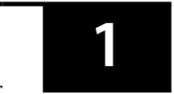
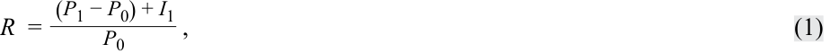
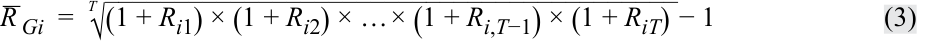
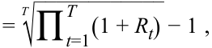
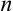
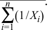
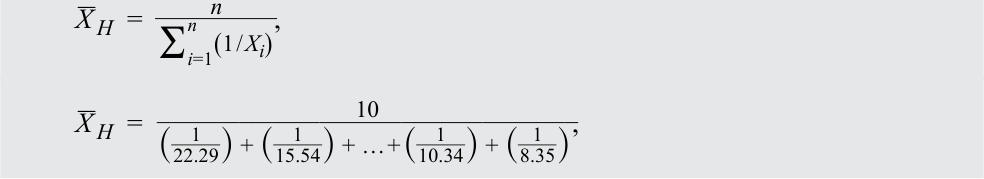

# Volume 1: Quantitative Methods
## Learning Module 1 Rates and Returns
### Part 1/3: Introduction (PDF Pages 11–26)

---

<!-- PDF Page 11 -->

#### L E A R N I N G M O D U L E 

# **<mark>1</mark>** 

### **Rates and Returns** 

**by Richard A. DeFusco, PhD, CFA, Dennis W. McLeavey, DBA, CFA, Jerald E. Pinto, PhD, CFA, David E. Runkle, PhD, CFA, and Vijay Singal, PhD, CFA.** 

_Richard A. DeFusco, PhD, CFA, is at the University of Nebraska-Lincoln (USA). Dennis W. McLeavey, DBA, CFA, is at the University of Rhode Island (USA). Jerald E. Pinto, PhD, CFA, is at CFA Institute (USA). David E. Runkle, PhD, CFA, is at Jacobs Levy Equity Management (USA). Vijay Singal, PhD, CFA, is at Virginia Tech (USA)._ 

###### **<mark>LEARNING OUTCOMES</mark>** 

- **_Mastery The candidate should be able to:_** interpret interest rates as required rates of return, discount rates, or opportunity costs and explain an interest rate as the sum of a real risk-free rate and premiums that compensate investors for bearing distinct types of risk calculate and interpret different approaches to return measurement over time and describe their appropriate uses compare the money-weighted and time-weighted rates of return and evaluate the performance of portfolios based on these measures calculate and interpret annualized return measures and continuously compounded returns, and describe their appropriate uses calculate and interpret major return measures and describe their appropriate uses 

<!-- Start of picture text -->
1 <!-- End of picture text -->

##### **INTRODUCTION** 

Interest rates are a critical concept in finance. In some cases, we assume a particular interest rate and in others, the interest rate remains the unknown quantity to determine. Although the pre-reads have covered the mechanics of time value of money problems, here we first illustrate the underlying economic concepts by explaining the meaning and interpretation of interest rates and then calculate, interpret, and compare different return measures. 

<!-- PDF Page 12 -->

###### **LEARNING MODULE OVERVIEW** 

- An interest rate, _r_ , can have three interpretations: (1) a required rate of return, (2) a discount rate, or (3) an opportunity cost. An interest rate reflects the relationship between differently dated cash flows. 

- An interest rate can be viewed as the sum of the real risk-free interest rate and a set of premiums that compensate lenders for bearing distinct types of risk: an inflation premium, a default risk premium, a liquidity premium, and a maturity premium. 

- The nominal risk-free interest rate is approximated as the sum of the real risk-free interest rate and the inflation premium. 

- A financial asset’s total return consists of two components: an income yield consisting of cash dividends or interest payments, and a return reflecting the capital gain or loss resulting from changes in the price of the financial asset. 

- A holding period return, _R_ , is the return that an investor earns for a single, specified period of time (e.g., one day, one month, five years). 

- Multiperiod returns may be calculated across several holding periods using different return measures (e.g., arithmetic mean, geometric mean, harmonic mean, trimmed mean, winsorized mean). Each return computation has special applications for evaluating investments. 

- The choice of which of the various alternative measurements of mean to use for a given dataset depends on considerations such as the presence of extreme outliers, outliers that we want to include, whether there is a symmetric distribution, and compounding. 

- A money-weighted return reflects the actual return earned on an investment after accounting for the value and timing of cash flows relating to the investment. 

- A time-weighted return measures the compound rate of growth of one unit of currency invested in a portfolio during a stated measurement period. Unlike a money-weighted return, a time-weighted return is not sensitive to the timing and amount of cashflows and is the preferred performance measure for evaluating portfolio managers because cash withdrawals or additions to the portfolio are generally outside of the control of the portfolio manager. 

- Interest may be paid or received more frequently than annually. The periodic interest rate and the corresponding number of compounding periods (e.g., quarterly, monthly, daily) should be adjusted to compute present and future values. 

- Annualizing periodic returns allows investors to compare different investments across different holding periods to better evaluate and compare their relative performance. With the number of compounding periods per year approaching infinity, the interest is compound continuously. 

- Gross return, return prior to deduction of managerial and administrative expenses (those expenses not directly related to return generation), is an appropriate measure to evaluate the comparative performance of an asset manager. 

<!-- PDF Page 13 -->

- Net return, which is equal to the gross return less managerial and administrative expenses, is a better return measure of what an investor actually earned. 

- The after-tax nominal return is computed as the total return minus any allowance for taxes on dividends, interest, and realized gains. 

- Real returns are particularly useful in comparing returns across time periods because inflation rates may vary over time and are particularly useful for comparing investments across time periods and performance between different asset classes with different taxation. 

- Leveraging a portfolio, via borrowing or futures, can amplify the portfolio’s gains or losses. 

##### **INTEREST RATES AND TIME VALUE OF MONEY** 

## **<mark>2</mark>** 

interpret interest rates as required rates of return, discount rates, or opportunity costs and explain an interest rate as the sum of a real risk-free rate and premiums that compensate investors for bearing distinct types of risk 

The time value of money establishes the equivalence between cash flows occurring on different dates. As cash received today is preferred to cash promised in the future, we must establish a consistent basis for this trade-off to compare financial instruments in cases in which cash is paid or received at different times. An **interest rate** (or yield), denoted _r_ , is a rate of return that reflects the relationship between differently dated – timed – cash flows. If USD 9,500 today and USD 10,000 in one year are equivalent in value, then USD 10,000 – USD 9,500 = USD 500 is the required compensation for receiving USD 10,000 in one year rather than now. The interest rate (i.e., the required compensation stated as a rate of return) is USD 500/USD 9,500 = 0.0526 or 5.26 percent. 

Interest rates can be thought of in three ways: 

- First, they can be considered _required rates of return_ —that is, the minimum rate of return an investor must receive to accept an investment. 

- Second, interest rates can be considered _discount rates_ . In the previous example, 5.26 percent is the discount rate at which USD 10,000 in one year is equivalent to USD 9,500 today. Thus, we use the terms “interest rate” and “discount rate” almost interchangeably. 

- Third, interest rates can be considered _opportunity costs_ . An **opportunity cost** is the value that investors forgo by choosing a course of action. In the example, if the party who supplied USD 9,500 had instead decided to spend it today, he would have forgone earning 5.26 percent by consuming rather than saving. So, we can view 5.26 percent as the opportunity cost of current consumption. 

<!-- PDF Page 14 -->

###### **Determinants of Interest Rates** 

Economics tells us that interest rates are set by the forces of supply and demand, where investors supply funds and borrowers demand their use. Taking the perspective of investors in analyzing market-determined interest rates, we can view an interest rate _r_ as being composed of a real risk-free interest rate plus a set of premiums that are required returns or compensation for bearing distinct types of risk: 

- _r_ = Real risk-free interest rate + Inflation premium + Default risk premium + Liquidity premium + Maturity premium. (1) 

- The **real risk-free interest rate** is the single-period interest rate for a completely risk-free security if no inflation were expected. In economic theory, the real risk-free rate reflects the time preferences of individuals for current versus future real consumption. 

- The **inflation premium** compensates investors for expected inflation and reflects the average inflation rate expected over the maturity of the debt. Inflation reduces the purchasing power of a unit of currency—the amount of goods and services one can buy with it. 

- The **default risk premium** compensates investors for the possibility that the borrower will fail to make a promised payment at the contracted time and in the contracted amount. 

- The **liquidity premium** compensates investors for the risk of loss relative to an investment’s fair value if the investment needs to be converted to cash quickly. US Treasury bills (T-bills), for example, do not bear a liquidity premium because large amounts of them can be bought and sold without affecting their market price. Many bonds of small issuers, by contrast, trade infrequently after they are issued; the interest rate on such bonds includes a liquidity premium reflecting the relatively high costs (including the impact on price) of selling a position. 

- The **maturity premium** compensates investors for the increased sensitivity of the market value of debt to a change in market interest rates as maturity is extended, in general (holding all else equal). The difference between the interest rate on longer-maturity, liquid Treasury debt and that on short-term Treasury debt typically reflects a positive maturity premium for the longer-term debt (and possibly different inflation premiums as well). 

The sum of the real risk-free interest rate and the inflation premium is the nominal risk-free interest rate: 

The nominal risk-free interest rate reflects the combination of a real risk-free rate plus an inflation premium: 

(1 + nominal risk-free rate) = (1 + real risk-free rate)(1 + inflation premium). 

In practice, however, the nominal rate is often approximated as the sum of the real risk-free rate plus an inflation premium: 

Nominal risk-free rate = Real risk-free rate + inflation premium. 

Many countries have short-term government debt whose interest rate can be considered to represent the nominal risk-free interest rate over that time horizon in that country. The French government issues BTFs, or negotiable fixed-rate discount Treasury bills (Bons du Trésor à taux fixe et à intérêts précomptés), with maturities of up to one year. The Japanese government issues a short-term Treasury bill with maturities of 6 and 12 months. The interest rate on a 90-day US T-bill, for example, represents the nominal risk-free interest rate for the United States over the next three 

<!-- PDF Page 15 -->

months. Typically, interest rates are quoted in annual terms, so the interest rate on a 90-day government debt security quoted at 3 percent is the annualized rate and not the actual interest rate earned over the 90-day period. 

Whether the interest rate we use is a required rate of return, or a discount rate, or an opportunity cost, the rate encompasses the real risk-free rate and a set of risk premia that depend on the characteristics of the cash flows. The foundational set of premia consist of inflation, default risk, liquidity risk, and maturity risk. All these premia vary over time and continuously change, as does the real risk-free rate. Consequently, all interest rates fluctuate, but how much they change depends on various economic fundamentals—and on the expectation of how these various economic fundamentals can change in the future. 

###### **EXAMPLE 1** 

###### **Determining Interest Rates** 

Exhibit 1 presents selected information for five debt securities. All five investments promise only a single payment at maturity. Assume that premiums relating to inflation, liquidity, and default risk are constant across all time horizons. 

**Exhibit 1: Investments Alternatives and Their Characteristics** 

|**Investment**|**Maturity** **(in years)**|**Liquidity**|**Default Risk** **I**|**nterest Rate** **(%)**|
|---|---|---|---|---|
|1|2|High|Low|2.0|
|2|2|Low|Low|2.5|
|3|7|Low|Low|r3|
|4|8|High|Low|4.0|
|5|8|Low|High|6.5|

Based on the information in Exhibit 1, address the following: 

1. Explain the difference between the interest rates offered by Investment 1 and Investment 2. 

###### **Solution:** 

Investment 2 is identical to Investment 1 except that Investment 2 has low liquidity. The difference between the interest rate on Investment 2 and Investment 1 is 0.5 percent. This difference in the two interest rates represents a liquidity premium, which represents compensation for the lower liquidity of Investment 2 (the risk of loss relative to an investment’s fair value if the investment needs to be converted to cash quickly). 

2. Estimate the default risk premium affecting all securities. 

###### **Solution:** 

To estimate the default risk premium, identify two investments that have the same maturity but different levels of default risk. Investments 4 and 5 both have a maturity of eight years but different levels of default risk. Investment 5, however, has low liquidity and thus bears a liquidity premium relative to Investment 4. From Part A, we know the liquidity premium is 0.5 percent. The difference between the interest rates offered by Investments 5 and 4 is 2.5 percent (6.5% − 4.0%), of which 0.5 percent is a liquidity premium. This 

<!-- PDF Page 16 -->

implies that 2.0 percent (2.5% − 0.5%) must represent a default risk premium reflecting Investment 5’s relatively higher default risk. 

3. Calculate upper and lower limits for the unknown interest rate for Investment 3, _r_ 3. 

###### **Solution:** 

Investment 3 has liquidity risk and default risk comparable to Investment 2, but with its longer time to maturity, Investment 3 should have a higher maturity premium and offer a higher interest rate than Investment 2. Therefore, the interest rate on Investment 3, _r_ 3, should thus be above 2.5 percent (the interest rate on Investment 2). 

If the liquidity of Investment 3 was high, Investment 3 would match Investment 4 except for Investment 3’s shorter maturity. We would then conclude that Investment 3’s interest rate should be less than the interest rate offered by Investment 4, which is 4 percent. In contrast to Investment 4, however, Investment 3 has low liquidity. It is possible that the interest rate on Investment 3 exceeds that of Investment 4 despite Investment 3’s shorter maturity, depending on the relative size of the liquidity and maturity premiums. However, we would expect _r_ 3 to be less than 4.5 percent, the expected interest rate on Investment 4 if it had low liquidity (4% + 0.5%, the liquidity premium). Thus, we should expect in the interest rate offered by Investment 3 to be between 2.5 percent and 4.5 percent. 

## **<mark>3</mark>** 

##### **RATES OF RETURN** 

calculate and interpret different approaches to return measurement over time and describe their appropriate uses 

Financial assets are frequently defined in terms of their return and risk characteristics. Comparison along these two dimensions simplifies the process of building a portfolio from among all available assets. In this lesson, we will compute, evaluate, and compare various measures of return. 

Financial assets normally generate two types of return for investors. First, they may provide periodic income through cash dividends or interest payments. Second, the price of a financial asset can increase or decrease, leading to a capital gain or loss. 

Some financial assets provide return through only one of these mechanisms. For example, investors in non-dividend-paying stocks obtain their return from price movement only. Other assets only generate periodic income. For example, defined benefit pension plans and retirement annuities make income payments over the life of a beneficiary. 

###### **Holding Period Return** 

Returns can be measured over a single period or over multiple periods. Single-period returns are straightforward because there is only one way to calculate them. Multiple-period returns, however, can be calculated in various ways and it is important to be aware of these differences to avoid confusion. 

<!-- PDF Page 17 -->

A **holding period return** , R, is the return earned from holding an asset for a single specified period of time. The period may be one day, one week, one month, five years, or any specified period. If the asset (e.g., bond, stock) is purchased today, time ( _t_ = 0), at a price of 100 and sold later, say at time ( _t_ = 1), at a price of 105 with no dividends or other income, then the holding period return is 5 percent [(105 − 100)/100)]. If the asset also pays income of two units at time ( _t_ = 1), then the total return is 7 percent. This return can be generalized and shown as a mathematical expression in which _P_ is the price and _I_ is the income, as follows: 

<!-- Formula Text: R  = (P 1 − P 0) + I 1 _ P 0 , (1) -->

where the subscript indicates the time of the price or income; ( _t_ = 0) is the beginning of the period; and ( _t_ = 1) is the end of the period. The following two observations are important. 

- We computed a capital gain of 5 percent and an income yield of 2 percent in this example. For ease of illustration, we assumed that the income is paid at time _t_ = 1. If the income was received before _t_ = 1, our holding period return may have been higher if we had reinvested the income for the remainder of the period. 

- Return can be expressed in decimals (0.07), fractions (7/100), or as a percent (7 percent). They are all equivalent. 

A holding period return can be computed for a period longer than one year. For example, an analyst may need to compute a three-year holding period return from three annual returns. In that case, the three-year holding period return is computed by compounding the three annual returns: 

R = [(1 + R1) × (1 + R2) × (1 + R3)] − 1, 

where _R_ 1, _R_ 2, and _R_ 3 are the three annual returns. 

###### **Arithmetic or Mean Return** 

Most holding period returns are reported as daily, monthly, or annual returns. When assets have returns for multiple holding periods, it is necessary to normalize returns to a common period for ease of comparison and understanding. There are different methods for aggregating returns across several holding periods. The remainder of this section presents various ways of computing average returns and discusses their applicability. 

The simplest way to compute a summary measure for returns across multiple periods is to take a simple arithmetic average of the holding period returns. Thus, three annual returns of −50 percent, 35 percent, and 27 percent will give us an average of 4 percent per year =  (________________− 50 %  + 35 %  + 27% 3 ). The arithmetic average return is easy to compute and has known statistical properties. 

In general, the arithmetic or mean return is denoted by _R__ _i_ and given by the following equation for asset _i_ , where _Rit_ is the return in period _t_ and _T_ is the total number of periods: 

<!-- Formula Text: _ R  i  = R i1 + R i2 + … + R i,T−1 + R iT ____________________ T =   1 _ T  ∑ t=1 T   R it. (2) -->

<!-- PDF Page 18 -->

###### **Geometric Mean Return** 

The arithmetic mean return assumes that the amount invested at the beginning of each period is the same. In an investment portfolio, however, even if there are no cash flows into or out of the portfolio the base amount changes each year. The previous year’s earnings must be added to the beginning value of the subsequent year’s investment— these earnings will be “compounded” by the returns earned in that subsequent year. We can use the geometric mean return to account for the compounding of returns. 

A geometric mean return provides a more accurate representation of the growth in portfolio value over a given time period than the arithmetic mean return. In general, the geometric mean return is denoted by _R__ _Gi_ and given by the following equation for asset _i_ : 

<!-- Formula Text: _ R  Gi  = T √ _________________________________________ (1 + R i1) × (1 + R i2) × … × (1 + R i,T−1) × (1 + R iT)  − 1 (3) -->

<!-- Formula Text: = T √ ____________ ∏ t=1 T   (1 + R t)  − 1 , -->

where _Rit_ is the return in period _t_ and _T_ is the total number of periods. 

In the example in the previous section, we calculated the arithmetic mean to be 4.00 percent. Using Equation 3, we can calculate the geometric mean return from the same three annual returns: 

_R_  Gi_ =  3√_____________________________(1 − 0.50) ×  (1 + 0.35) ×  (1 + 0.27) − 1 =   − 0.0500 . Exhibit 2 shows the actual return for each year and the balance at the end of each year using actual returns. 

**Exhibit 2: Portfolio Value and Performance** 

||**Actual Return** **for the Year** **(%)**|**Year-End** **Amount**|**Year-End Amount** **Using Arithmetic** **Return of 4%**|**Year-End Amount** **Using Geometric** **Return of −5%**|
|---|---|---|---|---|
|Year 0||EUR1.0000|EUR1.0000|EUR1.0000|
|Year 1|−50|0.5000|1.0400|0.9500|
|Year 2|35|0.6750|1.0816|0.9025|
|Year 3|27|0.8573|1.1249|0.8574|

Beginning with an initial investment of EUR1.0000, we will have a balance of EUR0.8574 at the end of the three-year period as shown in the fourth column of Exhibit 2. Note that we compounded the returns because, unless otherwise stated, we earn a return on the balance as of the end of the prior year. That is, we will receive a return of 35 percent in the second year on the balance at the end of the first year, which is only EUR0.5000, not the initial balance of EUR1.0000. Let us compare the balance at the end of the three-year period computed using geometric returns with the balance we would calculate using the 4 percent annual arithmetic mean return from our earlier example. The ending value using the arithmetic mean return is EUR1.1249 (=1.0000 × 1.043 ). This is much larger than the actual balance at the end of Year 3 of EUR0.8573. 

In general, the arithmetic return is biased upward unless each of the underlying holding period returns are equal. The bias in arithmetic mean returns is particularly severe if holding period returns are a mix of both positive and negative returns, as in this example. 

We will now look at three examples that calculate holding period returns over different time horizons. 

<!-- PDF Page 19 -->

###### **EXAMPLE 2** 

###### **Holding Period Return** 

1. An investor purchased 100 shares of a stock for USD34.50 per share at the beginning of the quarter. If the investor sold all of the shares for USD30.50 per share after receiving a USD51.55 dividend payment at the end of the quarter, the investor’s holding period return is _closest_ to: 

   - **A.** −13.0 percent. 

   - **B.** −11.6 percent. 

   - **C.** −10.1 percent. 

###### **Solution:** 

C is correct. Applying Equation 2, the holding period return is −10.1 percent, calculated as follows: 

_R_ = (3,050 − 3,450 + 51.55)/3,450 = −10.1%. 

The holding period return comprised of a dividend yield of 1.49 percent (= 51.55/3,450) and a capital loss of −11.59 percent (= −400/3,450). 

###### **EXAMPLE 3** 

###### **Holding Period Return** 

1. An analyst obtains the following annual rates of return for a mutual fund, which are presented in Exhibit 3. 

###### **Exhibit 3: Mutual Fund Performance, 20X8–20X0** 

|**Year** **Return (%)**|
|---|
|20X8 14|
|20X9 −10|
|20X0 −2|

The fund’s holding period return over the three-year period is _closest_ to: 

- **A.** 0.18 percent. 

- **B.** 0.55 percent. 

- **C.** 0.67 percent. 

###### **Solution:** 

B is correct. The fund’s three-year holding period return is 0.55 percent, calculated as follows: 

_R = [(1 + R1) × (1 + R2) × (1 + R3)] − 1_ , 

_R_ = [(1 + 0.14)(1 − 0.10)(1 − 0.02)] − 1 = 0.0055 = 0.55%. 

<!-- PDF Page 20 -->

###### **EXAMPLE 4** 

###### **Geometric Mean Return** 

1. An analyst observes the following annual rates of return for a hedge fund, which are presented in Exhibit 4. 

**Exhibit 4: Hedge Fund Performance, 20X8–20X0** 

|**Year** **Return (%)**|
|---|
|20X8 22|
|20X9 −25|
|20X0 11|

The fund’s geometric mean return over the three-year period is _closest_ to: 

- **A.** 0.52 percent. 

- **B.** 1.02 percent. 

**C.** 2.67 percent. 

**Solution:** 

A is correct. Applying Equation 4, the fund’s geometric mean return over the three-year period is 0.52 percent, calculated as follows: 

- _R_  G_ = [(1 + 0.22)(1 − 0.25)(1 + 0.11)](1/3) − 1 = 1.0157(1/3) − 1 = 0.0052 = 0.52%. 

###### **EXAMPLE 5** 

###### **Geometric and Arithmetic Mean Returns** 

1. Consider the annual return data for the group of countries in Exhibit 5. 

**Exhibit 5: Annual Returns for Years 1 to 3 for Selected Countries’ Stock Indexes** 

||**52-W**|**eek Retur**|**n (%)**|**Average 3-**|**Year Return**|
|---|---|---|---|---|---|
|**Index**|**Year 1**|**Year 2**|**Year 3**|**Arithmetic**|**Geometric**|
|Country A|−15.6|−5.4|6.1|−4.97|−5.38|
|Country B|7.8|6.3|−1.5|4.20|4.12|
|Country C|5.3|1.2|3.5|3.33|3.32|
|Country D|−2.4|−3.1|6.2|0.23|0.15|
|Country E|−4.0|−3.0|3.0|−1.33|−1.38|
|Country F|5.4|5.2|−1.0|3.20|3.16|
|Country G|12.7|6.7|−1.2|6.07|5.91|
|Country H|3.5|4.3|3.4|3.73|3.73|
|Country I|6.2|7.8|3.2|5.73|5.72|

<!-- PDF Page 21 -->

||**52-W**|**eek Retur**|**n (%)**|**Average 3-**|**Year Return**|
|---|---|---|---|---|---|
|**Index**|**Year 1**|**Year 2**|**Year 3**|**Arithmetic**|**Geometric**|
|Country J|8.1|4.1|−0.9|3.77|3.70|
|Country K|11.5|3.4|1.2|5.37|5.28|

Calculate the arithmetic and geometric mean returns over the three years for the following three stock indexes: Country D, Country E, and Country F. **Solution:** 

The arithmetic mean returns are as follows: 

||**An**|**nual Retur**|**n (%)**|**Sum** **3**|**Arithmetic**|
|---|---|---|---|---|---|
||**Year 1**|**Year 2**|**Year 3**|∑ _i_**=1**   _R_ _i_|**Mean Return** **(%)**|
|Country D|−2.4|−3.1|6.2|0.7|0.233|
|Country E|−4.0|−3.0|3.0|−4.0|−1.333|
|CountryF|5.4|5.2|−1.0|9.6|3.200|

The geometric mean returns are as follows: 

||**1 + R** **Year 1**|**eturn in Decimal** **(1 + Rt)** **Year 2**|**Form** **Year 3**|**Product**  ∏ _t_ _T_  (**1 +**_R_ _t_ )|**3rd Root**  [ ∏ _t_ _T_  (**1 +**_R_ _t_ ) ]  **1****⁄3**|**Geometric mean** **return (%)**|
|---|---|---|---|---|---|---|
|Country D|0.976|0.969|1.062|1.00438|1.00146|0.146|
|Country E|0.960|0.970|1.030|0.95914|0.98619|−1.381|
|CountryF|1.054|1.052|0.990|1.09772|1.03157|3.157|

In Example 5, the geometric mean return is less than the arithmetic mean return for each country’s index returns. In fact, the geometric mean is always less than or equal to the arithmetic mean with one exception: the two means will be equal is when there is no variability in the observations—that is, when all the observations in the series are the same. 

In general, the difference between the arithmetic and geometric means increases with the variability within the sample; the more disperse the observations, the greater the difference between the arithmetic and geometric means. Casual inspection of the returns in Exhibit 5 and the associated graph of means in Exhibit 6 suggests a greater variability for Country A’s index relative to the other indexes, and this is confirmed with the greater deviation of the geometric mean return (−5.38 percent) from the arithmetic mean return (−4.97 percent). How should the analyst interpret these results? 

<!-- PDF Page 22 -->

**Exhibit 6: Arithmetic and Geometric Mean Returns for Country Stock Indexes, Years 1 to 3** 

<!-- Start of picture text -->
Country A B C D E F G H I J K 6 –4 –2 0 2 4 6 8 Mean Return (%) Geometric Mean Arithmetic Average <!-- End of picture text -->

The geometric mean return represents the growth rate or compound rate of return on an investment. One unit of currency invested in a fund tracking the Country B index at the beginning of Year 1 would have grown to (1.078)(1.063)(0.985) = 1.128725 units of currency, which is equal to 1 plus Country B’s geometric mean return of 4.1189 percent compounded over three periods: [1 + 0.041189]3 = 1.128725. This math confirms that the geometric mean is the compound rate of return. With its focus on the actual return of an investment over a multiple-period horizon, the geometric mean is of key interest to investors. The arithmetic mean return, focusing on average single-period performance, is also of interest. Both arithmetic and geometric means have a role to play in investment management, and both are often reported for return series. 

For reporting historical returns, the geometric mean has considerable appeal because it is the rate of growth or return we would have to earn each year to match the actual, cumulative investment performance. Suppose we purchased a stock for EUR100 and two years later it was worth EUR100, with an intervening year at EUR200. The geometric mean of 0 percent is clearly the compound rate of growth during the two years, which we can confirm by compounding the returns: [(1 + 1.00)(1 − 0.50)]1/2 − 1 = 0%. Specifically, the ending amount is the beginning amount times (1 + _RG_ )2 . 

However, the arithmetic mean, which is [100% + −50%]/2 = 25% in the previous example, can distort our assessment of historical performance. As we noted, the arithmetic mean is always greater than or equal to the geometric mean. If we want to estimate the average return over a one-period horizon, we should use the arithmetic mean because the arithmetic mean is the average of one-period returns. If we want to estimate the average returns over more than one period, however, we should use the geometric mean of returns because the geometric mean captures how the total returns are linked over time. 

###### **The Harmonic Mean** 

The **harmonic mean** , _X__ _H_ , is another measure of central tendency. The harmonic mean is appropriate in cases in which the variable is a rate or a ratio. The terminology “harmonic” arises from its use of a type of series involving reciprocals known as a harmonic series. 

<!-- PDF Page 23 -->

**Harmonic Mean Formula.** The harmonic mean of a set of observations _X_ 1, _X_ 2, …, Xn is: 

<!-- Formula Text: _ X  H  = n _ ∑ i=1 n (1 / X i) , (4) -->

with Xi > 0 for _i_ = 1, 2, …, _n_ . 

The harmonic mean is the value obtained by summing the reciprocals of the observations, 

<!-- Formula Text: ∑ i=1 n (1 / X i), -->

the terms of the form 1/Xi, and then averaging their sum by dividing it by the number of observations, _n_ , and, then finally, taking the reciprocal of that average, 

<!-- Formula Text: n -->

<!-- Formula Text: _ ∑ i=1 n (1 / X i) . -->

The harmonic mean may be viewed as a special type of weighted mean in which an observation’s weight is inversely proportional to its magnitude. For example, if there is a sample of observations of 1, 2, 3, 4, 5, 6, and 1,000, the harmonic mean is 2.8560. Compared to the arithmetic mean of 145.8571, we see the influence of the outlier (the 1,000) to be much less than in the case of the arithmetic mean. So, the harmonic mean is quite useful as a measure of central tendency in the presence of outliers. 

The harmonic mean is used most often when the data consist of rates and ratios, such as P/Es. Suppose three peer companies have P/Es of 45, 15, and 15. The arithmetic mean is 25, but the harmonic mean, which gives less weight to the P/E of 45, is 19.3. 

The harmonic mean is a relatively specialized concept of the mean that is appropriate for averaging ratios (“amount per unit”) when the ratios are repeatedly applied to a fixed quantity to yield a variable number of units. The concept is best explained through an illustration. A well-known application arises in the investment strategy known as **cost averaging** , which involves the periodic investment of a fixed amount of money. In this application, the ratios we are averaging are prices per share at different purchase dates, and we are applying those prices to a constant amount of money to yield a variable number of shares. An illustration of the harmonic mean to cost averaging is provided in Example 6. 

###### **EXAMPLE 6** 

###### **Cost Averaging and the Harmonic Mean** 

1. Suppose an investor invests EUR1,000 each month in a particular stock for _n_ = 2 months. The share prices are EUR10 and EUR15 at the two purchase dates. What was the average price paid for the security? 

###### **Solution:** 

Purchase in the first month = EUR1,000/EUR10 = 100 shares. 

Purchase in the second month = EUR1,000/EUR15 = 66.67 shares. 

The investor purchased a total of 166.67 shares for EUR2,000, so the average price paid per share is EUR2,000/166.67 = EUR12. The average price paid is in fact the harmonic mean of the asset’s prices at the purchase dates. Using Equation 5, the harmonic mean price is 2/[(1/10) + (1/15)] = EUR12. The value EUR12 is less than the arithmetic mean purchase price (EUR10 + EUR15)/2 = EUR12.5. 

<!-- PDF Page 24 -->

Because they use the same data but involve different progressions in their respective calculations, the arithmetic, geometric, and harmonic means are mathematically related to one another. We will not go into the proof of this relationship, but the basic result follows: 

Arithmetic mean × Harmonic mean = (Geometric mean)2 . 

Unless all the observations in a dataset are the same value, the harmonic mean is always less than the geometric mean, which, in turn, is always less than the arithmetic mean. 

The harmonic mean only works for non-negative numbers, so when working with returns that are expressed as positive or negative percentages, we first convert the returns into a compounding format, assuming a reinvestment, as (1 + R), as was done in the geometric mean return calculation, and then calculate (1 + harmonic mean), and subtract 1 to arrive at the harmonic mean return. 

###### **EXAMPLE 7** 

###### **Calculating the Arithmetic, Geometric, and Harmonic Means for P/Es** 

Each year in December, a securities analyst selects her 10 favorite stocks for the next year. Exhibit 7 presents the P/Es, the ratio of share price to projected earnings per share (EPS), for her top 10 stock picks for the next year. 

**Exhibit 7: Analyst’s 10 Favorite Stocks for Next Year** 

|**Stock**|**P/E**|
|---|---|
|Stock 1|22.29|
|Stock 2|15.54|
|Stock 3|9.38|
|Stock 4|15.12|
|Stock 5|10.72|
|Stock 6|14.57|
|Stock 7|7.20|
|Stock 8|7.97|
|Stock 9|10.34|
|Stock 10|8.35|

1. Calculate the arithmetic mean P/E for these 10 stocks. 

###### **Solution:** 

The arithmetic mean is calculated as: 

121.48/10 = 12.1480. 

2. Calculate the harmonic mean P/E for the 10 stocks. 

###### **Solution:** 

The harmonic mean is calculated as: 

<!-- Start of picture text -->
X  _ H  =   _ n n  , ∑ i =1(1 /  Xi ) _ _______________________________10 X H  =   _ _ _ _ (22.29 1 ) +  ( 15.54 1 ) + … + ( 10.34 1 ) +  ( 8.35 1 ) , <!-- End of picture text -->

<!-- PDF Page 25 -->

- _X_  H_ = 10 / 0.9247 = 10.8142 . 

In finance, the weighted harmonic mean is used when averaging rates and other multiples, such as the P/E ratio, because the harmonic mean gives equal weight to each data point, and reduces the influence of outliers. These calculations can be performed using Excel: 

- To calculate the arithmetic mean or average return, the =AVERAGE(return1, return2, … ) function can be used. 

- To calculate the geometric mean return, the =GEOMEAN(return1, return2, … ) function can be used. 

- To calculate the harmonic mean return, the =HARMEAN(return1, return2, … ) function can be used. 

In addition to arithmetic, geometric, and harmonic means, two other types of means can be used. Both the trimmed and the winsorized means seek to minimize the impact of outliers in a dataset. Specifically, the **trimmed mean** removes a small defined percentage of the largest and smallest values from a dataset containing our observation before calculating the mean by averaging the remaining observations. 

A winsorized mean replaces the extreme observations in a dataset to limit the effect of the outliers on the calculations. The **winsorized mean** is calculated after replacing extreme values at both ends with the values of their nearest observations, and then calculating the mean by averaging the remaining observations. 

However, the key question is: Which mean to use in what circumstances? The choice of which mean to use depends on many factors, as we describe in Exhibit 8: 

- Are there outliers that we want to include? 

- Is the distribution symmetric? 

- Is there compounding? 

- Are there extreme outliers? 

<!-- PDF Page 26 -->

###### **Exhibit 8: Deciding Which Measure to Use** 

<!-- Start of picture text -->
Collect Sample Include all Yes values, Arithmetic Mean including outliers? Yes Compounding? Geometric Mean Extreme Yes Harmonic mean, Trimmed mean, outliers? Winsorized mean <!-- End of picture text -->

###### **QUESTION SET** 

A fund had the following returns over the past 10 years: 

**Exhibit 9: 10-Year Returns** 

|**Year**|**Return**|
|---|---|
|1|4.5%|
|2|6.0%|
|3|1.5%|
|4|−2.0%|
|5|0.0%|
|6|4.5%|
|7|3.5%|
|8|2.5%|
|9|5.5%|
|10|4.0%|

1. The arithmetic mean return over the 10 years is _closest_ to: 

   - **A.** 2.97 percent. **B.** 3.00 percent. 

   - **C.** 3.33 percent. 

   - **Solution:** 

B is correct. The arithmetic mean return is calculated as follows: 

