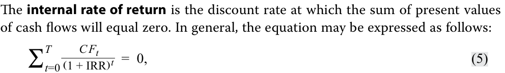
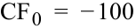
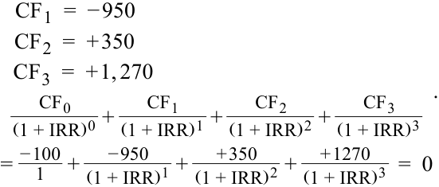
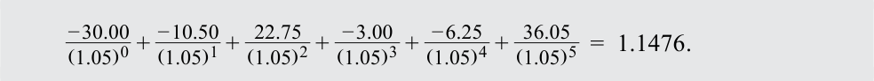
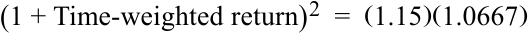
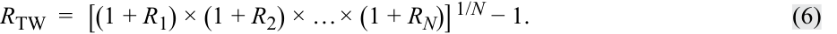
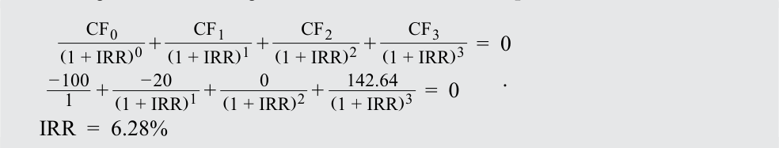
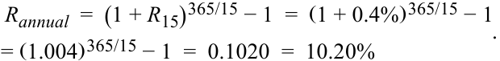
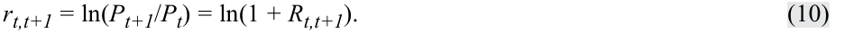
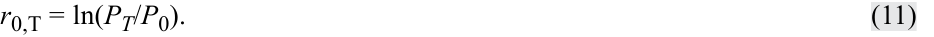

# Volume 1: Quantitative Methods
## Learning Module 1 Rates and Returns
### Part 2/3: Money-Weighted and Time-Weighted Return (PDF Pages 27–40)

---

<!-- PDF Page 27 -->

- _R_ ~~_~~ =  30.0%/10 = 3.0%. 

2. The geometric mean return over the 10 years is _closest_ to: **A.** 2.94 percent. **B.** 2.97 percent. **C.** 3.00 percent. **Solution:** 

B is correct. The geometric mean return is calculated as follows: 

_R_  G_ =  10√_____________________________________________(1 + 0.045) ×  (1 + 0.06) × … ×  (1 + 0.055) ×  (1 + 0.04) − 1 _R_  G_ =  10√_ 1.3402338 − 1 = 2.9717%. 

## **MONEY-WEIGHTED AND TIME-WEIGHTED RETURN** 

# **<mark>4</mark>** 

compare the money-weighted and time-weighted rates of return and evaluate the performance of portfolios based on these measures 

The arithmetic and geometric return computations do not account for the timing of cash flows into and out of a portfolio. For example, suppose an investor experiences the returns shown in Exhibit 2. Instead of only investing EUR1.0 at the start (Year 0) as was the case in Exhibit 2, suppose the investor had invested EUR10,000 at the start, EUR1,000 in Year 1, and EUR1,000 in Year 2. In that case, the return of –50 percent in Year 1 significantly hurts her given the relatively large investment at the start. Conversely, if she had invested only EUR100 at the start, the absolute effect of the –50 percent return on the total return is drastically reduced. 

### **Calculating the Money Weighted Return** 

The **money-weighted return** accounts for the money invested and provides the investor with information on the actual return she earns on her investment. The money-weighted return and its calculation are similar to the internal rate of return and a bond’s yield to maturity. Amounts invested are cash outflows from the investor’s perspective and amounts returned or withdrawn by the investor, or the money that remains at the end of an investment cycle, is a cash inflow for the investor. 

For example, assume that an investor invests EUR100 in a mutual fund at the beginning of the first year, adds another EUR950 at the beginning of the second year, and withdraws EUR350 at the end of the second year. The cash flows are presented in Exhibit 10. 

<!-- PDF Page 28 -->

**Exhibit 10: Portfolio Balances across Three Years** 

|**Year**|**1**|**2**|**3**|
|---|---|---|---|
|Balance from previous year|EUR0|EUR50|EUR1,000|
|New investment by the investor (cash inflow for||||
|l the mutual fund) at the start of the year|100|950|0|
|Net balance at the beginning of year|100|1,000|1,000|
|Investment return for the year|−50%|35%|27%|
|Investment gain (loss)|−50|350|270|
|Withdrawal by the investor (cash outflow for the mutual fund) at the end of the year|0|−350|0|
|Balance at the end ofyear|EUR50|EUR1,000|EUR1,270|

<!-- Formula Text: The internal rate of return is the discount rate at which the sum of present values of cash flows will equal zero. In general, the equation may be expressed as follows: ∑ t=0 T C F t _ (1 + IRR) t   =  0, (5) -->

where _T_ is the number of periods, CFt is the cash flow at time _t_ , and IRR is the internal rate of return or the money-weighted rate of return. 

A cash flow can be positive or negative; a positive cash flow is an inflow where money flows to the investor, whereas a negative cash flow is an outflow where money flows away from the investor. The cash flows are expressed as follows, where each cash inflow or outflow occurs at the end of each year. Thus, CF0 refers to the cash flow at the end of Year 0 or beginning of Year 1, and CF3 refers to the cash flow at end of Year 3 or beginning of Year 4. Because cash flows are being discounted to the present—that is, end of Year 0 or beginning of Year 1—the period of discounting CF0 is zero. 

<!-- Formula Text: CF 0  =  − 100 -->

<!-- Formula Text: CF 1  =  − 950 CF 2  =  + 350 CF 3  =  + 1, 270 CF 0 _ (1 + IRR) 0  + CF 1 _ (1 + IRR) 1  + CF 2 _ (1 + IRR) 2  + CF 3 _ (1 + IRR) 3 =  − 100 _ 1   + − 950 _ (1 + IRR) 1  + + 350 _ (1 + IRR) 2  +   + 1270 _ (1 + IRR) 3   =  0 . -->

<!-- Formula Text: IRR  =  26.11% -->

The investor’s internal rate of return, or the money-weighted rate of return, is 26.11 percent, which tells the investor what she earned on the actual euros invested for the entire period on an annualized basis. This return is much greater than the arithmetic and geometric mean returns because only a small amount was invested when the mutual fund’s return was −50 percent. 

All the above calculations can be performed using Excel using the =IRR(values) function, which results in an IRR of 26.11 percent. 

#### **_Money-Weighted Return for a Dividend-Paying Stock_** 

Next, we’ll illustrate calculating the money-weighted return for a dividend paying stock. Consider an investment that covers a two-year horizon. At time _t_ = 0, an investor buys one share at a price of USD200. At time _t_ = 1, he purchases an additional share at a price of USD225. At the end of Year 2, _t_ = 2, he sells both shares at a price of USD235. During both years, the stock pays a dividend of USD5 per share. The _t_ =1 dividend is not reinvested. Exhibit 11 outlines the total cash inflows and outflows for the investment. 

<!-- PDF Page 29 -->

**Exhibit 11: Cash Flows for a Dividend-Paying Stock** 

|**Time**|**Outflows**|
|---|---|
|0|USD200 to purchase the first share|
|1|i USD225 to purchase the second share|
|**Time**|**Inflows**|
|1|USD5 dividend received from first share (and not reinvested)|
|2|i USD10 dividend (USD5 per share × 2 shares) received|
|2|USD470 received from selling two shares at USD235 per share|

To solve for the money-weighted return, the first step is to group net cash flows by time. For this example, we have −USD200 for the _t_ = 0 net cash flow, −USD220 = − USD225 + USD5 for the _t_ = 1 net cash flow, and USD480 for the _t_ = 2 net cash flow. After entering these cash flows, we use the spreadsheet’s (such as Excel) or calculator’s IRR function to find that the money-weighted rate of return is 9.39 percent. 

CF 0 = − 200 CF 1 = − 220 CF 2 = + 480 _( 1 + IRR CF 0)0+ _( 1 + IRR CF 1)1+ _( 1 + IRR CF 2)2 . _ _− 220 _480 =− 200 1+  ( 1 + IRR)1+  ( 1 + IRR)2= 0 IRR = 9.39% 

All these calculations can be performed using Excel using the =IRR(values) function, which results in an IRR of 9.39 percent. 

Now we take a closer look at what has happened to the portfolio during each of the two years. 

In the first year, the portfolio generated a one-period holding period return of (USD5 + USD225 − USD200)/USD200 = 15%. At the beginning of the second year, the amount invested is USD450, calculated as USD225 (per share price of stock) × 2 shares, because the USD5 dividend was spent rather than reinvested. 

At the end of the second year, the proceeds from the liquidation of the portfolio are USD470 plus USD10 in dividends (as outlined in Exhibit 11). So, in the second year the portfolio produced a holding period return of (USD10 + USD470 − USD450)/ USD450 = 6.67%. The mean holding period return was (15% + 6.67%)/2 = 10.84%. 

The money-weighted rate of return, which we calculated as 9.39 percent, puts a greater weight on the second year’s relatively poor performance (6.67 percent) than the first year’s relatively good performance (15 percent), as more money was invested in the second year than in the first. That is the sense in which returns in this method of calculating performance are “money weighted.” 

Although the money-weighted return is an accurate measure of what the investor earned on the money invested, it is limited in its applicability to other situations. For example, it does not allow for a return comparison between different individuals or different investment opportunities. Importantly, two investors in the _same_ mutual fund or with the same portfolio of underlying investments may have different money-weighted returns because they invested different amounts in different years. 

<!-- PDF Page 30 -->

#### **EXAMPLE 8** 

### **Computation of Returns** 

Ulli Lohrmann and his wife, Suzanne Lohrmann, are planning for retirement and want to compare the past performance of a few mutual funds they are considering for investment. They believe that a comparison over a five-year period would be appropriate. They gather information on a fund they are considering, the Rhein Valley Superior Fund, which is presented in Exhibit 12. 

#### **Exhibit 12: Rhein Valley Superior Fund Performance** 

|**Year**|**Assets under Management** **at the Beginning of Year** **(euros)**|**Annual Return** **(%)**|
|---|---|---|
|1|30 million|15|
|2|45 million|−5|
|3|20 million|10|
|4|25 million|15|
|5|35 million|3|

The Lohrmanns are interested in aggregating this information for ease of comparison with other funds. 

**Exhibit 13: Rhein Valley Superior Fund Annual Returns and Investments (euro millions)** 

|**Year**|**1**|**2**|**3**|**4**|**5**|
|---|---|---|---|---|---|
|Balance from previous year|0|34.50|42.75|22.00|28.75|
|New investment by the investor l||||||
|(cash inflow for the Rhein fund)|30.00|10.50|0|3.00|6.25|
|Withdrawal by the investor (cash outflow for the Rhein fund)|0|0|−22.75|0|0|
|Net balance at the beginning of year|30.00|45.00|20.00|25.00|35.00|
|Investment return for the year|15%|–5%|10%|15%|3%|
|Investment gain (loss)|4.50|–2.25|2.00|3.75|1.05|
|Balance at the end ofyear|34.50|42.75|22.00|28.75|36.05|

1. Compute the fund’s holding period return for the five-year period. **Solution:** 

The five-year holding period return is calculated as: 

_R_ = (1 + R1)(1 + R2)(1 + R3)(1 + R4)(1 + R5) – 1 

_R_ = (1.15)(0.95)(1.10)(1.15)(1.03) – 1 = 

_R =_ 0.4235 = 42.35%. 

2. Compute the fund’s arithmetic mean annual return. **Solution:** 

The arithmetic mean annual return is calculated as: 

<!-- PDF Page 31 -->

<!-- Formula Text: _ R  i  =   15 %  − 5 %  + 10 %  + 15 %  + 3% ________________________ 5 =  7.60%. -->

3. Compute the fund’s geometric mean annual return. How does it compare with the arithmetic mean annual return? 

#### **Solution:** 

The geometric mean annual return can be computed as: 

- _ __________________________ R Gi_ =  5√1.15 × 0.95 × 1.10 × 1.15 × 1.03 − 1, _R_  Gi_ =  5√<mark>_</mark> 1.4235 − 1 = 0.0732 = 7.32% . 

Thus, the geometric mean annual return is 7.32 percent, which is slightly less than the arithmetic mean return of 7.60 percent. 

4. The Lohrmanns want to earn a minimum annual return of 5 percent. The annual returns and investment amounts are presented in Exhibit 13. Is the money-weighted annual return greater than 5 percent? 

#### **Solution:** 

To calculate the money-weighted rate of return, tabulate the annual returns and investment amounts to determine the cash flows, as shown in Exhibit 13: 

CF0 = –30.00, CF1 = –10.50, CF2 = +22.75, CF3 = –3.00, CF4 = –6.25, CF5 = +36.05. 

We can use the given 5 percent return to see whether or not the present value of the net cash flows is positive. If it is positive, then the money-weighted rate of return is greater than 5 percent, because a 5 percent discount rate could not reduce the present value to zero. 

<!-- Formula Text: − 30.00 _ (1.05) 0  +  − 10.50 _ (1.05) 1  +  22.75 _ (1.05) 2  +  − 3.00 _ (1.05) 3  +  − 6.25 _ (1.05) 4  +  36.05 _ (1.05) 5   =  1.1476. -->

Because the value is positive, the money-weighted rate of return is greater than 5 percent. The exact money-weighted rate of return (found by setting the above equation equal to zero) is 5.86 percent. These calculations can be performed using Excel using the =IRR(cash flows) function, which results in an IRR of 5.86 percent. 

#### **_Time-Weighted Returns_** 

An investment measure that is not sensitive to the additions and withdrawals of funds is the time-weighted rate of return. The **time-weighted rate of return** measures the compound rate of growth of USD1 initially invested in the portfolio over a stated measurement period. For the evaluation of portfolios of publicly traded securities, the time-weighted rate of return is the preferred performance measure as it neutralizes the effect of cash withdrawals or additions to the portfolio, which are generally outside of the control of the portfolio manager. 

<!-- PDF Page 32 -->

#### **Computing Time-Weighted Returns** 

To compute an exact time-weighted rate of return on a portfolio, take the following three steps: 

**1.** Price the portfolio immediately prior to any significant addition or withdrawal of funds. Break the overall evaluation period into subperiods based on the dates of cash inflows and outflows. 

**2.** Calculate the holding period return on the portfolio for each subperiod. 

**3.** Link or compound holding period returns to obtain an annual rate of return for the year (the time-weighted rate of return for the year). If the investment is for more than one year, take the geometric mean of the annual returns to obtain the time-weighted rate of return over that measurement period. 

Let us return to our dividend stock money-weighted example in the section, “Money-Weighted Return for a Dividend-Paying Stock” and calculate the time-weighted rate of return for that investor’s portfolio based on the information included in Exhibit 11. In that example, we computed the holding period returns on the portfolio, Step 2 in the procedure for finding the time-weighted rate of return. Given that the portfolio earned returns of 15 percent during the first year and 6.67 percent during the second year, what is the portfolio’s time-weighted rate of return over an evaluation period of two years? 

We find this time-weighted return by taking the geometric mean of the two holding period returns, Step 3 in the previous procedure. The calculation of the geometric mean exactly mirrors the calculation of a compound growth rate. Here, we take the product of 1 plus the holding period return for each period to find the terminal value at _t_ = 2 of USD1 invested at _t_ = 0. We then take the square root of this product and subtract 1 to get the geometric mean return. We interpret the result as the annual compound growth rate of USD1 invested in the portfolio at _t_ = 0. Thus, we have: 

<!-- Formula Text: (1 + Time-weighted return) 2  =  (1.15)(1.0667) -->

<!-- Formula Text: Time-weighted return  =  √ ____________ (1.15)(1.0667)  − 1  =  10.76%. -->

The time-weighted return on the portfolio was 10.76 percent, compared with the money-weighted return of 9.39 percent, which gave larger weight to the second year’s return. We can see why investment managers find time-weighted returns more meaningful. If a client gives an investment manager more funds to invest at an unfavorable time, the manager’s money-weighted rate of return will tend to be depressed. If a client adds funds at a favorable time, the money-weighted return will tend to be elevated. The time-weighted rate of return removes these effects. 

In defining the steps to calculate an exact time-weighted rate of return, we said that the portfolio should be valued immediately prior to any significant addition or withdrawal of funds. With the amount of cash flow activity in many portfolios, this task can be costly. We can often obtain a reasonable approximation of the time-weighted rate of return by valuing the portfolio at frequent, regular intervals, particularly if additions and withdrawals are unrelated to market movements. 

The more frequent the valuation, the more accurate the approximation. Daily valuation is commonplace. Suppose that a portfolio is valued daily over the course of a year. To compute the time-weighted return for the year, we first compute each day’s holding period return. We compute 365 such daily returns, denoted _R_ 1, _R_ 2, …, _R_ 365. We obtain the annual return for the year by linking the daily holding period returns in the following way: (1 + _R_ 1) × (1 + _R_ 2) × … × (1 + _R_ 365) − 1. If withdrawals and additions to the portfolio happen only at day’s end, this annual return is a precise time-weighted rate of return for the year. Otherwise, it is an approximate time-weighted return for the year. 

<!-- PDF Page 33 -->

If we have several years of data, we can calculate a time-weighted return for each year individually, as above. If _Ri_ is the time-weighted return for year _i_ , we calculate an annualized time-weighted return as the geometric mean of _N_ annual returns, as follows: 

<!-- Formula Text: R TW  =  [(1 + R 1) × (1 + R 2) × … × (1 + R N)] 1/N − 1. (6) -->

Example 9 illustrates the calculation of the time-weighted rate of return. 

#### **EXAMPLE 9** 

### **Time-Weighted Rate of Return** 

Strubeck Corporation sponsors a pension plan for its employees. It manages part of the equity portfolio in-house and delegates management of the balance to Super Trust Company. As chief investment officer of Strubeck, you want to review the performance of the in-house and Super Trust portfolios over the last four quarters. You have arranged for outflows and inflows to the portfolios to be made at the very beginning of the quarter. Exhibit 14 summarizes the inflows and outflows as well as the two portfolios’ valuations. In Exhibit 11, the ending value is the portfolio’s value just prior to the cash inflow or outflow at the beginning of the quarter. The amount invested is the amount each portfolio manager is responsible for investing. 

**Exhibit 14: Cash Flows for the In-House Strubeck Account and the Super Trust Account (US dollars)** 

|||**Qua**|**rter**||
|---|---|---|---|---|
||**1**|**2**|**3**|**4**|
|**Panel A: In-House Account**|||||
|Beginning value|4,000,000|6,000,000|5,775,000|6,720,000|
|Beginning of period inflow l|||||
|l (outflow)|1,000,000|(500,000)|225,000|(600,000)|
|Amount invested|5,000,000|5,500,000|6,000,000|6,120,000|
|Endingvalue|6,000,000|5,775,000|6,720,000|5,508,000|
|**Panel B: Super Trust Accoun**|**t**||||
|Beginning value|10,000,000|13,200,000|12,240,000|5,659,200|
|Beginning of period inflow (outflow)|2,000,000|(1,200,000)|(7,000,000)|(400,000)|
|l Amount invested|12,000,000|12,000,000|5,240,000|5,259,200|
|Endingvalue|13,200,000|12,240,000|5,659,200|5,469,568|

1. Calculate the time-weighted rate of return for the in-house account. 

#### **Solution:** 

To calculate the time-weighted rate of return for the in-house account, we compute the quarterly holding period returns for the account and link them into an annual return. The in-house account’s time-weighted rate of return is 27.01 percent, calculated as follows: 

<!-- PDF Page 34 -->

1Q HPR: _r_ 1 =  (USD6,000,000 − USD5,000,000)  / USD5,000,000 = 0.20 2Q HPR: _r_ 2 =  (USD5,775,000 − USD5,500,000)  / USD5,500,000 = 0.05 3Q HPR: _r_ 3 =  (USD6,720,000 − USD6,000,000)  / USD6,000,000 = 0.12 4Q HPR: _r_ 4 =  (USD5,508,000 − USD6,120,000)  / USD6,120,000 = − 0.10 

_R_ TW =  (1 + _r_ 1)(1 + _r_ 2)(1 + _r_ 3)(1 + _r_ 4) − 1 , 

_R_ TW =( 1.20)( 1.05)( 1.12)( 0.90) − 1 = 0.2701 or 27.01% . 

2. Calculate the time-weighted rate of return for the Super Trust account. **Solution:** 

The account managed by Super Trust has a time-weighted rate of return of 26.02 percent, calculated as follows: 

1Q HPR: _r_ 1 =  ( _USD_ 13, 200, 000 − _USD_ 12, 000, 000)  / _USD_ 12, 000, 000 = 0.10 2Q HPR: _r_ 2 =  ( _USD_ 12, 240, 000 − _USD_ 12, 000, 000)  / _USD_ 12, 000, 000 = 0.02 3Q HPR: _r_ 3 =  ( _USD_ 5, 659, 200 − _USD_ 5, 240, 000)  / _USD_ 5, 240, 000 = 0.08 4Q HPR: _r_ 4 =  ( _USD_ 5, 469, 568 − _USD_ 5, 259, 200)  / _USD_ 5, 259, 200 = 0.04 

_R_ TW =  (1 + _r_ 1)(1 + _r_ 2)(1 + _r_ 3)(1 + _r_ 4) − 1 , 

_R_ TW =( 1.10)( 1.02)( 1.08)( 1.04) − 1 = 0.2602 or 26.02% . 

The in-house portfolio’s time-weighted rate of return is higher than the Super Trust portfolio’s by 99 basis points. Note that 27.01 percent and 26.02 percent might be rounded to 27 percent and 26 percent, respectively. The impact of the rounding the performance difference (100 bp vs. 99 bp) may seem as trivial, yet it’s impact on a large portfolio may be substantive. 

Having worked through this exercise, we are ready to look at a more detailed case. 

#### **EXAMPLE 10** 

### **Time-Weighted and Money-Weighted Rates of Return Side by Side** 

Your task is to compute the investment performance of the Walbright Fund for the most recent year. The facts are as follows: 

- On 1 January, the Walbright Fund had a market value of USD100 million. 

- During the period 1 January to 30 April, the stocks in the fund generated a capital gain of USD10 million. 

- On 1 May, the stocks in the fund paid a total dividend of USD2 million. All dividends were reinvested in additional shares. 

- Because the fund’s performance had been exceptional, institutions invested an additional USD20 million in Walbright on 1 May, raising assets under management to USD132 million (USD100 + USD10 + USD2 + USD20). 

- On 31 December, Walbright received total dividends of USD2.64 million. The fund’s market value on 31 December, not including the USD2.64 million in dividends, was USD140 million. 

- The fund made no other interim cash payments during the year. 

<!-- PDF Page 35 -->

1. Compute the Walbright Fund’s time-weighted rate of return. **Solution:** 

Because interim cash flows were made on 1 May, we must compute two interim total returns and then link them to obtain an annual return. Exhibit 15 lists the relevant market values on 1 January, 1 May, and 31 December, as well as the associated interim four-month (1 January to 1 May) and eightmonth (1 May to 31 December) holding period returns. 

#### **Exhibit 15: Cash Flows for the Walbright Fund** 

1 January Beginning portfolio value = USD100 million 1 May Dividends received before additional investment = USD2 million Ending portfolio value = USD110 million Four-month holding period return: _R_ =  _____________USD_2 +_USD_10 = 12% _USD_ 100 

New investment = USD20 million Beginning market value for last two-thirds of the year = USD132 million 31 December Dividends received = USD2.64 million Ending portfolio value = USD140 million Eight-month holding period return: _R_ =  ________________________USD_2.64 +_USD_140 −_USD_132 = 8.06% _USD_ 132 

Now we must geometrically link the four- and eight-month holding period returns to compute an annual return. We compute the time-weighted return as follows: 

_R_ TW = 1.12 × 1.0806 − 1 = 0.2103. 

In this instance, we compute a time-weighted rate of return of 21.03 percent for one year. The four-month and eight-month intervals combine to equal one year. (Note: Taking the square root of the product 1.12 × 1.0806 would be appropriate only if 1.12 and 1.0806 each applied to one full year.) 

2. Compute the Walbright Fund’s money-weighted rate of return. 

   - **Solution:** 

To calculate the money-weighted return, we need to find the discount rate that sets the sum of the present value of cash inflows and outflows equal to zero. The initial market value of the fund and all additions to it are treated as cash outflows. (Think of them as expenditures.) Withdrawals, receipts, and the ending market value of the fund are counted as inflows. (The ending market value is the amount investors receive on liquidating the fund.) Because interim cash flows have occurred at four-month intervals, we must solve for the four-month internal rate of return. Exhibit 15 details the cash flows and their timing. 

CF0 = –100 CF1 = –20 CF2 = 0 

<!-- PDF Page 36 -->

#### CF3 = 142.64 

CF0 refers to the initial investment of USD100 million made at the beginning of the first four-month interval on 1 January. CF1 refers to the cash flows made at end of the first four-month interval or the beginning of the second four-month interval on 1 May. Those cash flows include a cash inflow of USD2 million for the dividend received and cash outflows of USD22 million for the dividend reinvested and additional investment, respectively. The second four-month interval had no cash flow so CF2 is equal to zero. CF3 refers to the cash inflows at the end of the third four-month interval. Those cash inflows include a USD2.64 million dividend received and the fund’s terminal market value of USD140 million. 

Using a spreadsheet or IRR-enabled calculator, we use −100, −20, 0, and USD142.64 for the _t_ = 0, _t_ = 1, _t_ = 2, and _t_ = 3 net cash flows, respectively. Using either tool, we get a four-month IRR of 6.28 percent. 

<!-- Formula Text: CF 0 _ (1 + IRR) 0  + CF 1 _ (1 + IRR) 1  + CF 2 _ (1 + IRR) 2  + CF 3 _ (1 + IRR) 3   =  0 − 100 _ 1   + − 20 _ (1 + IRR) 1  + 0 _ (1 + IRR) 2  +   142.64 _ (1 + IRR) 3   =  0 IRR  =  6.28% . -->

The quick way to annualize this four-month return is to multiply it by 3. A more accurate way is to compute it on a compounded basis as: (1.0628)3 – 1 = 0.2005 or 20.05 percent. 

These calculations can also be performed using Excel using the =IRR(cash flows) function, which results in an IRR of 6.28 percent. 

3. Interpret the differences between the Fund’s time-weighted and money-weighted rates of return. 

#### **Solution:** 

In this example, the time-weighted return (21.03 percent) is greater than the money-weighted return (20.05 percent). The Walbright Fund’s performance was relatively poorer during the eight-month period, when the fund had more money invested, than the overall performance. This fact is reflected in a lower money-weighted rate of return compared with the time-weighted rate of return, as the money-weighted return is sensitive to the timing and amount of withdrawals and additions to the portfolio. 

The accurate measurement of portfolio returns is important to the process of evaluating portfolio managers. In addition to considering returns, however, analysts must also weigh risk. When we worked through Example 9, we stopped short of suggesting that in-house management was superior to Super Trust because it earned a higher time-weighted rate of return. A judgment as to whether performance was “better” or “worse” must include the risk dimension, which will be covered later in your study materials. 

# **<mark>5</mark>** 

## **ANNUALIZED RETURN** 

calculate and interpret annualized return measures and continuously compounded returns, and describe their appropriate uses 

<!-- PDF Page 37 -->

The period during which a return is earned or computed can vary and often we have to annualize a return that was calculated for a period that is shorter (or longer) than one year. You might buy a short-term treasury bill with a maturity of three months, or you might take a position in a futures contract that expires at the end of the next quarter. How can we compare these returns? 

In many cases, it is most convenient to annualize all available returns to facilitate comparison. Thus, daily, weekly, monthly, and quarterly returns are converted to annualized returns. Many formulas used for calculating certain values or prices also require all returns and periods to be expressed as annualized rates of return. For example, the most common version of the Black–Scholes option-pricing model requires annualized returns and periods to be in years. 

### **Non-annual Compounding** 

Recall that interest may be paid semiannually, quarterly, monthly, or even daily. To handle interest payments made more than once a year, we can modify the present value formula as follows. Here, _Rs_ is the quoted interest rate and equals the periodic interest rate multiplied by the number of compounding periods in each year. In general, with more than one compounding period in a year, we can express the formula for present value as follows: 

<!-- Formula Text: PV  =  FV N (1 + R s _ m ) −mN , (7) -->

where 

- _m_ = number of compounding periods per year, 

- Rs = quoted annual interest rate, and 

- _N_ = number of years. 

The formula in Equation 7 is quite similar to the simple present value formula. As we have already noted, present value and future value factors are reciprocals. Changing the frequency of compounding does not alter this result. The only difference is the use of the periodic interest rate and the corresponding number of compounding periods. The following example presents an application of monthly compounding. 

#### **EXAMPLE 11** 

### **The Present Value of a Lump Sum with Monthly Compounding** 

The manager of a Canadian pension fund knows that the fund must make a lump-sum payment of CAD5 million 10 years from today. She wants to invest an amount today in a guaranteed investment contract (GIC) so that it will grow to the required amount. The current interest rate on GICs is 6 percent a year, compounded monthly. 

1. How much should she invest today in the GIC? 

**Solution:** 

By applying Equation 7, the required present value is calculated as follow: 

<!-- PDF Page 38 -->

FV _N_ = CAD 5,000,000 _Rs_ = 6 %  = 0.06 _m_ = 12 _Rs_ / _m_ = 0.06 / 12 = 0.005 _N_ = 10 _mN_ = 12( 10) = 120 . − _mN_  Rs_ PV =  FV _N_ (1 + _m_) = C _AD_ 5,000,000( 1.005)−120 = C _AD_ 5,000,000( 0.549633) = C _AD_ 2,748,163.67 

In applying Equation 7, we use the periodic rate (in this case, the monthly rate) and the appropriate number of periods with monthly compounding (in this case, 10 years of monthly compounding, or 120 months). 

### **Annualizing Returns** 

To annualize any return for a period shorter than one year, the return for the period must be compounded by the number of periods in a year. A monthly return is compounded 12 times, a weekly return is compounded 52 times, and a quarterly return is compounded 4 times. Daily returns are normally compounded 365 times. For an uncommon number of days, we compound by the ratio of 365 to the number of days. 

If the weekly return is 0.2 percent, then the compound annual return is 10.95 percent (there are 52 weeks in a year): 

<!-- Formula Text: R annual  =  (1 + R weekly) 52 − 1  =  (1 + 0.2%) 52 − 1 = (1.002) 52 − 1  =  0.1095  =  10.95% . -->

If the return for 15 days is 0.4 percent, then the annualized return is 10.20 percent, assuming 365 days in a year: 

<!-- Formula Text: R annual  =  (1 + R 15) 365/15 − 1  =  (1 + 0.4%) 365/15 − 1 = (1.004) 365/15 − 1  =  0.1020  =  10.20% . -->

A general equation to annualize returns is given, where _c_ is the number of periods in a year. For a quarter, _c_ = 4 and for a month, _c_ = 12: 

<!-- Formula Text: R annual  =    (1  + R period) c − 1. (8) -->

How can we annualize a return when the holding period return is more than one year? For example, how do we annualize an 18-month holding period return? Because one year contains two-thirds of 18-month periods, _c_ = 2/3 in the above equation. For example, an 18-month return of 20 percent can be annualized as follows: 

<!-- Formula Text: R annual  =  (1 + R 18month) 2/3 − 1  =  (1 + 0.20) 2/3 − 1  =  0.1292  =  12.92%. -->

Similar expressions can be constructed when quarterly or weekly returns are needed for comparison instead of annual returns. In such cases, _c_ is equal to the number of holding periods in a quarter or in a week. For example, assume that you want to convert daily returns to weekly returns or annual returns to weekly returns for comparison between weekly returns. To convert daily returns to weekly returns, _c_ = 5, assume that there are five trading days in a week. However, daily return calculations can be annualized differently. For example, five can be used for trading-day-based calculations, giving approximately 250 trading days a year; seven can be used on calendar-day-based calculations. Specific methods used conform to specific business practices, market 

<!-- PDF Page 39 -->

conventions, and standards. To convert annual returns to weekly returns, _c_ = 1/52. The expressions for annual returns can then be rewritten as expressions for weekly returns as follows: 

<!-- Formula Text: R weekly  =  (1 + R daily) 5 − 1;  R weekly  =  (1 + R annual) 1/52 − 1. (9) -->

One major limitation of annualizing returns is the implicit assumption that returns can be repeated precisely, that is, money can be reinvested repeatedly while earning a similar return. This type of return is not always possible. An investor may earn a return of 5 percent during a week because the market rose sharply that week, but it is highly unlikely that he will earn a return of 5 percent every week for the next 51 weeks, resulting in an annualized return of 1,164.3 percent (= 1.0552 − 1). Therefore, it is important to annualize short-term returns with this limitation in mind. 

#### **EXAMPLE 12** 

### **Annualized Returns** 

An analyst seeks to evaluate three securities she has held in her portfolio for different periods of time. 

   - Over the past 100 days, Security A has earned a return of 6.2 percent. 

   - Security B has earned 2 percent over the past four weeks. 

   - Security C has earned a return of 5 percent over the past three months. 

1. Compare the relative performance of the three securities. **Solution:** 

To facilitate comparison, the three securities’ returns need to be annualized: 

- Annualized return for Security A: _RSA_ = (1 + 0.062)365/100 − 1 = 0.2455 = 24.55% 

- Annualized return for Security B: _RSB_ = (1 + 0.02)52/4 − 1 = 0.2936 = 29.36% 

- Annualized return for Security C: _RSC_ = (1 + 0.05)4 − 1 = 0.2155 = 21.55% 

Security B generated the highest annualized return. 

#### **EXAMPLE 13** 

### **Exchange-Traded Fund Performance** 

An investor is evaluating the returns of three recently formed exchange-traded funds. Selected return information on the exchange-traded funds (ETFs) is presented in Exhibit 16. 

<!-- PDF Page 40 -->

#### **Exhibit 16: ETF Performance Information** 

|**ETF**|**Time Since Inception**|**Return Since Inception (%)**|
|---|---|---|
|1|146 days|4.61|
|2|5 weeks|1.10|
|3|15 months|14.35|

1. Which ETF has the highest annualized rate of return? 

**A.** ETF 1 **B.** ETF 2 **C.** ETF 3 **Solution:** 

- B is correct. The annualized rate of return for the three ETFs are as follows: ETF 1 annualized return = (1.0461365/146 ) – 1 = 11.93% 

ETF 2 annualized return = (1.011052/5 ) – 1 = 12.05% 

ETF 3 annualized return = (1.143512/15 ) – 1 = 11.32% 

Despite having the lowest value for the periodic rate, ETF 2 has the highest annualized rate of return because of the reinvestment rate assumption and the compounding of the periodic rate. 

### **Continuously Compounded Returns** 

An important concept is the continuously compounded return associated with a holding period return, such as _R1_ . The **continuously compounded return** associated with a holding period return is the natural logarithm of one plus that holding period return, or equivalently, the natural logarithm of the ending price over the beginning price (the price relative). Note that here we are using _r_ to refer specifically to continuously compounded returns, but other textbooks and sources may use a different notation. 

If we observe a one-week holding period return of 0.04, the equivalent continuously compounded return, called the one-week continuously compounded return, is ln(1.04) = 0.039221; EUR1.00 invested for one week at 0.039221 continuously compounded gives EUR1.04, equivalent to a 4 percent one-week holding period return. 

The continuously compounded return from _t_ to _t_ + 1 is 

<!-- Formula Text: rt,t+1 = ln(Pt+1/Pt) = ln(1 + Rt,t+1). (10) -->

For our example, an asset purchased at time _t_ for a _P0_ of USD30 and the same asset one period later, _t + 1_ , has a value of P1 of USD34.50 has a continuously compounded return given by _r_ 0,1 = ln( _P_ 1/ _P_ 0) = ln(1 + _R_ 0,1) = ln(USD34.50/USD30) = ln(1.15) = 0.139762. 

Thus, 13.98 percent is the continuously compounded return from _t_ = 0 to _t_ = 1. The continuously compounded return is smaller than the associated holding period return. If our investment horizon extends from _t_ = 0 to _t_ = _T_ , then the continuously compounded return to _T_ is 

<!-- Formula Text: r0,T = ln(PT/P0). (11) -->

Applying the exponential function to both sides of the equation, we have exp( _r_ 0,T) = exp[ln( _PT_ / _P_ 0)] = _PT_ / _P_ 0, so 

<!-- Formula Text: PT = P0exp(r0,T). -->

