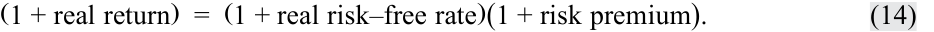
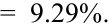
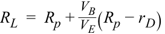

# Volume 1: Quantitative Methods
## Learning Module 1 Rates and Returns
### Part 3/3: Other Major Return Measures and Their Applications (PDF Pages 41–52)

---

<!-- PDF Page 41 -->

We can also express _PT_ / _P_ 0 as the product of price relatives: 

_PT_ / _P_ 0 = ( _PT_ / _PT−1_ )( _PT−1_ / _PT−2_ ) . . . ( _P_ 1/ _P_ 0). ~~(12)~~ 

Taking logs of both sides of this equation, we find that the continuously compounded return to time _T_ is the sum of the one-period continuously compounded returns: 

_r_ 0,T = _rT−1,T_ + _rT−2,T−1_ + . . . + _r_ 0,1. ~~(13)~~ 

Using holding period returns to find the ending value of a USD1 investment involves the multiplication of quantities (1 + holding period return). Using continuously compounded returns involves addition (as shown in Equation 13), which is a desirable property of continuously compounded returns and which we will use throughout the curriculum. 

### **OTHER MAJOR RETURN MEASURES AND THEIR APPLICATIONS** 

# **<mark>6</mark>** 

calculate and interpret major return measures and describe their appropriate uses 

The statistical measures of return discussed in the previous section are generally applicable across a wide range of assets and time periods. Special assets, however, such as mutual funds, and other considerations, such as taxes or inflation, may require more specific return measures. 

Although it is not possible to consider all types of special measures, we will discuss the effect of fees (gross versus net returns), taxes (pre-tax and after-tax returns), inflation (nominal and real returns), and the effect of **leverage** . Many investors use mutual funds or other external entities (i.e., investment vehicles) for investment. In those cases, funds charge management fees and expenses to the investors. Consequently, gross and net-of-fund-expense returns should also be considered. Of course, an investor may be interested in the net-of-expenses after-tax real return, which is in fact what an investor truly receives. We consider these additional return measures in the following sections. 

#### **Gross and Net Return** 

A gross return is the return on assets managed less any trading expenses and commissions. Gross return is intended to reflect the investment skill of the manager. Expenses including management fees, custody fees, and taxes are not included in the gross return because they may be different for different investors. For example, most asset managers provide lower management fee rates to larger accounts. Excluding these expenses in gross returns provides a basis for evaluation and comparison of investment management skill. 

Net return is a measure of what the investment vehicle (e.g., mutual fund) has earned for the investor. Net return accounts for (i.e., deducts) all managerial and administrative expenses that reduce an investor’s return. Because individual investors are most concerned about the net return (i.e., what they actually receive), small mutual funds with a limited amount of assets under management are at a disadvantage compared with the larger funds that can spread their largely fixed administrative expenses over a larger asset base. As a result, many small mutual funds waive part of the expenses to keep the funds competitive. 

<!-- PDF Page 42 -->

#### **Pre-Tax and After-Tax Nominal Return** 

All return measures discussed up to this point are pre-tax nominal returns—that is, no adjustment has been made for taxes or inflation. In general, all returns are pre-tax nominal returns unless they are otherwise designated. 

Many investors are concerned about the possible tax liability associated with their returns because taxes reduce the net return that they receive. Capital gains and income may be taxed differently, depending on the jurisdiction. Capital gains come in two forms: short-term capital gains and long-term capital gains. Long-term capital gains receive preferential tax treatment in a number of countries. Interest income is taxed as ordinary income in most countries. Dividend income may be taxed as ordinary income, may have a lower tax rate, or may be exempt from taxes depending on the country and the type of investor. The after-tax nominal return is computed as the total return minus any allowance for taxes on dividends, interest, and realized gains. Bonds issued at a discount to the par value may be taxed based on accrued gains instead of realized gains. 

Because taxes are paid on realized capital gains and income, the investment manager can minimize the tax liability by selecting appropriate securities (e.g., those subject to more favorable taxation, all other investment considerations equal) and reducing trading turnover. Therefore, taxable investors evaluate investment managers based on the after-tax nominal return. 

#### **Real Returns** 

Previously this learning module approximated the relationship between the nominal rate and the real rate by the following relationship: 

- ( 1 + nominal risk–free rate) =( 1 + real risk–free rate) (1 + inflation premium) . 

This relationship can be extended to link the relationship between nominal and real returns. Specifically, the nominal return consists of a real risk-free rate of return to compensate for postponed consumption; inflation as loss of purchasing power; and a risk premium for assuming risk. Frequently, the real risk-free return and the risk premium are combined to arrive at the real “risky” rate and is simply referred to as the real return, or: 

<!-- Formula Text: (1 + real return)  =  (1 + real risk–free rate)(1 + risk premium). (14) -->

Real returns are particularly useful in comparing returns across time periods because inflation rates may vary over time. Real returns are also useful in comparing returns among countries when returns are expressed in local currencies instead of a constant investor currency and when inflation rates vary between countries (which are usually the case). 

Finally, the after-tax real return is what the investor receives as compensation for postponing consumption and assuming risk after paying taxes on investment returns. As a result, the after-tax real return becomes a reliable benchmark for making investment decisions. Although it is a measure of an investor’s benchmark return, it is not commonly calculated by asset managers because it is difficult to estimate a general tax component applicable to all investors. For example, the tax component depends on an investor’s specific taxation rate (marginal tax rate), how long the investor holds an investment (long-term versus short-term), and the type of account the asset is held in (tax-exempt, tax-deferred, or normal). 

<!-- PDF Page 43 -->

##### **EXAMPLE 14** 

#### **Computation of Special Returns** 

Let’s return to Example 8. After reading this section, Mr. Lohrmann decided that he was not being fair to the fund manager by including the asset management fee and other expenses because the small size of the fund would put it at a competitive disadvantage. He learns that the fund spends a fixed amount of EUR500,000 every year on expenses that are unrelated to the manager’s performance. 

Mr. Lohrmann has become concerned that both taxes and inflation may reduce his return. Based on the current tax code, he expects to pay 20 percent tax on the return he earns from his investment. Historically, inflation has been around 2 percent and he expects the same rate of inflation to be maintained. 

1. Estimate the annual gross return for the first year by adding back the fixed expenses. 

##### **Solution:** 

The gross return for the first year is higher by 1.67 percent (= EUR500,000/ EUR30,000,000) than the 15 percent% investor return reported by the fund. Thus, the gross return for the first year is 16.67 percent (= 15% + 1.67%). 

2. What is the net return that investors in the Rhein Valley Superior Fund earned during the five-year period? 

##### **Solution:** 

The investor return reported by the mutual fund is the net return of the fund after accounting for all direct and indirect expenses. The net return is also the pre-tax nominal return because it has not been adjusted for taxes or inflation. From Example. 8, the net return for the five-year holding period was calculated as 42.35 percent. 

3. What is the after-tax net return for the first year that investors earned from the Rhein Valley Superior Fund? Assume that all gains are realized at the end of the year and the taxes are paid immediately at that time. 

##### **Solution:** 

The net return earned by investors during the first year was 15 percent. Applying a 20 percent tax rate, the after-tax return that accrues to investors is 12 percent [= 15% − (0.20 × 15%)]. 

4. What is the after-tax real return that investors would have earned in the fifth year? 

##### **Solution:** 

The after-tax return earned by investors in the fifth year is 2.4 percent [= 3% − (0.20 × 3%)]. Inflation reduces the return by 2 percent so the after-tax real return earned by investors in the fifth year is 0.39 percent, as shown: 

<mark>_ _</mark>(1 + 2.40%)( 1 + 2.00%) − 1 =  (( 1 + 0.02001 + 0.0240)) − 1 = 1.0039 − 1 = 0.0039 = 0.39% . 

Note that taxes are paid before adjusting for inflation. 

<!-- PDF Page 44 -->

#### **Leveraged Return** 

In the previous calculations, we have assumed that the investor’s position in an asset is equal to the total investment made by an investor using his or her own money. This section differs in that the investor creates a leveraged position. 

There are two ways of creating a claim on asset returns that are greater than the investment of one’s own money. First, an investor may trade futures contracts in which the money required to take a position may be as little as 10 percent of the notional value of the asset. In this case, the leveraged return, the return on the investor’s own money, is 10 times the actual return of the underlying security. Both the gains and losses are amplified by a factor of 10. 

Investors can also invest more than their own money by borrowing money to purchase the asset. This approach is easily done in stocks and bonds, and very common when investing in real estate. If half (50 percent) of the money invested is borrowed, then the gross return to the investor is doubled, but the interest to be paid on borrowed money must be deducted to calculate the net return. 

Using borrowed capital, debt, the size of the leveraged position increases by the additional, borrowed capital. If the total investment return earned on the leveraged portfolio, _RP_ , exceeds the borrowing cost on debt, _rD_ , taking on leverage increases the return on the portfolio. Denoting the return on a leveraged portfolio as _RL_ , then the return can be calculated as follows: 

<!-- Formula Text: R L  =   Portfolio return ___________ Portfolio equity   = [R P × (V E + V B) − (V B × r D)] _____________________ V E =  R p + V B _ V E (R p − r D), (15) -->

where _VE_ is the equity of the portfolio and _VB_ is the debt or borrowed funds. If _RP_ < rD then leverage decreases _RL_ . 

For example, for a EUR10 million equity portfolio that generates an 8 percent total investment return, _RP_ , over one year and is financed 30 percent with debt at 5 percent, then the leveraged return, _RL_ , is: 

 VB_ __________ RL_ = _Rp_ + _VE_ (_Rp_−_rD_ )= 8 %  +_EUR_ _EUR_3 million 7 million(8 %  − 5%) = 8 %  + 0.43 × 3 % 

<!-- Formula Text: =  9.29%. -->

##### **EXAMPLE 15** 

#### **Return Calculations** 

An analyst observes the following historic asset class geometric returns: 

**Exhibit 17: Asset Class Geometric Return** 

|**Asset Class**|**Geometric Return (%)**|
|---|---|
|Equities|8.0|
|Corporate Bonds|6.5|
|Treasury bills|2.5|
|Inflation|2.1|

1. The real rate of return for equities is _closest_ to: 

   - **A.** 5.4 percent. 

   - **B.** 5.8 percent. 

<!-- PDF Page 45 -->

**C.** 5.9 percent. **Solution:** 

B is correct. The real rate of return for equities is calculated as follows: 

(1 + 0.080)/(1 + 0.0210) − 1 = 5.8%. 

2. The real rate of return for corporate bonds is _closest_ to: **A.** 4.3 percent. **B.** 4.4 percent. **C.** 4.5 percent. **Solution:** 

A is correct. The real rate of return for corporate bonds is calculated as follows: 

(1 + 0.065)/(1 + 0.0210) − 1 = 4.3%. 

3. The risk premium for equities is closest to: 

**A.** 5.4 percent. **B.** 5.5 percent. 

**C.** 5.6 percent. **Solution:** 

A is correct. The risk premium for equities is calculated as follows: 

(1 + 0.080)/(1 + 0.0250) − 1 = 5.4%. 

4. The risk premium for corporate bonds is _closest_ to: 

**A.** 3.5 percent. **B.** 3.9 percent. 

**C.** 4.0 percent. **Solution:** 

B is correct. The risk premium for corporate bonds is calculated as follows: (1 + 0.0650)/(1 + 0.0250) − 1 = 3.9%. 

<!-- PDF Page 46 -->

## **~~PRACTICE PROBLEMS~~** 

**1.** The nominal risk-free rate is _best_ described as the sum of the real risk-free rate and a premium for: 

   - **A.** maturity. 

   - **B.** liquidity. 

   - **C.** expected inflation. 

**2.** Which of the following risk premiums is most relevant in explaining the difference in yields between 30-year bonds issued by the US Treasury and 30-year bonds issued by a small, private US corporate issuer? 

   - **A.** Inflation 

   - **B.** Maturity 

   - **C.** Liquidity 

**3.** Consider the following annual return for Fund Y over the past five years: 

**Exhibit 1: Five-Year Annual Returns** 

|**Year**|**Return (%)**|
|---|---|
|Year 1|19.5|
|Year 2|−1.9|
|Year 3|19.7|
|Year 4|35.0|
|Year 5|5.7|

The geometric mean return for Fund Y is _closest_ to: 

   - **A.** 14.9 percent. 

   - **B.** 15.6 percent. 

   - **C.** 19.5 percent. 

**4.** A portfolio manager invests EUR5,000 annually in a security for four years at the following prices: 

**Exhibit 1: Five-Year Purchase Prices** 

|**Year**|**Purchase Price (euros per unit)**|
|---|---|
|Year 1|62.00|
|Year 2|76.00|

<!-- PDF Page 47 -->

|**Year**|**Purchase Price (euros per unit)**|
|---|---|
|Year 3|84.00|
|Year 4|90.00|

The average price is _best_ represented as the: 

   - **A.** harmonic mean of EUR76.48. 

   - **B.** geometric mean of EUR77.26. 

   - **C.** arithmetic average of EUR78.00. 

**5.** Which of the following statements regarding arithmetic and geometric means is correct? 

   - **A.** The geometric mean will exceed the arithmetic mean for a series with non-zero variance. 

   - **B.** The geometric mean measures an investment’s compound rate of growth over multiple periods. 

   - **C.** The arithmetic mean measures an investment’s terminal value over multiple periods. 

**6.** A fund receives investments at the beginning of each year and generates returns for three years as follows: 

**Exhibit 1: Investments and Returns for Three Years** 

||**Assets under Management at**|**Return during Year of**|
|---|---|---|
|**Year of Investment**|**the Beginning of each year**|**Investment**|
|1|USD1,000|15%|
|2|USD4,000|14%|
|3|USD45,000|−4%|

Which return measure over the three-year period is negative? 

   - **A.** Geometric mean return 

   - **B.** Time-weighted rate of return 

   - **C.** Money-weighted rate of return 

**7.** At the beginning of Year 1, a fund has USD10 million under management; it earns a return of 14 percent for the year. The fund attracts another net USD100 million at the start of Year 2 and earns a return of 8 percent for that year. The money-weighted rate of return of the fund is _most likely_ to be: 

   - **A.** less than the time-weighted rate of return. 

   - **B.** the same as the time-weighted rate of return. 

   - **C.** greater than the time-weighted rate of return. 

**8.** An investor is evaluating the returns of three recently formed ETFs. Selected 

<!-- PDF Page 48 -->

return information on the ETFs is presented in Exhibit 1: 

**Exhibit 1: Returns on ETFs** 

|**ETF**|**Time Since Inception**|**Return Since Inception (%)**|
|---|---|---|
|1|125 days|4.25|
|2|8 weeks|1.95|
|3|16 months|17.18|

Which ETF has the highest annualized rate of return? 

   - **A.** ETF 1 

   - **B.** ETF 2 

   - **C.** ETF 3 

**9.** The price of a stock at _t_ = 0 is USD208.25 and at _t_ = 1 is USD186.75. The continuously compounded rate of return, r1,T for the stock from _t_ = 0 to _t_ = 1 is _closest_ to: **A.** –10.90 percent. 

   - **B.** –10.32 percent. 

   - **C.** 11.51 percent. 

**10.** A USD25 million equity portfolio is financed 20 percent with debt at a cost of 6 percent annual cost. If that equity portfolio generates a 10 percent annual total investment return, then the leveraged return is: 

   - **A.** 11.0 percent. 

   - **B.** 11.2 percent. 

   - **C.** 13.2 percent 

**11.** An investment manager’s gross return is: 

   - **A.** an after-tax nominal, risk-adjusted return. 

   - **B.** the return earned by the manager prior to deduction of trading expenses. 

   - **C.** an often used measure of an investment manager’s skill because it does not include expenses related to management or administration. 

**12.** The strategy of using leverage to enhance investment returns: 

   - **A.** amplifies gains but not losses. 

   - **B.** doubles the net return if half of the invested capital is borrowed. 

   - **C.** increases total investment return only if the return earned exceeds the borrowing cost. 

**13.** At the beginning of the year, an investor holds EUR10,000 in a hedge fund. The investor borrowed 25 percent of the purchase price, EUR2,500, at an annual interest rate of 6 percent and expects to pay a 30 percent tax on the return she 

<!-- PDF Page 49 -->

earns from his investment. At the end of the year, the hedge fund reported the information in Exhibit 1: 

|**Exhibit 1: Hedge Fund Investment**||
|---|---|
|Gross return|8.46%|
|Trading expenses|1.10%|
|Managerial and administrative|1.60%|
|expenses||

The investor’s after-tax return on the hedge fund investment is closest to: 

**A.** 3.60 percent. 

- **B.** 3.98 percent. 

- **C.** 5.00 percent. 

<!-- PDF Page 50 -->

## **~~SOLUTIONS~~** 

1. C is correct. The nominal risk-free rate is approximated as the sum of the real risk-free interest rate and an inflation premium. 

2. C is correct. US Treasury bonds are highly liquid, whereas the bonds of small issuers trade infrequently and the interest rate includes a liquidity premium. This liquidity premium reflects the relatively high costs (including the impact on price) of selling a position. As the two bond issues have the same 30-year maturity, the observed difference in yields would not be solely explained by maturity. Further, the inflation premium embedded in the yield of both bonds is likely to be similar given they are both US-based bonds with the same maturity. 

3. A is correct. The geometric mean return for Fund Y is calculated as follows: 

   - _R_  G_ = [(1 + 0.195) × (1 − 0.019) × (1 + 0.197) × (1 + 0.350) × (1 + 0.057)](1/5) − 1 = 14.9%. 

4. A is correct. The harmonic mean is appropriate for determining the average price per unit as it gives equal weight to each data point and reduces the potential influence of outliers. It is calculated as follows: 

   - _X H_ =  4/[(1/62.00) + (1/76.00) + (1/84.00) + (1/90.00)] = EUR76.48. 

5. B is correct. The geometric mean compounds the periodic returns of every period, giving the investor a more accurate measure of the terminal value of an investment. 

6. C is correct. The money-weighted rate of return considers both the timing and amounts of investments into the fund. To calculate the money-weighted rate of return, tabulate the annual returns and investment amounts to determine the cash flows. 

|**Year**|**1**|**2**|**3**|
|---|---|---|---|
|Balance from previous year|0|USD1,150|USD4,560|
|New investment|USD1,000|USD2,850|USD40,440|
|Net balance at the beginning of year|USD1,000|USD4,000|USD45,000|
|Investment return for the year|15%|14%|−4%|
|Investment gain (loss)|USD150|USD560|−USD1,800|
|Balance at the end ofyear|USD1,150|USD4,560|USD43,200|

CF0 = –USD1,000, CF1 = –USD2,850, CF2 = –USD40,440, CF3 = +USD43,200. 

<!-- Formula Text: CF 0  =  − 1, 000 CF 1  =  − 2, 850 CF 2  =  − 40, 440 CF 3  =  + 43, 200 CF 0 _ (1 + IRR) 0  + CF 1 _ (1 + IRR) 1  + CF 2 _ (1 + IRR) 2  + CF 3 _ (1 + IRR) 3 =  − 1, 000 _ 1 +   − 2, 850 _ (1 + IRR) 1  +   − 40, 440 _ (1 + IRR) 2  +   43, 200 _ (1 + IRR) 3   =  0 . -->

Solving for _IRR_ results in a value of _IRR_ = −2.22 percent. 

<!-- PDF Page 51 -->

Note that A and B are incorrect because the time-weighted rate of return (TWR) of the fund is the same as the geometric mean return of the fund and is positive: 

_R_ TW =  3√_______________(1.15)(1.14)(0.96) − 1 = 7.97% . 

7. A is correct. Computation of the money-weighted return, _r_ , requires finding the discount rate that sums the present value of cash flows to zero. Because most of the investment came during Year 2, the money-weighted return will be biased toward the performance of Year 2 when the return was lower. The cash flows are as follows: 

CF0 = −10 CF1 = −100 

CF2 = +120.31 

The terminal value is determined by summing the investment returns for each period [(10 × 1.14 × 1.08) + (100 × 1.08)]. 

_( 1 + IRR CF 0)0+ _( 1 + IRR CF 1)1+ _( 1 + IRR CF 2)2 _ _− 100 _ .− 10 1+  ( 1 + IRR)1+  ( 1 + IRR120.31)2= 0 

This results in a value of _IRR_ = 8.53 percent. The time-weighted return of the fund is calculated as follows: 

<!-- Formula Text: R TW = 2 √ _ (1.14)(1.08)  − 1 = 10.96%. -->

8. B is correct. The annualized rate of return for ETF 1 annualized return = (1.0425365/125 ) – 1 = 12.92% ETF 2 annualized return = (1.019552/8 ) − 1 = 13.37% 

ETF 3 annualized return = (1.171812/16 ) – 1 = 12.63% 

Despite having the lowest value for the periodic rate, ETF 2 has the highest annualized rate of return because of the reinvestment rate assumption and the compounding of the periodic rate. 

9. A is correct. The continuously compounded return from _t_ = 0 to _t_ = 1 is _r_ 0,1 = ln( _S1_ / _S_ 0) = ln(186.75/208.25) = –0.10897 = –10.90%. 

10. A is correct. 

<!-- Formula Text: R L  =  R p + V B _ V E (R p − r D) -->

___________ =  10%  +_USD_5_million_ _USD_ 20 _million_(10% −  6%) 

=  10%  +  0.25 × 4%  =  11.0% . 

11. C is correct. Gross returns are calculated on a pre-tax basis; trading expenses _are_ accounted for in the computation of gross returns as they contribute directly to the returns earned by the manager. A is incorrect because investment managers’ gross returns are pre-tax and not adjusted for risk. B is incorrect because managers’ gross returns do reflect the deduction of trading expenses since they contribute directly to the return earned by the manager. 

<!-- PDF Page 52 -->

12. C is correct. The use of leverage can increase an investor’s return if the total investment return earned on the leveraged investment exceeds the borrowing cost on debt. A is incorrect because leverage amplifies both gains and losses. B is incorrect because, if half of the invested capital is borrowed, then the investor’s gross (not net) return would double. 

13. C is correct. The first step is to compute the investor’s net return from the hedge fund investment. The net return is the fund’s gross return less managerial and administrative expenses of 1.60 percent, or 8.46% – 1.60% = 6.86%. Note that trading expenses are already reflected in the gross return, so they are not subtracted. The second step is to compute the investor’s leveraged return (the investor borrowed EUR2,500 (25 percent) of the purchase), calculated as: follows 

<!-- Formula Text: R L  =  R p + V B _ V E (R p − r D) -->

<!-- Formula Text: R L  =  6.86% +  EUR2, 500 _ EUR7, 500 (6.86 % − 6%) -->

<!-- Formula Text: R L = 6.86% + 0.33 × 0.86% = 7.15%. -->

The final step is to compute the after-tax return: After-tax return = 7.15% (1 – 0.30) = 5.00%. 

