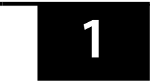
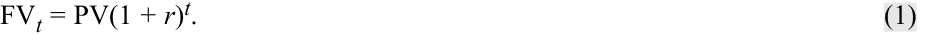
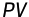
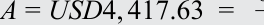
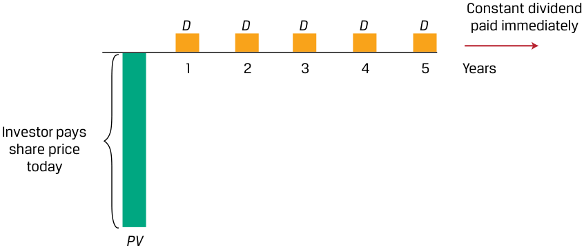
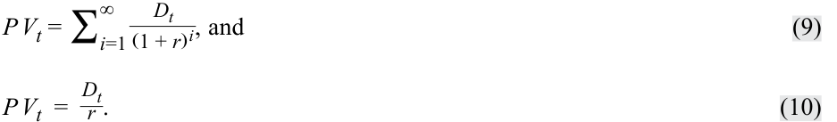
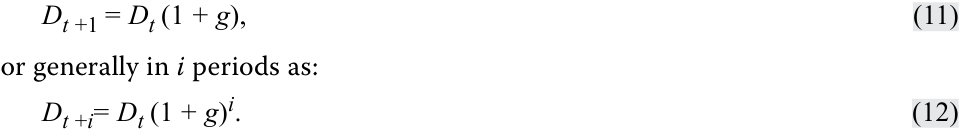
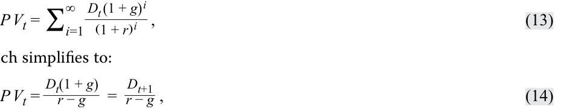
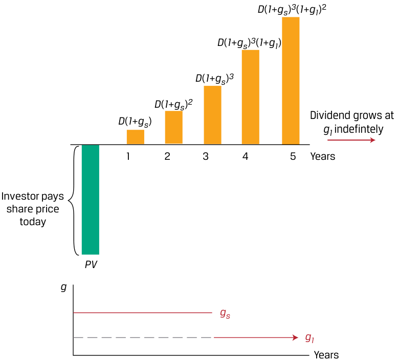
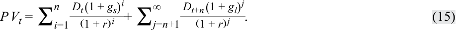

# Volume 1: Quantitative Methods
## Learning Module 2 Time Value of Money in Finance
### Part 1/4: Introduction (PDF Pages 53–67)

---

<!-- PDF Page 53 -->

#### L E A R N I N G M O D U L E 

# **<mark>2</mark>** 

### **Time Value of Money in Finance** 

###### **<mark>LEARNING OUTCOMES</mark>** 

- **_Mastery The candidate should be able to:_** calculate and interpret the present value (PV) of fixed-income and equity instruments based on expected future cash flows calculate and interpret the implied return of fixed-income instruments and required return and implied growth of equity instruments given the present value (PV) and cash flows explain the cash flow additivity principle, its importance for the no-arbitrage condition, and its use in calculating implied forward interest rates, forward exchange rates, and option values 

<!-- Start of picture text -->
1 <!-- End of picture text -->

##### **INTRODUCTION** 

This learning module applies time value of money principles in valuing financial assets. The first lesson focuses on solving for the present value of expected future cash flows associated with bonds and stocks. In the second lesson, the focus shifts to solving for implied bond and stock returns given current prices. This includes solving for and interpreting implied growth rates associated with given stock prices. The final lesson introduces cash flow additivity, an important principle which ensures that financial asset prices do not allow investors to earn risk-free profits, illustrated with several examples. The material covered in this learning module provides an important foundation for candidates in understanding how financial assets are priced in markets. 

###### **LEARNING MODULE OVERVIEW** 

- The price of a bond is the sum of the present values of the bond’s promised coupon payments and its par value. For discount bonds, the price reflects only the present value of the bond’s par value. 

- The value of a stock should reflect the sum of the present values of the stock’s expected future dividends in perpetuity. 

<!-- PDF Page 54 -->

- Stock valuation models are classified by the expected growth pattern assumed for future dividends: (1) no growth, (2) constant growth, or (3) changing dividend growth. 

- If a bond’s price is known, the bond’s implied return can be computed using the bond’s price and its promised future cash flows. 

- A stock’s required return can be estimated given the stock’s current price and assumptions about its expected future dividends and growth rates. 

- A stock’s implied dividend growth rate can be estimated given the stock’s current price and assumptions about its expected future dividends and required return. 

- If valuing two (or more) cash flow streams, the cash flow additivity principle allows for the cash flow streams to be compared (as long as the cash flows occur at the same point in time). 

- Application of cash flow additivity allows for confirmation that asset prices are the same for economically equivalent assets (even if the assets have differing cash flow streams). 

- Several real-world applications of cash flow additivity are used to illustrate no-arbitrage pricing. 

## **<mark>2</mark>** 

##### **TIME VALUE OF MONEY IN FIXED INCOME AND EQUITY** 

calculate and interpret the present value (PV) of fixed-income and equity instruments based on expected future cash flows 

The timing of cash flows associated with financial instruments affects their value, with cash inflows valued more highly the sooner they are received. The time value of money represents the trade-off between cash flows received today versus those received on a future date, allowing the comparison of the current or present value of one or more cash flows to those received at different times in the future. This difference is based upon an appropriate discount rate _r_ as shown in the prior learning module, which varies based upon the type of instrument and the timing and riskiness of expected cash flows. 

In general, the relationship between a current or present value ( _PV_ ) and future value ( _FV_ ) of a cash flow, where _r_ is the stated discount rate per period and _t_ is the number of compounding periods, is as follows: 

<!-- Formula Text: FVt = PV(1 + r)t. (1) -->

If the number of compounding periods _t_ is very large, that is, _t_ →∞, we compound the initial cash flow on a continuous basis as follows: 

<!-- Formula Text: FVt = PVer t. (2) -->

Conversely, present values can be expressed in future value terms, which requires recasting Equation 1 as follows: 

<!-- PDF Page 55 -->

<!-- Formula Text: FV t  =  PV (1 + r) t PV  =  FV t[ 1 _ (1 + r) t ] PV  =  FV t (1 + r) −t . (3) -->

The continuous time equivalent expression of Equation 3 is as follows: PV _t_ = FV _e__−r t_ . 

<!-- Formula Text: (4) -->

###### **Fixed-Income Instruments and the Time Value of Money** 

Fixed-income instruments are debt instruments, such as a bond or a loan, that represent contracts under which an issuer borrows money from an investor in exchange for a promise of future repayment. The discount rate for fixed-income instruments is an interest rate, and the rate of return on a bond or loan is often referred to as its yield-to-maturity (YTM). 

Cash flows associated with fixed-income instruments usually follow one of three general patterns: 

- Discount: An investor pays an initial price ( _PV_ ) for a bond or loan and receives a single principal cash flow ( _FV_ ) at maturity. The difference ( _FV_ − _PV_ ) represents the interest earned over the life of the instrument. 

- Periodic Interest: An investor pays an initial price ( _PV_ ) for a bond or loan and receives interest cash flows ( _PMT_ ) at pre-determined intervals over the life of the instrument, with the final interest payment and the principal ( _FV_ ) paid at maturity. 

- Level Payments: An investor pays an initial price ( _PV_ ) and receives uniform cash flows at pre-determined intervals ( _A_ ) through maturity which represent both interest and principal repayment. 

###### **_Discount Instruments_** 

The discount cash flow pattern is shown in Exhibit 1: 

###### **Exhibit 1: Discount Bond Cash Flows** 

<!-- Start of picture text -->
FV ( FV–PV ) represents FV interest over the investment period PV Investor receives final bond principal payment at maturity 5.0 Years Investor pays discounted value of bond at inception PV <!-- End of picture text -->

<!-- PDF Page 56 -->

The present value ( _PV_ ) calculation for a discount bond with principal ( _FV_ ) paid at time _t_ with a market discount rate of _r_ per period is: 

_PV_ (Discount Bond) = _FVt_ / (1 + _r_ )_t_ . ~~(5)~~ 

The investor’s sole source of return is the difference between the price paid ( _PV_ ) and full principal ( _FV_ ) received at maturity. This type of bond is often referred to as a **zero-coupon bond** given the lack of intermediate interest cash flows, which for bonds are generally referred to as coupons. 

###### **EXAMPLE 1** 

###### **Discount Bonds under Positive and Negative Interest Rates** 

While most governments issue fixed coupon bonds with principal paid at maturity, for many government issuers such as the United States, United Kingdom, or India, investors buy and sell individual interest or principal cash flows separated (or stripped) from these instruments as discount bonds. Consider a single principal cash flow payable in 20 years on a Republic of India government bond issued when the YTM is 6.70 percent. For purposes of this simplified example, we use annual compounding, that is, _t_ in Equation 5 is equal to the number of years until the cash flow occurs. 

1. What should an investor expect to pay for this discount bond per INR100 of principal? 

###### **Solution:** 

INR27.33 

We solve for _PV_ given _r_ of 6.70 percent, _t_ = 20, and _FV20_ of INR100 using Equation 5: 

_PV_ = INR100 / (1 + 0.067)20 = INR27.33. 

We may also use the Microsoft Excel or Google Sheets PV function: 

~~= PV (rate, nper, pmt, FV, type),~~ 

where: 

_rate_ = the market discount rate per period, 

_nper_ = the number of periods, 

_pmt_ = the periodic coupon payment (zero for a discount bond), 

_FV_ = future or face value, and 

_type_ = payments made at the end (0 as in this case) or beginning (1) of each period. 

As a cash outflow (or price paid), the Excel PV solution has a negative sign, so: 

_PV_ = (27.33) = ~~PV (0.067,20,0,100,0)~~ . 

While the principal ( _FV_ ) is a constant INR100, the price ( _PV_ ) changes as both time passes, and interest rates change. 

<!-- PDF Page 57 -->

2. If we assume that interest rates remain unchanged, what is the price ( _PV_ ) of the bond in three years’ time? **Solution:** 

INR33.21 

Solve for _PV_ by substituting _t_ = 17 into the prior calculation using Equation 5: 

_PV_ = INR100 / (1 + 0.067)17 = INR33.21. 

The INR5.88 price increase with a constant _r_ represents implied interest earned over the three years. If the interest rate is positive, the _PV_ generally rises (or accretes) over time to reach _FV_ as time passes and _t_ approaches zero. 

3. Prices also change as interest rates change. Suppose after purchase at t = 0 we observe an immediate drop in the bond price to INR22.68224 per INR100 of principal. What is the implied interest rate on the discount bond? 

**Solution:** 

7.70 percent 

Here we may solve for _r_ in Equation 5 as follows: 

INR22.68224 = INR100 / (1 + _r_ )20 . 

Rearranging Equation 5, we get: 

_r_ = 7.70 percent = (100/22.68224)1/20 − 1. 

Alternatively, we may use the Microsoft Excel or Google Sheets RATE function: 

~~= RATE (nper, pmt, PV, FV, type, guess)~~ using the same arguments as above, with _guess_ as an optional estimate argument, which must be between 0 and 1 and defaults to 0.1, as follows: 

###### 7.70 percent ~~= RATE (20,0,-22.68224,100,0,0.1).~~ 

This shows that a 100 basis point (1.00 percent) increase in _r_ results in an INR4.65 price decrease, underscoring the inverse relationship between price and YTM. 

4. Now consider a bond issued at negative interest rates. In July 2016, Germany became the first eurozone country to issue 10-year sovereign bonds at a negative yield. If the German government bond annual YTM was −0.05 percent when issued, calculate the present value ( _PV_ ) of the bond per EUR100 of principal ( _FV_ ) at the time of issuance. 

**Solution:** 

EUR100.50 

Solve for _PV_ given _r_ of −0.05 percent, _t_ =10, and _FV10_ of EUR100 using Equation 1: 

_PV_ = EUR100.50 = EUR100 / (1 − 0.0005)10 , 

or 

_PV_ = (100.50) ~~= PV (−0.0005,10,0,100,0)~~ . 

At issuance, this bond is priced at a **premium** , meaning that an investor purchasing the bond at issuance paid EUR0.50 above the future value expected at maturity, which is the principal. 

<!-- PDF Page 58 -->

5. Six years later, when German inflation reached highs not seen in decades and investors increased their required nominal rate of return, say we observed that the German government bond in question 4 is now trading at a price ( _PV_ ) of EUR95.72 per EUR100 principal. What is the YTM on this bond? **Solution:** 

   - 1.10 percent 

   - Use Equation 5 to solve for _r_ given a _PV_ of 95.72, _FV_ of 100, and _t_ = 4, we get: 

EUR95.72 = EUR100 / (1 + _r_ )4 ; _r_ = 1.10%, or 1.10% ~~= RATE (4,0,-95.72,100,0,0.1)~~ . 

In the case of the Republic of India discount bond, a higher interest rate will reduce the bond’s price. However, in contrast to the accreting price of a discount bond, the premium bond’s price will decline (or amortize) over time to reach the EUR100 future value at maturity. 

###### **_Coupon Instrument_** 

A periodic cash flow pattern for fixed-income interest payments with principal repaid at maturity is shown in Exhibit 2. In this case, all the periodic cash flow payments are identical and occur on a semiannual basis. 

###### **Exhibit 2: Coupon Bond Cash Flows** 

<!-- Start of picture text -->
PMT + FV FV Investor receives final coupon and principal payment at maturity PMT PMT PMT PMT PMT PMT PMT PMT PMT PMT 0.5 1.0 1.5 2.0 2.5 3.0 3.5 4.0 4.5 5.0 Years Investor pays present value of bond at inception PV <!-- End of picture text -->

Pricing a coupon bond extends the single cash flow calculation for a discount bond to a general formula for calculating a bond’s price ( _PV_ ) given the market discount rate on a coupon date, as follows: 

- _PV(Coupon Bond)_ 

<!-- PDF Page 59 -->

###### **EXAMPLE 2** 

###### **Hellenic Republic of Greece Annual Coupon Bond** 

At the height of the COVID pandemic, the government of Greece issued a 2 percent annual coupon bond maturing in seven years. 

1. If the observed YTM at issuance was 2.00 percent, what was the issuance price ( _PV_ ) per EUR100 of principal? 

###### **Solution:** 

EUR100 

Solve for _PV_ using Equation 6 with _PMTi_ = EUR2, _r_ = 2.00%, and _FV_ = EUR100: 

_PV_ = EUR100 

<!-- Formula Text: =   2 _ 1.02  +   2 _ 1.02 2  +   2 _ 1.02 3  +   2 _ 1.02 4  +   2 _ 1.02 5  +   2 _ 1.02 6  +  102 _ 1.02 7 . -->

We may solve this using the Microsoft Excel or Google Sheets PV function introduced earlier ( _PV_ (0.02,7,2,100,0)). The issuance price equals the principal ( _PV_ = _FV_ ). This relationship holds on a coupon date for any bond where the fixed periodic coupon is equal to the discount rate. 

The present value of each cash flow may be solved using Equation 5. For example, the final EUR102 interest and principal cash flow in seven years is: 

###### _PV_ = EUR88.80 = EUR102/(1.02)7 . 

The following table shows the present value of all bond cash flows: 

|**Years/Periods**|**0**|**1**|**2**|**3**|**4**|**5**|**6**|**7**|
|---|---|---|---|---|---|---|---|---|
|FV||2|2|2|2|2|2|102|
|PV|100.00|1.96|1.92|1.88|1.85|1.81|1.78|88.80|

2. Next, let’s assume that, exactly two years later, a sharp rise in Eurozone inflation drove the Greek bond’s price lower to EUR93.091 (per EUR100 of principal). What would be the implied YTM expected by investors under these new market conditions? 

###### **Solution:** 

###### 3.532 percent 

In this case, we must solve for _r_ using Equation 6, with _PV_ equal to 93.091, as follows: 

<!-- Formula Text: PV = 93.091 = 2/(1+r) + 2/(1+r)2 + 2/(1+r)3 + 2/(1+r)4 + 102/(1+r)5. -->

Here we may use the Microsoft Excel or Google Sheets RATE function ~~(RATE (5,2,93.091,100,0,0.1)~~ ) to solve for _r_ of 3.532 percent. Investors in fixed coupon bonds face a capital loss when investors expect a higher YTM. 

The interest rate _r_ used to discount all cash flows in Equation 6 is the bond’s YTM, which is typically quoted on an annual basis. However, many bonds issued by public or private borrowers pay interest on a semiannual basis. In Example 3, we revisit the Republic of India bond from which a single cash flow was stripped in an earlier simplified example. 

<!-- PDF Page 60 -->

**EXAMPLE 3** 

###### **Republic of India Semiannual Coupon Bond** 

Consider the 20-year Republic of India government bond from which the discount bond in Example 1 was separated (or stripped). The bond was issued at an annualized coupon rate of 6.70 percent and a YTM of 6.70 percent, and the coupon payments are semiannual. 

1. Solve for the price of the bond at issuance. 

**Solution:** 

INR100 

As coupon periods are semiannual, for a principal of INR100, _PMT_ = INR3.35 (=6.70/2) and the periodic discount rate is 3.35 percent (=6.70 percent/2), as follows: 

_PV_ = 3.35/(1.0335) + 3.35/(1.0335)2 + … + 3.35/(1.0335)39 + 103.35/ (1.0335)40 . 

As shown in Example 2, because _the coupon rate is equal to the YTM_ , we expect this bond to have a _PV_ of INR100 at issuance. 

2. What is the bond’s price if the YTM immediately rises to 7.70 percent? 

###### **Solution:** 

INR89.88 

We can solve for the _PV_ as INR89.88 using Equation 6 with _r_ = 3.85% (=7.70/2) or using the Microsoft Excel or Google Sheets PV function ~~(PV (0.0385,40,3.35,100,0)~~ ). The first and final three cash flows are shown below: 

||**Years**|**0**|**0.5**|**1**|**1.5**|**19**|**19.5**|**20**|
|---|---|---|---|---|---|---|---|---|
|**r**|**Periods**|**0**|**1**|**2**|**3**|**38**|**39**|**40**|
||FV||3.35|3.35|3.35|3.35|3.35|103.35|
|6.70%|PV|100.00|3.24|3.14|3.03|0.96|0.93|27.66|
|7.70%|PV|89.88|3.23|3.11|2.99|0.80|0.77|22.81|

3. Recalculate the discount bond price for the single principal payment in 20 years from Example 1 , where YTM = 6.70, and discounting is done semiannually. 

**Solution:** INR26.77 Using Equation 5: 

_PV_ ( _FV_ 40) = INR26.77 = 100 / (1.0335)40 . 

Discounting on a semiannual basis for 40 periods, _PV_ ( _FV40_ ) of 26.77 is less than the original PV of 27.33 using 20 annual periods from Example 1 (since 1/(1+ _r_ )_t_ > 1/(1+ _r_ /2)_2t_ when _r_ ≥ 0). 

<!-- PDF Page 61 -->

A **perpetual bond** is a less common type of coupon bond with no stated maturity date. Most perpetual bonds are issued by companies to obtain equity-like financing and often include redemption features. As _N_ →∞ in Equation 6, we can simplify this to solve for the present value of a **perpetuity** (or perpetual fixed periodic cash flow without early redemption), where _r_ > 0, as follows: 

_PV_ (Perpetual Bond) = _PMT_ / _r_ . 

~~(7)~~ 

###### **EXAMPLE 4** 

###### **KB Financial Perpetual Bond** 

In 2020, KB Financial (the holding company for Kookmin Bank) issued KRW325 billion in perpetual bonds with a 3.30 percent quarterly coupon. 

1. Calculate the bond’s YTM if the market price was KRW97.03 (per KRW100). 

###### **Solution:** 

3.40 percent 

Solve for _r_ in Equation 7 given a _PV_ of KRW97.03 and a periodic quarterly coupon ( _PMT_ ) of KRW0.825 (= (3.30% × KRW100)/4): 

KRW97.03 = KRW0.825 / _r_ ; 

_r_ = 0.85% per period, or 3.40% (=0.85% × 4) on an annualized basis. 

###### **_Annuity Instruments_** 

Examples of fixed-income instruments with level payments, which combine interest and principal cash flows through maturity, include fully amortizing loans such as mortgages and a fixed-income stream of periodic cash inflows over a finite period known as an annuity. Exhibit 3 illustrates an example of level monthly cash flows based upon a mortgage. 

###### **Exhibit 3: Mortgage Cash Flows** 

<!-- Start of picture text -->
Investor receives a fixed periodic payment equal to the sum of interest and principal payments INT INT INT INT INT INT INT INT INT INT PRN PRN PRN PRN PRN PRN PRN PRN PRN PRN 1 2 3 4 5 ... 356 357 358 359 360 Months Borrower receives mortgage loan at inception <!-- End of picture text -->

<!-- Start of picture text -->
PV <!-- End of picture text -->

<!-- PDF Page 62 -->

We may calculate the periodic annuity cash flow ( _A_ ), which occurs at the end of each respective period, as follows: 

<!-- Formula Text: A = r(PV) _ 1 − (1 + r) −t  , (8) -->

where: 

- _A_ = periodic cash flow, 

- _r_ = market interest rate per period, 

- _PV_ = present value or principal amount of loan or bond, and 

- _t_ = number of payment periods. 

###### **EXAMPLE 5** 

###### **Mortgage Cash Flows** 

An investor seeks a fixed-rate 30-year mortgage loan to finance 80 percent of the purchase price of USD1,000,000 for a residential building. 

1. Calculate the investor’s monthly payment if the annual mortgage rate is 5.25 percent. 

###### **Solution:** 

Solve for _A_ using Equation 8 with _r_ = 0.4375% (= 5.25%/12), _t_ of 360, and _PV_ of USD800,000 (=80% × USD1,000,000): 

<!-- Formula Text: 0.4375% (USD800, 000) -->

<!-- Formula Text: A = USD4, 417.63  = 0_ -->

__________________1 −( 1 + 0.4375%)−360  . 

The 360 level monthly payments consist of both principal and interest. 

2. What is the principal amortization and interest breakdown of the first two monthly cash flows? 

###### **Solution:** 

Month 1 interest is USD3,500 and principal is USD917.63 Month 2 interest is USD3,495.99 and principal is USD921.64 

Month 1: 

Interest: USD3,500 = USD800,000 × 0.4375% (= _PV0_ × _r_ ) 

Principal Amortization: USD4,417.63 − USD3,500 = USD917.63 Remaining Principal ( _PV1_ ): USD799,082.37 = USD800,000 − USD917.63 

Month 2: 

Interest: USD3,495.99 = USD799,082.37 × 0.4375% (= _PV1_ × _r_ ) Principal Amortization: USD4,417.63 − USD3,495.99 = USD921.64 Remaining Principal ( _PV2_ ): USD798,160.73 = USD799,082.37 − USD921.64 

Although the periodic mortgage payment is constant, the proportion of interest per payment declines while the principal amortization rises over 

<!-- PDF Page 63 -->

time. The following spreadsheet shows the first and final three monthly cash flows. 

|**Month**|**Total Monthly** **Payment**|**Monthly Inter-** **est Payment**|**Monthly** **Principal** **Repayment**|**Remaining** **Principal**|
|---|---|---|---|---|
|1|$ 4,417.63|$ 3,500.00|$ 917.63|$ 799,082.37|
|2|$ 4,417.63|$ 3,495.99|$ 921.64|$ 798,160.73|
|3|$ 4,417.63|$ 3,491.95|$ 925.68|$ 797,235.05|
|…|||||
|358|$ 4,417.63|$ 57.48|$ 4,360.15|$ 8,777.61|
|359|$ 4,417.63|$ 38.40|$ 4,379.23|$ 4,398.39|
|360|$ 4,417.63|$ 19.24|$ 4,398.39|$ 0.00|

###### **Equity Instruments and the Time Value of Money** 

Equity investments, such as preferred or common stock, represent ownership shares in a company which entitle investors to receive any discretionary cash flows in the form of dividends. Unlike fixed-income instruments, equity investments have no maturity date and are assumed to remain outstanding indefinitely, or until a company is sold, restructured, or liquidated. One way to value a company’s shares is by discounting expected future cash flows using an expected rate of return ( _r_ ). These cash flows include any periodic dividends received plus the expected price received at the end of an investment horizon. 

Common assumptions associated with valuing equity instruments based upon dividend cash flows often follow one of three general approaches: 

- Constant Dividends: An investor pays an initial price ( _PV_ ) for a preferred or common share of stock and receives a fixed periodic dividend ( _D_ ). 

- Constant Dividend Growth Rate: An investor pays an initial price ( _PV_ ) for a share of stock and receives an initial dividend in one period ( _Dt+1_ ), which is expected to grow over time at a constant rate of _g_ . 

- Changing Dividend Growth Rate: An investor pays an initial price ( _PV_ ) for a share of stock and receives an initial dividend in one period ( _Dt+1_ ). The dividend is expected to grow at a rate that changes over time as a company moves from an initial period of high growth to slower growth as it reaches maturity. 

The simplest case of a stock that is assumed to pay constant dividends in perpetuity is shown in Exhibit 4. 

<!-- PDF Page 64 -->

###### **Exhibit 4: Equity Cash Flows with Constant Dividends** 

<!-- Start of picture text -->
Constant dividend D D D D D paid immediately 1 2 3 4 5 Years Investor pays share price today PV <!-- End of picture text -->

The price of a preferred or common share expected to pay a constant periodic dividend is an infinite series that simplifies to the formula for the present value of a perpetuity shown and is similar to the valuation of a perpetual bond that we encountered earlier. Specifically, the valuation in Equation 7: 

<!-- Formula Text: P V t = ∑ i=1 ∞ D t _ (1 + r) i , and (9) P V t  = D t _ r . (10) -->

###### **EXAMPLE 6** 

###### **Constant Dividend Cash Flows** 

Shipline PLC is a company that pays regular dividends of GBP1.50 per year, which are expected to continue indefinitely. 

1. What is Shipline’s expected stock price if shareholders’ required rate of return is 15 percent? 

###### **Solution:** 

- GBP10 

Solve for _PV_ using Equation 10, where _D_ is GBP1.50 and the rate of return per period _r_ is 15 percent: 

_PV_ = GBP10.00 = GBP1.50/0.15. 

Alternatively, a common equity forecasting approach is to assume a constant dividend growth rate ( _g_ ) into perpetuity, as illustrated in Exhibit 5. 

<!-- PDF Page 65 -->

**Exhibit 5: Equity Cash Flows with Constant Dividend Growth** 

<!-- Start of picture text -->
D ( 1 + g ) 5 D ( 1 + g ) 4 D ( 1 + g ) 3 D ( 1 + g ) 2 Dividend grows at  g D ( 1 + g ) indefintely 1 2 3 4 5 Years Investor pays share price today PV <!-- End of picture text -->

If dividends grow at a rate of _g_ per period and are paid at the end of each period, the next dividend (at time _t_ + 1) may be shown as follows: 

<!-- Formula Text: Dt +1 = Dt (1 + g), (11) or generally in i periods as: Dt +i= Dt (1 + g)i. (12) -->

If dividend cash flows continue to grow at _g_ indefinitely, then we may rewrite Equation 10 as follows: 

<!-- Formula Text: P V t = ∑ i=1 ∞ D t (1 + g) i _ (1 + r) i   , (13) ich simplifies to: P V t = D t(1 + g) _ r − g    = D t+1 _ r − g  , (14) -->

which simplifies to: 

where _r – g_ > 0. 

An alternative to constant dividend growth is an assumption of changing growth. This is common for evaluating the share price of firms expected to experience an initial rapid rise in cash flow, followed by slower growth as a company matures. The simplest form of changing dividend growth is the two-stage model shown in Exhibit 6. 

<!-- PDF Page 66 -->

**Exhibit 6: Equity Cash Flows with Two-Stage Dividend Growth** 

<!-- Start of picture text -->
D ( 1 + gs ) 3 ( 1 + g1 ) 2 D ( 1 + gs ) 3 ( 1 + g1 ) D ( 1 + gs ) 3 D ( 1 + gs ) 2 Dividend grows at D ( 1 + gs ) g1  indefintely 1 2 3 4 5 Years Investor pays share price today PV g gs g1 Years <!-- End of picture text -->

The example in Exhibit 6 shows a company with an initial higher short-term dividend growth of _gs_ for the first three years, followed by lower long-term growth ( _gl_ , where _gs_ > _gl_ ) indefinitely thereafter. If we generalize the initial growth phase to _n_ periods followed by indefinite slower growth at _gl_ , we obtain a modified version of Equation 14 as follows: 

<!-- Formula Text: P V t = ∑ i=1 n D t (1 + g s) i _ (1 + r) i  + ∑ j=n+1 ∞ D t+n (1 + g l) j _ (1 + r) j  . (15) -->

<!-- Formula Text: Note that the second expression in Equation 15 involves constant growth starting in n periods, for which we can substitute the geometric series simplification: P V t = ∑ i=1 n D t (1 + g s) i _ (1 + r) i  + E(S t+n) _ (1 + r) n  , (16) -->

where the stock value of the stock in n periods ( _E_ ( _St_ + _n_ ) is referred to as the **terminal value** ) and is equal to the following: 

<!-- Formula Text: E(S t+n ) = D t+n+1 _ r− g l . (17) -->

We revisit the Shipline PLC stock price example to evaluate the effects of constant dividend, constant dividend growth and changing dividend growth assumptions on a company’s expected share price. 

###### **EXAMPLE 7** 

###### **Constant and Changing Dividend Growth** 

Recall that based on a constant GBP1.50 annual dividend and required return of 15 percent, we showed Shipline PLC’s expected stock price to be GBP10.00. Suppose instead that an investment analyst assumes that Shipline will grow its annual dividend by 6 percent per year indefinitely. 

<!-- PDF Page 67 -->

1. How does Shipline’s expected share price change under the analyst’s constant growth assumption? **Solution:** 

GBP17.67 

Using Equation 14, solve for _PV_ using _Dt+1_ of GBP1.59 (=GBP1.50 × (1 + 0.06)), _r_ of 15%, and _g_ of 6%: 

_PV_ = GBP1.59 / (15% − 6%) = GBP17.67. 

Note that a higher growth rate _g_ increases the _PV_ by reducing the denominator ( _r − g_ ). 

2. How does Shipline’s expected share price change if we assume instead an initial dividend growth of 6 percent over a three-year period followed by constant 2 percent dividend growth thereafter? 

**Solution:** 

GBP13.05 

We may solve for Shipline’s expected share price ( _PV_ ) using Equation 15– Equation 17 and _Dt_ = 1.5, _gs_ = 6%, _n_ = 3, r = 15%, and _gl_ = 2%, as follows: 

<!-- Formula Text: P V t = ∑ i=1 3    1.50 (1 + 0.06) i ___________ (1 + 0.15) i  + ∑ j=4 ∞ D t+3 (1 + 0.02) j ___________ (1 + 0.15) j  . -->

As a first step, we calculate the present value of dividends associated with the higher 6 percent growth rate over the first three years as shown in the first expression. As a second step, we calculate the present value of future dividends at a lower 2 percent growth rate for an indefinite period. The sum of these two steps is the expected share price. 

Step 1 Solve for the first step as GBP3.832 with dividend cash flows for the initial growth period as shown in the following spreadsheet: 

|**_t_**|**_D_**|**_PV(D)_ at****_r_% **|
|---|---|---|
|0|1.500||
|1|1.590|1.383|
|2|1.685|1.274|
|3|1.787|1.175|
|_PV(ST growth)_||3.832|

Step 2 As shown in Equation 17, the second expression simplifies as follows: <mark>_</mark>( 1 + _E_ ( _Sr_ 4) )3; with_E_(_S_4 ) =  r_ − _D_ 4 _gl_. 

We may solve for _D4_ as GBP1.823 (=1.787 × 1.02 = _D3_ (1 + _gl_ )) and the second expression to be GBP9.22 as follows: 

<!-- Formula Text: GBP9.22 = 1.823 ⧸(0.15 − 0.02) _____________ (1.15) 3 . -->

Step 3 The sum of these two steps gives us an expected Shipline share price of GBP13.05 (=3.83 + 9.22). 

In the following table, we show the sensitivity of Shipline’s expected share price ( _PV_ ) to changes in the long-term growth rate ( _gl_ ) after three years of 6 percent dividend growth: 

