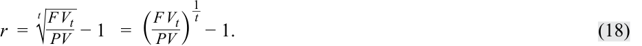
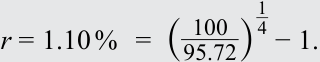
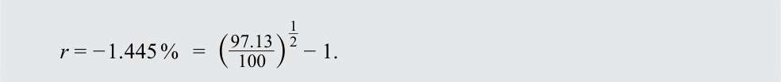
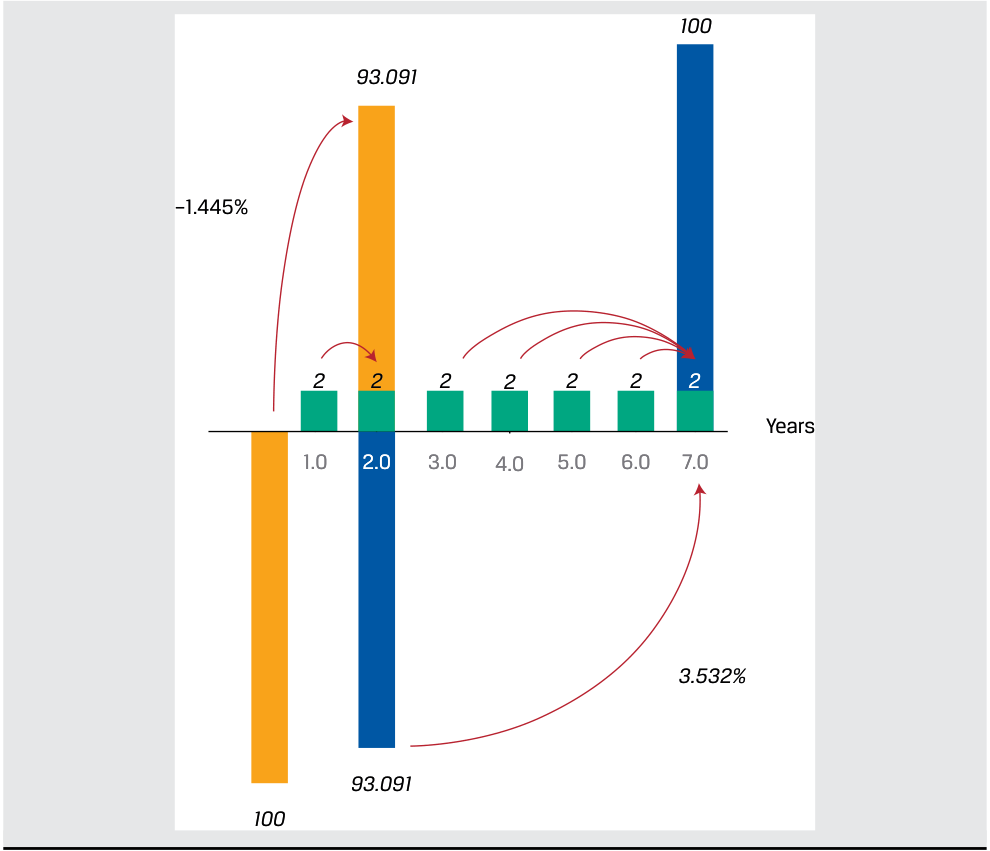
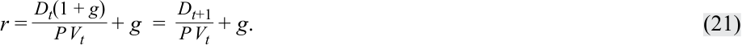
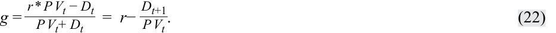
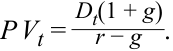
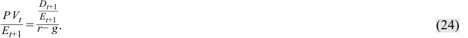
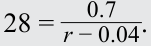

# Volume 1: Quantitative Methods
## Learning Module 2 Time Value of Money in Finance
### Part 2/4: Implied Return and Growth (PDF Pages 68–76)

---

<!-- PDF Page 68 -->

|**Share Price**|**LT Growth Rate**|
|---|---|
|11.66|0%|
|13.05|2%|
|14.94|4%|
|17.67|6%|

# **<mark>3</mark>** 

## **IMPLIED RETURN AND GROWTH** 

calculate and interpret the implied return of fixed-income instruments and required return and implied growth of equity instruments given the present value (PV) and cash flows 

Lesson 1 addressed the time value of money trade-off between cash flows occurring today versus those in the future for certain fixed income and equity instruments. Market participants often face a situation in which both the present and future values of instruments or cash flows may be known. In this case it becomes possible to solve for the implied return or growth rate implied by the current price and features of the future cash flows. In this sense, solving for the implied growth or return provides a view of the market expectations that are incorporated into the market price of the asset. 

### **Implied Return for Fixed-Income Instruments** 

Fixed-income instruments are characterized by contractual interest and principal cash flows. If we observe the present value (or price) and assume that all future cash flows occur as promised, then the discount rate (r) or yield-to-maturity ( _YTM_ ) is a measure of implied return under these assumptions for the cash flow pattern. 

In the case of a discount bond or instrument, recall that an investor receives a single principal cash flow ( _FV_ ) at maturity, with ( _FV_ − _PV_ ) representing the implied return, as shown in Exhibit 7. 

<!-- PDF Page 69 -->

#### **Exhibit 7: Discount Bond Implied Return** 

<!-- Start of picture text -->
FV Bond principal payment at maturity 5.0 Years Discounted bond value at inception (1+r) t PV <!-- End of picture text -->

We may rearrange Equation 5 from earlier to solve for the implied periodic return earned over the life of the instrument ( _t_ periods): 

<!-- Formula Text: r  = t √ _ F V t _ PV   − 1   =  ( F V t _ PV ) 1 _ t − 1. (18) -->

#### **EXAMPLE 8** 

### **Discount Bond Implied Return** 

Recall from Example 1 that in 2016, German 10-year government bond investors faced a price of EUR100.50 per EUR100 principal and an annual YTM of −0.05 percent at issuance. That is, the German 10-year government bond was initially priced by the market to provide a negative return to the investor. Six years later, these bonds traded at a price ( _PV_ ) of EUR95.72 per EUR100 principal. 

1. What was the initial investor’s implied return on this bond over the six-year holding period? 

#### **Solution:** 

−0.81 percent 

We can solve for an investor’s annualized return ( _r_ ) using Equation 18 and a _PV_ of 100.5, _FV_ of 95.72, and _t_ of 6 as follows: 

<!-- Formula Text: r = − 0.81 %   =  ( 95.72 _ 100.5 ) 1 _ 6 − 1. -->

Note that an investor who purchases the discount bond at issuance and receives EUR100 in 10 years expects an implied return equal to the issuance YTM of −0.05 percent. However, the EUR4.78 price decline for the first six years translates into an annualized return of −0.81 percent, which is below the initial YTM of −0.05 percent. This negative return is consistent with an expected decline in the price ( _PV_ ) of a discount bond amid higher inflation. 

<!-- PDF Page 70 -->

2. What is the expected return of an investor who purchases the discount bond at EUR95.72 and holds it for the remaining four years? 

#### **Solution:** 

1.10 percent 

Here the current price of 95.72 in Equation 18 is now the _PV_ , and the principal of 100 is _FV_ , with _t_ = 4: 

<!-- Formula Text: r = 1.10 %   =  ( 100 _ 95.72 ) 1 _ 4 − 1. -->

Note that _r_ of 1.10 percent is equal to the YTM for the remaining four years we derived in Example 1. The cumulative returns across the two investors is equal to the initial −0.05 percent YTM, assuming no transaction costs as follows: 

<!-- Formula Text: − 0.05 %   =  [(1 − 0.0081) 6 × (1 + 0.011) 4]  1 _ 10 − 1. -->

These relationships are summarized in the following diagram: 

<!-- Start of picture text -->
100 95.72 –0.8% 10.0 Years 1.10% 95.72 100.5 Initial 6y Final 4y Annualized Return: Annualized Return: –0.8% 1.10% Full 10y Annualized Return (YTM) –0.05% <!-- End of picture text -->

Unlike discount bonds, fixed-income instruments that pay periodic interest have cash flows throughout their life until maturity. The uniform discount rate (or internal rate of return) for all promised cash flows is the YTM, a single implied market discount rate for all cash flows regardless of timing as shown for a coupon bond in Exhibit 8. 

<!-- PDF Page 71 -->

#### **Exhibit 8: Coupon Bond Implied Return** 

<!-- Start of picture text -->
PMT + FV FV Final coupon and principal payment at maturity YTM = IRR PMT PMT PMT PMT PMT PMT PMT PMT PMT PMT 0.5 1.0 1.5 2.0 2.5 3.0 3.5 4.0 4.5 5.0 Years Present value of bond at inception PV <!-- End of picture text -->

The YTM assumes an investor expects to receive all promised cash flows through maturity and reinvest any cash received at the same YTM. For coupon bonds, this involves periodic interest payments only, while for level payment instruments such as mortgages, the calculation assumes both interest and amortized principal may be invested at the same rate. Like other internal rates of return, the YTM cannot be solved using an equation, but it may be calculated using iteration with a spreadsheet or calculator, a process that solves for _r_ in Equation 19, as follows: 

_PV(Coupon Bond)_ 

<!-- Formula Text: = PMT1 / (1 + r)1 + PMT2 / (1 + r)2 + … + (PMTN + FVN) / (1 + r)N, (19) -->

where _FV_ equals a bond’s principal and N is the number of periods to maturity. 

The Microsoft Excel or Google Sheets YIELD function can be used to calculate YTM for fixed-income instruments with periodic interest and full principal payment at maturity: 

= YIELD (settlement, maturity, rate, pr, redemption, frequency, [basis]) 

where: 

_settlement_ = settlement date entered using the DATE function; 

_maturity_ = maturity date entered using the DATE function; 

_rate =_ semi-annual (or periodic) coupon; 

_pr =_ price per 100 face value; 

_redemption =_ future value at maturity; 

_frequency =_ number of coupons per year; and 

_[basis] =_ day count convention, typically 0 for US bonds (30/360 day count). 

Example 9 illustrates the implied return on fixed income instruments with periodic interest. 

<!-- PDF Page 72 -->

#### **EXAMPLE 9** 

### **Greek Coupon Bond Implied Return** 

Recall from Example 2 that seven-year Greek government bonds issued in 2020 with a 2.00 percent annual coupon had a price of EUR93.091 per EUR100 principal two years later. 

1. What is the implied two-year return for an investor able to reinvest periodic interest at the original YTM of 2.00 percent? 

**Solution:** 

−1.445 percent 

Using Equation 18 as for the discount bond, we must first calculate the future value ( _FV_ ) after two years including the future price of 93.091 and all cash flows reinvested to that date: 

_FV2_ = _PMT_ 1(1 + _r_ ) + _PMT2_ + _PV2_ 

_FV2_ = 97.13 = 2 × (1.02) + 2 + 93.091 

<!-- Formula Text: r = − 1.445 %   =  ( 97.13 _ 100 ) 1 _ 2 − 1. -->

This negative annualized return was due to a EUR6.91 (=100 − 93.091) capital loss which exceeded the periodic interest plus reinvestment proceeds of EUR4.04 (=2 × (1.02) + 2). The fall in the price of the bond to EUR93.091 in 2022 was a result of a rise in Eurozone inflation over the period. 

For an investor purchasing the 2 percent coupon bond in 2022 at a price of EUR93.091, recall that we solved for an _r_ (or YTM) of 3.532 percent. Note that this YTM calculation for the remaining five years assumes all cash flows can be reinvested at 3.532 percent through maturity. The rate(s) at which periodic interest can be reinvested is critical for the implied return calculation for coupon bonds as shown below. YTM is computed assuming that the bond is held to maturity. 

<!-- PDF Page 73 -->

<!-- Start of picture text -->
100 93.091 –1.445% 2 2 2 2 2 2 2 Years 1.0 2.0 3.0 4.0 5.0 6.0 7.0 3.532% 93.091 100 <!-- End of picture text -->

### **Equity Instruments, Implied Return, and Implied Growth** 

As noted in the discussion of calculating the present value of an equity investment, the price of a share of stock reflects not only the required return but also the growth of cash flows. If we begin with an assumption of constant growth of dividends from Equation 14, we can rearrange the formula as follows: 

<!-- Formula Text: r − g = D t(1 + g) _ P V t    = D t+1 _ P V t . (20) -->

The left-hand side of Equation 20 simply reflects the difference between the required return and the constant growth rate, and the right-hand side is the dividend yield of the stock based on expected dividends over the next period. Thus, the implied return on a stock given its expected dividend yield and growth is given by Equation 21, as follows: 

<!-- Formula Text: r = D t(1 + g) _ P V t   + g  = D t+1 _ P V t  + g. (21) -->

Simply put, if we assume that a stock’s dividend grows at a constant rate in perpetuity, the stock’s implied return is equal to its expected dividend yield plus the constant growth rate. 

Alternatively, we may be interested in solving for a stock’s implied growth rate, and this relation is given by Equation 22: 

<!-- Formula Text: g = r * P V t − D t _ P V t+ D t    =  r− D t+1 _ P V t . (22) -->

If a stock’s next expected dividend is known, then we can calculate the implied growth by deducting its expected dividend yield from its required return. 

<!-- PDF Page 74 -->

#### **EXAMPLE 10** 

### **Implied Return and Growth for a Stock** 

Coca-Cola Company stock trades at a share price of USD63.00 and its annualized expected dividend per share during the next year is USD1.76. 

1. If an analyst expects Coca-Cola’s dividend per share to increase at a constant 4 percent per year indefinitely, calculate the required return expected by investors. 

#### **Solution:** 

6.79 percent Using Equation 21, 

<!-- Formula Text: r  =   1.76 _ 63  + 0.04  =  0.0679. -->

The required return expected for Coca-Cola stock is 6.79 percent given its current price, expected dividend, and expected dividend growth rate. Investor expectations of future stock returns are inferred by the combination of the current price, expected future cash flows and the cash flow growth rate. Suppose that, instead of attempting to estimate the required return, an investor wishes to determine an implied dividend growth rate. In this case, the investor must assume a future stock return, as in question 2. 

2. If the analyst believes that Coca-Cola stock investors should expect a return of 7 percent, calculate the implied dividend growth rate for Coca-Cola. 

#### **Solution:** 

4.21 percent Using Equation 22, 

<!-- Formula Text: g  =  0.07−  1.76 _ 63  = 0.0421. -->

The implied dividend growth rate for Coca-Cola stock is 4.21 percent given its expected return, price, and expected dividend. Given that a higher expected return is assumed in this question compared to the case in question 1, the result is a higher implied dividend growth rate to justify Coca-Cola’s stock price of USD63.00. 

Rather than comparing equity share prices directly in currency terms, a common practice is to compare ratios of share price to earnings per share, or the **price-to-earnings ratio** . 

#### **PRICE-TO-EARNINGS RATIO** 

Price-to-earnings ratio is a relative valuation metric that improves comparability by controlling for a known driver of value (earnings per share) as well as currency. It is analogous to expressing the price of real estate using a price per square meter. 

A stock trading at a price-to-earnings ratio of 20 implies that its share price is 20 times its earnings per share and investors are willing to pay 20 times earnings per share for each share traded, which is more expensive than a stock trading at a price to earnings ratio of 10. 

<!-- PDF Page 75 -->

Price-to-earnings ratios not only are used for individual stocks but also are a valuation metric for stock indexes, such S&P 500, FTSE 100, or Nikkei 225. Here, the stock index value is divided by a weighted sum of the index constituents’ earnings per share. This will be explored in depth later in the curriculum, but we can relate the price-to-earnings ratio to our earlier discussion of relating a stock’s price ( _PV_ ) to expected future cash flows to make some useful observations. First, recall Equation 14: 

<!-- Formula Text: P V t = D t(1 + g) _ r − g  . -->

We can divide both sides by _Et_ , earnings per share for period _t_ , to obtain: 

<!-- Formula Text: P V t _ E t  = D t _ E t  × (1 + g) _ r− g . (23) -->

The left-hand side of Equation 23 is the price-to-earnings ratio, whereas the first term in the numerator on the right is the proportion of earnings distributed to shareholders as dividends known as the **dividend payout ratio** . 

Given a price-to-earnings ratio and dividend payout ratio, we can solve for either required return or implied dividend growth rate (given an assumption about the other). The required return is useful in understanding investor return expectations on a forward-looking basis. The implied constant growth rate is useful to compare with the company’s expected growth rate and historical growth rate. For example, if the implied constant growth rate is 10 percent yet the analyst estimates that the company can only grow by 5 percent, the analyst may judge the shares to be overvalued. 

In practice, the **forward price-to-earnings ratio** or ratio of its share price to an estimate of its next period (t + 1) earnings per share is commonly used. With it, we can simplify the previous equation as follows: 

<!-- Formula Text: P V t _ E t+1  = D t+1 _ E t+1 _ r− g . (24) -->

From Equation 24, we can see that forward price-to-earnings ratio is positively related to higher expected dividend payout ratio and higher expected growth but is negatively related to the required return. 

#### **EXAMPLE 11** 

### **Implied Return and Growth from Price to Earnings Ratio** 

1. Suppose Coca-Cola stock trades at a forward price to earnings ratio of 28, its expected dividend payout ratio is 70 percent, and analysts believe that its dividend will grow at a constant rate of 4 percent per year. Calculate Coca-Cola’s required return. 

**Solution** : 

6.50 percent Using Equation 24, 

<!-- Formula Text: 28 =   0.7 _ r − 0.04 . -->

Solving this equation for r, Coca-Cola’s required return is 6.50 percent. Given the above result for Coca-Cola’s required return, it should come as no surprise that if we instead assume that the required return on Coca-Cola stock is 6.50 percent, then we would find that Coca-Cola’s implied growth rate is 4 percent, and this result is confirmed in question 2. 

<!-- PDF Page 76 -->

2. Suppose Coca-Cola stock trades at a forward price to earnings ratio of 28, its expected dividend payout ratio is 70 percent, and analysts believe that its required return is 6.50 percent. Calculate Coca-Cola’s implied growth rate. 

#### **Solution:** 

4.00 percent Using Equation 24, 

<mark>_</mark> 28 =0.70 0.065− _g_. 

Solving this equation for _g_ , Coca-Cola’s implied growth rate is 4.00 percent. In particular, Coca-Cola’s return is expected to be 2.5 percent greater than its dividend growth rate (i.e., 6.50% − 4.00%). 

As discussed earlier, the same principles apply to understanding required returns and growth rates on stock indexes. 

3. A stock index is trading at a forward price to earnings ratio of 19. If the expected dividend payout ratio on the index is 60 percent, and equity investors expect an index rate of return of 8 percent, calculate the implied constant growth rate for the index. 

**Solution:** 

4.84 percent Using Equation 24: 

<!-- Formula Text: 19 =   0.60 _ 0.08− g . -->

Solving for _g_ , we find that investors expect the index’s dividend growth rate to be 4.84 percent in the future. Alternatively, we could assume that investors expect a 4.84 percent growth rate and solve for _r_ to calculate 8 percent as the required return. Thus, the index forward price-to-earnings ratio of 19 and an expected dividend payout ratio of 60 percent combine to reflect expectations of 8 percent return and 4.84 percent growth. Specifically, the required return exceeds the implied dividend growth rate by 3.16 percent (i.e., 8% − 4.84%). 

An important point from the prior results is that equity prices, whether expressed simply as price or as a price-to-earnings ratio, reflect combined expectations about future returns and growth. Expectations of returns and growth are linked together by the difference between _r_ and _g_ . For example, the Coca-Cola example using a price-to-earnings ratio of 28 describes a situation in which investors must believe that the required return on Coca-Cola stock is 2.5 percent above its growth rate. 

4. Suppose Coca-Cola stock trades at a forward price to earnings ratio of 28 and its expected dividend payout ratio is 70 percent. Analysts believe that Coca-Cola stock should earn a 9 percent return and that its dividends will grow by 4.50 percent per year indefinitely. Recommend a course of action for an investor interested in taking a position in Coca-Cola stock. 

#### **Solution:** 

Take a short position in Coca-Cola stock. If we evaluate the above parameters using Equation 24, we can see that this results in an inequality. 

