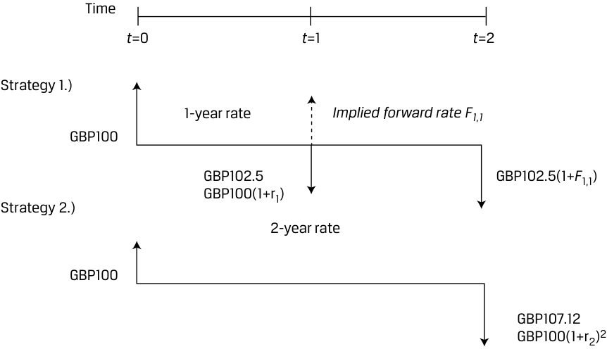
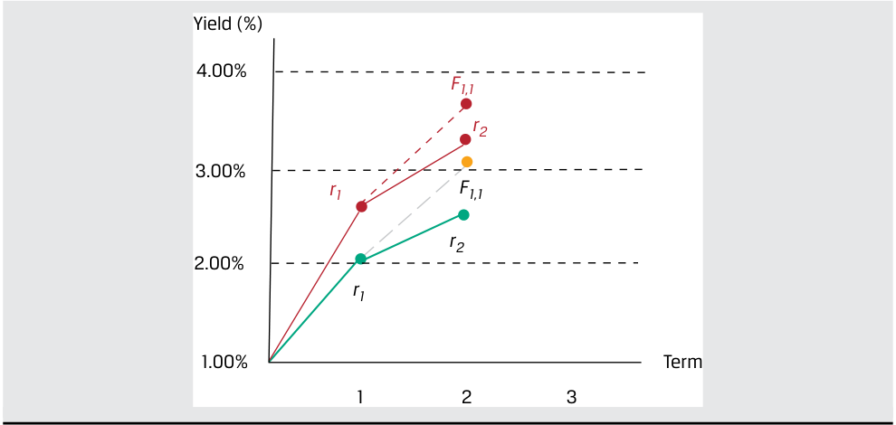
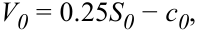
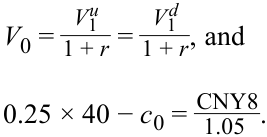
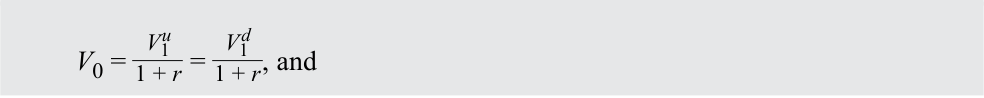

# Volume 1: Quantitative Methods
## Learning Module 2 Time Value of Money in Finance
### Part 3/4: Cash Flow Additivity (PDF Pages 77–91)

---

<!-- PDF Page 77 -->

<mark>_</mark> 0.70 28 >  0.09− 0.045= 15.56. 

Coca-Cola’s forward price-to-earnings ratio of 28 is much greater than 15.56, which is computed from the equation. Investor expectations of cash flow growth and return are inconsistent with Coca-Cola’s forward price to earnings ratio. Specifically, an investor should consider a short position in Coca-Cola stock in the belief that its price should decline because its current price to earnings ratio is well above what its fundamentals imply. As shown in results for questions 1 and 2 in this example, expectations for the required return and growth rate must be such that _r – g_ = 2.50% to justify a forward price-to-earnings ratio of 28 given the expected dividend payout ratio of 70 percent. 

## **CASH FLOW ADDITIVITY** 

**<mark>4</mark>** 

explain the cash flow additivity principle, its importance for the no-arbitrage condition, and its use in calculating implied forward interest rates, forward exchange rates, and option values 

The time value of money trade-off between cash flows occurring today versus those in the future may be extended beyond pricing future cash flows today or calculating the implied return on a single instrument using the **cash flow additivity principle** . Under cash flow additivity, the present value of any future cash flow stream indexed at the same point equals the sum of the present values of the cash flows. This principle is important in ensuring that market prices reflect the condition of no arbitrage, or that no possibility exists to earn a riskless profit in the absence of transaction costs. Let’s begin with a basic example to demonstrate the cash flow additivity principle. 

#### **EXAMPLE 12** 

### **Basic Cash Flow Additivity** 

Let’s assume that you have GBP100 to invest, and have two strategies from which to choose with the following cash flow streams as shown in Exhibit 9. 

<!-- PDF Page 78 -->

#### **Exhibit 9: Two Investment Strategies** 

<!-- Start of picture text -->
Time t =0 t =1 t =2 t =3 Strategy 1.) GBP100 CF(1)1: GBP45 CF(1)2: GBP45 CF(1)3: GBP45 Strategy 2.) GBP100 CF(2)1: GBP60 CF(2)2: GBP40 CF(2)3: GBP32.35 <!-- End of picture text -->

Your required return for both investment strategies is 10 percent per time period. 

1. Recommend which investment strategy to choose. 

#### **Solution:** 

To make a recommendation between these two strategies, we need to establish which one has the higher present value as well as whether either has a positive present value. To accomplish these objectives, we can first compute the present values of both strategies and ensure that at least one has a positive present value in addition to comparing the present values of the two strategies. Alternatively, we can calculate the difference between the cash flows at each time period to effectively create a new set of cash flows. Both solution processes should yield an equivalent numeric result when comparing the two strategies, and this numeric equivalence represents the cash flow additivity principle. Let’s first create the set of cash flows from the difference of the two strategies as shown in the diagram: 

<!-- Start of picture text -->
Time t =0 t =1 t =2 t =3 Strategy 2.)  –  Strategy 1.) CF(2-1)1: GBP0 CF(2-1)1: GBP15 CF(2-1)2: (GBP5) CF(2-1)3: (GBP12.65) GBP100 <!-- End of picture text -->

<!-- Formula Text: The present value of these net cash flows is zero, indicating equivalence, as follows: PV = 0+  15 _ 1.10 +   − 5 _ (1.10) 2 +  − 12, 65 _ (1.10) 3   =  0. -->

The conclusion from this analysis is that the two strategies are economically equivalent; therefore you should have no preference for one over the other. We must also determine whether these strategies are economically valuable. To do so, let’s calculate the present value of each strategy individually. 

<!-- PDF Page 79 -->

<!-- Formula Text: For investment strategy 1, the present value is GBP11.91, as follows: PV = − 100+  45 _ 1.10 +   45 _ (1.10) 2 +   45 _ (1.10) 3   =  11.91. For investment strategy 2, the present value is also GBP11.91, as follows: PV = − 100+  60 _ 1.10 +   40 _ (1.10) 2 +  32.35 _ (1.10) 3   =  11.91. -->

Both investment strategies are valuable in that the present value of the sums of their cash flows are positive. Since the present values are identical, subtracting the present value of strategy 1 from the present value of strategy 2 is zero (i.e., 11.91 – 11.91). Either strategy is recommended as both are valuable and have equal present values. 

In the following sections, we apply the cash flow additivity principle to three different economic situations and further illustrate the principle of no arbitrage by comparing two economically equivalent strategies in each situation. 

### **Implied Forward Rates Using Cash Flow Additivity** 

Consider two risk-free discount bonds with different maturities as follows: 

One-year bond: _r_ 1 = 2.50% 

Two-year bond: _r_ 2 = 3.50% 

A risk neutral investor seeking to earn a return on GBP100 over a two-year investment horizon has two possible strategies: 

_Investment strategy 1:_ Invest today for two years at a known annualized yield of 3.50 percent. Using Equation 5, we may solve for the future value in two years ( _FV2_ ) as follows: 

GBP100 = _FV_ 2 / (1+ _r_ 2)2 ; 

_FV_ 2 = GBP107.12. 

_Investment strategy 2:_ Invest today for one year at a known yield of 2.50 percent and reinvest in one year’s time for one year at a rate of _F_ 1,1 (the oneyear forward rate starting in one year). 

These two strategies are summarized in Exhibit 10: 

<!-- PDF Page 80 -->

#### **Exhibit 10: Implied Forward Rate Example** 

<!-- Start of picture text -->
Time t =0 t =1 t =2 Strategy 1.) 1-year rate Implied forward rate F1,1 GBP100 GBP102.5 GBP102.5(1+ F 1,1) GBP100(1+r1) Strategy 2.) 2-year rate GBP100 GBP107.12 GBP100(1+r2) 2 <!-- End of picture text -->

Under the cash flow additivity principle, a risk-neutral investor would be indifferent between strategies 1 and 2 under the following condition: 

_FV_ 2 = _PV_ 0×(1+ _r_ 2)2 = _PV_ 0×(1 + _r_ 1)(1+ _F_ 1,1), ~~(25)~~ 

GBP107.12 = GBP100 (1.025)(1+ _F_ 1,1), and 

_F_ 1,1 = 4.51%. 

We can rearrange Equation 25 to solve for _F_ 1,1 in general as follows: 

- _F_ 1,1 = (1 + _r_ 2)2 /(1 + _r_ 1) – 1. 

To illustrate why the one-year forward interest rate must be 4.51 percent, let’s assume an investor could lock in a one-year rate of 5 percent starting in one year. The following arbitrage strategy generates a riskless profit: 

**1.** Borrow GBP100 for two years at 3.50 percent and agree to pay GBP107.12 in two years. 

**2.** Invest GBP100 for the first year at 2.50 percent and in year two at 5 percent, so receive GBP107.63 in two years. 

**3.** The combination of these two strategies above yields a riskless profit of GBP0.51 in two years with zero initial investment. 

This set of strategies illustrates that forward rates should be set such that investors cannot earn riskless arbitrage profits in financial markets. This is demonstrated by comparing two economically equivalent strategies (i.e., borrowing for two years at a two-year rate versus borrowing for two one-year horizons at two different rates) The forward interest rate _F_ 1,1 may be interpreted as the breakeven one-year reinvestment rate in one year’s time. 

<!-- PDF Page 81 -->

#### **EXAMPLE 13** 

### **Forward Interest Rate Changes** 

At its June 2022 meeting, the US Federal Reserve surprised markets by raising its target interest rate by a greater-than-expected 75 bps and suggested further increases in the future in response to sharply higher inflation. Exhibit 11 shows one-year and two-year US Treasury strip prices per USD100 at the end of May 2022 and after the Fed’s decision in June: 

**Exhibit 11: One- and Two-Year US Treasury Strip Prices** 

|**Date**|**_PV_(****_1y_)**|**_PV_(****_2y_)**|
|---|---|---|
|31 May 2022|98.028|95.109|
|15 June 2022|97.402|93.937|

1. Using the information in Exhibit 11, show the change in the breakeven oneyear reinvestment in one year’s time ( _F1,1_ ). 

#### **Solution:** 

62 bps or 0.62 percent 

First, we use Equation 18 to solve for each market discount rate _r_ . For example, in the case of the two-year discount bond on 15 June: 

<!-- Formula Text: r = 3.177 percent  =  (  100 _ 93.937 ) 1 _ 2 − 1. -->

The following table summarizes the respective discount bond rates: 

|**Date**|**_r1_**|**_r2_**|
|---|---|---|
|31 May 2022|2.012%|2.539%|
|15 June 2022|2.667%|3.177%|

Solve for the respective forward rates ( _F_ 1,1) by rearranging Equation 25: _F_ 1,1 = (1+ _r_ 2)2 /(1+ _r_ 1) – 1. 

_<u>F1,1</u>_ <u>(31 May):</u> _F1,1_ = 3.069% = (1 + 2.539%)2 /(1 + 2.012%) – 1. _<u>F1,1</u>_ <u>(15 June):</u> _F1,1_ = 3.689% = (1 + 3.177%)2 /(1 + 2.667%) – 1. 

While the higher _r1_ and _r2_ in mid-June shows that investors have factored the immediate 75 bp increase into their nominal discount rate, the 62 bp (0.62 percent) increase in _F1,1_ is a measure of expected future rate increases given that the one-year nominal rate of return starts in one year’s time. Note also that in a rising rate environment, _F1,1_ > _r2_ , as shown in the following diagram comparing _r1_ , _r2_ and _F1,1_ on 31 May (lower rates) to 15 June (higher rates). 

<!-- PDF Page 82 -->

<!-- Start of picture text -->
Yield (%) 4.00% F1,1 r2 3.00% r1 F1,1 r2 2.00% r1 1.00% Term 1 2 3 <!-- End of picture text -->

### **Forward Exchange Rates Using No Arbitrage** 

We now extend the principle of cash flow additivity to an economic scenario involving different currencies. 

Assume that you have USD1,000 to invest for six months. You are considering a riskless investment in either US or Japanese six-month government debt. Let’s assume that the current exchange rate between Japanese yen (JPY) and US dollars (USD) is 134.40 (i.e., JPY134.40 = USD1). The six-month Japanese yen risk-free rate is assumed to be 0.05 percent, and the six-month US dollar risk-free rate is 2.00 percent. This example assumes continuous compounding. 

_Investment strategy 1:_ Invest USD1,000 in a six-month US Treasury bill 

At time _t_ = 0: Invest USD1,000 at the 2.00 percent US-dollar risk-free rate for six months. 

At time t = T in six months: Receive USD1,010.05 (= 1,000e(0.02 × 0.5) ). _Investment strategy 2:_ Convert the USD1,000 into Japanese yen at the current exchange rate of 134.40, invest in a six-month Japanese Treasury, and convert this known amount back into US dollars in six months at a sixmonth forward exchange rate set today of 133.096. 

At time _t_ = 0: Convert USD1,000 into JPY134,400. Lend the JPY134,400 at the 0.05 percent JPY risk-free rate for six months. 

At time t = T in six months: Receive JPY loan proceeds of 134,433.60 (= 134,400e(0.0005 × 0.5) ). Exchange JPY loan proceeds for US dollars at the forward rate of 133.096 to receive USD1010.05 (=134,433.60/133.096). 

These two strategies are economically equivalent in that both involve investing USD1000 at t = 0 and receiving USD1010.05 in six months. The element that links these two strategies is the six-month forward exchange rate of 133.096 JPY/USD. If this forward rate is set above or below 133.096, an arbitrage opportunity would exist for investors converting between Japanese yen and US dollars. Exhibit 12 provides a visual layout of the two strategies. 

<!-- PDF Page 83 -->

#### **Exhibit 12: No-Arbitrage Condition in the Foreign Exchange Market** 

<!-- Start of picture text -->
Investment Lend USD1,000 at Strategy 1 USD1,000 rusd  = rd =2.00% Receive USD1,000e USD1,010.05 r d T =1,000e (0.02 × 0.5) Begin with Time USD1,000 t =0 t = 6 months Investment Sell USD Receive Strategy 2 USD1,000 USD[134,433.60 × 1/ F o,( f /d) ( T )] which must = USD1,010.05 S o,( f /d) = 134.400 F o,( f /d) ( T ) = JPY134,433.60 = 133.096 USD1,010.05 Lend JPY134,400 at Receive JPY134,400 rJPY  =  rf  = 0.05% Earn JPY134,400e JPY134,433.60 r f T = 134,400e (0.0005 × 0.5) <!-- End of picture text -->

#### **EXAMPLE 14** 

### **Foreign Exchange Forward Rates in a Changing Interest Rate Environment** 

Central banks responded differently to the sharp rise in inflation during 2022. For example, while the Fed raised rates by 75 bps to 1.75 percent in mid-June, the Bank of England opted for a more gradual approach, raising its benchmark rate by just 25 bps to 1.25 percent. Exhibit 13 compares one-year US Treasury strip rates ( _rUSD_ ) from the prior example to UK gilt strip rates ( _rGBP)_ over the same time frame: 

#### **Exhibit 13: Comparison of US Treasury Strip Rates** 

|**Date**|**_rUSD_**|**_rGBP_**|
|---|---|---|
|31 May 2022|2.012%|1.291%|
|15 June 2022|2.667%|1.562%|

1. If we assume the USD/GBP spot price of 1.2602 (or USD1.2602 per GBP1.00) from 31 May remains constant, how does the change in risk-free US dollars versus British pounds rates affect the one-year USD/GBP forward rate? 

#### **Solution:** 

The no-arbitrage USD/GBP forward rate increases from 1.2693 to 1.2742. Assume an investor has GBP1,000 to invest for one year in a British-pound or US-dollar risk-free discount bond. The US dollars needed to purchase GBP1 in one year must have a spot price equal to the discounted future price. 

As of 31 May: 

<!-- PDF Page 84 -->

Domestic Strategy: Invest GBP1,000 at the 1.291 percent one-year British-pound risk-free rate to receive GBP1,012.99 (= 1,000e(0.01291) ) in one year. 

Foreign Strategy: Convert GBP1,000 at USD/GBP1.2602 to receive USD1,260.20, which invested at the one-year US-dollar risk-free rate of 2.012 percent generates a return of USD1,285.81 (=1,260.20 e(0.02012) ) in one year. 

The no-arbitrage USD/GBP forward rate as of 31 May is therefore equal to 1.2693 (= USD1,285.81/GBP1,012.99). 

As of 15 June: 

Domestic Strategy: Invest GBP1,000 at the 1.562 percent one-year British-pound risk-free rate to receive GBP1,015.74 (= 1,000e(0.01562) ) in one year. 

Foreign Strategy: Convert GBP1,000 at 1.2602 to receive USD1,260.20, which invested at the one-year US-dollar risk-free rate of 2.667 percent returns USD1,294.26 (=1,260.20 e(0.02667) ) in one year. 

The no-arbitrage USD/GBP forward rate as of 15 June is equal to 1.2742 (= USD1,294.26/GBP1,015.74). 

As of mid-June, an investor agreeing to exchange US dollars for British pounds in one year must deliver more US dollars (1.2742 versus 1.2693) in exchange for GBP1 than if the same contract had been entered at the end of May. The greater increase in rUSD widens the interest rate differential (rUSD – rGBP), causing US dollars to depreciate on a forward basis versus British pounds over the period. Differently put, the expectation for US-dollar depreciation on a forward basis versus British pounds would require a higher US-dollar interest rate to attract investors to US dollars versus British pounds. 

### **Option Pricing Using Cash Flow Additivity** 

Let’s assume an asset has a current price of 40 Chinese yuan (i.e., CNY40). The asset is risky in that its price may rise 40 percent to CNY56 during the next time period or its price may fall 20 percent to CNY32 during the next time period. 

An investor wishes to sell a contract on the asset in which the buyer of the contract has the right, but not obligation, to buy the noted asset for CNY50 at the end of the next time period. We can apply the principle of cash flow additivity to establish no-arbitrage pricing for this contract. 

The binomial tree in Exhibit 14 summarizes the two possible future outcomes of the asset: 

<!-- PDF Page 85 -->

#### **Exhibit 14: One-Period Binomial Tree for the Asset’s Price** 

<!-- Start of picture text -->
S 1 u  = CNY56 S 0 = CNY40 S 1 d  = CNY32 0 time T  = 1 <!-- End of picture text -->

The contract value under the two scenarios is as follows (shown visually in Exhibit 15): 

- Price Increase: The 40 percent increase results in a contract value of CNY 6 (=CNY56 − CNY50), as the contract owner will choose to buy the asset at CNY50 and is able to sell it at a market price of CNY56. 

- Price Decrease: The 20 percent decrease results in a contract value of zero (CNY0), as the contract owner will choose not to buy the asset at CNY50 when the market price is only CNY32. 

#### **Exhibit 15: One-Period Binomial Tree for the Contract’s Price** 

<!-- Start of picture text -->
c 1 u  =  CNY6 c 0 = ? c 1 d  =  CNY0 0 time T  = 1 <!-- End of picture text -->

Consider the position of the contract seller as follows: 

- At _t_ = 0, the contract value is _c_ 0. 

- At _t_ = 1, the contract value is either CNY6 (if the underlying asset rises to CNY56) or CNY0 (if the underlying stock falls to CNY32). 

The initial contract value _c_ 0 is unknown and may be determined using cash flow additivity and no-arbitrage pricing. That is, the value of the contract and the underlying asset in each future scenario may be used to construct a risk-free portfolio, or a portfolio where the value is the same in both scenarios. For example, assume at _t_ = 0 an investor creates a portfolio in which the contract is sold at a price of _c_ 0 and 0.25 units of the underlying asset are purchased. This portfolio is called a replicating portfolio in that it is designed specifically to create a matching future cash flow stream to that of a risk-free asset. Denoting the value of the portfolio as _V_ at t = 0 and at t = 1 under both the price increase and price decrease scenarios, we have the following: 

- _V_ 0 _=_ 0.25 × 40 – _c_ 0, 

- _V_ 1_u_ _=_ 0.25 ×56 – 6 = 8, and 

- _V_ 1_d_ _=_ 0.25 × 32 – 0 = 8. 

<!-- PDF Page 86 -->

As can be seen, the value of the replicating portfolio is equal to CNY8 regardless of whether the price of the asset increases or decreases. Because of this, the portfolio is risk-free and can be discounted as a risk-free asset. The payoffs for these two scenarios are shown in Exhibit 16. 

#### **Exhibit 16: Call Option Replication** 

<!-- Start of picture text -->
0.25S 1 u  –  c1 u 0.25S 0 –  c 0 0.25S 1 d  –  c1 d 0 time T  = 1 <!-- End of picture text -->

To solve for _c0_ , we set the present value of the replicating portfolio (0.25 × _40_ − c0) equal to the discounted future value of the risk-free payoff of CNY8 under each outcome as in Equation 5. Assume _r_ of 5 percent: 

<!-- Formula Text: V0 = 0.25S0 − c0, -->

<!-- Formula Text: V 0 = V 1 u _ 1 + r  = V 1 d _ 1 + r , and 0.25 × 40 − c 0 =  CNY8 _ 1.05  . -->

We solve for _c0_ as CNY2.38. Thus, CNY2.38 is a fair price for the seller of the contract to receive from the buyer of the contract. 

As part of the example above, we assumed that the investor buys 0.25 units of the asset as part of the portfolio. This proportion of the underlying asset is known as the **hedge ratio** in option pricing. In fact, the example just completed is a simplified process for solving for the value of a call option (this material will be covered in more detail later in the curriculum). As in our prior examples, we compare different strategies using cash flow additivity to help solve for a no-arbitrage price for a financial instrument. 

#### **EXAMPLE 15** 

### **Put Option** 

A put option grants the owner the right, but not the obligation to sell a stock at a predetermined exercise price _X_ . If we assume _X_ = CNY50, then the put option value in one period ( _p1_ ) is equal to Max(0, CNY50 − _S1_ ). 

1. Using a one-period binomial tree model with the same prices in one year, initial stock price ( _S0_ ) of CNY40, and 5 percent discount rate, create a riskfree portfolio replicating the put option with 0.75 units of the underlying asset and solve for the put option price ( _p0_ ). 

#### **Solution:** 

The one-period binomial model is as follows: 

<!-- PDF Page 87 -->

<!-- Start of picture text -->
S 1 u  = CNY56 S 0 = CNY40 S 1 d  = CNY32 0 time T  = 1 <!-- End of picture text -->

The put option value under the two scenarios is as follows: 

- Price Increase ( _p1__u_ ): The 40 percent increase results in a put option value of CNY0, as the option owner will choose not to sell the stock at the exercise price. 

- Price Decrease ( _p1__d_ ): The 20 percent decrease results in a put option value of CNY18 (CNY50 – CNY32), as the put option owner will choose to sell the stock with a market price of CNY32 at the exercise price of CNY50. 

<!-- Start of picture text -->
P 1 u  = CNY0 P 0 = ? P 1 d  = CNY18 0 time T  = 1 <!-- End of picture text -->

Unlike the call option, the put option increases in value as the stock price falls, so a risk-free portfolio combines a stock purchase with a purchased put option. Specifically, assume at _t_ = 0, we sell a put option at a price of _p_ 0 and purchase 0.75 units of the underlying stock. Portfolio values at t = 0 and t = 1 are as follows: 

- _V_ 0 _=_ 0.75 _S_ 0 _+p_ 0, 

> ■ _V_ 1_u_ _=_ 0.75 _S_ 1_u_ _+ p_ 1_u_ , and ■ _V_ 1_d_ _=_ 0.75 _S_ 1_d_ _+_ p1_d_ , 

where _V1__u_ = _V1__d_ . 

The value of the risk-free portfolio in one period ( _V1_ = 0.75 _S1_ + _p1_ ) under the two scenarios is: 

- Price Increase ( _V1__u_ ): The portfolio value is CNY42 (=(0.75 × CNY56) + CNY 0)). 

- Price Decrease ( _V1__d_ ): The portfolio value is CNY42 (=(0.75 × CNY32) + CNY18)). 

Solve for p _0_ , by setting the present value of the replicating portfolio (0.75 _S0_ + _p_ 0) equal to the discounted future value of the payoff, _S0_ is CNY40 and _r_ is 5 percent: 

_V0_ = 0.75 _S0 +p0_ , 

<!-- Formula Text: V 0 = V 1 u _ 1 + r  = V 1 d _ 1 + r , and -->

<!-- PDF Page 88 -->

<mark>_</mark> _p_ 0 =_CNY_ 1.0542  − 0.75 (_CNY_40) . 

Solve for _p0_ to be equal to CNY10. The higher put price is a result of the greater payoff of the put option versus the call option under the given parameters of the binomial model. The factors affecting option prices will be addressed in detail later in the curriculum. 

<!-- PDF Page 89 -->

# **~~PRACTICE PROBLEMS~~** 

**1.** Grupo Ignacia issued 10-year corporate bonds two years ago. The bonds pay an annualized coupon of 10.7 percent on a semiannual basis, and the current annualized YTM is 11.6 percent. The current price of Grupo Ignacia’s bonds (per MXN100 of par value) is _closest_ to: 

   - **A.** MXN95.47. 

   - **B.** MXN97.18. 

**C.** MXN95.39. 

**2.** Grey Pebble Real Estate seeks a fully amortizing fixed-rate five-year mortgage loan to finance 75 percent of the purchase price of a residential building that costs NZD5 million. The annual mortgage rate is 4.8 percent. The monthly payment for this mortgage would be _closest_ to: 

   - **A.** NZD70,424. 

   - **B.** NZD93,899. 

   - **C.** NZD71,781. 

**3.** Mylandia Corporation pays an annual dividend to its shareholders, and its most recent payment was CAD2.40. Analysts following Mylandia expect the company’s dividend to grow at a constant rate of 3 percent per year in perpetuity. Mylandia shareholders require a return of 8 percent per year. The expected share price of Mylandia is _closest_ to: 

   - **A.** CAD48.00. 

   - **B.** CAD49.44. 

   - **C.** CAD51.84. 

**4.** Suppose Mylandia announces that it expects significant cash flow growth over the next three years, and now plans to increase its recent CAD2.40 dividend by 10 percent in each of the next three years. Following the 10 percent growth period, Mylandia is expected to grow its annual dividend by a constant 3 percent indefinitely. Mylandia’s required return is 8 percent. Based upon these revised expectations, The expected share price of Mylandia stock is: 

   - **A.** CAD49.98. 

   - **B.** CAD55.84. 

   - **C.** CAD59.71. 

**5.** Consider a Swiss Confederation zero-coupon bond with a par value of CHF100, a remaining time to maturity of 12 years and a price of CHF89. In three years’ time, the bond is expected to have a price of CHF95.25. If purchased today, the bond’s expected annualized return is _closest_ to: 

   - **A.** 0.58 percent. 

   - **B.** 1.64 percent. 

<!-- PDF Page 90 -->

**C.** 2.29 percent. 

**6.** Grupo Ignacia issued 10-year corporate bonds four years ago. The bonds pay an annualized coupon of 10.7 percent on a semiannual basis, and the current price of the bonds is MXN97.50 per MXN100 of par value. The YTM of the bonds is _closest_ to: 

   - **A.** 11.28 percent. 

   - **B.** 11.50 percent. 

   - **C.** 11.71 percent. 

**7.** Mylandia Corporation stock trades at CAD60.00. The company pays an annual dividend to its shareholders, and its most recent payment of CAD2.40 occurred yesterday. Analysts following Mylandia expect the company’s dividend to grow at a constant rate of 3 percent per year. Mylandia’s required return is: 

   - **A.** 8.00 percent. 

   - **B.** 7.00 percent. 

   - **C.** 7.12 percent. 

**8.** An analyst observes the benchmark Indian NIFTY 50 stock index trading at a forward price-to-earnings ratio of 15. The index’s expected dividend payout ratio in the next year is 50 percent, and the index’s required return is 7.50 percent. If the analyst believes that the NIFTY 50 index dividends will grow at a constant rate of 4.50 percent in the future, which of the following statements is correct? 

   - **A.** The analyst should view the NIFTY 50 as overpriced. 

   - **B.** The analyst should view the NIFTY 50 as underpriced. 

   - **C.** The analyst should view the NIFTY 50 as fairly priced. 

**9.** If you require an 8 percent return and must invest USD500,000, which of the investment opportunities in Exhibit 1 should you prefer? 

**Exhibit 1: Investment Opportunities** 

|**Cash flows (in thousands)**|**t = 0**|**t = 1**|**t = 2**|**t = 3**|
|---|---|---|---|---|
|Opportunity 1|−500|195|195|195|
|Opportunity 2|−500|225|195|160.008|

   - **A.** Opportunity 1 

   - **B.** Opportunity 2 

   - **C.** Indifferent between the two opportunities. 

**10.** Italian one-year government debt has an interest rate of 0.73 percent; Italian two-year government debt has an interest rate of 1.29 percent. The breakeven one-year reinvestment rate, one year from now is _closest_ to: 

   - **A.** 1.01 percent. 

<!-- PDF Page 91 -->

   - **B.** 1.11 percent. 

   - **C.** 1.85 percent. 

**11.** The current exchange rate between the euro and US dollar is USD/EUR1.025. Risk-free interest rates for one year are 0.75 percent for the euro and 3.25 percent for the US dollar. The one-year USD/EUR forward rate that _best_ prevents arbitrage opportunities is: 

   - **A.** USD/EUR1.051. 

   - **B.** USD/EUR1.025. 

   - **C.** USD/EUR0.975. 

**12.** A stock currently trades at USD25. In one year, it will either increase in value to USD35 or decrease to USD15. An investor sells a call option on the stock, granting the buyer the right, but not the obligation, to buy the stock at USD25 in one year. At the same time, the investor buys 0.5 units of the stock. Which of the following statements about the value of the investor’s portfolio at the end of one year is correct? 

   - **A.** The portfolio has a value of USD7.50 in both scenarios. 

   - **B.** The portfolio has a value of USD25 in both scenarios. 

   - **C.** The portfolio has a value of USD17.50 if the stock goes up and USD7.50 if the stock goes down. 

