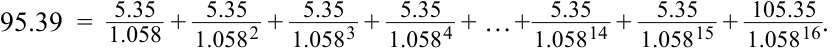
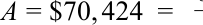
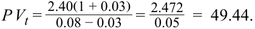
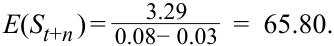

# Volume 1: Quantitative Methods
## Learning Module 2 Time Value of Money in Finance
### Part 4/4: Solutions (PDF Pages 92–94)

---

<!-- PDF Page 92 -->

# **~~SOLUTIONS~~** 

1. C is correct. The coupon payments are 5.35 (=10.7/2), the discount rate is 5.8 percent (=11.6%/2) per period, and the number of periods is 16 (=8×2). Using Equation 6, the calculation is as follows: 

<!-- Formula Text: 95.39  =   5.35 _ 1.058  +   5.35 _ 1.058 2  +   5.35 _ 1.058 3  +   5.35 _ 1.058 4  + … +   5.35 _ 1.058 14  +   5.35 _ 1.058 15  +  105.35 _ 1.058 16 . -->

Alternatively, using the Microsoft Excel or Google Sheets PV function ( ~~PV (0.058,16,5.35,100,0))~~ also yields a result of MXN95.39. A is incorrect. MXN95.47 is the result when incorrectly using coupon payments of 10.7, a discount rate of 11.6 percent, and 8 as the number of periods. B is incorrect. MXN97.18 is the result when using the correct semiannual coupons and discount rate, but incorrectly using 8 as the number of periods. 

2. A is correct. The present value of the mortgage is NZD3.75 million (=0.75×5,000,000), the periodic discount rate is 0.004 (=0.048/12), and the number of periods is 60 (=5×12). Using Equation 8, 

0.4%  (NZD3, 750, 000) 

<!-- Formula Text: A = $70, 424  = 0_ -->

<!-- Formula Text: 1 − (1 + 0.4%) −60  . -->

Alternatively, the spreadsheet PMT function may be used with the inputs stated earlier. 

B is incorrect. NZD93,899 is the result if NZD5 million is incorrectly used as the present value term. 

C is incorrect. NZD71,781 is the result if the calculation is made using 4.8 percent as the rate and 5 as the number of periods, then the answer is divided by 12. 

3. B is correct. Mylandia’s next expected dividend is CAD2.472 (=2.40×1.03), and using Equation 14, 

<!-- Formula Text: P V t =  2.40(1 + 0.03) _ 0.08 − 0.03   =  2.472 _ 0.05   =  49.44. -->

4. C is correct. Following the first step, we observe the following expected dividends for Mylandia for the next three years: 

In 1 year: _D1_ = CAD2.64 (=2.40×1.10) 

In 2 years: _D2_ = CAD2.90 (=2.40×1.102 ) In 3 years: _D3_ = CAD3.19 (=2.40×1.103 ) 

The second step involves a lower 3 percent growth rate. At the end of year four, Mylandia’s dividend ( _D4_ ) is expected to be CAD3.29 (=2.40×1.103 ×1.03). At this time, Mylandia’s expected terminal value at the end of three years is CAD65.80 using Equation 17, as follows: 

<!-- Formula Text: E(S t+n ) = 3.29 _ 0.08− 0.03   =  65.80. -->

<!-- Formula Text: Third, we calculate the sum of the present values of these expected dividends using Equation 16: P V t =  2.64 _ 1.08 +  2.90 _ 1.08 2 +  3.19 _ 1.08 3  +  65.80 _ 1.08 3   =  59.71. -->

5. C is correct. The FV of the bond is CHF95.25, the PV is CHF89, and the number of annual periods ( _t_ ) is 3. Using Equation 18, 

<!-- PDF Page 93 -->

2.29 percent = (92.25/89)(1/3) − 1. 

A is incorrect as the result is derived using _t_ of 12. B is incorrect as this result is derived using a PV of CHF95.25 and an FV of 100. 

6. A is correct. The YTM is calculated by solving for the RATE spreadsheet function with the following inputs: number of periods of 12 (=6 × 2), coupon payments of 5.35 (=10.7/2), PV of −97.50, and FV of 100. The resulting solution for RATE of 5.64 percent is in semiannual terms, so multiply by 2 to calculate annualized YTM of 11.28 percent. 

B is incorrect, as 11.50 percent is the result if number of periods used is eight, instead of 12. C is incorrect, as 11.71 percent is the result if the number of periods used is 6, instead of 12. 

7. C is correct. We may solve for required return based upon the assumption of constant dividend growth using Equation 21: 

 r_ =2.40 (1.03) + 0.03 = 0.0712 . 60 

B is incorrect as 7.00 percent is the result if we use the previous dividend of CAD2.40 instead of the next expected dividend. A is incorrect as 8.00 percent is simply the required return assumed from one of the Mylandia examples in Question Set 1 in which the price is solved to be a lower value. 

8. B is correct. Using Equation 24, the previous input results in the following inequality: 

_0.50 15 <  0.075− 0.045= 16.67 . 

The above inequality implies that the analyst should view the NIFTY 50 as priced too low. The fundamental inputs into the equation imply a forward price to earnings ratio of 16.67 rather than 15. An alternative approach to answering the question would be to solve for implied growth using the observed forward price to earnings ratio of 15 and compare this to the analyst’s growth expectations: 

_ 15 =0.50 0.075− _g_. 

Solving for _g_ yields a result of 4.1667 percent. Since the analyst expects higher NIFTY 50 dividend growth of 4.50 percent, the index is viewed as underpriced. 

9. C is correct. Using cash flow additivity, compare the two opportunities by subtracting Opportunity 2 from Opportunity 1 yielding the following cash flows: 

Opportunity 1 – Opportunity 2 0 −30 0 34.992 

Finding the present value of the above cash flows at 8 percent discount rate shows that both investment opportunities have the same present value. Thus, the two opportunities are economically identical, and there is no clear preference for one over the other. 

10. C is correct. The one-year forward rate reflects the breakeven one-year reinvestment rate in one year, computed as follows: _F_ 1,1 = (1+ _r_ 2)2 /(1+ _r_ 1) – 1, 

   - _F_ 1,1 = (1.0129)2 /(1.0073) – 1 = 0.0185. 

11. A is correct. To avoid arbitrage opportunities in exchanging euros and US dollars, investors must be able to lock in a one-year forward exchange rate of USD/ 

<!-- PDF Page 94 -->

EUR1.051 today. The solution methodology is shown below. In one year, a single unit of euro invested risk-free is worth EUR1.0075 (=e0.0075 ). In one year, a single unit of euro converted to US dollars and then invested risk-free is worth USD1.0589 (=1.025*e0.0325 ). 

To convert USD1.0589 into EUR1.0075 requires a forward exchange rate of USD/ EUR1.051 (=1.0589/1.0075). 

12. A is correct. Regardless of whether the stock increases or decreases in price, the investor’s portfolio has a value of USD7.50 as follows: 

If stock price goes to USD35, value = 0.5×35 – 10 = 7.50. 

If stock price goes to USD15, value = 0.5×15 – 0 = 7.50. 

If the stock price rises to USD35, the sold call option at USD25 has a value to the buyer of USD10, offsetting the rise in the stock price. 

