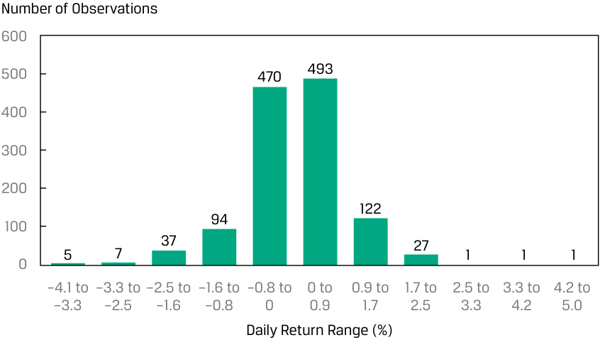
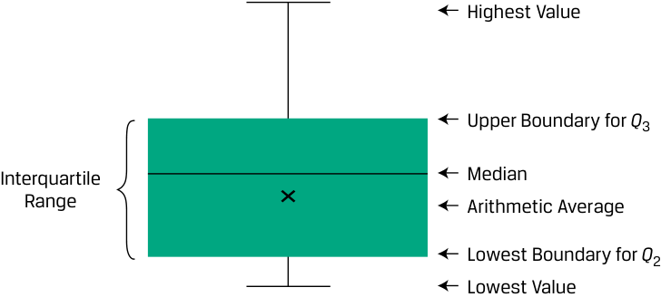
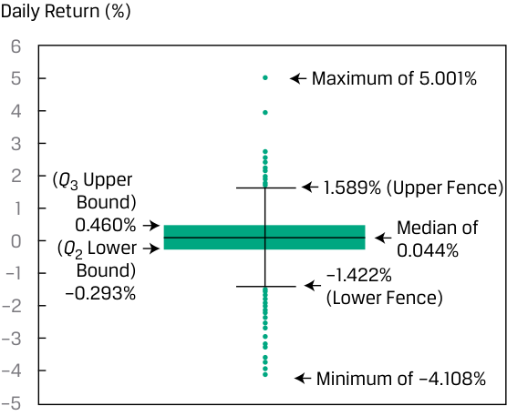

# Volume 1: Quantitative Methods
## Learning Module 3 Statistical Measures of Asset Returns
### Part 1/4: Introduction (PDF Pages 95–107)

---

<!-- PDF Page 95 -->

# L E A R N I N G M O D U L E **<mark>3</mark>** 

### **Statistical Measures of Asset Returns** 

**by Pamela Peterson Drake, PhD, CFA, and Wu Jian, PhD.** 

_Pamela Peterson Drake, PhD, CFA, is at James Madison University (USA). Jian Wu, PhD, is at State Street (USA)._ 

|**LEARNIN** |**G OUTCOMES** |
|---|---|
|**_Mastery_**|**_The candidate should be able to:_**|
||calculate, interpret, and evaluate measures of central tendency and location to address an investment problem|
||calculate, interpret, and evaluate measures of dispersion to address an investment problem|
||interpret and evaluate measures of skewness and kurtosis to address an investment problem|
||interpret correlation between two variables to address an investment problem|

#### **INTRODUCTION** 

**<mark>1</mark>** 

Data have always been a key input for securities analysis and investment management, allowing investors to explore and exploit an abundance of information for their investment strategies. While this data-rich environment offers potentially tremendous opportunities for investors, turning data into useful information is not so straightforward. 

This module provides a foundation for understanding important concepts that are an indispensable part of the analytical tool kit needed by investment practitioners, from junior analysts to senior portfolio managers. These basic concepts pave the way for more sophisticated tools that will be developed as the quantitative methods topic unfolds, which are integral to gaining competencies in the investment management techniques and asset classes that are presented later in the CFA curriculum. 

This learning module focuses on how to summarize and analyze important aspects of financial returns, including key measures of central tendency, dispersion, and the shape of return distributions—specifically, skewness and kurtosis. The learning module finishes with a graphical introduction to covariance and correlation between two variables, a key concept in constructing investment portfolios to achieve diversification across assets within a portfolio. 

<!-- PDF Page 96 -->

###### **LEARNING MODULE OVERVIEW** 

- Sample statistics—such as measures of central tendency, dispersion, skewness, and kurtosis—help with investment analysis, particularly in making probabilistic statements about returns. 

- Measures of central tendency include the mean, the median and the mode, and specify where data are centered. 

- The arithmetic mean is the sum of the observations divided by the number of observations. It is the most frequently used measure of central tendency. 

- The median is the value of the middle item of observations, or the mean of the values of the two middle items, when the items in a set are sorted into ascending or descending order. Since the median is not influenced by extreme values, it is most useful in the case of skewed distributions. 

- The mode is the most frequently observed value and is the only measure of central tendency that can be used with nominal or categorical data. A distribution may be unimodal (one mode), bimodal (two modes), trimodal (three modes), or have even more modes. 

- Quantiles, as the median, quartiles, quintiles, deciles, and percentiles, are location parameters that divide a distribution into halves, quarters, fifths, tenths, and hundredths, respectively. 

- A box and whiskers plot illustrates the distribution of a set of observations. The “box” depicts the interquartile range, the difference between the first and the third quartile. The “whiskers” outside of the “box” indicate the others measures of dispersion. 

- Dispersion measures, such as the range, mean absolute deviation (MAD), variance, standard deviation, target downside deviation, and coefficient of variation, describe the variability of outcomes around the arithmetic mean. 

- The range is the difference between the maximum value and the minimum value of the dataset. The range has only a limited usefulness because it uses information from only two observations. 

- The MAD for a sample is the average of the absolute deviations of observations from the mean. 

- The variance is the average of the squared deviations around the mean, and the standard deviation is the positive square root of variance. In computing sample variance, _s__2_ , and sample standard deviation, _s_ , the average squared deviation is computed using a divisor equal to the sample size minus 1. 

- The target downside deviation, or target semideviation, is a measure of the risk of being below a given target. 

- The coefficient of variation (CV) is the ratio of the standard deviation of a set of observations to their mean value. By expressing the magnitude of variation among observations relative to their average size, the CV allows for the direct comparisons of dispersion across different datasets. Reflecting the correction for scale, the CV is a scale-free measure, that is, it has no units of measurement. 

<!-- PDF Page 97 -->

- Skewness describes the degree to which a distribution is asymmetric about its mean. An asset return distribution with positive skewness has frequent small losses and a few extreme gains compared to a normal distribution. An asset return distribution with negative skewness has frequent small gains and a few extreme losses compared to a normal distribution. Zero skewness indicates a symmetric distribution of returns. 

- Kurtosis measures the combined weight of the tails of a distribution relative to the rest of the distribution. A distribution with fatter tails than the normal distribution is referred to as fat-tailed (leptokurtic); a distribution with thinner tails than the normal distribution is referred to as thin-tailed (platykurtic). The kurtosis of a normal distribution is 3. 

- The correlation coefficient measures the association between two variables. It is the ratio of covariance to the product of the two variables’ standard deviations. A positive correlation coefficient indicates that the two variables tend to move together, whereas a negative coefficient indicates that the two variables tend to move in opposite directions. Correlation does not imply causation, simply association. Issues that arise in evaluating correlation include the presence of outliers and spurious correlation. 

#### **MEASURES OF CENTRAL TENDENCY AND LOCATION** 

## **<mark>2</mark>** 

calculate, interpret, and evaluate measures of central tendency and location to address an investment problem 

In this lesson, our focus is on measures of central tendency and other measures of location. A **measure of central tendency** specifies where the data are centered. For a return series, a measure of central tendency shows where the empirical distribution of returns is centered, essentially a measure of the “expected” return based on the observed sample. **Measures of location** , mean, the **median** , and the **mode** include not only measures of central tendency but also other measures that illustrate other aspects of the location or distribution of the data. 

Frequency distributions, histograms, and contingency tables provide a convenient way to summarize a series of observations on an asset’s returns as a first step toward describing the data. For example, a histogram for the frequency distribution of the daily returns for the fictitious EAA Equity Index over the past five years is shown in Exhibit 1. 

<!-- PDF Page 98 -->

**Exhibit 1: Histogram of Daily Returns on the EAA Equity Index** 

<!-- Start of picture text -->
Number of Observations 600 500 470 493 400 300 200 122 94 100 37 27 5 7 1 1 1 0 –4.1 to –3.3 to –2.5 to –1.6 to –0.8 to 0 to 0.9 to 1.7 to 2.5 to 3.3 to 4.2 to –3.3 –2.5 –1.6 –0.8 0 0.9 1.7 2.5 3.3 4.2 5.0 Daily Return Range (%) <!-- End of picture text -->

##### **Measures of Central Tendency** 

###### **_The Arithmetic Mean_** 

Analysts and portfolio managers often want one number that describes a representative possible outcome of an investment decision. The arithmetic mean is one of the most frequently used measures of central tendency. 

**Arithmetic Mean.** The **arithmetic mean** is the sum of the values of the observations in a dataset divided by the number of observations. 

###### **_The Sample Mean_** 

The sample mean is the arithmetic mean, or arithmetic average, computed for a sample. 

<!-- Formula Text: Sample Mean Formula. The sample mean or average,  _ X  (read “X-bar”), is the arithmetic mean value of a sample: _ X   = ∑ i=1 n X i _ n , (1) -->

where _n_ is the number of observations in the sample. 

A property and potential drawback of the arithmetic mean is its sensitivity to extreme values, or outliers. Because all observations are used to compute the mean and are given equal weight (i.e., importance), the arithmetic mean can be pulled sharply upward or downward by extremely large or small observations, respectively. The most common approach in this situation is to report the median, or middle value, in place of or in addition to the mean. 

###### **_The Median_** 

A second important measure of central tendency is the median. 

**Definition of Median.** The median is the value of the middle item of a dataset that has been sorted into ascending or descending order. In an odd-numbered sample of _n_ observations, the median is the value of the 

<!-- PDF Page 99 -->

observation that occupies the ( _n_ + 1)/2 position. In an even-numbered sample, we define the median as the mean of the values of the observations occupying the _n_ /2 and ( _n_ + 2)/2 positions (the two middle observations). 

Whether we use the calculation for an even- or odd-numbered sample, an equal number of observations lie above and below the median. A distribution has only one median. A potential advantage of the median is that, unlike the mean, outliers do not affect it. 

The median, however, does not use all the information about the size of the observations; it focuses only on the relative position of the ranked observations. Calculating the median may also be more complex. Mathematicians express this disadvantage by saying that the median is less mathematically tractable than the mean. 

###### **_The Mode_** 

A third important measure of central tendency is the mode. 

**Definition of Mode.** The mode is the most frequently occurring value in a dataset. A dataset can have more than one mode, or even no mode. When a dataset has a single value that is observed most frequently, its distribution is said to be **unimodal** . If a dataset has two most frequently occurring values, then it has two modes and its distribution is referred to as **bimodal** . When all the values in a dataset are different, the distribution has no mode because no value occurs more frequently than any other value. 

Stock return data and other data from continuous distributions may not have a modal outcome. Exhibit 2 presents the frequency distribution of the daily returns for the EAA Equity Index over the past five years. 

**Exhibit 2: Frequency Distribution for Daily Returns of EAA Equity Index** 

|**Return Bin (%)**|**Absolute** **Frequency**|**Relative** **Frequency** **(%)**|**Cumulative** **Absolute** **Frequency**|**Cumulative** **Relative** **Frequency** **(%)**|
|---|---|---|---|---|
|−5.0 to −4.0|1|0.08|1|0.08|
|−4.0 to −3.0|7|0.56|8|0.64|
|−3.0 to −2.0|23|1.83|31|2.46|
|−2.0 to −1.0|77|6.12|108|8.59|
|−1.0 to 0.0|470|37.36|578|45.95|
|0.0 to 1.0|555|44.12|1,133|90.06|
|1.0 to 2.0|110|8.74|1,243|98.81|
|2.0 to 3.0|13|1.03|1,256|99.84|
|3.0 to 4.0|1|0.08|1,257|99.92|
|4.0 to 5.0|1|0.08|1,258|100.00|

A histogram for the frequency distribution of these daily returns was shown in Exhibit 1. The modal interval always has the highest bar in the histogram; in this case, the modal interval is 0.0 to 1.0 percent, and this interval has 555 observations out of a total of 1,258 observations. 

<!-- PDF Page 100 -->

##### **Dealing with Outliers** 

In practice, although an extreme value or outlier in a financial dataset may represent a rare value in the population, it may also reflect an error in recording the value of an observation or an observation generated from a different population. After having checked and eliminated errors, we can address what to do with extreme values in the sample. 

When dealing with a sample that has extreme values, there may be a possibility of transforming the variable (e.g., a log transformation) or of selecting another variable that achieves the same purpose. If, however, alternative model specifications or variable transformations are not possible, then three options exist for dealing with extreme values: 

Option 1 Do nothing; use the data without any adjustment. 

Option 2 Delete all the outliers. 

Option 3 Replace the outliers with another value. 

The first option is appropriate if the values are legitimate, correct observations, and it is important to reflect the whole of the sample distribution. Because outliers may contain meaningful information, excluding or altering these values may reduce valuable information. Further, because identifying a data point as extreme leaves it up to the judgment of the analyst, leaving in all observations eliminates that need to judge a value as extreme. 

The second option excludes the extreme observations. One measure of central tendency in this case is the **trimmed mean** , which is computing an arithmetic mean after excluding a stated small percentage of the lowest and highest values. For example, a 5 percent trimmed mean discards the lowest 2.5 percent and the highest 2.5 percent of values and computes the mean of the remaining 95 percent of values. A trimmed mean is used in sports competitions when judges’ lowest and highest scores are discarded in computing a contestant’s score. 

The third option involves substituting values for the extreme values. A measure of central tendency in this case is the **winsorized mean** . It is calculated after assigning one specified low value to a stated percentage of the lowest values in the dataset and one specified high value to a stated percentage of the highest values in the dataset. For example, a 95 percent winsorized mean sets the bottom 2.5 percent of values in the dataset equal to the value at or below which 2.5 percent of all the values lie (as will be seen shortly, this is called the “2.5th percentile” value) and the top 2.5 percent of values in the dataset equal to the value at or below which 97.5 percent of all the values lie (the “97.5th percentile” value). 

Often comparing the statistical measures of datasets with outliers included and with outliers excluded can reveal important insights about the dataset. Such comparison can be particularly helpful when investors analyze the behavior of asset returns and rate, price, spread and volume changes. 

In Example 1, we show the differences among these options for handling outliers using daily returns for the fictitious Euro-Asia-Africa (EAA) Equity Index in Exhibit 2. 

###### **EXAMPLE 1** 

##### **Handling Outliers: Daily Returns to an Index** 

Using daily returns on the EAA Equity Index for the past five years, consisting of 1,258 trading days, we can see the effect of trimming and winsorizing the data: 

<!-- PDF Page 101 -->

**Exhibit 3: Effect of Trimming and Winsorizing** 

|||**Trimmed Mean**|**Winsorized Mean**|
|---|---|---|---|
||**Arithmetic Mean**|**(Trimmed 5%)**|**(95%)**|
|Mean|0.035%|0.048%|0.038%|
|Number of||||
|Observations|1,258|1,194|1,258|

The trimmed mean eliminates the lowest 2.5 percent of returns, which in this sample is any daily return less than −1.934 percent, and it eliminates the highest 2.5 percent, which in this sample is any daily return greater than 1.671 percent. The result of this trimming is that the mean is calculated using 1,194 observations instead of the original sample’s 1,258 observations. 

The winsorized mean substitutes a return of −1.934 percent (the 2.5 percentile value) for any observation below −1.934 and substitutes a return of 1.671 percent (the 97.5 percentile value) for any observation above 1.671. The result in this case is that the trimmed and winsorized means are higher than the arithmetic mean, suggesting the potential evidence of significant negative returns in the observed daily return distribution. 

##### **Measures of Location** 

Having discussed measures of central tendency, we now examine an approach to describing the location of data that involves identifying values at or below which specified proportions of the data lie. For example, establishing that 25 percent, 50 percent, and 75 percent of the annual returns on a portfolio provides concise information about the distribution of portfolio returns. Statisticians use the word **quantile** as the most general term for a value at or below which a stated fraction of the data lies. In the following section, we describe the most commonly used quantiles—quartiles, quintiles, deciles, and percentiles—and their application in investments. 

###### **_Quartiles, Quintiles, Deciles, and Percentiles_** 

We know that the median divides a distribution of data in half. We can define other dividing lines that split the distribution into smaller sizes. **Quartiles** divide the distribution into quarters, **quintiles** into fifths, **deciles** into tenths, and **percentiles** into hundredths. The **interquartile range** (IQR) is the difference between the third quartile and the first quartile, or IQR = _Q_ 3 − _Q_ 1. 

Example 2 illustrates the calculation of various quantiles for the daily return on the EAA Equity Index. 

###### **EXAMPLE 2** 

##### **Percentiles, Quintiles, and Quartiles for the EAA Equity Index** 

Using the daily returns on the EAA Equity Index over the past five years and ranking them from lowest to highest daily return, we show the return bins from 1 (the lowest 5 percent) to 20 (the highest 5 percent) as follows: 

<!-- PDF Page 102 -->

**Exhibit 4: EAA Equity Index Daily Returns Grouped by Size of Return** 

||**Cumulative Percent-** |**Daily Retur** |**n (%) between**||
|---|---|---|---|---|
|**Bin**|**age of Sample Trading** **Days (%)**|**Lower** **Bound**|**Upper Bound**|**Number of** **Observations**|
|1|5|−4.108|−1.416|63|
|2|10|−1.416|−0.876|63|
|3|15|−0.876|−0.629|63|
|4|20|−0.629|−0.432|63|
|5|25|−0.432|−0.293|63|
|6|30|−0.293|−0.193|63|
|7|35|−0.193|−0.124|62|
|8|40|−0.124|−0.070|63|
|9|45|−0.070|−0.007|63|
|10|50|−0.007|0.044|63|
|11|55|0.044|0.108|63|
|12|60|0.108|0.173|63|
|13|65|0.173|0.247|63|
|14|70|0.247|0.343|62|
|15|75|0.343|0.460|63|
|16|80|0.460|0.575|63|
|17|85|0.575|0.738|63|
|18|90|0.738|0.991|63|
|19|95|0.991|1.304|63|
|20|100|1.304|5.001|63|

Because of the continuous nature of returns, it is not likely for a return to fall on the boundary for any bin other than the minimum (Bin = 1) and maximum (Bin = 20). 

Using the data in Exhibit 4, complete the following tasks: 

1. Identify the 10th and 90th percentiles. 

###### **Solution:** 

The 10th and 90th percentiles correspond to the bins or ranked returns that include 10 percent and 90 percent of the daily returns, respectively. The 10th percentile corresponds to the return of −0.876 percent (and includes returns of that much and lower), and the 90th percentile corresponds to the return of 0.991 percent (and lower). 

2. Identify the first, second, and third quintiles. 

###### **Solution:** 

The first quintile corresponds to the lowest 20 percent of the ranked data, or −0.432 percent (and lower). The second quintile corresponds to the lowest 40 percent of the ranked data, or −0.070 percent (and lower). 

The third quintile corresponds to the lowest 60 percent of the ranked data, or 0.173 percent (and lower). 

<!-- PDF Page 103 -->

3. Identify the first and third quartiles. 

###### **Solution:** 

The first quartile corresponds to the lowest 25 percent of the ranked data, or −0.293 percent (and lower). The third quartile corresponds to the lowest 75 percent of the ranked data, or 0.460 percent (and lower). 

4. Identify the median. 

###### **Solution:** 

The median is the return for which 50 percent of the data lies on either side, which is 0.044 percent, the highest daily return in the 10th bin out of 20. 

5. Calculate the interquartile range. 

###### **Solution:** 

The interquartile range is the difference between the third and first quartiles, 0.460 percent and −0.293 percent, or 0.753 percent. 

One way to visualize the dispersion of data across quartiles is to use a diagram, such as a box and whisker chart. A **box and whisker plot** is shown in Exhibit 5. The “box” represents the lower bound of the second quartile and the upper bound of the third quartile, with the median or arithmetic average noted as a measure of central tendency of the entire distribution. The whiskers are the lines that run from the box and are bounded by the “fences,” which represent the lowest and highest values of the distribution. 

**Exhibit 5: Box and Whisker Plot** 

<!-- Start of picture text -->
Highest Value Upper Boundary for  Q 3 Interquartile Median Range × Arithmetic Average Lowest Boundary for  Q 2 Lowest Value <!-- End of picture text -->

There are several variations for box and whisker displays. For example, for ease in detecting potential outliers, the fences of the whiskers may be a function of the interquartile range instead of the highest and lowest values like that in Exhibit 5. 

In Exhibit 5, visually, the interquartile range is the height of the box and the fences are set at extremes. But another form of box and whisker plot typically uses 1.5 times the interquartile range for the fences. Thus, the upper fence is 1.5 times the interquartile range added to the upper bound of _Q_ 3, and the lower fence is 1.5 times the interquartile range subtracted from the lower bound of _Q_ 2. Observations beyond the fences (i.e., outliers) may also be displayed. 

We can see the role of outliers in such a box and whisker plot using the EAA Equity Index daily returns, as shown in Exhibit 6. 

<!-- PDF Page 104 -->

###### **Exhibit 6: Box and Whisker Chart for EAA Equity Index Daily Returns** 

<!-- Start of picture text -->
Daily Return (%) 6 5 Maximum of 5.001% 4 3 2 ( Q 3 Upper  1.589% (Upper Fence) 1 Bound) 0.460% Median of 0 ( Q 2 Lower 0.044% –1 Bound) –1.422% –2 –0.293% (Lower Fence) –3 –4 Minimum of –4.108% –5 <!-- End of picture text -->

Exhibit 6 reveals the following: 

- The maximum and minimum values of the distribution are 5.001 and −4.108, respectively, while the median (50th percentile) value is 0.044. 

- The interquartile range is 0.753 [= 0.460 − (−0.293)], and when multiplied by 1.5 and added to the _Q_ 3 upper bound of 0.460 gives an upper fence of 1.589 [= (1.5 × 0.753) + 0.460]. 

- The lower fence is determined in a similar manner, using the _Q_ 2 lower bound, to be −1.422 [= −(1.5 × 0.753) + (−0.293)]. 

As noted, any observation above (below) the upper (lower) fence is deemed to be an outlier. 

###### **_Quantiles in Investment Practice_** 

Quantiles are used in portfolio performance evaluation as well as in investment strategy development and research. 

Investment analysts use quantiles to rank performance, such as the performance of assets, indexes, and portfolios. The performance of investment managers is often characterized in terms of the percentile in which their performance falls relative to the performance of their peer group of managers. The widely used Morningstar investment fund star rankings, for example, associate the number of stars with percentiles of performance metrics relative to similar-style investment funds. 

Another key use of quantiles is in investment research. Dividing data into quantiles based on a specific objectively quantifiable characteristic, such as sales, market capitalization, or asset size allows analysts to evaluate the impact of that specific characteristic on a quantity of interest, such as asset returns, sales, growth, or valuation metrics. For instance, quantitatively driven investors often rank companies based on the market value of their equity, or their market capitalization, before sorting them into deciles. The first decile contains the portfolio of those companies with the smallest market values, usually called small capitalization companies. The tenth decile contains those companies with the largest market values, usually called large capitalization companies. Ranking companies by decile allows analysts to compare the absolute and relative performance of small market capitalization companies with large ones. 

<!-- PDF Page 105 -->

###### **QUESTION SET** 

The histogram in Exhibit 7 shows a distribution of the annual returns for the S&P 500 Index for a 50-year period. 

###### **Exhibit 7: Annual Returns for the S&P 50 Index** 

<!-- Start of picture text -->
Frequency 8 7 6 5 4 3 2 1 0 –37 –32 –27 –22 –17 –12 –7 –2 3 8 13 18 23 28 33 to to to to to to to to to to to to to to to –32 –27 –22 –17 –12 –7 –2 3 8 13 18 23 28 33 38 Return Intervals (%) <!-- End of picture text -->

1. The bin containing the median return is: 

   - **A.** 3 percent to 8 percent. 

   - **B.** 8 percent to 13 percent. 

   - **C.** 13 percent to 18 percent. 

   - **Solution:** 

C is correct. Because 50 data points are in the histogram, the median return would be the mean of the 50/2 = 25th and (50 + 2)/2 = 26th positions. The sum of the return bin frequencies to the left of the 13 percent to 18 percent interval is 24. As a result, the 25th and 26th returns will fall in the 13 percent to 18 percent interval. 

2. Based on Exhibit 7, the distribution would be _best_ described as being: 

   - **A.** unimodal. 

   - **B.** bimodal. 

   - **C.** trimodal. 

###### **Solution:** 

C is correct. The mode of a distribution with data grouped in intervals is the interval with the highest frequency. The three intervals of 3 percent to 8 

<!-- PDF Page 106 -->

percent, 18 percent to 23 percent, and 28 percent to 33 percent all have the highest frequency of 7. 

Consider the annual returns in Exhibit 8 for three portfolios for Portfolios P, Q and R. Portfolios P and R were created in Year 1, Portfolio Q was created in Year 2. 

**Exhibit 8: Annual Portfolio Returns** 

||**Year 1 (%)**|**Year 2 (%)**|**Year 3 (%)**|**Year 4 (%)**|**Year 5 (%)**|
|---|---|---|---|---|---|
|Portfolio P|−3.0|4.0|5.0|3.0|7.0|
|Portfolio Q|NA|−3.0|6.0|4.0|8.0|
|Portfolio R|1.0|−1.0|4.0|4.0|3.0|

3. The median annual return for: 

   - **A.** Portfolio P is 4.5 percent. 

   - **B.** Portfolio Q is 4.0 percent. 

   - **C.** Portfolio R is higher than its arithmetic mean annual return. 

   - **Solution:** 

C is correct. The median of Portfolio R is 0.8 percent higher than the mean for Portfolio R. A is incorrect because the median annual return for Portfolio P is 4.0 percent. B is incorrect because the median annual return for Portfolio Q is 5.0 percent (midpoint of 4 percent and 6 percent). 

4. The mode for Portfolio R is: 

   - **A.** 1.0 percent. 

   - **B.** 3.0 percent. 

   - **C.** 4.0 percent. 

   - **Solution:** 

C is correct. The mode is the most frequently occurring value in a dataset, which for Portfolio R is 4.0 percent. 

A fund had the following returns over the past 10 years: 

**Exhibit 9: Fund Returns for 10 Years** 

|**Year**|**Return**|
|---|---|
|1|4.5%|
|2|6.0%|
|3|1.5%|
|4|−2.0%|
|5|0.0%|
|6|4.5%|
|7|3.5%|
|8|2.5%|

<!-- PDF Page 107 -->

<!-- Start of picture text -->
Year Return 9 5.5% 10 4.0% 5. The fund’s arithmetic mean return over the 10 years is  closest  to: A.  2.97 percent. B.  3.00 percent. C.  3.33 percent. Solution: B is correct. The sum of the returns is 30.0 percent, so the arithmetic mean is 30.0%/10 = 3.0%. 6. The fund’s geometric mean return over the 10 years is  closest  to: A.  2.94 percent. B.  2.97 percent. C.  3.00 percent. Solution: B is correct. The geometric mean return is calculated as follows: _ _____________________________________________ R G  =  10√(1 + 0.045) ×  (1 + 0.06) × … ×  (1 + 0.055) ×  (1 + 0.04) − 1 , R  _ G  =  10√ _ 1.3402338 − 1 = 2.9717%. 7. The harmonic mean return over the 10 years is  closest  to: A.  2.94 percent. B.  2.97 percent. C.  3.00 percent. Solution: A is correct. The harmonic mean is calculated as follows: X  _ H  =  ____________ n n  − 1 , ∑ i =1(1 / (1 +   ri ) _ ______________________________10 X H  =   _ _ _ _ (1.045 1 ) +  ( 1.06 1 ) + … + ( 1.055 1 ) +  ( 1.04 1 ) − 1 , _ _ X H  =  (9.714 10 ) −  1 = 2.9442 %. Consider the box and whisker plot in Exhibit 10: <!-- End of picture text -->

