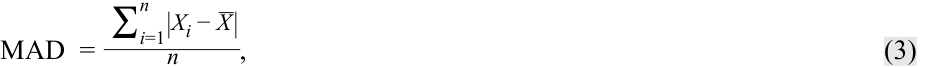
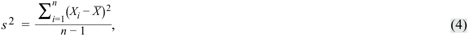
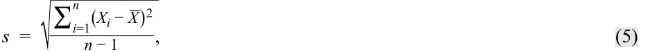
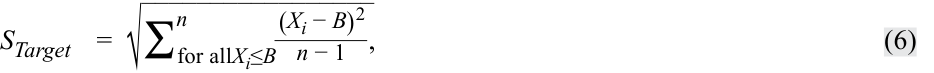
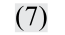
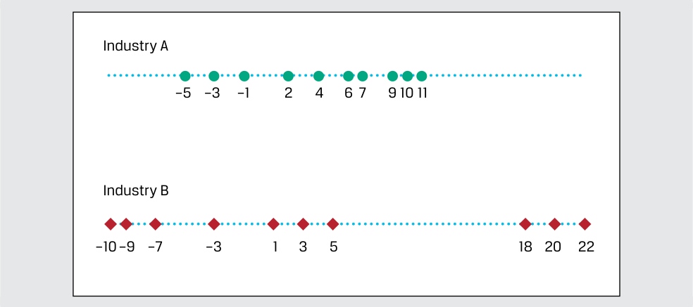
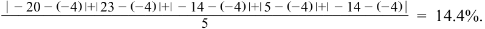

# Volume 1: Quantitative Methods
## Learning Module 3 Statistical Measures of Asset Returns
### Part 2/4: Measures of Dispersion (PDF Pages 108–117)

---

<!-- PDF Page 108 -->

**Exhibit 10: Box and Whisker Plot** 

<!-- Start of picture text -->
180 160 154.45 140 120 114.25 100 100.49 80 79.74 60 51.51 40 <!-- End of picture text -->

8. The median is _closest_ to: 

   - **A.** 34.51. 

   - **B.** 100.49. 

   - **C.** 102.98. 

   - **Solution:** 

B is correct. In a box and whisker plot, the “box” represents the lower bound of the second quartile and the upper bound of the third quartile, with the median or arithmetic average noted as a measure of central tendency of the entire distribution. The median is indicated within the box, which is 100.49. 

9. The interquartile range is _closest_ to: 

**A.** 13.76. 

- **B.** 25.74. 

**C.** 34.51. **Solution:** 

C is correct. The interquartile range is the height of the box, which is the difference between 114.25 and 79.74, equal to 34.51. 

# **<mark>3</mark>** 

## **MEASURES OF DISPERSION** 

calculate, interpret, and evaluate measures of dispersion to address an investment problem 

Few would disagree with the importance of expected return or mean return in investments: To understand an investment more completely, however, we also need to know how returns are dispersed around the mean. **Dispersion** is the variability around the central tendency. If mean return addresses reward, then dispersion addresses risk and uncertainty. 

<!-- PDF Page 109 -->

In this lesson, we examine the most common measures of dispersion: range, mean absolute deviation, variance, and standard deviation. These are all measures of **absolute dispersion** . Absolute dispersion is the amount of variability present without comparison to any reference point or benchmark. 

### **The Range** 

We encountered range earlier when we discussed the construction of frequency distributions. It is the simplest of all the measures of dispersion. 

**Definition of Range.** The **range** is the difference between the maximum and minimum values in a dataset: 

Range = Maximum value − Minimum value. ~~(2)~~ 

An alternative way to report the range is to specify both the maximum and minimum values. This alternative definition provides more information as the range is reported as “from Maximum Value to Minimum Value.” 

One advantage of the range is ease of computation. A disadvantage is that the range uses only two pieces of information from the distribution. It cannot tell us how the data are distributed (i.e., the shape of the distribution). Because the range is the difference between the maximum and minimum values in the dataset, it is also sensitive to extremely large or small observations (“outliers”) that may not be representative of the distribution. 

### **Mean Absolute Deviations** 

Measures of dispersion can be computed using all the observations in the distribution rather than just the highest and lowest. We could compute measures of dispersion as the arithmetic average of the deviations around the mean, but the problem is that deviations around the mean always sum to 0. Therefore, we need to find a way to address the problem of negative deviations canceling out positive deviations. 

One solution is to examine the absolute deviations around the mean as in the **mean absolute deviation** (MAD). 

**MAD Formula.** The MAD for a sample is: 

<!-- Formula Text: MAD  = ∑ i=1 n |X i − _ X | _ n , (3) -->

where _X__ is the sample mean, _n_ is the number of observations in the sample, and the | | indicate the absolute value of what is contained within these bars. 

The MAD uses all of the observations in the sample and is thus superior to the range as a measure of dispersion. One technical drawback of MAD is that it is difficult to manipulate mathematically compared with the next measure we will introduce, sample variance. 

### **Sample Variance and Sample Standard Deviation** 

A second approach to the problem of positive and negative deviations canceling out is to square them. Variance and standard deviation, which are based on squared deviations, are the two most widely used measures of dispersion. **Variance** is defined as the average of the squared deviations around the mean. **Standard deviation** is the square root of the variance. 

<!-- PDF Page 110 -->

#### **_Sample Variance_** 

In investments, we often do not know the mean of a population of interest, so we estimate it using the mean from a sample drawn from the population. The corresponding measure of dispersion is the sample variance or standard deviation. 

**Sample Variance Formula** . The **sample variance** , _s__2_ , is: 

<!-- Formula Text: s 2  = ∑ i=1 n (X i − _ X ) 2 ___________ n − 1 , (4) -->

where _X__ is the sample mean and _n_ is the number of observations in the sample. 

The variance calculation takes care of the problem of negative deviations from the mean canceling out positive deviations by squaring those deviations. 

For the sample variance, by dividing by the sample size minus 1 (or _n_ − 1) rather than _n_ , we improve the statistical properties of the sample variance. The quantity _n_ − 1 is also known as the number of degrees of freedom in estimating the population variance. To estimate the population variance with _s_2 , we must first calculate the sample mean, which itself is an estimated parameter. Therefore, once we have computed the sample mean, there are only _n_ − 1 independent pieces of information from the sample; that is, if you know the sample mean and _n_ − 1 of the observations, you could calculate the missing sample observation. 

#### **_Sample Standard Deviation_** 

Variance is measured in squared units associated with the mean, and we need a way to return to those original units. Standard deviation, the square root of the variance, solves this problem and is more easily interpreted than the variance. 

A useful property of the sample standard deviation is that, unlike sample variance, it is expressed in the same unit as the data itself. If the dataset is percentage of daily returns for an index, then both the average and the standard deviation of the dataset is in percentage terms, while the variance is in squared percentage of daily returns. 

**Sample Standard Deviation Formula.** The **sample standard deviation** , _s_ , is: 

<!-- Formula Text: s  =  √ ____________ ∑ i=1 n (X i − _ X ) 2 ___________ n − 1 , (5) -->

where _X__ is the sample mean and _n_ is the number of observations in the sample. 

Because the standard deviation is a measure of dispersion about the arithmetic mean, we usually present the arithmetic mean and standard deviation together when summarizing data. When we are dealing with data that represent a time series of percentage changes, presenting the geometric mean (i.e., representing the compound rate of growth) is also very helpful. 

### **Downside Deviation and Coefficient of Variation** 

An asset’s variance or standard deviation of returns is often interpreted as a measure of the asset’s risk. Variance and standard deviation of returns take account of returns above and below the mean, or upside and downside risks, respectively. However, 

<!-- PDF Page 111 -->

investors are typically concerned only with **downside risk** —for example, returns below the mean or below some specified minimum target return. As a result, analysts have developed measures of downside risk. 

#### **_Downside Deviation_** 

In practice, we may be concerned with values of return (or another variable) below some level other than the mean. For example, if our return objective is 6.0 percent annually (our minimum acceptable return), then we may be concerned particularly with returns below 6.0 percent a year. The target downside deviation, also referred to as the **target semideviation** , is a measure of dispersion of the observations (here, returns) below a target—for example 6.0 percent. To calculate a sample target semideviation, we first specify the target. After identifying observations below the target, we find the sum of those squared negative deviations from the target, divide that sum by the total number of observations in the sample minus 1, and, finally, take the square root. 

**Sample Target Semideviation Formula.** The target semideviation, _s_ Target, is: 

<!-- Formula Text: S Target    =  √ _________________ ∑ for allX i≤B n (X i − B) 2 _ n − 1   , (6) -->

where _B_ is the target and _n_ is the total number of sample observations. We illustrate this in Example 3. 

#### **EXAMPLE 3** 

### **Calculating Target Downside Deviation** 

Consider the monthly returns on a portfolio as shown in Exhibit 11: 

**Exhibit 11: Monthly Portfolio Returns** 

|**Month**|**Return (%)**|
|---|---|
|January|5|
|February|3|
|March|−1|
|April|−4|
|May|4|
|June|2|
|July|0|
|August|4|
|September|3|
|October|0|
|November|6|
|December|5|

1. Calculate the target downside deviation when the target return is 3 percent. **Solution:** 

<!-- PDF Page 112 -->

|**Month**|**Observation**|**Deviation** **from the 3%** **Target**|**Deviations** **below the** **Target**|**Squared Devia-** **tions below the** **Target**|
|---|---|---|---|---|
|January|5|2|—|—|
|February|3|0|—|—|
|March|−1|−4|−4|16|
|April|−4|−7|−7|49|
|May|4|1|—|—|
|June|2|−1|−1|1|
|July|0|−3|−3|9|
|August|4|1|—|—|
|September|3|0|—|—|
|October|0|−3|−3|9|
|November|6|3|—|—|
|December|5|2|—|—|
|**Sum**||||**84**|

_84 **Target semideviation** =  √_( 12 − 1)  = 2.7634%. 

2. If the target return were 4 percent, would your answer be different from that for question 1? Without using calculations, explain how would it be different? 

#### **Solution:** 

If the target return is higher, then the existing deviations would be larger and there would be several more values in the deviations and squared deviations below the target; so, the target semideviation would be larger. 

How does the target downside deviation relate to the sample standard deviation? We illustrate the differences between the target downside deviation and the standard deviation in Example 4, using the data in Example 3. 

#### **EXAMPLE 4** 

### **Comparing the Target Downside Deviation with the Standard Deviation** 

1. Given the data in Example 3, calculate the sample standard deviation. 

#### **Solution:** 

|**Month**|**Observation** **D**|**eviation from the** **Mean**|**Squared Deviation**|
|---|---|---|---|
|January|5|2.75|7.5625|
|February|3|0.75|0.5625|
|March|−1|−3.25|10.5625|
|April|−4|−6.25|39.0625|
|May|4|1.75|3.0625|
|June|2|−0.25|0.0625|

<!-- PDF Page 113 -->

|**Month**|**Observation** **D**|**eviation from the** **Mean**|**Squared Deviation**|
|---|---|---|---|
|July|0|−2.25|5.0625|
|August|4|1.75|3.0625|
|September|3|0.75|0.5625|
|October|0|−2.25|5.0625|
|November|6|3.75|14.0625|
|December|5|2.75|7.5625|
|**Sum**|27||**96.2500**|

<mark>_</mark> 96.2500 The sample standard deviation is  √_ 11= 2.958%. 

2. Given the data in Example 3, calculate the target downside deviation if the target is 2 percent. **Solution:** 

|**Month**|**Observation**|**Deviation** **from the 2%** **Target**|**Deviations** **below the** **Target**|**Squared Devia-** **tions below the** **Target**|
|---|---|---|---|---|
|January|5|3|—|—|
|February|3|1|—|—|
|March|−1|−3|−3|9|
|April|−4|−6|−6|36|
|May|4|2|—|—|
|June|2|0|—|—|
|July|0|−2|−2|4|
|August|4|2|—|—|
|September|3|1|—|—|
|October|0|−2|−2|4|
|November|6|4|—|—|
|December|5|3|—|—|
|**Sum**||||**53**|

__53 The target semideviation with 2 percent target =  √ 11= 2.195 percent. 

3. Compare the standard deviation, the target downside deviation if the target is 2 percent, and the target downside deviation if the target is 3 percent. 

#### **Solution:** 

The standard deviation is based on the deviation from the mean, or 27% / 12 = 2.25%. The standard deviation includes all deviations from the mean, not just those below it. This results in a sample standard deviation of 2.958 percent. 

Considering just the four observations below the 2 percent target, the target semideviation is 2.195 percent. It is less than the sample standard deviation since target semideviation captures only the downside risk (i.e., deviations below the target). Considering target semideviation with a 3 percent target, 

<!-- PDF Page 114 -->

there are now five observations below 3 percent, so the target semideviation is higher, at 2.763 percent. 

#### **_Coefficient of Variation_** 

We noted earlier that the standard deviation is more easily interpreted than variance because standard deviation uses the same units of measurement as the observations. We may sometimes find it difficult to interpret what standard deviation means in terms of the relative degree of variability of different sets of data, however, either because the datasets have markedly different means or because the datasets have different units of measurement. In this section, we explain a measure of relative dispersion, the coefficient of variation that can be useful in such situations. **Relative dispersion** is the amount of dispersion relative to a reference value or benchmark. 

The coefficient of variation is helpful in such situations as that just described (i.e., datasets with markedly different means or different units of measurement). 

**Coefficient of Variation Formula.** The **coefficient of variation** (CV) is the ratio of the standard deviation of a set of observations to their mean value: 

<!-- Formula Text: CV  =   s _ _ X  , -->

<!-- Formula Text: (7) -->

where _s_ is the sample standard deviation and _X__ is the sample mean. 

When the observations are returns, for example, the CV measures the amount of risk (standard deviation) per unit of reward (mean return). An issue that may arise, especially when dealing with returns, is that if _X__ is negative, the statistic is meaningless. 

The CV may be stated as a multiple (e.g., two times) or as a percentage (e.g., 200 percent). Expressing the magnitude of variation among observations relative to their average size, the CV permits direct comparisons of dispersion across different datasets. Reflecting the correction for scale, the CV is a scale-free measure (i.e., , it has no units of measurement). 

We illustrate the usefulness of CV for comparing datasets with markedly different standard deviations using two hypothetical samples of companies in Example 5. 

#### **EXAMPLE 5** 

### **Coefficient of Variation of Returns on Assets** 

Suppose an analyst collects the return on assets (ROA), in percentage terms, for 10 companies for each of two industries: 

**Exhibit 12: Returns on Assets for Two Industries** 

|**Company**|**Industry A**|**Industry B**|
|---|---|---|
|1|−5|−10|
|2|−3|−9|
|3|−1|−7|
|4|2|−3|
|5|4|1|
|6|6|3|
|7|7|5|
|8|9|18|

<!-- PDF Page 115 -->

|**Company**|**Industry A**|**Industry B**|
|---|---|---|
|9|10|20|
|10|11|22|

These data can be represented graphically as shown in Exhibit 13: 

#### **Exhibit 13: Returns on Assets Depicted Graphically** 

<!-- Start of picture text -->
Industry A –5 –3 –1 2 4 6 7 9 10 11 Industry B –10–9 –7 –3 1 3 5 18 20 22 <!-- End of picture text -->

1. Calculate the average ROA for each industry. 

#### **Solution:** 

The arithmetic mean ROA for both industries is the sum of the 10 observations, which in both cases is 40, divided by the 10 observations, or 40/10 = 4%. 

2. Calculate the standard deviation of ROA for each industry. 

#### **Solution:** 

Using Equation 5, the standard deviation for Industry A is 5.60 and 12.12 for Industry B. 

3. Calculate the coefficient of variation (CV) of the ROA for each industry. 

#### **Solution:** 

Using Equation 7, the CV for Industry A = 5.60/4 = 1.40 and the CV for Industry B = 12.12/4 = 3.03. 

Though the two industries have the same arithmetic mean ROA, the dispersion is quite different—with Industry B’s returns on assets being much more disperse than those of Industry A. The CV for these two industries reflects this, with Industry B having a larger CV. The interpretation is that the risk per unit of mean return is more than two times (2.16 = 3.03/1.40) greater for Industry B than Industry A. 

#### **QUESTION SET** 

Consider the annual MSCI World Index total returns for a 10-year <u>period, as shown in Exhibit 14:</u> 

<!-- PDF Page 116 -->

#### **Exhibit 14: MSCI World Index Total Returns** 

|Year 1|15.25%|Year 6|30.79%|
|---|---|---|---|
|Year 2|10.02%|Year 7|12.34%|
|Year 3|20.65%|Year 8|−5.02%|
|Year 4|9.57%|Year 9|16.54%|
|Year 5|−40.33%|Year 10|27.37%|

1. For Years 6 through 10, the mean absolute deviation (MAD) of the MSCI World Index total returns is _closest_ to: 

   - **A.** 10.20 percent. 

   - **B.** 12.74 percent. 

**C.** 16.40 percent. **Solution:** 

A is correct. The MAD is calculated as follows: 

Step 1 Sum annual returns and divide by _n_ to find the arithmetic mean( _X__) of 16.40 percent. 

<!-- Formula Text: Step 2	 Calculate the absolute value of the difference between each year’s return and the mean from Step 1. Sum the results and divide by n to find the MAD: MAD  = ∑ i=1 n |X i − _ X | _ n , -->

_ MAD =50.98% = 10.20%. 5 

These calculations are shown in the following table: 

||**Step 1**|**Step 2**|
|---|---|---|
|**Year**|**Return**|**| **_X_ _i_**−** **_** _X_**|**|
|Year 6|30.79%|14.39%|
|Year 7|12.34%|4.06%|
|Year 8|−5.02%|21.42%|
|Year 9|16.54%|0.14%|
|Year 10|27.37%|10.97%|
|Sum:|82.02%|50.98%|
|_n:_|5|5|
|_ _X_:|16.40%|10.20%|

Annual returns and summary statistics for three funds are listed as follows: 

||**A**|**nnual Returns (%**|**)**|
|---|---|---|---|
|**Year**|**Fund ABC**|**Fund XYZ**|**Fund PQR**|
|Year 1|−20.0|−33.0|−14.0|
|Year 2|23.0|−12.0|−18.0|
|Year 3|−14.0|−12.0|6.0|

<!-- PDF Page 117 -->

||**A**|**nnual Returns (%**|**)**|
|---|---|---|---|
|**Year**|**Fund ABC**|**Fund XYZ**|**Fund PQR**|
|Year 4|5.0|−8.0|−2.0|
|Year 5|−14.0|11.0|3.0|
|Mean|−4.0|−10.8|−5.0|
|Standard deviation|17.8|15.6|10.5|

2. The fund with the highest mean absolute deviation (MAD) is Fund: 

**A.** ABC. 

**B.** XYZ. 

**C.** PQR. 

**Solution:** 

A is correct. The MAD of Fund ABC’s returns is the highest among the three funds. Using Equation 3, the MAD for each fund is calculated as follows: 

MAD for Fund ABC = 

<!-- Formula Text: |  − 20 − (− 4) |+| 23 − (− 4) |+|  − 14 − (− 4) |+| 5 − (− 4) |+|  − 14 − (− 4) | ________________________________________________ 5 =  14.4%. -->

MAD for Fund XYZ = 

_____________________________________________________________|  − 33 −  (− 10.8)|+|  − 12 −  (− 10.8)|+|  − 12 −  (− 10.8)|+|  − 8 −  (− 10.8)|+| 11 −  (− 10.8)| 5 

= 9.8% . 

MAD for Fund PQR = 

_______________________________________________|  − 14 −  (− 5)|  +  |  − 18 −  (− 5)|+| 6 −  (− 5)|+|  − 2 −  (− 5)|+| 3 −  (− 5)| = 8.8% . 5 

3. Consider the statistics in Exhibit 15 for Portfolio A and Portfolio B over the past 12 months: 

#### **Exhibit 15: Portfolio A and Portfolio B Statistics** 

||**Portfolio A**|**Portfolio B**|
|---|---|---|
|Average Return|3%|3%|
|Geometric Return|2.85%|?|
|Standard Deviation|4%|6%|

4. The geometric mean return of Portfolio B is _most likely_ to be: 

   - **A.** less than 2.85 percent. 

**B.** equal to 2.85 percent. 

