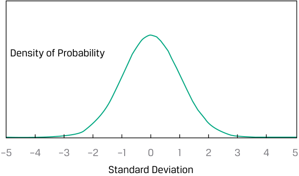
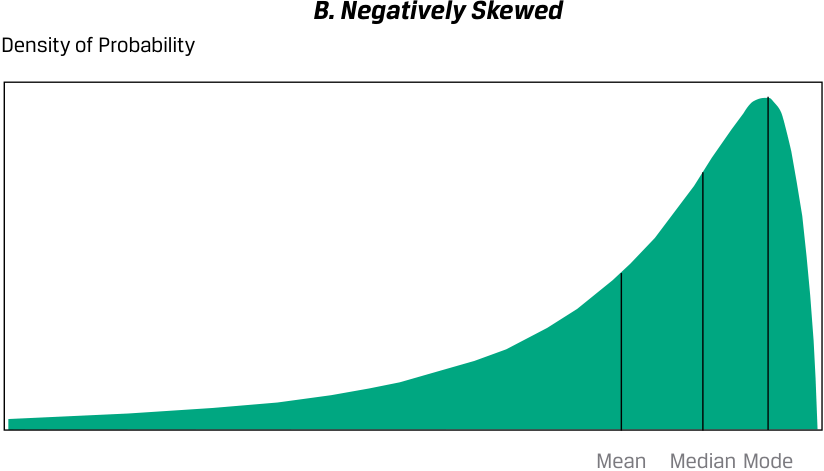
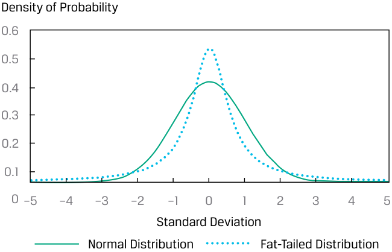
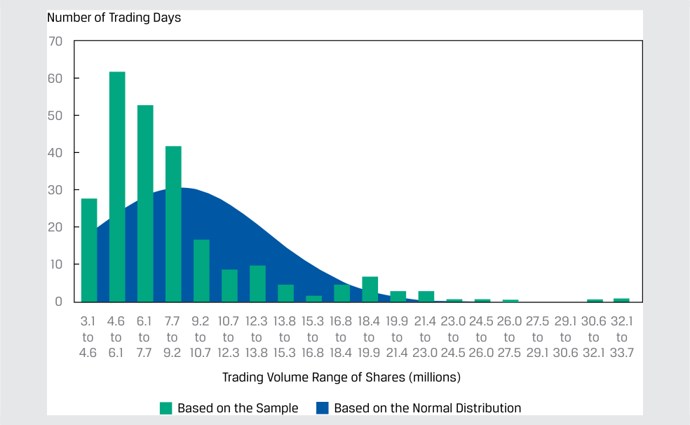
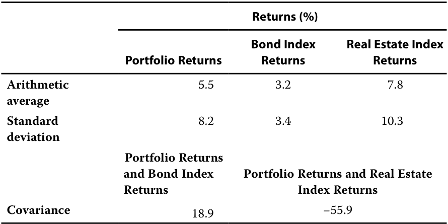

# Volume 1: Quantitative Methods
## Learning Module 3 Statistical Measures of Asset Returns
### Part 3/4: Measures of Shape of a Distribution (PDF Pages 118–133)

---

<!-- PDF Page 118 -->

**C.** greater than 2.85 percent. **Solution:** 

A is correct. The higher the dispersion of a distribution, the greater the difference between the arithmetic mean and the geometric mean. 

# **<mark>4</mark>** 

## **MEASURES OF SHAPE OF A DISTRIBUTION** 

interpret and evaluate measures of skewness and kurtosis to address an investment problem 

Mean and variance may not adequately describe an investment’s distribution of returns. In calculations of variance, for example, the deviations around the mean are squared, so we do not know whether large deviations are likely to be positive or negative. We need to go beyond measures of central tendency, location, and dispersion to reveal other important characteristics of the distribution. One important characteristic of interest to analysts is the degree of symmetry in return distributions. 

If a return distribution is symmetrical about its mean, each side of the distribution is a mirror image of the other. Thus, equal loss and gain intervals exhibit the same frequencies. 

One of the most important distributions is the normal distribution, depicted in Exhibit 16. This symmetrical, bell-shaped distribution plays a central role in the mean–variance model of portfolio selection; it is also used extensively in financial risk management. The normal distribution has the following characteristics: 

- Its mean, median, and mode are equal. 

- It is completely described by two parameters—its mean and variance (or standard deviation). 

#### **Exhibit 16: The Normal Distribution** 

<!-- Start of picture text -->
Density of Probability –5 –4 –3 –2 –1 0 1 2 3 4 5 Standard Deviation <!-- End of picture text -->

Other distributions may require more information than just the mean and variance to characterize their shape. 

<!-- PDF Page 119 -->

#### **_Skewness_** 

A distribution that is not symmetrical is termed **skewed** . A return distribution with positive skew has frequent small losses and a few extreme gains. A return distribution with negative skew has frequent small gains and a few extreme losses. Panel A of Exhibit 17 illustrates a continuous positively skewed distribution, which has a long tail on its right side; Panel B illustrates a continuous negatively skewed distribution, which has a long tail on its left side. 

**Exhibit 17: Properties of Skewed Distributions** 

<!-- Start of picture text -->
A. Positively Skewed Density of Probability Mode Median Mean <!-- End of picture text -->

<!-- Start of picture text -->
B. Negatively Skewed Density of Probability Mean Median Mode <!-- End of picture text -->

For a continuous positively skewed unimodal distribution, the mode is less than the median, which is less than the mean. For the continuous negatively skewed unimodal distribution, the mean is less than the median, which is less than the mode. For a given expected return and standard deviation, investors should be attracted by a positive skew because the mean return lies above the median. Relative to the mean return, positive skew amounts to limited, though frequent, downside returns compared with somewhat unlimited, but less frequent, upside returns. 

Skewness is the name given to a statistical measure of skew. (The word “skewness” is also sometimes used interchangeably for “skew.”) Like variance, skewness is computed using each observation’s deviation from its mean. **Skewness** (sometimes 

<!-- PDF Page 120 -->

referred to as relative skewness) is computed as the average cubed deviation from the mean, standardized by dividing by the standard deviation cubed to make the measure free of scale. 

Cubing, unlike squaring, preserves the sign of the deviations from the mean. If a distribution is positively skewed with a mean greater than its median, then more than half of the deviations from the mean are negative and less than half are positive. However, for the sum of the cubed deviations to be positive, the losses must be small and likely and the gains less likely but more extreme. Therefore, if skewness is positive, the average magnitude of positive deviations is larger than the average magnitude of negative deviations. 

The approximation for computing **sample skewness** when _n_ is large (100 or more) is: 

<!-- Formula Text: Skewness  ≈  ( 1 _ n ) ∑ i=1 n (X i − _ X ) 3 ___________ s 3 . (8) -->

As you will learn later in the curriculum, different investment strategies may introduce different types and amounts of skewness into returns. 

#### **_Kurtosis_** 

Another way in which a return distribution might differ from a normal distribution is its relative tendency to generate large deviations from the mean. Most investors would perceive a greater chance of extremely large deviations from the mean as higher risk. 

**Kurtosis** is a measure of the combined weight of the tails of a distribution relative to the rest of the distribution—that is, the proportion of the total probability that is outside of, say, 2.5 standard deviations of the mean. A distribution that has fatter tails than the normal distribution is referred to as **leptokurtic** or **fat-tailed** ; a distribution that has thinner tails than the normal distribution is referred to as being **platykurtic** or **thin-tailed** ; and a distribution similar to the normal distribution as it concerns relative weight in the tails is called **mesokurtic** . A fat-tailed (thin-tailed) distribution tends to generate more frequent (less frequent) extremely large deviations from the mean than the normal distribution. 

Exhibit 18 illustrates a distribution with fatter tails than the normal distribution. By construction, the fat-tailed and normal distributions in Exhibit 18 have the same mean, standard deviation, and skewness. Note that this fat-tailed distribution is more likely than the normal distribution to generate observations in the tail regions defined by the intersection of the distribution lines near a standard deviation of about ±2.5. This fat-tailed distribution is also more likely to generate observations that are near the mean, defined here as the region ±1 standard deviation around the mean. However, to ensure probabilities sum to 1, this distribution generates fewer observations in the regions between the central region and the two tail regions. 

<!-- PDF Page 121 -->

#### **Exhibit 18: Fat-Tailed Distribution Compared to the Normal Distribution** 

<!-- Start of picture text -->
Density of Probability 0.6 0.5 0.4 0.3 0.2 0.1 0 –5 –4 –3 –2 –1 0 1 2 3 4 5 Standard Deviation Normal Distribution Fat-Tailed Distribution <!-- End of picture text -->

The calculation for kurtosis involves finding the average of deviations from the mean raised to the fourth power and then standardizing that average by dividing by the standard deviation raised to the fourth power. A normal distribution has kurtosis of 3.0, so a fat-tailed distribution has a kurtosis above 3.0 and a thin-tailed distribution has a kurtosis below 3.0. 

**Excess kurtosis** is the kurtosis relative to the normal distribution. For a large sample size ( _n_ = 100 or more), **sample excess kurtosis** (KE) is approximately as follows: 

<!-- Formula Text: K E  ≈  [( 1 _ n ) ∑ i=1 n (X i − _ X ) 4 ___________ s 4 ] − 3. (9) -->

As with skewness, this measure is free of scale. Many statistical packages report estimates of sample excess kurtosis, labeling this as simply “kurtosis.” 

Excess kurtosis thus characterizes kurtosis relative to the normal distribution. A normal distribution has excess kurtosis equal to 0. A fat-tailed distribution has excess kurtosis greater than 0, and a thin-tailed distribution has excess kurtosis less than 0. A return distribution with positive excess kurtosis—a fat-tailed return distribution—has more frequent extremely large deviations from the mean than a normal distribution. 

**Exhibit 19: Summary of Kurtosis** 

|**If kurtosis is …**|**then excess kurto-** **sis is …**|**Therefore, the distri-** **bution is …**|**And we refer to the** **distribution as being** **…**|
|---|---|---|---|
|above 3.0|above 0|fatter-tailed than the normal distribution.|fat-tailed (leptokurtic)|
|equal to 3.0|equal to 0|similar in tails to the normal distribution.|mesokurtic|
|less than 3.0|less than 0|thinner-tailed than the normal distribution.|thin-tailed (platykurtic)|

Most equity return series have been found to be fat-tailed. If a return distribution is fat-tailed and we use statistical models that do not account for that distribution, then we will underestimate the likelihood of very bad or very good outcomes. Example 6 revisits the EAA Equity Index from the earlier Example 1 and quantifies the shape of it return distribution. 

<!-- PDF Page 122 -->

#### **EXAMPLE 6** 

### **Skewness and Kurtosis of EAA Equity Index Daily Returns** 

Consider the statistics in Exhibit 20 for the EAA Equity Index: 

#### **Exhibit 20: Properties of Skewed Distributions** 

||**Daily Return (%)**|
|---|---|
|Arithmetic mean|0.0347|
|Standard deviation|0.8341|
||**Measure of Symmetry**|
|Skewness|−0.4260|
|Excess kurtosis|3.7962|

The returns reflect negative skewness, which is illustrated in Exhibit 21 by comparing the distribution of the daily returns with a normal distribution with the same mean and standard deviation. 

**Exhibit 21: Negative Skewness** 

<!-- Start of picture text -->
Number of Observations –5 –4 –3 –2 –1 0 1 2 3 4 5 Standard Deviation EAA Daily Returns Normal Distribution <!-- End of picture text -->

Using both the statistics and the graph, we see the following: 

- The distribution is negatively skewed, as indicated by the negative calculated skewness of −0.4260 and the influence of observations below the mean of 0.0347 percent. 

- The highest frequency of returns occurs within the 0.0 to 0.5 standard deviations from the mean (i.e., the mode is greater than the mean as the positive returns are offset by extreme negative deviations). 

- The distribution is fat-tailed, as indicated by the positive excess kurtosis of 3.7962. In Exhibit 21, we can see fat tails, a concentration of returns around the mean, and fewer observations in the regions between the central region and the two-tail regions. 

To understand the trading liquidity of a stock, investors often look at the distribution of the daily trading volume for a stock. Analyzing the daily volume can provide insights about the interest in the stock, what factors may drive interest in the stock as well as whether the market can absorb a large trade in the stock. The latter may be of interest to investors interested in either establishing or exiting a large position in the particular stock. 

<!-- PDF Page 123 -->

#### **INTERPRETING SKEWNESS AND KURTOSIS** 

Consider the daily trading volume for a stock for one year, as shown in Exhibit 22. In addition to the count of observations within each bin or interval, the number of observations anticipated based on a normal distribution (given the sample arithmetic average and standard deviation) is provided as well. The average trading volume per day for the stock during the year was 8.6 million shares, and the standard deviation was 4.9 million shares. 

#### **Exhibit 22: Histogram of Daily Trading Volume for a Stock for One Year** 

<!-- Start of picture text -->
Number of Trading Days 70 60 50 40 30 20 10 0 3.1 4.6 6.1 7.7 9.2 10.7 12.3 13.8 15.3 16.8 18.4 19.9 21.4 23.0 24.5 26.0 27.5 29.1 30.6 32.1 to to to to to to to to to to to to to to to to to to to to 4.6 6.1 7.7 9.2 10.7 12.3 13.8 15.3 16.8 18.4 19.9 21.4 23.0 24.5 26.0 27.5 29.1 30.6 32.1 33.7 Trading Volume Range of Shares (millions) Based on the Sample Based on the Normal Distribution <!-- End of picture text -->

1. Would the distribution be characterized as being skewed? If so, what could account for this situation? 

#### **Solution:** 

The distribution appears to be skewed to the right, or positively skewed. This is likely due to: (1) no possible negative trading volume on a given trading day, so the distribution is truncated at zero; and (2) greater-than-typical trading occurring relatively infrequently, such as when there are company-specific announcements. 

The actual skewness for this distribution is 2.1090, which supports this interpretation. 

2. Does the distribution display kurtosis? Explain. 

#### **Solution:** 

The distribution appears to have excess kurtosis, with a right-side fat tail and with maximum shares traded in the 4.6 to 6.1 million range, exceeding what is expected if the distribution was normally distributed. There are also fewer observations than expected between the central region and the tail. The actual excess kurtosis for this distribution is 5.2151, which supports this interpretation. 

<!-- PDF Page 124 -->

#### **QUESTION SET** 

1. An analyst calculates the excess kurtosis of a stock’s returns as −0.75. From this information, the analyst should conclude that the distribution of returns is: 

   - **A.** normally distributed. 

   - **B.** fat-tailed compared to the normal distribution. 

   - **C.** thin-tailed compared to the normal distribution. 

   - **Solution:** 

C is correct. The distribution is thin-tailed relative to the normal distribution because the excess kurtosis is less than zero. 

Use Exhibit 23 to answer questions 2–4. 

An analyst examined a cross-section of annual returns for 252 stocks and calculated the following statistics: 

#### **Exhibit 23: Cross-Section of Annual Returns** 

|Arithmetic Average|9.986%|
|---|---|
|Geometric Mean|9.909%|
|Variance|0.001723|
|Skewness|0.704|
|Excess Kurtosis|0.503|

2. The coefficient of variation (CV) is closest to: 

   - **A.** 0.02. 

   - **B.** 0.42. 

   - **C.** 2.41. 

**Solution:** 

B is correct. The CV is the ratio of the standard deviation to the arithmetic average, or  √_ 0.001723/ 0.09986 = 0.416. 

3. This distribution is best described as: 

   - **A.** negatively skewed. 

   - **B.** having no skewness. 

   - **C.** positively skewed. 

   - **Solution:** 

   - C is correct. The skewness is positive, so it is right-skewed (positively skewed). 

4. Compared to the normal distribution, this sample’s distribution is best described as having tails of the distribution with: 

   - **A.** less probability than the normal distribution. 

   - **B.** the same probability as the normal distribution. 

<!-- PDF Page 125 -->

- **C.** more probability than the normal distribution. 

- **Solution:** 

C is correct. The excess kurtosis is positive, indicating that the distribution is “fat-tailed”; therefore, there is more probability in the tails of the distribution relative to the normal distribution. 

## **CORRELATION BETWEEN TWO VARIABLES** 

# **<mark>5</mark>** 

interpret correlation between two variables to address an investment problem 

### **Scatter Plot** 

A **scatter plot** is a useful tool for displaying and understanding potential relationships between two variables. Suppose an analyst is interested in the relative performance of two sectors, information technology (IT) and utilities, compared to the market index over a specific five-year period. The analyst has obtained the sector and market index returns for each month over the five years under investigation. Exhibit 24 presents a scatterplot of returns for the IT sector index versus the S&P 500, and Exhibit 25 presents a scatterplot of returns for the utilities sector index versus the S&P 500. 

Tight (loose) clustering signals a potentially stronger (weaker) relationship between the two variables. 

#### **Exhibit 24: Scatter Plot of Information Technology Sector Index Return versus S&P 500 Index Return** 

<!-- Start of picture text -->
Information Technology 10.0 7.5 5.0 2.5 0 –2.5 –5.0 –7.5 –7.5 –5.0 –2.5 0 2.5 5.0 7.5 S&P 500 <!-- End of picture text -->

<!-- PDF Page 126 -->

#### **Exhibit 25: Scatter Plot of Utilities Sector Index Return versus S&P 500 Index Return** 

<!-- Start of picture text -->
Utilities 8 6 4 2 0 –2 –4 –6 –7.5 –5.0 –2.5 0 2.5 5.0 7.5 S&P 500 <!-- End of picture text -->

Despite their relatively straightforward construction, scatter plots convey valuable information. First, it is important to inspect for any potential association between the two variables. The pattern of the scatter plot may indicate no apparent relationship, a linear association, or a non-linear relationship. Furthermore, the strength of the association can be determined by how closely the data points are clustered around a line drawn across the observations. 

Examining Exhibit 24 we can see the returns of the IT sector are highly positively associated with S&P 500 Index returns because the data points are tightly clustered along a positively sloped line. In contrast, Exhibit 25 tells a different story for relative performance of the utilities sector and S&P 500 index returns: The data points appear to be distributed in no discernable pattern, indicating no clear relationship among these variables. 

Second, observing the data points located toward the ends of each axis, which represent the maximum or minimum values, provides a quick sense of the data range. Third, if a relationship among the variables is apparent, inspecting the scatter plot can help to spot extreme values (i.e., outliers). For example, an outlier data point is readily detected in Exhibit 24 as indicated by the arrow. Finding these extreme values and handling them with appropriate measures is an important part of the financial modeling process. 

Scatter plots are a powerful tool for finding patterns between two variables, for assessing data range, and for spotting extreme values. In some situations, however, we need to inspect for pairwise associations among many variables—for example, when conducting feature selection from dozens of variables to build a predictive model. 

Now that we have some understanding of sample variance and standard deviation, we can more formally consider the concept of correlation between two random variables that we previously explored visually in the scatter plots. 

### **Covariance and Correlation** 

**Correlation** is a measure of the linear relationship between two random variables. The first step in considering how two variables vary together, however, is constructing their covariance. 

<!-- PDF Page 127 -->

**Definition of Sample Covariance.** The **sample covariance** ( _sXY_ ) is a measure of how two variables in a sample move together: 

<!-- Formula Text: s XY  = ∑ i=1 n (X i − _ X )(Y i − _ Y ) ________________ n − 1 . (10) -->

Equation 10 indicates that the sample covariance is the average value of the product of the deviations of observations on two random variables ( _Xi_ and _Yi_ ) from their sample means. If the random variables are returns, the units would be returns squared. Also, note the use of _n_ − 1 in the denominator, which ensures that the sample covariance is an unbiased estimate of population covariance. 

Stated simply, covariance is a measure of the joint variability of two random variables. If the random variables vary in the same direction—for example, _X_ tends to be above its mean when _Y_ is above its mean, and _X_ tends to be below its mean when _Y_ is below its mean—then their covariance is positive. If the variables vary in the opposite direction relative to their respective means, then their covariance is negative. 

The size of the covariance measure alone is difficult to interpret as it involves squared units of measure and so depends on the magnitude of the variables. This brings us to the normalized version of covariance, which is the correlation coefficient. 

**Definition of Sample Correlation Coefficient** . The **sample correlation coefficient** is a standardized measure of how two variables in a sample move together. The sample correlation coefficient ( _rXY_ ) is the ratio of the sample covariance to the product of the two variables’ standard deviations: 

<!-- Formula Text: r XY  = s XY _ s X s Y . (11) -->

Importantly, the correlation coefficient expresses the strength of the linear relationship between the two random variables. 

### **Properties of Correlation** 

We now discuss the correlation coefficient, or simply correlation, and its properties in more detail: 

**1.** Correlation ranges from −1 and +1 for two random variables, _X_ and _Y_ : 

- −1 ≤ _rXY_ ≤ +1. 

**2.** A correlation of 0, termed uncorrelated, indicates an absence of any linear relationship between the variables. 

**3.** A positive correlation close to +1 indicates a strong positive linear relationship. A correlation of 1 indicates a perfect linear relationship. 

**4.** A negative correlation close to −1 indicates a strong negative (i.e., inverse) linear relationship. A correlation of −1 indicates a perfect inverse linear relationship. 

We return to scatter plots to illustrate correlation visually. In contrast to the correlation coefficient, which expresses the relationship between two data series using a single number, a scatter plot depicts the relationship graphically. Therefore, scatter plots are a very useful tool for the sensible interpretation of a correlation coefficient. 

Exhibit 26 shows examples of scatter plots. Panel A shows the scatter plot of two variables with a correlation of +1. Note that all the points on the scatter plot in Panel A lie on a straight line with a positive slope. Whenever variable _X_ increases by one unit, variable _Y_ increases by two units. Because all of the points in the graph lie on a straight line, an increase of one unit in _X_ is associated with an exact two-unit 

<!-- PDF Page 128 -->

increase in _Y_ , regardless of the level of _X_ . Even if the slope of the line were different (but positive), the correlation between the two variables would still be +1 as long as all the points lie on that straight line. Panel B shows a scatter plot for two variables with a correlation coefficient of −1. Once again, the plotted observations all fall on a straight line. In this graph, however, the line has a negative slope. As _X_ increases by one unit, _Y_ decreases by two units, regardless of the initial value of _X_ . 

**Exhibit 26: Scatter Plots Showing Various Degrees of Correlation** 

#### **_A. Variables With a Correlation of +1_** 

#### **_B. Variables With a Correlation of –1_** 

<!-- Start of picture text -->
Variable Y Variable Y 35 20 30 15 25 10 20 5 15 0 10 –5 5 –10 0 –15 0 5 10 15 20 0 10 20 Variable X Variable X <!-- End of picture text -->

**_C. Variables With a Correlation of 0_** 

**_D. Variables With a Strong Nonlinear Association_** 

Variable Y 

<!-- Start of picture text -->
Variable Y <!-- End of picture text -->

<!-- Start of picture text -->
12 Variable Y 60 10 50 8 40 6 30 4 20 2 5 0 0 10 20 0 Variable X 0 10 20 Variable X <!-- End of picture text -->

Panel C shows a scatter plot of two variables with a correlation of 0; they have no linear relation. This graph shows that the value of variable _X_ tells us nothing about the value of variable _Y_ . Panel D shows a scatter plot of two variables that have a non-linear relationship. Because the correlation coefficient is a measure of the linear association between two variables, it would not be appropriate to use the correlation coefficient in this case. 

<!-- PDF Page 129 -->

### **Limitations of Correlation Analysis** 

Exhibit 26 illustrates that correlation measures the linear association between two variables, but it may not always be reliable. Two variables can have a strong _nonlinear_ relation and still have a very low correlation. A nonlinear relation between variables _X_ and _Y_ is shown in Panel D. Even though these two variables are perfectly associated, there is no linear association between them and hence no meaningful correlation. 

Correlation may also be an unreliable measure when outliers are present in one or both variables. As we have seen, outliers are small numbers of observations at either extreme (small or large) of a sample. Correlation may be quite sensitive to outliers. In such a situation, we should consider whether it makes sense to exclude those outlier observations and whether they are noise or true information. We use judgment to determine whether those outliers contain information about the two variables’ relationship, and should be included in the correlation analysis, or contain no information, and should be excluded. If they are to be excluded from the correlation analysis, as we have seen previously, outlier observations can be handled by trimming or winsorizing the dataset. 

Importantly, keep in mind that correlation does not imply causation. Even if two variables are highly correlated, one does not necessarily cause the other in the sense that certain values of one variable bring about the occurrence of certain values of the other. 

Moreover, with visualizations too, including scatter plots, we must be on guard against unconsciously making judgments about causal relationships that may or may not be supported by the data. 

The term **spurious correlation** has been used to refer to: 

- correlation between two variables that reflects chance relationships in a particular dataset; 

- correlation induced by a calculation that mixes each of two variables with a third variable; and 

- correlation between two variables arising not from a direct relation between them but from their relation to a third variable. 

As an example of the chance relationship, consider the monthly US retail sales of beer, wine, and liquor and the atmospheric carbon dioxide levels from 2000 to 2018. The correlation is 0.824, indicating that a positive relation exists between the two. However, there is no reason to suspect that the levels of atmospheric carbon dioxide are related to the retail sales of beer, wine, and liquor. 

As an example of the second type of spurious correlation, two variables that are uncorrelated may be correlated if divided by a third variable. For example, consider a cross-sectional sample of companies’ dividends and total assets. While there may be a low correlation between these two variables, dividing each by market capitalization may increase the correlation. 

As an example of the third type of spurious correlation, height may be positively correlated with the extent of a person’s vocabulary, but the underlying relationships are between age and height and between age and vocabulary. 

Investment professionals must be cautious in basing investment strategies on high correlations. Spurious correlations may suggest investment strategies that appear profitable but would not be, if implemented. 

A further issue is that correlation does not tell the whole story about the data. Consider Anscombe’s Quartet, discussed in Example 7, for which dissimilar graphs can be developed with variables that have the same mean, same standard deviation, and same correlation. 

<!-- PDF Page 130 -->

#### **EXAMPLE 7** 

### **Anscombe’s Quartet** 

Francis Anscombe, a British statistician, developed datasets that illustrate why just looking at summary statistics (i.e., mean, standard deviation, and correlation) does not fully describe the data. He created four datasets (designated I, II, III, and IV), each with two variables, _X_ and _Y_ , such that: 

- The _X_ s in each dataset have the same mean and standard deviation, 9.00 and 3.32, respectively. 

- The Ys in each dataset have the same mean and standard deviation, 7.50 and 2.03, respectively. 

- The Xs and Ys in each dataset have the same correlation of 0.82. 

**Exhibit 27: Summary Statistics** 

||**I**||**I**|**I**|**I**|**II**|**I**|**V**|
|---|---|---|---|---|---|---|---|---|
|**Observation**|**_X_**|**_Y_**|**_X_**|**_Y_**|**_X_**|**_Y_**|**_X_**|**_Y_**|
|1|10|8.04|10|9.14|10|7.46|8|6.6|
|2|8|6.95|8|8.14|8|6.77|8|5.8|
|3|13|7.58|13|8.74|13|12.74|8|7.7|
|4|9|8.81|9|8.77|9|7.11|8|8.8|
|5|11|8.33|11|9.26|11|7.81|8|8.5|
|6|14|9.96|14|8.1|14|8.84|8|7|
|7|6|7.24|6|6.13|6|6.08|8|5.3|
|8|4|4.26|4|3.1|4|5.39|19|13|
|9|12|10.8|12|9.13|12|8.15|8|5.6|
|10|7|4.82|7|7.26|7|6.42|8|7.9|
|11|5|5.68|5|4.74|5|5.73|8|6.9|
|_N_|11|11|11|11|11|11|11|11|
|Mean|9.00|7.50|9.00|7.50|9.00|7.50|9.00|7.50|
|Standard deviation|3.32|2.03|3.32|2.03|3.32|2.03|3.32|2.03|
|Correlation|0.|82|0.8|2|0.|82|0.|82|

While the _X_ variable has the same values for I, II, and III in the quartet of datasets, the Y variables are quite different, creating different relationships. The four datasets are: 

I An approximate linear relationship between _X_ and _Y_ . 

II A curvilinear relationship between _X_ and _Y_ . 

III A linear relationship except for one outlier. 

IV A constant _X_ with the exception of one outlier. 

Depicting the quartet visually, 

<!-- PDF Page 131 -->

#### **Exhibit 28: Visual Depiction** 

<!-- Start of picture text -->
I II Variable Y Variable Y 14 14 12 12 10 10 8 6 6 4 4 2 2 0 0 0 5 10 15 0 5 10 15 Variable X Variable X III IV Variable Y Variable Y 14 14 12 12 10 10 8 8 6 6 4 4 2 2 0 0 0 5 10 15 0 5 10 15 20 Variable X Variable X <!-- End of picture text -->

The bottom line? Knowing the means and standard deviations of the two variables, as well as the correlation between them, does not tell the entire story. 

_Source:_ Francis John Anscombe, “Graphs in Statistical Analysis,” _American Statistician_ 27 (February 1973): 17–21. 

#### **QUESTION SET** 

1. A correlation of 0.34 between two variables, _X_ and _Y_ , is _best_ described as: 

   - **A.** changes in _X_ causing changes in _Y_ . 

   - **B.** a positive association between _X_ and _Y_ . 

   - **C.** a curvilinear relationship between _X_ and _Y_ . 

   - **Solution:** 

   - B is correct. The correlation coefficient is positive, indicating that the two series move together. 

2. Which of the following is a potential problem with interpreting a correlation coefficient? 

   - **A.** Outliers 

   - **B.** Spurious correlation 

<!-- PDF Page 132 -->

- **C.** Both outliers and spurious correlation 

- **Solution:** 

C is correct. Both outliers and spurious correlation are potential problems with interpreting correlation coefficients. 

Use the information in Exhibit 29 to answer questions 3 and 4. 

An analyst is evaluating the tendency of returns on the portfolio of stocks she manages to move along with bond and real estate indexes. She gathered monthly data on returns and the indexes: 

**Exhibit 29: Monthly Data on Returns and Indexes** 

<!-- Start of picture text -->
Returns (%) Bond Index  Real Estate Index Portfolio Returns Returns Returns Arithmetic  5.5 3.2 7.8 average Standard  8.2 3.4 10.3 deviation Portfolio Returns and Bond Index  Portfolio Returns and Real Estate Returns Index Returns Covariance 18.9 −55.9 <!-- End of picture text -->

3. Without calculating the correlation coefficient, the correlation of the portfolio returns and the bond index returns is _most likely_ to be: 

   - **A.** negative. 

   - **B.** zero. 

   - **C.** positive. 

   - **Solution:** 

C is correct. The correlation coefficient is positive because the covariance is positive. 

4. Without calculating the correlation coefficient, the correlation of the portfolio returns and the real estate index returns is: 

   - **A.** negative. 

   - **B.** zero. 

   - **C.** positive. 

   - **Solution:** 

A is correct. The correlation coefficient is negative because the covariance is negative. 

5. Consider two variables, _A_ and _B_ . If variable _A_ has a mean of −0.56, variable _B_ has a mean of 0.23, and the covariance between the two variables is positive, the correlation between these two variables is: 

   - **A.** negative. 

**B.** zero. 

<!-- PDF Page 133 -->

**C.** positive. **Solution:** C is correct. The correlation coefficient must be positive because the covariance is positive. The fact that one or both variables have a negative mean does not affect the sign of the correlation coefficient. 

