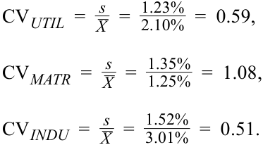

# Volume 1: Quantitative Methods
## Learning Module 3 Statistical Measures of Asset Returns
### Part 4/4: Practice Problems (PDF Pages 134–138)

---

<!-- PDF Page 134 -->

# **~~PRACTICE PROBLEMS~~** 

## **The following information relates to questions 1-5** 

Consider the results of an analysis focusing on the market capitalizations of a sample of 100 firms: 

### **Exhibit 1: Market Capitalization of a Sample of 100 Firms** 

||**Cumulative Percentage**|**Market Capita** **billio**|**lization (euro** **ns)**|**Number of**|
|---|---|---|---|---|
|**Bin**|**of Sample (%)**|**Lower Bound**|**Upper Bound**|**Observations**|
|1|5|0.28|15.45|5|
|2|10|15.45|21.22|5|
|3|15|21.22|29.37|5|
|4|20|29.37|32.57|5|
|5|25|32.57|34.72|5|
|6|30|34.72|37.58|5|
|7|35|37.58|39.90|5|
|8|40|39.90|41.57|5|
|9|45|41.57|44.86|5|
|10|50|44.86|46.88|5|
|11|55|46.88|49.40|5|
|12|60|49.40|51.27|5|
|13|65|51.27|53.58|5|
|14|70|53.58|56.66|5|
|15|75|56.66|58.34|5|
|16|80|58.34|63.10|5|
|17|85|63.10|67.06|5|
|18|90|67.06|73.00|5|
|19|95|73.00|81.62|5|
|20|100|81.62|96.85|5|

**1.** The tenth percentile corresponds to observations in bin(s): 

   - **A.** 2. 

   - **B.** 1 and 2. 

   - **C.** 19 and 20. 

**2.** The second quintile corresponds to observations in bin(s): 

   - **A.** 8. 

<!-- PDF Page 135 -->

   - **B.** 5, 6, 7, and 8. 

   - **C.** 6, 7, 8, 9, and 10. 

**3.** The fourth quartile corresponds to observations in bin(s): 

   - **A.** 17. 

   - **B.** 17, 18, 19, and 20. 

   - **C.** 16, 17, 18, 19, and 20. 

**4.** The median is _closest_ to: 

   - **A.** 44.86. 

   - **B.** 46.88. 

   - **C.** 49.40. 

**5.** The interquartile range is _closest_ to: 

   - **A.** 20.76. 

   - **B.** 23.62. 

   - **C.** 25.52. 

**6.** Exhibit 1 shows the annual MSCI World Index total returns for a 10-year period. 

**Exhibit 1: MSCI World Index Returns** 

|Year 1|15.25%|Year 6|30.79%|
|---|---|---|---|
|Year 2|10.02%|Year 7|12.34%|
|Year 3|20.65%|Year 8|−5.02%|
|Year 4|9.57%|Year 9|16.54%|
|Year 5|−40.33%|Year 10|27.37%|

The fourth quintile return for the MSCI World Index is _closest_ to: 

- **A.** 20.65 percent. 

**B.** 26.03 percent. 

- **C.** 27.37 percent. 

## **The following information relates to questions 7-9** 

A fund had the following experience over the past 10 years: 

<!-- PDF Page 136 -->

**Exhibit 1: Performance over 10 Years** 

|**Year**|**Return**|
|---|---|
|1|4.5%|
|2|6.0%|
|3|1.5%|
|4|−2.0%|
|5|0.0%|
|6|4.5%|
|7|3.5%|
|8|2.5%|
|9|5.5%|
|10|4.0%|

**7.** The fund’s standard deviation of returns over the 10 years is _closest_ to: 

   - **A.** 2.40 percent. 

   - **B.** 2.53 percent. 

   - **C.** 7.58 percent. 

**8.** The target semideviation of the returns over the 10 years, if the target is 2 percent, is _closest_ to: 

   - **A.** 1.42 percent. 

   - **B.** 1.50 percent. 

   - **C.** 2.01 percent. 

**9.** Consider the mean monthly return and the standard deviation for three industry sectors, as shown in Exhibit 2: 

**Exhibit 2: Mean Monthly Return and Standard Deviations** 

||**Mean Monthly Return**|**Standard Deviation of Return**|
|---|---|---|
|**Sector**|**(%)**|**(%)**|
|Utilities (UTIL)|2.10|1.23|
|Materials (MATR)|1.25|1.35|
|Industrials (INDU)|3.01|1.52|

Based on the coefficient of variation (CV), the riskiest sector is: 

- **A.** utilities. 

- **B.** materials. 

- **C.** industrials. 

<!-- PDF Page 137 -->

# **~~SOLUTIONS~~** 

1. B is correct. The tenth percentile corresponds to the lowest 10 percent of the observations in the sample, which are in bins 1 and 2. 

2. B is correct. The second quintile corresponds to the second 20 percent of observations. The first 20 percent consists of bins 1 through 4. The second 20 percent of observations consists of bins 5 through 8. 

3. C is correct. A quartile consists of 25 percent of the data, and the last 25 percent of the 20 bins are 16 through 20. 

4. B is correct. The center of the 20 bins is represented by the market capitalization of the highest value of the 10th bin and the lowest value of the 11th bin, which is 46.88. 

5. B is correct. The interquartile range is the difference between the lowest value in the second quartile and the highest value in the third quartile. The lowest value of the second quartile is 34.72, and the highest value of the third quartile is 58.34. Therefore, the interquartile range is 58.34 − 34.72 = 23.62. 

6. B is correct. Quintiles divide a distribution into fifths, with the fourth quintile occurring at the point at which 80 percent of the observations lie below it. The fourth quintile is equivalent to the 80th percentile. To find the _y_ th percentile ( _Py_ ), we first must determine its location. The formula for the location ( _Ly_ ) of a _y_ th percentile in an array with _n_ entries sorted in ascending order is Ly = ( _n_ + 1) × ( _y_ /100). In this case, _n_ = 10 and _y_ = 80%, so 

_L_ 80 = (10 + 1) × (80/100) = 11 × 0.8 = 8.8. 

With the data arranged in ascending order (−40.33 percent, −5.02 percent, 9.57 percent, 10.02 percent, 12.34 percent, 15.25 percent, 16.54 percent, 20.65 percent, 27.37 percent, and 30.79 percent), the 8.8th position would be between the eighth and ninth entries, 20.65 percent and 27.37 percent, respectively. Using linear interpolation, _P_ 80 = _X_ 8 + ( _Ly_ − 8) × ( _X_ 9 − _X_ 8), 

_P_ 80 = 20.65 + (8.8 − 8) × (27.37 − 20.65) 

= 20.65 + (0.8 × 6.72) = 20.65 + 5.38 

= 26.03 percent. 

7. B is correct. The fund’s standard deviation of returns is calculated as follows: 

|**Year**|**Return**|**Deviation from Mean**|**Deviation Squared**|
|---|---|---|---|
|1|4.5%|0.0150|0.000225|
|2|6.0%|0.0300|0.000900|
|3|1.5%|−0.0150|0.000225|
|4|−2.0%|−0.0500|0.002500|
|5|0.0%|−0.0300|0.000900|
|6|4.5%|0.0150|0.000225|
|7|3.5%|0.0050|0.000025|
|8|2.5%|−0.0050|0.000025|
|9|5.5%|0.0250|0.000625|

<!-- PDF Page 138 -->

|**Year**|**Return**|**Deviation from Mean**|**Deviation Squared**|
|---|---|---|---|
|10|4.0%|0.0100|0.000100|
|Mean|3.0%|||
|Sum|||**0.005750**|

The standard deviation is the square root of the sum of the squared deviations, divided by _n_ − 1: 

_0.005750 _s_ =  √_( 10 − 1)  = 2.5276%. 

8. B is correct. The target semideviation of the returns over the 10 years with a target of 2 percent is calculated as follows: 

|**Year**|**Return**|**Deviation Squared below Target of 2%**|
|---|---|---|
|1|4.5%||
|2|6.0%||
|3|1.5%|0.000025|
|4|−2.0%|0.001600|
|5|0.0%|0.000400|
|6|4.5%||
|7|3.5%||
|8|2.5%||
|9|5.5%||
|10|4.0%||
|Sum||0.002025|

The target semideviation is the square root of the sum of the squared deviations from the target, divided by _n_ − 1: 

_0.002025 _s_ Target =  √_( 10 − 1)  = 1.5%. 

9. B is correct. The CV is the ratio of the standard deviation to the mean, where a higher CV implies greater risk per unit of return. 

<!-- Formula Text: CV UTIL  =   s _ _ X    =   1.23% _ 2.10%   =  0.59, CV MATR  =   s _ _ X    =   1.35% _ 1.25%   =  1.08, CV INDU  =   s _ _ X    =   1.52% _ 3.01%   =  0.51. -->

