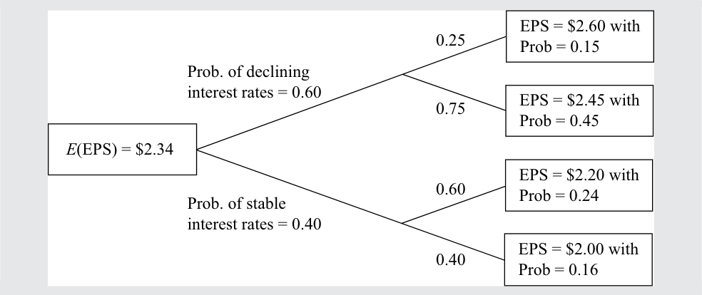

# Volume 1: Quantitative Methods
## Learning Module 4 Probability Trees and Conditional Expectations
### Part 1/2: Introduction (PDF Pages 139–146)

---

<!-- PDF Page 139 -->

#### L E A R N I N G M O D U L E 

# **<mark>4</mark>** 

### **Probability Trees and Conditional Expectations** 

**by Richard A. DeFusco, PhD, CFA, Dennis W. McLeavey, DBA, CFA, Jerald E. Pinto, PhD, CFA, and David E. Runkle, PhD, CFA.** 

_Richard A. DeFusco, PhD, CFA, is at the University of Nebraska-Lincoln (USA). Dennis W. McLeavey, DBA, CFA, is at the University of Rhode Island (USA). Jerald E. Pinto, PhD, CFA, is at CFA Institute (USA). David E. Runkle, PhD, CFA, is at Jacobs Levy Equity Management (USA)._ 

###### **<mark>LEARNING OUTCOMES</mark>** 

###### **_Mastery The candidate should be able to:_** 

- calculate expected values, variances, and standard deviations and demonstrate their application to investment problems formulate an investment problem as a probability tree and explain the use of conditional expectations in investment application calculate and interpret an updated probability in an investment setting using Bayes’ formula 

<!-- Start of picture text -->
1 <!-- End of picture text -->

##### **INTRODUCTION** 

Investment decisions are made under uncertainty about the future direction of the economy, issuers, companies, and prices. This learning module presents probability tools that address many real-world problems involving uncertainty and applies to a variety of investment management applications. 

Lesson 1 introduces the calculation of the expected value, variance, and standard deviation for a random variable. These are essential quantitative concepts in investment management. Lesson 2 introduces probability trees that help in visualizing the conditional expectations and the total probabilities for expected value. 

When making investment decisions, analysts often rely on perspectives, which may be influenced by subsequent observations. Lesson 3 introduces Bayes’ formula, a rational method to adjust probabilities with the arrival of new information. This method has wide business and investment applications. 

<!-- PDF Page 140 -->

###### **LEARNING MODULE OVERVIEW** 

- The expected value of a random variable is a probability-weighted average of the possible outcomes of the random variable. For a random variable _X_ , the expected value of _X_ is denoted _E_ ( _X_ ). 

- The variance of a random variable is the expected value (the probability-weighted average) of squared deviations from the random variable’s expected value _E_ ( _X_ ): σ2 ( _X_ ) = _E_ {[ _X_ − _E_ ( _X_ )]2 }, where σ2 ( _X_ ) stands for the variance of _X_ . 

- Standard deviation is the positive square root of variance. Standard deviation measures dispersion (as does variance), but it is measured in the same units as the variable. 

- A probability tree is a means of illustrating the results of two or more independent events. 

- A probability of an event given (conditioned on) another event is a conditional probability. The probability of an event _A_ given an event _B_ is denoted _P_ ( _A_ | _B_ ), and _P_ ( _A_ | _B_ ) = _P_ ( _AB_ )/ _P_ ( _B_ ), _P_ ( _B_ ) ≠ 0. 

- According to the total probability rule, if _S_ 1, _S_ 2, …, _Sn_ are mutually exclusive and exhaustive scenarios or events, then _P_ ( _A_ ) = _P_ ( _A_ | _S_ 1) _P_ ( _S_ 1) + _P_ ( _A_ | _S_ 2) _P_ ( _S_ 2) + … + _P_ ( _A_ | _Sn_ ) _P_ ( _Sn_ ). 

- Conditional expected value is _E_ ( _X_ | _S_ ) = _P_ ( _X_ 1 | _S_ ) _X_ 1 + _P_ ( _X_ 2 | _S_ ) _X_ 2 + … + _P_ (Xn | _S_ )Xn and has an associated conditional variance and conditional standard deviation. 

- Bayes’ formula is a method used to update probabilities based on new information. 

- Bayes’ formula is expressed as follows: Updated probability of event given the new information = [(Probability of the new information given event)/(Unconditional probability of the new information)] × Prior probability of event. 

<!-- Start of picture text -->
2 <!-- End of picture text -->

##### **EXPECTED VALUE AND VARIANCE** 

calculate expected values, variances, and standard deviations and demonstrate their application to investment problems 

The expected value of a random variable is an essential quantitative concept in investments. Investors continually make use of expected values—in estimating the rewards of alternative investments, in forecasting earnings per share (EPS) and other corporate financial variables and ratios, and in assessing any other factor that may affect their financial position. The **expected value of a random variable** is the probability-weighted average of the possible outcomes of the random variable. For a random variable _X_ , the expected value of _X_ is denoted _E_ ( _X_ ). 

Expected value (e.g., expected stock return) looks either to the future, as a forecast, or to the “true” value of the mean (the population mean). We should distinguish expected value from the concepts of historical or sample mean. The sample mean also 

<!-- PDF Page 141 -->

summarizes in a single number a central value. However, the sample mean presents a central value for a particular set of observations as an equally weighted average of those observations. In sum, the contrast is forecast versus historical, or population versus sample. 

An equation that summarizes the calculation of the expected value for a discrete random variable X is as follows: 

<!-- Formula Text: E(X)  =  P(X 1) X 1 + P(X 2) X 2 + … + P(X n) X n  =  ∑ i=1 n P(X i) X i, (1) -->

where Xi is one of _n_ possible outcomes of the discrete random variable _X_ . 

The expected value is our forecast. Because we are discussing random quantities, we cannot count on an individual forecast being realized (although we hope that, on average, forecasts will be accurate). It is important, as a result, to measure the risk we face. Variance and standard deviation measure the dispersion of outcomes around the expected value or forecast. 

The **variance of a random variable** is the expected value (the probability-weighted average) of squared deviations from the random variable’s expected value: 

<!-- Formula Text: σ 2(X)  =  E [X − E(X)] 2. (2) -->

The two notations for variance are σ2 ( _X_ ) and Var( _X_ ). 

Variance is a number greater than or equal to 0 because it is the sum of squared terms. If variance is 0, there is no dispersion or risk. The outcome is certain, and the quantity _X_ is not random at all. Variance greater than 0 indicates dispersion of outcomes. Increasing variance indicates increasing dispersion, all else being equal. 

The following equation summarizes the calculation of variance: 

<!-- Formula Text: σ 2(X)  =  P(X 1) [X 1 − E(X)] 2 + P(X 2) [X 2 − E(X)] 2 + … + P(X n) [X n − E(X)] 2  =  ∑ i = 1 n P(X i) [X i − E(X)] 2, (3) -->

where Xi is one of _n_ possible outcomes of the discrete random variable _X_ . 

Variance of _X_ is a quantity in the squared units of _X_ . For example, if the random variable is return in percent, variance of return is in units of percent squared. Standard deviation is easier to interpret than variance because it is in the same units as the random variable. **Standard deviation** is the square root of variance. If the random variable is return in percent, standard deviation of return is also in units of percent. In the following examples, when the variance of returns is stated as a percent or amount of money, to conserve space, we may suppress showing the unit squared. 

The best way to become familiar with these concepts is to work examples. 

###### **EXAMPLE 1** 

###### **BankCorp’s Earnings per Share, Part 1** 

As part of your work as a banking industry analyst, you build models for forecasting earnings per share of the banks you cover. Today you are studying BankCorp. In Exhibit 1, you have recorded a probability distribution for BankCorp’s EPS for the current fiscal year. 

**Exhibit 1: Probability Distribution for BankCorp’s EPS** 

|**Probability**|**EPS (USD)**|
|---|---|
|0.15|2.60|
|0.45|2.45|
|0.24|2.20|

<!-- PDF Page 142 -->

|**Probability**|**EPS (USD)**|
|---|---|
|0.16|2.00|
|1.00||

1. What is the expected value of BankCorp’s EPS for the current fiscal year? **Solution:** 

Following the definition of expected value, list each outcome, weight it by its probability, and sum the terms. 

_E_ (EPS) = 0.15(USD2.60) + 0.45(USD 2.45) + 0.24(USD 2.20) + 0.16(USD 2.00) 

- = USD2.3405 

The expected value of EPS is USD2.34. 

2. Using the probability distribution of EPS from Exhibit 1, you want to measure the dispersion around your forecast. What are the variance and standard deviation of BankCorp’s EPS for the current fiscal year? 

###### **Solution:** 

The order of calculation is always expected value, then variance, and then standard deviation. Expected value has already been calculated. Following the previous definition of variance, calculate the deviation of each outcome from the mean or expected value, square each deviation, weight (multiply) each squared deviation by its probability of occurrence, and then sum these terms. 

- _σ_2( EPS) = _P_( 2.60) [2.60 − _E_( EPS) ]2 + _P_( 2.45) [2.45 − _E_( EPS) ]2 + _P_( 2.20) [2.20 − _E_( EPS) ]2 + _P_( 2.00) [2.00 − _E_( EPS) ]2 = 0.15( 2.60 − 2.34)2 + 0.45( 2.45 − 2.34)2 +  0.24( 2.20 − 2.34)2 + 0.16( 2.00 − 2.34)2 = 0.01014 + 0.005445 + 0.004704 + 0.018496 = 0.038785 

Standard deviation is the positive square root of 0.038785: 

σ(EPS) = 0.0387851/2 = 0.196939, or approximately 0.20. 

## **<mark>3</mark>** 

##### **PROBABILITY TREES AND CONDITIONAL EXPECTATIONS** 

formulate an investment problem as a probability tree and explain the use of conditional expectations in investment application 

In investments, we make use of any relevant information available in making our forecasts. When we refine our expectations or forecasts, we are typically updating them based on new information or events; in these cases, we are using **conditional expected values** . The expected value of a random variable _X_ given an event or scenario _S_ is denoted _E_ ( _X_ | _S_ ). Suppose the random variable _X_ can take on any one of _n_ distinct 

<!-- PDF Page 143 -->

outcomes _X_ 1, _X_ 2, …, Xn (these outcomes form a set of mutually exclusive and exhaustive events). The expected value of _X_ conditional on _S_ is the first outcome, _X_ 1, times the probability of the first outcome given _S, P_ ( _X_ 1 | _S_ ), plus the second outcome, _X_ 2, times the probability of the second outcome given _S, P_ ( _X_ 2 | _S_ ), and so forth, as follows: 

_E_ ( _X_ | _S_ ) = _P_ ( _X_ 1 | _S_ ) _X_ 1 + _P_ ( _X_ 2 | _S_ ) _X_ 2 + … + _P_ (Xn | _S_ )Xn. ~~(4)~~ 

We will illustrate this equation shortly. 

Parallel to the total probability rule for stating unconditional probabilities in terms of conditional probabilities, there is a principle for stating (unconditional) expected values in terms of conditional expected values. This principle is the **total probability rule for expected value** . 

###### **Total Probability Rule for Expected Value** 

The formula follows: 

<!-- Formula Text: E(X) = E(X | S)P(S) + E(X | SC)P(SC), (5) -->

where SC is the “complement of S,” which means event or scenario “S” does not occur. _E_ ( _X_ ) = _E_ ( _X_ | _S_ 1) _P_ ( _S_ 1) + _E_ ( _X_ | _S_ 2) _P_ ( _S_ 2) + … + _E_ ( _X_ | Sn) _P_ (Sn), ~~(6)~~ 

where _S_ 1, _S_ 2, …, Sn are mutually exclusive and exhaustive scenarios or events. 

The general case, Equation 6, states that the expected value of _X_ equals the expected value of _X_ given Scenario 1, _E_ ( _X_ | _S_ 1), times the probability of Scenario 1, _P_ ( _S_ 1), plus the expected value of _X_ given Scenario 2, _E_ ( _X_ | _S_ 2), times the probability of Scenario 2, _P_ ( _S_ 2), and so forth. 

To use this principle, we formulate mutually exclusive and exhaustive scenarios that are useful for understanding the outcomes of the random variable. This approach was employed in developing the probability distribution of BankCorp’s EPS in Example 1, as we now discuss. 

###### **EXAMPLE 2** 

###### **BankCorp’s Earnings per Share, Part 2** 

The earnings of BankCorp are interest rate sensitive, benefiting from a declining interest rate environment. Suppose there is a 0.60 probability that BankCorp will operate in a _declining interest rate environment_ in the current fiscal year and a 0.40 probability that it will operate in a _stable interest rate environment_ (assessing the chance of an increasing interest rate environment as negligible). If a _declining interest rate environment_ occurs, the probability that EPS will be USD2.60 is estimated at 0.25, and the probability that EPS will be USD2.45 is estimated at 0.75. Note that 0.60, the probability of _declining interest rate environment,_ times 0.25, the probability of USD2.60 EPS given a _declining interest rate environment,_ equals 0.15, the (unconditional) probability of USD2.60 given in the table in Exhibit 1. The probabilities are consistent. Also, 0.60(0.75) = 0.45, the probability of USD2.45 EPS given in Exhibit 1. The **probability tree diagram** in Exhibit 2 shows the rest of the analysis. 

<!-- PDF Page 144 -->

###### **Exhibit 2: BankCorp’s Forecasted EPS** 

<!-- Start of picture text -->
EPS = $2.60 with 0.25 Prob = 0.15 Prob. of declining interest rates = 0.60 EPS = $2.45 with 0.75 Prob = 0.45 E (EPS) = $2.34 EPS = $2.20 with 0.60 Prob = 0.24 Prob. of stable interest rates = 0.40 EPS = $2.00 with 0.40 Prob = 0.16 <!-- End of picture text -->

A declining interest rate environment points us to the **node** of the tree that branches off into outcomes of USD2.60 and USD2.45. We can find expected EPS given a declining interest rate environment as follows, using Equation 6: 

- _E_ (EPS | _declining interest rate environment_ ) 

- = 0.25(USD2.60) + 0.75(USD2.45) 

- = USD2.4875 

If interest rates are stable, 

_E_ (EPS | _stable interest rate environment_ ) = 0.60(USD2.20) + 0.40(USD2.00) 

- = USD2.12 

Once we have the new piece of information that interest rates are stable, for example, we revise our original expectation of EPS from USD2.34 downward to USD2.12. Now using the total probability rule for expected value, 

###### E( EPS) 

= E (EPS | declining interest rate environment) P(declining interest rate environment) + E (EPS | stable interest rate environment) P(stable interest rate environment) 

So, _E_ (EPS) = USD2.4875(0.60) + USD2.12(0.40) = USD2.3405 or about USD2.34. 

This amount is identical to the estimate of the expected value of EPS calculated directly from the probability distribution in Example 1. Just as our probabilities must be consistent, so too must our expected values, unconditional and conditional, be consistent; otherwise, our investment actions may create profit opportunities for other investors at our expense. 

To review, we first developed the factors or scenarios that influence the outcome of the event of interest. After assigning probabilities to these scenarios, we formed expectations conditioned on the different scenarios. Then we worked backward to formulate an expected value as of today. In the problem just worked, EPS was the event of interest, and the interest rate environment was the factor influencing EPS. 

We can also calculate the variance of EPS given each scenario: 

- σ2 (EPS| _declining interest rate environment_ ) 

- = _P_ (USD2.60| _declining interest rate environment_ ) 

- × [USD2.60 − _E_ (EPS| _declining interest rate environment_ )]2 

- + _P_ (USD2.45| _declining interest rate environment_ ) 

<!-- PDF Page 145 -->

- × [USD2.45 − _E_ (EPS| _declining interest rate environment_ )]2 

- = 0.25(USD2.60 − USD2.4875)2 + 0.75(USD2.45 − USD2.4875)2 = 0.004219 

Similarly, σ2 (EPS | _stable interest rate environment_ ) is found to be equal to 

- = 0.60(USD2.20 − USD2.12)2 + 0.40(USD2.00 − USD2.12)2 = 0.0096 

These are **conditional variances** , the variance of EPS given a _declining interest rate environment_ and the variance of EPS given a _stable interest rate environment_ . The relationship between unconditional variance and conditional variance is a relatively advanced topic. The main points are that (1) variance, like expected value, has a conditional counterpart to the unconditional concept; and (2) we can use conditional variance to assess risk given a particular scenario. 

###### **EXAMPLE 3** 

###### **BankCorp’s Earnings per Share, Part 3** 

Continuing with the BankCorp example, you focus now on BankCorp’s cost structure. One model, a simple linear regression model, you are researching for BankCorp’s operating costs is 

- _Y_ˆ = _a_ + _bX_ , 

where _Y_ˆ is a forecast of operating costs in millions of US dollars and _X_ is the number of branch offices; and _Y_ˆ represents the expected value of _Y_ given _X_ , or _E_ ( _Y_ | _X_ ). You interpret the intercept _a_ as fixed costs and _b_ as variable costs. You estimate the equation as follows: 

_Y_ˆ = 12.5 + 0.65 _X_ . 

BankCorp currently has 66 branch offices, and the equation estimates operating costs as 12.5 + 0.65(66) = USD55.4 million. You have two scenarios for growth, pictured in the tree diagram in Exhibit 3. 

###### **Exhibit 3: BankCorp’s Forecasted Operating Costs** 

<!-- Start of picture text -->
Branches = 125 0.50 Op. Costs = ? Prob = ? High Growth Probability = 0.80  Branches = 100 0.50 Op. Costs = ? Prob = ? Expected Op. Costs = ? Branches = 80 0.85 Op. Costs = ? Low Growth Prob = ? Probability = 0.20 Branches = 70 0.15 Op. Costs = ? Prob = ? <!-- End of picture text -->

1. Compute the forecasted operating costs given the different levels of operating costs, using _Y_ˆ = 12.5 + 0.65 _X_ . State the probability of each level of the number of branch offices. These are the answers to the questions in the terminal boxes of the tree diagram. 

###### **Solution:** 

Using _Y_ˆ = 12.5 + 0.65 _X_ , from top to bottom, we have 

<!-- PDF Page 146 -->

|**Operating Costs**|**Probability**|
|---|---|
|ˆ _Y_= 12.5 + 0.65(125) = USD93.75 million|0.80(0.50) = 0.40|
|ˆ _Y_= 12.5 + 0.65(100) = USD77.50 million|0.80(0.50) = 0.40|
|ˆ _Y_= 12.5 + 0.65(80) = USD64.50 million|0.20(0.85) = 0.17|
|ˆ _Y_= 12.5 + 0.65(70) = USD58.00 million|0.20(0.15) = 0.03|
||Sum = 1.00|

2. Compute the expected value of operating costs under the high growth scenario. Also calculate the expected value of operating costs under the low growth scenario. 

   - **Solution:** 

US dollar amounts are in millions. 

- E(operating costs| _high growth_ ) = 0.50(USD93.75) + 0.50(USD77.50) 

- = USD85.625 

E(operating costs| _low growth_ ) = 0.85(USD64.50) + 0.15(USD58.00) = USD63.525 

3. Refer to the question in the initial box of the tree: What are BankCorp’s expected operating costs? 

   - **Solution:** 

US dollar amounts are in millions. 

- _E_ (operating costs) = _E_ (operating costs| _high growth_ ) _P_ ( _high growth_ ) 

- + _E_ (operatingcosts| _low growth_ ) _P_ ( _low growth_ ) 

- = 85.625(0.80) + 63.525(0.20) = 81.205 

- BankCorp’s expected operating costs are USD81.205 million. 

In this section, we have treated random variables, such as EPS, as standalone quantities. We have not explored how descriptors, such as expected value and variance of EPS, may be functions of other random variables. Portfolio return is one random variable that is clearly a function of other random variables, the random returns on the individual securities in the portfolio. To analyze a portfolio’s expected return and variance of return, we must understand that these quantities are a function of characteristics of the individual securities’ returns. Looking at the variance of portfolio return, we see that the way individual security returns move together or covary is key. We cover portfolio expected return, variance of return, and importantly, covariance and correlation in a separate learning module. 

###### **QUESTION SET** 

1. Suppose the prospects for recovering principal for a defaulted bond issue depend on which of two economic scenarios prevails. Scenario 1 has probability 0.75 and will result in recovery of USD0.90 per USD1 <u>principal value with probability 0.45, or in recovery of USD0.80 per USD1</u> 

