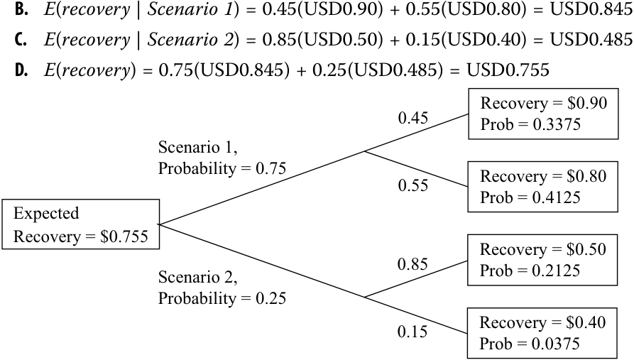
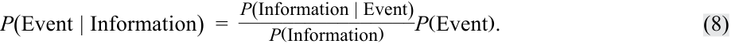
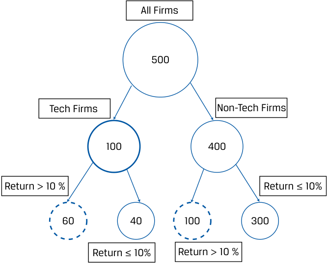
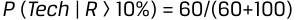
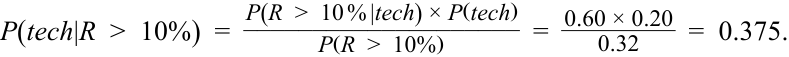
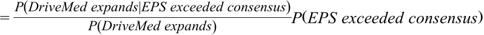
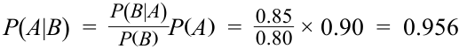
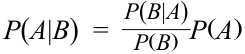

# Volume 1: Quantitative Methods
## Learning Module 4 Probability Trees and Conditional Expectations
### Part 2/2: Bayes' Formula and Updating Probability Estimates (PDF Pages 147–158)

---

<!-- PDF Page 147 -->

principal value with probability 0.55. Scenario 2 has probability 0.25 and will result in recovery of USD0.50 per USD1 principal value with probability 0.85, or in recovery of USD0.40 per USD1 principal value with probability 0.15. 

Using the data for Scenario 1 and Scenario 2, calculate the following: 

- **A.** Compute the expected recovery, given the first scenario. 

- **B.** Compute the expected recovery, given the second scenario. 

- **C.** Compute the expected recovery. 

- **D.** Graph the information in a probability tree diagram. 

- **E.** Compute the probability of each of the four possible recovery amounts: USD0.90, USD0.80, USD0.50, and USD0.40. 

- **Solution:** 

- **A.** _Outcomes associated with Scenario 1:_ With a 0.45 probability of a USD0.90 recovery per USD1 principal value, given Scenario 1, and with the probability of Scenario 1 equal to 0.75, the probability of recovering USD0.90 is 0.45 (0.75) = 0.3375. By a similar calculation, the probability of recovering USD0.80 is 0.55(0.75) = 0.4125. _Outcomes associated with Scenario 2:_ With a 0.85 probability of a USD0.50 recovery per USD1 principal value, given Scenario 2, and with the probability of Scenario 2 equal to 0.25, the probability of recovering USD0.50 is 0.85(0.25) = 0.2125. By a similar calculation, the probability of recovering USD0.40 is 0.15(0.25) = 0.0375. 

<!-- Start of picture text -->
B.  E ( recovery  |  Scenario 1 ) = 0.45(USD0.90) + 0.55(USD0.80) = USD0.845 C.  E ( recovery  |  Scenario 2 ) = 0.85(USD0.50) + 0.15(USD0.40) = USD0.485 D.  E ( recovery ) = 0.75(USD0.845) + 0.25(USD0.485) = USD0.755 Recovery = $0.90 0.45 Prob = 0.3375 Scenario 1, Probability = 0.75 0.55 Recovery = $0.80 Prob = 0.4125 Expected Recovery = $0.755 Recovery = $0.50 0.85 Prob = 0.2125 Scenario 2, Probability = 0.25 Recovery = $0.40 0.15 Prob = 0.0375 <!-- End of picture text -->

## **BAYES' FORMULA AND UPDATING PROBABILITY ESTIMATES** 

<!-- Start of picture text -->
4 <!-- End of picture text -->

calculate and interpret an updated probability in an investment setting using Bayes’ formula 

<!-- PDF Page 148 -->

A topic that is often useful in solving investment problems is Bayes’ formula: what probability theory has to say about learning from experience. 

### **Bayes’ Formula** 

When we make decisions involving investments, we often start with viewpoints based on our experience and knowledge. These viewpoints may be changed or confirmed by new knowledge and observations. **Bayes’ formula** is a rational method for adjusting our viewpoints as we confront new information. Bayes’ formula and related concepts are used in many business and investment decision-making contexts. 

Bayes’ formula makes use of the total probability rule: 

<!-- Formula Text: P(A) = ∑ n  P(A ∩ B n). (7) -->

To review, that rule expresses the probability of an event as a weighted average of the probabilities of the event, given a set of scenarios. Bayes’ formula works in reverse; more precisely, it reverses the “given that” information. Bayes’ formula uses the occurrence of the event to infer the probability of the scenario generating it. For that reason, Bayes’ formula is sometimes called an inverse probability. In many applications, including those illustrating its use in this section, an individual is updating his/her beliefs concerning the causes that may have produced a new observation. 

**Bayes’ Formula.** Given a set of prior probabilities for an event of interest, if you receive new information, the rule for updating your probability of the event is as follows: 

Updated probability of event given the new information 

=  ___________________________________Unconditional probability of the new informationProbability of the new information given event× Prior probability of event . 

In probability notation, this formula can be written concisely as follows: 

<!-- Formula Text: P(Event | Information)  = P(Information | Event) ________________ P(Information) P(Event). (8) -->

Consider the following example using frequencies—which may be more straightforward initially than probabilities—for illustrating and understanding Bayes’ formula. Assume a hypothetical large-cap stock index has 500 member firms, of which 100 are technology firms, and 60 of these had returns of >10 percent, and 40 had returns of ≤10 percent. Of the 400 non-technology firms in the index, 100 had returns of >10 percent, and 300 had returns of ≤10 percent. The tree map in Exhibit 4 is useful for visualizing this example, which is summarized in the table in Exhibit 5. 

<!-- PDF Page 149 -->

**Exhibit 4: Tree Map for Visualizing Bayes’ Formula Using Frequencies** 

<!-- Start of picture text -->
All Firms 500 Tech Firms Non-Tech Firms 100 400 Return > 10 % Return ≤ 10% 60 40 100 300 Return ≤ 10% Return > 10 % <!-- End of picture text -->

<!-- Start of picture text -->
P  ( Tech  |  R  > 10%) = 60/(60+100) <!-- End of picture text -->

**Exhibit 5: Summary of Returns for Tech and Non-Tech Firms in Hypothetical Large-Cap Equity Index** 

||**Type of Firm in**|**Stock Index**||
|---|---|---|---|
|**Rate of Return (R)**|**Non-Tech**|**Tech**|**Total**|
|R >10%|100|60|160|
|R ≤10%|300|40|340|
|Total|400|100|500|

What is the probability a firm is a tech firm given that it has a return of >10 percent or _P_ ( _tech_ | _R > 10%_ )? Looking at the frequencies in the tree map and in the table, we can see many empirical probabilities, such as the following: 

- _P(tech) =_ 100 / 500 = 0.20, 

- _P_ ( _non-tech_ ) = 400 / 500 = 0.80, 

- _P(R > 10% | tech) =_ 60 / 100 = 0.60, 

- _P_ ( _R > 10%_ | _non-tech_ ) = 100 / 400 = 0.25, 

- _P(R > 10%) =_ 160 / 500 = 0.32, and, finally, 

- _P_ ( _tech_ | _R > 10%_ ) = 60/ 160 = 0.375. 

This probability is the answer to our initial question. 

Without looking at frequencies, let us use Bayes’ formula to find the probability that a firm has a return of >10 percent and then the probability that a firm with a return of >10 percent is a tech firm, _P_ ( _tech_ | _R > 10%_ ). First, 

_P_ ( _R > 10%_ ) 

- = _P_ ( _R > 10% | tech_ ) × _P_ ( _tech_ ) + _P_ ( _R > 10%_ | _non-tech_ ) × _P_ ( _non-tech_ ) 

- = 0.60 × 0.20 + 0.25 × 0.80 = 0.32. 

<!-- PDF Page 150 -->

Now we can implement the Bayes’ formula answer to our question: 

<!-- Formula Text: P(tech|R  >  10%)  = P(R  >  10 % |tech) × P(tech) ____________________ P(R  >  10%) =   0.60 × 0.20 _ 0.32 =  0.375. -->

The probability that a firm with a return of >10 percent is a tech firm is 0.375, which is impressive because the probability that a firm is a tech firm (from the whole sample) is only 0.20. In sum, it can be readily seen from the tree map and the underlying frequency data (Exhibit 4 and 5, respectively) or from the probabilities in Bayes’ formula that 160 firms have R >10 percent, and 60 of them are tech firms, so 

_P_ ( _tech_ | _R > 10%_ ) = 60/160 = 0.375. 

Users of Bayesian statistics do not consider probabilities (or likelihoods) to be known with certainty but believe that these should be subject to modification whenever new information becomes available. Our beliefs or probabilities are continually updated as new information arrives over time. 

To further illustrate Bayes’ formula, we work through an investment example that can be adapted to any actual problem. Suppose you are an investor in the stock of DriveMed, Inc. Positive earnings surprises relative to consensus EPS estimates often result in positive stock returns, and negative surprises often have the opposite effect. DriveMed is preparing to release last quarter’s EPS result, and you are interested in which of these three events happened: _last quarter’s EPS exceeded the consensus EPS estimate, last quarter’s EPS exactly met the consensus EPS estimate,_ or _last quarter’s EPS fell short of the consensus EPS estimate._ This list of the alternatives is mutually exclusive and exhaustive. 

On the basis of your own research, you write down the following **prior probabilities** (or priors, for short) concerning these three events: 

- _P_ ( _EPS exceeded consensus_ ) = 0.45 

- _P_ ( _EPS met consensus_ ) = 0.30 

- _P_ ( _EPS fell short of consensus_ ) = 0.25 

These probabilities are “prior” in the sense that they reflect only what you know now, before the arrival of any new information. 

The next day, DriveMed announces that it is expanding factory capacity in Singapore and Ireland to meet increased sales demand. You assess this new information. The decision to expand capacity relates not only to current demand but probably also to the prior quarter’s sales demand. You know that sales demand is positively related to EPS. So now it appears more likely that last quarter’s EPS will exceed the consensus. 

The question you have is, “In light of the new information, what is the updated probability that the prior quarter’s EPS exceeded the consensus estimate?” 

Bayes’ formula provides a rational method for accomplishing this updating. We can abbreviate the new information as _DriveMed expands_ . The first step in applying Bayes’ formula is to calculate the probability of the new information (here: _DriveMed expands_ ), given a list of events or scenarios that may have generated it. The list of events should cover all possibilities, as it does here. Formulating these conditional probabilities is the key step in the updating process. Suppose your view, based on research of DriveMed and its industry, is 

- _P_ ( _DriveMed expands_ | _EPS exceeded consensus_ ) = 0.75 

- _P_ ( _DriveMed expands_ | _EPS met consensus_ ) = 0.20 

- _P_ ( _DriveMed expands_ | _EPS fell short of consensus_ ) = 0.05 

Conditional probabilities of an observation (here: _DriveMed expands_ ) are sometimes referred to as **likelihoods** . Again, likelihoods are required for updating the probability. 

<!-- PDF Page 151 -->

Next, you combine these conditional probabilities or likelihoods with your prior probabilities to get the unconditional probability for DriveMed expanding, _P_ ( _DriveMed expands_ ), as follows: 

_P_ ( _DriveMed expands_ ) 

= _P_ ( _DriveMed expands_ | _EPS exceeded consensus)_ × _P_ (EPS exceeded consensus) 

+ _P_ ( _DriveMed expands_ | _EPS met consensus)_ × _P_ ( _EPS met consensus_ ) 

+ _P_ ( _DriveMed expands_ | _EPS fell short of consensus_ ) × _P_ ( _EPS fell short of consensus_ ) 

= 0.75(0.45) + 0.20(0.30) + 0.05(0.25) = 0.41, _or_ 41%. 

This is the total probability rule in action. Now you can answer your question by applying Bayes’ formula, Equation 8: 

P(EPS" " exceeded" " consensus│DriveMed" " expands) 

<!-- Formula Text: = P(DriveMed expands|EPS exceeded consensus) _________________________________ P(DriveMed expands) P(EPS exceeded consensus) -->

=(0.75/0.41)(0.45)=1.829268(0.45) 

=0.823171 

Before DriveMed’s announcement, you thought the probability that DriveMed would beat consensus expectations was 45 percent. On the basis of your interpretation of the announcement, you update that probability to 82.3 percent. This updated probability is called your **posterior probability** because it reflects or comes after the new information. 

The Bayes’ calculation takes the prior probability, which was 45 percent, and multiplies it by a ratio—the first term on the right-hand side of the equal sign. The denominator of the ratio is the probability that DriveMed expands, as you view it without considering (conditioning on) anything else. Therefore, this probability is unconditional. The numerator is the probability that DriveMed expands, if last quarter’s EPS actually exceeded the consensus estimate. This last probability is larger than unconditional probability in the denominator, so the ratio (1.83 roughly) is greater than 1. As a result, your updated or posterior probability is larger than your prior probability. Thus, the ratio reflects the impact of the new information on your prior beliefs. 

#### **EXAMPLE 4** 

### **Inferring Whether DriveMed’s EPS Met Consensus EPS** 

You are still an investor in DriveMed stock. To review the givens, your prior probabilities are _P_ ( _EPS exceeded consensus_ ) = 0.45, _P_ ( _EPS met consensus_ ) = 0.30, and _P_ ( _EPS fell short of consensus_ ) = 0.25. You also have the following conditional probabilities: 

P(DriveMed expands | EPS exceeded consensus) = 0.75 

P(DriveMed expands | EPS met consensus) = 0.20 

P(DriveMed expands | EPS fell short of consensus) = 0.05 

<!-- PDF Page 152 -->

1. What is your estimate of the probability _P_ ( _EPS exceeded consensus_ | _DriveMed expands_ )? 

Recall that you updated your probability that last quarter’s EPS exceeded the consensus estimate from 45 percent to 82.3 percent after DriveMed announced it would expand. Now you want to update your other priors. 

Update your prior probability that DriveMed’s EPS met consensus. 

#### **Solution:** 

The probability is _P_ ( _EPS met consensus_ | _DriveMed expands_ ) = 

<!-- Formula Text: P(DriveMed expands|EPS met consensus) _____________________________ P(DriveMed expands) P(EPS met consensus) -->

The probability _P_ ( _DriveMed expands_ ) is found by taking each of the three conditional probabilities in the statement of the problem, such as _P_ ( _DriveMed expands_ | _EPS exceeded consensus_ ); multiplying each one by the prior probability of the conditioning event, such as _P_ ( _EPS exceeded consensus_ ); and then adding the three products. The calculation is unchanged from the problem in the text above: _P_ ( _DriveMed expands_ ) = 0.75(0.45) + 0.20(0.30) + 0.05(0.25) = 0.41, or 41 percent. The other probabilities needed, _P_ ( _DriveMed expands_ | _EPS met consensus_ ) = 0.20 and _P_ ( _EPS met consensus_ ) = 0.30, are givens. So 

_P_ ( _EPS met consensus_ | _DriveMed expands_ ) 

= [ _P_ ( _DriveMed expands_ | _EPS met consensus_ )/ _P_ ( _DriveMed expands_ )] _P_ ( _EPS met consensus_ ) 

= (0.20/0.41)(0.30) = 0.487805(0.30) = 0.146341 

After taking account of the announcement on expansion, your updated probability that last quarter’s EPS for DriveMed just met consensus is 14.6 percent compared with your prior probability of 30 percent. 

2. Update your prior probability that DriveMed’s EPS fell short of consensus. **Solution:** 

_P_ ( _DriveMed expands_ ) was already calculated as 41 percent. Recall that _P_ ( _DriveMed expands_ | _EPS fell short of consensus_ ) = 0.05 and _P_ ( _EPS fell short of consensus_ ) = 0.25 are givens. 

_P_ ( _EPS fell short of consensus|DriveMed expands_ ) 

= [ _P(DriveMed expands_ | _EPS fell short of consensus_ )/ 

_P_ ( _DriveMed expands_ )] _P_ ( _EPS fell short of consensus_ ) 

#### = (0.05/0.41)(0.25) = 0.121951(0.25) = 0.030488 

As a result of the announcement, you have revised your probability that DriveMed’s EPS fell short of consensus from 25 percent (your prior probability) to 3 percent. 

<!-- PDF Page 153 -->

3. Show that the three updated probabilities sum to 1. (Carry each probability to four decimal places.) 

#### **Solution:** 

The sum of the three updated probabilities is 

_P_ ( _EPS exceeded consensus|DriveMed expands_ ) + _P_ ( _EPS met consensus_ | _DriveMed expands_ ) + _P_ ( _EPS fell short of consensus_ | _DriveMed expands_ ) 

#### = 0.8232 + 0.1463 + 0.0305 = 1.000 

The three events ( _EPS exceeded consensus_ , _EPS met consensus_ , and _EPS fell short of consensus_ ) are mutually exclusive and exhaustive: One of these events or statements must be true, so the conditional probabilities must sum to 1. Whether we are talking about conditional or unconditional probabilities, whenever we have a complete set of distinct possible events or outcomes, the probabilities must sum to 1. This calculation serves to check your work. 

4. Suppose, because of lack of prior beliefs about whether DriveMed would meet consensus, you updated on the basis of prior probabilities that all three possibilities were equally likely: _P_ ( _EPS exceeded consensus_ ) = _P_ ( _EPS met consensus_ ) = _P_ ( _EPS fell short of consensus_ ) = 1/3. 

#### **Solution:** 

Using the probabilities given in the question, 

_P_ ( _DriveMed expands_ ) 

= _P_ ( _DriveMed expands_ | _EPS exceeded consensus_ ) _P_ ( _EPS exceeded consensus_ ) + _P_ ( _DriveMed expands_ | _EPS met consensus_ ) _P_ ( _EPS met consensus_ ) + _P_ ( _DriveMed expands_ | _EPS fell short of consensus_ ) _P_ ( _EPS fell short of consensus_ ) 

#### = 0.75(1/3) + 0.20(1/3) + 0.05(1/3) = 1/3 

Not surprisingly, the probability of DriveMed expanding is one-third (1/3) because the decision maker has no prior beliefs or views regarding how well EPS performed relative to the consensus estimate. Now we can use Bayes’ formula to find _P_ ( _EPS exceeded consensus_ | _DriveMed expands_ ) = [ _P_ ( _DriveMed expands_ | _EPS exceeded consensus_ )/ _P_ ( _DriveMed expands_ )] _P_ ( _EPS exceeded consensus_ ) = [(0.75/(1/3)] (1/3) = 0.75, or 75 percent. This probability is identical to your estimate of _P_ ( _DriveMed expands_ | _EPS exceeded consensus_ ). When the prior probabilities are equal, the probability of information given an event equals the probability of the event given the information. When a decision maker has equal prior probabilities (called **diffuse priors** ), the probability of an event is determined by the information. 

#### **QUESTION SET** 

The following example shows how Bayes’ formula is used in credit granting in cases in which the probability of payment given credit information is higher than the probability of payment without the information. 

1. Jake Bronson is predicting the probability that consumer finance applicants <u>granted credit will repay in a timely manner (i.e., their accounts will not</u> 

<!-- PDF Page 154 -->

become “past due”). Using Bayes’ formula, he has structured the problem as follows: 

<!-- Formula Text: P(Event | Information)  = P(Information | Event) ________________ P(Information) P(Event), -->

where the event ( _A_ ) is “timely repayment” and the information ( _B_ ) is having a “good credit report.” 

Bronson estimates that the unconditional probability of receiving timely payment, _P(A)_ , is 0.90 and that the unconditional probability of having a good credit report, _P(B)_ , is 0.80. The probability of having a good credit report given that borrowers paid on time, _P(B | A)_ , is 0.85. 

What is the probability that applicants with good credit reports will repay in a timely manner? 

- **A.** 0.720 

- **B.** 0.944 

- **C.** 0.956 

#### **Solution:** 

The correct answer is C. The probability of timely repayment given a good credit report, _P(A | B)_ , is 

<!-- Formula Text: P(A|B)  = P(B|A) _ P(B) P(A)  =   0.85 _ 0.80  × 0.90  =  0.956 -->

2. You have developed a set of criteria for evaluating distressed credits. Companies that do not receive a passing score are classed as likely to go bankrupt within 12 months. You gathered the following information when validating the criteria: 

   - Forty percent of the companies to which the test is administered will go bankrupt within 12 months: _P_ ( _non-survivor_ ) = 0.40. 

   - Fifty-five percent of the companies to which the test is administered pass it: _P_ ( _pass test_ ) = 0.55. 

   - The probability that a company will pass the test given that it will subsequently survive 12 months, is 0.85: _P_ ( _pass test_ | _survivor_ ) = 0.85. 

Using the information validating your criteria, calculate the following: 

- **A.** What is P( _pass test | non-survivor_ )? 

- **B.** Using Bayes’ formula, calculate the probability that a company is a survivor, given that it passes the test; that is, calculate _P_ ( _survivor_ | _pass test_ ). 

- **C.** What is the probability that a company is a _non-survivor_ , given that it fails the test? 

- **D.** Is the test effective? 

- **Solution:** 

- A. We can set up the equation using the total probability rule: 

- _P_ <u>(</u> _<u>pass test</u>_ <u>) =</u> _P_ <u>(</u> _<u>pass test</u>_ <u>|</u> _survivor_ <u>)</u> _P_ <u>(</u> _survivor_ <u>)</u> 

<!-- PDF Page 155 -->

+ _P_ ( _pass test_ | _non-survivor_ ) _P_ ( _non-survivor_ ) We know that _P_ ( _survivor_ ) = 1 – _P_ ( _non-survivor_ ) = 1 – 0.40 = 0.60. Therefore, _P_ ( _pass test_ ) = 0.55 = 0.85(0.60) + _P_ ( _pass test_ | _non-survivor_ )(0.40). Thus, _P_ ( _pass test_ | _non-survivor_ ) = [0.55 – 0.85(0.60)]/0.40 = 0.10. B. We can calculate the probability that a company is a survivor as follows:_P_(_survivor_|_passtest_) =  [_P_(_passtest_|_survivor_) /_P_(_passtest_)]_P_(_survivor_) =( 0.85 / 0.55) 0.60 = 0.927273 The information that a company passes the test causes you to update your probability that it is a survivor from 0.60 to approximately 0.927. C. According to Bayes’ formula, _P_ ( _non-survivor_ | _fail test_ ) = [ _P_ (- _fail test_ | _non-survivor_ )/ _P_ ( _fail test_ )] _P_ ( _non-survivor_ ) = [ _P_ ( _fail test_ | _non-survivor_ )/0.45]0.40. We can set up the following equation to obtain _P_ ( _fail test_ | _non-survivor_ ): _P_ ( _fail test_ ) = _P_ ( _fail test_ | _non_ − _survivor_ ) _P_( _non_ − _survivor_) + _P_ ( _fail test_ | _survivor_ ) _P_( _survivor_) 0.45 = _P_ ( _fail test_ | _non_ − _survivor_ ) 0.40 + 0.15( 0.60) where _P_ ( _fail test_ | _survivor_ ) = 1 − _P_ ( _pass test_ | _survivor_ ) = 1 − 0.85 = 0.15. So, _P_ ( _fail test_ | _non-survivor_ ) = [0.45 − 0.15(0.60)]/0.40 = 0.90. Using this result with the previous formula, we find _P_ ( _non-survivor_ | _fail test_ ) = [0.90/0.45]0.40 = 0.80. Seeing that a company fails the test causes us to update the probability that it is a non-survivor from 0.40 to 0.80. D. A company passing the test greatly increases our confidence that it is a survivor. A company failing the test doubles the probability that it is a non-survivor. Therefore, the test appears to be useful. 3. An analyst estimates that 20 percent of high-risk bonds will fail (go bankrupt). If she applies a bankruptcy prediction model, she finds that 70 percent of the bonds will receive a “good” rating, implying that they are less likely to fail. Of the bonds that failed, only 50 percent had a “good” rating. Using Bayes’ formula, what is the predicted probability of failure given a “good” rating? (Hint, let _P_ ( _A_ ) be the probability of failure, _P_ ( _B_ ) be the probability of a “good” rating, _P_ ( _B_ | _A_ ) be the likelihood of a “good” rating given failure, and _P_ ( _A_ | _B_ ) be the likelihood of failure given a “good” rating.) **A.** 5.7 percent **B.** 14.3 percent **C.** 28.6 percent **Solution:** B is correct. With Bayes’ formula, the probability of failure given a “good” rating is 

<!-- PDF Page 156 -->

<!-- Formula Text: P(A|B)  = P(B|A) _ P(B) P(A) -->

where 

_P_ ( _A_ ) = 0.20 = probability of failure 

_P_ ( _B_ ) = 0.70 = probability of a “good” rating 

_P_ ( _B_ | _A_ ) = 0.50 = probability of a “good” rating given failure 

With these estimates, the probability of failure given a “good” rating is 

 P_ ( _B_ | _A_ )  P_ ( _A_ | _B_ ) = _P_( _B_)_P_(_A_) = 0.700.50 × 0.20 = 0.143 

If the analyst uses the bankruptcy prediction model as a guide, the probability of failure declines from 20 percent to 14.3 percent. 

4. In a typical year, 5 percent of all CEOs are fired for “performance” reasons. Assume that CEO performance is judged according to stock performance and that 50 percent of stocks have above-average returns or “good” performance. Empirically, 30 percent of all CEOs who were fired had “good” performance. Using Bayes’ formula, what is the probability that a CEO will be fired given “good” performance? (Hint, let _P_ ( _A_ ) be the probability of a CEO being fired, _P_ ( _B_ ) be the probability of a “good” performance rating, _P_ ( _B_ | _A_ ) be the likelihood of a “good” performance rating given that the CEO was fired, and _P_ ( _A_ | _B_ ) be the likelihood of the CEO being fired given a “good” performance rating.) 

   - **A.** 1.5 percent 

   - **B.** 2.5 percent 

**C.** 3.0 percent 

**Solution:** 

C is correct. With Bayes’ formula, the probability of the CEO being fired given a “good” rating is 

<!-- Formula Text: P(A|B)  = P(B|A) _ P(B) P(A) -->

where 

_P_ ( _A_ ) = 0.05 = probability of the CEO being fired 

_P_ ( _B_ ) = 0.50 = probability of a “good” rating 

_P_ ( _B_ | _A_ ) = 0.30 = probability of a “good” rating given that the CEO is fired 

- With these estimates, the probability of the CEO being fired given a “good” rating is 

 P_ ( _B_ | _A_ )  P_ ( _A_ | _B_ ) = _P_( _B_)_P_(_A_) = 0.500.30 × 0.05 = 0.03 

Although 5 percent of all CEOs are fired, the probability of being fired given a “good” performance rating is 3 percent. 

<!-- PDF Page 157 -->

# **~~PRACTICE PROBLEMS~~** 

**1.** An analyst developed two scenarios with respect to the recovery of USD100,000 principal from defaulted loans: 

|**Scenario**|**Probability of Sce-** **nario (%)**|**Amount Recovered** **(USD)**|**Probability of Amount** **(%)**|
|---|---|---|---|
|1|40|50,000|60|
|||30,000|40|
|2|60|80,000|90|
|||60,000|10|

The amount of the expected recovery is _closest_ to which of the following? 

**A.** USD36,400. 

   - **B.** USD55,000. 

   - **C.** USD63,600. 

**2.** The probability distribution for a company’s sales is: 

|**Probability**|**Sales (USD, millions)**|
|---|---|
|0.05|70|
|0.70|40|
|0.25|25|

The standard deviation of sales is _closest_ to which of the following? 

**A.** USD9.81 million. 

- **B.** USD12.20 million. 

- **C.** USD32.40 million. 

<!-- PDF Page 158 -->

# **~~SOLUTIONS~~** 

1. C is correct. If Scenario 1 occurs, the expected recovery is 60% (USD50,000) + 40% (USD30,000) = USD42,000, and if Scenario 2 occurs, the expected recovery is 90% (USD80,000) + 10% (USD60,000) = USD78,000. Weighting by the probability of each scenario, the expected recovery is 40% (USD42,000) + 60% (USD78,000) = USD63,600. Alternatively, first calculating the probability of each amount occurring, the expected recovery is (40%)(60%)(USD50,000) + (40%)(40%)(USD30,000) + (60%)(90%)(USD80,000) + (60%)(10%)(USD60,000) = USD63,600. 

2. A is correct. The analyst must first calculate expected sales as 0.05 × USD70 + 0.70 × USD40 + 0.25 × USD25 = USD3.50 million + USD28.00 million + USD6.25 million = USD37.75 million. 

After calculating expected sales, we can calculate the variance of sales: 

σ2 (Sales) 

- = _P_ (USD70)[USD70 – _E_ (Sales)]2 + _P_ (USD40)[USD40 – _E_ (Sales)]2 + _P_ (USD25) [USD25 – _E_ (Sales)]2 

= 0.05(USD70 – 37.75)2 + 0.70(USD40 – 37.75)2 + 0.25(USD25 – 37.75)2 

- = USD52.00 million + USD3.54 million + USD40.64 million 

- = USD96.18 million. 

The standard deviation of sales is thus σ = (USD96.18)1/2 = USD9.81 million. 

