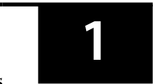
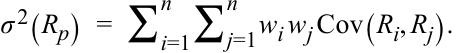
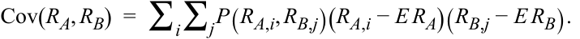
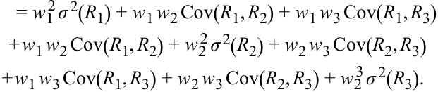
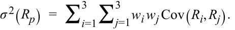

# Volume 1: Quantitative Methods
## Learning Module 5 Portfolio Mathematics
### Part 1/2: Introduction (PDF Pages 159–172)

---

<!-- PDF Page 159 -->

#### L E A R N I N G M O D U L E 

# **<mark>5</mark>** 

### **Portfolio Mathematics** 

**by Richard A. DeFusco, PhD, CFA, Dennis W. McLeavey, DBA, CFA, Jerald E. Pinto, PhD, CFA, and David E. Runkle, PhD, CFA.** 

_Richard A. DeFusco, PhD, CFA, is at the University of Nebraska-Lincoln (USA). Dennis W. McLeavey, DBA, CFA, is at the University of Rhode Island (USA). Jerald E. Pinto, PhD, CFA, is at CFA Institute (USA). David E. Runkle, PhD, CFA, is at Jacobs Levy Equity Management (USA)._ 

###### **<mark>LEARNING OUTCOMES</mark>** 

###### **_Mastery The candidate should be able to:_** 

calculate and interpret the expected value, variance, standard deviation, covariances, and correlations of portfolio returns calculate and interpret the covariance and correlation of portfolio returns using a joint probability function for returns define shortfall risk, calculate the safety-first ratio, and identify an optimal portfolio using Roy’s safety-first criterion 

<!-- Start of picture text -->
1 <!-- End of picture text -->

##### **INTRODUCTION** 

Modern portfolio theory makes frequent use of the idea that investment opportunities can be evaluated using expected return as a measure of reward and variance of return as a measure of risk. In Lesson 1, we will develop an understanding of portfolio return and risk metrics. The forecast expected return and variance of return are functions of the returns on the individual portfolio holdings. To begin, the expected return on a portfolio is a weighted average of the expected returns on the securities in the portfolio. When we have estimated the expected returns on the individual securities, we immediately have portfolio expected return. Lesson 2 focuses on forecasting certain portfolio metrics, such as correlations and covariances by looking at the risk and return on the individual components of a portfolio. Lesson 3 introduces various portfolio risk metrics widely used in portfolio management. 

<!-- PDF Page 160 -->

###### **LEARNING MODULE OVERVIEW** 

- A portfolio’s variance measures its expected investment risk and is defined as σ2 (Rp) = _E_ {[Rp _E_ (Rp)]2 }. A portfolio’s expected return (E(Rp)) is a weighted average of the expected returns (R1 to Rn) on the component securities using their respective proportions of the portfolio in currency units as weights (w1 to wn): 

<!-- Formula Text: E(R p)  =  E(w 1 R 1 + w 2 R 2 + … + w n R n) = w 1 E(R 1) + w 2 E(R 2) + … + w n E(R n) -->

- Portfolio variance is affected by both the risk of the individual component assets and their combined risks together as measured by their covariance, which is defined as 

<!-- Formula Text: σ 2(R p)  =  ∑ i=1 n ∑ j=1 n w i w j Cov(R i, R j). -->

- Covariance of returns can be negative (an average negative relationship between returns), zero if returns on the assets are unrelated, or positive (an average positive relationship between returns). Correlation, like covariance, measures linear association and ranges between –1 (strongly inverse) to +1 (strongly direct), with 0 indicating no relationship. 

- The covariance of portfolio returns can be estimated using a joint probability function of random variables. Defined on variables X and Y, as P(X,Y), which gives the probability of joint occurrences of their values. For example, P(X=3, Y=2), is the probability X equals 3 and Y equals 2. 

- A formula for computing the covariance between random variables RA and RB, such as the different assets of a portfolio, is 

<!-- Formula Text: Cov(R A, R B)  =  ∑ i ∑ j P(R A,i, R B,j)(R A,i − E R A)(R B,j − E R B). -->

The value is derived by summing all possible deviation cross-products weighted by the appropriate joint probability. 

- The joint probability function simplifies for independent variables, defined for two random variables _X_ and _Y_ if and only if _P_ ( _X,Y_ ) = _P_ ( _X_ ) _P_ ( _Y_ ). The expected value of the product of both independent and uncorrelated random variables is the product of their expected values. 

- An application of normal distribution theory to practical investment problems involves safety-first rules. These focus on reducing the shortfall risk, defined as portfolio value (or portfolio return) falling below some minimum acceptable level over some time horizon, 

- The safety-first ratio is defined as (SFRatio = [E(RP) − RL]/σP, where E(RP) is expected portfolio return, RL is a predetermined minimum threshold level for a variable of interest like portfolio return, and σP is portfolio standard deviation. When RL is the risk-free rate, the safety-first ratio is equivalent to the Sharpe ratio. 

- Roy’s safety-first criterion states that the optimal portfolio minimizes the probability that portfolio return, RP, will fall below RL. For a <u>portfolio with a given safety-first ratio (SFratio), the probability that</u> 

<!-- PDF Page 161 -->

its return will be less than RL is _Normal_ (–SFRatio), and the safety-first optimal portfolio has the lowest such probability. The criterion is implemented by first calculating each potential portfolio’s SFRatio and then choosing the portfolio with the highest SFRatio. 

##### **PORTFOLIO EXPECTED RETURN AND VARIANCE OF RETURN** 

## **<mark>2</mark>** 

calculate and interpret the expected value, variance, standard deviation, covariances, and correlations of portfolio returns 

The **expected return on the portfolio** ( _E_ ( _Rp_ )) is a weighted average of the expected returns (R1 to Rn) on the component securities using their respective proportions of the portfolio in currency units as weights ( _w1_ to _wn_ ): 

<!-- Formula Text: E(R p)  =  E(w 1 R 1 + w 2 R 2 + … + w n R n) = w E(R ) + w E(R ) + +w E(R )  . (1) -->

= _w_ 1 _E_ ( _R_ 1) + _w_ 2 _E_ ( _R_ 2) + … + _wn E_ ( _Rn_ ). 

Suppose we have estimated expected returns on assets in the three-asset portfolio shown in Exhibit 1. 

**Exhibit 1: Weights and Expected Returns of Sample Portfolio** 

|**Asset Class**|**Weight**|**Expected Return (%)**|
|---|---|---|
|S&P 500|0.50|13|
|US long-term corporate bonds|0.25|6|
|MSCI EAFE|0.25|15|

We calculate the expected return on the portfolio as 11.75 percent: 

<!-- Formula Text: E(R p)  =  w 1 E(R 1) + w 2 E(R 2) + w 3 E(R 3) = 0.50(13%) + 0.25(6%) + 0.25(15%)  =  11.75% . -->

Here we are interested in portfolio variance of return as a measure of investment risk. Accordingly, portfolio variance is as follows: 

<!-- Formula Text: σ2(Rp) = E{[Rp− E(Rp)]2}. (2) -->

This is expected variance or variance in a forward-looking sense. To implement this definition of portfolio variance, we use information about the individual assets in the portfolio, but we also need the concept of covariance. To avoid notational clutter, we write ERp for _E_ (Rp). 

###### **Covariance** 

Given two random variables Ri and Rj, the **covariance** between Ri and Rj is as follows: 

Cov( _Ri_ , _Rj_ ) = _E_ [( _Ri_ − _ERi_ )( _Rj_ − _ERj_ )]. ~~(3)~~ 

<!-- PDF Page 162 -->

Alternative notations are σ(Ri,Rj) and σij. Equation 3 states that the covariance between two random variables is the probability-weighted average of the cross-products of each random variable’s deviation from its own expected value. The previous measure is the population covariance and is forward-looking. The sample covariance between two random variables Ri and Rj, based on a sample of past data of size _n_ is as follows: 

<!-- Formula Text: Cov(R i, R j)  =  ∑ n=1 n (R i,t, _ R  i)(R j,t − E _ R  j)⧸(n − 1). (4) -->

Start with the definition of variance for a three-asset portfolio and see how it decomposes into three variance terms and six covariance terms. Dispensing with the derivation, the result is Equation 5: 

<!-- Formula Text: σ 2(R p)  =  E[(R p − E R p) 2] = E{[w 1 R 1 + w 2 R 2 + w 3 R 3 − E(w 1 R 1 + w 2 R 2 + w 3 R 3)] 2} = E{[w 1 R 1 + w 2 R 2 + w 3 R 3 − w 1 E R 1 − w 2 E R 2 − w 3 E R 3] 2}. (5) -->

<!-- Formula Text: = w 1 2 σ 2(R 1) + w 1 w 2 Cov(R 1, R 2) + w 1 w 3 Cov(R 1, R 3) + w 1 w 2 Cov(R 1, R 2) + w 2 2 σ 2(R 2) + w 2 w 3 Cov(R 2, R 3) + w 1 w 3 Cov(R 1, R 3) + w 2 w 3 Cov(R 2, R 3) + w 2 3 σ 2(R 3). -->

Noting that the order of variables in covariance does not matter, for example, Cov( _R_ 2, _R_ 1) = Cov( _R_ 1, _R_ 2), and that diagonal variance terms σ2 ( _R_ 1), σ2 ( _R_ 2), and σ2 ( _R_ 3) can be expressed as Cov( _R_ 1, _R_ 1), Cov( _R_ 2, _R_ 2), and Cov( _R_ 3, _R_ 3), respectively, the most compact way to state Equation 5 is 

<!-- Formula Text: σ 2(R p)  =  ∑ i=1 3   ∑ j=1 3   w i w j Cov(R i, R j). -->

Moreover, this expression generalizes for a portfolio of any size _n_ to 

<!-- Formula Text: σ 2(R p)  =  ∑ i=1 n ∑ j=1 n w i w j Cov(R i, R j). (6) -->

Equation 6 shows that individual variances of return constitute part, but not all, of portfolio variance. The three variances are outnumbered by the six covariance terms off the diagonal. If there are 20 assets, there are 20 variance terms and 20(20) − 20 = 380 off-diagonal covariance terms. A first observation is that as the number of holdings increases, covariance becomes increasingly important, all else equal. 

The covariance terms capture how the co-movements of returns affect aggregate portfolio variance. From the definition of covariance, we can establish two essential observations about covariance. 

**1.** We can interpret the sign of covariance as follows: 

   - Covariance of returns is negative if, when the return on one asset is above its expected value, the return on the other asset tends to be below its expected value (an average inverse relationship between returns). 

   - Covariance of returns is 0 if returns on the assets are unrelated. 

Covariance of returns is positive when the returns on both assets tend to be on the same side (above or below) their expected values at the same time (an average positive relationship between returns). The covariance of a random variable with itself ( _own covariance_ ) is its own variance: Cov( _R,R_ ) = _E_ {[ _RE_ ( _R_ )][ _RE_ ( _R_ )]} = _E_ {[ _RE_ ( _R_ )]2 } = σ2 ( _R_ ). 

<!-- PDF Page 163 -->

Exhibit 2 summarizes the inputs for portfolio expected return (Panel A) and variance of return (Panel B). A complete list of the covariances constitutes all the statistical data needed to compute portfolio variance of return as shown in the covariance matrix in Panel B. 

**Exhibit 2: Inputs to Portfolio Expected Return and Variance** 

|**A. Inputs**|**to Portfolio Expected Retu**|**rn**||
|---|---|---|---|
|**Asset**|**A**|**B**|**C**|
||_E_(RA)|_E_(RB)|_E_(RC)|
|**B. Covaria**|**nce Matrix: The Inputs to**|**Portfolio Variance of Retu**|**rn**|
|**Asset**|**A**|**B**|**C**|
|A|**Cov(****_R_A****_R_A,****_R_A****_R_A)**|Cov(_R_A,_R_B)|Cov(_R_A,_R_C)|
|B|Cov(_R_B,_R_A)|**Cov(****_R_B****_R_B,****_R_B****_R_B)**|Cov(_R_B,_R_C)|
|C|Cov(_R_C,_R_A)|Cov(_R_C,_R_B)|**Cov(****_R_C****_R_C,****_R_C****_R_C)**|

With three assets, the covariance matrix has 32 = 3 × 3 = 9 entries, but the diagonal terms, the variances (bolded in Exhibit 2), are treated separately from the off-diagonal terms. So, there are 9 − 3 = 6 covariances, excluding variances. But Cov( _R_ B, _R_ A) = Cov( _R_ A, _R_ B), Cov( _R_ C, _R_ A) = Cov( _R_ A, _R_ C), and Cov( _R_ C, _R_ B) = Cov( _R_ B, _R_ C). The covariance matrix below the diagonal is the mirror image of the covariance matrix above the diagonal, so you only need to use one (i.e., either below or above the diagonal). As a result, there are only 6/2 = 3 distinct covariance terms to estimate. In general, for _n_ securities, there are _n_ ( _n_ − 1)/2 distinct covariances and _n_ variances to estimate. 

Suppose we have the covariance matrix shown in Exhibit 3 with returns expressed as a percentage. The table entries are shown as return percentages squared (%2 ). The terms 38%2 and 400%2 are 0.0038 and 0.0400, respectively, stated as decimals; the correct usage of percents and decimals leads to identical answers. 

**Exhibit 3: Covariance Matrix** 

|||**US Long-Term**||
|---|---|---|---|
||**S&P 500**|**Corporate Bonds**|**MSCI EAFE**|
|S&P 500|400|45|189|
|US long-term corporate bonds|45|81|38|
|MSCI EAFE|189|38|441|

Taking Equation 5 and grouping variance terms together produces the following: 

_σ_2 ( _Rp_ ) = _w_ 12 _σ_2 ( _R_ 1) + _w_ 22 _σ_2 ( _R_ 2) + _w_ 23 _σ_2 ( _R_ 3) + 2 _w_ 1 _w_ 2 Cov ( _R_ 1 , _R_ 2) 

+ 2 _w_ 1 _w_ 3 Cov ( _R_ 1 , _R_ 3) + 2 _w_ 2 _w_ 3 Cov ( _R_ 2 , _R_ 3) =( 0.50)2( 400) +( 0.25)2( 81) +( 0.25)2( 441) + 2( 0.50)( 0.25)( 45) + 2( 0.50)( 0.25)( 189) + 2( 0.25)( 0.25)( 38) 

= 100 + 5.0625 + 27.5625 + 11.25 + 47.25 + 4.75 = 195.875. 

<!-- PDF Page 164 -->

The variance is 195.875. Standard deviation of return is 195.8751/2 = 14%. To summarize, the portfolio has an expected annual return of 11.75 percent and a standard deviation of return of 14 percent. 

Looking at the first three terms in the calculation above, their sum (100 + 5.0625 + 27.5625) is 132.625, the contribution of the individual variances to portfolio variance. If the returns on the three assets were independent, covariances would be 0 and the standard deviation of portfolio return would be 132.6251/2 = 11.52 percent as compared to 14 percent before, so a less risky portfolio. If the covariance terms were negative, then a negative number would be added to 132.625, so portfolio variance and risk would be even smaller, while expected return would not change. For the same expected portfolio return, the portfolio has less risk. This risk reduction is a diversification benefit, meaning a risk-reduction benefit from holding a portfolio of assets. The diversification benefit increases with decreasing covariance. This observation is a key insight of modern portfolio theory. This insight is even more intuitively stated when we can use the concept of correlation. 

###### **Correlation** 

The **correlation** between two random variables, Ri and Rj, is defined as follows: ρ(Ri,Rj) = Cov(Ri,Rj)/[σ(Ri)σ(Rj)]. ~~(7)~~ 

Alternative notations are Corr(Ri,Rj) and ρij. 

The above definition of correlation is forward-looking because it involves dividing the forward-looking covariance by the product of forward-looking standard deviations. Frequently, covariance is substituted out using the relationship Cov(Ri,Rj) = ρ(Ri,Rj) σ(Ri)σ(Rj). Like covariance, the correlation coefficient is a measure of linear association. However, the division in the definition makes correlation a pure number (without a unit of measurement) and places bounds on its largest and smallest possible values, which are +1 and –1, respectively. 

If two variables have a strong positive linear relation, then their correlation will be close to +1. If two variables have a strong negative linear relation, then their correlation will be close to –1. If two variables have a weak linear relation, then their correlation will be close to 0. Using the previous definition, we can state a correlation matrix from data in the covariance matrix alone. Exhibit 4 shows the correlation matrix. 

**Exhibit 4: Correlation Matrix of Returns** 

||**S&P 500**|**US Long-Term Cor-** **porate Bonds**|**MSCI EAFE**|
|---|---|---|---|
|S&P 500|1.00|0.25|0.45|
|US long-term corporate bonds|0.25|1.00|0.20|
|MSCI EAFE|0.45|0.20|1.00|

For example, from Exhibit 3, we know the covariance between long-term bonds and MSCI EAFE is 38. The standard deviation of long-term bond returns is 811/2 = 9 percent, that of MSCI EAFE returns is 4411/2 = 21 percent, from diagonal terms in Exhibit 3. The correlation ρ( _R_ long-term bonds, _R_ EAFE) is 38/[(9%)(21%)] = 0.201, rounded to 0.20. The correlation of the S&P 500 with itself equals 1: The calculation is its own covariance divided by its standard deviation squared. 

<!-- PDF Page 165 -->

###### **EXAMPLE 1** 

###### **Portfolio Expected Return and Variance of Return with Varying Portfolio Weights** 

Anna Cintara is constructing different portfolios from the following two stocks: 

###### **Exhibit 5: Description of Two-Stock Portfolio** 

||**Stock 1**||**Stock 2**|
|---|---|---|---|
|Expected return|4%||8%|
|Standard deviation|6%||15%|
|Current portfolio weights|0.40||0.60|
|Correlation between returns||0.30||

1. Calculate the covariance between the returns on the two stocks. 

   - **Solution:** 

The correlation between two stock returns is ρ(Ri,Rj) = Cov(Ri,Rj)/[σ(Ri) σ(Rj)], so the covariance is Cov(Ri,Rj) = ρ(Ri,Rj) σ(Ri) σ(Rj). For these two stocks, the covariance is Cov(R1,R2) = ρ(R1,R2) σ(R1) σ(R2) = 0.30 (6) (15) = 27. 

2. What is the portfolio expected return and standard deviation if Cintara puts 100 percent of her investment in Stock 1 ( _w_ 1 = 1.00 and _w_ 2 = 0.00)? What is the portfolio expected return and standard deviation if Cintara puts 100 percent of her investment in Stock 2 ( _w_ 1 = 0.00 and _w_ 2 = 1.00)? 

   - **Solution:** 

If the portfolio is 100 percent invested in Stock 1, the portfolio has an expected return of 4 percent and a standard deviation of 6 percent. If the portfolio is 100 percent invested in Stock 2, the portfolio has an expected return of 8 percent and a standard deviation of 15 percent. 

3. What are the portfolio expected return and standard deviation using the current portfolio weights? 

###### **Solution:** 

For the current 40/60 portfolio, the expected return is 

- _E_ (Rp) = _w_ 1 _E_ ( _R_ 1) + (1 − _w_ 1) _E_ ( _R_ 2) = 0.40(4%) + 0.60(8%) = 6.4% 

The portfolio variance and standard deviation are as follows: 

- _σ_2 ( _Rp_ ) = _w_ 12 _σ_2 ( _R_ 1) + _w_ 22 _σ_2 ( _R_ 2) + 2 _w_ 1 _w_ 2 Cov ( _R_ 1 , _R_ 2) 

- =  (0.40) 2( 36) +  (0.60) 2( 225) + 2( 0.40)( 0.60)( 27) 

- = 5.76 + 81 + 12.96 = 99.72 σ( _Rp_ ) = 99.72½ = 9.99% 

4. Calculate the expected return and standard deviation of the portfolios when _w_ 1 goes from 0.00 to 1.00 in 0.10 increments (and _w_ 2 = 1 – _w_ 1). Place the 

<!-- PDF Page 166 -->

results (stock weights, portfolio expected return, and portfolio standard deviation) in a table, and then sketch a graph of the results with the standard deviation on the horizontal axis and expected return on the vertical axis. 

###### **Solution:** 

The portfolio expected returns, variances, and standard deviations for the different sets of portfolio weights are given in the following table. Three of the rows are already computed in the solutions to 2 and 3, and the other rows are computed using the same expected return, variance, and standard deviation formulas as in the solution to 3: 

|**Stock 1** **weight**|**Stock 2** **weight**|**Expected** **return (%)**|**Variance** **(%****2****)**|**Standard devia-** **tion (%)**|
|---|---|---|---|---|
|1.00|0.00|4.00|36.00|6.00|
|0.90|0.10|4.40|36.27|6.02|
|0.80|0.20|4.80|40.68|6.38|
|0.70|0.30|5.20|49.23|7.02|
|0.60|0.40|5.60|61.92|7.87|
|0.50|0.50|6.00|78.75|8.87|
|0.40|0.60|6.40|99.72|9.99|
|0.30|0.70|6.80|124.83|11.17|
|0.20|0.80|7.20|154.08|12.41|
|0.10|0.90|7.60|187.47|13.69|
|0.00|1.00|8.00|225.00|15.00|

The graph of the expected return and standard deviation follows: 

<!-- Start of picture text -->
Expected Return (%) 9 8 7 6 5 4 3 2 1 0 0 2 4 6 8 10 12 14 16 Standard Deviation (%) <!-- End of picture text -->

###### **QUESTION SET** 

1. US and Spanish bonds returns measured in the same currency units have standard deviations of 0.64 and 0.56, respectively. If the correlation between the two bonds is 0.24, the covariance of returns is _closest_ to: 

   - **A.** 0.086. 

   - **B.** 0.335. 

<!-- PDF Page 167 -->

- **C.** 0.390. 

- **Solution:** 

A is correct. The covariance is the product of the standard deviations and correlation using the formula Cov(US bond returns, Spanish bond returns) = σ(US bonds) × σ (Spanish bonds) × ρ(US bond returns, Spanish bond returns) = 0.64 × 0.56 × 0.24 = 0.086. 

2. The covariance of returns is positive when the returns on two assets tend to: 

   - **A.** have the same expected values. 

   - **B.** be above their expected value at different times. 

   - **C.** be on the same side of their expected value at the same time. 

   - **Solution:** 

   - C is correct. The covariance of returns is positive when the returns on both assets tend to be on the same side (above or below) their expected values at the same time, indicating an average positive relationship between returns. 

3. Which of the following correlation coefficients indicates the weakest linear relationship between two variables? 

   - **A.** –0.67 

   - **B.** –0.24 

   - **C.** 0.33 

###### **Solution:** 

B is correct. Correlations near +1 exhibit strong positive linearity, whereas correlations near –1 exhibit strong negative linearity. A correlation of 0 indicates an absence of any linear relationship between the variables. The closer the correlation is to 0, the weaker the linear relationship. 

4. An analyst develops the following covariance matrix of returns: 

||**Hedge Fund**|**Market Index**|
|---|---|---|
|Hedge fund|256|110|
|Market index|110|81|

The correlation of returns between the hedge fund and the market index is _closest_ to: 

- **A.** 0.005. 

- **B.** 0.073. 

- **C.** 0.764. 

###### **Solution:** 

C is correct. The correlation between two random variables Ri and Rj is defined as ρ(Ri,Rj) = Cov(Ri,Rj)/[σ(Ri)σ(Rj)]. Using the subscript _i_ to represent hedge funds and the subscript _j_ to represent the market index, the standard deviations are σ(Ri) = 2561/2 = 16 and σ(Rj) = 811/2 = 9. Thus, ρ(Ri,Rj) = Cov(Ri,Rj)/[σ(Ri) σ(Rj)] = 110/(16 × 9) = 0.764. 

5. All else being equal, as the correlation between two assets approaches +1.0, the diversification benefits: 

**A.** decrease. 

<!-- PDF Page 168 -->

- **B.** stay the same. 

- **C.** increase. 

- **Solution:** 

A is correct. As the correlation between two assets approaches +1, diversification benefits decrease. In other words, an increasingly positive correlation indicates an increasingly strong positive linear relationship and fewer diversification benefits. 

6. Given a portfolio of five stocks, how many unique covariance terms, excluding variances, are required to calculate the portfolio return variance? 

   - **A.** 10 

   - **B.** 20 

   - **C.** 25 

   - **Solution:** 

   - A is correct. A covariance matrix for five stocks has 5 × 5 = 25 entries. Subtracting the 5 diagonal variance terms results in 20 off-diagonal entries. Because a covariance matrix is symmetrical, only 10 entries are unique (20/2 = 10). 

7. Which of the following statements is _most_ accurate? If the covariance of returns between two assets is 0.0023, then the: 

   - **A.** assets’ risk is near zero. 

   - **B.** asset returns are unrelated. 

   - **C.** asset returns have a positive relationship. 

   - **Solution:** 

   - C is correct. The covariance of returns is positive when the returns on both assets tend to be on the same side (above or below) their expected values at the same time. 

8. A two-stock portfolio includes stocks with the following characteristics: 

||**Stock 1**||**Stock 2**|
|---|---|---|---|
|Expected return|7%||10%|
|Standard deviation|12%||25%|
|Portfolio weights|0.30||0.70|
|Correlation||0.20||

What is the standard deviation of portfolio returns? 

- **A.** 14.91 percent 

- **B.** 18.56 percent 

- **C.** 21.10 percent 

- **Solution:** 

B is correct. The covariance between the returns for the two stocks is Cov(R1,R2) = ρ(R1,R2) σ(R1) σ(R2) = 0.20 (12) (25) = 60. The portfolio variance is 

<!-- PDF Page 169 -->

_σ_2 ( _Rp_ ) = _w_ 12 _σ_2 ( _R_ 1) + _w_ 22 _σ_2 ( _R_ 2) + 2 _w_ 1 _w_ 2 Cov ( _R_ 1 , _R_ 2) =( 0.30)2( 12)2 +( 0.70)2( 25)2 + 2( 0.30)( 0.70)( 60) = 12.96 + 306.25 + 25.2 = 344.41. 

The portfolio standard deviation is σ2 ( _Rp_ ) = 344.41½ = 18.56%. 

###### 9. Lena Hunziger has designed the following three-asset portfolio: 

||**Asset 1**|**Asset 2**|**Asset 3**|
|---|---|---|---|
|Expected return|5%|6%|7%|
|Portfolio weight|**0.20**|0.30|0.50|

###### **Variance-Covariance Matrix** 

||**Asset 1**|**Asset 2**|**Asset 3**|
|---|---|---|---|
|Asset 1|196|105|140|
|Asset 2|105|225|150|
|Asset 3|140|150|400|

Hunziger estimated the portfolio return to be 6.3 percent. What is the portfolio standard deviation? 

**A.** 13.07 percent 

**B.** 13.88 percent 

**C.** 14.62 percent 

**Solution:** 

C is correct. For a three-asset portfolio, the portfolio variance is 

- _σ_2 ( _Rp_ ) = _w_ 12 _σ_2 ( _R_ 1) + _w_ 22 _σ_2 ( _R_ 2) + _w_ 32 _σ_2 ( _R_ 3) + 2 _w_ 1 _w_ 2 Cov ( _R_ 1 , _R_ 2) 

- + 2 _w_ 1 _w_ 3 Cov ( _R_ 1 , _R_ 3) + 2 _w_ 2 _w_ 3 Cov ( _R_ 2 , _R_ 3) 

=( 0.20)2( 196) +( 0.30)2( 225) +( 0.50)2( 400) + 2( 0.20)( 0.30)( 105) + 2( 0.20)( 0.50)( 140) + 2( 0.30)( 0.50)( 150) = 7.84 + 20.25 + 100 + 12.6 + 28 + 45 = 213.69. 

The portfolio standard deviation is 

_σ_2 ( _Rp_ ) =  213.691/2 = 14.62% . 

##### **FORECASTING CORRELATION OF RETURNS: COVARIANCE GIVEN A JOINT PROBABILITY FUNCTION** 

## **<mark>3</mark>** 

calculate and interpret the covariance and correlation of portfolio returns using a joint probability function for returns 

<!-- PDF Page 170 -->

How do we estimate return covariance and correlation? Frequently, we make forecasts on the basis of historical covariance or use other methods such as a market model regression based on historical return data. We can also calculate covariance using the **joint probability function** of the random variables, if that can be estimated. The joint probability function of two random variables _X_ and _Y_ , denoted _P_ ( _X,Y_ ), gives the probability of joint occurrences of values of _X_ and _Y_ . For example, _P_ ( _X_ =3, _Y_ =2), is the probability that _X_ equals 3 and _Y_ equals 2. 

Suppose that the joint probability function of the returns on BankCorp stock (RA) and the returns on NewBank stock (RB) has the simple structure given in Exhibit 6. 

**Exhibit 6: Joint Probability Function of BankCorp and NewBank Returns (Entries Are Joint Probabilities)** 

||**RB = 20%**|**RB = 16%**|**RB = 10%**|
|---|---|---|---|
|RA= 25%|0.20|0|0|
|RA= 12%|0|0.50|0|
|RA= 10%|0|0|0.30|

The expected return on BankCorp stock is 0.20(25%) + 0.50(12%) + 0.30(10%) = 14%. The expected return on NewBank stock is 0.20(20%) + 0.50(16%) + 0.30(10%) = 15%. The joint probability function above might reflect an analysis based on whether banking industry conditions are good, average, or poor. Exhibit 7 presents the calculation of covariance. 

**Exhibit 7: Covariance Calculations** 

|**Banking** **Industry** **Condition**|**Deviations** **BankCorp**|**Deviations** **NewBank**|**Product of** **Deviations**|**Probability** **of Condition**|**Probabili-** **ty-Weighted** **Product**|
|---|---|---|---|---|---|
|Good|25−14|20−15|55|0.20|11|
|Average|12−14|16−15|−2|0.50|−1|
|Poor|10−14|10−15|20|0.30|6 Cov(RA,RB) = 16|

_Note:_ Expected return for BankCorp is 14% and for NewBank, 15%. 

The first and second columns of numbers show, respectively, the deviations of BankCorp and NewBank returns from their mean or expected value. The next column shows the product of the deviations. For example, for good industry conditions, (25 − 14)(20 − 15) = 11(5) = 55. Then, 55 is multiplied or weighted by 0.20, the probability that banking industry conditions are good: 55(0.20) = 11. The calculations for average and poor banking conditions follow the same pattern. Summing up these probability-weighted products, we find Cov(RA,RB) = 16. 

A formula for computing the covariance between random variables RA and RB is 

Cov ( _RA_ , _RB_ ) =  ∑ _i_ ∑ _j P_ ( _RA_ , _i_ , _RB_ , _j_ )( _RA_ , _i_ − _E RA_ )( _RB_ , _j_ − _E RB_ ) . ~~(8)~~ 

The formula tells us to sum all possible deviation cross-products weighted by the appropriate joint probability. 

<!-- PDF Page 171 -->

Next, we take note of the fact that when two random variables are independent, their joint probability function simplifies. 

Two random variables _X_ and _Y_ are **independent** if and only if _P_ ( _X,Y_ ) = _P_ ( _X_ ) _P_ ( _Y_ ). 

For example, given independence, _P_ (3,2) = _P_ (3) _P_ (2). We multiply the individual probabilities to get the joint probabilities. _Independence_ is a stronger property than _uncorrelatedness_ because correlation addresses only linear relationships. The following condition holds for independent random variables and, therefore, also holds for uncorrelated random variables. 

The expected value of the product of uncorrelated random variables is the product of their expected values. 

_E_ ( _XY_ ) = _E_ ( _X_ ) _E_ ( _Y_ ) if _X_ and _Y_ are uncorrelated. 

Many financial variables, such as revenue (price times quantity), are the product of random quantities. When applicable, the previous rule simplifies the calculation of the expected value of a product of random variables. 

###### **EXAMPLE 2** 

###### **Covariances and Correlations of Security Returns** 

Isabel Vasquez is reviewing the correlations between four of the asset classes in her company portfolio. In Exhibit 8, she plots 24 recent monthly returns for large-cap US stocks versus for large-cap world ex-US stocks (Panel 1) and the 24 monthly returns for intermediate-term corporate bonds versus long-term corporate bonds (Panel 2). Vasquez presents the returns, variances, and covariances in decimal form instead of percentage form. Note the different ranges of their vertical axes (Return %). 

<!-- PDF Page 172 -->

###### **Exhibit 8: Monthly Returns for Four Asset Classes** 

<!-- Start of picture text -->
A. Equity Monthly Returns Return (%) 0.15 0.10 0.05 0 –0.05 –0.10 –0.15 1 3 5 7 9 11 13 15 17 19 21 23 Large-Cap US Large-Cap World Ex US B. Corporate Bond Monthly Returns Return (%) 0.15 0.10 0.05 0 –0.05 –0.10 –0.15 1 3 5 7 9 11 13 15 17 19 21 23 Intermediate Corp Bonds Long-Term Corp Bonds <!-- End of picture text -->

1. Selected data for the four asset classes are shown in Exhibit 9. 

**Exhibit 9: Selected Data for Four Asset Classes** 

|**Asset Classes**|**Large-Cap** **US Equities**|**World (ex** **US) Equities**|**Intermediate** **Corp Bonds**|**Long-Term** **Corp Bonds**|
|---|---|---|---|---|
|Variance|0.001736|0.001488|0.000174|0.000699|
|Standard deviation|0.041668|0.038571|0.013180|0.026433|
|Covariance|0.00|1349|0.0003|18|
|Correlation|0.87|553|0.951|33|

Vasquez noted, as shown in Exhibit 9, that although the two equity classes had much greater variances and covariance than the two bond classes, the correlation between the two equity classes was lower than the correlation between the two bond classes. She also noted that long-term bonds were more volatile (higher variance) than intermediate-term bonds; however, long- and intermediate-term bond returns still had a high correlation. 

