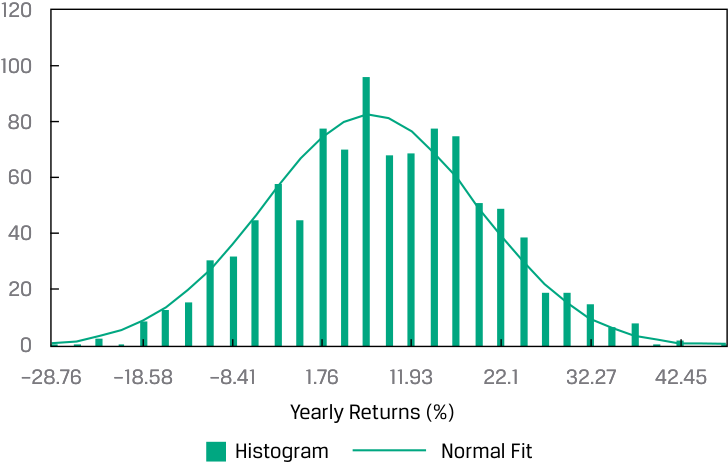
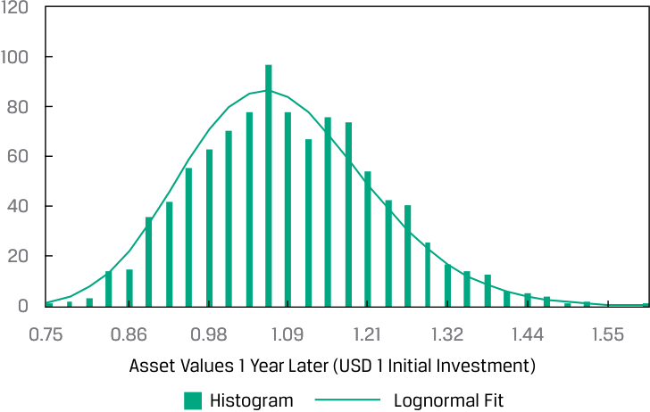
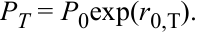
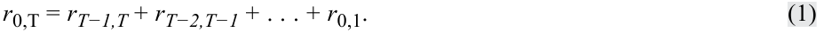
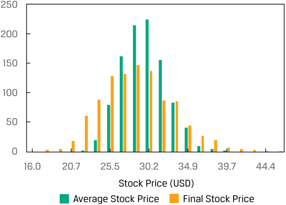
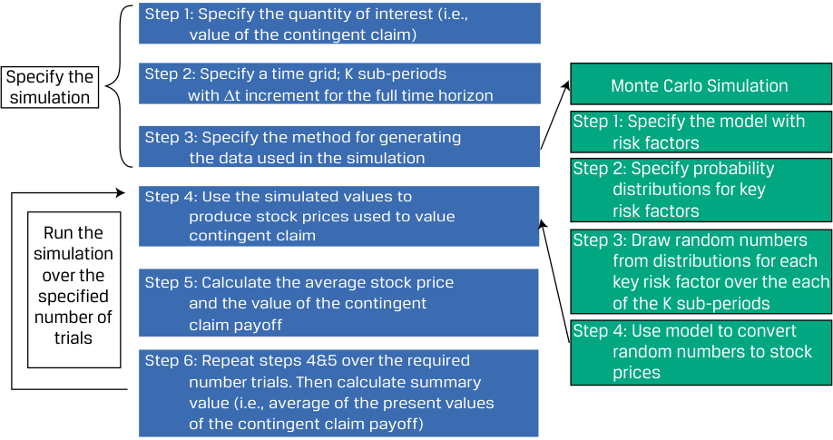
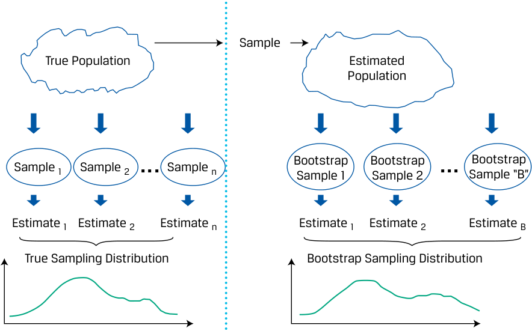

# Volume 1: Quantitative Methods
## Learning Module 6 Simulation Methods
### Part 1/2: Introduction (PDF Pages 183–198)

---

<!-- PDF Page 183 -->

#### L E A R N I N G M O D U L E 

# **<mark>6</mark>** 

### **Simulation Methods** 

**by Kobor Adam, PhD, CFA.** 

_Adam Kobor, PhD, CFA, at New York University Investment Office (USA)_ 

###### **<mark>LEARNING OUTCOMES</mark>** 

**_Mastery The candidate should be able to:_** explain the relationship between normal and lognormal distributions and why the lognormal distribution is used to model asset prices when using continuously compounded asset returns describe Monte Carlo simulation and explain how it can be used in investment applications describe the use of bootstrap resampling in conducting a simulation based on observed data in investment applications 

##### **INTRODUCTION** 

**<mark>1</mark>** 

The understanding and application of probability distributions is a critical component of forecasting financial variables and asset prices. This learning module provides a foundation for understanding important concepts related to probability distributions. Regarding the application of probability distributions, this learning module explains how to construct and interpret a Monte Carlo simulation analysis. Bootstrapping, with some similarities to Monte Carlo simulations, is also demonstrated to illustrate the use and application of this statistical sampling approach. 

###### **LEARNING MODULE OVERVIEW** 

- The lognormal distribution is widely used for modeling the probability distribution of financial asset prices because the distribution is bounded from below by 0 as asset prices and usually describes accurately the statistical distribution properties of financial assets prices. Lognormal distribution is typically skewed to the right. 

- Continuously compounded returns play a role in many asset pricing models, as well as in risk management. 

<!-- PDF Page 184 -->

- Monte Carlo simulation is widely used to estimate risk and return in investment applications. Specifically, it is commonly used to value securities with complex features, such as embedded options, where no analytic pricing formula is available 

- A Monte Carlo simulation generates a large number of random samples from a specified probability distribution or a series of distributions to obtain the likelihood of a range of results. 

- Bootstrapping mimics the process of performing random sampling from a population to construct the sampling distribution by treating the randomly drawn sample as if it were the population. 

- Because a random sample offers a good representation of the population, bootstrapping can simulate sampling from the population by sampling from the observed sample. 

## **<mark>2</mark>** 

##### **LOGNORMAL DISTRIBUTION AND CONTINUOUS COMPOUNDING** 

explain the relationship between normal and lognormal distributions and why the lognormal distribution is used to model asset prices when using continuously compounded asset returns 

###### **The Lognormal Distribution** 

Closely related to the normal distribution, the lognormal distribution is widely used for modeling the probability distribution of share and other asset prices. For example, the lognormal distribution appears in the Black–Scholes–Merton option pricing model. The Black–Scholes–Merton model assumes that the price of the asset underlying the option is lognormally distributed. 

A random variable _Y_ follows a lognormal distribution if its natural logarithm, ln _Y_ , is normally distributed. The reverse is also true: If the natural logarithm of random variable _Y_ , ln _Y_ , is normally distributed, then _Y_ follows a lognormal distribution. If you think of the term lognormal as “the log is normal,” you will have no trouble remembering this relationship. 

The two most noteworthy observations about the lognormal distribution are that it is bounded below by 0 and it is skewed to the right (it has a long right tail). Note these two properties in the graphs of the probability density functions (pdfs) of two lognormal distributions in Exhibit 1. Asset prices are bounded from below by 0. In practice, the lognormal distribution has been found to be a usefully accurate description of the distribution of prices for many financial assets. However, the normal distribution is often a good approximation for returns. For this reason, both distributions are very important for finance professionals. 

<!-- PDF Page 185 -->

###### **Exhibit 1: Two Lognormal Distributions** 

<!-- Start of picture text -->
0 0.5 1.0 1.5 2.0 2.5 3.0 3.5 4.0 4.5 <!-- End of picture text -->

Like the normal distribution, the lognormal distribution is completely described by two parameters. Unlike many other distributions, a lognormal distribution is defined in terms of the parameters of a _different_ distribution. The two parameters of a lognormal distribution are the mean and standard deviation (or variance) of its associated normal distribution: the mean and variance of ln _Y_ , given that _Y_ is lognormal. So, we must keep track of two sets of means and standard deviations (or variances): (1) the mean and standard deviation (or variance) of the associated normal distribution (these are the parameters) and (2) the mean and standard deviation (or variance) of the lognormal variable itself. 

To illustrate this relationship, we simulated 1,000 scenarios of yearly asset returns, assuming that returns are normally distributed with 7 percent mean and 12 percent standard deviation. For each scenario _i_ , we converted the simulated continuously compounded returns ( _ri_ ) to future asset prices with the formula Price(1 year later) _i_ = USD1 × exp( _ri_ ), where exp is the exponential function and assuming that the asset’s price is USD1 today. In Exhibit 2, Panel A shows the distribution of the simulated returns together with the fitted normal pdf, whereas Panel B shows the distribution of the corresponding future asset prices together with the fitted lognormal pdf. Again, note that the lognormal distribution of future asset prices is bounded below by 0 and has a long right tail. 

<!-- PDF Page 186 -->

###### **Exhibit 2: Simulated Returns (Normal PDF) and Asset Prices (Lognormal PDF)** 

###### **_A. Normal PDF_** 

<!-- Start of picture text -->
120 100 80 60 40 20 0 –28.76 –18.58 –8.41 1.76 11.93 22.1 32.27 42.45 Yearly Returns (%) Histogram Normal Fit <!-- End of picture text -->

###### **_B. Lognormal PDF_** 

<!-- Start of picture text -->
120 100 80 60 40 20 0 0.75 0.86 0.98 1.09 1.21 1.32 1.44 1.55 Asset Values 1 Year Later (USD 1 Initial Investment) Histogram Lognormal Fit <!-- End of picture text -->

The expressions for the mean and variance of the lognormal variable are challenging. Suppose a normal random variable _X_ has expected value _μ_ and variance _σ__2_ . Define _Y_ = exp( _X_ ). Remember that the operation indicated by exp( _X_ ) or e_X_ (where _e_ ≈ 2.7183) is the opposite operation from taking logs. Because ln _Y_ = ln [exp( _X_ )] = _X_ is normal (we assume _X_ is normal), _Y_ is lognormal. What is the expected value of _Y_ = exp( _X_ )? A guess might be that the expected value of _Y_ is exp( _μ_ ). The expected value is actually exp( _μ_ + 0.50 _σ__2_ ), which is larger than exp( _μ_ ) by a factor of exp(0.50 _σ__2_ ) > 1. To get some insight into this concept, think of what happens if we increase _σ__2_ . The distribution spreads out; it can spread upward, but it cannot spread downward past 0. As a result, the center of its distribution is pushed to the right: The distribution’s mean increases. The expressions for the mean and variance of a lognormal variable are summarized below, where _μ_ and _σ__2_ are the mean and variance of the associated normal distribution (refer to these expressions as needed, rather than memorizing them): 

■ Mean ( _μL_ ) of a lognormal random variable = exp( _μ_ + 0.50 _σ__2_ ). 

<!-- PDF Page 187 -->

- Variance ( _σL__2_ ) of a lognormal random variable = exp(2 _μ_ + _σ__2_ ) × [exp( _σ__2_ ) − 1]. 

###### **Continuously Compounded Rates of Return** 

We now explore the relationship between the distribution of stock return and stock price. In this section, we show that if a stock’s continuously compounded return is normally distributed, then future stock price is necessarily lognormally distributed. Furthermore, we show that stock price may be well described by the lognormal distribution even when continuously compounded returns do not follow a normal distribution. These results provide the theoretical foundation for using the lognormal distribution to model asset prices. 

Showing that the stock price at some future time _T_ , _PT_ , equals the current stock price, _P_ 0, multiplied by _e_ raised to power _r0,T_ , the continuously compounded return from 0 to _T_ : 

<!-- Formula Text: PT = P0exp(r0,T). -->

We showed in an earlier lesson that _r_ 0,T, the continuously compounded return to time _T_ , is the sum of the one-period continuously compounded returns, as follows: 

<!-- Formula Text: r0,T = rT−1,T + rT−2,T−1 + . . . + r0,1. (1) -->

If these shorter-period returns are normally distributed, then _r_ 0,T is normally distributed (given certain assumptions) or approximately normally distributed (not making those assumptions). As _PT_ is proportional to the log of a normal random variable, _PT_ is lognormal. 

A key assumption in many investment applications is that returns are **independently and identically distributed** (i.i.d.). Independence captures the proposition that investors cannot predict future returns using past returns. Identical distribution captures the assumption of stationarity, a property implying that the mean and variance of return do not change from period to period. 

Assume that the one-period continuously compounded returns (such as _r_ 0,1) are i.i.d. random variables with mean μ and variance σ2 (but making no normality or other distributional assumption). Then, 

<!-- Formula Text: E(r0,T) = E(rT−1,T) + E(rT−2,T−1) + . . . + E(r0,1) = μT, (2) (we add up μ for a total of T times), and σ2(r0,T) = σ2T (3) -->

(as a consequence of the independence assumption). 

The variance of the _T_ holding period continuously compounded return is _T_ multiplied by the variance of the one-period continuously compounded return; also, σ( _r_ 0,T) = _σ_ √ T_ . If the one-period continuously compounded returns on the right-hand side of Equation 1 are normally distributed, then the _T_ holding period continuously compounded return, _r_ 0,T, is also normally distributed with mean _μT_ and variance _σ__2_ _T_ . This is because a linear combination of normal random variables is also a normal random variable. 

Even if the one-period continuously compounded returns are not normal, their sum, _r_ 0,T, is approximately normal according to the central limit theorem. Now compare PT = _P_ 0exp( _r_ 0,T) to _Y_ = exp( _X_ ), where _X_ is _normal_ and _Y_ is lognormal (as we discussed previously). Clearly, we can model future stock price _PT_ as a lognormal random variable because _r_ 0,T should be at least approximately _normal_ . This assumption of normally distributed returns is the basis in theory for the lognormal distribution as a model for the distribution of prices of shares and other financial assets. 

<!-- PDF Page 188 -->

Continuously compounded returns play a role in many asset pricing models, as well as in risk management. **Volatility** measures the standard deviation of the continuously compounded returns on the underlying asset; by convention, it is stated as an annualized measure. In practice, we often estimate volatility using a historical series of continuously compounded daily returns. We gather a set of daily holding period returns, convert them into continuously compounded daily returns and then compute the standard deviation of the continuously compounded daily returns and annualize that number using Equation 3. 

Annualizing is typically done based on 250 days in a year, the approximate number of business days that financial markets are typically open for trading. Thus, if daily volatility were 0.01, we would state volatility (on an annual basis) as  0.01  √_ 250 = 0.1581 . Example 1 illustrates the estimation of volatility for the shares of Astra International. 

###### **EXAMPLE 1** 

###### **Volatility of Share Price** 

Suppose you are researching Astra International (Indonesia Stock Exchange: ASII) and are interested in Astra’s price action in a week in which international economic news had significantly affected the Indonesian stock market. You decide to use volatility as a measure of the variability of Astra shares during that week. Exhibit 3 shows closing prices during that week. 

**Exhibit 3: Astra International Daily Closing Prices** 

|**Day**|**Closing Price** **(Indonesian rupiah, IDR)**|
|---|---|
|Monday|6,950|
|Tuesday|7,000|
|Wednesday|6,850|
|Thursday|6,600|
|Friday|6,350|

Use the data provided to do the following: 

<!-- PDF Page 189 -->

1. Estimate the volatility of Astra shares. (Annualize volatility on the basis of 250 trading days in a year.) 

###### **Solution:** 

First, calculate the continuously compounded daily returns; then, find their standard deviation in the usual way. In calculating sample variance, to get sample standard deviation, the divisor is sample size minus 1. 

ln(7,000/6,950) = 0.007168. 

ln(6,850/7,000) = −0.021661. ln(6,600/6,850) = −0.037179. ln(6,350/6,600) = −0.038615. Sum = −0.090287. Mean = −0.022572. Variance = 0.000452. 

Standard deviation = 0.021261. 

The standard deviation of continuously compounded daily returns is _ 0.021261. Equation 3 states that _σ_ ˆ( _r_ 0, _T_ ) = _σ_ ˆ √ _T_ . In this example, _σ_ ˆ is the sample standard deviation of one-period continuously compounded returns. Thus, _σ_ ˆ refers to 0.021261. We want to annualize, so the horizon _T_ corresponds to one year. Because _σ_ ˆ is in days, we set _T_ equal to the number of trading days in a year (250). 

Therefore, we find that annualized volatility for Astra stock that week was 33.6 percent, calculated as  0.021261  √_ 250 = 0.336165 . 

2. Calculate an estimate of the expected continuously compounded annual return for Astra. 

###### **Solution:** 

Note that the sample mean, −0.022572 (from the Solution to 1), is a sample estimate of the mean, _μ_ , of the continuously compounded one-period or daily returns. The sample mean can be translated into an estimate of the expected continuously compounded annual return using Equation 2, _μ_ ˆ _T_ = − 0.022572 ( 250 )  (using 250 to be consistent with the calculation of volatility). 

3. Discuss why it may not be prudent to use the sample mean daily return to estimate the expected continuously compounded annual return for Astra. 

###### **Solution:** 

Four daily return observations are far too few to estimate expected returns. Further, the variability in the daily returns overwhelms any information about expected return in a series this short. 

4. Identify the probability distribution for Astra share prices if continuously compounded daily returns follow the normal distribution. 

###### **Solution:** 

Astra share prices should follow the lognormal distribution if the continuously compounded daily returns on Astra shares follow the normal distribution. 

<!-- PDF Page 190 -->

We have shown that the distribution of stock price is lognormal, given certain assumptions. Earlier we gave bullet-point expressions for the mean and variance of a lognormal random variable. In the context of a stock price, the _μ_ ˆ and _σ_ ˆ2 in these expressions would refer to the mean and variance of the _T_ horizon, not the one-period, continuously compounded returns compatible with the horizon of _PT_ . 

## **<mark>3</mark>** 

##### **MONTE CARLO SIMULATION** 

describe Monte Carlo simulation and explain how it can be used in investment applications 

After gaining an understanding of probability distributions used to characterize asset prices and asset returns, we explore a technique called **Monte Carlo simulation** in which probability distributions play an integral role. A characteristic of Monte Carlo simulation is the generation of a very large number of random samples from a specified probability distribution or distributions to obtain the likelihood of a range of results. 

Monte Carlo simulation is widely used to estimate risk and return in investment applications. In this setting, we simulate the portfolio’s profit and loss performance for a specified time horizon, either on an asset-by-asset basis or an aggregate, portfolio basis. Repeated trials within the simulation, each trial involving a draw of random observations from a probability distribution, produce a simulated frequency distribution of portfolio returns from which performance and risk measures are derived. 

Another important use of Monte Carlo simulation in investments is as a tool for valuing complex securities for which no analytic pricing formula is available. For other securities, such as mortgage-backed securities with complex embedded options, Monte Carlo simulation is also an important modeling resource. Because we control the assumptions when we carry out a simulation, we can run a model for valuing such securities through a Monte Carlo simulation to examine the model’s sensitivity to a change in key assumptions. 

To understand the technique of Monte Carlo simulation, we present the process as a series of steps; these can be viewed as providing an overview rather than a detailed recipe for implementing a Monte Carlo simulation in its many varied applications. 

To illustrate the steps, we use Monte Carlo simulation to value an option, **contingent claim** , whose value is based on some other underlying security. For this option, no analytic pricing formula is available. For our purposes, the value of this contingent claim (an Asian option), equals the difference between the underlying stock price at that maturity and the _average_ stock price during the life of the contingent claim or USD 0, whichever is greater. For instance, if the final underlying stock price is USD 34 and the average value over the life of the claim is USD 31, the value of the contingent claim at its maturity is USD 3 (the greater of USD 34 – USD 31 = USD 3 and USD 0). 

Assume that the maturity of the claim is one year from today; we will simulate stock prices in monthly steps over the next 12 months and will generate 1,000 scenarios to value this claim. The payoff diagram of this contingent claim security is depicted in Panel A of Exhibit 4, a histogram of simulated average and final stock prices is shown in Panel B, and a histogram of simulated payoffs of the contingent claim is presented in Panel C. 

The payoff diagram (Panel A) is a snapshot of the contingent claim at maturity. If the stock’s final price is less than or equal to its average over the life of the contingent claim, then the payoff would be zero. However, if the final price exceeds the average price, the payoff is equal to this difference. Panel B shows histograms of the simulated 

<!-- PDF Page 191 -->

final and average stock prices. Note that the simulated final price distribution is wider than the simulated average price distribution. Also, note that the contingent claim’s value depends on the difference between the final and average stock prices, which cannot be directly inferred from these histograms. 

###### **Exhibit 4: Payoff Diagram, Histogram of Simulated Average, and Final Stock Prices, and Histogram of Simulated Payoffs for Contingent Claim** 

<!-- Start of picture text -->
A. Contingent Claim Payoff Diagram Payoff (USD) 35 30 25 20 15 10 5 0 –30 –20 –10 0 10 20 30 Final Price Minus Average Price (USD) <!-- End of picture text -->

###### **_B. Histogram of Simulated Average and Final Stock Prices_** Number of Trials 

<!-- Start of picture text -->
250 200 150 100 50 0 16.0 20.7 25.5 30.2 34.9 39.7 44.4 Stock Price (USD) Average Stock Price Final Stock Price <!-- End of picture text -->

###### **_C. Histogram of Simulated Contingent Claim Payoffs_** 

###### Number of Trials 

<!-- Start of picture text -->
700 600 500 400 300 200 100 0 0 1.7 3.5 5.2 6.9 8.7 10.4 Contingent Claim Payoff (USD) <!-- End of picture text -->

<!-- PDF Page 192 -->

Finally, Panel C shows the histogram of the contingent claim’s simulated payoffs. In 654 of 1,000 total trials, the final stock price was less than or equal to the average price, so in 65.4 percent of the trials the contingent claim paid off zero. In the remaining 34.6 percent of the trials, however, the claim paid the positive difference between the final and average prices, with the maximum payoff being USD 11. 

The process flowchart in Exhibit 5 shows the steps for implementing the Monte Carlo simulation for valuing this contingent claim. Steps 1 through 3 of the process describe specifying the simulation; Steps 4 through 6 describe running the simulation. 

**Exhibit 5: Steps in Implementing the Monte Carlo Simulation** 

<!-- Start of picture text -->
Step 1: Specify the quantity of interest (i.e., value of the contingent claim) Specify the Step 2: Specify a time grid; K sub-periods Monte Carlo Simulation simulation with �t increment for the full time horizon Step 1: Specify the model with Step 3: Specify the method for generating risk factors the data used in the simulation Step 2: Specify probability Step 4: Use the simulated values to  distributions for key produce stock prices used to value risk factors Run the contingent claim Step 3: Draw random numbers simulation from distributions for each over the Step 5: Calculate the average stock price key risk factor over the each specified and the value of the contingent  of the K sub-periods number of trials claim payoff Step 4: Use model to convert random numbers to stock Step 6: Repeat steps 4&5 over the required prices number trials. Then calculate summary value (i.e., average of the present values of the contingent claim payoff) <!-- End of picture text -->

The mechanics of implementing the Monte Carlo simulation for valuing the contingent claim using the six-step process are described as follows: 

**1.** Specify the quantity of interest in terms of underlying variables. The quantity of interest is the contingent claim value, and the underlying variable is the stock price. Then, specify the starting value(s) of the underlying variable(s). 

   - We use _CiT_ to represent the value of the claim at maturity, _T_ . The subscript _i_ in _CiT_ indicates that _CiT_ is a value resulting from the _i_ th **simulation trial** , each simulation trial involving a drawing of random values (an iteration of Step 4). 

**2.** Specify a time grid. Take the horizon in terms of calendar time and split it into a number of subperiods—say, _K_ in total. Calendar time divided by the number of subperiods, _K_ , is the time increment, Δ _t_ . In our example, calendar time is one year and _K_ is 12, so Δ _t_ equals one month. 

**3.** Specify the method for generating the data used in the simulation. This step will require that distributional assumptions be made for the key risk factors that drive the underlying variables. For example, stock price is the underlying variable for the contingent claim, so we need a model for stock price movement, effectively a period return. We choose the following model for changes in stock price, where _Zk_ stands for the standard normal random variable: 

ΔStock price = ( _μ_ × Prior stock price × Δ _t_ ) + ( _σ_ × Prior stock price × _Zk_ ). 

<!-- PDF Page 193 -->

The term _Zk_ is the key risk factor in the simulation. Through our choice of _μ_ (mean) and _σ_ (standard deviation), we control the distribution of the stock price variable. Although this example has one key risk factor, a given simulation may have multiple key risk factors. 

Then, using a computer program or spreadsheet function, draw _K_ random values of each risk factor. In our example, the spreadsheet function would produce a draw of _K_ (= 12) values of the standard normal variable _Zk_ : _Z1, Z2, Z3, . . ., ZK_ . We will discuss generating standard normal random numbers (or, in fact, random numbers with any kind of distribution) after describing the sequence of simulation steps. 

**4.** Use the simulated values to produce stock prices used to value the contingent claim. This step will convert the standard normal random numbers generated in Step 3 into stock price changes (ΔStock price) by using the model of stock price dynamics from Step 3. The result is _K_ observations on possible changes in stock price over the _K_ subperiods (remember, _K_ = 12). An additional calculation is needed to convert those changes into a sequence of _K_ stock prices, with the initial stock price as the starting value over the _K_ subperiods. This is an important step: we rely on the distributional assumptions of the Monte Carlo simulation to randomly create a very large number of stock price processes. 

**5.** Calculate the average stock price and the value of the contingent claim. This calculation produces the average stock price during the life of the contingent claim (the sum of _K_ stock prices divided by _K_ ). Then, compute the value of the contingent claim at maturity, _CiT_ , and then calculate its present value, _Ci0_ , by discounting this terminal value using an appropriate interest rate as of today. (The subscript _i_ in _Ci0_ stands for the _i_ th simulation trial, as it does in _CiT_ .) We have now completed one simulation trial. 

**6.** Repeat steps 4 and 5 over the required number of trials. Iteratively, go back to Step 4 until the specified number of trials, _I_ , is completed. Finally, produce summary values and statistics for the simulation. The quantity of interest in our example is the mean value of _Ci0_ for the total number of simulation trials ( _I_ = 1,000). This mean value is the Monte Carlo estimate of the value of our contingent claim. 

In Example 2, we continue with the application of Monte Carlo simulation to value another type of contingent claim. 

###### **EXAMPLE 2** 

###### **Valuing a Lookback Contingent Claim Using Monte Carlo Simulation** 

1. A standard lookback contingent claim on a stock has a value at maturity equal to (Value of the stock at maturity − Minimum value of stock during the life of the claim prior to maturity) or USD 0, whichever is greater. If the minimum value reached prior to maturity was USD 20.11 and the value of 

<!-- PDF Page 194 -->

the stock at maturity is USD 23, for example, the contingent claim is worth USD 23 – USD 20.11 = USD 2.89. 

How might you use Monte Carlo simulation in valuing a lookback contingent claim? 

###### **Solution:** 

We previously described how to use Monte Carlo simulation to value a certain type of contingent claim. Just as we can calculate the average value of the stock over a simulation trial to value that claim, for a lookback contingent claim, we can also calculate the minimum value of the stock over a simulation trial. Then, for a given simulation trial, we can calculate the terminal value of the claim, given the minimum value of the stock for the simulation trial. We can then discount this terminal value back to the present to get the value of the claim today ( _t_ = 0). The average of these _t_ = 0 values over all simulation trials is the Monte Carlo simulated value of the lookback contingent claim. 

Finally, note that Monte Carlo simulation is a complement to analytical methods. It provides only statistical estimates, not exact results. Analytical methods, where available, provide more insight into cause-and-effect relationships. However, as financial product innovations proceed, the applications for Monte Carlo simulation in investment management continue to grow. 

###### **QUESTION SET** 

1. Define Monte Carlo simulation and explain its use in investment management. 

###### **Solution:** 

A Monte Carlo simulation generates of a large number of random samples from a specified probability distribution (or distributions) to represent the role of risk in the system. Monte Carlo simulation is widely used to estimate risk and return in investment applications. In this setting, we simulate the portfolio’s profit and loss performance for a specified time horizon. Repeated trials within the simulation produce a simulated frequency distribution of portfolio returns from which performance and risk measures are derived. Another important use of Monte Carlo simulation in investments is as a tool for valuing complex securities for which no analytic pricing formula is available. It is also an important modeling resource for securities with complex embedded options. 

2. Compared with analytical methods, what are the strengths and weaknesses of using Monte Carlo simulation for valuing securities? 

###### **Solution:** 

- _Strengths:_ Monte Carlo simulation can be used to price complex securities for which no analytic expression is available, particularly European-style options. 

- _Weaknesses:_ Monte Carlo simulation provides only statistical estimates, not exact results. Analytic methods, when available, provide more insight into cause-and-effect relationships than does Monte Carlo simulation. 

<!-- PDF Page 195 -->

|3. A Monte Carlo simulation can be used to:|
|---|
|**A.**directly provide precise valuations of call options.|
|**B.**simulate a process from historical records of returns.|
|**C.**test the sensitivity of a model to changes in assumptions—for example, on distributions of key variables.|
|**Solution:**|
|C is correct. A characteristic feature of Monte Carlo simulation is the gener- ation of a large number of random samples from a specified probability dis- tribution or distributions to represent the role of risk in the system. There- fore, it is very useful for investigating the sensitivity of a model to changes in assumptions—for example, on distributions of key variables.|

4. A limitation of Monte Carlo simulation is: **A.** its failure to do “what if” analysis. **B.** that it requires historical records of returns. **C.** its inability to independently specify cause-and-effect relationships. 

**Solution:** C is correct. Monte Carlo simulation is a complement to analytical methods. Monte Carlo simulation provides statistical estimates and not exact results. Analytical methods, when available, provide more insight into cause-andeffect relationships. 

##### **BOOTSTRAPPING** 

## **<mark>4</mark>** 

describe the use of bootstrap resampling in conducting a simulation based on observed data in investment applications 

Earlier, we demonstrated how to find the standard error of the sample mean, which can be computed based on the central limit theorem. We now introduce a computational tool called **resampling** , which repeatedly draws samples from the original observed data sample for the statistical inference of population parameters. **Bootstrap** , one of the most popular resampling methods, uses computer simulation for statistical inference without using an analytical formula such as a _z_ -statistic or _t_ -statistic. 

The idea behind bootstrap is to mimic the process of performing random sampling from a population to construct the sampling distribution. The difference lies in the fact that we have no knowledge of what the population looks like, except for a sample with size _n_ drawn from the population. Because a random sample offers a good representation of the population, we can simulate sampling from the population by sampling from the observed sample. In other words, the bootstrap mimics the process by treating the randomly drawn sample as if it were the population. 

Both the bootstrap and the Monte Carlo simulation build on repetitive sampling. Bootstrapping resamples a dataset as the true population, and infers from the sampling statistical distribution parameter values (i.e., mean, variance, skewness, and kurtosis) for the population. Monte Carlo simulation builds on generating random data with certain known statistical distribution of parameter values. 

<!-- PDF Page 196 -->

The right-hand side of Exhibit 6 illustrates the process. In bootstrap, we repeatedly draw samples from the original sample, and each resample is of the same size as the original sample. Note that each item drawn is replaced for the next draw (i.e., the identical element is put back into the group so that it can be drawn more than once). Although some items may appear several times in the resamples, other items may not appear at all. 

**Exhibit 6: Bootstrap Resampling** 

<!-- Start of picture text -->
Sample True Population Estimated Population Bootstrap Bootstrap Bootstrap Sample 1 Sample 2 ... Sample n ... Sample 1 Sample 2 Sample “B” Estimate 1 Estimate 2 Estimate n Estimate 1 Estimate 2 Estimate B True Sampling Distribution Bootstrap Sampling Distribution <!-- End of picture text -->

The mechanics of implementing the simulation for valuing the contingent claim used in the previous lesson using the bootstrap differ only in the source of the random variable used. Instead of being drawn from a probability distribution, under bootstrapping, the random variable is drawn from the sample as described in the discussion related to Exhibit 6. Exhibit 7 shows the steps for the bootstrap process highlighting the differences between the bootstrap process and the Monte Carlo simulation from Exhibit 6. 

**Exhibit 7: Steps in Implementing Simulation using Bootstrapping** 

<!-- Start of picture text -->
Step 1: Specify the quantity of interest (i.e., value of the contingent claim) Specify the Step 2: Specify a time grid; K sub-periods simulation with �t increment for the full time horizon Bootstrap Simulation Step 3: Specify the method for generating Step 1: Use the observed empirical the data used in the simulation distribution of the asset to derive properties of the distribution Step 4: Use the simulated values to Run the produce stock prices used to value Step 2: Draw k random values of simulation contingent claim stock process from the empirical over the distribution using the bootstrap specified Step 5: Calculate the average stock price procedure number of and the value of the contingent trials claim payoff Step 6: Repeat steps 4&5 over the required number trials. Then calculate summary value (i.e., average of the present values of the contingent claim payoff) <!-- End of picture text -->

<!-- PDF Page 197 -->

The steps in using bootstrap to simulate the contingent claim are then (with the first two steps and the last three steps) the same for bootstrapping as they are for the Monte Carlo simulation: 

**1.** Specify the quantity of interest in terms of underlying variables. The quantity of interest is the contingent claim value, and the underlying variable is the stock price. Then, specify the starting value(s) of the underlying variable(s). We use _CiT_ to represent the value of the claim at maturity, _T_ . The subscript _i_ in _CiT_ indicates that _CiT_ is a value resulting from the _i_ th simulation trial, each simulation trial involving a drawing of random values (an iteration of Step 4). 

**2.** Specify a time grid that is consistent with the periodicity of the sample observations. Take the horizon in terms of calendar time and split it into a number of subperiods—say, _K_ in total. Calendar time divided by the number of subperiods, _K_ , is the time increment, Δ _t_ . In the example, calendar time was one year, and _K_ is 12, so Δ _t_ equals one month. 

**3.** Specify the method for generating the data used in the simulation. In our example, stock price is the underlying variable for the contingent claim, so we use the observed changes in stock price as our empirical distribution. We use the observed historical behavior of stock price processes: price changes or price returns. 

**4.** Use the simulated values to produce stock prices used to value the contingent claim. Using a computer program or spreadsheet function, draw _K_ random values of stock process from the empirical distribution using the bootstrap procedure. Then, convert the stock price changes (ΔStock price) from Step 3 into the stock price dynamics. The calculation is necessary to convert those changes into a sequence of _K_ stock prices, with the initial stock price as the starting value over the _K_ subperiods. This is an important step: we rely on the distribution of the bootstrapped trials drawn from observed, historical stock price processes. 

**5.** Calculate the average stock price and the value of the contingent claim. Another calculation produces the average stock price during the life of the contingent claim (the sum of _K_ stock prices divided by _K_ ). Then, compute the value of the contingent claim at maturity, _CiT_ , and then calculate its present value, _Ci0_ , by discounting this terminal value using an appropriate interest rate as of today. (The subscript _i_ in _Ci0_ stands for the _i_ th simulation trial, as it does in _CiT_ .) We have now completed one simulation trial. 

**6.** Repeat steps 4 and 5 over the required number of trials. Iteratively, go back to Step 4 until the specified number of trials, _I_ , is completed. Finally, produce summary values and statistics for the simulation. The quantity of interest in our example is the mean value of _Ci0_ for the total number of bootstrapping runs ( _I_ = 1,000). This mean value is the bootstrap estimate of the value of our contingent claim based on the observed empirical distribution. 

Again, note that bootstrap simulation is a complement to analytical methods. It provides only statistical estimates based on the empirical distribution created by the bootstrapping process from observed, historical prices and price processes; these are not exact results. Analytical methods, where available, provide more insight into cause-and-effect relationships. 

<!-- PDF Page 198 -->

###### **QUESTION SET** 

1. What are the main strengths and weaknesses of bootstrapping? **Solution:** _Strengths:_ 

   - Bootstrapping is simple to perform. 

   - ■ Bootstrapping offers a good representation of the statistical features of the population and can simulate sampling from the population by sampling from the observed sample. 

   - _Weaknesses:_ 

   - Bootstrapping provides only statistical estimates, not exact results. 

