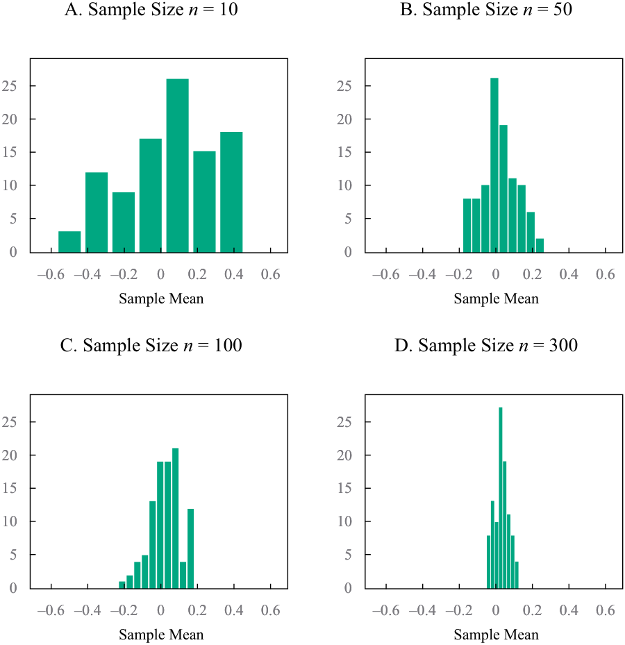
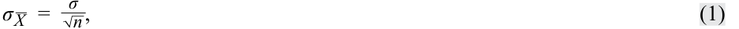
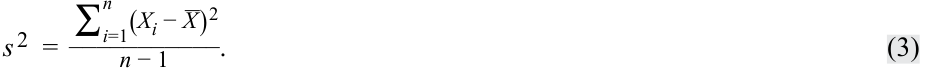

# Volume 1: Quantitative Methods
## Learning Module 7 Estimation and Inference
### Part 1/2: Introduction (PDF Pages 201–214)

---

<!-- PDF Page 201 -->

#### L E A R N I N G M O D U L E 

# **<mark>7</mark>** 

### **Estimation and Inference** 

###### **by Wu Jian, PhD.** 

_Jian Wu, PhD, is at State Street (USA)._ 

###### **<mark>LEARNING OUTCOMES</mark>** 

|**_Mastery_**|**_The candidate should be able to:_**|
|---|---|
||compare and contrast simple random, stratified random, cluster, convenience, and judgmental sampling and their implications for sampling error in an investment problem|
||explain the central limit theorem and its importance for the distribution and standard error of the sample mean|
||describe the use of resampling (bootstrap, jackknife) to estimate the sampling distribution of a statistic|

<!-- Start of picture text -->
1 <!-- End of picture text -->

##### **INTRODUCTION** 

In this Learning Module, we present the various methods for obtaining information on a population (all members of a specified group) through samples (part of the population). The information on a population that we seek usually concerns the value of a **parameter** , a quantity computed from or used to describe a population of data. In Lesson 1 we introduce sampling, which we use a sample to estimate a parameter; we make use of sample statistics. A statistic is a quantity computed from or used to describe a sample of data. 

Supposing that a sample is representative of the underlying population, how can the analyst assess the sampling error in estimating a population parameter? In Lesson 2, the Central Limit Theorem helps us understand the sampling distribution of the sample mean in many of the estimation problems we face. This provides guidance on how closely a sample mean can be expected to match its underlying population mean, allowing an analyst to use the sampling distribution to assess the accuracy of the sample and test hypotheses about the underlying parameter. Lesson 3 covers various resampling approaches. 

<!-- PDF Page 202 -->

###### **LEARNING MODULE OVERVIEW** 

- Of the two types of sampling methods, probability sampling includes simple random sampling and stratified random sampling, and non-probability sampling includes convenience sampling and judgmental sampling. Probability sampling involves equal chance of sample selection, while non-probability sampling has a significant risk of being non-representative. 

- Sampling error is the difference between the observed value of a statistic and the quantity it is intended to estimate as a result of using subsets of the population. 

- Non-probability sampling methods rely not on a fixed selection process but instead on a researcher’s sample selection capabilities. Its advantages include quick and low-cost data collection, and can apply expert judgment for efficient sample selection. 

- The Central Limit Theorem is defined as follows: Given a population described by any probability distribution with mean µ and finite variance σ2 , the sampling distribution of the sample mean_ X computed from random samples of size n from this population will be approximately normal with mean µ (the population mean) and variance σ2 /n (the population variance divided by n) when the sample size n is large. 

- The standard error of the sample mean is an important quantity in applying the central limit theorem in practice. It is typically estimated using the square root of the sample variance, calculated as follows: 

<!-- Formula Text: s 2  = ∑ i=1 n (X i − _ X) 2 ____________ n − 1 . -->

- The central limit theorem shows that when sampling from any distribution, the sample mean distribution will have these two properties when the sample size is large: (1) the distribution of the sample mean _X__ will be approximately normal, and (2) the mean of the distribution of_ X will be equal to the mean of the population from which samples are drawn. 

- Bootstrap, a popular resampling method which repeatedly draws samples of the same size as the original sample, uses computer simulation for statistical inference without using an analytical formula such as a z-statistic or t-statistic. It can be used as a simple but powerful method for any complicated estimators such as the standard error of a sample mean. 

- Bootstrap has potential advantages in accuracy. Given these advantages, it can be applied widely in finance, such as for historical simulations in asset allocation or in gauging an investment strategy’s performance against a benchmark. 

- Jackknife is another resampling technique with samples selected by taking the original observed data sample and leaving out one observation at a time from the set (and not replacing it). Jackknife is often used to reduce the bias of an estimator, and other applications include finding the standard error and confidence interval of an estimator. 

<!-- PDF Page 203 -->

##### **SAMPLING METHODS** 

## **<mark>2</mark>** 

compare and contrast simple random, stratified random, cluster, convenience, and judgmental sampling and their implications for sampling error in an investment problem 

We take samples for one of two reasons. In some cases, we cannot possibly examine every member of the population. In other cases, examining every member of the population would not be economically efficient. Thus, savings of time and money are two primary factors that cause an analyst to use sampling to answer a question about a population. 

There are two types of sampling methods: **probability sampling** and **non-probability sampling** . Probability sampling gives every member of the population an equal chance of being selected. Hence it can create a sample that is representative of the population. In contrast, non-probability sampling depends on factors other than probability considerations, such as a sampler’s judgment or the convenience to access data. Consequently, there is a significant risk that non-probability sampling might generate a non-representative sample. In general, all else being equal, probability sampling can yield more accuracy and reliability compared with non-probability sampling. 

We first focus on probability sampling, particularly the widely used **simple random sampling** and **stratified random sampling** . We then turn our attention to non-probability sampling. 

###### **Simple Random Sampling** 

Suppose a wireless equipment analyst wants to know how much major customers will spend on average for equipment during the coming year. One strategy is to survey the population of wireless equipment customers and inquire what their purchasing plans are. Surveying all companies, however, would be very costly in terms of time and money. 

Alternatively, the analyst can collect a representative sample of companies and survey them about upcoming wireless equipment expenditures. In this case, the analyst will compute the sample mean expenditure, _X__ , a statistic. This strategy has a substantial advantage over polling the whole population because it can be accomplished more quickly and at lower cost. 

Sampling, however, introduces error. The error arises because not all of the companies in the population are surveyed. The analyst who decides to sample is trading time and money for sampling error. 

When an analyst chooses to sample, they must formulate a sampling plan. A **sampling plan** is the set of rules used to select a sample. The basic type of sample from which we can draw statistically sound conclusions about a population is the simple random sample. 

A **simple random sample** is a subset of a larger population created in such a way that each element of the population has an equal probability of being selected to the subset. 

The procedure of drawing a sample to satisfy the definition of a simple random sample is called **simple random sampling** . Simple random sampling is particularly useful when data in the population is homogeneous—that is, the characteristics of the data or observations (e.g., size or region) are broadly similar. If this condition is not satisfied, other types of sampling may be more appropriate. 

<!-- PDF Page 204 -->

**Systematic sampling** can be used when we cannot code (or even identify) all the members of a population. With systematic sampling, we select every _k_ th member until we have a sample of the desired size. The sample that results from this procedure should be approximately random. 

Suppose the wireless equipment analyst polls a random sample of wireless equipment customers to determine the average equipment expenditure. The derived sample mean will provide the analyst with an estimate of the population mean expenditure. The mean obtained from the sample this way will differ from the population mean that we are trying to estimate. It is subject to error. An important part of this error is known as sampling error, which comes from sampling variation and occurs because we have data on only a subset of the population. 

**Sampling error** is the difference between the observed value of a statistic and the quantity it is intended to estimate as a result of using subsets of the population. 

A random sample reflects the properties of the population in an unbiased way, and sample statistics, such as the sample mean, computed on the basis of a random sample are valid estimates of the underlying population parameters. Thus a sample statistic is a random variable. In other words, not only do the original data from the population have a distribution but so does the sample statistic. This distribution is the statistic’s sampling distribution. 

**Sampling distribution** of a statistic is the distribution of all the distinct possible values that the statistic can assume when computed from samples of the same size randomly drawn from the same population. 

In the case of the sample mean, for example, we refer to the “sampling distribution of the sample mean” or the distribution of the sample mean. We will have more to say about sampling distributions later in this text. Next, we look at another sampling method that is useful in investment analysis. 

###### **Stratified Random Sampling** 

The simple random sampling method just discussed may not be the best approach in all situations. One frequently used alternative is stratified random sampling. 

In **stratified random sampling** , the population is divided into subpopulations (strata) based on one or more classification criteria. Simple random samples are then drawn from each stratum in sizes proportional to the relative size of each stratum in the population. These samples are then pooled to form a stratified random sample. 

In contrast to simple random sampling, stratified random sampling guarantees that population subdivisions of interest are represented in the sample. Another advantage is that estimates of parameters produced from stratified sampling have greater precision—that is, smaller variance or dispersion—than estimates obtained from simple random sampling. 

Bond indexing is one area in which stratified sampling is frequently applied. **Indexing** is an investment strategy in which an investor constructs a portfolio to mirror the performance of a specified index. In pure bond indexing, also called the full-replication approach, the investor attempts to fully replicate an index by owning all the bonds in the index in proportion to their market value weights. Many bond indexes consist of thousands of issues, however, so pure bond indexing is difficult to implement. In addition, transaction costs would be high because many bonds do not have liquid markets. 

Although a simple random sample could be a solution to the cost problem, the sample would probably not match the index’s major risk factors, such as interest rate sensitivity. Because the major risk factors of fixed-income portfolios are well known and quantifiable, stratified sampling offers a more effective approach. In this approach, we divide the population of index bonds into groups of similar duration (interest rate sensitivity), cash flow distribution, sector, credit quality, and call exposure. We refer 

<!-- PDF Page 205 -->

to each group as a stratum or cell (a term frequently used in this context). Then, we choose a sample from each stratum proportional to the relative market weighting of the stratum in the index to be replicated. 

###### **EXAMPLE 1** 

###### **Bond Indexes and Stratified Sampling** 

Suppose you are the manager of a portfolio of bonds indexed to the Bloomberg Barclays US Government/Credit Index, meaning that the portfolio returns should be similar to those of the index. You are exploring several approaches to indexing, including a stratified sampling approach. You first distinguish among agency bonds, US Treasury bonds, and investment-grade corporate bonds. For each of these three groups, you define 10 maturity intervals—1 to 2 years, 2 to 3 years, 3 to 4 years, 4 to 6 years, 6 to 8 years, 8 to 10 years, 10 to 12 years, 12 to 15 years, 15 to 20 years, and 20 to 30 years—and also separate the bonds with coupons (annual interest rates) of 6 percent or less from the bonds with coupons of more than 6 percent. 

1. How many cells or strata does this sampling plan entail? 

   - **Solution:** 

We have 3 issuer classifications, 10 maturity classifications, and 2 coupon classifications. So, in total, this plan entails 3(10)(2) = 60 different strata or cells. 

2. If you use this sampling plan, what is the minimum number of issues the indexed portfolio can have? 

###### **Solution:** 

One cannot have less than 1 issue for each cell, so the portfolio must include at least 60 issues. 

3. Suppose that in selecting among the securities that qualify for selection within each cell, you apply a criterion concerning the liquidity of the security’s market. Is the sample obtained random? Explain your answer. 

###### **Solution:** 

Applying any additional criteria to the selection of securities for the cells, not every security that might be included has an equal probability of being selected. There is no proportionality in the selection, and as a result, the sampling is not random. In practice, indexing using stratified sampling usually does not strictly involve random sampling because the selection of bond issues within cells is subject to various additional criteria. Because the purpose of sampling in this application is not to make an inference about a population parameter but rather to index a portfolio, lack of randomness is not in itself a problem in this application of stratified sampling. 

###### **Cluster Sampling** 

Another sampling method, **cluster sampling** , also requires the division or classification of the population into subpopulation groups, called clusters. In this method, the population is divided into clusters, each of which is essentially a mini-representation of the entire populations. Then certain clusters are chosen as a whole using simple 

<!-- PDF Page 206 -->

random sampling. If all the members in each sampled cluster are sampled, this sample plan is referred to as one-stage cluster sampling. If a subsample is randomly selected from each selected cluster, then the plan is referred as two-stage cluster sampling. Exhibit 1 (bottom-right panel) shows how cluster sampling works and how it compares with the other probability sampling methods. 

**Exhibit 1: Probability Sampling** 

<!-- Start of picture text -->
Simple random sample Systematic sample Stratified sample Cluster sample Clusters Subdivision Subdivision (strata) (strata) <!-- End of picture text -->

A major difference between cluster and stratified random samples is that in cluster sampling, a whole cluster is regarded as a sampling unit and only sampled clusters are included. In stratified random sampling, however, all the strata are included and only specific elements within each stratum are then selected as sampling units. 

Cluster sampling is commonly used for broad market surveys, and the most popular version identifies clusters based on geographic parameters. For example, a research institute is looking to survey if individual investors in the United States are bullish, bearish, or neutral on the stock market. It would be impossible to carry out the research by surveying all the individual investors in the country. The two-stage cluster sampling is a good solution in this case. In the first stage, a researcher can group the population by states and all the individual investors of each state represent a cluster. A handful of the clusters are then randomly selected. At the second stage, a simple random sample of individual investors is selected from each sampled cluster to conduct the survey. 

Compared with other probability sampling methods, given equal sample size, cluster sampling usually yields lower accuracy because a sample from a cluster might be less representative of the entire population. Its major advantage, however, is offering the most time-efficient and cost-efficient probability sampling plan for analyzing a vast population. 

###### **Non-Probability Sampling** 

Non-probability sampling methods rely not on a fixed selection process but instead on a researcher’s sample selection capabilities. We introduce two major types of non-probability sampling methods here. 

- **Convenience Sampling:** In this method, an element is selected from the population based on whether or not it is accessible to a researcher or on how easy it is for a researcher to access the element. The samples are not 

<!-- PDF Page 207 -->

necessarily representative of the entire population, and hence the level of sampling accuracy could be limited. The advantage of **convenience sampling** is that data can be collected quickly at a low cost. In situations such as the preliminary stage of research or in circumstances subject to cost constraints, convenience sampling is often used as a time-efficient and cost-effective sampling plan for a small-scale pilot study before testing a large-scale and more representative sample. 

- **Judgmental Sampling:** This sampling process involves selectively handpicking elements from the population based on a researcher’s knowledge and professional judgment. Sample selection under **judgmental sampling** can be affected by the bias of the researcher and might lead to skewed results that do not represent the whole population. In circumstances where there is a time constraint, however, or when the specialty of researchers is critical to select a more representative sample than by using other probability or non-probability sampling methods, judgmental sampling allows researchers to go directly to the target population of interest. For example, when auditing financial statements, seasoned auditors can apply their sound judgment to select accounts or transactions that can provide sufficient audit coverage. Example 2 illustrates an application of these sampling methods. 

###### **EXAMPLE 2** 

###### **Demonstrating the Power of Sampling** 

To demonstrate the power of sampling, we conduct two sampling experiments on a large dataset. The full dataset is the “population,” representing daily returns of the fictitious Euro-Asia-Africa (EAA) Equity Index. This dataset spans a fiveyear period and consists of 1,258 observations of daily returns with a minimum value of −4.1 percent and a maximum value of 5.0 percent. 

First, we calculate the mean daily return of the EAA Equity Index (using the population). 

By taking the average of all the data points, the mean of the entire daily return series is computed as 0.035 percent. 

###### **First Experiment: Random Sampling** 

The sample size _m_ is set to 5, 10, 20, 50, 100, 200, 500, and 1,000. At each sample size, we run random sampling multiple times ( _N_ = 100) to collect 100 samples to compute mean absolute error. The aim is to compute and plot the mean error versus the sample size. 

For a given sample size _m_ , we use a random sampling procedure to compute mean absolute error in order to measure sampling error. 

By applying this procedure, we compute mean absolute errors for eight different sample sizes: _m_ = 5, 10, 20, 50, 100, 200, 500, and 1000. 

###### **Second Experiment: Stratified Random Sampling** 

We now conduct stratified random sampling by dividing daily returns into groups by year. The sample size _m_ is again set to 5, 10, 20, 50, 100, 200, 500, and 1,000. At each sample size, we run random sampling multiple times ( _N_ = 100) to collect 100 samples to compute mean absolute error. 

<!-- PDF Page 208 -->

We follow the same steps as before, except for the first step. Rather than running a simple random sampling, we conduct stratified random sampling—that is, randomly selecting subsamples of equal number from daily return groups by year to generate a full sample. For example, for a sample of 50, 10 data points are randomly selected from daily returns of each year from 2014 to 2018, respectively. Exhibit 2 summarizes the results. 

###### **Exhibit 2: Mean Absolute Errors under Different Sampling Procedures** 

|**Mean Abso**|**lute Error**|**of Rand**|**om Sam**|**pling**|||||
|---|---|---|---|---|---|---|---|---|
|**Sample size**|**5**|**10**|**20**|**50**|**100**|**200**|**500**|**1,000**|
|Mean abso-|0.297%|0.218%|0.163%|0.091%|0.063%|0.039%|0.019%|0.009%|
|lute error|||||||||

|**Mean Abso   i**|**lute Erro  i**|**r of Strati**|**ified Ra**|**i ndom Sa**|**i  mpling**||||
|---|---|---|---|---|---|---|---|---|
|**Sample size**|**5**|**10**|**20**|**50**|**100**|**200**|**500**|**1,000**|
|Mean abso- lute error|0.294%|0.205%|0.152%|0.083%|0.071%|0.051%|0.025%|0.008%|

Under both random sampling and stratified sampling mean absolute errors quickly shrink as sample size increases. Stratified sampling produces smaller mean absolute errors as it more accurately reflects the character of the population, but this difference shrinks—and in this case actually expands—as the sample size increases. 

Exhibit 2 also indicates that a minimum sample size is needed to limit sample error and achieve a certain level of accuracy. After a certain size, however, there is little incremental benefit from adding more observations (200 to 400 in this case). 

###### **Sampling from Different Distributions** 

In practice, in addition to selecting appropriate sampling methods, we also need to be careful when sampling from a population that is not under one single distribution. Example 3 illustrates the problems that can arise when sampling from more than one distribution. 

###### **EXAMPLE 3** 

###### **Calculating Sharpe Ratios: One or Two Years of Quarterly Data** 

Analysts often use the Sharpe ratio to evaluate the performance of a managed portfolio. The Sharpe ratio is the average return in excess of the risk-free rate divided by the standard deviation of returns. This ratio measures the return of a fund or a security above the risk-free rate (the excess return) earned per unit of standard deviation of return. 

<!-- PDF Page 209 -->

To compute the Sharpe ratio, suppose that an analyst collects eight quarterly excess returns (i.e., total return in excess of the risk-free rate). During the first year, the investment manager of the portfolio followed a low-risk strategy, and during the second year, the manager followed a high-risk strategy. For each of these years, the analyst also tracks the quarterly excess returns of some benchmark against which the manager will be evaluated. For each of the two years, the Sharpe ratio for the benchmark is 0.21. Exhibit 3 gives the calculation of the Sharpe ratio of the portfolio. 

**Exhibit 3: Calculation of Sharpe Ratios: Low-Risk and High-Risk Strategies** 

|**Quarter/Measure**|**Year 1** **Excess Returns**|**Year 2** **Excess Returns**|
|---|---|---|
|Quarter 1|−3%|−12%|
|Quarter 2|5|20|
|Quarter 3|−3|−12|
|Quarter 4|5|20|
|Quarterly average|1%|4%|
|Quarterly standard deviation|4.62%|18.48%|

_Sharpe ratio = 0.22 = 1/4.62 = 4/18.48_ 

For the first year, during which the manager followed a low-risk strategy, the average quarterly return in excess of the risk-free rate was 1 percent with a standard deviation of 4.62 percent. The Sharpe ratio is thus 1/4.62 = 0.22. The second year’s results mirror the first year except for the higher average return and volatility. The Sharpe ratio for the second year is 4/18.48 = 0.22. The Sharpe ratio for the benchmark is 0.21 during the first and second years. Because larger Sharpe ratios are better than smaller ones (providing more return per unit of risk), the manager appears to have outperformed the benchmark. 

Now, suppose the analyst believes a larger sample to be superior to a small one. She thus decides to pool the two years together and calculate a Sharpe ratio based on eight quarterly observations. The average quarterly excess return for the two years is the average of each year’s average excess return. For the two-year period, the average excess return is (1 + 4)/2 = 2.5% per quarter. The standard deviation for all eight quarters measured from the sample mean of 2.5 percent is 12.57 percent. The portfolio’s Sharpe ratio for the two-year period is now 2.5/12.57 = 0.199; the Sharpe ratio for the benchmark remains 0.21. Thus, when returns for the two-year period are pooled, the manager appears to have provided less return per unit of risk than the benchmark and less when compared with the separate yearly results. 

The problem with using eight quarters of return data is that the analyst has violated the assumption that the sampled returns come from the same population. As a result of the change in the manager’s investment strategy, returns in Year 2 followed a different distribution than returns in Year 1. Clearly, during Year 1, returns were generated by an underlying population with lower mean and variance than the population of the second year. Combining the results for the first and second years yielded a sample that was representative of no population. Because the larger sample did not satisfy model assumptions, any conclusions the 

<!-- PDF Page 210 -->

analyst reached based on the larger sample are incorrect. For this example, she was better off using a smaller sample than a larger sample because the smaller sample represented a more homogeneous distribution of returns. 

###### **QUESTION SET** 

An analyst is studying research and development (R&D) spending by pharmaceutical companies around the world. She considers three sampling methods for understanding a company’s level of R&D. Method 1 is to simply use all the data available to her from an internal database that she and her colleagues built while researching several dozen representative stocks in the sector. Method 2 involves relying on a commercial database provided by a data vendor. She would select every fifth pharmaceutical company on the list to pull the data. Method 3 is to first divide pharmaceutical companies in the commercial database into three groups according to the region where a company is headquartered (e.g., Asia, Europe, or North America) and then randomly select a subsample of companies from each group, with the sample size proportional to the size of its associated group in order to form a complete sample. 

1. Method 1 is an example of: 

   - **A.** simple random sampling. 

   - **B.** stratified random sampling. 

   - **C.** convenience sampling. 

   - **Solution:** 

C is correct. The analyst selects the data from the internal database because they are easy and convenient to access. 

2. Method 2 is an example of: 

   - **A.** judgmental sampling. 

   - **B.** systematic sampling. 

   - **C.** cluster sampling. 

   - **Solution:** 

B is correct. The sample elements are selected with a fixed interval ( _k_ = 5) from the large population provided by data vendor. 

3. Method 3 is an example of: 

   - **A.** simple random sampling. 

   - **B.** stratified random sampling. 

   - **C.** cluster sampling. 

###### **Solution:** 

B is correct. The population of pharmaceutical companies is divided into three strata by region to perform random sampling individually. 

4. Perkiomen Kinzua, a seasoned auditor, is auditing last year’s transactions for Conemaugh Corporation. Unfortunately, Conemaugh had a very large number of transactions, and Kinzua is under a time constraint to finish the audit. 

<!-- PDF Page 211 -->

He decides to audit only the small subset of the transaction population that is of interest and to use sampling to create that subset. 

The most appropriate sampling method for Kinzua to use is: 

- **A.** judgmental sampling. 

- **B.** systematic sampling. 

- **C.** convenience sampling. 

- **Solution:** 

A is correct. With judgmental sampling, Kinzua will use his knowledge and professional judgment as a seasoned auditor to select transactions of interest from the population. This approach will allow Kinzua to create a sample that is representative of the population and that will provide sufficient audit coverage. Judgmental sampling is useful in cases that have a time constraint or in which the specialty of researchers is critical to select a more representative sample than by using other probability or non-probability sampling methods. Judgment sampling, however, entails the risk that Kinzua is biased in his selections, leading to skewed results that are not representative of the whole population. 

##### **CENTRAL LIMIT THEOREM AND INFERENCE** 

## **<mark>3</mark>** 

explain the central limit theorem and its importance for the distribution and standard error of the sample mean 

Earlier we presented a wireless equipment analyst who decided to sample in order to estimate mean planned capital expenditures by the customers of wireless equipment vendors. Supposing that the sample is representative of the underlying population, how can the analyst assess the sampling error in estimating the population mean? 

The sample mean is itself a random variable with a probability distribution called the statistic’s sampling distribution. To estimate how closely the sample mean can be expected to match the underlying population mean, the analyst needs to understand the sampling distribution of the mean. The central limit theorem helps us understand the sampling distribution of the mean in many of the estimation problems we face. 

###### **The Central Limit Theorem** 

To explain the central limit theorem, we will revisit the daily returns of the fictitious Euro-Asia-Africa Equity Index shown earlier. The dataset (the population) consists of daily returns of the index over a five-year period. The 1,258 return observations have a population mean of 0.035 percent. 

We conduct four different sets of random sampling from the population. We first draw a random sample of 10 daily returns and obtain a sample mean. We repeat this exercise 99 more times, drawing a total of 100 samples of 10 daily returns. We plot the sample mean results in a histogram, as shown in the top left panel of Exhibit 4. We then repeat the process with a larger sample size of 50 daily returns. We draw 100 samples of 50 daily returns and plot the results (the mean returns) in the histogram shown in the top-right panel of Exhibit 4. We then repeat the process for sample sizes of 100 and 300 daily returns, respectively, again drawing 100 samples in each case. 

<!-- PDF Page 212 -->

These results appear in the bottom-left and bottom-right panels of Exhibit 4. Looking at all four panels together, we observe that the larger the sample size, the more closely the histogram follows the shape of normal distribution. 

**Exhibit 4: Sampling Distribution with Increasing Sample Size** 

<!-- Start of picture text -->
A. Sample Size  n  = 10 B. Sample Size  n  = 50 25 25 20 20 15 15 10 10 5 5 0 0 –0.6 –0.4 –0.2 0 0.2 0.4 0.6 –0.6 –0.4 –0.2 0 0.2 0.4 0.6 Sample Mean Sample Mean C. Sample Size  n  = 100 D. Sample Size  n  = 300 25 25 20 20 15 15 10 10 5 5 0 0 –0.6 –0.4 –0.2 0 0.2 0.4 0.6 –0.6 –0.4 –0.2 0 0.2 0.4 0.6 Sample Mean Sample Mean <!-- End of picture text -->

The results of this exercise show that as we increase the size of a random sample, the distribution of the sample means tends towards a normal distribution and the sampling error of the sample mean is reduced. This is a significant outcome and brings us to the central limit theorem concept, one of the most practically useful theorems in probability theory. It has important implications for how we construct confidence intervals and test hypotheses. Formally, the **central limit theorem** is stated as follows: 

- **Central Limit Theorem.** Given a population described by any probability distribution having mean µ and finite variance σ2 , the sampling distribution of the sample mean _X__ computed from random samples of size _n_ from this population will be approximately normal with mean µ (the population mean) and variance σ2 / _n_ (the population variance divided by _n_ ) when the sample size _n_ is large. 

Consider what the expression σ2 / _n_ signifies. Variance (σ2 ) stays the same, but as _n_ increases, the size of the fraction decreases. This suggests that it becomes progressively less common to obtain a sample mean that is far from the true population mean with progressively larger sample sizes. 

<!-- PDF Page 213 -->

The central limit theorem allows us to make quite precise probability statements about the population mean by using the sample mean, _regardless of the population distribution_ (so long as it has finite variance), because the sample mean follows an approximate normal distribution for large-size samples. The obvious question is, “When is a sample’s size large enough that we can assume the sample mean is normally distributed?” In general, when sample size _n_ is greater than or equal to 30, we can assume that the sample mean is approximately normally distributed. When the underlying population is very non-normal, a sample size well in excess of 30 may be required for the normal distribution to be a good description of the sampling distribution of the mean. 

###### **Standard Error of the Sample Mean** 

The central limit theorem states that the variance of the distribution of the sample mean is σ2 / _n_ . The positive square root of variance is standard deviation. The standard deviation of a sample statistic is known as the standard error of the statistic. The standard error of the sample mean is an important quantity in applying the central limit theorem in practice. 

- _X_ 

- **Definition of the Standard Error of the Sample Mean.** For sample mean_ calculated from a sample generated by a population with standard deviation σ, the standard error of the sample mean is given by one of two expressions: 

<!-- Formula Text: σ _ X   =   σ _ √ _ n  , (1) -->

when we know σ, the population standard deviation, or by 

<!-- Formula Text: s _ X   =    s _ √ _ n  , (2) -->

when we do not know the population standard deviation and need to use the sample standard deviation, _s,_ to estimate it. 

In practice, we almost always need to use Equation 2. The estimate of _s_ is given by the square root of the sample variance, _s_2 , calculated as follows: 

<!-- Formula Text: s 2  = ∑ i=1 n (X i − _ X ) 2 ___________ n − 1 . (3) -->

Note that although the standard error is the standard deviation of the sampling distribution of the parameter, “standard deviation” in general and “standard error” are two distinct concepts, and the terms are not interchangeable. 

Simply put, standard deviation measures the dispersion of the data from the mean, whereas standard error measures how much inaccuracy of a population parameter estimate comes from sampling. The contrast between standard deviation and standard error reflects the distinction between data description and inference. If we want to draw conclusions about how spread out the data are, standard deviation is the statistic to use. If we want to find out how precise the estimate of a population parameter from sampled data is relative to its true value, standard error is the statistic to use. 

In another learning module we will see how the sample mean and its standard error are used in hypothesis testing to make probability statements about the population mean. To summarize, the central limit theorem tells us that when we sample from any distribution, the distribution of the sample mean will have the following properties as long as our sample size is large: 

- The distribution of the sample mean _X__ will be approximately normal. 

- The mean of the distribution of _X__ will be equal to the mean of the population from which the samples are drawn. 

<!-- PDF Page 214 -->

- The variance of the distribution of _X__ will be equal to the variance of the population divided by the sample size. 

###### **QUESTION SET** 

A research analyst makes two statements about repeated random sampling: 

- Statement 1 When repeatedly drawing large samples from datasets, the sample means are approximately normally distributed. 

- Statement 2 The underlying population from which samples are drawn must be normally distributed in order for the sample mean to be normally distributed. 

1. Which of the following best describes the validity of the analyst’s statements? 

- **A.** Statement 1 is false; Statement 2 is true. 

- **B.** Both statements are true. 

- **C.** Statement 1 is true; Statement 2 is false. 

- **Solution:** 

C is correct. According to the central limit theorem, Statement 1 is true. Statement 2 is false because the underlying population does not need to be normally distributed in order for the sample mean to be normally distributed. 

2. Although he knows security returns are not independent, a colleague makes the claim that because of the central limit theorem, if we diversify across a large number of investments, the portfolio standard deviation will eventually approach zero as _n_ becomes large. Is he correct? 

###### **Solution:** 

No. First the conclusion on the limit of zero is wrong; second, the support cited for drawing the conclusion (i.e., the central limit theorem) is not relevant in this context. 

3. Why is the central limit theorem important? 

###### **Solution:** 

In many instances, the distribution that describes the underlying population is not normal or the distribution is not known. The central limit theorem states that if the sample size is large, regardless of the shape of the underlying population, the distribution of the sample mean is approximately normal. Therefore, even in these instances, we can still construct confidence intervals (and conduct tests of inference) as long as the sample size is large (generally _n_ ≥ 30). 

4. What is wrong with the following statement of the central limit theorem? 

_Central Limit Theorem._ “If the random variables _X_ 1, _X_ 2, _X_ 3, …, Xn are a random sample of size _n_ from any distribution with finite mean μ and variance 

