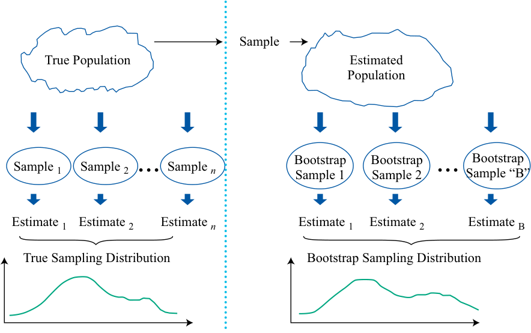
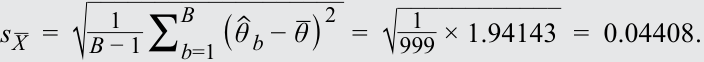
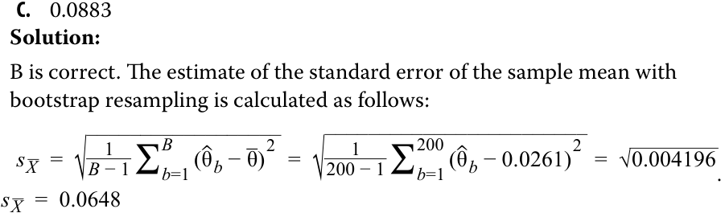
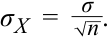

# Volume 1: Quantitative Methods
## Learning Module 7 Estimation and Inference
### Part 2/2: Bootstrapping and Empirical Sampling Distributions (PDF Pages 215–222)

---

<!-- PDF Page 215 -->

|σ2, then the distribution of~~_~~ _X_will be approximately normal, with a standard deviation of_σ_/√ _ _n_.”|
|---|
|**Solution:**|
|The statement makes the following mistakes: • Given the conditions in the statement, the distribution of_ _X_will be approx- imately normal only for large sample sizes. • The statement omits the important element of the central limit theorem that the distribution of_ _X_will have mean_μ_.|
|5. Peter Biggs wants to know how growth managers performed last year. Biggs assumes that the population cross-sectional standard deviation of growth manager returns is 6 percent and that the returns are independent across managers.|
|**A.**How large a random sample does Biggs need if he wants the standard deviation of the sample means to be 1 percent?|
|**B.**How large a random sample does Biggs need if he wants the standard deviation of the sample means to be 0.25 percent? **Solution:**|
|A. The standard deviation or standard error of the sample mean is_σ_  _ _X_=_σ_ / √ _ _n_. Substituting in the values for_σ_  _ _X_and σ, we have 1% =  6 %  /√ _ _n_, or√ _ _n_= 6. Squaring this value, we get a random sample of_n_= 36.|
|B. As in Part A, the standard deviation of sample mean is_σ_  _ _X_=_σ_ /√ _ _n_. Substituting in the values for_σ_  _ _X_and σ, we have 0.25% =  6 %  /√ _ _n_, or√ _ _n_= 24. Squaring this value, we get a random sample of_n_= 576, which is substan- tially larger than for Part A of this question.|

### **BOOTSTRAPPING AND EMPIRICAL SAMPLING DISTRIBUTIONS** 

# **<mark>4</mark>** 

describe the use of resampling (bootstrap, jackknife) to estimate the sampling distribution of a statistic 

We demonstrated how to find the standard error of the sample mean, based on the central limit theorem. We return to the computational tool called **resampling** , which repeatedly draws samples from the original observed data sample for the statistical inference of population parameters. **Bootstrap** , one of the most popular resampling methods, uses computer simulation for statistical inference without using an analytical formula such as a _z_ -statistic or _t_ -statistic. 

In bootstrap, we repeatedly draw samples from the original sample, and each resample is of the same size as the original sample. Note that each item drawn is replaced for the next draw (i.e., the identical element is put back into the group so that it can be drawn more than once). Assuming we are looking to find the standard error of sample mean, we take many resamples and then compute the mean of each resample. Note that although some items may appear several times in the resamples, other items may not appear at all. 

<!-- PDF Page 216 -->

**Exhibit 5: Bootstrap Resampling** 

<!-- Start of picture text -->
Sample True Population Estimated Population Sample 1 Sample 2 ... Sample  n Bootstrap Bootstrap ... Bootstrap Sample 1 Sample 2 Sample “B” Estimate 1 Estimate 2 Estimate  n Estimate 1 Estimate 2 Estimate B True Sampling Distribution Bootstrap Sampling Distribution <!-- End of picture text -->

Subsequently, we construct a sampling distribution with these resamples. The bootstrap sampling distribution (right-hand side of Exhibit 5) will approximate the true sampling distribution. We estimate the standard error of the sample mean using Equation 4. Note that to distinguish the foregoing resampling process from other types of resampling, it is often called model-free resampling or non-parametric resampling. 

<!-- Formula Text: s _ X   =  √ ___________________ 1 _ B − 1  ∑ b=1 B   ( ˆ θ  b − _ θ ) 2 , (4) -->

where: 

<!-- Formula Text: S _ X  = the estimate of the standard error of the sample mean, -->

- _B_ = the number of resamples drawn from the original sample, 

- _θ_ˆ _b_ = the mean of a resample, and 

- _θ_ = the mean across all the resample means. 

Bootstrap is one of the most powerful and widely used tools for statistical inference. As we have explained, it can be used to estimate the standard error of a sample mean. Similarly, bootstrap can be used to find the standard error or construct confidence intervals for the statistic of other population parameters, such as the median, which does not apply to the previously discussed methodologies. Compared with conventional statistical methods, bootstrap does not rely on an analytical formula to estimate the distribution of the estimators. It is a simple but powerful method for any complicated estimators and particularly useful when no analytical formula is available. In addition, bootstrap has potential advantages in accuracy. Given these advantages, bootstrap can be applied widely in finance, such as for historical simulations in asset allocation or in gauging an investment strategy’s performance against a benchmark. 

<!-- PDF Page 217 -->

##### **EXAMPLE 4** 

#### **Bootstrap Resampling Illustration** 

Exhibit 6 displays a set of 12 monthly returns of a rarely traded stock, shown in Column A. Our aim is to calculate the standard error of the sample mean. Using the bootstrap resampling method, a series of bootstrap samples, labelled as “resamples” (with replacement) are drawn from the sample of 12 returns. Notice how some of the returns from data sample in Column A feature more than once in some of the resamples (e.g., 0.055 features twice in Resample 1). 

**Exhibit 6: Rarely Traded Stock, 12 Monthly Returns** 

|**Column A**|**Resample 1**|**Resample 2**|**Resample 3**||**Resample** **1,000**|
|---|---|---|---|---|---|
|−0.096|0.055|−0.096|−0.033|…|−0.072|
|−0.132|−0.033|0.055|−0.132|…|0.255|
|−0.191|0.255|0.055|−0.157|…|0.055|
|−0.096|−0.033|−0.157|0.255|…|0.296|
|0.055|0.255|−0.096|−0.132|…|0.055|
|−0.053|−0.157|−0.053|−0.191|…|−0.096|
|−0.033|−0.053|−0.096|0.055|…|0.296|
|0.296|−0.191|−0.132|0.255|…|−0.132|
|0.055|−0.132|−0.132|0.296|…|0.055|
|−0.072|−0.096|0.055|−0.096|…|−0.096|
|0.255|0.055|−0.072|0.055|…|−0.191|
|−0.157|−0.157|−0.053|−0.157|…|0.055|
|Sample mean|−0.019|−0.060|0.001|…|0.040|

Drawing 1,000 such samples, we obtain 1,000 sample means. The mean across all resample means is −0.01367. The sum of squares of the differences between _ each sample mean and the mean across all resample means ( ∑ _Bb_ =1( _θ_ ˆ _b_ − _θ_ )2 ) is 1.94143. Using Equation 4, we calculate an estimate of the standard error of the sample mean: 

<!-- Formula Text: s _ X   =  √ ___________________ 1 _ B − 1  ∑ b=1 B   ( ˆ θ  b − _ θ ) 2   =  √ ____________ 1 _ 999  × 1.94143   =  0.04408. -->

**Jackknife** is another resampling technique for statistical inference of population parameters. Unlike bootstrap, which repeatedly draws samples with replacement, jackknife samples are selected by taking the original observed data sample and leaving out one observation at a time from the set (and not replacing it). Jackknife method is often used to reduce the bias of an estimator, and other applications include finding the standard error and confidence interval of an estimator. According to its computation procedure, we can conclude that jackknife produces similar results for every run, whereas bootstrap usually gives different results because bootstrap resamples are randomly drawn. For a sample of size _n_ , jackknife usually requires _n_ repetitions, whereas with bootstrap, we are left to determine how many repetitions are appropriate. 

<!-- PDF Page 218 -->

##### **QUESTION SET** 

1. An analyst in a real estate investment company is researching the housing market of the Greater Boston area. From a sample of collected house sale price data in the past year, she estimates the median house price of the area. To find the standard error of the estimated median, she is considering two options: 

Option 1: The standard error of the sample median can be given by_ √_s__ _n_, where _s_ denotes the sample standard deviation and _n_ denotes the sample size. 

Option 2: Apply the bootstrap method to construct the sampling distribution of the sample median, and then compute the standard error using Equation 7. 

Which of the following statements is accurate? 

- **A.** Option 1 is suitable to find the standard error of the sample median. 

- **B.** Option 2 is suitable to find the standard error of the sample median. 

- **C.** Both options are suitable to find the standard error of the sample median. 

##### **Solution:** 

B is correct. Option 1 is valid for estimating the standard error of the sample mean but not for that of the sample median, which is not based on the given formula. Thus, both A and C are incorrect. The bootstrap method is a simple way to find the standard error of an estimator even if no analytical formula is available or it is too complicated. 

Having covered many of the fundamental concepts of sampling and estimation, we now focus on sampling issues of special concern to analysts. The quality of inferences depends on the quality of the data as well as on the quality of the sampling plan used. Financial data pose special problems, and sampling plans frequently reflect one or more biases. The next section examines these issues. 

2. Otema Chi has a spreadsheet with 108 monthly returns for shares in Marunou Corporation. He writes a software program that uses bootstrap resampling to create 200 resamples of this Marunou data by sampling with replacement. Each resample has 108 data points. Chi’s program calculates the mean of each of the 200 resamples, and then it calculates that the mean of these 200 resample means is 0.0261. The program subtracts 0.0261 from each of the 200 resample means, squares each of these 200 differences, and adds the squared differences together. The result is 0.835. The program then calculates an estimate of the standard error of the sample mean. 

The estimated standard error of the sample mean is closest to: 

**A.** 0.0115 

**B.** 0.0648 

<!-- PDF Page 219 -->

<!-- Formula Text: C.	 0.0883 Solution: B is correct. The estimate of the standard error of the sample mean with bootstrap resampling is calculated as follows: s _ X   =  √ __________________ 1 _ B − 1  ∑ b=1 B   (ˆ θ b − _ θ) 2   =  √ ________________________ 1 _ 200 − 1  ∑ b=1 200  (ˆ θ b − 0.0261) 2   =  √ _ 0.004196 s _ X   =  0.0648 . -->

<!-- PDF Page 220 -->

## **~~PRACTICE PROBLEMS~~** 

**1.** Which one of the following statements is true about non-probability sampling? 

   - **A.** There is significant risk that the sample is not representative of the population. 

   - **B.** Every member of the population has an equal chance of being selected for the sample. 

   - **C.** Using judgment guarantees that population subdivisions of interest are represented in the sample. 

**2.** The _best_ approach for creating a stratified random sample of a population involves: 

   - **A.** drawing an equal number of simple random samples from each subpopulation. 

   - **B.** selecting every _k_ th member of the population until the desired sample size is reached. 

   - **C.** drawing simple random samples from each subpopulation in sizes proportional to the relative size of each subpopulation. 

**3.** A population has a non-normal distribution with mean _µ_ and variance _σ_2 . The sampling distribution of the sample mean computed from samples of large size from that population will have: 

   - **A.** the same distribution as the population distribution. 

   - **B.** its mean approximately equal to the population mean. 

   - **C.** its variance approximately equal to the population variance. 

**4.** A sample mean is computed from a population with a variance of 2.45. The sample size is 40. The standard error of the sample mean is _closest_ to: 

   - **A.** 0.039. 

   - **B.** 0.247. 

   - **C.** 0.387. 

**5.** Compared with bootstrap resampling, jackknife resampling: 

   - **A.** is done with replacement. 

   - **B.** usually requires that the number of repetitions is equal to the sample size. 

   - **C.** produces dissimilar results for every run because resamples are randomly drawn. 

<!-- PDF Page 221 -->

## **~~SOLUTIONS~~** 

1. A is correct. Because non-probability sampling is dependent on factors other than probability considerations, such as a sampler’s judgment or the convenience to access data, there is a significant risk that non-probability sampling might generate a non-representative sample. 

2. C is correct. Stratified random sampling involves dividing a population into subpopulations based on one or more classification criteria. Then, simple random samples are drawn from each subpopulation in sizes proportional to the relative size of each subpopulation. These samples are then pooled to form a stratified random sample. 

3. B is correct. Given a population described by any probability distribution (normal or non-normal) with finite variance, the central limit theorem states that the sampling distribution of the sample mean will be approximately normal, with the mean approximately equal to the population mean, when the sample size is large. 

4. B is correct. Taking the square root of the known population variance to determine the population standard deviation (σ) results in 

   - _σ_ =  √_ 2.45 = 1.565 . 

The formula for the standard error of the sample mean (σX), based on a known sample size ( _n_ ), is 

<!-- Formula Text: σ X  =   σ _ √ _ n  . -->

Therefore, 

<!-- Formula Text: σ X  =   1.565 _ √ _ 40    =  0.247. -->

5. B is correct. For a sample of size _n_ , jackknife resampling usually requires _n_ repetitions. In contrast, with bootstrap resampling, we are left to determine how many repetitions are appropriate. 

<!-- PDF Page 222 -->

