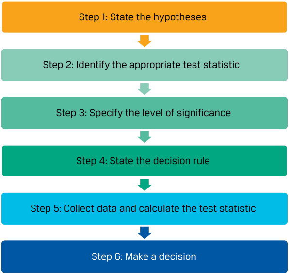

# Volume 1: Quantitative Methods
## Learning Module 8 Hypothesis Testing
### Part 1/3: Introduction (PDF Pages 223–229)

---

<!-- PDF Page 223 -->

#### L E A R N I N G M O D U L E 

# **<mark>8</mark>** 

### **Hypothesis Testing** 

**by Pamela Peterson Drake, PhD, CFA.** 

_Pamela Peterson Drake, PhD, CFA, is at James Madison University (USA)._ 

###### **<mark>LEARNING OUTCOMES</mark>** 

|**_Mastery_**|**_The candidate should be able to:_**|
|---|---|
||explain hypothesis testing and its components, including statistical significance, Type I and Type II errors, and the power of a test|
||construct hypothesis tests and determine their statistical significance, the associated Type I and Type II errors, and power of the test given a significance level|
||compare and contrast parametric and nonparametric tests, and describe situations where each is the more appropriate type of test|

<!-- Start of picture text -->
1 <!-- End of picture text -->

##### **INTRODUCTION** 

Hypothesis testing is covered extensively in the pre-read. This learning module builds on that coverage and assumes a functional understanding of the topic gained there or elsewhere. 

Lesson 1 summaries the hypothesis testing process by exemplifying its use in finance and investment management. Lesson 2 brings forward the impact of errors in the hypothesis testing process. Lesson 3 introduces nonparametric tests and their applications in investment management. 

###### **LEARNING MODULE OVERVIEW** 

- The steps in testing a hypothesis are as follows: **1.** State the hypotheses. **2.** Identify the appropriate test statistic and its probability distribution. 

   **3.** Specify the significance level. 

   **4.** State the decision rule. **5.** Collect the data and calculate the test statistic. 

<!-- PDF Page 224 -->

   **6.** Make a decision. 

- A test statistic is a quantity, calculated using a sample, whose value is the basis for deciding whether to reject or not reject the null hypothesis. We compare the computed value of the test statistic to a critical value for the same test statistic to determine whether to reject or not reject the null hypothesis. 

- In reaching a statistical decision, two possible errors can be made: reject a true null hypothesis (a Type I error, or false positive), or fail to reject a false null hypothesis (a Type II error, or false negative). 

- The level of significance of a test is the probability of a Type I error when conducting a hypothesis test. The standard approach to hypothesis testing involves specifying a level of significance (i.e., the probability of a Type I error). The complement of the level of significance is the confidence level. 

- For hypothesis tests concerning the population mean of a normally distributed population with an unknown variance, the theoretically correct test statistic is the _t_ -statistic. 

- To test whether the observed difference between two means is statistically significant, the analyst must first decide whether the samples are independent or dependent (related). If the samples are independent, a test concerning differences between means is employed. If the samples are dependent, a test of mean differences (paired comparisons test) is employed. 

- To determine whether the difference between two population means from normally distributed populations with unknown but equal variances, the appropriate test is a _t_ -test based on pooling the observations of the two samples to estimate the common but unknown variance. This test is based on an assumption of independent samples. 

- In tests concerning two means based on two samples that are not independent, the data are often arranged in paired observations and a test of mean differences (a paired comparisons test) is conducted. When the samples are from normally distributed populations with unknown variances, the appropriate test statistic is _t_ -distributed. 

- In tests concerning the variance of a single normally distributed population, the test statistic is chi-square with _n_ − 1 degrees of freedom, where _n_ is sample size. 

- For tests concerning differences between the variances of two normally distributed populations based on two random, independent samples, the appropriate test statistic is based on an _F_ -test (the ratio of the sample variances). The degrees of freedom for this _F_ -test are _n_ 1 − 1 and _n_ 2 − 1, where _n_ 1 corresponds to the number of observations in the calculation of the numerator, and _n_ 2 is the number of observations in the calculation of the denominator of the _F_ -statistic. 

- A parametric test is a hypothesis test concerning a population parameter, or a hypothesis test based on specific distributional assumptions. In contrast, a nonparametric test either is not concerned with a parameter or makes minimal assumptions about the population from which the sample was taken. 

<!-- PDF Page 225 -->

- A nonparametric test is primarily used when data do not meet distributional assumptions, when there are outliers, when data are given in ranks, or when the hypothesis we are addressing does not concern a parameter. 

##### **HYPOTHESIS TESTS FOR FINANCE** 

## **<mark>2</mark>** 

explain hypothesis testing and its components, including statistical significance, Type I and Type II errors, and the power of a test 

We use **hypothesis testing** to make decisions using data. Hypothesis testing is part of statistical inference, the process of making judgments about a larger group (a population) based on a smaller group of observations (a sample). 

In hypothesis testing, we test to determine whether a sample statistic is likely to come from a population with the hypothesized value of the population parameter. 

The concepts and tools of hypothesis testing provide an objective means to gauge whether the available evidence supports the hypothesis. After applying a statistical test, we should have a clearer idea of the probability that a hypothesis is true or not, although our conclusion always stops short of certainty. 

The main focus of this lesson is on the framework of hypothesis testing and tests concerning mean and variance, two measures frequently used in investments. 

###### **The Process of Hypothesis Testing** 

Hypothesis testing is part of the branch of statistics known as statistical inference. In statistical inference, there is estimation and hypothesis testing. Estimation involves point estimates and interval estimates. Consider a sample mean, which is a point estimate, that we can use to form a confidence interval. In hypothesis testing, the focus is examining how a sample statistic informs us about a population parameter. A **hypothesis** is a statement about one or more populations that we test using sample statistics. 

The process of hypothesis testing begins with the formulation of a theory to organize and explain observations. We judge the correctness of the theory by its ability to make accurate predictions—for example, to predict the results of new observations. If the predictions are correct, we continue to maintain the theory as a possibly correct explanation of our observations. Risk plays a role in the outcomes of observations in finance, so we can only try to make unbiased, probability-based judgments about whether the new data support the predictions. Statistical hypothesis testing fills that key role of testing hypotheses when there is uncertainty. When an analyst correctly formulates the question into a testable hypothesis and carries out a test of hypotheses, the use of well-established scientific methods supports the conclusions and decisions made on the basis of this test. 

We organize this introduction to hypothesis testing around the six steps presented in Exhibit 1, which illustrate the standard approach to hypothesis testing. 

<!-- PDF Page 226 -->

###### **Exhibit 1: The Process of Hypothesis Testing** 

<!-- Start of picture text -->
Step 1: State the hypotheses Step 2: Identify the appropriate test statistic Step 3: Specify the level of significance Step 4: State the decision rule Step 5: Collect data and calculate the test statistic Step 6: Make a decision <!-- End of picture text -->

###### **_Stating the Hypotheses_** 

For each hypothesis test, we always state two hypotheses: the **null hypothesis** (or null), designated _H_ 0, and the **alternative hypothesis** , designated Ha. The null hypothesis is a statement concerning a population parameter or parameters considered to be true unless the sample we use to conduct the hypothesis test gives convincing evidence that the null hypothesis is false. In fact, the null hypothesis is what we want to reject. If there is sufficient evidence to indicate that the null hypothesis is not true, we reject it in favor of the alternative hypothesis. 

Importantly, the null and alternative hypotheses are stated in terms of population parameters, and we use sample statistics to test these hypotheses. 

Second, the null and alternative hypotheses must be mutually exclusive and collectively exhaustive; in other words, all possible values are contained in either the null or the alternative hypothesis. 

###### **_Identify the Appropriate Test Statistic and Distribution_** 

A test statistic is a value calculated on the basis of a sample that, when used in conjunction with a decision rule, is the basis for deciding whether to reject the null hypothesis. 

The focal point of our statistical decision is the value of the test statistic. The test statistic that we use depends on what we are testing. 

Following the identification of the appropriate test statistic, we must be concerned with the distribution of the test statistic. We show examples of test statistics, and their corresponding distributions, in Exhibit 2. 

<!-- PDF Page 227 -->

**Exhibit 2: Test Statistics and Their Distribution** 

|**What We Want to Test**|**Test Statistic**|**Probability Distribution of** **the Statistic**|**Degrees of** **Freedom**|
|---|---|---|---|
|Test of a single mean|_t_= ~~_~~ _X_−_μ_ 0  ~~_~~ _s _⧸ √ _ _n_|_t_-distributed|_n_− 1|
|Test of the difference in means Test of the mean of differences|_t_=  ( _ _Xd_1−_ _Xd_2 )−( _μ_ _d_1−_μ_ _d_2 )  _______**_**____________  √  _s_ _p_ 2 _  _n_ _d_1 +  _s_ _p_ 2 _  _n_ _d_2  _t_= _ _d_−_μ_ _d_0  _  _s_  _ _d_|_t_-distributed _t_-distributed|_n_1+_n_2− 2 _n_− 1|
|Test of a single variance|_χ_ 2=(_n_ − 1 )_s_ 2  _  _σ_ 0 2|Chi-square distributed|_n_− 1|
|Test of the difference in variances|_F_=  _s_ _Before_ 2  _  _s_ _After_ 2|_F_-distributed|_n_1− 1,_n_2− 1|
|Test of a correlation|_t_=_r_  √ _ _n_− 2 _  √ _ 1 −_r_ 2|_t-Distributed_|_n_− 2|
|Test of independence (categorical data)|_χ_ 2=∑ _i_=1 _m_  ( _O_ _ij_−_E_ _ij_)2 )  _  _E_ _ij_|_Chi-square distributed_|(_r_− 1)(_c_− 1)|

_Note:_ μ0, μd0, and   σ_ 02 denote hypothesized values of the mean, mean difference, and variance, respectively. The _x__ , _d_ , _s_2 , _s_ , and _r_ denote for a sample the mean, mean of the differences, variance, standard deviation, and correlation, respectively, with subscripts indicating the sample, if appropriate. The sample size is indicated as _n_ , and the subscript indicates the sample, if appropriate. _Oij_ and _Eij_ are observed and expected frequencies, respectively, with _r_ indicating the number of rows and _c_ indicating the number of columns in the contingency table. 

###### **_Specify the Level of Significance_** 

The level of significance reflects how much sample evidence we require to reject the null hypothesis. The required standard of proof can change according to the nature of the hypotheses and the seriousness of the consequences of making a mistake. 

There are four possible outcomes when we test a null hypothesis, as shown in Exhibit 3. A **Type I error** is a false positive (reject when the null is true), whereas a **Type II error** is a false negative (fail to reject when the null is false). 

**Exhibit 3: Correct and Incorrect Decisions in Hypothesis Testing** 

|**Decision**|**_H_0 True**|**_H_0 False**|
|---|---|---|
||Correct decision:|Type II error:|
|**Fail to reject****_H_0**|Do not reject a true null hypothesis.|Fail to reject a false null hypothesis. False negative|
||Type I error:|Correct decision:|
|**Reject****_H_0**|Reject a true null hypothesis. Falsepositive|Reject a false null hypothesis.|

<!-- PDF Page 228 -->

When we make a decision in a hypothesis test, we run the risk of making either a Type I or a Type II error. As shown in Exhibit 3, these errors are mutually exclusive: If we mistakenly reject the true null, we can only be making a Type I error; if we mistakenly fail to reject the false null, we can only be making a Type II error. 

The probability of a Type I error is denoted by the lowercase Greek letter alpha, α. This probability is also known as the **level of significance** of the test, and its complement, (1 − α), is the **confidence level** . For example, a level of significance of 5 percent for a test means that there is a 5 percent probability of rejecting a true null hypothesis and corresponds to the 95 percent confidence level. 

Controlling the probabilities of the two types of errors involves a trade-off. All else equal, if we decrease the probability of a Type I error by specifying a smaller significance level (say, 1 percent rather than 5 percent), we increase the probability of making a Type II error because we will reject the null less frequently, including when it is false. Both Type I and Type II errors are risks of being wrong. Whether to accept more of one type versus the other depends on the consequences of the errors, such as costs. This trade-off weighs the impact of errors we are willing to accept and if so, at what cost. The only way to reduce the probabilities of both types of errors simultaneously is to increase the sample size, _n_ . 

Whereas the significance level of a test is the probability of incorrectly rejecting the true null, the **power of a test** is the probability of _correctly_ rejecting the null—that is, the probability of rejecting the null when it is false. The power of a test is, in fact, the complement of the Type II error. The probability of a Type II error is often denoted by the lowercase Greek letter beta, β. We can classify the different probabilities in Exhibit 4 to reflect the notation that is often used. 

**Exhibit 4: Probabilities Associated with Hypothesis Testing Decisions** 

|**Decision**|**_H_0 True**|**_H_0 False**|
|---|---|---|
|Fail to reject_H_0|1 − α|β|
|Reject_H_0|α|1 − β|

###### **_State the Decision Rule_** 

The fourth step in hypothesis testing is stating the decision rule: When do we reject the null hypothesis, and when do we not? The action we take is based on comparing the calculated sample test statistic with a specified value or values, which are referred to as **critical values** . 

The critical value or values we choose are based on the level of significance and the probability distribution associated with the test statistic. If we find that the calculated value of the test statistic is more extreme than the critical value or values, then we reject the null hypothesis; we say the result is **statistically significant** . Otherwise, we fail to reject the null hypothesis; there is not sufficient evidence to reject the null hypothesis. Recall that the smallest level of significance at which the null hypothesis can be rejected is the **p-value** , the area in the probability distribution outside the calculated test statistic. 

<!-- PDF Page 229 -->

###### **QUESTION SET** 

1. Willco is a manufacturer in a mature cyclical industry. During the most recent industry cycle, its net income averaged USD30 million per year with a standard deviation of USD10 million ( _n_ = 6 observations). Management claims that Willco’s performance during the most recent cycle results from new approaches and that Willco’s profitability will exceed the average of USD24 million per year observed in prior cycles. 

   - **A.** With _μ_ as the population value of mean annual net income, formulate null and alternative hypotheses consistent with testing Willco management’s claim. 

   - **B.** Assuming that Willco’s net income is at least approximately normally distributed, identify the appropriate test statistic and calculate the degrees of freedom. 

   - **C.** Based on a critical value of 2.015, determine whether to reject the null hypothesis. 

###### **Solution:** 

   - **A.** We often set up the “hoped for” or “suspected” condition as the alternative hypothesis. Here, that condition is that the population value of Willco’s mean annual net income exceeds USD24 million. Thus, we have _H_ 0: _μ_ ≤ 24 versus _Ha_ : _μ_ > 24. 

   - **B.** Given that net income is normally distributed with unknown variance, the appropriate test statistic is a t-statistic with _n_ − 1 = 6 − 1 = 5 degrees of freedom. 

   - **C.** We reject the null if the calculated _t-_ statistic is greater than 2.015. The calculated _t_ -statistic is 

   - _ 

   - _t_ =30 − 24 = 1.4697 .10 ⧸√_6 

   - **D.** Because the calculated test statistic does not exceed 2.015, we fail to reject the null hypothesis. There is not sufficient evidence to indicate that the mean net income is greater than USD24 million. 

2. All else equal, is specifying a smaller significance level in a hypothesis test likely to increase the probability of a: 

||**Type I error?**|**Type II error?**|
|---|---|---|
|A.|No|No|
|B.|No|Yes|
|C.|Yes|No|

###### **Solution:** 

B is correct. Specifying a smaller significance level decreases the probability of a Type I error (rejecting a true null hypothesis) but increases the probability of a Type II error (not rejecting a false null hypothesis). As the level of significance decreases, the null hypothesis is less frequently rejected. 

