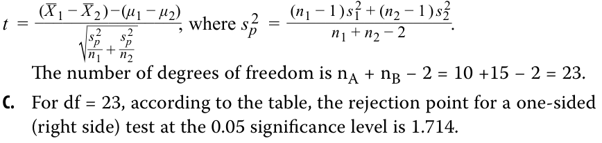
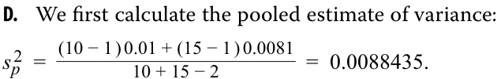
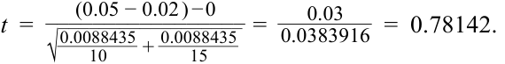

# Volume 1: Quantitative Methods
## Learning Module 8 Hypothesis Testing
### Part 2/3: Tests of Return and Risk in Finance (PDF Pages 230–243)

---

<!-- PDF Page 230 -->

3. For each of the following hypothesis tests concerning the population mean, μ, state the conclusion regarding the test of the hypotheses. 

   - **A.** _H_ 0: _μ_ = 10 versus _Ha_ : _μ_ ≠ 10, with a calculated _t_ -statistic of 2.05 and critical _t_ -values of ±1.984. 

   - **B.** _H_ 0: _μ_ ≤ 10 versus _Ha_ : _μ_ > 10, with a calculated _t_ -statistic of 2.35 and a critical _t_ -value of +1.679 

   - **C.** _H_ 0: _μ_ = 10 versus _Ha_ : _μ_ ≠ 10, with a calculated _t_ -statistic of 2.05, a _p_ -value of 4.6352%, and a level of significance of 5%. 

   - **D.** _H_ 0: _μ_ ≤ 10 versus _Ha_ : _μ_ > 10, with a 2% level of significance and a calculated test statistic with a _p_ -value of 3%. 

#### **Solution:** 

We make the decision either by comparing the calculated test statistic with the critical values or by comparing the _p_ -value for the calculated test statistic with the level of significance. 

- **A.** Reject the null hypothesis because the calculated test statistic of 2.05 is outside the bounds of the critical values of ±1.984. 

- **B.** Reject the null hypothesis because the calculated test statistic of 2.35 is outside the bounds of the critical value of +1.679. 

- **C.** The p-value corresponding to the calculated test statistic of 4.6352% is less than the level of significance (5%), so we reject the null hypothesis. 

- **D.** We fail to reject because the p-value for the calculated test statistic of 3% is greater than the level of significance (2%). 

# **<mark>3</mark>** 

## **TESTS OF RETURN AND RISK IN FINANCE** 

construct hypothesis tests and determine their statistical significance, the associated Type I and Type II errors, and power of the test given a significance level 

Hypothesis tests concerning return and risk are among the most common in finance. The sampling distribution of the mean, when the population standard deviation is unknown, is _t_ -distributed, and when the population standard deviation is known, it is normally distributed, or _z_ -distributed. Since the population standard deviation is unknown in almost all cases, we will focus on the use of a _t_ -distributed test statistic. 

#### **TEST OF A SINGLE MEAN: RISK AND RETURN CHARACTERISTICS OF AN EQUITY MUTUAL FUND** 

Suppose you are analyzing Sendar Equity Fund,. During the past 24 months, it has achieved a mean monthly return of 1.50%, with a sample standard deviation of monthly returns of 3.60 percent. Given its level of market risk and according to a pricing model, this mutual fund was expected to have earned a 1.10 percent mean monthly return during that time period. 

Assuming returns are normally distributed, are the actual results consistent with a population mean monthly return of 1.10 percent? 

<!-- PDF Page 231 -->

Formulate and test a hypothesis that the fund's performance was different than the mean return of 1.1 percent inferred from the pricing model. Use a 5 percent level of significance. 

**Exhibit 5: Test of a Single Mean** 

|**Step 1**|State the hypotheses.|_H_0:_μ_= 1.1% versus_Ha_:_μ_≠ 1.1%|
|---|---|---|
|**Step 2**|Identify the appropriate test statistic.|_t_= _ _X_−_μ_ 0  _ _s _⧸ √ _ _n_ with 24 − 1 = 23 degrees of freedom.|
|**Step 3**|Specify the level of significance.|_α_= 5% (two tailed).|
|**Step 4**|State the decision rule.|Critical_t_-values = ±2.069. Reject the null if the calculated_t_-statistic is less than −2.069, and reject the null if the calculated_t_-statistic is greater than +2.069. **Excel**  _Lower:_ ~~T.INV(0.025,23)~~  _Upper:_~~T.INV(0.975,23)~~ **R** ~~qt(c(.025,.975),23)~~|
|||**Python** ~~from scipy.stats import t~~  _Lower:_ ~~t.ppf(.025,23)~~  _Upper:_ ~~t.ppf(.975,23)~~|
|**Step 5**|Calculate the test statistic.|_t_=1.5 − 1.1 _  3.6 ⧸ √ _ 24 = 0.54433|
|**Step 6**|Make a decision.|Fail to reject the null hypothesis because the calculated_t_-statistic falls between the two critical values. There is not sufficient evidence to indicate that the population mean monthly return is different from 1.10%.|

Test the hypothesis using the 95 percent confidence interval. The 95 percent confidence interval is _X__ ± Critical value (_ √_s__ _n_ ), so {1.5 − 2.069 (3.6 ⧸√_ 24) ,  1.5 + 2.069 (3.6⧸ √_ 24)} {1.5 − 1.5204, 1.5 + 1.5204} {− 0.0204, 3.0204} The hypothesized value of 1.1 percent is within the bounds of the 95 percent confidence interval, so we fail to reject the null hypothesis. 

#### **TEST OF A SINGLE VARIANCE: RISK CHARACTERISTICS OF AN EQUITY MUTUAL FUND** 

Suppose we want to use the observed sample variance of the fund to test whether the true variance of the fund is less than some trigger level, say 4 percent. Performing a test of a population variance requires specifying the hypothesized value of the variance. We can formulate hypotheses concerning whether the variance is equal to a specific value or whether it is greater than or less than a hypothesized value: 

One-sided alternative (left tail): _H_ 0 : _σ_2 ≥ _σ_ 02 versus _Ha_ : _σ_2 < _σ_ 02 . 

<!-- PDF Page 232 -->

Note that the fund’s variance is less than the trigger level _σ_ 02 = 4% if the null hypothesis is rejected in favor of the alternative hypothesis. In tests concerning the variance of a single normally distributed population, we make use of a chisquare test statistic, denoted _χ_2 . 

You continue with your analysis of Sendar Equity Fund, a midcap growth fund that has been in existence for only 24 months. During this period, Sendar Equity achieved a mean monthly return of 1.50 percent and a standard deviation of monthly returns of 3.60 percent. Using a 5 percent level of significance, test whether the standard deviation of returns is less than 4 percent. Recall that the standard deviation is the square root of the variance, hence a standard deviation of 4 percent or 0.04, is a variance of 0.0016. 

#### **Exhibit 6: Test of Single Variance** 

|**Step 1**|State the hypotheses.|_H_0: σ2≥ 16 versus Ha: σ2< 16|
|---|---|---|
|**Step 2**|Identify the appropriate test statistic.|_χ_ 2=(_n_ − 1 )_s_ 2  _  _σ_ 0 2|
|**Step 3**|Specify the level of significance.|5%|
|**Step 4**|i State the decision rule.|With 24 − 1 = 23 degrees of freedom, the critical value is 13.09051. We reject the null hypothesis if the calculated_χ__2_statistic is greater than 13.09051.|
|||**Excel** ~~CHISQ.INV(0.05,23)~~|
|||**R** ~~qchisq(.05,23)~~ **Python** ~~from scipy.stats import chi2~~ ~~chi2.ppf(.05,23)~~|
|**Step 5**|Calculate the test statistic.|_χ_ 2=(24 − 1 ) 12.96 ___________ 16 = 18.63000|
|**Step 6**|Make a decision.|Reject the null hypothesis because the calculated _χ_ 2 statistic is greater than the critical value. There is sufficient evidence to indicate that the variance is less than 16% (or, equivalently, that the standard deviation is less than 4%).|

#### **TEST CONCERNING DIFFERENCES BETWEEN MEANS WITH INDEPENDENT SAMPLES** 

We often want to know whether a mean value—for example, a mean return— differs for two groups. Is an observed difference due to chance or to different underlying values for the mean? We test this by drawing a sample from each group. When it is reasonable to believe that the samples are from populations that are approximately normally distributed and that the samples are also independent of each other, we use the test of the difference in the means. We may assume that population variances are equal or unequal. However, our focus in discussing the test of the difference of means is using the assumption that the population variances are equal. In the calculation of the test statistic, we combine the observations from both samples to obtain a pooled estimate of the common population variance. 

Let μ1 and μ2 represent, respectively, the population means of the first and second populations, respectively. Most often we want to test whether the population means are equal or whether one is larger than the other. Thus, we formulate the following hypotheses: 

<!-- PDF Page 233 -->

_H_ 0: μ1 − μ2 = 0 versus _Ha_ : μ1 − μ2 ≠ 0. 

#### **EXAMPLE 1** 

### **Comparison of Returns on the ACE High Yield Index for Two Periods** 

Suppose we want to test whether the returns of the ACE High Yield Total Return Index, shown in Exhibit 7, are different for two different time periods, Period 1 and Period 2. 

**Exhibit 7: Descriptive Statistics for ACE High Yield Total Return Index for Periods 1 and 2** 

||**Period 1**|**Period 2**|
|---|---|---|
|**Mean**|0.01775%|0.01134%|
|**Standard deviation**|0.31580%|0.38760%|
|**Sample size**|445 days|859 days|

Note that these periods are of different lengths and the samples are independent; that is, there is no pairing of the days for the two periods. 

1. Is there a difference between the mean daily returns in Period 1 and in Period 2, using a 5% level of significance? 

#### **Solution:** 

**Step 1** State the hypotheses. _H_ 0: μ _Period_ 1 = μ _Period_ 2 versus Ha: μ _Period_ 1 ≠ μ _Period_ 2 **Step 2** Identify the appropriate test statistic. _t_ =  _______________________________( _X__ _Period_ 1 − _X__ √_______________ nPeriodperiodsp_2 21 ) − (+  nμperiodPeriodsp_2 2 1 − _μPeriod_ 2 ) , _________________________________( _nperiod_ 1 − 1 ) _sPeriod_ 2 1 + ( _nperiod_ 2 − 1 ) _sPeriod_ 2 2 _sp_2 = where _nperiod_ 1 + _nperiod_ 2 − 2 with 445 + 859 − 2 = 1,302 degrees of freedom. **Step 3** Specify the level of significance. _α_ = 5% **Step 4** State the decision rule. Critical _t_ -values = ±1.962 Reject the null if the calculated _t_ -statistic is less than −1.962, and reject the null if the calculated _t_ -statistic is greater than +1.962. **Excel** _Lower:_ ~~T.INV(0.025,1302)~~ _Upper:_ ~~T.INV(0.975,1302)~~ **R** ~~qt(c(.025,.975),1302)~~ **Python** ~~from scipy.stats import t~~ _Lower:_ ~~t.ppf(.025,1302)~~ _Upper:_ ~~t.ppf(.975,1302)~~ 

<!-- PDF Page 234 -->

<!-- Formula Text: Step 5 Calculate the test statistic. s p 2  =   (445 − 1 ) 0.09973 + (859 − 1 ) 0.15023 ____________________________ 445 + 859 − 2 =  0.1330 t  =   (0.01775 − 0.01134 ) − 0 __________________ √ _____________ 0.1330 _ 445   +  0.1330 _ 859 =   0.0064 _ 0.0213   =  0.3009. Step 6 Make a decision. Fail to reject the null because the calculated t-statistic falls within the bounds of the two critical values. We conclude that there is insufficient evidence to indicate that the returns are different for the two time periods. -->

### **Test Concerning Differences between Means with Dependent Samples** 

When we compare two independent samples, we use a _t_ -distributed test statistic that uses the difference in the means and a pooled variance. An assumption for the validity of those tests is that the samples are independent—that is, unrelated to each other. When we want to conduct tests on two means based on samples that we believe are dependent, we use the **test of the mean of the differences** (a paired comparisons test). 

How is this test of paired differences different from the test of the difference in means in independent samples? The test of paired comparisons is more powerful than the test of the difference in the means because by using the common element (such as the same periods or companies), we eliminate the variation between the samples that could be caused by something other than what we are testing. 

#### **EXAMPLE 2** 

### **A Comparison of the Returns of Two Indexes** 

Suppose we want to compare the returns of the ACE High Yield Index with those of the ACE BBB Index. We collect data over the same 1,304 days for both indexes and calculate their means and standard deviations as shown in Exhibit 8. 

**Exhibit 8: Mean and Standard Deviations for the ACE High Yield Index and the ACE BBB Index** 

||**ACE High Yield** **Index (%)**|**ACE BBB Index** **(%)**|**Difference (%)**|
|---|---|---|---|
|Mean return|0.0157|0.0135|−0.0021|
|Standard|0.3157|0.3645|0.3622|
|deviation||||

1. Using a 5 percent level of significance, is the mean of the differences is different from zero? 

#### **Solution:** 

**Step 1** State the hypotheses. _H_ 0: μd0 = 0 versus Ha: μd0 ≠ 0 **Step 2** Identify the appropriate test statistic. _t_ = <mark>_</mark> _d_ _ − _sd_  μd_ 0 **Step 3** Specify the level of significance. 5% 

<!-- PDF Page 235 -->

|**Step 4**|State the decision rule.|With 1,304 − 1 = 1,303 degrees of freedom, the critical values are ±1.962. We reject the null hypothesis if the calculated_t_-statistic is less than −1.962 or greater than +1.962. **Excel**|
|---|---|---|
|||_Lower:_ ~~T.INV(0.025,1303)~~|
|||_Upper:_ ~~T.INV(0.975,1303)~~ **R** ~~qt(c(.025,.975),1303~~|
|||**Python** ~~from scipy.stats import t~~  _Lower:_ ~~t.ppf(.025,1303)~~  _Upper:_ ~~t.ppf(.975,1303)~~|
|**Step 5**|Calculate the test statistic.|_ _d_= − 0.0021%  _s_  _ _d_= _s_ _d_  _  √ _ _n_=0.3622 _  √ _ 1, 304= 0.01003% _t_=− 0.00210 − 0 _ 0.01003 = − 0.20937|
|**Step 6**|Make a decision.|Fail to reject the null hypothesis because the calculated_t_-statistic falls within the bounds of the two critical values. There is insufficient evidence to indi- cate that the mean of the differences of returns is different from zero.|

### **Test Concerning the Equality of Two Variances** 

There are many instances in which we want to compare the volatility of two samples, in which case we can test for the equality of two variances. Examples include comparisons of baskets of securities against indexes or benchmarks, as well as comparisons of volatility in different periods. 

#### **EXAMPLE 3** 

### **Volatility and Regulation** 

You are investigating whether the population variance of returns on a stock market index changed after a change in market regulation. The first 418 weeks occurred before the regulation change, and the second 418 weeks occurred after the regulation change. You gather the data in Exhibit 9 for 418 weeks of returns both before and after the change in regulation. You have specified a 5 percent level of significance. 

#### **Exhibit 9: Index Returns and Variances before and after the Market Regulation Change** 

||**N**|**Mean Weekly** **Return (%)**|**Variance of Returns**|
|---|---|---|---|
|Before regulation change|418|0.250|4.644|
|After regulation change|418|0.110|3.919|

1. Are the variance of returns different before the regulation change versus after the regulation change? 

**Solution:** 

<!-- PDF Page 236 -->

|**Step 1**|State the hypotheses.|_H_ 0:_σ_ _Before_ 2 =_σ_ _After_ 2 versus_H_ _a_:_σ_ _Before_ 2 ≠_σ_ _After_ 2|
|---|---|---|
|**Step 2**|Identify the appropriate test statistic.|_F_=  _s_ _Before_ 2  _  _s_ _After_ 2|
|**Step 3**|Specify the level of significance.|5%|
|**Step 4** **Step 5**|State the decision rule. Calculate the test statistic.|With 418 − 1 = 417 and 418 − 1 = 417 degrees of freedom, the critical values are 0.82512 and 1.21194. Reject the null if the calculated_F_-statistic is less than 0.82512 or greater than 1.21194. **Excel**  _Left side:_ ~~F.INV(0.025,417,417)~~  _Right side:_ ~~F.INV(0.975,417,417)~~ **R** ~~qf(c(.025,.975),417,417)~~ **Python** ~~from scipy.stats import f~~  _Left side:_ ~~f.ppf(.025,417,417)~~  _Right side:_ ~~f.ppf(.975,417,417)~~  _F_=4.644 _ 3.919 = 1.18500|
|**Step 6** |Make a decision. 2. Is the v the reg **Solutio** |Fail to reject the null hypothesis since the calculated_F_-statistic falls within the bounds of the two critical values. There is not sufficient evidence to indicate that the weekly variances of returns are different in the periods before and after the regulation change. ariance of returns greater before the regulation change versus after ulation change? **n:**    |
|**Step 1**|State the hypotheses.|_H_ 0:_σ_ _Before_ 2 ≤_σ_ _After_ 2 versus_H_ _a_:_σ_ _Before_ 2 >_σ_ _After_ 2|
|**Step 2**|Identify the appropriate test statistic.|_F_=  _s_ _Before_ 2  _  _s_ _After_ 2|
|**Step 3**|Specify the level of significance.|5%|
|**Step 4**|State the decision rule.|With 418 − 1 = 417 and 418 − 1 = 417 degrees of freedom, the critical value is 1.17502. We reject the null hypothesis if the calculated_F_-statistic is greater than 1.17502. **Excel** ~~F.INV(0.95,417,417)~~ **R** ~~qf(.95,417,417)~~ **Python** ~~from scipy.stats import f~~ ~~f.ppf(.95,417,417)~~|
|**Step 5**|Calculate the test statistic.|_F_=4.644 _ 3.919 = 1.18500|
|**Step 6**|Make a decision.|Reject the null hypothesis since the calculated_F_-statistic is greater than 1.17502. There is sufficient evidence to indicate that the weekly variances of returns before the regulation change are greater than the variances after the regulation change.|

<!-- PDF Page 237 -->

#### **QUESTION SET** 

Investment analysts often use earnings per share (EPS) forecasts. One test of forecasting quality is the zero-mean test, which states that optimal forecasts should have a mean forecasting error of zero. The forecasting error is the difference between the predicted value of a variable and the actual value of the variable. 

You have collected data (shown in Exhibit 10) for two analysts who cover two different industries: Analyst A covers the telecom industry; Analyst B covers automotive parts and suppliers. 

**Exhibit 10: Test of Return and Risk** 

|**Pe**|**rformance in Fo**|**recasting Quarterly Earnin**|**gs per Share**|
|---|---|---|---|
||**Number of** **Forecasts**|**Mean Forecast Error** **(Predicted − Actual)**|**Standard Deviation** **of Forecast Errors**|
|Analyst A|10|0.05|0.10|
|Analyst B|15|0.02|0.09|

Critical _t_ -values: 

|**Degrees of**|**Area in the Right-**|**Side Rejection Area**|
|---|---|---|
|**Freedom**|**_p_ = 0.05**|**_p_ = 0.025**|
|8|1.860|2.306|
|9|1.833|2.262|
|10|1.812|2.228|
|11|1.796|2.201|
|12|1.782|2.179|
|13|1.771|2.160|
|14|1.761|2.145|
|15|1.753|2.131|
|16|1.746|2.120|
|17|1.740|2.110|
|18|1.734|2.101|
|19|1.729|2.093|
|20|1.725|2.086|
|21|1.721|2.080|
|22|1.717|2.074|
|23|1.714|2.069|
|24|1.711|2.064|
|25|1.708|2.060|
|26|1.706|2.056|
|27|1.703|2.052|

<!-- PDF Page 238 -->

1. With μ as the population mean forecasting error, formulate null and alternative hypotheses for a zero-mean test of forecasting quality. 

   - **A.** For Analyst A, determine whether to reject the null at the 0.05 level of significance. 

   - **B.** For Analyst B, determine whether to reject the null at the 0.05 level of significance. 

**Solution:** 

_H_ 0: μ = 0 versus Ha: μ ≠ 0. 

 X_ − _μ_ 0 **A.** The t-test is based on _t_ =_ _s_ / √_ _n_with n − 1 = 10 − 1 = 9 degrees of freedom. At the 0.05 significance level, we reject the null if the calculated t-statistic is outside the bounds of ±2.262 (from the table for 9 degrees of freedom and 0.025 in the right side of the distribution). For Analyst A, we have a calculated test statistic of 

 t_ =0.05 − 0 = 1.58114 .0.10 ⧸√_ 10 

We, therefore, fail to reject the null hypothesis at the 0.05 level. 

- **B.** For Analyst B, the t-test is based on t with 15 − 1 = 14 degrees of freedom. At the 0.05 significance level, we reject the null if the calculated t-statistic is outside the bounds of ±2.145 (from the table for 14 degrees of freedom). The calculated test statistic is 

- _ 

- _t_ =0.02 − 0 = 0.86066 .0.09 ⧸√_ 15 

Because 0.86066 is within the range of ±2.145, we fail to reject the null at the 0.05 level. 

2. Reviewing the EPS forecasting performance data for Analysts A and B, you want to investigate whether the larger average forecast errors of Analyst A relative to Analyst B are due to chance or to a higher underlying mean value for Analyst A. Assume that the forecast errors of both analysts are normally distributed and that the samples are independent. 

   - **A.** Formulate null and alternative hypotheses consistent with determining whether the population mean value of Analyst A’s forecast errors (μ1) are larger than Analyst B’s (μ2). 

   - **B.** Identify the test statistic for conducting a test of the null hypothesis formulated in Part A. 

   - **C.** Identify the rejection point or points for the hypotheses tested in Part A at the 0.05 level of significance. 

   - **D.** Determine whether to reject the null hypothesis at the 0.05 level of significance. 

**Solution:** 

- **A.** Stating the suspected condition as the alternative hypothesis, we have 

_H_ 0: μ _A_ − μ _B_ ≤ 0 versus _Ha_ : μ _A_ − μ _B_ > 0, 

where 

μ _A_ = the population mean value of Analyst A’s forecast errors <u>μ</u> _<u>B</u>_ = the population mean value of Analyst B’s forecast errors 

<!-- PDF Page 239 -->

**B.** We have two normally distributed populations with unknown variances. Based on the samples, it is reasonable to assume that the population variances are equal. The samples are assumed to be independent; this assumption is reasonable because the analysts cover different industries. The appropriate test statistic is _t_ using a pooled estimate of the common variance: 

<!-- Formula Text: t  = ( _ X  1 − _ X  2 ) − (μ 1 − μ 2) ________________ √ _ s p 2 _ n 1  + s p 2 _ n 2 , where s p 2  = (n 1 − 1 ) s 1 2 + (n 2 − 1 ) s 2 2 _________________ n 1 + n 2 − 2 . The number of degrees of freedom is nA + nB − 2 = 10 +15 − 2 = 23. C.	 For df = 23, according to the table, the rejection point for a one-sided (right side) test at the 0.05 significance level is 1.714.i -->

<!-- Formula Text: i D.	 We first calculate the pooled estimate of variance: s p 2  =   (10 − 1 ) 0.01 + (15 − 1 ) 0.0081 ______________________ 10 + 15 − 2 =  0.0088435. -->

We then calculate the _t_ -distributed test statistic: 

<!-- Formula Text: t  = (0.05 − 0.02 ) − 0 _________________ √ __________________ 0.0088435 _ 10 +  0.0088435 _ 15 = 0.03 _ 0.0383916   =  0.78142. -->

Because 0.78142 < 1.714, we fail to reject the null hypothesis. There is not sufficient evidence to indicate that the mean for Analyst A exceeds that for Analyst B. 

An investment consultant gathers two independent random samples of fiveyear performance data for US and European absolute return hedge funds. Noting a return advantage of 50 bps for US managers, the consultant decides to test whether the two means are different from one another at a 0.05 level of significance. The two populations are assumed to be normally distributed with unknown but equal variances. Results of the hypothesis test are contained in the Exhibit 11. 

#### **Exhibit 11: Hypothesis Test Results** 

|**Sample Size**|**Mean Return (%)**|**Standard** **Deviation**|
|---|---|---|
|US managers 50|4.7|5.4|
|European 50|4.2|4.8|
|managers|||
|Null and alternative hypotheses|_H_0: μ_US_− μE= 0;_Ha_:|μ_US_− μE≠ 0|
|Calculated test statistic|0.4893||
|Critical value rejection points|±1.984||

_Note:_ The mean return for US funds is μUS, and μE is the mean return for European funds. 

3. The consultant should conclude that the: 

- **A.** null hypothesis is not rejected. 

- **B.** alternative hypothesis is statistically confirmed. 

<!-- PDF Page 240 -->

- **C.** difference in mean returns is statistically different from zero. 

- **Solution:** 

A is correct. The calculated _t_ -statistic value of 0.4893 falls within the bounds of the critical _t_ -values of ±1.984. Thus, _H_ 0 cannot be rejected; the result is not statistically significant at the 0.05 level. 

4. During a 10-year period, the standard deviation of annual returns on a portfolio you are analyzing was 15 percent a year. You want to see whether this record is sufficient evidence to support the conclusion that the portfolio’s underlying variance of return was less than 400, the return variance of the portfolio’s benchmark. 

   - **A.** Formulate null and alternative hypotheses consistent with your objective. 

   - **B.** Identify the test statistic for conducting a test of the hypotheses in Part A, and calculate the degrees of freedom. 

   - **C.** Determine whether the null hypothesis is rejected or not rejected at the 0.05 level of significance using a critical value of 3.325. 

   - **Solution:** 

   - **A.** We have a “less than” alternative hypothesis, where σ2 is the variance of return on the portfolio. The hypotheses are _H_ 0: σ2 ≥ 400 versus Ha: σ2 < 400, where 400 is the hypothesized value of variance. This means that the rejection region is on the left side of the distribution. 

   - **B.** The test statistic is chi-square distributed with 10 − 1 = 9 degrees of freedom. 

   - **C.** The test statistic is calculated as 

<!-- Formula Text: χ 2  =   (n − 1) s 2 _ σ 0 2 =   9 × 15 2 _ 400    =   2, 025 _ 400    =  5.0625 ,  or  5.06. -->

Because 5.06 is greater than 3.325, we reject the null hypothesis; the calculated test statistic falls to the right of the critical value, where the critical value separates the left-side region from the region where we reject the null. We can determine the critical value for this test using software: 

**Excel** ~~[CHISQ.INV(0.05,9)]~~ 

~~[qchisq(.05,9)]~~ 

#### **Python** 

~~[from scipy.stats import chi2 and chi2.ppf(.05,9)]~~ We can determine the _p_ -value for the calculated test statistic of 17.0953 using software: 

**Excel** ~~[CHISQ.DIST(5.06,9,TRUE)]~~ 

~~[pchisq(5.06,9,lower.tail=TRUE)]~~ 

**Python** 

~~[from scipy.stats import chi2 and chi2. cdf(5.06,9)]~~ 

<!-- PDF Page 241 -->

5. You are investigating whether the population variance of returns on an index changed subsequent to a market disruption. You gather the following data for 120 months of returns before the disruption and for 120 months of returns after the disruption. You have specified a 0.05 level of significance. 

#### **Exhibit 12: Data for 120 Months of Returns** 

|**Time Period**|**_N_**|**Mean Monthly Return (%)**|**Variance of Returns**|
|---|---|---|---|
|Before disruption|120|1.416|22.367|
|After disruption|120|1.436|15.795|

- **A.** Formulate null and alternative hypotheses consistent with the research goal. 

- **B.** Identify the test statistic for conducting a test of the hypotheses in Part A, and calculate the degrees of freedom. 

- **C.** Determine whether to reject the null hypothesis at the 0.05 level of significance if the critical values are 0.6969 and 1.4349. 

- **Solution: A.** We have a “not equal to” alternative hypothesis: 2 2 2 2 . 

- _H_ 0  : _σBefore_ = _σAfter_ versus _Ha_ : _σBefore_ ≠ _σAfter_ **B.** To test a null hypothesis of the equality of two variances, we use an _F_ -test:  s_ 12 

- _F_ = _s_ 22 . 

- _F_ = 22.367/15.795 = 1.416, with 120 − 1 = 119 numerator and 120 − 1 = 119 denominator degrees of freedom. 

- **C.** Because this is a two-tailed test, we use critical values for the 0.05/2 = 0.025 level. The calculated test statistic falls within the bounds of the critical values (i.e., between 0.6969 and 1.4349), so we fail to reject the null hypothesis; there is not enough evidence to indicate that the variances are different before and after the disruption. Note that we could also have formed the F-statistic as 15.796/22.367 = 0.706 and draw the same conclusion. 

We could also use software to calculate the critical values: 

**Excel** ~~[F.INV(0.025,119,119)~~ and ~~F.INV(0.975,119,119)] [qf(c(.025,.975),119,119)]~~ **Python** ~~from scipy.stats import f and f.ppf [(.025,119,119) and f.ppf(.975,119,119)]~~ 

<!-- PDF Page 242 -->

Additionally, we could use software to calculate the _p_ -value of the calculated test statistic, which is 5.896 percent, and then compare it with the level of significance: 

**Excel** 

~~[(1-F.DIST(22.367/15.796,119,119,TRUE))*2~~ or ~~F.DIST(15.796/22.367,119,119,TRUE)*2]~~ **R** 

~~[(1-pf(22.367/15.796,119,119))*2~~ or ~~pf(15.796/22.367,119,119)*2]~~ 

**Python** 

~~from scipy.stats import f and f.cdf [(15.796/22.367,119,119)*2~~ or ~~(1-f.cdf(22.367/15.796,119,119))*2]~~ 

# **<mark>4</mark> PARAMETRIC VERSUS NONPARAMETRIC TESTS** 

compare and contrast parametric and nonparametric tests, and describe situations where each is the more appropriate type of test 

The hypothesis testing procedures we have discussed up to this point have two characteristics in common. First, they are concerned with parameters, and second, their validity depends on a definite set of assumptions. Mean and variance, for example, are two parameters, or defining quantities, of a normal distribution. The tests also make specific assumptions—in particular, assumptions about the distribution of the population producing the sample. Any test or procedure with either of these two characteristics is a **parametric test** or procedure. 

In some cases, however, we are concerned about quantities other than parameters of distributions. In other cases, we may believe that the assumptions of parametric tests do not hold. In cases where we are examining quantities other than population parameters or where assumptions of the parameters are not satisfied, a nonparametric test or procedure can be useful. 

A **nonparametric test** is a test that is not concerned with a parameter or a test that makes minimal assumptions about the population from which the sample comes. Exhibit 13 presents examples of nonparametric alternatives to the parametric, _t_ -distributed tests concerning means. 

**Exhibit 13: Nonparametric Alternatives to Parametric Tests Concerning Means** 

||**Parametric**|**Nonparametric**|
|---|---|---|
|Tests concerning a single mean|_t_-distributed test _z_-distributed test|Wilcoxon signed-rank test|

<!-- PDF Page 243 -->

|Tests concerning differences between|_t_-distributed test|Mann–Whitney_U_test|
|---|---|---|
|f means||(Wilcoxon rank sum test)|
|Tests concerning mean differences|_t_-distributed test|Wilcoxon signed-rank test|
|f (paired comparisons tests)||Sign test|

### **Uses of Nonparametric Tests** 

Nonparametric procedures are primarily used in four situations: (1) when the data do not meet distributional assumptions, (2) when there are outliers, (3) when the data are given in ranks or use an ordinal scale, or (4) when the relevant hypotheses do not concern a parameter. 

The first situation occurs when the data available for analysis suggest that the distributional assumptions of the parametric test are not satisfied. For example, we may want to test a hypothesis concerning the mean of a population but believe that neither _t_ - nor _z_ -distributed tests are appropriate because the sample is small and may come from a markedly non-normally distributed population. In that case, we may use a nonparametric test. The nonparametric test will frequently involve the conversion of observations (or a function of observations) into ranks according to magnitude, and sometimes it will involve working with only “greater than” or “less than” relationships (using the + and − signs to denote those relationships). Characteristically, one must refer to specialized statistical tables to determine the rejection points of the test statistic, at least for small samples. Such tests, then, typically interpret the null hypothesis as a hypothesis about ranks or signs. 

Second, whereas the underlying distribution of the population may be normal, there may be extreme values or outliers that influence the parametric statistics but not the nonparametric statistics. For example, we may want to use a nonparametric test of the median, in the case of outliers, instead of a test of the mean. 

Third, we may have a sample in which observations are ranked. In those cases, we also use nonparametric tests because parametric tests generally require a stronger measurement scale than ranks. For example, if our data were the rankings of investment managers, we would use nonparametric procedures to test the hypotheses concerning those rankings. 

A fourth situation in which we use nonparametric procedures occurs when our question does not concern a parameter. For example, if the question concerns whether a sample is random or not, we use the appropriate nonparametric test (a “runs test”). The nonparametric runs test is used to test whether stock price changes can be used to forecast future stock price changes—in other words, a test of the random walk theory. Another type of question that nonparametric methods can address is whether a sample came from a population following a particular probability distribution. 

### **Nonparametric Inference: Summary** 

Nonparametric statistical procedures extend the reach of inference because they make few assumptions, can be used on ranked data, and may address questions unrelated to parameters. Quite frequently, nonparametric tests are reported alongside parametric tests; the user can then assess how sensitive the statistical conclusion is to the assumptions underlying the parametric test. However, if the assumptions of the parametric test are met, the parametric test (where available) is generally preferred over the nonparametric test because the parametric test may have more power—that is, a greater ability to reject a false null hypothesis. 

