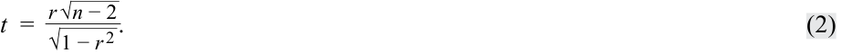
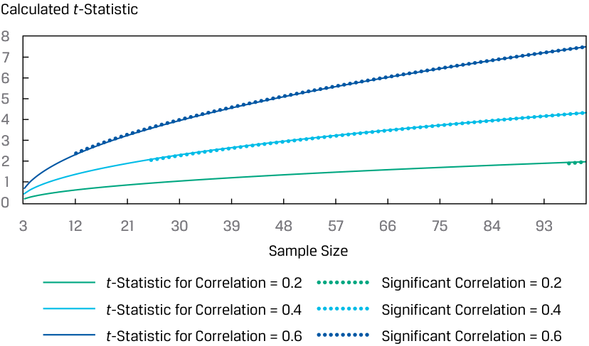
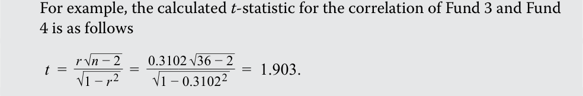
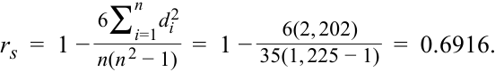
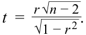

# Volume 1: Quantitative Methods
## Learning Module 9 Parametric and Non-Parametric Tests of Independence
### Part 1/2: Introduction (PDF Pages 251–260)

---

<!-- PDF Page 251 -->

#### L E A R N I N G M O D U L E 

# **<mark>9</mark>** 

### **Parametric and Non-Parametric Tests of Independence** 

**by Pamela Peterson Drake, PhD, CFA.** 

_Pamela Peterson Drake, PhD, CFA, is at James Madison University (USA)._ 

###### **<mark>LEARNING OUTCOMES</mark>** 

**_Mastery The candidate should be able to:_** explain parametric and nonparametric tests of the hypothesis that the population correlation coefficient equals zero, and determine whether the hypothesis is rejected at a given level of significance explain tests of independence based on contingency table data 

##### **INTRODUCTION** 

**<mark>1</mark>** 

In many contexts in investments, we want to assess the strength of the linear relationship between two variables—that is, we want to evaluate the **correlation** between them. A significance test of a correlation coefficient allows us to assess whether the relationship between two random variables is the result of chance. Lesson 1 covers a parametric and a non-parametric approach to testing the correlation between two variables. If we decide that the relationship does not result from chance, then we can use this information in modeling or forecasting using regression models or machine learning covered in later Learning Modules. 

When faced with categorical or discrete data, however, we cannot use the methods discussed in the first lesson to test whether the classifications of such data are independent. If we want to test whether there is a relationship between categorical or discreet data, we can perform a test of independence using a nonparametric test statistic. The second lesson covers the use of contingency tables in implementing this non-parametric test. 

###### **LEARNING MODULE OVERVIEW** 

■ There are three ways to formulate hypotheses. Let θ indicate the population parameters: 

<!-- PDF Page 252 -->

   **1.** Two-sided alternative: _H0_ : θ = θ0 versus _Ha_ : θ ≠ θ0 

   **2.** One-sided alternative (right side): _H0_ : θ ≤ θ0 versus _Ha_ : θ > θ0 

   **3.** One-sided alternative (left side): _H0_ : θ ≥ θ0 versus _Ha_ : θ < θ0 

   where θ0 is a hypothesized value of the population parameter and θ is the true value of the population parameter. 

- A parametric test is a hypothesis test concerning a population parameter or a hypothesis test based on specific distributional assumptions. In contrast, a nonparametric test either is not concerned with a parameter or makes mini mal assumptions about the population from which the sample comes. 

- A nonparametric test is primarily used when data do not meet distributional assumptions, when there are outliers, when data are given in ranks, or when the hypothesis we are addressing does not concern a parameter. 

- In tests concerning correlation, we use a t-statistic to test whether a popula tion correlation coefficient is different from zero. If we have n observations for two variables, this test statistic has a _t_ -distribution with _n_ − 2 degrees of freedom. 

- The Spearman rank correlation coefficient is calculated on the ranks of two variables within their respective samples. 

- A chi-square distributed test statistic is used to test for independence of two categorical variables. This nonparametric test compares actual frequencies with those expected on the basis of independence. This test statistic has degrees of freedom of ( _r_ − 1)( _c_ − 2), where _r_ is the number of categories for the first variable and c is the number of categories of the second variable. 

## **<mark>2</mark>** 

##### **TESTS CONCERNING CORRELATION** 

- explain parametric and nonparametric tests of the hypothesis that the population correlation coefficient equals zero, and determine whether the hypothesis is rejected at a given level of significance 

The most common hypotheses concerning correlation occur when comparing the population correlation coefficient with zero because we often ask whether a relationship exists, which implies a null of the correlation coefficient equal to zero (i.e., no relationship). Hypotheses concerning the population correlation coefficient may be two- or one-sided, as we have seen in other tests. Let _ρ_ represent the population correlation coefficient. The possible hypotheses are as follows: 

- Two sided: _H_ 0: _ρ_ = 0 versus _Ha_ : ρ ≠ 0 

- One sided (right side): _H_ 0: _ρ_ ≤ 0 versus _Ha_ : _ρ_ > 0 

- One sided (left side): _H_ 0: _ρ_ ≥ 0 versus _Ha_ : _ρ_ < 0 

We use the sample correlation to test these hypotheses on the population correlation. 

<!-- PDF Page 253 -->

###### **Parametric Test of a Correlation** 

The parametric pairwise correlation coefficient is often referred to as **Pearson correlation** , the **bivariate correlation** , or simply the correlation. Our focus is on the testing of the correlation and not the actual calculation of this statistic, but it helps distinguish this correlation from the nonparametric correlation if we look at the formula for the sample correlation. Consider two variables, _X_ and _Y_ . The sample correlation, _rXY_ , is as follows: 

<!-- Formula Text: r XY  = s XY _ s X s Y , (1) -->

where _sXY_ is the sample covariance between the _X_ and _Y_ variables, _sX_ is the standard deviation of the _X_ variable, and _sY_ is the standard deviation of the _Y_ variable. We often drop the subscript to represent the correlation as simply _r_ . 

Therefore, you can see from this formula that each observation is compared with its respective variable mean and that, because of the covariance, it matters how much each observation differs from its respective variable mean. Note that the covariance drives the sign of the correlation. 

If the two variables are normally distributed, we can test to determine whether the null hypothesis ( _H_ 0: _ρ_ = 0) should be rejected using the sample correlation, _r_ . The formula for the _t_ -test is as follows: 

<!-- Formula Text: t  =   r √ _ n − 2 _ √ _ 1 − r 2  . (2) -->

This test statistic is _t_ -distributed with _n_ − 2 degrees of freedom. One practical observation concerning Equation 2 is that the magnitude of _r_ needed to reject the null hypothesis decreases as sample size _n_ increases, for two reasons. First, as _n_ increases, the number of degrees of freedom increases and the absolute value of the critical value of the _t_ -statistic decreases. Second, the absolute value of the numerator increases with larger _n_ , resulting in a larger magnitude of the calculated _t_ -statistic. For example, with sample size _n_ = 12, _r_ = 0.35 results in a _t_ -statistic of 1.182, which is not different from zero at the 0.05 level ( _t_ α/2 = ±2.228). With a sample size of _n_ = 32, the same sample correlation, _r_ = 0.35, yields a _t_ -statistic of 2.046, which is just significant at the 0.05 level ( _t_ α/2 = ±2.042). 

Another way to make this point is that when sampling from the same population, a false null hypothesis is more likely to be rejected (i.e., the power of the test increases) as we increase the sample size, all else equal, because a higher number of observations increases the numerator of the test statistic. We show this in Exhibit 1 for three different sample correlation coefficients, with the corresponding calculated _t_ -statistics and significance at the 5 percent level for a two-sided alternative hypothesis. As the sample size increases, significance is more likely to be indicated, but the rate of achieving this significance depends on the sample correlation coefficient; the higher the sample correlation, the faster significance is achieved when increasing the sample size. As the sample sizes increase as ever-larger datasets are examined, the null hypothesis is almost always rejected and other tools of data analysis must be applied. 

<!-- PDF Page 254 -->

**Exhibit 1: Calculated Test Statistics for Different Sample Sizes and Sample Correlations with a 5 Percent Level of Significance** 

<!-- Start of picture text -->
Calculated  t -Statistic 8 7 6 5 4 3 2 1 0 3 12 21 30 39 48 57 66 75 84 93 Sample Size t -Statistic for Correlation = 0.2 Significant Correlation = 0.2 t -Statistic for Correlation = 0.4 Significant Correlation = 0.4 t -Statistic for Correlation = 0.6 Significant Correlation = 0.6 <!-- End of picture text -->

###### **EXAMPLE 1** 

###### **Examining the Relationship between Returns on Investment One and Investment Two** 

An analyst is examining the annual returns for Investment One and Investment Two over 33 years, as displayed in Exhibit 2. 

**Exhibit 2: Returns for Investments One and Two over 33 Years** 

<!-- Start of picture text -->
Annual Return (%) 12 10 8 6 4 2 0 –2 1 3 5 7 9 11 13 15 17 19 21 23 25 27 29 31 33 Year Investment One Investment Two <!-- End of picture text -->

Although this time series plot provides some useful information, the analyst is most interested in quantifying how the returns of these two series are related, so she calculates the correlation coefficient, equal to 0.43051, between these series. 

1. Is there a significant positive correlation between these two return series if she uses a 1 percent level of significance? **Solution:** 

<!-- PDF Page 255 -->

|**Step 1**|State the hypotheses.|_H_ 0:_ρ_≤ 0 versus_H_ _a_:_ρ_> 0|
|---|---|---|
|**Step 2**|Identify the appropriate test statistic.|_t_=_r_  √ _ _n_− 2 _  √ _ 1 −_r_ 2|
|**Step 3**|Specify the level of significance.|1%|
|**Step 4**|State the decision rule.|With 33 − 2 = 31 degrees of freedom and a one-sided test with a 1% level of significance, the critical value is 2.45282. We reject the null hypothesis if the calculated_t_-statistic is greater than 2.45282.|
|**Step 5**|Calculate the test statistic.|_t_ =0.43051√ _ 33 − 2 ____________  √ ___________ 1 − 0.18534  = 2.65568|
|**Step 6**|Make a decision.|Reject the null hypothesis because the calculated_t_-statistic is greater than 2.45282. Evidence is sufficient to reject the_H_0in favor of Ha, that the correla- tion between the annual returns of these two investments is positive.|

###### **EXAMPLE 2** 

###### **Correlation with the S&P 500 Returns** 

1. Exhibit 3 shows the sample correlations between the monthly returns for four different mutual funds and the S&P 500. The correlations are based on 36 monthly observations. The funds are as follows: 

###### **Exhibit 3: Sample Correlations between Monthly Returns and the S&P 500** 

|Fund 1|Large-cap fund||||
|---|---|---|---|---|
|Fund 2|Mid-cap fund||||
|Fund 3|Large-cap value fund||||
|Fund 4|Emerging market fund||||
|S&P 500|US domestic stock index||||
||**Fund 1** **Fund 2**|**Fund 3**|**Fund 4**|**S&P 500**|
|Fund 1|1||||
|Fund 2|0.9231 1||||
|Fund 3|0.4771 0.4156|1|||

<!-- PDF Page 256 -->

|Fund 4|0.7111|0.7238|0.3102|1|
|---|---|---|---|---|
|S&P 500|0.8277|0.8223|0.5791|0.7515 1|

Test the null hypothesis that each of these correlations, individually, is equal to zero against the alternative hypothesis that it is not equal to zero. Use a 5 percent significance level and critical _t_ -values of ±2.032. 

###### **Solution:** 

The hypotheses are _H_ 0: _ρ_ = 0 and _Ha_ : _ρ_ ≠ 0. The calculated test statistics are based on the formula 

<!-- Formula Text: t  =   r √ _ n − 2 _ √ _ 1 − r 2  . -->

<!-- Formula Text: For example, the calculated t-statistic for the correlation of Fund 3 and Fund 4 is as follows t  =   r √ _ n − 2 _ √ _ 1 − r 2    =   0.3102 √ _ 36 − 2 ___________ √ _ 1 − 0.3102 2    =  1.903. -->

Repeating this calculation for the entire matrix of correlations gives the following: 

###### **Calculated** **_t_ -Statistics for Correlations** 

||**Fund 1**|**Fund 2**|**Fund 3**|**Fund 4**|**S&P 500**|
|---|---|---|---|---|---|
|Fund 1||||||
|Fund 2|13.997|||||
|Fund 3|3.165|2.664||||
|Fund 4|5.897|6.116|1.903|||
|S&P 500|8.600|8.426|4.142|6.642||

With critical values of ±2.032, with the exception of the correlation between Fund 3 and Fund 4 returns, we reject the null hypothesis for these correlations. In other words, evidence is sufficient to indicate that the correlations are different from zero, with the exception of the correlation of returns between Fund 3 and Fund 4. 

We could use software to determine the critical values: 

###### **Excel** 

<!-- Formula Text: [T.INV(0.025,34) and T.INV(0.975,34)] -->

**R** 

<!-- Formula Text: [qt(c(.025,.975),34)] -->

###### **Python** 

~~[from scipy.stats import t and t.ppf(.025,34) and t.ppf(.975,34)]~~ 

We also could use software to determine the _p_ -value for the calculated test statistic to enable a comparison with the level of significance. For example, for _t_ = 2.664, the _p_ -value is 0.01172: 

<!-- PDF Page 257 -->

~~[(1-T.DIST(2.664,34,TRUE))*2]~~ **R** ~~[(1-pt(2.664,34))*2]~~ 

###### **Python** 

~~[from scipy.stats import t (1-t.cdf(2.664,34))*2]~~ 

###### **Non-Parametric Test of Correlation: The Spearman Rank Correlation Coefficient** 

When we believe that the population under consideration meaningfully departs from normality, we can use a test based on the **Spearman rank correlation coefficient** , _rS_ . The Spearman rank correlation coefficient is essentially equivalent to the Pearson correlation coefficient as defined earlier, but it is calculated on the _ranks_ of the two variables (e.g., _X_ and _Y_ ) within their respective samples. The calculation of _rS_ requires the following steps: 

**1.** Rank the observations on _X_ from largest to smallest. Assign the number 1 to the observation with the largest value, the number 2 to the observation with second largest value, and so on. In case of ties, assign to each tied observation the average of the ranks that they jointly occupy. For example, if the third and fourth largest values are tied, we assign both observations the rank of 3.5 (the average of 3 and 4). Perform the same procedure for the observations on _Y._ 

**2.** Calculate the difference, di, between the ranks for each pair of observations on _X_ and _Y_ , and then calculate di2 (the squared difference in ranks). 

<!-- Formula Text: 3.	 With n as the sample size, the Spearman rank correlation is given as follows: r s  =  1 − 6∑ i=1 n d i 2 _ n(n 2 − 1) . (3) -->

Suppose an analyst is examining the relationship between returns for two investment funds, A and B, of similar risk over 35 years. She is concerned that the assumptions for the parametric correlation may not be met, so she decides to test Spearman rank correlations. Her hypotheses are _H_ 0: _rS_ = 0 and _Ha_ : _rS_ ≠ 0. She gathers the returns, ranks the returns for each fund, and calculates the difference in ranks and the squared differences. A partial table is provided in Exhibit 4. 

**Exhibit 4: Differences and Squared Differences in Ranks for Fund A and Fund B over 35 Years** 

|**Year**|**Fund A**|**Fund B**|**Rank of A**|**Rank of B**|**_d_**|**_d_****2**|
|---|---|---|---|---|---|---|
|1|2.453|1.382|27|31|−4|16|
|2|3.017|3.110|24|24|0|0|
|3|4.495|6.587|19|7|12|144|
|4|3.627|3.300|23|23|0|0|

⁝ 

<!-- PDF Page 258 -->

|**Year**|**Fund A**|**Fund B**|**Rank of A**|**Rank of B**|**_d_**|**_d_****2**|
|---|---|---|---|---|---|---|
|30|2.269|0.025|28|35|−7|49|
|31|6.354|4.428|10|19|−9|81|
|32|6.793|4.165|8|20|−12|144|
|33|7.300|7.623|5|5|0|0|
|34|6.266|4.527|11|18|−7|49|
|35|1.257|4.704|34|16|18|324|
||||||Sum =|2,202|

The Spearman rank correlation is as follows: 

<!-- Formula Text: r s  =  1 − 6∑ i=1 n d i 2 _ n(n 2 − 1)   =  1 − 6(2, 202) _ 35(1, 225 − 1)   =  0.6916. -->

The test of hypothesis for the Spearman rank correlation depends on whether the sample is small or large ( _n_ > 30). For small samples, the researcher requires a specialized table of critical values, but for large samples, we can conduct a _t_ -test using the test statistic in Equation 2, which is _t_ -distributed with _n_ − 2 degrees of freedom. 

In this example, for a two-tailed test with a 5 percent significance level, the critical values for _n_ − 2 = 35 − 2 = 33 degrees of freedom are ±2.0345. For the sample information in Exhibit 4, the calculated test statistic is as follows: 

<!-- Formula Text: t  =    0.6916 √ _ 33 ___________ √ ____________ 1 − (0.6916 2)    =  5.5005 -->

Accordingly, we reject the null hypothesis ( _H_ 0: _rS_ = 0), concluding that evidence is sufficient to indicate that the correlation between the returns of Fund A and Fund B is different from zero. 

###### **EXAMPLE 3** 

###### **Testing the Exchange Rate Correlation** 

An analyst gathers exchange rate data for five currencies relative to the US dollar. Upon inspection of the distribution of these exchange rates, she observes a departure from normality, especially with negative skewness for four of the series and positive skewness for the fifth. Therefore, she decides to examine the relationships among these currencies using Spearman rank correlations. She calculates these correlations between the currencies over 180 days, which are shown in the correlogram in Exhibit 5. In this correlogram, the lower triangle reports the pairwise correlations and the upper triangle provides a visualization of the magnitude of the correlations, with larger circles indicating the larger absolute value of the correlations and darker circles indicating correlations that are negative. 

<!-- PDF Page 259 -->

###### **Exhibit 5: Spearman Rank Correlations between Exchanges Rates Relative to the US Dollar** 

<!-- Start of picture text -->
1.0 AUD 0.8 0.6 0.9124 CAD 0.4 0.2 0.6079 0.5654 EUR 0 –0.2 0.6816 0.7047 0.4889 GBP –0.4 –0.6 –0.1973 –0.2654 0.3691 –0.2046 JPY –0.8 –1.0 <!-- End of picture text -->

1. For any of these pairwise Spearman rank correlations, can we reject the null hypothesis of no correlation ( _H_ 0: _rS_ = 0 and _Ha_ : _rS_ ≠ 0) at the 5 percent level of significance? 

###### **Solution:** 

The critical _t_ -values for 2.5 percent in each tail of the distribution are ±1.97338. 

There are five exchange rates, so there are 5C2 = {5! / [2!(5 -2)!]}, or 10, unique correlation pairs. Therefore, we need to calculate 10 _t_ -statistics. For example, the correlation between EUR/USD and AUD/USD is 0.6079. The calculated _t_ -statistic is 

<!-- Formula Text: 0.6079 √ _ 180 − 2 ____________ √ _ 1 − 0.6079 2     =   8.11040 _ 0.79401   =  10.2144. -->

Repeating this _t_ -statistic calculation for each pair of exchange rates yields the test statistics shown in Exhibit 6. 

**Exhibit 6: Calculated Test Statistics for Test of Spearman Rank Correlations** 

||**AUD/USD**|**CAD/USD**|**EUR/USD**|**GBP/USD**|
|---|---|---|---|---|
|CAD/USD|29.7409||||
|EUR/USD|10.2144|9.1455|||
|GBP/USD|12.4277|13.2513|7.4773||
|JPY/USD|−2.6851|−3.6726|5.2985|−2.7887|

The analyst should reject all 10 null hypotheses, because the calculated _t_ -statistics for all exchange rate pairs fall outside the bounds of the two critical values. She should conclude that all the exchange rate pair correlations are different from zero at the 5 percent level. 

<!-- PDF Page 260 -->

###### **QUESTION SET** 

You are interested in whether excess risk-adjusted return (alpha) is correlated with mutual fund expense ratios for US large-cap growth funds. The following table presents the sample. 

|**Mutual Fund**|**Alpha**|**Expense Ratio**|
|---|---|---|
|1|−0.52|1.34|
|2|−0.13|0.40|
|3|−0.50|1.90|
|4|−1.01|1.50|
|5|−0.26|1.35|
|6|−0.89|0.50|
|7|−0.42|1.00|
|8|−0.23|1.50|
|9|−0.60|1.45|

1. Formulate null and alternative hypotheses consistent with the verbal description of the research goal. 

###### **Solution:** 

We have a “not equal to” alternative hypothesis: 

_H_ 0: _ρ_ = 0 versus _Ha_ : _ρ_ ≠ 0 

2. Identify and justify the test statistic for conducting a test of the hypotheses in Part A. 

###### **Solution:** 

Mutual fund expense ratios are bounded from above and below; in practice, there is at least a lower bound on alpha (as any return cannot be less than −100 percent), and expense ratios cannot be negative. These variables may not be normally distributed, and the assumptions of a parametric test are not likely to be fulfilled. Thus, a nonparametric test appears to be appropriate. 

We would use the nonparametric Spearman rank correlation coefficient to conduct the test: 

<!-- Formula Text: r s  =  1 − 6∑ i=1 n d i 2 _ n(n 2 − 1) -->

with the _t_ -distributed test statistic of 

<!-- Formula Text: t  =   r √ _ n − 2 _ √ _ 1 − r 2  . -->

The calculation of the Spearman rank correlation coefficient is given in the following table. 

