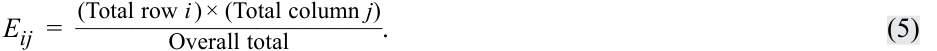
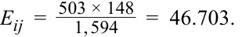
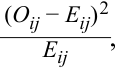
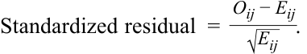
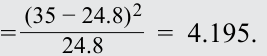

# Volume 1: Quantitative Methods
## Learning Module 9 Parametric and Non-Parametric Tests of Independence
### Part 2/2: Tests of Independence Using Contingency Table Data (PDF Pages 261–270)

---

<!-- PDF Page 261 -->

|**Mutual** **Fund**|**Alpha**|**Expense** **Ratio**|**Rank** **by** **Alpha**|**Rank by** **Expense** **Ratio**|**Difference** **in Rank**|**Difference** **Squared**|
|---|---|---|---|---|---|---|
|1|−0.52|1.34|6|6|0|0|
|2|−0.13|0.40|1|9|−8|64|
|3|−0.50|1.90|5|1|4|16|
|4|−1.01|1.50|9|2.5|6.5|42.25|
|5|−0.26|1.35|3|5|−2|4|
|6|−0.89|0.50|8|8|0|0|
|7|−0.42|1.00|4|7|−3|9|
|8|−0.23|1.50|2|2.5|–0.5|0.25|
|9|−0.60|1.45|7|4|3|9 144.5|

 rs_ = 1 −6(144.5) 9(80)= − 0.20417. 

3. Determine whether to reject the null hypothesis at the 0.05 level of significance if the critical values are ±2.306. 

The calculated test statistic, using the _t_ -distributed test statistic 

_t_ =  __r_√_ _n_ − 2 _______________________7 _ √_ 1 − _r_2 is_t_= √− 0.20417 1 − 0.041681√=  − 0.540183 0.978937= − 0.55181 . 

On the basis of this value falling within the range of +2.306, we fail to reject the null hypothesis that the Spearman rank correlation coefficient is zero. 

### **TESTS OF INDEPENDENCE USING CONTINGENCY TABLE DATA** 

# **<mark>3</mark>** 

explain tests of independence based on contingency table data 

When faced with categorical or discrete data, we cannot use the methods that we have discussed up to this point to test whether the classifications of such data are independent. Suppose we observe the following **frequency table** of 1,594 exchange-traded funds (ETFs) based on two classifications: size (i.e., market capitalization) and investment type (value, growth, or blend), as shown in Exhibit 7. The classification of the investment type is discrete, so we cannot use correlation to assess the relationship between size and investment type. 

<!-- PDF Page 262 -->

**Exhibit 7: Size and Investment Type Classifications of 1,594 ETFs** 

||**Size Bas**|**ed on Market Capita**|**lization**||
|---|---|---|---|---|
|**Investment Type**|**Small**|**Medium**|**Large**|**Total**|
|Value|50|110|343|503|
|Growth|42|122|202|366|
|Blend|56|149|520|725|
|Total|148|381|1,065|1,594|

Exhibit 7 is called a **contingency table** or a **two-way table** (because there are two classifications, or classes—size and investment type). 

If we want to test whether a relationship exists between the size and investment type, we can perform a test of independence using a nonparametric test statistic that is chi-square distributed: 

<!-- Formula Text: χ 2  =  ∑ i=1 m (O ij − E ij) 2 _ E ij , (4) -->

where: 

- _m_ = the number of cells in the table, which is the number of groups in the first class multiplied by the number of groups in the second class; 

- _Oij_ = the number of observations in each cell of row _i_ and column _j_ (i.e., observed frequency); and 

- _Eij_ = the expected number of observations in each cell of row _i_ and column _j_ , assuming independence (i.e., expected frequency). 

This test statistic has ( _r_ − 1)( _c_ − 1) degrees of freedom, where _r_ is the number of rows and _c_ is the number of columns. 

In Exhibit 7, size class has three groups (small, medium, and large) and investment type class has three groups (value, growth, and blend), so _m_ is 9 (= 3 × 3). The number of ETFs in each cell ( _Oij_ ), the observed frequency, is given, so to calculate the chi-square test statistic, we need to estimate _Eij_ , the expected frequency, which is the number of ETFs we would expect to be in each cell if size and investment type are completely independent. The expected number of ETFs ( _Eij_ ) is calculated using the following: 

<!-- Formula Text: E ij  = (Total row i ) × (Total column j) ______________________ Overall total . (5) -->

Consider one combination of size and investment type, small-cap value: 

<!-- Formula Text: E ij  =   503 × 148 _ 1, 594    =  46.703. -->

We repeat this calculation for each combination of size and investment type (i.e., _m_ = 9 pairs) to arrive at the expected frequencies, shown in Panel A of Exhibit 8. Next, we calculate 

<!-- Formula Text: (O ij − E ij) 2 _ E ij , -->

the squared difference between observed and expected frequencies scaled by expected frequency, for each cell as shown in Panel B of Exhibit 8. Finally, by summing the values of 

<!-- Formula Text: (O ij − E ij) 2 _ E ij -->

<!-- PDF Page 263 -->

for each of the _m_ cells, we calculate the chi-square statistic as 32.08025. 

##### **Exhibit 8: Inputs to Chi-Square Test Statistic Calculation for 1,594 ETFs Assuming Independence of Size and Investment Type** 

###### **A. Expected Frequency of ETFs by Size and Investment Type** 

||**Size B**|**ased on Market Capita**|**lization**|
|---|---|---|---|
|**Investment Type**|**Small**|**Medium**|**Large**|
|Value|46.703|120.228|336.070|
|Growth|33.982|87.482|244.536|
|Blend|67.315|173.290|484.395|
|Total|148.000|381.000|1,065.000|

###### **B. Scaled Squared Deviation for Each Combination of Size and Investment Type** 

||**Size B**|**ased on Market Capita**|**lization**|
|---|---|---|---|
|**Investment Type**|**Small**|**Medium**|**Large**|
|Value|0.233|0.870|0.143|
|Growth|1.892|13.620|7.399|
|Blend|1.902|3.405|2.617|

In our ETF example, we test the null hypothesis of independence between the two classes (i.e., no relationship between size and investment type) versus the alternative hypothesis of dependence (i.e., a relationship between size and investment type) using a 5 percent level of significance, as shown in Exhibit 9. If the observed values are equal to the expected values, the calculated test statistic would be zero. If, however, the observed and expected values are different, these differences are squared, so the calculated chi-square statistic will be positive. Therefore, for the test of independence using a contingency table, there is only one rejection region, on the right side. 

**Exhibit 9: Test of Independence of Size and Investment Type for 1,594 ETFs** 

|**Step 1**|State the hypotheses.|_H_0: ETF size and investment type are not related, so these classifications are inde- pendent;_Ha_: ETF size and investment type are related, so these classifications are not independent.|
|---|---|---|
|**Step 2**|Identify the appropriate test statistic.|_χ_ 2=∑ _i_=1 _m_  ( _O_ _ij_−_E_ _ij_ ) 2  _  _E_ _ij_|
|**Step 3**|Specify the level of significance.|5%|

<!-- PDF Page 264 -->

**Step 4** State the decision rule. 

With (3 − 1) × (3 − 1) = 4 degrees of freedom and a one-sided test with a 5% level of significance, the critical value is 9.4877. 

|||We reject the null hypothesis if the calculated _χ__2_statistic is greater than 9.4877.|
|---|---|---|
|||**Excel** ~~CHISQ.INV(0.95,4)~~|
|||**R** ~~qchisq(.95,4)~~|
|||**Python** ~~from scipy.stats import~~ ~~chi2~~|
|||~~chi2.ppf(.95,4)~~|
|**Step 5**|Calculate the test statistic.|_χ__2_= 32.08025|
|**Step 6**|Make a decision.|Reject the null hypothesis of independence because the calculated_χ__2_test statistic is greater than 9.4877. Evidence is sufficient to conclude that ETF size and investment type are related (i.e., not independent).|

We can visualize the contingency table in a graphic referred to as a mosaic. In a mosaic, a grid reflects the comparison between the observed and expected frequencies. Consider Exhibit 10, which represents the ETF contingency table. 

**Exhibit 10: Mosaic of the ETF Contingency Table** 

<!-- Start of picture text -->
Small Medium Large Size 4> 2 to 4 Value 0 to 2 –2 to 0 Growth Investment Type –4- to –2 –4< Blend Standardized Residuals: <!-- End of picture text -->

The width of the rectangles in Exhibit 10 reflect the proportion of ETFs that are small, medium, and large, whereas the height reflects the proportion that are value, growth, and blend. The darker shading indicates whether the number of observations is more than expected under the null hypothesis of independence, whereas the lighter shading indicates that the number of observations is less than expected, with “more than” and “less than” determined by reference to the standardized residual boxes. The standardized residual, also referred to as a Pearson residual, is as follows: 

<!-- Formula Text: Standardized residual  = O ij − E ij _ √ _ E ij   . -->

<!-- PDF Page 265 -->

The interpretation for this ETF example is that there are more medium-size growth ETFs (standardized residual of 3.69) and fewer large-size growth ETFs (standardized residual of −2.72) than would be expected if size and investment type were independent. 

##### **EXAMPLE 4** 

#### **Using Contingency Tables to Test for Independence** 

Consider the contingency table in Exhibit 11, which classifies 500 randomly selected companies on the basis of two environmental, social, and governance (ESG) rating dimensions: environmental rating and governance rating. 

**Exhibit 11: Classification of 500 Randomly Selected Companies Based on Environmental and Governance Ratings** 

||**Govern**|**ance Rating**|||
|---|---|---|---|---|
|**Environmental Rating**|**Progressive**|**Average**|**Poor**|**Total**|
|Progressive|35|40|5|80|
|Average|80|130|50|260|
|Poor|40|60|60|160|
|Total|155|230|115|500|

1. What are the expected frequencies for these two ESG rating dimensions if these categories are independent? 

##### **Solution:** 

The expected frequencies based on independence of the governance rating and the environmental rating are shown in Panel A of Exhibit 12. For example, using Equation 5, the expected frequency for the combination of progressive governance and progressive environmental ratings is 

<!-- Formula Text: E ij  =   155 × 80 _ 500    =  24.80. -->

The scaled squared deviations for each combination of environmental and governance rating are shown in Panel B of Exhibit 12. For example, using Equation 4, the scaled squared deviation for the combination of progressive governance and progressive environmental ratings is as follows: 

<!-- Formula Text: =  (35 − 24.8) 2 _ 24.8 =  4.195. -->

<!-- PDF Page 266 -->

##### **Exhibit 12: Inputs to Chi-Square Test Statistic Calculation Assuming Independence of Environmental and Governance Ratings** 

**A. Expected Frequencies of Environmental and Governance Ratings Assuming Independence** 

||**G**|**overnance Rati**|**ng**|
|---|---|---|---|
|**Environmental Rating**|**Progressive**|**Average**|**Poor**|
|Progressive|24.8|36.8|18.4|
|Average|80.6|119.6|59.8|
|Poor|49.6|73.6|36.8|

**B. Scaled Squared Deviation for Each Combination of Environmental and Governance Ratings** 

||**G**|**overnance Rati**|**ng**|
|---|---|---|---|
|**Environmental Rating**|**Progressive**|**Average**|**Poor**|
|Progressive|4.195|0.278|9.759|
|Average|0.004|0.904|1.606|
|Poor|1.858|2.513|14.626|

2. Using a 5 percent level of significance, determine whether these two ESG rating dimensions are independent of one another. 

##### **Solution:** 

|**Step 1**|State the hypotheses.|_H_0: Governance and environmental ratings are not related, so these ratings are independent; _Ha_: Governance and environmental ratings are related, so these ratings are not independent.|
|---|---|---|
|**Step 2**|Identify the appro- priate test statistic.|_χ_ 2=∑ _i_=1 _m_    ( _O_ _ij_−_E_ _ij_ ) 2  _  _E_ _ij_|
|**Step 3**|Specify the level of significance.|5%|
|**Step 4**|State the decision rule.|With (3 − 1) × (3 − 1) = 4 degrees of freedom and a one-sided test with a 5% level of significance, the critical value is 9.487729. We reject the null hypothesis if the calculated_χ__2_ statistic is greater than 9.487729. **Excel** ~~CHISQ.INV(0.95,4)~~ **R**|
|||~~qchisq(.95,4)~~ **Python**|
|||~~from scipy.stats import chi2~~ ~~chi2.ppf(.95,4)~~|

<!-- PDF Page 267 -->

|**Step 5**|Calculate the test statistic.|_χ__2_= 35.74415 To calculate the test statistic, we first calcu- late the squared difference between observed and expected frequencies scaled by expected frequency for each cell, as shown in Panel B of Exhibit 12. Then, summing the values in each of the_m_cells (see Equation 4), we calculate the chi-square statistic as 35.74415.|
|---|---|---|
|**Step 6**|Make a decision.|Reject the null hypothesis because the calculated _χ__2_test statistic is greater than 9.487729. Evidence is sufficient to indicate that the environmental and governance ratings are related, so they are not independent.|

##### **QUESTION SET** 

An analyst group follows 250 firms and classifies them in two dimensions. First, they use dividend payment history and earnings forecasts to classify firms into one of three groups, with 1 indicating the dividend stars and 3 the dividend laggards. Second, they classify firms on the basis of financial leverage, using debt ratios, debt features, and corporate governance to classify the firms into three groups, with 1 indicating the least risky firms based on financial leverage and 3 indicating the riskiest. The classification of the 250 firms is as follows: 

|**Financial Leverage**||**Dividend Group**|
|---|---|---|
|**Group**|**1**|**2** **3**|
|1|40|40 40|
|2|30|10 20|
|3|10|50 10|

Using the classification of the 250 firms, answer the following questions: 

1. What are the null and alternative hypotheses to test whether the dividend and financial leverage groups are independent of one another? 

   - **Solution:** 

The hypotheses are as follows: 

_H_ 0: Dividend and financial leverage ratings are not related, so these groupings are independent. 

   - Ha: Dividend and financial leverage ratings are related, so these groupings are not independent. 

2. What is the appropriate test statistic to use in this type of test? **Solution:** 

The appropriate test statistic is 

<!-- PDF Page 268 -->

<!-- Formula Text: χ 2  =  ∑ i=1 m (O ij − E ij) 2 _ E ij , -->

where _Oij_ represents the observed frequency for the _i_ and _j_ group and _Eij_ represents the expected frequency for the _i_ and _j_ group if the groupings are independent. 

The expected frequencies based on independence are as follows: 

|**Financial Leverage**|**Di**|**vidend Gro**|**up**||
|---|---|---|---|---|
|**Group**|**1**|**2**|**3**|**Sum**|
|1|38.4|48|33.6|120|
|2|19.2|24|16.8|60|
|3|22.4|28|19.6|70|
|Sum|80|100|70|250|

The scaled squared deviations for each combination of financial leverage and dividend grouping are: 

|**Financial Lever-**||**Dividend Group**||
|---|---|---|---|
|**age Group**|**1**|**2**|**3**|
|1|0.06667|1.33333|1.21905|
|2|6.07500|8.16667|0.60952|
|3|6.86429|17.28571|4.70204|

3. If the critical value for the 0.05 level of significance is 9.4877, what is your conclusion? 

##### **Solution:** 

The sum of these scaled squared deviations is the calculated chi-square statistic of 46.3223. Because this calculated value exceeds the critical value of 9.4877, we reject the null hypothesis that these groupings are independent. 

<!-- PDF Page 269 -->

## **~~PRACTICE PROBLEMS~~** 

**1.** Jill Batten is analyzing how the returns on the stock of Stellar Energy Corp. are related with the previous month’s percentage change in the US Consumer Price Index for Energy (CPIENG). Based on 248 observations, she has computed the sample correlation between the Stellar and CPIENG variables to be −0.1452. She also wants to determine whether the sample correlation is significantly different from zero. The critical value for the test statistic at the 0.05 level of significance is approximately 1.96. Batten should conclude that the statistical relationship between Stellar and CPIENG is: 

   - **A.** significant, because the calculated test statistic is outside the bounds of the critical values for the test statistic. 

   - **B.** significant, because the calculated test statistic has a lower absolute value than the critical value for the test statistic. 

   - **C.** insignificant, because the calculated test statistic is outside the bounds of the critical values for the test statistic. 

**2.** Which of the following statements is correct regarding the chi-square test of independence? 

   - **A.** The test has a one-sided rejection region. 

   - **B.** The null hypothesis is that the two groups are dependent. 

   - **C.** If there are two categories, each with three levels or groups, there are six degrees of freedom. 

<!-- PDF Page 270 -->

## **~~SOLUTIONS~~** 

1. A is correct. The calculated test statistic is 

<!-- Formula Text: t  =   r √ _ n − 2 _ √ _ 1 − r 2 =  − 0.1452 √ _ 248 − 2 _____________ √ _____________ 1 − (− 0.1452) 2    =  − 2.30177. -->

Because the value of _t_ = −2.30177 is outside the bounds of ±1.96, we reject the null hypothesis of no correlation and conclude that evidence is sufficient to indicate that the correlation is different from zero. 

2. A is correct. The test statistic includes squared differences between the observed and expected values, so the test involves only one side, the right side. B is incorrect because the null hypothesis is that the groups are independent, and C is incorrect because with three levels of groups for the two categorical variables, there are four degrees of freedom. 

