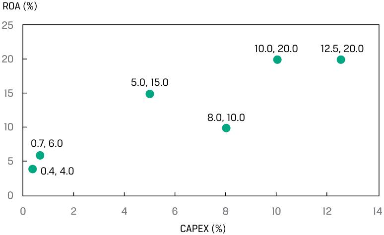
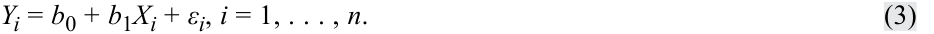
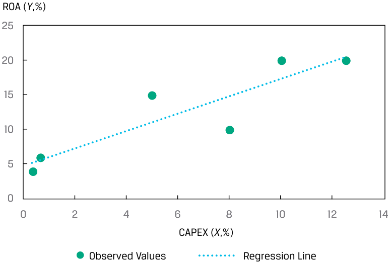
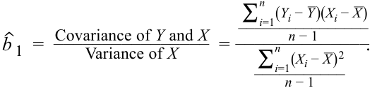
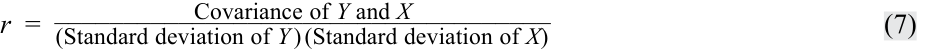
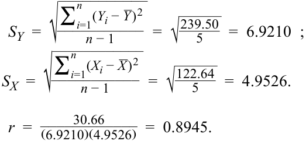

# Volume 1: Quantitative Methods
## Learning Module 10 Simple Linear Regression
### Part 1/6: Introduction (PDF Pages 271–282)

---

<!-- PDF Page 271 -->

L E A R N I N G M O D U L E 

# **<mark>10</mark>** 

### **Simple Linear Regression** 

**by Pamela Peterson Drake, PhD, CFA.** 

_Pamela Peterson Drake, PhD, CFA, is at James Madison University (USA)._ 

##### **<mark>LEARNING OUTCOMES</mark>** 

|**_Mastery_**|**_The candidate should be able to:_**|
|---|---|
||describe a simple linear regression model, how the least squares criterion is used to estimate regression coefficients, and the interpretation of these coefficients|
||explain the assumptions underlying the simple linear regression model, and describe how residuals and residual plots indicate if these assumptions may have been violated|
||calculate and interpret measures of fit and formulate and evaluate tests of fit and of regression coefficients in a simple linear regression|
||describe the use of analysis of variance (ANOVA) in regression analysis, interpret ANOVA results, and calculate and interpret the standard error of estimate in a simple linear regression|
||calculate and interpret the predicted value for the dependent variable, and a prediction interval for it, given an estimated linear regression model and a value for the independent variable f|
||describe different functional forms of simple linear regressions|

#### **INTRODUCTION** 

<!-- Start of picture text -->
1 <!-- End of picture text -->

describe a simple linear regression model, how the least squares criterion is used to estimate regression coefficients, and the interpretation of these coefficients 

Financial analysts often need to examine whether a variable is useful for explaining another variable. For example, the analyst may want to know whether earnings or cash flow growth help explain a company’s market value. **Regression analysis** is a tool for examining this type of issue. 

<!-- PDF Page 272 -->

Linear regression allows us to test hypotheses about the relationship between two variables by quantifying the strength of the relationship between the two variables, and to use one variable to make predictions about the other variable. Our focus is on linear regression with a single independent variable—that is, simple linear regression. 

###### **LEARNING MODULE OVERVIEW** 

- Simple linear regression is a mathematical process for determining how the variation in one variable can explain the variation in another variable. 

- The variable we wish to explain is called the dependent variable, and the variable that we use to explain the dependent variable is called the independent variable. 

- Simple linear regression uses the ordinary least squares approach to calculate the slope and intercept parameters that characterize a linear relationship between the two variables. 

- Simple linear regression requires that we make four assumptions: linearity, homoskedasticity, independence, and normality. 

- Linearity requires that the regression residuals be random and that the independent variable not be random. Homoskedasticity, which refers to variance being constant across observations, cannot be assumed when we see residuals clustering in multiple groups because the clustering indicates multiple regimes with different variances within our time period. 

- Independence means that the X-Y pairs are uncorrelated; a pattern in a plot of the residuals (e.g., seasonality) suggests that there is autocorrelation across observations and that we cannot assume independence. Normality means that residuals must be normally distributed and does not require that the data itself be normally distributed. Non-normality is of particular concern for small sample sizes, but for large sample sizes, the central limit theorem tells us that we may be able to relax the normality requirement. 

- The total variation in the dependent variable, called the sum of squares total (SST), can be decomposed into two parts: the explained variation, called the sum of squares regression (SSR), and the unexplained variation, called the sum of squares error (SSE). 

- There are several ways to measure a regression model’s goodness of fit. These include the coefficient of determination, the _F_ -statistic for the test of fit, and the standard error of the regression. 

- Hypothesis testing can be used to determine, at a specified confidence level, whether the slope or intercept differs from zero or another specified value, or whether the slope is positive or negative. We can use indicator variables to determine whether our regression parameters differ between data points that either have or do not have a particular characteristic (e.g., monthly price data in cases in which only some months have earnings announcements). 

- An analysis of variance (ANOVA) table presents the sums of squares, degrees of freedom, mean squares, and _F_ -statistic for a regression model. 

<!-- PDF Page 273 -->

- The standard error of the estimate is a measure of the distance between the observed values of the dependent variable and those predicted from the estimated regression. The smaller this value, the better the fit of the model. 

- The standard error of the forecast is used to provide an interval estimate around the estimated regression line. It is necessary because the regression line does not describe the relationship between the dependent and independent variables perfectly. 

- The simple linear regression model on non-linear data can be adjusted by using different functional forms that transform the dependent or independent variables. 

- Three common functional forms for transforming data include the loglin model, the lin-log model, and the log-log model. 

- The key to fitting the appropriate functional form of a simple linear regression is examining the goodness-of-fit measures—the coefficient of determination (R2 ), the _F_ -statistic, and the standard error of the estimate (se)—as well as examining whether there are patterns in the residuals. 

#### **ESTIMATION OF THE SIMPLE LINEAR REGRESSION MODEL** 

## **<mark>2</mark>** 

- describe a simple linear regression model, how the least squares criterion is used to estimate regression coefficients, and the interpretation of these coefficients 

##### **Introduction to Linear Regression** 

Suppose an analyst is examining the return on assets (ROA) for an industry and observes the ROA for the six companies shown in Exhibit 1. The average of these ROAs is 12.5 percent, but the range is from 4 percent to 20 percent. 

**Exhibit 1: Return on Assets of Selected Companies** 

|**Company**|**ROA (%)**|
|---|---|
|A|6.0|
|B|4.0|
|C|15.0|
|D|20.0|
|E|10.0|
|F|20.0|

<!-- PDF Page 274 -->

In trying to understand why the ROAs differ among these companies, we could look at why the ROA of Company A differs from that of Company B, why the ROA of Company A differs from that of Company D, why the ROA of Company F differs from that of Company C, and so on, comparing each pair of ROAs. We can simplify this exercise by instead comparing each company’s ROA to the mean ROA of 12.5 percent. To do this, we look at the sum of the squared deviations of the observations from the mean to capture variations in ROA from their mean. Let _Y_ represent the variable that we would like to explain, which in this case is the ROA. Let _Yi_ represent an observation of a company’s ROA, and let _Y__ represent the mean ROA for the sample of size _n_ . We can describe the variation of the ROAs as follows: 

<!-- Formula Text: Variation of Y  =  ∑ i=1 n (Y i − _ Y ) 2. (1) -->

Our goal is to understand what drives these ROAs or, in other words, what explains the variation of _Y_ . The variation of _Y_ is often referred to as the **sum of squares total (SST)** , or the total sum of squares. 

We now ask whether it is possible to explain the variation of the ROA using another variable that also varies among the companies; note that if this other variable is constant or random, it would not explain the ROA differences. Suppose the analyst believes that the capital expenditures in the previous period, scaled by the prior period’s beginning property, plant, and equipment, are a driver for the ROA variable. Let us represent this scaled capital expenditures variable as CAPEX, as we show in Exhibit 2. 

**Exhibit 2: Return on Assets and Scaled Capital Expenditures** 

|**Company**|**ROA (%)**|**CAPEX (%)**|
|---|---|---|
|A|6.0|0.7|
|B|4.0|0.4|
|C|15.0|5.0|
|D|20.0|10.0|
|E|10.0|8.0|
|F|20.0|12.5|
|Arithmetic mean|12.5|6.1|

Let _X_ represent the explanatory variable, in this case, CAPEX. Then _Xi_ will represent an observation of our explanatory variable, and _X__ will represent the mean value for the explanatory variable, that is, the mean of all of our CAPEX values. The variation of _X_ is calculated as follows: 

<!-- Formula Text: Variation of X  =  ∑ i=1 n (X i − _ X ) 2. (2) -->

We can see the relation between ROA and CAPEX in the **scatter plot** (or scattergram) in Exhibit 3, which represents the two variables in two dimensions. Typically, we present the variable whose variation we want to explain along the vertical axis and the variable whose variation we want to use to explain that variation along the horizontal axis. Each point in this scatter plot represents a paired observation that consists of CAPEX and ROA. From a casual visual inspection, a positive relation is apparent between ROA and CAPEX: Companies with higher CAPEX tend to have a higher ROA. 

<!-- PDF Page 275 -->

###### **Exhibit 3: Scatter Plot of ROA and CAPEX** 

<!-- Start of picture text -->
ROA (%) 25 10.0, 20.0 12.5, 20.0 20 5.0, 15.0 15 8.0, 10.0 10 0.7, 6.0 5 0.4, 4.0 0 0 2 4 6 8 10 12 14 CAPEX (%) <!-- End of picture text -->

In the ROA example, we use the capital expenditures to explain the ROAs. We refer to the variable whose variation is being explained as the **dependent variable** , or the explained variable; it is typically denoted by _Y_ . We refer to the variable whose variation is being used to explain the variation of the dependent variable as the **independent variable** , or the explanatory variable; it is typically denoted by _X_ . Therefore, in our example, the ROA is the dependent variable ( _Y_ ) and CAPEX is the independent variable ( _X_ ). 

A common method used to relate the dependent and independent variables is through the estimation of a linear relationship, which implies describing the relation between the two variables as represented by a straight line. If we have only one independent variable, we refer to the method as **simple linear regression (SLR)** , or linear regression; if we have more than one independent variable, we refer to the method as multiple regression. 

Linear regression allows us to test hypotheses about the relationship between two variables by quantifying the strength of the relationship between the two variables and to use one variable to make predictions about the other variable. 

###### **IDENTIFYING THE DEPENDENT AND INDEPENDENT VARIABLES IN A REGRESSION** 

An analyst is researching the relationship between corporate earnings growth and stock returns. Specifically, she is interested in whether earnings revisions are correlated with stock price returns in the same period. She collects five years of monthly data on earnings per share (EPS) revisions and stock price returns for a sample of 100 companies. 

1. What are the dependent and independent variables in her model? 

###### **Solution:** 

The dependent variable is monthly stock price returns, and the independent variable is EPS revisions. In the analyst’s model, the variation in monthly stock price returns is being explained by the variation in EPS revisions. 

<!-- PDF Page 276 -->

##### **Estimating the Parameters of a Simple Linear Regression** 

###### **_The Basics of Simple Linear Regression_** 

Regression analysis begins with the dependent variable, the variable whose variation you are seeking to explain. The independent variable is the variable whose variation you are using to explain changes in the dependent variable. For example, you might try to explain small-stock returns (the dependent variable) using returns to the S&P 500 Index (the independent variable). Or you might try to explain a country’s inflation rate (the dependent variable) as a function of growth in its money supply (the independent variable). 

As the name implies, linear regression assumes a linear relationship between the dependent and the independent variables. The goal is to fit a line to the observations on _Y_ and _X_ to minimize the squared deviations from the line; this is the least squares criterion—hence, the name least squares regression. Because of its common use, linear regression is often referred to as ordinary least squares (OLS) regression. 

Using notation, the linear relation between the dependent and independent variables is described as follows: 

<!-- Formula Text: Yi = b0 + b1Xi + εi, i = 1, . . . , n. (3) -->

Equation 3 is a model that does not require that every (X, Y) pair for an observation fall on the regression line. This equation states that the dependent variable, _Y_ , is equal to the **intercept** , _b_ 0, plus a **slope coefficient** , _b_ 1, multiplied by the independent variable, _X_ , plus an **error term** , ε. The error term, or simply the error, represents the difference between the observed value of _Y_ and that expected from the true underlying population relation between _Y_ and _X_ . We refer to the intercept, _b_ 0, and the slope coefficient, _b_ 1, as the **regression coefficients** ? A way that we often describe this simple linear regression relation is that _Y_ is regressed on _X_ . 

Consider the ROA and CAPEX scatter diagram from Exhibit 3, which we elaborate on in Exhibit 4 by including the fitted regression line. This line represents the average relationship between ROA and CAPEX; not every observation falls on the line, but the line describes the mean relation between ROA and CAPEX. 

**Exhibit 4: Fitted Regression Line of ROA and CAPEX** 

<!-- Start of picture text -->
ROA ( Y ,%) 25 20 15 10 5 0 0 2 4 6 8 10 12 14 CAPEX ( X ,%) Observed Values Regression Line <!-- End of picture text -->

<!-- PDF Page 277 -->

###### **_Estimating the Regression Line_** 

We cannot observe the population parameter values _b_ 0 and _b_ 1 in a regression model. Instead, we observe only _b_ˆ 0 and _b_ˆ 1 , which are estimates (as indicated by the “hats” above the coefficients) of the population parameters based on the sample. Thus, predictions must be based on the parameters’ estimated values, and testing is based on estimated values in relation to the hypothesized population values. 

We estimate the regression line as the line that best fits the observations. In simple linear regression, the estimated intercept, _b_ˆ 0 , and slope, _b_ˆ 1 , are such that the sum of the squared vertical distances from the observations to the fitted line is minimized. The focus is on the sum of the squared differences between the observations on Yi and the corresponding estimated value, _Y_ˆ _i_ , on the regression line. 

We represent the value of the dependent variable for the _i_ th observation that falls on the line as _Y_ˆ _i_ , which is equal to _b_ˆ 0 + _b_ˆ 1 _Xi_ . _Y_ˆ _i_ is what the estimated value of the _Y_ variable would be for the _i_ th observation based on the mean relationship between _Y_ and _X_ . The **residual** for the _i_ th observation, _ei_ , is how much the observed value of _Yi_ differs from the _Y_ˆ _i_ estimated using the regression line: _ei_ = _Yi_ − _Y_ˆ _i_ . Note the subtle difference between the error term and the residual: The error term refers to the true underlying population relationship, whereas the residual refers to the fitted linear relation based on the sample. 

Fitting the line requires minimizing the sum of the squared residuals, the **sum of squares error (SSE)** , also known as the residual sum of squares: 

<!-- Formula Text: Sum of squares error  =  ∑ i=1 n (Y i −  ˆ Y  i ) 2 = ∑ i=1 n [Y i − ( ˆ b  0 +  ˆ b  1 X i)] 2 = ∑ i=1 n e i 2. (4) -->

Using least squares regression to estimate the values of the population parameters of _b_ 0 and _b_ 1, we can fit a line through the observations of _X_ and _Y_ that explains the value that _Y_ takes for any particular value of _X_ . 

As seen in Exhibit 5, the residuals are represented by the vertical distances from the fitted line (see the third and fifth observations, Companies C and E, respectively) and are, therefore, in the units of measurement represented by the dependent variable. The residual is in the same unit of measurement as the dependent variable: If the dependent variable is in euros, the error term is in euros, and if the dependent variable is in growth rates, the error term is in growth rates. 

<!-- PDF Page 278 -->

**Exhibit 5: Residuals of the Linear Regression** 

<!-- Start of picture text -->
ROA ( Y ,%) 25 20 15 Company C Residual: Company E Residual: e 3 =  Y 3 – ( b 0 –  b 1 X 3) e 5 =  Y 5 – ( b 0 –  b 1 X 5) 10 5 0 0 2 4 6 8 10 12 14 CAPEX ( X ,%) Observed Values of  Y Predicted Values of  Y Regression Line <!-- End of picture text -->

How do we calculate the intercept ( _b_ˆ 0 ) and the slope ( _b_ˆ 1 ) for a given sample of ( _Y_ , _X_ ) pairs of observations? The slope is the ratio of the covariance between _Y_ and _X_ to the variance of _X_ , where _Y__ is the mean of the _Y_ variable and _X__ is the mean of _X_ variable: 

<!-- Formula Text: ˆ b  1  =   Covariance of Y and X ________________ Variance of X = ∑ i=1 n (Y i − _ Y )(X i − _ X ) ________________ n − 1 ______________ ∑ i=1 n (X i − _ X ) 2 ___________ n − 1 . -->

Simplifying, 

<!-- Formula Text: ˆ b  1  = ∑ i=1 n (Y i − _ Y )(X i − _ X ) ________________ ∑ i=1 n (X i − _ X ) 2 . (5) -->

<!-- Formula Text: Once we estimate the slope, we can then estimate the intercept using the mean of Y and the mean of X: ˆ b  0  = _ Y  −  ˆ b  1 _ X . (6) -->

Incremental values to calculate the slope and the intercept are in Exhibit 6. 

**Exhibit 6: Estimating Slope and Intercept for the ROA Model** 

|**Company**|**ROA (Yi)**|**CAPEX (Xi)**|( _Y_ _i_**−** **_** _Y_) **2**|( _X_ _i_**−** **_** _X_) **2**|( _Y_ _i_**−** **_** _Y_) ( _X_ _i_**−** **_** _X_)|
|---|---|---|---|---|---|
|A|6.0|0.7|42.25|29.16|35.10|
|B|4.0|0.4|72.25|32.49|48.45|
|C|15.0|5.0|6.25|1.21|−2.75|
|D|20.0|10.0|56.25|15.21|29.25|
|E|10.0|8.0|6.25|3.61|−4.75|
|F|20.0|12.5|56.25|40.96|48.00|

<!-- PDF Page 279 -->

|**Company**|**ROA (Yi)**|**CAPEX (Xi)**|( _Y_ _i_**−** **_** _Y_) **2**|( _X_ _i_**−** **_** _X_) **2**|( _Y_ _i_**−** **_** _Y_) ( _X_ _i_**−** **_** _X_)|
|---|---|---|---|---|---|
|Sum|75.0|36.6|239.50|122.64|153.30|
|Arithmetic|12.5|6.1||||
|mean||||||

 Slope coefficient: b_ˆ 1 =153.30 122.64= 1.25. _Intercept: b_ˆ 0 = 12.5 − (1.25 × 6.10 ) = 4.875. _ROW regression model: Y_ˆ _i_ = 4.875 + 1.25 _Xi_ + _εi_ . 

Notice the similarity of the formula for the slope coefficient and that of the pairwise correlation. The sample correlation, _r_ , is the ratio of the covariance to the product of the standard deviations: 

<!-- Formula Text: r  = Covariance of Y and X ____________________________________ (Standard deviation of Y ) (Standard deviation of X) (7) -->

The subtle difference between the slope and the correlation formulas is in the denominator: For the slope, this is the variance of the independent variable, but for the correlation, the denominator is the product of the standard deviations. For our ROA and CAPEX analysis, 

<!-- Formula Text: Covariance of Y and X: cov XY  = ∑ i=1 n (Y i − _ Y  ) (X i − _ X ) ________________ n − 1 =   153.30 _ 5    =  30.6600. -->

Standard deviation of _Y_ and _X_ : 

<!-- Formula Text: S Y  =  √ ___________ ∑ i=1 n (Y i − _ Y ) 2 ___________ n − 1 =  √ _ 239.50 _ 5     =  6.9210  ; S X  =  √ ____________ ∑ i=1 n (X i − _ X ) 2 ___________ n − 1 =  √ _ 122.64 _ 5     =  4.9526. r  = 30.66 ____________ (6.9210)(4.9526)   =  0.8945. -->

Because the denominators of both the slope and the correlation are positive, the sign of the slope and the correlation are driven by the numerator: If the covariance is positive, both the slope and the correlation are positive, and if the covariance is negative, both the slope and the correlation are negative. 

###### **EXAMPLE 1** 

##### **How Do Analysts Perform Simple Linear Regression?** 

Typically, an analyst will use the data analysis functions on a spreadsheet, such as Microsoft Excel, or a statistical package in the R or Python programming languages to perform linear regression analysis. The following are some of the more common choices in practice. 

###### **Simple Linear Regression: Intercept and Slope** 

> ■ _Excel_ : Use the INTERCEPT, SLOPE functions. 

> ■ _R_ : Use the lm function. 

> ■ _Python_ : Use the sm.OLS function in the statsmodels package. 

<!-- PDF Page 280 -->

###### **Correlations** 

- _Excel_ : Use the CORREL function. 

- _R_ : Use the cor function in the stats library. 

- _Python_ : Use the corrcoef function in the numpy library. 

Note that in R and Python, there are many choices for regression and correlation analysis. 

###### **_Interpreting the Regression Coefficients_** 

What is the meaning of the regression coefficients? The intercept is the value of the dependent variable if the value of the independent variable is zero. Importantly, this does not make sense in some contexts, especially if it is unrealistic that the independent variable would be zero. For example, if we have a model in which money supply explains GDP growth, the intercept has no meaning because, practically speaking, zero money supply is not possible. If the independent variable were money supply growth, however, the intercept is meaningful. The slope is the change in the dependent variable for a one-unit change in the independent variable. If the slope is positive, then the change in the independent variable and that of the dependent variable will be in the same direction; if the slope is negative, the change in the independent variable and that of the dependent variable will be in opposite directions. 

###### **EXAMPLE 2** 

##### **Interpreting Positive and Negative Slopes** 

Suppose the dependent variable (Y) is in millions of euros and the independent variable ( _X_ ) is in millions of US dollars. 

If the slope is positive 1.2, then 

- ↑ USD1 million → ↑ EUR1.2 million 

- ↓ USD1 million → ↓ EUR1.2 million 

If the slope is negative 1.2, then 

- ↑ USD1 million → ↓ EUR1.2 million 

- ↓ USD1 million → ↑ EUR1.2 million 

Using the ROA regression model from Exhibit 6, we would interpret the estimated coefficients as follows: 

- The return on assets for a company is 4.875% if the company makes no capital expenditures. 

- If CAPEX increases by one unit—say, from 4% to 5%—ROA increases by 1.25%. 

Using the estimated regression coefficients, we can determine the values of the dependent variable if they follow the average relationship between the dependent and independent variables. A result of the mathematics of the least squares fitting of the regression line is that the expected value of the residual term is zero: E _(ε)_ = 0. 

<!-- PDF Page 281 -->

We show the calculation of the predicted dependent variable and residual term for each observation in the ROA example in Exhibit 7. Note that the sum and average of _Yi_ and _Y_ˆ 1 are the same, and the sum of the residuals is zero. 

**Exhibit 7: Calculation of the Dependent Variable and Residuals for the ROA and CAPEX Model** 

||**(1)**|**(2)**|**(3)**|**(4)**|
|---|---|---|---|---|
|**Company**|**ROA (Yi)**|**CAPEX(Xi)**|**Predicted** **ROA** ( ˆ _Yi_ )|**(1) − (3)** **(2) Residual (ei)**|
|A|6.0|0.7|5.750|0.250|
|B|4.0|0.4|5.375|−1.375|
|C|15.0|5.0|11.125|3.875|
|D|20.0|10.0|17.375|2.625|
|E|10.0|8.0|14.875|−4.875|
|F|20.0|12.5|20.500|−0.500|
|Sum|75.0|36.6|75.000|0.000|
|Average|12.5|6.1|12.5|0.000|

_For Company C (i = 3),_ 

_Y_ˆ _i =  b_ˆ _0 +  b_ˆ _1  X i +  ε i = 4.875 + 1.25  X i +  ε i_ 

_Y_ˆ _i = 4.875 + (1.25 × 5.0 ) = 4.875 + 6.25 = 11.125 Y i −  Y_ˆ _i =  e i = 15.0 − 11.125 = 3.875,  the vertical distance in Exhibit 5._ 

Whereas the sum of the residuals must equal zero by design, the focus of fitting the regression line in a simple linear regression is minimizing the sum of the squared residual terms. 

###### **_Cross-Sectional versus Time-Series Regressions_** 

Regression analysis uses two principal types of data: cross sectional and time series. A cross-sectional regression involves many observations of _X_ and _Y_ for the same time period. These observations could come from different companies, asset classes, investment funds, countries, or other entities, depending on the regression model. For example, a cross-sectional model might use data from many companies to test whether predicted EPS growth explains differences in price-to-earnings ratios during a specific time period. Note that if we use cross-sectional observations in a regression, we usually denote the observations as _i_ = 1, 2, . . . , _n_ . 

Time-series data use many observations from different time periods for the same company, asset class, investment fund, country, or other entity, depending on the regression model. For example, a time-series model might use monthly data from many years to test whether a country’s inflation rate determines its short-term interest rates. If we use time-series data in a regression, we usually denote the observations as _t_ = 1, 2, . . . , _T_ . Note that in the sections that follow, we primarily use the notation _i_ = 1, 2, . . . , _n_ , even for time series. 

###### **QUESTION SET** 

An analyst is exploring the relationship between a company’s net profit margin and research and development expenditures. He collects data for an industry and calculates the ratio of research and development expenditures to revenues (RDR) and the net profit margin (NPM) for eight companies. 

<!-- PDF Page 282 -->

Specifically, he wants to explain the net profit margin variation by using the variation observed in the companies’ research and development spending. He reports the data in Exhibit 8. 

**Exhibit 8: Observations on NPM and RDR for Eight Companies** 

|**Company**|**NPM (%)**|**RDR (%)**|
|---|---|---|
|1|4|8|
|2|5|10|
|3|10|6|
|4|9|5|
|5|5|7|
|6|6|9|
|7|12|5|
|8|3|10|

1. What is the slope coefficient for this simple linear regression model? **Solution:** 

The slope coefficient for the regression model is −1.3, and the details for the inputs to this calculation are in Exhibit 9. 

**Exhibit 9: Details of Calculation of Slope of NPM Regressed on RDR** 

|**Com-** **pany**|**NPM** **(%)** **(Yi)**|**RDR** **(%)** **(Xi)**|_Y_ _i_**−** **_** _Y_|_X_ _i_**−** **_** _X_|( _Y_ _i_**−** **_** _Y_) **2**|( _X_ _i_**−** **_** _X_) **2**|( _Y_ _i_**−** **_** _Y_) ( _X_ _i_**−** **_** _X_)|
|---|---|---|---|---|---|---|---|
|1|4|8|−2.8|0.5|7.5625|0.25|−1.375|
|2|5|10|−1.8|2.5|3.0625|6.25|−4.375|
|3|10|6|3.3|−1.5|10.5625|2.25|−4.875|
|4|9|5|2.3|−2.5|5.0625|6.25|−5.625|
|5|5|7|−1.8|−0.5|3.0625|0.25|0.875|
|6|6|9|−0.8|1.5|0.5625|2.25|−1.125|
|7|12|5|5.3|−2.5|27.5625|6.25|−13.125|
|8|3|10|−3.8|2.5|14.0625|6.25|−9.375|
|Sum|54|60|0.0|0.0|71.5000|30.00|−39.000|
|Average|6.75|7.5||||||

_ Slope coefficient: _b_ˆ 1 =− 39 30= − 1.3. 

2. What is the intercept for this regression model? 

###### **Solution:** 

The intercept of the regression model is 16.5: 

Intercept: _b_ˆ 0 = 6.75 −( − 1.3 × 7.5) = 6.75 + 9.75 = 16.5 

