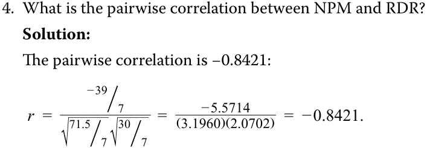
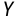
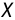
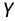
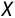
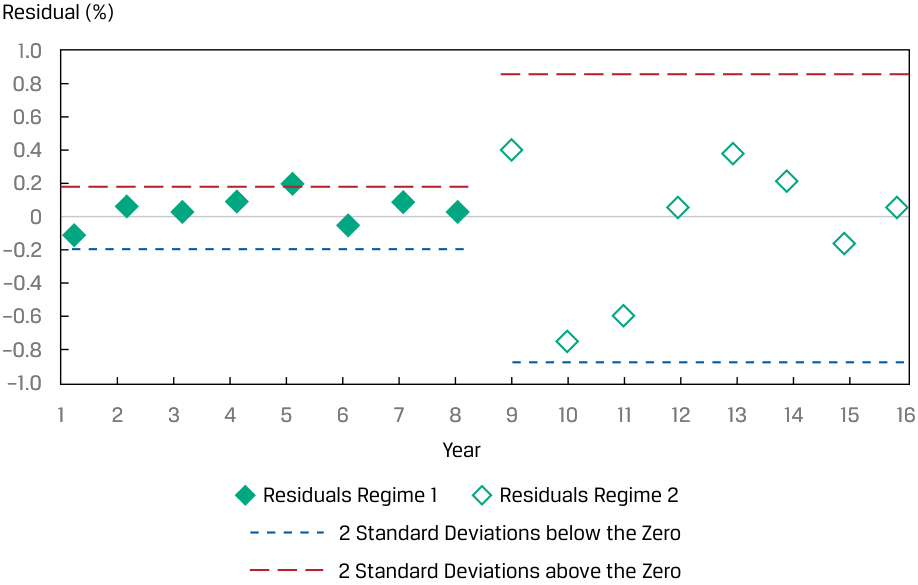
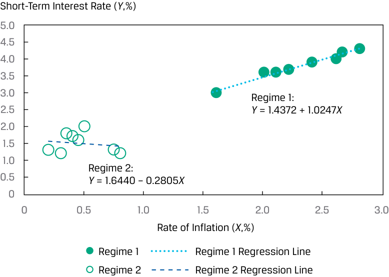
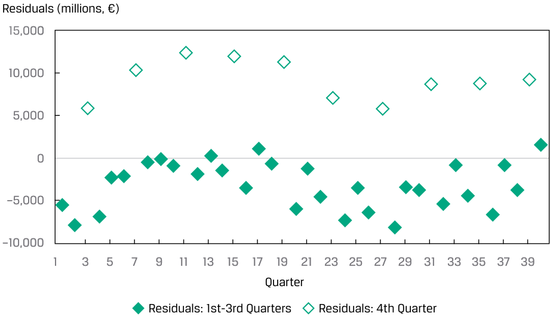
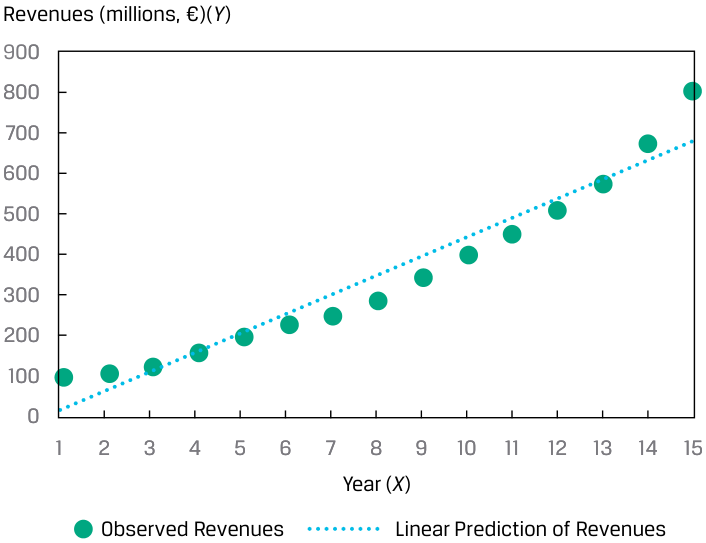

# Volume 1: Quantitative Methods
## Learning Module 10 Simple Linear Regression
### Part 2/6: Assumptions of the Simple Linear Regression Model (PDF Pages 283–289)

---

<!-- PDF Page 283 -->

3. How is this estimated linear regression model represented? **Solution:** The regression model is represented by _Y_ˆ _i_ = 16.5 − 1.3 _Xi_ + _εi_ . 

<!-- Start of picture text -->
4. What is the pairwise correlation between NPM and RDR? Solution: The pairwise correlation is −0.8421: r  =  ___________ − 39 ⧸_7  =  ____________ ( 3.1960− 5.5714 )( 2.0702 ) = − 0.8421. √ _ 71.5⧸7 √30⧸7 <!-- End of picture text -->

## **ASSUMPTIONS OF THE SIMPLE LINEAR REGRESSION MODEL** 

# **<mark>3</mark>** 

explain the assumptions underlying the simple linear regression model, and describe how residuals and residual plots indicate if these assumptions may have been violated 

We have discussed how to interpret the coefficients in a simple linear regression model. Now we turn to the statistical assumptions underlying this model. Suppose that we have _n_ observations of both the dependent variable, _Y_ , and the independent variable, _X_ , and we want to estimate the simple linear regression of _Y_ regressed on _X_ . We need to make the following four key assumptions to be able to draw valid conclusions from a simple linear regression model: 

**1.** Linearity: The relationship between the dependent variable, _Y_ , and the independent variable, _X_ , is linear. 

**2.** Homoskedasticity: The variance of the regression residuals is the same for all observations. 

**3.** Independence: The observations, pairs of _Y_ s and _X_ s, are independent of one another. This implies the regression residuals are uncorrelated across observations. 

**4.** Normality: The regression residuals are normally distributed. 

Now we take a closer look at each of these assumptions and introduce the “best practice” of examining residual plots of regression results to identify potential violations of these key assumptions. 

### **Assumption 1: Linearity** 

We are fitting a linear model, so we must assume that the true underlying relationship between the dependent and independent variables is linear. If the relationship between the independent and dependent variables is nonlinear in the parameters, estimating that relation with a simple linear regression model will produce invalid results: The model will be biased, because it will under- and overestimate the dependent variable at certain points. For example, _Yi_ = _b_ 0 _e__b_1_Xi_ + _εi_ is nonlinear in _b_ 1, so we should not apply the linear regression model to it. Exhibit 10 shows an example of this exponential 

<!-- PDF Page 284 -->

model, with a regression line indicated. You can see that this line does not fit this relationship well: For lower and higher values of _X_ , the linear model underestimates the _Y_ , whereas for the middle values, the linear model overestimates _Y_ . 

**Exhibit 10: Illustration of Nonlinear Relationship Estimated as a Linear Relationship** 

<!-- Start of picture text -->
Y <!-- End of picture text -->

<!-- Start of picture text -->
X <!-- End of picture text -->

Another implication of this assumption is that the independent variable, _X_ , must not be random; that is, it is non-stochastic. If the independent variable is random, there would be no linear relation between the dependent and independent variables. Although we may initially assume that the independent variable in the regression model is not random, that assumption may not always be true. 

When we look at the residuals of a model, what we would like to see is that the residuals are random. The residuals should not exhibit a pattern when plotted against the independent variable. As we show in Exhibit 11, the residuals from the Exhibit 10 linear regression do not appear to be random but, rather, they exhibit a relationship with the independent variable, _X_ , falling for some range of _X_ and rising in another. 

#### **Exhibit 11: Illustration of Residuals in a Nonlinear Relationship Estimated as a Linear Relationship** 

<!-- Start of picture text -->
Y <!-- End of picture text -->

<!-- Start of picture text -->
X <!-- End of picture text -->

<!-- PDF Page 285 -->

### **Assumption 2: Homoskedasticity** 

Assumption 2, that the variance of the residuals is the same for all observations, is known as the **homoskedasticity** assumption. In terms of notation, this assumption relates to the squared residuals: 

<!-- Formula Text: E(ε i 2)  =  σ ε 2, i = 1, . . . , n. (8) -->

If the residuals are not homoskedastic, that is, if the variance of residuals differs across observations, then we refer to this as **heteroskedasticity** . 

Suppose you are examining a time series of short-term interest rates as the dependent variable and inflation rates as the independent variable over 16 years. We may believe that short-term interest rates ( _Y_ ) and inflation rates ( _X_ ) should be related (i.e., interest rates are higher with higher rates of inflation). If this time series spans many years, with different central bank actions that force short-term interest rates to be (artificially) low for the last eight years of the series, then it is likely that the residuals in this estimated model will appear to come from two different models. We will refer to the first eight years as Regime 1 (normal rates) and the second eight years as Regime 2 (low rates). If the model fits differently in the two regimes, the residuals and their variances will be different. 

You can see this situation in Exhibit 12, which shows a scatter plot with an estimated regression line. The slope of the regression line over all 16 years is 1.1979. 

**Exhibit 12: Scatter Plot of Interest Rates (** **_Y_ ) and Inflation Rates (** **_X_ )** 

<!-- Start of picture text -->
Short-Term Interest Rate ( Y ,%) 5.0 4.5 4.0 3.5 3.0 2.5 2.0 1.5 Y  = 0.9954 + 1.1979 X 1.0 0.5 0 0 0.5 1.0 1.5 2.0 2.5 3.0 Rate of Inflation ( X ,%) Short-Term Interest Rate ( Y ,%) Regression Line: All Years <!-- End of picture text -->

We plot the residuals of this model in Exhibit 13 against the years. In this plot, we indicate the distance that is two standard deviations from zero (the mean of the residuals) for the first eight years’ residuals and then do the same for the second eight years. As you can see, the residuals appear different for the two regimes: the variation in the residuals for the first eight years is much smaller than the variation for the second eight years. 

<!-- PDF Page 286 -->

#### **Exhibit 13: Residual Plot for Interest Rates (** **_Y_ ) vs. Inflation Rates (** **_X_ ) Model** 

<!-- Start of picture text -->
Residual (%) 1.0 0.8 0.6 0.4 0.2 0 –0.2 –0.4 –0.6 –0.8 –1.0 1 2 3 4 5 6 7 8 9 10 11 12 13 14 15 16 Year Residuals Regime 1 Residuals Regime 2 2 Standard Deviations below the Zero 2 Standard Deviations above the Zero <!-- End of picture text -->

Why does this happen? The model seems appropriate, but when we examine the residuals (Exhibit 13), an important step in assessing the model fit, we see that the model fits better in some years compared with others. The difference in variance of residuals between the two regimes is apparent from the much wider band around residuals for Regime 2 (the low-rate period). This indicates a clear violation of the homoskedasticity assumption. 

If we estimate a regression line for each regime, we can see that the model for the two regimes is quite different, as we show in Exhibit 14. In the case of Regime 1 (normal rates), the slope is 1.0247, whereas in Regime 2 (low rates) the slope is −0.2805. In sum, the clustering of residuals in two groups with much different variances clearly indicates the existence of distinct regimes for the relationship between short-term interest rates and the inflation rate. 

<!-- PDF Page 287 -->

#### **Exhibit 14: Fitted Regression Lines for the Two Regimes** 

<!-- Start of picture text -->
Short-Term Interest Rate ( Y ,%) 5.0 4.5 4.0 3.5 3.0 Regime 1: 2.5 Y  = 1.4372 + 1.0247 X 2.0 1.5 1.0 Regime 2: 0.5 Y  = 1.6440 – 0.2805 X 0 0 0.5 1.0 1.5 2.0 2.5 3.0 Rate of Inflation ( X ,%) Regime 1 Regime 1 Regression Line Regime 2 Regime 2 Regression Line <!-- End of picture text -->

### **Assumption 3: Independence** 

We assume that the observations ( _Y_ and _X_ pairs) are uncorrelated with one another, meaning they are independent. If there is correlation between observations (i.e., autocorrelation), they are not independent and the residuals will be correlated. The assumption that the residuals are uncorrelated across observations is also necessary for correctly estimating the variances of the **estimated parameters** of _b_ 0 and _b_ 1 (i.e., _b_ˆ 0 and _b_ˆ 1 ) that we use in hypothesis tests of the intercept and slope, respectively. It is important to examine whether the residuals exhibit a pattern, suggesting a violation of this assumption. Therefore, we need to visually and statistically examine the residuals for a regression model. 

Consider the quarterly revenues of a company regressed over 40 quarters, as shown in Exhibit 15, with the regression line included. It is clear that these revenues display a seasonal pattern, an indicator of autocorrelation. 

<!-- PDF Page 288 -->

**Exhibit 15: Regression of Quarterly Revenues vs. Time (40 Quarters)** 

<!-- Start of picture text -->
Revenues (millions, €)( Y ) 140,000 135,000 130,000 125,000 120,000 115,000 110,000 105,000 Y  = 108,502.3 + 609.6427 100,000 95,000 90,000 1 3 5 7 9 11 13 15 17 19 21 23 25 27 29 31 33 35 37 39 Quarter ( X ) Observed Quarterly Revenues: 1st-3rd Quarters Observed Quarterly Revenues: 4th Quarter <!-- End of picture text -->

In Exhibit 16, we plot the residuals from this model and see that there is a pattern. These residuals are correlated, specifically jumping up in Quarter 4 and then falling back the subsequent quarter. In sum, the patterns in both Exhibit 15 and Exhibit 16 indicate a violation of the assumption of independence. 

**Exhibit 16: Residual Plot for Quarterly Revenues vs. Time Model** 

<!-- Start of picture text -->
Residuals (millions, €) 15,000 10,000 5,000 0 –5,000 –10,000 1 3 5 7 9 11 13 15 17 19 21 23 25 27 29 31 33 35 37 39 Quarter Residuals: 1st-3rd Quarters Residuals: 4th Quarter <!-- End of picture text -->

### **Assumption 4: Normality** 

The assumption of normality requires that the residuals be normally distributed. This does not mean that the dependent and independent variables must be normally distributed; it only means that the residuals from the model are normally distributed. However, in estimating any model, it is good practice to understand the distribution of 

<!-- PDF Page 289 -->

the dependent and independent variables to explore for outliers. An outlier in either or both variables can substantially influence the fitted line such that the estimated model will not fit well for most of the other observations. 

With normally distributed residuals, we can test a particular hypothesis about a linear regression model. For large sample sizes, we may be able to drop the assumption of normality by appealing to the central limit theorem; asymptotic theory (which deals with large samples) shows that in many cases, the test statistics produced by standard regression programs are valid even if the model’s residuals are not normally distributed. 

#### **QUESTION SET** 

An analyst is investigating a company’s revenues and estimates a simple linear time-series model by regressing revenues against time, where time—1, 2, . . . , 15—is measured in years. She plots the company’s observed revenues and the estimated regression line, as shown in Exhibit 17. She also plots the residuals from this regression model, as shown in Exhibit 18. 

#### **Exhibit 17: Revenues vs. Time Using Simple Linear Regression** 

<!-- Start of picture text -->
Revenues (millions, €)( Y ) 900 800 700 600 500 400 300 200 100 0 1 2 3 4 5 6 7 8 9 10 11 12 13 14 15 Year ( X ) Observed Revenues Linear Prediction of Revenues <!-- End of picture text -->

#### **Exhibit 18: Residual Plot for Revenues vs. Time** 

<!-- Start of picture text -->
Revenues (millions, €)( Y ) 150 100 50 0 –50 –100 1 2 3 4 5 6 7 8 9 10 11 12 13 14 15 Year ( X ) <!-- End of picture text -->

