# Volume 1: Quantitative Methods
## Learning Module 10 Simple Linear Regression
### Part 3/6: Hypothesis Tests in the Simple Linear Regression Model (PDF Pages 290–302)

---

<!-- PDF Page 290 -->

1. Based on Exhibit 17 and Exhibit 18, describe which assumption(s) of simple linear regression the analyst’s model may be violating. **Solution:** 

The correct model is not linear, as evident from the pattern of the revenues in Exhibit 17. In the earlier years (i.e., 1 and 2) and later years (i.e., 14 and 15), the linear model underestimates revenues, whereas for the middle years (i.e., 7–11), the linear model overestimates revenues. Moreover, the curved pattern of residuals in Exhibit 18 indicates potential heteroskedasticity (residuals have unequal variances), lack of independence of observations, and non-normality (a concern given the small sample size of _n_ = 15). In sum, the analyst should be concerned that her model violates all the assumptions governing simple linear regression (linearity, homoskedasticity, independence, and normality). 

# **<mark>4</mark>** 

### **HYPOTHESIS TESTS IN THE SIMPLE LINEAR REGRESSION MODEL** 

calculate and interpret measures of fit and formulate and evaluate tests of fit and of regression coefficients in a simple linear regression 

#### **Analysis of Variance** 

The simple linear regression model sometimes describes the relationship between two variables quite well, but sometimes it does not. We must be able to distinguish between these two cases to use regression analysis effectively. Remember our goal is to explain the variation of the dependent variable. So, how well has this goal been achieved, given our choice of independent variable? 

##### **_Breaking Down the Sum of Squares Total into Its Components_** 

We begin with the sum of squares total and then break it down into two parts: the sum of squares error and the **sum of squares regression (SSR)** . The sum of squares regression is the sum of the squared differences between the predicted value of the dependent variable, _Y_ˆ _i_ , based on the estimated regression line, and the mean of the dependent variable, _Y__ : 

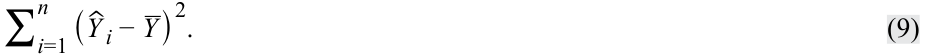

<!-- Formula Text: ∑ i=1 n ( ˆ Y  i − _ Y ) 2. (9) -->

We have already defined the sum of squares total, which is the total variation in _Y_ , and the sum of squares error, the unexplained variation in _Y_ . Note that the sum of squares regression is the explained variation in _Y_ . So, as illustrated in Exhibit 19, SST = SSR + SSE, meaning total variation in _Y_ equals explained variation in _Y_ plus unexplained variation in _Y_ . 

<!-- PDF Page 291 -->

**Exhibit 19: Breakdown of Variation of Dependent Variable** 

<!-- Start of picture text -->
Sum of Squares Total (SST) Σ ni =1( Yi  –  Y– ) 2 Sum of Squares Regression (SSR) Sum of Squares Error (SSE) n ^ ^ – n Σ( Yi  –  Y ) 2 Σ i =1( Yi  –  Yi ) 2 i =1 <!-- End of picture text -->

We show the breakdown of the sum of squares total formula for our ROA regression example in Exhibit 20. The total variation of ROA that we want to explain (SST) is 239.50. This number includes the variation unexplained (SSE), 47.88, and the variation explained (SSR), 191.63. These sum of squares values are important inputs into measures of the fit of the regression line. 

**Exhibit 20: Breakdown of the Sum of Squares Total for ROA Model** 

|**Company**|**ROA** **(Yi)**|**CAPEX** **(Xi)**|**Predicted** **ROA**  **( **ˆ _Y_**)**|**Variation** **to Be** **Explained**  ( _Y_ _i_**−** **_** _Y_) **2**|**Variation** **Unexplained**  ( _Y_ _i_**−**ˆ _Yi_ ) **2**|**Variation** **Explained**  ( ˆ _Yi_**−** **_** _Y_) **2**|
|---|---|---|---|---|---|---|
|A|6.0|0.7|5.750|42.25|0.063|45.563|
|B|4.0|0.4|5.375|72.25|1.891|50.766|
|C|15.0|5.0|11.125|6.25|15.016|1.891|
|D|20.0|10.0|17.375|56.25|6.891|23.766|
|E|10.0|8.0|14.875|6.25|23.766|5.641|
|F|20.0|12.5|20.500|56.25|0.250|64.000|
|||||239.50|47.88|191.625|
|Mean|12.50||||||

_Sum of squares total = 239.50. Sum of squares error = 47.88. Sum of squares regression = 191.63._ 

#### **Measures of Goodness of Fit** 

We can use several measures to evaluate goodness of fit—that is, how well the regression model fits the data. These include the coefficient of determination, the _F_ -statistic for the test of fit, and the standard error of the regression. 

<!-- PDF Page 292 -->

The **coefficient of determination (R****2** **)** , also referred to as the _R_ -squared or _R_2 , is the percentage of the variation of the dependent variable that is explained by the independent variable: 

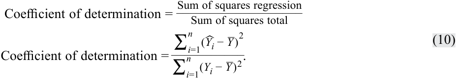

<!-- Formula Text: Coefficient of determination = Sum of squares regression ___________________ Sum of squares total Coefficient of determination = ∑ i=1 n (ˆ Y i − _ Y ) 2 ___________ ∑ i=1 n (Y i − _ Y ) 2 . (10) -->

By construction, the coefficient of determination ranges from 0 percent to 100 percent. In our ROA example, the coefficient of determination is 191.625 ÷ 239.50, or 0.8001, so 80.01 percent of the variation in ROA is explained by CAPEX. In a simple linear regression, the square of the pairwise correlation is equal to the coefficient of determination: 

<!-- Formula Text: r 2  = ∑ i=1 n (ˆ Y i − _ Y ) 2 ____________ ∑ i=1 n (Y i − _ Y ) 2 =  R 2. (11) -->

In our earlier ROA regression analysis, _r_ = 0.8945, so we now see that _r_2 is indeed equal to the coefficient of determination ( _R_2 ), since (0.8945)2 = 0.8001. 

Whereas the coefficient of determination—the portion of the variation of the dependent variable explained by the independent variable—is descriptive, it is not a statistical test. To see if our regression model is likely to be statistically meaningful, we will need to construct an _F_ -distributed test statistic. 

In general, we use an _F_ -distributed test statistic to compare two variances. In regression analysis, we can use an _F_ -distributed test statistic to test whether the slopes in a regression are equal to zero, with the slopes designated as bi, against the alternative hypothesis that at least one slope is not equal to zero: 

<!-- Formula Text: H0: b1 = b2 = b3 =. . . = bk= 0. -->

<!-- Formula Text: Ha: At least one bk is not equal to zero. -->

For simple linear regression, these hypotheses simplify to 

<!-- Formula Text: H0: b1 = 0. Ha: b1 ≠ 0. -->

The _F_ -distributed test statistic is constructed by using the sum of squares regression and the sum of squares error, each adjusted for degrees of freedom; in other words, it is the ratio of two variances. We divide the sum of squares regression by the number of independent variables, represented by k. In the case of a simple linear regression, k = 1, so we arrive at the **mean square regression (MSR)** , which is the same as the sum of squares regression: 

<!-- Formula Text: MSR  = Sum of squares regression ___________________ k = ∑ i=1 n (ˆ Y i − _ Y ) 2 ___________ 1 . (12) -->

So, for simple linear regression, 

<!-- Formula Text: MSR  =  ∑ i=1 n (ˆ Y i − _ Y ) 2. (13) -->

Next, we calculate the **mean square error (MSE)** , which is the sum of squares error divided by the degrees of freedom, which are _n_ − _k_ − 1. In simple linear regression, _n_ − _k_ − 1 becomes _n_ − 2: 

<!-- Formula Text: MSE  = Sum of squares error _______________ n − k − 1 , -->

<!-- PDF Page 293 -->

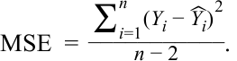

<!-- Formula Text: MSE  = ∑ i=1 n (Y i − ˆ Y i) 2 ___________ n − 2 . -->

<!-- Formula Text: (14) -->

Therefore, the _F_ -distributed test statistic (MSR/MSE) is 

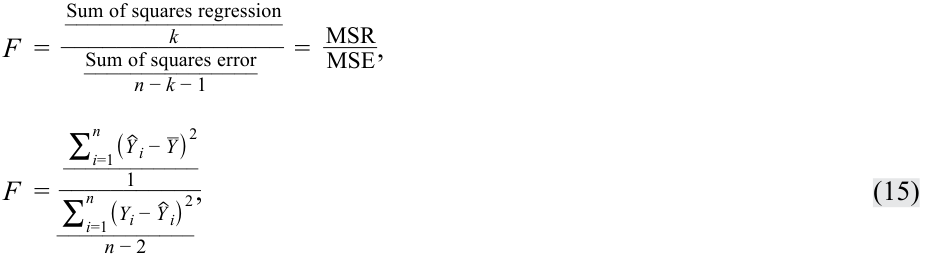

<!-- Formula Text: F  = Sum of squares regression ___________________ k ________________ Sum of squares error _______________ n − k − 1 =   MSR _ MSE , F  = ∑ i=1 n ( ˆ Y  i − _ Y ) 2 ____________ 1 ___________ ∑ i=1 n (Y i −  ˆ Y  i) 2 ____________ n − 2 , (15) -->

which is distributed with 1 and _n_ − 2 degrees of freedom in simple linear regression. The _F_ -statistic in regression analysis is one sided, with the rejection region on the right side, because we are interested in whether the variation in _Y_ explained (the numerator) is larger than the variation in _Y_ unexplained (the denominator). 

#### **Hypothesis Testing of Individual Regression Coefficients** 

##### **_Hypothesis Tests of the Slope Coefficient_** 

We can use the _F_ -statistic to test for the significance of the slope coefficient (i.e., whether it is significantly different from zero), but we also may want to perform other hypothesis tests for the slope coefficient—for example, testing whether the population slope is different from a specific value or whether the slope is positive. We can use a _t_ -distributed test statistic to test such hypotheses about a regression coefficient. 

Suppose we want to check a stock’s valuation using the market model; we hypothesize that the stock has an average systematic risk (i.e., risk similar to that of the market), as represented by the coefficient on the market returns variable. Or we may want to test the hypothesis that economists’ forecasts of the inflation rate are unbiased (i.e., on average, not overestimating or underestimating actual inflation rates). In each case, does the evidence support the hypothesis? Such questions as these can be addressed with hypothesis tests on the regression slope. To test a hypothesis about a slope, we calculate the test statistic by subtracting the hypothesized population slope ( _B_ 1) from the estimated slope coefficient ( _b_ˆ 1 ) and then dividing this difference by the standard error of the slope coefficient, _sb_ ˆ1: 

<!-- Formula Text: t  = ˆ b  1 − B 1 _ s  ˆ b  1  . (16) -->

This test statistic is _t_ -distributed with _n_ − _k_ − 1 or _n_ − 2 degrees of freedom because two parameters (an intercept and a slope) were estimated in the regression. 

The **standard error of the slope coefficient** ( _sb_ ˆ1) for a simple linear regression is the ratio of the model’s standard error of the estimate ( _se_ ), introduced later, to the square root of the variation of the independent variable: 

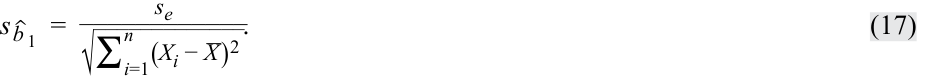

<!-- Formula Text: s  ˆ b  1  = s e ____________ √ _____________ ∑ i=1 n (X i − _ X ) 2 . (17) -->

We compare the calculated _t_ -statistic with the critical values to test hypotheses. Note that the greater the variability of the independent variable, the lower the standard error of the slope (Equation 17) and hence the greater the calculated _t_ -statistic (Equation 16). If the calculated _t_ -statistic is outside the bounds of the critical _t_ -values, we reject the null hypothesis, but if the calculated _t_ -statistic is within the bounds of the critical values, we fail to reject the null hypothesis. Similar to tests of the mean, the alternative hypothesis can be two sided or one sided. 

<!-- PDF Page 294 -->

Consider our previous simple linear regression example with ROA as the dependent variable and CAPEX as the independent variable. Suppose we want to test whether the slope coefficient of CAPEX is different from zero to confirm our intuition of a significant relationship between ROA and CAPEX. We can test the hypothesis concerning the slope using the six-step process, as we show in Exhibit 21. As a result of this test, we conclude that the slope is different from zero; that is, CAPEX is a significant explanatory variable of ROA. 

**Exhibit 21: Test of the Slope for the Regression of ROA on CAPEX** 

|**Step** **1**|State the hypotheses.|_H_0:_b_1= 0 versus_Ha_:_b_1≠ 0|
|---|---|---|
|**Step** **2**|Identify the appropriate test statistic.|_t_= ˆ _b_1−_B_ 1  _  _s_  ˆ _b_1    with 6 − 2 = 4 degrees of freedom.|
|**Step** **3**|Specify the level of significance.|_α_= 5%.|
|**Step**|State the decision rule.|Critical_t_-values = ±2.776.|
|**4**||We can determine this from **Excel**|
|||_Lower:_~~T.INV(0.025,4)~~|
|||_Upper:_~~T.INV(0.975,4)~~|
|||**R:** ~~qt(c(.025,.975),4)~~|
|||**Python:**~~from scipy.stats import t~~ _Lower:_~~t.ppf(.025,4)~~ _Upper:_~~t.ppf(.975,4)~~ We reject the null hypothesis if the calculated _t_-statistic is less than −2.776 or greater than +2.776.|
|**Step** **5**|Calculate the test statistic.|The slope coefficient is 1.25 (Exhibit 6). The mean square error is 11.96875 (Exhibit 39). The variation of CAPEX is 122.640 (Exhibit 6).  _s_ _e_=√ _ 11.96875 = 3.459588.|
|**Step** **6**|Make a decision.|Reject the null hypothesis of a zero slope. There is sufficient evidence to indicate that the slope is different from zero.|

A feature of simple linear regression is that the _t_ -statistic used to test whether the slope coefficient is equal to zero and the _t_ -statistic to test whether the pairwise correlation is zero (i.e., _H_ 0: _ρ_ = 0 versus _Ha_ : _ρ_ ≠ 0) are the same value. Just as with a test of a slope, both two-sided and one-sided alternatives are possible for a test of a correlation—for example, _H_ 0: _ρ_ ≤ 0 versus _Ha_ : _ρ_ > 0. The test-statistic to test whether the correlation is equal to zero is as follows: 

<!-- Formula Text: t  =   r √ _ n − 2 _ √ _ 1 − r 2  . (18) -->

In our example of ROA regressed on CAPEX, the correlation ( _r_ ) is 0.8945. To test whether this correlation is different from zero, we perform a test of hypothesis, shown in Exhibit 22. As you can see, we draw a conclusion similar to that for our test of the slope, but it is phrased in terms of the correlation between ROA and CAPEX: There is a significant correlation between ROA and CAPEX. 

<!-- PDF Page 295 -->

**Exhibit 22: Test of the Correlation between ROA and CAPEX** 

|**Step 1**|State the hypotheses.|_H_0: ρ = 0 versus_Ha_:_ρ_≠ 0|
|---|---|---|
|**Step 2**|Identify the appropriate test statistic.|_t_=_r_  √ _ _n_− 2 _  √ _ 1 −_r_ 2 . with 6 − 2 = 4 degrees of freedom.|
|**Step 3**|Specify the level of significance.|_α_= 5%.|
|**Step 4**|State the decision rule.|Critical_t_-values = ±2.776. Reject the null if the calculated_t_-statistic is less than −2.776 or greater than +2.776.|
|**Step 5**|Calculate the test statistic.|_t_=0.8945√ _ 4 _  √ _ 1 − 0.8001 = 4.00163.|
|**Step 6**|Make a decision.|Reject the null hypothesis of no correlation. There is sufficient evidence to indicate that the correlation between ROA and CAPEX is differ- ent from zero.|

Another interesting feature of simple linear regression is that the test-statistic used to test the fit of the model (i.e., the _F_ -distributed test statistic) is related to the calculated _t_ -statistic used to test whether the slope coefficient is equal to zero: _t_2 = _F_ ; therefore, 4.001312 = 16.0104. 

What if instead we want to test whether there is a one-to-one relationship between ROA and CAPEX, implying a slope coefficient of 1.0. The hypotheses become _H_ 0: _b_ 1 = 1 and _Ha_ : _b_ 1 ≠ 1. The calculated _t_ -statistic is as follows: 

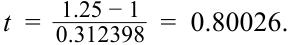

<!-- Formula Text: t  =   1.25 − 1 _ 0.312398   =  0.80026. -->

This calculated test statistic falls within the bounds of the critical values, ±2.776, so we fail to reject the null hypothesis: There is not sufficient evidence to indicate that the slope is different from 1.0. 

What if instead we want to test whether there is a positive slope or positive correlation, as our intuition suggests? In this case, all the steps are the same as in Exhibit 21 and Exhibit 22 except the critical values because the tests are one sided. For a test of a positive slope or positive correlation, the critical value for a 5 percent level of significance is +2.132. We show the test of hypotheses for a positive slope and a positive correlation in Exhibit 23. Our conclusion is that evidence is sufficient to support both a positive slope and a positive correlation. 

**Exhibit 23: One-Sided Tests for the Slope and Correlation** 

|||**Test of the Slope**|**Test of the Correlation**|
|---|---|---|---|
|**Step 1**|State the hypotheses.|_H_0:_b_1≤ 0 versus_Ha_:_b_1> 0|_H_0:_ρ_≤ 0 versus_Ha_:_ρ_> 0|
|**Step 2**|Identify the appropriate test statistic.|_t_= ˆ _b_1−_B_ 1  _  _s_  ˆ _b_1    with 6 − 2 = 4 degrees of freedom.|_t_=_r_  √ _ _n_− 2 _  √ _ 1 −_r_ 2 . with 6 − 2 = 4 degrees of freedom.|
|**Step 3**|Specify the level of significance.|_α_= 5%.|_α_= 5%.|
|**Step 4**|State the decision rule.|Critical_t_-value = 2.132. Reject the null if the calculated|Critical_t_-value = 2.132. Reject the null if the calculated|
|||_t_-statistic is greater than 2.132.|_t_-statistic is greater than 2.132.|

<!-- PDF Page 296 -->

**Step 5** Calculate the test statistic. _t_ = <mark>_</mark> 0.3123981.25 − 0= 4.00131 _t_ = <mark>_</mark> √0.8945<mark>_</mark> 1 − 0.8001√ _4= 4.00131 **Step 6** Make a decision. Reject the null hypothesis. Evidence is Reject the null hypothesis. Evidence is sufficient to indicate that the slope is sufficient to indicate that the correlation greater than zero. is greater than zero. 

##### **_Hypothesis Tests of the Intercept_** 

We may want to test whether the population intercept is a specific value. As a reminder on how to interpret the intercept, consider the simple linear regression with a company’s revenue growth rate as the dependent variable ( _Y_ ), and the GDP growth rate of its home country as the independent variable ( _X_ ). The intercept is the company’s revenue growth rate if the GDP growth rate is 0 percent. 

<!-- Formula Text: g g p The equation for the standard error of the intercept, s  ˆ b  0, is as follows: s  ˆ b  0  =  S e √ _______________ 1 _ n  + _ X  2 ___________ ∑ i=1 n (X i − _ X ) 2 . (19) -->

We can test whether the intercept is different from the hypothesized value, _B_ 0, by comparing the estimated intercept ( _b_ˆ 0 ) with the hypothesized intercept and then dividing the difference by the standard error of the intercept: 

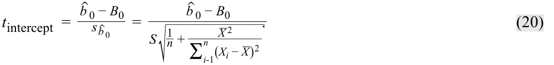

<!-- Formula Text: t intercept  = ˆ b  0 − B 0 _ s  ˆ b  0    = ˆ b  0 − B 0 _______________ S √ _______________ 1 _ n  + _ X  2 ___________ ∑ i-1 n (X i − _ X ) 2 . (20) -->

In the ROA regression example, the intercept is 4.875 percent. Suppose we want to test whether the intercept is greater than 3 percent. The one-sided hypothesis test is shown in Exhibit 24. As you can see, we reject the null hypothesis. In other words, evidence is sufficient that if there are no capital expenditures (CAPEX = 0), ROA is greater than 3 percent. 

**Exhibit 24: Test of Hypothesis for Intercept for Regression of ROA on CAPEX** 

|**Step 1**|State the hypotheses.|_H_0:_b_0≤ 3% versus_Ha_:_b_0> 3%|
|---|---|---|
|**Step 2**|Identify the appropriate test statistic.|_t_ _intercept_= ˆ _b_0−_B_ 0  _  _s_  ˆ _b_0    with 6 − 2 = 4 degrees of freedom.|
|**Step 3**|Specify the level of significance.|_α_= 5%.|
|**Step 4**|State the decision rule.|Critical_t_-value = 2.132. Reject the null if the calculated_t_-statistic is greater than 2.132.|
|**Step 5**|Calculate the test statistic.|_t_ intercept= 4.875 − 3.0 ________**_**_______ 3.4596 ×√ 1 _ 6 + 6.12  _ 122.64 = 1.875 _____________ 3.4596 × 0.68562 = 0.7905|
|**Step 6**|Make a decision.|Do not reject the null hypothesis. There is not sufficient evidence to indicate that the intercept is greater than 3%.|

<!-- PDF Page 297 -->

##### **_Hypothesis Tests of Slope When the Independent Variable Is an Indicator Variable_** 

Suppose we want to examine whether a company’s quarterly earnings announcements influence its monthly stock returns. In this case, we could use an **indicator variable** , or dummy variable, that takes on only the values 0 or 1 as the independent variable. Consider the case of a company’s monthly stock returns over a 30-month period. A simple linear regression model for investigating this question would be monthly returns, RET, regressed on the indicator variable, EARN, that takes on a value of 0 if there is no earnings announcement that month and 1 if there is an earnings announcement: 

RET _i_ = _b_ 0 + _b_ 1  EARN _i_ + _εi_ . ~~(21)~~ 

This regression setup allows us to test whether there are different returns for earnings-announcement months versus non-earnings-announcement months. The observations and regression results are shown graphically in Exhibit 25. 

**Exhibit 25: Earnings Announcements, Dummy Variable, and Stock Returns** 

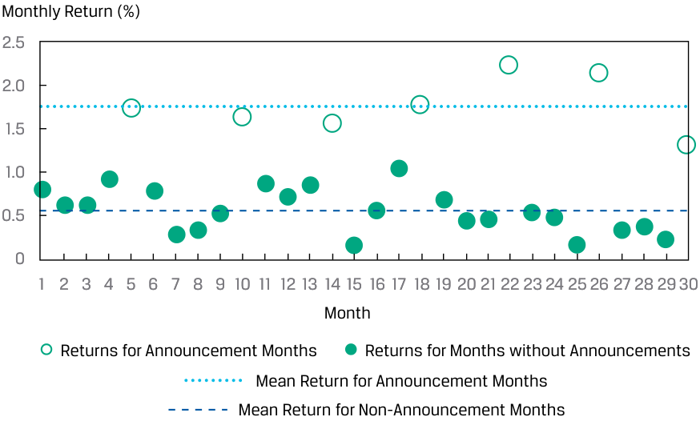

<!-- Start of picture text -->
Monthly Return (%) 2.5 2.0 1.5 1.0 0.5 0 1 2 3 4 5 6 7 8 9 10 11 12 13 14 15 16 17 18 19 20 21 22 23 24 25 26 27 28 29 30 Month Returns for Announcement Months Returns for Months without Announcements Mean Return for Announcement Months Mean Return for Non-Announcement Months <!-- End of picture text -->

Clearly there are some months in which the returns are different from other months, and these correspond to months in which there was an earnings announcement. We estimate the simple linear regression model and perform hypothesis testing in the same manner as if the independent variable were a continuous variable. In a simple linear regression, the interpretation of the intercept is the predicted value of the dependent variable if the indicator variable is zero. Moreover, the slope when the indicator variable is 1 is the difference in the means if we grouped the observations by the indicator variable. The results of the regression are given in Panel A of Exhibit 26. 

**Exhibit 26: Regression and Test of Differences Using an Indicator Variable** 

#### **A. Regression Estimation Results** 

||**fi**|**Standard Error of** **fi**|**Calculated Test**|
|---|---|---|---|
||**Estimated Coefficients**|**Coefficients**|**Statistic**|
|Intercept|**fi** 0.5629|**fi** 0.0560|10.0596|
|EARN|1.2098|0.1158|10.4435|

_Regression Estimation Results Degrees of freedom = 28._ 

<!-- PDF Page 298 -->

_Critical t-values = +2.0484 (5% significance)._ 

#### **B. Test of Differences in Means** 

||**RET for Earnings-** **Announcement** **Months**|**RET for Non-Earnings-** **Announcement Months**|**Difference in** **Means**|
|---|---|---|---|
|Mean|1.7727|0.5629|1.2098|
|Variance|0.1052|0.0630||
|Observations|7|23||
|Pooled variance|||0.07202|
|Calculated test|||10.4435|
|statistic||||

_Test of Differences in Means Degrees of freedom = 28. Critical t-values = +2.0484 (5% significance)._ 

We can see the following from Panel A of Exhibit 26: 

- The intercept (0.5629) is the mean of the returns for non-earnings-announcement months. 

- The slope coefficient (1.2098) is the difference in means of returns between earnings-announcement and non-earnings-announcement months. 

- We reject the null hypothesis that the slope coefficient on EARN is equal to zero. We also reject the null hypothesis that the intercept is zero. The reason is that in both cases, the calculated test statistic exceeds the critical _t_ -value. 

We could also test whether the mean monthly return is the same for both the non-earnings-announcement months and the earnings-announcement months by testing the following: 

_H_ 0 : _μRETearnings_ = _μRETNon_ − _earnings_ and _Ha_ : _μRETearnings_ ≠ _μRETNon_ − _earnings_ 

The results of this hypothesis test are gleaned from Panel B of Exhibit 26. As you can see, we reject the null hypothesis that there is no difference in the mean RET for the earnings-announcement and non-earnings-announcements months at the 5 percent level of significance, because the calculated test statistic (10.4435) exceeds the critical value (2.0484). 

##### **_Test of Hypotheses: Level of Significance and p-Values_** 

The choice of significance level in hypothesis testing is always a matter of judgment. Analysts often choose the 0.05 level of significance, which indicates a 5 percent chance of rejecting the null hypothesis when, in fact, it is true (a Type I error, or false positive). Of course, decreasing the level of significance from 0.05 to 0.01 decreases the probability of a Type I error, but it also increases the probability of a Type II error—failing to reject the null hypothesis when, in fact, it is false (i.e., a false negative). 

The _p_ -value is the smallest level of significance at which the null hypothesis can be rejected. The smaller the _p_ -value, the smaller the chance of making a Type I error (i.e., rejecting a true null hypothesis), so the greater the likelihood the regression model is valid. For example, if the _p_ -value is 0.005, we reject the null hypothesis that the true parameter is equal to zero at the 0.5 percent significance level (99.5 percent 

<!-- PDF Page 299 -->

confidence). In most software packages, the _p_ -values provided for regression coefficients are for a test of null hypothesis that the true parameter is equal to zero against the alternative that the parameter is not equal to zero. 

In our ROA regression example, the calculated _t_ -statistic for the test of whether the slope coefficient is zero is 4.00131. The _p_ -value corresponding to this test statistic is 0.016, which means that, assuming the null hypothesis is true, there is a 1.6% chance of observing a test statistic as extreme as the one observed, or more extreme. Comparing this _p_ -value with the level of significance of 5 percent (and critical values of ±2.776) leads us to easily reject the null hypothesis of _H_ 0: _b_ 1 = 0. 

How do we determine the _p_ -values? Because this is the area in the distribution outside the calculated test statistic, we need to resort to software tools. For the _p_ -value corresponding to the _t_ = 4.00131 from the ROA regression example, we could use the following: 

- **Excel** (1-T.DIST(4.00131,4,TRUE))*2 

- **R** (1-pt(4.00131,4))*2 

- **Python** from scipy.stats import t _and_ (1 - t.cdf(4.00131,4))*2 

##### **QUESTION SET** 

The following applies to questions 1–3: 

Julie Moon is an energy analyst examining electricity, oil, and natural gas consumption in different regions over different seasons. She ran a simple regression explaining the variation in energy consumption as a function of temperature. The total variation of the dependent variable was 140.58, and the explained variation was 60.16. She had 60 monthly observations. 

1. Calculate the coefficient of determination. 

##### **Solution:** 

The coefficient of determination is 0.4279: 

<!-- Start of picture text -->
______________Explained variation _ =   60.16 Total variation 140.58  = 0.4279. <!-- End of picture text -->

2. Calculate the _F_ -statistic to test the fit of the model. 

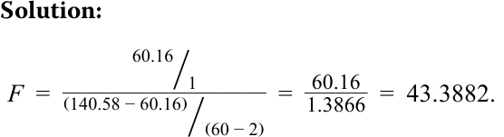

<!-- Start of picture text -->
Solution: _________________ 60.16 ⧸1 _ F  =   =   60.16 1.3866  = 43.3882. (140.58 − 60.16) ⧸(60 − 2) <!-- End of picture text -->

3. Calculate the sample standard deviation of monthly energy consumption. 

##### **Solution:** 

The sample variance of the dependent variable uses the total variation of the dependent variable and divides it by the number of observations less one: 

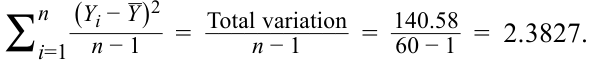

<!-- Formula Text: ∑ i=1 n (Y i − _ Y ) 2 _ n − 1    =   Total variation ___________ n − 1 =   140.58 _ 60 − 1   =  2.3827. -->

The sample standard deviation of the dependent variable is the square root of the variance, or  √_ 2.3827 = 1.544 . 

The following applies to questions 4–6: 

<!-- PDF Page 300 -->

An analyst is interested in interpreting the results of and performing tests of hypotheses for the market model estimation that regresses the daily return on ABC stock on the daily return on the fictitious Europe–Asia–Africa (EAA) Equity Index, his proxy for the stock market. He has generated the regression results presented in Exhibit 27. 

##### **Exhibit 27: Hypothesis Testing of Simple Linear Regression Results Selected Results of Estimation of Market Model for ABC Stock** 

|Standard error of the estimate (se)|1.26|
|---|---|
|Standard deviation of ABC stock returns|0.80|
|Standard deviation of EAA Equity Index returns|0.70|
|Number of observations|1,200|
||_Coefficients_|
|Intercept|0.010|
|Slope of EAA Equity Index returns|0.982|

4. If the critical _t_ -values are ±1.96 (at the 5 percent significance level), is the slope coefficient different from zero? **Solution:** 

First, we calculate the variation of the independent variable using the standard deviation of the independent variable: 

<!-- Formula Text: ∑ i=1 n (X i − _ X ) 2  = ∑ i=1 n (X i − _ X ) 2 ___________ n − 1 × (n − 1). So, ∑ i=1 n (X i − _ X ) 2  =  0.70 2 × 1, 199  =  587.51. -->

So, 

Next, the standard error of the estimated slope coefficient is 

<!-- Formula Text: s  ˆ b  1  = s e ____________ √ _____________ ∑ i=1 n (X i − _ X ) 2 =    1.26 _ √ _ 587.51    =  0.051983, and the test statistic is t  = ˆ b  1 − B 1 _ s  ˆ b  1    =   0.982 − 0 _ 0.051983   =  18.8907. -->

and the test statistic is 

The calculated test statistic is outside the bounds of ±1.96, so we reject the null hypothesis of a slope coefficient equal to zero. 

5. If the critical _t_ -values are ±1.96 (at the 5 percent significance level), is the slope coefficient different from 1.0? 

##### **Solution:** 

The calculated test statistic for the test of whether the slope coefficient is equal to 1.0 is 

<!-- PDF Page 301 -->

## ~~_~~ _t_ =0.982 − 1 0.051983= − 0.3463. 

The calculated test statistic is within the bounds of ±1.96, so we fail to reject the null hypothesis of a slope coefficient equal to 1.0, which is evidence that the true population slope may be 1.0. 

6. An economist collected the monthly returns for KDL’s portfolio and a diversified stock index. The data collected are shown in Exhibit 28: 

##### **Exhibit 28: Monthly Returns for KDL** 

|**Month**|**Portfolio Return (%)**|**Index Return (%)**|
|---|---|---|
|1|1.11|−0.59|
|2|72.10|64.90|
|3|5.12|4.81|
|4|1.01|1.68|
|5|−1.72|−4.97|
|6|4.06|−2.06|

The economist calculated the correlation between the two returns and found it to be 0.996. The regression results with the portfolio return as the dependent variable and the index return as the independent variable are given in Exhibit 29: 

##### **Exhibit 29: Regression Results** 

|**Regression Statistics**||
|---|---|
|_R_2|0.9921|
|Standard error|2.8619|
|Observations|6|

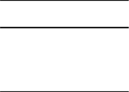

|**Source**|**df**|**Sum of** **Squares**|**Mean** **Square**|**_F_**|**_p_-Value**|
|---|---|---|---|---|---|
|Regression|1|4,101.6205|4,101.6205|500.7921|0.0000|
|Residual|4|32.7611|8.1903|||
|Total|5|4,134.3815||||

||**Coefficients**|**Standard** **Error**|**_t_-Statistic**|**_p_-Value**|
|---|---|---|---|---|
|Intercept|2.2521|1.2739|1.7679|0.1518|
|Index|1.0690|0.0478|22.3784|0.0000|
|return (%)|||||

When reviewing the results, Andrea Fusilier suspected that they were unreliable. She found that the returns for Month 2 should have been 7.21 percent 

<!-- PDF Page 302 -->

and 6.49 percent, instead of the large values shown in the first table. Correcting these values resulted in a revised correlation of 0.824 and the revised regression results in Exhibit 30: 

**Exhibit 30: Revised Regression Results** 

<!-- Start of picture text -->
Regression Statistics R 2 0.6784 Standard error 2.0624 Observations 6 Sum of  Mean Source df Squares Square F p -Value Regression 1 35.8950 35.8950 8.4391 0.044 Residual 4 17.0137 4.2534 Total 5 52.91 <!-- End of picture text -->

||**Coefficients**|**Standard** **Error**|**_t_-Statistic**|**_p_-Value**|
|---|---|---|---|---|
|Intercept|2.2421|0.8635|2.5966|0.060|
|Slope|0.6217|0.2143|2.9050|0.044|

Explain how the bad data affected the results. 

##### **Solution:** 

The Month 2 data point is an outlier, lying far away from the other data values. Because this outlier was caused by a data entry error, correcting the outlier improves the validity and reliability of the regression. In this case, revised _R_2 is lower (from 0.9921 to 0.6784). The outliers created the illusion of a better fit from the higher _R_2 ; the outliers altered the estimate of the slope. The standard error of the estimate is lower when the data error is corrected (from 2.8619 to 2.0624), as a result of the lower mean square error. At a 0.05 level of significance, both models fit well. The difference in the fit is illustrated in Exhibit 31. 

