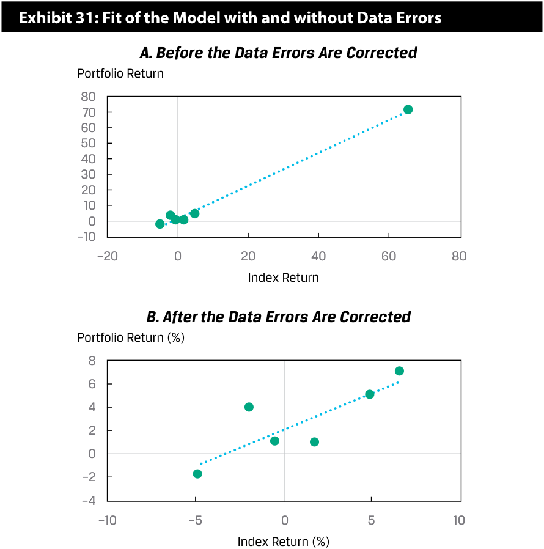
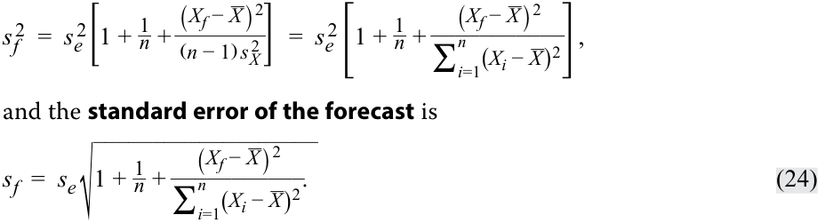
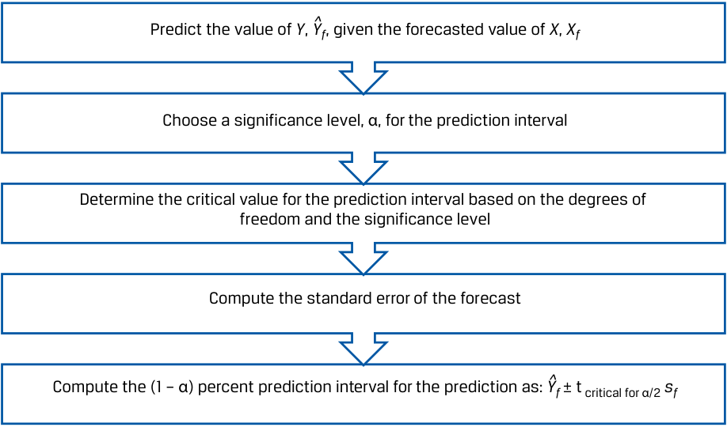
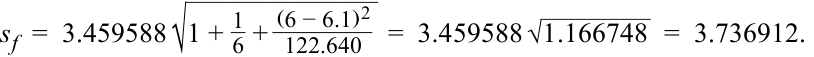
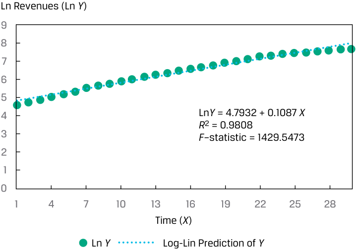
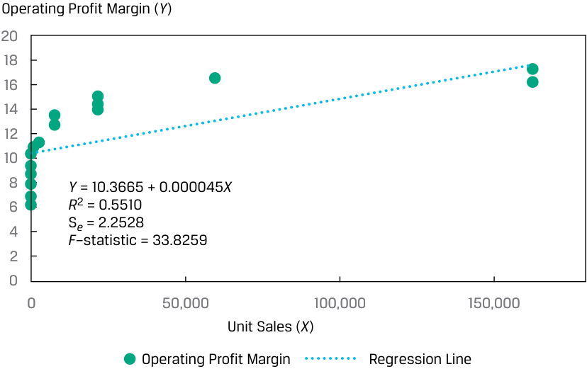
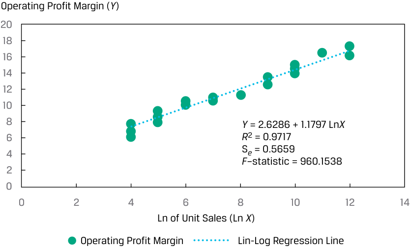
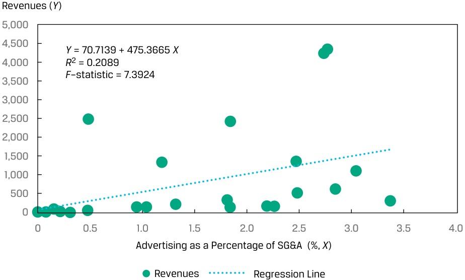
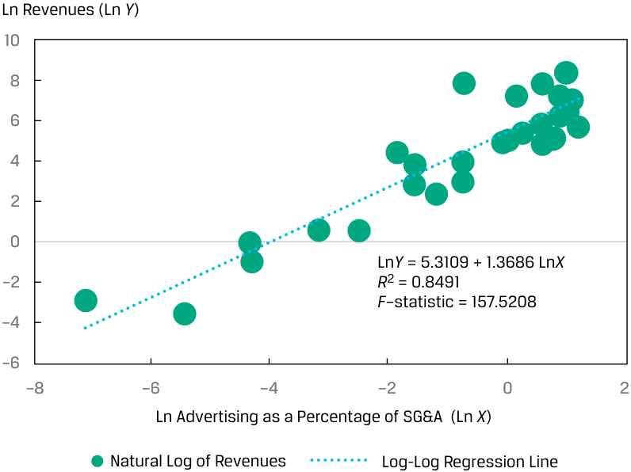

# Volume 1: Quantitative Methods
## Learning Module 10 Simple Linear Regression
### Part 4/6: Prediction in the Simple Linear Regression Model (PDF Pages 303–317)

---

<!-- PDF Page 303 -->

<!-- Start of picture text -->
Exhibit 31: Fit of the Model with and without Data Errors A. Before the Data Errors Are Corrected Portfolio Return 80 70 60 50 40 30 20 10 0 –10 –20 0 20 40 60 80 Index Return B. After the Data Errors Are Corrected Portfolio Return (%) 8 6 4 2 0 –2 –4 –10 –5 0 5 10 Index Return (%) <!-- End of picture text -->

## **PREDICTION IN THE SIMPLE LINEAR REGRESSION MODEL** 

# **<mark>5</mark>** 

describe the use of analysis of variance (ANOVA) in regression analysis, interpret ANOVA results, and calculate and interpret the standard error of estimate in a simple linear regression 

calculate and interpret the predicted value for the dependent variable, and a prediction interval for it, given an estimated linear regression model and a value for the independent variable 

### **ANOVA and Standard Error of Estimate in Simple Linear Regression** 

We often represent the sums of squares from a regression model in an **analysis of variance (ANOVA)** table, as shown in Exhibit 32, which presents the sums of squares, the degrees of freedom, the mean squares, and the _F_ -statistic. Notice that the variance of the dependent variable is the ratio of the sum of squares total to _n_ − 1. 

<!-- PDF Page 304 -->

**Exhibit 32: Analysis of Variance Table for Simple Linear Regression** 

|**Source**|**Sum of Squares**|**Degrees of** **Freedom**|**Mean Square**|**_F_-S**|**tatistic**|
|---|---|---|---|---|---|
|Regression|SSR =∑ _i_=1 _n_   ( ˆ _Yi_−_ _Y_) 2|1|MSR =  ∑ _i_=1 _n_  ( ˆ _Yi_−_ _Y_) 2  ____________ 1|_F_=MSR _ MSE|=  ∑ _i_=1 _n_  ( ˆ _Yi_−_ _Y_) 2  ____________ 1  ___________  ∑ _i_=1 _n_  ( _Y_ _i_−ˆ _Yi_ ) 2  _____________ _n_− 2|
|Error|SSE =∑ _i_=1 _n_   ( _Y_ _i_−ˆ _Yi_ ) 2|_n_− 2|MSE =  ∑ _i_=1 _n_  ( _Y_ _i_−ˆ _Yi_ ) 2  _____________ _n_− 2|||
|Total|SST =∑ _i_=1 _n_   ( _Y_ _i_−_ _Y_) 2|_n_− 1||||

From the ANOVA table, we can also calculate the **standard error of the estimate** ( _se_ ), which is also known as the standard error of the regression or the root mean square error. The _se_ is a measure of the distance between the observed values of the dependent variable and those predicted from the estimated regression—the smaller the _se_ , the better the fit of the model. The _se_ , along with the coefficient of determination and the _F_ -statistic, is a measure of the goodness of the fit of the estimated regression line. Unlike the coefficient of determination and the _F_ -statistic, which are relative measures of fit, the standard error of the estimate is an absolute measure of the distance of the observed dependent variable from the regression line. Thus, the _se_ is an important statistic used to evaluate a regression model and is used to calculate prediction intervals and to perform tests on the coefficients. The calculation of _se_ is straightforward once we have the ANOVA table because it is the square root of the MSE: 

<!-- Formula Text: Standard error of the estimate (s e)  =  √ _ MSE   =  √ ____________ ∑ i=1 n (Y i −  ˆ Y  i) 2 ____________ n − 2 . (22) -->

We show the ANOVA table for our ROA regression example in Exhibit 32, using the information from Exhibit 33. For a 5 percent level of significance, the critical _F_ -value for the test of whether the model is a good fit (i.e., whether the slope coefficient is different from zero) is 7.71. We can get this critical value in the following ways: 

- _Excel_ [F.INV(0.95,1,4)] 

- _R_ [qf(.95,1,4)] 

- _Python_ [from scipy.stats import f _and_ f.ppf(.95,1,4)] 

With a calculated _F_ -statistic of 16.0104 and a critical _F_ -value of 7.71, we reject the null hypothesis and conclude that the slope of our simple linear regression model for ROA is different from zero. 

**Exhibit 33: ANOVA Table for ROA Regression Model** 

|**Source**|**Sum of** **Squares**|**Degrees of** **Freedom**|**Mean Square**|**_F_-Statistic**|
|---|---|---|---|---|
|Regression|191.625|1|191.625|16.0104|
|Error|47.875|4|11.96875||
|Total|239.50|5|||

<!-- PDF Page 305 -->

The calculations to derive the ANOVA table and ultimately to test the goodness of fit of the regression model can be time consuming, especially for samples with many observations. However, statistical packages, such as SAS, SPSS Statistics, and Stata, as well as software, such as Excel, R, and Python, produce the ANOVA table as part of the output for regression analysis. 

### **Prediction Using Simple Linear Regression and Prediction Intervals** 

Financial analysts often want to use regression results to make predictions about a dependent variable. For example, we might ask, “How fast will the sales of XYZ Corporation grow this year if real GDP grows by 4 percent?” But we are not merely interested in making these forecasts; we also want to know how certain we can be about the forecasts’ results. A forecasted value of the dependent variable, _Y_ˆ _f_ , is determined using the estimated intercept and slope, as well as the expected or forecasted independent variable, Xf: 

<!-- Formula Text: ˆ Y  f  =   ˆ b  0 +  ˆ b  1 X f. (23) -->

In our ROA regression model, if we forecast a company’s CAPEX to be 6 percent, the forecasted ROA based on our estimated equation is 12.375 percent: 

_Y_ˆ _f_ = 4.875 +( 1.25 × 6) = 12.375 . 

However, we need to consider that the estimated regression line does not describe the relation between the dependent and independent variables perfectly; it is an average of the relation between the two variables. This is evident because the residuals are not all zero. 

Therefore, an interval estimate of the forecast is needed to reflect this uncertainty. The estimated variance of the prediction error, _sf_2 , of _Y_ , given _X_ , is 

<!-- Formula Text: s f 2  =  s e 2[1 +  1 _ n  + (X f − _ X ) 2 _ (n − 1) s X 2  ]  =  s e 2 [ 1 +  1 _ n  + (X f − _ X ) 2 ___________ ∑ i=1 n (X i − _ X ) 2 ] , and the standard error of the forecast is s f  =  s e √ ___________________ 1 +  1 _ n  + (X f − _ X ) 2 ___________ ∑ i=1 n (X i − _ X ) 2 . (24) -->

The standard error of the forecast depends on the following: 

- the standard error of the estimate, se; 

- the number of observations, _n_ ; 

- the forecasted value of the independent variable, Xf, used to predict the dependent variable and its deviation from the estimated mean, _X__ ; and 

- the variation of the independent variable. 

We can see the following from the equation for the standard error of the forecast: 

**1.** The better the fit of the regression model, the smaller the standard error of the estimate (se) and, therefore, the smaller standard error of the forecast. 

**2.** The larger the sample size ( _n_ ) in the regression estimation, the smaller the standard error of the forecast. 

**3.** The closer the forecasted independent variable (Xf) is to the mean of the independent variable( _X__) used in the regression estimation, the smaller the standard error of the forecast. 

<!-- PDF Page 306 -->

Once we have this estimate of the standard error of the forecast, determining a prediction interval around the predicted value of the dependent variable ( _Y_ˆ _f_ ) is very similar to estimating a confidence interval around an estimated parameter. The prediction interval is 

_Y_ˆ _f_ ± _tcritical for α_ /2 _sf_ . 

We outline the steps for developing the prediction interval in Exhibit 34. 

#### **Exhibit 34: Creating a Prediction Interval around the Predicted Dependent Variable** 

<!-- Start of picture text -->
Predict the value of  Y ,  Y^f , given the forecasted value of  X ,  Xf Choose a significance level, α, for the prediction interval Determine the critical value for the prediction interval based on the degrees of freedom and the significance level Compute the standard error of the forecast Compute the (1 – α) percent prediction interval for the prediction as:  Y^f  ± t critical for α/2  sf <!-- End of picture text -->

For our ROA regression model, given that the forecasted value of CAPEX is 6.0, the predicted value of _Y_ is 12.375: 

_Y_ˆ _f_ = 4.875 + 1.25 _Xf_ = 4.875 +( 1.25 × 6.0) = 12.375. 

Assuming a 5 percent significance level ( _α_ ), two sided, with _n_ − 2 degrees of freedom (so, df = 4), the critical values for the prediction interval are ±2.776. The standard error of the forecast is 

<!-- Formula Text: s f  =  3.459588 √ ______________ 1 +  1 _ 6  +  (6 − 6.1) 2 _ 122.640    =  3.459588 √ _ 1.166748   =  3.736912. -->

The 95 percent prediction interval then becomes 

<!-- Formula Text: 12.375 ± 2.776 (3.736912) -->

12.375 ± 10.3737 

<!-- Formula Text: {2.0013  <   ˆ Y  f  <  22.7487} -->

For our ROA regression example, we can see how the standard error of the forecast ( _sf_ ) changes as our forecasted value of the independent variable gets farther from the mean of the independent variable  ( _Xf_ − _X__ ) in Exhibit 35. The mean of CAPEX is 6.1 

percent, and the band that represents one standard error of the forecast, above and below the forecast, is minimized at that point and increases as the independent variable gets farther from _X__ . 

<!-- PDF Page 307 -->

#### **Exhibit 35: ROA Forecasts and Standard Error of the Forecast** 

<!-- Start of picture text -->
Forecasted ROA (%) 45 40 35 30 25 20 15 10 5 0 –5 1 2 3 4 5 6 7 8 9 10 11 12 13 14 15 16 17 18 19 20 Forecasted CAPEX (%) Forecasted  Y Upper Bound of 95% Prediction Interval Lower Bound of 95% Prediction Interval One Standard Error of the Forecast above the Forecast One Standard Error of the Forecast below the Forecast <!-- End of picture text -->

#### **QUESTION SET** 

Suppose you run a cross-sectional regression for 100 companies, where the dependent variable is the annual return on stock and the independent variable is the lagged percentage of institutional ownership (INST). The results of this simple linear regression estimation are shown in Exhibit 36. Evaluate the model by answering questions 1–4. 

#### **Exhibit 36: ANOVA Table for Annual Stock Return Regressed on Institutional Ownership** 

|**Source**|**Sum of Squares**|**Degrees of Freedom**|**Mean Square**|
|---|---|---|---|
|Regression|576.1485|1|576.1485|
|Error|1,873.5615|98|19.1180|
|Total|2,449.7100|||

1. What is the coefficient of determination for this regression model? 

#### **Solution:** 

The coefficient of determination is sum of squares regression/sum of squares total: 576.148 ÷ 2,449.71 = 0.2352, or 23.52 percent. 

<!-- PDF Page 308 -->

2. What is the standard error of the estimate for this regression model? **Solution:** 

The standard error of the estimate is the square root of the mean square error:  √_ 19.1180 = 4.3724 . 

3. At a 5 percent level of significance, do we reject the null hypothesis of the slope coefficient equal to zero if the critical _F_ -value is 3.938? 

   - **Solution:** 

Using a six-step process for testing hypotheses, we get the following: 

|**Step 1**|State the hypotheses.|_H_0:_b_1= 0 versus_Ha_:_b_1≠ 0|
|---|---|---|
|**Step 2**|Identify the appropri- ate test statistic.|_F_=MSR _ MSE with 1 and 98 degrees of freedom.|
|**Step 3**|Specify the level of significance.|_α_= 5% (one tail, right side).|
|**Step 4**|State the decision rule.|Critical_F_-value = 3.938. Reject the null hypothesis if the calculated _F_-statistic is greater than 3.938.|
|**Step 5**|Calculate the test statistic.|_F_=576.1485 _ 19.1180= 30.1364|
|**Step 6**|Make a decision.|Reject the null hypothesis because the cal- culated_F_-statistic is greater than the critical _F_-value. Evidence is sufficient to indicate that the slope coefficient is different from 0.0.|

4. Based on your answers to the preceding questions, evaluate this simple linear regression model. 

#### **Solution:** 

The coefficient of determination indicates that variation in the independent variable explains 23.52 percent of the variation in the dependent variable. Also, the _F_ -statistic test confirms that the model’s slope coefficient is different from 0 at the 5 percent level of significance. In sum, the model seems to fit the data reasonably well. 

### **The following applies to questions 5-10** 

Suppose we want to forecast a company’s net profit margin (NPM) based on its research and development expenditures scaled by revenues (RDR), using the model estimated in Example 2 and the details provided in Exhibit 8. The regression model was estimated using data on eight companies as 

_Y_ˆ _f_ = 16.5 − 1.3 _Xf_ , 

____________∑ _ni_ with a standard error of the estimate (=1( _Xi_ − _X__ )2 _se_ ) of 1.8618987 and variance of RDR, , of 4.285714, as given. ( _n_ − 1) 

5. What is the predicted value of NPM if the forecasted value of RDR is 5? **Solution:** 

The predicted value of NPM is 10: 16.5 − (1.3 × 5) = 10. 

<!-- PDF Page 309 -->

6. What is the standard error of the forecast ( _sf_ ) if the forecasted value of RDR is 5? **Solution:** To derive the standard error of the forecast ( _sf_ ), we first have to calculate the variation of RDR. Then, we have all the pieces to calculate sf: ∑ _ni_ =1 ( _Xi_ − _X_ _)2 = 4.285714 × 7 = 30. ______________ _ 1 +_1 = 2.1499. _sf_ = 1.8618987  √ 8+  (5 − 7.5 30)2 7. What is the 95 percent prediction interval for the predicted value of NPM using critical _t_ -values (df = 6) of ±2.447? **Solution:** The 95 percent prediction interval for the predicted value of NPM is {10 ± 2.447( 2.1499) } , { 4.7392 < _Y_ˆ _f_ < 15.2608 }  . 8. What is the predicted value of NPM if the forecasted value of RDR is 15? **Solution:** The predicted value of NPM is −3: 16.5 − (1.3 × 15) = −3. 9. Referring to exhibit 9, what is the standard error of the forecast if the forecasted value of RDR is 15? **Solution:** To derive the standard error of the forecast, we first must calculate the variation of RDR. Then, we can calculate sf: ∑ _ni_ =1 ( _Xi_ − _X_ _)2 = 4.285714 × 7 = 30. _______________ _ 1 +_1 = 3.2249. _sf_ = 1.8618987  √ 8+  (15 − 7.5 30)2 

10. What is the 95 percent prediction interval for the predicted value of NPM using critical _t_ -values (df = 6) of ±2.447? **Solution:** 

The 95 percent prediction interval for the predicted value of NPM is {− 3 ± 2.447( 3.2249) } , { − 10.8913 < _Y_ˆ _f_ < 4.8913 }  . 

### **The following applies to questions 11-15** 

You are examining the results of a regression estimation that attempts to explain the unit sales growth of a business you are researching. The analysis of variance output for the regression is given in the Exhibit 37. The regression was based on five observations ( _n_ = 5). 

<!-- PDF Page 310 -->

#### **Exhibit 37: ANOVA Output** 

<!-- Start of picture text -->
Sum of  Mean Source df Squares Square F p -Value Regression 1 88.0 88.0 36.667 0.00904 Residual 3 7.2 2.4 Total 4 95.2 <!-- End of picture text -->

11. Calculate the sample variance of the dependent variable using information in the table. 

#### **Solution:** 

The sample variance of the dependent variable is the sum of squares total divided by its degrees of freedom ( _n_ − 1 = 5 − 1 = 4, as given). Thus, the sample variance of the dependent variable is 95.2 ÷ 4 = 23.8. 

12. Calculate the coefficient of determination for this estimated model. 

#### **Solution:** 

The coefficient of determination = 88.0 ÷ 95.2 = 0.92437. 

13. What hypothesis does the _F_ -statistic test? 

#### **Solution:** 

The _F_ -statistic tests whether all the slope coefficients in a linear regression are equal to zero. 

14. Is the _F_ -test significant at the 0.05 significance level? 

#### **Solution:** 

The calculated value of the _F_ -statistic is 36.667, as shown in Exhibit 32. The corresponding _p_ -value is less than 0.05, so you reject the null hypothesis of a slope equal to zero. 

15. Calculate the standard error of the estimate. 

#### **Solution:** 

The standard error of the estimate is the square root of the mean square error: _se_ =  √_ 2.4 = 1.54919. 

# **<mark>6</mark>** 

## **FUNCTIONAL FORMS FOR SIMPLE LINEAR REGRESSION** 

describe different functional forms of simple linear regressions 

Not every set of independent and dependent variables has a linear relation. In fact, we often see non-linear relationships in economic and financial data. Consider the revenues of a company over time illustrated in Exhibit 38, with revenues as the dependent 

<!-- PDF Page 311 -->

( _Y_ ) variable and time as the independent ( _X_ ) variable. Revenues grow at a rate of 15 percent per year for several years, but then the growth rate eventually declines to just 5 percent per year. Estimating this relationship as a simple linear model would understate the dependent variable, revenues, and, for some ranges of the independent variable, time, and would overstate it for other ranges of the independent variable. 

**Exhibit 38: Company Revenues over Time** 

<!-- Start of picture text -->
Revenues ( Y ) 2,500 2,000 1,500 1,000 Y  = –287.61 + 76.578  X 500 R 2  = 0.9478 F –statistic = 508.9017 0 –500 1 4 7 10 13 16 19 22 25 28 Time ( X ) Observed  Y Linear Prediction of  Y <!-- End of picture text -->

We can still use the simple linear regression model, but we need to modify either the dependent or the independent variables to make it work well. This is the case with many different financial or economic data that you might use as dependent and independent variables in your regression analysis. 

Several different functional forms can be used to potentially transform the data to enable their use in linear regression. These transformations include using the log (i.e., natural logarithm) of the dependent variable, the log of the independent variable, the reciprocal of the independent variable, the square of the independent variable, or the differencing of the independent variable. We illustrate and discuss three often-used functional forms, each of which involves log transformation: 

**1.** the **log-lin model** , in which the dependent variable is logarithmic but the independent variable is linear; 

**2.** the **lin-log model** , in which the dependent variable is linear but the independent variable is logarithmic; and 

**3.** the **log-log model** , in which both the dependent and independent variables are in logarithmic form. 

### **_The Log-Lin Model_** 

In the log-lin model, the dependent variable is in logarithmic form and the independent variable is not, as follows: 

ln _Yi_ = _b_ 0 + _b_ 1 _Xi_ . 

<!-- PDF Page 312 -->

The slope coefficient in this model is the relative change in the dependent variable for an absolute change in the independent variable. We can transform the _Y_ variable (revenues) in Exhibit 38 into its natural log (ln) and then fit the regression line, as shown in Exhibit 39. From this chart, we see that the log-lin model is a better-fitting model than the simple linear regression model. 

**Exhibit 39: Log-Lin Model Applied to Company Revenues over Time** 

<!-- Start of picture text -->
Ln Revenues (Ln  Y ) 9 8 7 6 5 4 Ln Y  = 4.7932 + 0.1087  X R 2  = 0.9808 3 F –statistic = 1429.5473 2 1 0 1 4 7 10 13 16 19 22 25 28 Time ( X ) Ln  Y Log-Lin Prediction of  Y <!-- End of picture text -->

It is important to note that in working with a log-lin model, you must take care when making a forecast. For example, suppose the estimated regression model is ln _Y_ = −7 + 2 _X._ If _X_ is 2.5 percent, then the forecasted value of ln _Y_ is −2. In this case, the predicted value of _Y_ is the antilog of −2, or _e_−2 = 0.135335. Another caution is that you cannot directly compare a log-lin model with a lin-lin model (i.e., the regression of _Y_ on _X_ without any transformation) because the dependent variables are not in the same form—we would have to transform the _R_2 and _F_ -statistic to enable a comparison. Looking at the residuals, however, is helpful: 

### **_The Lin-Log Model_** 

The lin-log model is similar to the log-lin model, but only the independent variable is in logarithmic form: 

_Yi_ = _b_ 0 + _b_ 1 ln _Xi_ . 

<!-- Formula Text: (26) -->

The slope coefficient in this regression model provides the absolute change in the dependent variable for a relative change in the independent variable. 

Suppose an analyst is examining the cross-sectional relationship between operating profit margin, the dependent variable ( _Y_ ), and unit sales, the independent variable ( _X_ ), and gathers data on a sample of 30 companies. The scatter plot and regression line for these observations are shown in Exhibit 40. Although the slope is different from zero at the 5 percent level (the calculated _t_ -statistic on the slope is 5.8616, compared with critical _t_ -values of ±2.048), given the R2 of 55.10 percent, the issue is whether we can get a better fit by using a different functional form. 

<!-- PDF Page 313 -->

#### **Exhibit 40: Relationship between Operating Profit Margin and Unit Sales** 

<!-- Start of picture text -->
Operating Profit Margin ( Y ) 20 18 16 14 12 10 8 Y  = 10.3665 + 0.000045 X 6 R 2  = 0.5510 4 S e  = 2.2528 F –statistic = 33.8259 2 0 0 50,000 100,000 150,000 Unit Sales ( X ) Operating Profit Margin Regression Line <!-- End of picture text -->

If instead we use the natural log of the unit sales as the independent variable in our model, we get a very different picture, as shown in Exhibit 41. The _R_2 for the model of operating profit margin regressed on the natural log of unit sales jumps to 97.17 percent. Because the dependent variable is the same in both the original and transformed models, we can compare the standard error of the estimate: 2.2528 with the original independent variable and a much lower 0.5629 with the transformed independent variable. Clearly the log-transformed explanatory variable has resulted in a better-fitting model. 

**Exhibit 41: Relationship Between Operating Profit Margin and Natural Logarithm of Unit Sales** 

<!-- Start of picture text -->
Operating Profit Margin ( Y ) 20 18 16 14 12 10 8 Y  = 2.6286 + 1.1797 Ln X 6 R 2  = 0.9717 4 S e  = 0.5659 F –statistic = 960.1538 2 0 0 2 4 6 8 10 12 14 Ln of Unit Sales (Ln  X ) Operating Profit Margin Lin-Log Regression Line <!-- End of picture text -->

<!-- PDF Page 314 -->

### **_The Log-Log Model_** 

The log-log model, in which both the dependent variable and the independent variable are linear in their logarithmic forms, is also referred to as the double-log model: ln _Yi_ = _b_ 0 + _b_ 1 ln _Xi_ . ~~(27)~~ 

This model is useful in calculating elasticities because the slope coefficient is the relative change in the dependent variable for a relative change in the independent variable. Consider a cross-sectional model of company revenues (the _Y_ variable) regressed on advertising spending as a percentage of selling, general, and administrative expenses, ADVERT (the _X_ variable). As shown in Exhibit 42, a simple linear regression model results in a shallow regression line, with a coefficient of determination of just 20.89 percent. 

**Exhibit 42: Fitting a Linear Relation Between Revenues and Advertising Spending** 

<!-- Start of picture text -->
Revenues ( Y ) 5,000 4,500 Y  = 70.7139 + 475.3665  X 4,000 R 2  = 0.2089 F –statistic = 7.3924 3,500 3,000 2,500 2,000 1,500 1,000 500 0 0 0.5 1.0 1.5 2.0 2.5 3.0 3.5 4.0 Advertising as a Percentage of SG&A  (%,  X ) Revenues Regression Line <!-- End of picture text -->

If instead we use the natural logarithms of both the revenues and ADVERT, we get a much different picture of this relationship. As shown in Exhibit 43, the estimated regression line has a significant positive slope; the log-log model’s _R_2 increases by more than four times, from 20.89 percent to 84.91 percent; and the _F_ -statistic jumps from 7.39 to 157.52. So, using the log-log transformation dramatically improves the regression model fit relative to our data. 

<!-- PDF Page 315 -->

#### **Exhibit 43: Fitting a Log-Log Model of Revenues and Advertising Spending** 

<!-- Start of picture text -->
Ln Revenues (Ln  Y ) 10 8 6 4 2 0 Ln Y  = 5.3109 + 1.3686 Ln X –2 R 2  = 0.8491 F –statistic = 157.5208 –4 –6 –8 –6 –4 –2 0 2 Ln Advertising as a Percentage of SG&A  (Ln  X ) Natural Log of Revenues Log-Log Regression Line <!-- End of picture text -->

### **_Selecting the Correct Functional Form_** 

The key to fitting the appropriate functional form of a simple linear regression is examining the goodness-of-fit measures—the coefficient of determination ( _R_2 ), the _F_ -statistic, and the standard error of the estimate ( _se_ )—as well as examining whether there are patterns in the residuals. In addition to fit statistics, most statistical packages provide plots of residuals as part of the regression output, which enables you to visually inspect the residuals. To reiterate an important point, what you want to see in these plots is random residuals. 

As an example, consider the relationship between the monthly returns on DEF stock and the monthly returns of the EAA Equity Index, as depicted in Panel A of Exhibit 44, with the regression line indicated. Using the equation for this regression line, we calculate the residuals and plot them against the EAA Equity Index, as shown in Panel B of Exhibit 44. The residuals appear to be random, bearing no relation to the independent variable. The distribution of the residuals, shown in Panel C of Exhibit 44, shows that the residuals are approximately normal. Using statistical software, we can investigate further by examining the distribution of the residuals, including using a normal probability plot or statistics to test for normality of the residuals. 

<!-- PDF Page 316 -->

#### **Exhibit 44: Monthly Returns on DEF Stock Regressed on Returns on the EAA Index** 

#### **_A. Scatterplot of Returns on DEF Stock and Return on the EAA Index_** Return on DEF Stock (%) 

<!-- Start of picture text -->
3.0 2.0 Y  = 0.0062 + 1.1905 X 1.0 0 –1.0 –2.0 –3.0 –4.0 –3.0 –2.0 –1.0 0 1.0 2.0 Return on the EAA Index (%) <!-- End of picture text -->

#### **_B. Scatterplot of Residuals and the Returns on the EAA Index_** 

##### Residual Return on DEF Stock (%) 

<!-- Start of picture text -->
0.3 0.2 0.1 0 –0.1 –0.2 –0.3 –0.4 –3.0 –2.0 –1.0 0 1.0 2.0 3.0 Return on the EAA Index (%) C. Histogram of Residuals Number of Observations 35 30 25 20 15 10 5 0 –0.28  –0.22 –0.16 –0.10 –0.04 0.02 0.08 0.14 0.20 to to to to to to to to to –0.22 –0.16 –0.10 –0.04 0.02 0.08 0.14 0.20 0.26 Residual Range (%) <!-- End of picture text -->

#### **QUESTION SET** 

An analyst is investigating the relationship between the annual growth in consumer spending (CONS) in a country and the annual growth in the country’s GDP (GGDP). The analyst estimates the two models in Exhibit 45. 

<!-- PDF Page 317 -->

#### **Exhibit 45: Model Estimates** 

||**Model 1**|**Model 2**|
|---|---|---|
||GGDPi=_b_0+_b_1CONSi+ εi|GGDPi=_b_0+_b_1ln(CONSi) + εi|
|Intercept|1.040|1.006|
|Slope|0.669|1.994|
|_R_2|0.788|0.867|
|Standard error of|0.404|0.320|
|the estimate|||
|_F_-statistic|141.558|247.040|

1. Identify the functional form used in these models. 

#### **Solution:** 

Model 1 is a simple linear regression model with no variable transformation, whereas Model 2 is a lin-log model with the natural log of the variable CONS as the independent variable. 

2. Explain which model has better goodness of fit with the sample data. 

#### **Solution:** 

The lin-log model, Model 2, fits the data better. Since the dependent variable is the same for the two models, we can compare the fit of the models using either the relative measures ( _R_2 or _F_ -statistic) or the absolute measure of fit, the standard error of the estimate. The standard error of the estimate is lower for Model 2, whereas the _R_2 and _F_ -statistic are higher for Model 2 compared with Model 1. 

