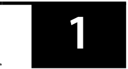

# Volume 2: Economics
## Learning Module 1 The Firm and Market Structures
### Part 1/5: Introduction (PDF Pages 11–13)

---

<!-- PDF Page 11 -->

### L E A R N I N G M O D U L E 

# **<mark>1</mark>** 

## **The Firm and Market Structures** 

**by Gary L. Arbogast, PhD, CFA, Richard V. Eastin, PhD, Fritz Richard, PhD, and Gambera Michele, PhD, CFA.** 

_Gary L. Arbogast, PhD, CFA (USA). Richard V. Eastin, PhD, is at the University of Southern California (USA). Richard Fritz, PhD, is at the School of Economics at Georgia Institute of Technology (USA). Michele Gambera, PhD, CFA, is at UBS Asset Management and the University of Illinois at Urbana-Champaign (USA)._ 

##### **<mark>LEARNING OUTCOMES</mark>** 

|**_Mastery_**|**_The candidate should be able to:_**|
|---|---|
||determine and interpret breakeven and shutdown points of production, as well as how economies and diseconomies of scale affect costs under perfect and imperfect competition|
||describe characteristics of perfect competition, monopolistic competition, oligopoly, and pure monopoly|
||explain supply and demand relationships under monopolistic competition, including the optimal price and output for firms as well as pricing strategy|
||explain supply and demand relationships under oligopoly, including the optimal price and output for firms as well as pricing strategy|
||identify the type of market structure within which a firm operates and describe the use and limitations of concentration measures|

<!-- Start of picture text -->
1 <!-- End of picture text -->

#### **INTRODUCTION** 

This learning module addresses several important concepts that extend the basic market model of demand and supply to the assessment of a firm’s breakeven and shutdown points of production. Demand concepts covered include own-price elasticity of demand, cross-price elasticity of demand, and income elasticity of demand. Supply concepts covered include total, average, and marginal product of labor; total, variable, and marginal cost of labor; and total and marginal revenue. These concepts are used to calculate the breakeven and shutdown points of production. 

<!-- PDF Page 12 -->

This learning module surveys how economists classify market structures. We analyze distinctions between the different structures that are important for understanding demand and supply relations, optimal price and output, and the factors affecting long-run profitability. We also provide guidelines for identifying market structure in practice. 

###### **LEARNING MODULE OVERVIEW** 

- Firms under conditions of perfect competition have no pricing power and, therefore, face a perfectly horizontal demand curve at the market price. For firms under conditions of perfect competition, price is identical to marginal revenue (MR). 

- Firms under conditions of imperfect competition face a negatively sloped demand curve and have pricing power. For firms under conditions of imperfect competition, MR is less than price. 

- Economic profit equals total revenue (TR) minus total economic cost, whereas accounting profit equals TR minus total accounting cost. 

- Economic cost considers the total opportunity cost of all factors of production. 

- Opportunity cost is the next best alternative use of a resource forgone in making a decision. 

- Maximum economic profit requires that (1) MR equals marginal cost (MC) and (2) MC not be falling with output. 

- The breakeven point occurs when TR equals total cost (TC), otherwise stated as the output quantity at which average total cost (ATC) equals price. 

- Shutdown occurs when a firm is better off not operating than continuing to operate. 

- If all fixed costs are sunk costs, then shutdown occurs when the market price falls below the minimum average variable cost. After shutdown, the firm incurs only fixed costs and loses less money than it would operating at a price that does not cover variable costs. 

- In the short run, it may be rational for a firm to continue to operate while earning negative economic profit if some unavoidable fixed costs are covered. 

- Economies of scale is defined as decreasing long-run cost per unit as output increases. Diseconomies of scale is defined as increasing longrun cost per unit as output increases. 

- Long-run ATC is the cost of production per unit of output under conditions in which all inputs are variable. 

- Specialization efficiencies and bargaining power in input price can lead to economies of scale. 

- Bureaucratic and communication breakdowns and bottlenecks that raise input prices can lead to diseconomies of scale. 

- The minimum point on the long-run ATC curve defines the minimum efficient scale for the firm. 

- Economic market structures can be grouped into four categories: perfect competition, monopolistic competition, oligopoly, and monopoly. 

<!-- PDF Page 13 -->

|■|The categories of economic market structures differ because of the following characteristics: The number of producers is many in perfect and monopolistic competition, few in oligopoly, and one in monopoly. The degree of product differentiation, the pricing power of the pro- ducer, the barriers to entry of new producers, and the level of non- price competition (e.g., advertising) are all low in perfect competition, moderate in monopolistic competition, high in oligopoly, and gener- ally highest in monopoly.|
|---|---|
|■|A financial analyst must understand the characteristics of market structures to better forecast a firm’s future profit stream.|
|■|i  i The optimal MR equals MC. Only in perfect competition, however, does the MR equal price. In the remaining structures, price generally exceeds MR because a firm can sell more units only by reducing the per unit price.|
|■|The quantity sold is highest in perfect competition. The price in perfect competition is usually lowest, but this depends on factors such as demand elasticity and increasing returns to scale (which may reduce the producer’s MC). Monopolists, oligopolists, and producers in monopolistic competition attempt to differentiate their products so that they can charge higher prices.|
|■|Typically, monopolists sell a smaller quantity at a higher price. Investors may benefit from being shareholders of monopolistic firms that have large margins and substantial positive cash flows.|
|■|l In perfect competition, firms do not earn economic profit. The market will compensate for the rental of capital and of management ser- vices, but the lack of pricing power implies that there will be no extra margins.|
|■|In the short run, firms in any market structure can have economic profits, the more competitive a market is and the lower the barriers to entry, the faster the extra profits will fade. In the long run, new entrants shrink margins and push the least efficient firms out of the market.|
|■|Oligopoly is characterized by the importance of strategic behavior. Firms can change the price, quantity, quality, and advertisement of the product to gain an advantage over their competitors. Several types of equilibrium (e.g., Nash, Cournot, kinked demand curve) may occur that affect the likelihood of each of the incumbents (and potential entrants in the long run) having economic profits. Price wars may be started to force weaker competitors to abandon the market.|
|■|Measuring market power is complicated. Ideally, econometric esti- mates of the elasticity of demand and supply should be computed. However, because of the lack of reliable data and the fact that elastic- ity changes over time (so that past data may not apply to the current situation), regulators and economists often use simpler measures. The concentration ratio is simple, but the Herfindahl-Hirschman index (HHI), with a little more computation required, often produces a bet- ter figure for decision making.|

