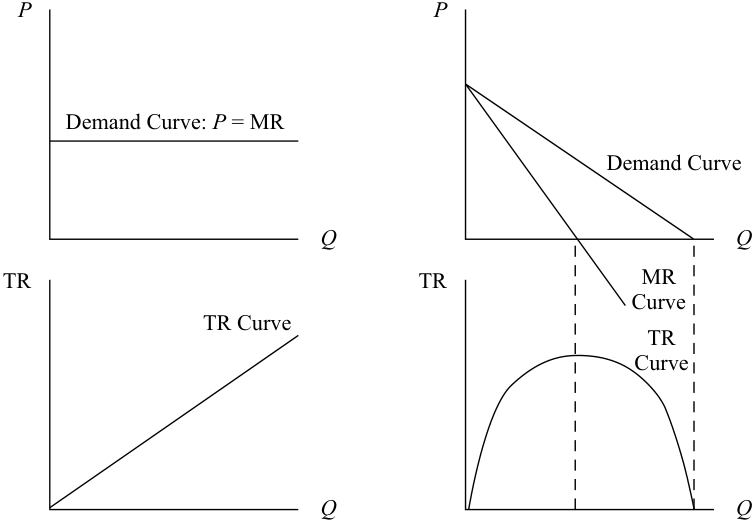
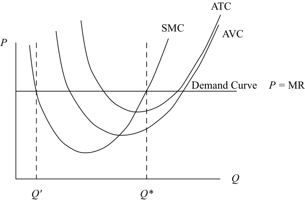
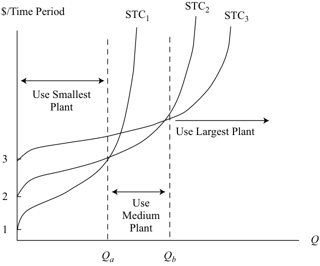
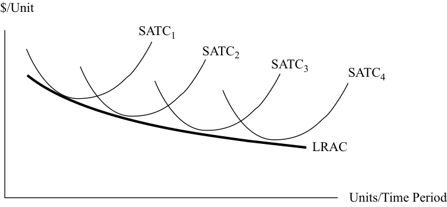

# Volume 2: Economics
## Learning Module 1 The Firm and Market Structures
### Part 2/5: Profit Maximization: Production Breakeven, Shutdown and Economies of Scale (PDF Pages 14–27)

---

<!-- PDF Page 14 -->

# **<mark>2</mark>** 

## **PROFIT MAXIMIZATION: PRODUCTION BREAKEVEN, SHUTDOWN AND ECONOMIES OF SCALE** 

determine and interpret breakeven and shutdown points of production, as well as how economies and diseconomies of scale affect costs under perfect and imperfect competition 

Firms generally can be classified as operating in either a perfectly competitive or an imperfectly competitive environment. The difference between the two manifests in the slope of the demand curve facing the firm. If the environment of the firm is perfectly competitive, it must take the market price of its output as given, so it faces a perfectly elastic, horizontal demand curve. In this case, the firm’s marginal revenue (MR) and the price of its product are identical. Additionally, the firm’s **average revenue** (AR), or revenue per unit, is also equal to price per unit. A firm that faces a negatively sloped demand curve, however, must lower its price to sell an additional unit, so its MR is less than price ( _P_ ). 

These characteristics of MR are also applicable to the total revenue (TR) functions. Under conditions of perfect competition, TR (as always) is equal to price times quantity: TR = ( _P_ )( _Q_ ). But under conditions of perfect competition, price is dictated by the market; the firm has no control over price. As the firm sells one more unit, its TR rises by the exact amount of price per unit. 

Under conditions of imperfect competition, price is a variable under the firm’s control, and therefore price is a function of quantity: _P_ = f( _Q_ ), and TR = f( _Q_ ) × _Q_ . For simplicity, suppose the firm is monopolistic and faces the market demand curve, which we will assume is linear and negatively sloped. Because the monopolist is the only seller, its TR is identical to the total expenditure of all buyers in the market. When price is reduced and quantity sold increases in this environment, a decrease in price initially increases total expenditure by buyers and TR to the firm because the decrease in price is outweighed by the increase in units sold. But as price continues to fall, the decrease in price overshadows the increase in quantity, and total expenditure (revenue) falls. We can now depict the demand and TR functions for firms under conditions of perfect and imperfect competition, as shown in Exhibit 1. 

<!-- PDF Page 15 -->

#### **Exhibit 1: Demand and Total Revenue Functions for Firms under Conditions of Perfect and Imperfect Competition** 

**_A. Perfectly Competitive Firm B. Imperfectly Competitive Firm_** 

<!-- Start of picture text -->
P P Demand Curve:  P  = MR Demand Curve Q Q TR TR MR Curve TR Curve TR Curve Q Q <!-- End of picture text -->

Panel A of Exhibit 1 depicts the demand curve (upper graph) and total revenue curve (lower graph) for the firm under conditions of perfect competition. Notice that the vertical axis in the upper graph is price per unit (e.g., GBP/bushel), whereas TR is measured on the vertical axis in the lower graph (e.g., GBP/week). The same is true for the respective axes in Panel B, which depicts the demand and total revenue curves for the monopolist. The TR curve for the firm under conditions of perfect competition is linear, with a slope equal to price per unit. The TR curve for the monopolist first rises (in the range where MR is positive and demand is elastic) and then falls (in the range where MR is negative and demand is inelastic) with output. 

### **Profit-Maximization, Breakeven, and Shutdown Points of Production** 

We can now combine the firm’s short-run TC curves with its TR curves to represent profit maximization in the cases of perfect competition and imperfect competition. Exhibit 2 shows both the AR and average cost curves in one graph for the firm under conditions of perfect competition. 

<!-- PDF Page 16 -->

**Exhibit 2: Demand and Average and Marginal Cost Curves for the Firm under Conditions of Perfect Competition** 

<!-- Start of picture text -->
ATC SMC AVC P Demand Curve P =  MR Q Q′ Q* <!-- End of picture text -->

The firm is maximizing profit by producing _Q_ *, where price is equal to short-run marginal cost (SMC) and SMC is rising. Note at another output level, _Q_ ′, where _P_ = SMC, SMC is still falling, so this cannot be a profit-maximizing solution. If market price were to rise, the firm’s demand and MR curve would simply shift upward, and the firm would reach a new profit-maximizing output level to the right of _Q_ *. If, however, market price were to fall, the firm’s demand and MR curve would shift downward, resulting in a new and lower level of profit-maximizing output. As depicted, this firm is currently earning a positive economic profit because market price exceeds average total cost (ATC), at output level _Q_ *. This profit is possible in the short run, but in the long run, competitors would enter the market to capture some of those profits and would drive the market price down to a level equal to each firm’s ATC. 

Exhibit 3 depicts the cost and revenue curves for the monopolist that is facing a negatively sloped market demand curve. The MR and demand curves are not identical for this firm. But the profit-maximizing rule is still the same: Find the level of _Q_ that equates SMC, to MR—in this case, _Q_ *. Once that level of output is determined, the optimal price to charge is given by the firm’s demand curve at _P_ *. This monopolist is earning positive economic profit because its price exceeds its ATC. The barriers to entry that give this firm its monopolistic power mean that outside competitors would not be able to compete away this firm’s profits. 

#### **Exhibit 3: Demand and Average and Marginal Cost Curves for the Monopolistic Firm** 

<!-- Start of picture text -->
P ATC SMC AVC P * Demand Curve  P =  AR MR Curve Q Q * <!-- End of picture text -->

<!-- PDF Page 17 -->

### **Breakeven Analysis and Shutdown Decision** 

A firm is said to break even if its TR is equal to its TC. It also can be said that a firm breaks even if its price (AR) is exactly equal to its ATC, which is true under conditions of perfect and imperfect competition. Of course, the goal of management is not just to breakeven but to maximize profit. However, perhaps the best the firm can do is cover all of its economic costs. Economic costs are the sum of total accounting costs and implicit opportunity costs. A firm whose revenue is equal to its economic costs is covering the opportunity cost of all of its factors of production, including capital. Economists would say that such a firm is earning normal profit, but not positive economic profit. It is earning a rate of return on capital just equal to the rate of return that an investor could expect to earn in an equivalently risky alternative investment (opportunity cost). Firms that are operating in a competitive environment with no barriers to entry from other competitors can expect, in the long run, to be unable to earn a positive economic profit; the excess rate of return would attract entrants who would produce more output and ultimately drive the market price down to the level at which each firm is, at best, just earning a normal profit. This situation, of course, does not imply that the firm is earning zero accounting profit. 

Exhibit 4 depicts the condition for both a firm under conditions of perfect competition (Panel A) and a monopolist (Panel B) in which the best each firm can do is to break even. Note that at the level of output at which SMC is equal to MR, price is equal to ATC. Hence, economic profit is zero, and the firms are breaking even. 

<!-- PDF Page 18 -->

#### **Exhibit 4: Examples of Firms under Perfect Competition and Monopolistic Firms That Can, at Best, Break Even** 

#### **_A. Perfect Competition_** 

<!-- Start of picture text -->
P ATC SMC AVC Demand Curve P = AR =  MR Q Q * B. Monopolist P ATC AVC SMC P * Demand Curve P = AR MR Curve Q Q * <!-- End of picture text -->

### **The Shutdown Decision** 

In the long run, if a firm cannot earn at least a zero economic profit, it will not operate because it is not covering the opportunity cost of all of its factors of production, labor, and capital. In the short run, however, a firm might find it advantageous to continue to operate even if it is not earning at least a zero economic profit. The discussion that follows addresses the decision to continue to operate and earn negative profit or shut down operations. 

Recall that typically some or all of a firm’s fixed costs are incurred regardless of whether the firm operates. The firm might have a lease on its building that it cannot avoid paying until the lease expires. In that case, the lease payment is a sunk cost: It cannot be avoided, no matter what the firm does. Sunk costs must be ignored in the decision to continue to operate in the short run. As long as the firm’s revenues cover 

<!-- PDF Page 19 -->

at least its variable cost, the firm is better off continuing to operate. If price is greater than average variable cost (AVC), the firm is covering not only all of its variable cost but also a portion of fixed cost. 

In the long run, unless market price increases, this firm would exit the industry. But in the short run, it will continue to operate at a loss. Exhibit 5 depicts a firm under conditions of perfect competition facing three alternative market price ranges for its output. At any price above _P_ 1, the firm can earn a positive profit and clearly should continue to operate. At a price below _P_ 2, the minimum AVC, the firm could not even cover its variable cost and should shut down. At prices between _P_ 2 and _P_ 1, the firm should continue to operate in the short run because it is able to cover all of its variable cost and contribute something toward its unavoidable fixed costs. Economists refer to the minimum AVC point as the **shutdown point** and the minimum ATC point as the **breakeven point** . 

#### **Exhibit 5: A Firm under Conditions of Perfect Competition Will Choose to Shut Down If Market Price Is Less Than Minimum AVC** 

<!-- Start of picture text -->
P ATC SMC AVC P 1 Breakeven Point P 2 Shutdown Point Q <!-- End of picture text -->

#### **EXAMPLE 1** 

### **Breakeven Analysis and Profit Maximization When the Firm Faces a Negatively Sloped Demand Curve under Imperfect Competition** 

Revenue and cost information for a future period including all opportunity costs is presented in Exhibit 6 for WR International, a newly formed corporation that engages in the manufacturing of low-cost, prefabricated dwelling units for urban housing markets in emerging economies. (Note that quantity increments are in blocks of 10 for a 250 change in price.) The firm has few competitors in a market setting of imperfect competition. 

**Exhibit 6: Revenue and Cost Information for WR International** 

|||**Total Revenue**|**Total Cost**|**i**|
|---|---|---|---|---|
|**Quantity (****_Q_)**|**Price (****_P_)**|**(****_TR_)**|**(****_TC_)****a**|**Profit**|
|0|10,000|0|100,000|–100,000|
|10|9,750|97,500|170,000|–72,500|

<!-- PDF Page 20 -->

|**Quantity (****_Q_)**|**Price (****_P_)**|**Total Revenue** **(****_TR_)**|**Total Cost** **(****_TC_)****a**|**Profit**|
|---|---|---|---|---|
|20|9,500|190,000|240,000|–50,000|
|30|9,250|277,500|300,000|–22,500|
|40|9,000|360,000|360,000|0|
|50|8,750|437,500|420,000|17,500|
|60|8,500|510,000|480,000|30,000|
|70|8,250|577,500|550,000|27,500|
|80|8,000|640,000|640,000|0|
|90|7,750|697,500|710,000|–12,500|
|100|7,500|750,000|800,000|–50,000|

a _Includes all opportunity costs_ 

1. How many units must WR International sell to initially break even? 

#### **Solution:** 

WR International will initially break even at 40 units of production, where TR and TC equal 360,000. 

2. Where is the region of profitability? 

#### **Solution:** 

The region of profitability will range from greater than 40 units to less than 80 units. Any production quantity of less than 40 units and any quantity greater than 80 units will result in an economic loss. 

3. At what point will the firm maximize profit? At what points are there economic losses? 

#### **Solution:** 

Maximum profit of 30,000 will occur at 60 units. Lower profit will occur at any output level that is higher or lower than 60 units. From 0 units to less than 40 units and for quantities greater than 80 units, economic losses occur. 

Given the relationships between TR, total variable costs (TVC), and total fixed costs (TFC), Exhibit 7 summarizes the decisions to operate, shut down production, or exit the market in both the short run and the long run. The firm must cover its variable cost to remain in business in the short run; if TR cannot cover TVC, the firm shuts down production to minimize loss. The loss would be equal to the amount of fixed cost. If TVC exceeds TR in the long run, the firm will exit the market to avoid the loss associated with fixed cost at zero production. By exiting the market, the firm’s investors do not suffer the erosion of their equity capital from economic losses. When TR is enough to cover TVC but not all of TFC, the firm can continue to produce in the short run but will not be able to maintain financial solvency in the long run. 

<!-- PDF Page 21 -->

**Exhibit 7: Short-Run and Long-Run Decisions to Operate or Not** 

|**Revenue–Cost Relationship**|**Short-Run Decision**|**Long-Term Decision**|
|---|---|---|
|TR = TC|Stay in market|Stay in market|
|TR = TVC but < TC|Stay in market|Exit market|
|TR < TVC|Shut down production|Exit market|

#### **EXAMPLE 2** 

### **Shutdown Analysis** 

For the most recent financial reporting period, a London-based business has revenue of GBP2 million and TC of GBP2.5 million, which are or can be broken down into TFC of GBP1 million and TVC of GBP1.5 million. The net loss on the firm’s income statement is reported as GBP500,000 (ignoring tax implications). In prior periods, the firm had reported profits on its operations. 

1. What decision should the firm make regarding operations over the short term? 

#### **Solution:** 

In the short run, the firm is able to cover all of its TVC but only half of its GBP1 million in TFC. If the business ceases to operate, its loss would be GBP1 million, the amount of TFC, whereas the net loss by operating would be minimized at GBP500,000. The firm should attempt to operate by negotiating special arrangements with creditors to buy time to return operations back to profitability. 

2. What decision should the firm make regarding operations over the long term? 

#### **Solution:** 

If the revenue shortfall is expected to persist over time, the firm should cease operations, liquidate assets, and pay debts to the extent possible. Any residual for shareholders would decrease the longer the firm is allowed to operate unprofitably. 

3. Assume the same business scenario except that revenue is now GBP1.3 million, which creates a net loss of GBP1.2 million. What decision should the firm make regarding operations in this case? 

#### **Solution:** 

The firm would minimize loss at GBP1 million of TFC by shutting down. If the firm decided to continue to do business, the loss would increase to GBP1.2 million. Shareholders would save GBP200,000 in equity value by pursuing this option. Unquestionably, the business would have a rather short life expectancy if this loss situation were to continue. 

When evaluating profitability, particularly of start-up firms and businesses using turnaround strategies, analysts should consider highlighting breakeven and shutdown points in their financial research. Identifying the unit sales levels at which the firm 

<!-- PDF Page 22 -->

enters or leaves the production range for profitability and at which the firm can no longer function as a viable business entity provides invaluable insight when making investment decisions. 

### **Economies and Diseconomies of Scale with Short-Run and Long-Run Cost Analysis** 

Rational behavior dictates that the firm select an operating size or scale that maximizes profit over any time frame. The time frame that defines the short run and long run for any firm is based on the ability of the firm to adjust the quantities of the fixed resources it uses. The short run is the time period during which at least one of the factors of production, such as technology, physical capital, and plant size, is fixed. The long run is defined as the time period during which all factors of production are variable. Additionally, in the long run, firms can enter or exit the market based on decisions regarding profitability. The long run is often referred to as the “planning horizon” in which the firm can choose the short-run position or optimal operating size that maximizes profit over time. The firm is always operating in the short run but planning in the long run. 

The time required for long-run adjustments varies by industry. For example, the long run for a small business using very little technology and physical capital may be less than a year, whereas for a capital-intensive firm, the long run may be more than a decade. Given enough time, however, all production factors are variable, which allows the firm to choose an operating size or plant capacity based on different technologies and physical capital. In this regard, costs and profits will differ between the short run and the long run. 

#### **_Short- and Long-Run Cost Curves_** 

Recall that when we addressed the short-run cost curves of the firm, we assumed that the capital input was held constant. That meant that the only way to vary output in the short run was to change the level of the variable input—in our case, labor. If the capital input—namely, plant and equipment—were to change, however, we would have an entirely new set of short-run cost curves, one for each level of capital input. 

The short-run total cost includes all the inputs—labor and capital—the firm is using to produce output. For reasons discussed earlier, the typical short-run total cost (STC) curve might rise with output, first at a decreasing rate because of specialization economies and then at an increasing rate, reflecting the law of diminishing marginal returns to labor. TFC, the quantity of capital input multiplied by the rental rate on capital, determines the vertical intercept of the STC curve. At higher levels of fixed input, TFC is greater, but the production capacity of the firm is also greater. Exhibit 8 shows three different STC curves for the same technology but using three distinct levels of capital input—points 1, 2, and 3 on the vertical axis. 

<!-- PDF Page 23 -->

**Exhibit 8: Short-Run Total Cost Curves for Various Plant Sizes** 

<!-- Start of picture text -->
$/Time Period STC1 STC2 STC3 Use Smallest Plant Use Largest Plant 3 2 Use Medium 1 Plant Q Qa Qb <!-- End of picture text -->

Plant Size 1 is the smallest and, of course, has the lowest fixed cost; hence, its STC1 curve has the lowest vertical intercept. Note that STC1 begins to rise more steeply with output, reflecting the lower plant capacity. Plant Size 3 is the largest of the three and reflects that size with both a higher fixed cost and a lower slope at any level of output. If a firm decided to produce an output between zero and Qa, it would plan on building Plant Size 1 because for any output level in that range, its cost would be less than it would be for Plant Size 2 or 3. Accordingly, if the firm were planning to produce output greater than Qb, it would choose Plant Size 3 because its cost for any of those levels of output would be lower than it would be for Plant Size 1 or 2. Of course, Plant Size 2 would be chosen for output levels between Qa and Qb. The long-run total cost curve is derived from the lowest level of STC for each level of output because in the long run, the firm is free to choose which plant size it will operate. This curve is called an “envelope curve.” In essence, this curve envelopes—encompasses—all possible combinations of technology, plant size, and physical capital. 

For each STC curve, there is also a corresponding **short-run average total cost** (SATC) curve and a corresponding **long-run average total cost** (LRAC) curve, the envelope curve of all possible short-run average total cost curves. The shape of the LRAC curve reflects an important concept called **economies of scale** and **diseconomies of scale** . 

#### **_Defining Economies of Scale and Diseconomies of Scale_** 

When a firm increases all of its inputs to increase its level of output (obviously, a long-run concept), it is said to _scale up_ its production. _Scaling down_ is the reverse— decreasing all of its inputs to produce less in the long run. Economies of scale occur if, as the firm increases its output, cost per unit of production falls. Graphically, this definition translates into an LRAC curve with a negative slope. Exhibit 9 depicts several SATC curves, one for each plant size, and the LRAC curve representing economies of scale. 

<!-- PDF Page 24 -->

**Exhibit 9: Short-Run Average Total Cost Curves for Various Plant Sizes and Their Envelope Curve, LRAC: Economies of Scale** 

<!-- Start of picture text -->
$/Unit SATC1 SATC2 SATC3 SATC4 LRAC Units/Time Period <!-- End of picture text -->

Diseconomies of scale occur if cost per unit rises as output increases. Graphically, diseconomies of scale translate into an LRAC curve with a positive slope. Exhibit 10 depicts several SATC curves, one for each plant size, and their envelope curve, the LRAC curve, representing diseconomies of scale. 

**Exhibit 10: Short-Run Average Total Cost Curves for Various Plant Sizes and Their Envelope Curve, LRAC: Diseconomies of Scale** 

<!-- Start of picture text -->
$/Unit SATC4 LRAC SATC3 SATC2 SATC1 Units/Time Period <!-- End of picture text -->

As the firm grows in size, economies of scale and a lower ATC can result from the following factors: 

- Achieving **increasing returns to scale** when a production process allows for increases in output that are proportionately larger than the increase in inputs. 

- Having a division of labor and management in a large firm with numerous workers, which allows each worker to specialize in one task rather than perform many duties, as in the case of a small business (as such, workers in a large firm become more proficient at their jobs). 

- Being able to afford more expensive, yet more efficient equipment and to adapt the latest in technology that increases productivity. 

- Effectively reducing waste and lowering costs through marketable by-products, less energy consumption, and enhanced quality control. 

- Making better use of market information and knowledge for more effective managerial decision making. 

<!-- PDF Page 25 -->

- Obtaining discounted prices on resources when buying in larger quantities. 

A classic example of a business that realizes economies of scale through greater physical capital investment is an electric utility. By expanding output capacity to accommodate a larger customer base, the utility company’s per-unit cost will decline. Economies of scale help explain why electric utilities have naturally evolved from localized entities to regional and multiregional enterprises. Walmart is an example of a business that has used its bulk purchasing power to obtain deep discounts from suppliers to keep costs and prices low. Walmart also uses the latest technology to monitor point-of-sale transactions to gather timely market information to respond to changes in customer buying behavior, which leads to economies of scale through lower distribution and inventory costs. 

Factors that can lead to diseconomies of scale, inefficiencies, and rising costs when a firm increases in size include the following: 

- Realizing **decreasing returns to scale** when a production process leads to increases in output that are proportionately smaller than the increase in inputs. 

- Being so large that it cannot be properly managed. 

- Overlapping and duplicating business functions and product lines. 

- Experiencing higher resource prices because of supply constraints when buying inputs in large quantities. 

Before its restructuring, General Motors (GM) was an example of a business that had realized diseconomies of scale by becoming too large. Scale diseconomies occurred through product overlap and duplication (i.e., similar or identical automobile models), and the fixed cost for these models was not spread over a large volume of output. In 2009, GM decided to discontinue three brands (Saturn, Pontiac, and Hummer) and also to drop various low-volume product models that overlapped with others. GM had numerous manufacturing plants around the world and sold vehicles in more than a hundred countries. Given this geographic dispersion in production and sales, the company had communication and management coordination problems, which resulted in higher costs. In 2017, GM sold its European arm, Opel, to Groupe PSA, the maker of Peugeot and Citroën. GM also had significantly higher labor costs than its competitors. As the largest producer in the market, it had been a target of labor unions for higher compensation and benefits packages relative to other firms. 

Economies and diseconomies of scale can occur at the same time; the impact on LRAC depends on which dominates. If economies of scale dominate, LRAC decreases with increases in output. The reverse holds true when diseconomies of scale prevail. LRAC may fall (economies of scale) over a range of output and then LRAC might remain constant over another range, which could be followed by a range over which diseconomies of scale prevail, as depicted in Exhibit 11. 

The minimum point on the LRAC curve is referred to as the **minimum efficient scale** . The minimum efficient scale is the optimal firm size under perfect competition over the long run. Theoretically, perfect competition forces the firm to operate at the minimum point on the LRAC curve because the market price will be established at this level over the long run. If the firm is not operating at this least-cost point, its long-term viability will be threatened. 

<!-- PDF Page 26 -->

#### **Exhibit 11: LRAC Can Exhibit Economies and Diseconomies of Scale** 

<!-- Start of picture text -->
$/Unit SATC1 SATC2 SATC3 SATC4 SATC5 SATCLRAC6 Units/Time Period <!-- End of picture text -->

#### **EXAMPLE 3** 

### **Long-Run Average Total Cost Curve** 

Exhibit 12 displays the long-run average total cost curve (LRACUS) and the short-run average total cost curves for three hypothetical US-based automobile manufacturers—Starr Vehicles (Starr), Rocket Sports Cars (Rocket), and General Auto (GenAuto). The LRAC curve for foreign-owned automobile companies that compete in the US auto market (LRACforeign) is also indicated in the graph. (The market structure implicit in the exhibit is imperfect competition.) 

1. To what extent are the cost relationships depicted in Exhibit 12 useful for an economic and financial analysis of the three US-based auto firms? 

#### **Exhibit 12: Long-Run Average Total Cost Curves for Three Auto Manufacturers** 

Cost Per Unit 

<!-- Start of picture text -->
Starr GenAuto LRAC us Rocket LRAC foreign Q 0 Quantity of Output <!-- End of picture text -->

#### **Solution:** 

First, it is observable that the foreign auto companies have a lower LRAC compared with that of the US automobile manufacturers. This competitive position places the US firms at a cost—and possibly, pricing—disadvantage in the market, with the potential to lose market share to the lower-cost foreign competitors. Second, only Rocket operates at the minimum point of the LRACUS, whereas GenAuto is situated in the region of diseconomies of scale and Starr is positioned in the economies of scale portion of the curve. To become more efficient and competitive, GenAuto needs to downsize and restructure, which means moving down the LRACUS curve to a smaller 

<!-- PDF Page 27 -->

yet lower-cost production volume. In contrast, Starr has to grow in size to become more efficient and competitive by lowering per-unit costs. From a long-term investment prospective and given its cost advantage, Rocket has the potential to create more investment value relative to GenAuto and Starr. Over the long run, if GenAuto and Starr can lower their ATC, they will become more attractive to investors. But if any of the three US auto companies cannot match the cost competitiveness of the foreign firms, they may be driven from the market. In the long run, the lower-cost foreign automakers pose a severe competitive challenge to the survival of the US manufacturers and their ability to maintain and grow shareholders’ wealth. 

#### **QUESTION SET** 

|1. An agricultural firm operating in a perfectly competitive market supplies wheat to manufacturers of consumer food products and animal feeds. If the firm were able to expand its production and unit sales by 10%, the_most likely_result would be:|
|---|
|**A.**a 10% increase in total revenue.|
|**B.**a 10% increase in average revenue.|
|**C.**a less than 10% increase in total revenue. **Solution:**|
|A is correct. In a perfectly competitive market, an increase in supply by a single firm will not affect price. Therefore, an increase in units sold by the firm will be matched proportionately by an increase in revenue.|
|2. The marginal revenue per unit sold for a firm doing business under condi- tions of perfect competition will_most likely_be:|
|**A.**equal to average revenue.|
|**B.**less than average revenue. **C.**greater than average revenue. **Solution:** A is correct. Under perfect competition, a firm is a price taker at any quanti- ty supplied to the market, and AR = MR = Price.|
|3. A profit maximum is_least likely_to occur when: **A.**average total cost is minimized.|
|**B.**marginal revenue is equal to marginal cost. **C.**the difference between total revenue and total cost is maximized. **Solution:**|
|A is correct. The quantity at which average total cost is minimized does not necessarily correspond to a profit maximum.|
|4. The short-term breakeven point of production for a firm operating under perfect competition will_most likely_occur when:|
|**A.**price is equal to average total cost.|
|**B.**marginal revenue is equal to marginal cost.|

