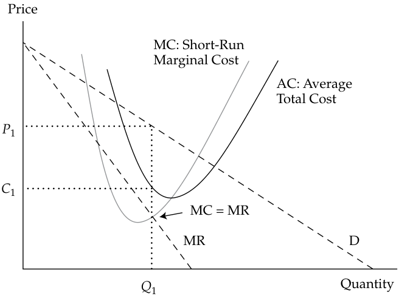

# Volume 2: Economics
## Learning Module 1 The Firm and Market Structures
### Part 3/5: Introduction to Market Structures (PDF Pages 28–36)

---

<!-- PDF Page 28 -->

- **C.** marginal revenue is equal to average variable costs. 

- **Solution:** 

A is correct. Under perfect competition, price is equal to marginal revenue. A firm breaks even when marginal revenue equals average total cost. 

# **<mark>3</mark>** 

## **INTRODUCTION TO MARKET STRUCTURES** 

describe characteristics of perfect competition, monopolistic competition, oligopoly, and pure monopoly 

Different market structures result in different sets of choices facing a firm’s decision makers. Thus, an understanding of market structure is a powerful tool in analyzing issues, such as a firm’s pricing of its products and, more broadly, its potential to increase profitability. In the long run, a firm’s profitability will be determined by the forces associated with the market structure within which it operates. In a highly competitive market, long-run profits will be driven down by the forces of competition. In less competitive markets, large profits are possible even in the long run; in the short run, any outcome is possible. Therefore, understanding the forces behind the market structure will aid the financial analyst in determining firms’ short- and long-term prospects. 

Market structures address questions such as the following: What determines the degree of competition associated with each market structure? Given the degree of competition associated with each market structure, what decisions are left to the management team developing corporate strategy? How does a chosen pricing and output strategy evolve into specific decisions that affect the profitability of the firm? The answers to these questions are related to the forces of the market structure within which the firm operates. 

### **Analysis of Market Structures** 

Traditionally, economists classify a market into one of four structures: perfect competition, monopolistic competition, oligopoly, and monopoly. 

Economists define a market as a group of buyers and sellers that are aware of each other and can agree on a price for the exchange of goods and services. Although internet access has extended a number of markets worldwide, certain markets remain limited by geographic boundaries. For example, the internet search engine Google operates in a worldwide market. In contrast, the market for premixed cement is limited to the area within which a truck can deliver the mushy mix from the plant to a construction site before the compound becomes useless. Thomas L. Friedman’s international best seller _The World Is Flat_ challenges the concept of the geographic limitations of the market. If the service being provided by the seller can be digitized, its market expands worldwide. For example, a technician can scan your injury in a clinic in Switzerland. That radiographic image can be digitized and sent to a radiologist in India to be read. As a customer (i.e., patient), you may never know that part of the medical service provided to you was the result of a worldwide market. 

Some markets are highly concentrated, with the majority of total sales coming from a small number of firms. For example, in the market for internet search, three firms controlled 98.9 percent of the US market (Google 63.5 percent, Microsoft 24 percent, and Oath (formerly Yahoo!) 11.4 percent) as of January 2018. Other markets 

<!-- PDF Page 29 -->

are fragmented, such as automobile repairs, in which small independent shops often dominate and large chains may or may not exist. New products can lead to market concentration. For example, Apple introduced its first digital audio player (iPod) in 2001 and despite the entry of competitors had a world market share of more than 70 percent among digital audio players in 2009. 

#### **THE IMPORTANCE OF MARKET STRUCTURE** 

Consider the evolution of television broadcasting. As the market environment for television broadcasting evolved, the market structure changed, resulting in a new set of challenges and choices. In the early days, viewers had only one choice: the “free” analog channels that were broadcast over the airwaves. Most countries had one channel, owned and run by the government. In the United States, some of the more populated markets were able to receive more channels because local channels were set up to cover a market with more potential viewers. By the 1970s, new technologies made it possible to broadcast by way of cable connectivity and the choices offered to consumers began to expand rapidly. Cable television challenged the “free” broadcast channels by offering more choice and a better-quality picture. The innovation was expensive for consumers and profitable for the cable companies. By the 1990s, a new alternative began to challenge the existing broadcast and cable systems: satellite television. Satellite providers offered a further expanded set of choices, albeit at a higher price, than the free broadcast and cable alternatives. In the early 2000s, satellite television providers lowered their pricing to compete directly with the cable providers. 

Today, cable program providers, satellite television providers, and terrestrial digital broadcasters that offer premium and pay-per-view channels compete for customers who are increasingly finding content on the internet and on their mobile devices. Companies like Netflix, Apple, and Amazon offered alternative ways for consumers to access content. Over time, these companies had moved beyond the repackaging of existing shows to developing their own content, mirroring the evolution of cable channels, such as HBO and ESPN a decade earlier. 

This is a simple illustration of the importance of market structure. As the market for television broadcasting became increasingly competitive, managers have had to make decisions regarding product packaging, pricing, advertising, and marketing to survive in the changing environment. In addition, mergers and acquisitions as a response to these competitive pressures have changed the essential structure of the industry. 

Market structure can be broken down into four distinct categories: perfect competition, monopolistic competition, oligopoly, and monopoly. 

We start with the most competitive environment, **perfect competition** . Unlike some economic concepts, perfect competition is not merely an ideal based on assumptions. Perfect competition is a reality—for example, in several commodities markets, in which sellers and buyers have a strictly homogeneous product and no single producer is large enough to influence market prices. Perfect competition’s characteristics are well recognized and its long-run outcome is unavoidable. Profits under the conditions of perfect competition are driven to the required rate of return paid by the entrepreneur to borrow capital from investors (so-called normal profit or rental cost of capital). This does not mean that all perfectly competitive industries are doomed to extinction by a lack of profits. On the contrary, millions of businesses that do very well are living under the pressures of perfect competition. 

**Monopolistic competition** is also highly competitive; however, it is considered a form of imperfect competition. Two economists, Edward H. Chamberlin (United States) and Joan Robinson (United Kingdom), identified this hybrid market and came 

<!-- PDF Page 30 -->

up with the term because this market structure not only has strong elements of competition but also some monopoly-like conditions. The competitive characteristic is a notably large number of firms, while the monopoly aspect is the result of product differentiation. That is, if the seller can convince consumers that its product is uniquely different from other, similar products, then the seller can exercise some degree of pricing power over the market. A good example is the brand loyalty associated with soft drinks such as Coca-Cola. Many of Coca-Cola’s customers believe that their beverages are truly different from and better than all other soft drinks. The same is true for fashion creations and cosmetics. 

The **oligopoly** market structure is based on a relatively small number of firms supplying the market. The small number of firms in the market means that each firm must consider what retaliatory strategies the other firms will pursue when prices and production levels change. Consider the pricing behavior of commercial airline companies. Pricing strategies and route scheduling are based on the expected reaction of the other carriers in similar markets. For any given route—say, from Paris, France, to Chennai, India—only a few carriers are in competition. If one of the carriers changes its pricing package, others likely will retaliate. Understanding the market structure of oligopoly markets can help identify a logical pattern of strategic price changes for the competing firms. 

Finally, the least competitive market structure is the **monopoly** . In pure monopoly markets, no other good substitutes exist for the given product or service. A single seller, which, if allowed to operate without constraint, exercises considerable power over pricing and output decisions. In most market-based economies around the globe, pure monopolies are regulated by a governmental authority. The most common example of a regulated monopoly is the local electrical power provider. In most cases, the monopoly power provider is allowed to earn a normal return on its investment and prices are set by the regulatory authority to allow that return. 

#### **_Factors That Determine Market Structure_** 

The following five factors determine market structure: 

**1.** The number and relative size of firms supplying the product; 

**2.** The degree of product differentiation; 

**3.** The power of the seller over pricing decisions; 

**4.** The relative strength of the barriers to market entry and exit; and 

**5.** The degree of non-price competition. 

The number and relative size of firms in a market influence market structure. When many firms exist, the degree of competition increases. With fewer firms supplying a good or service, consumers are limited in their market choices. One extreme case is the monopoly market structure, with only one firm supplying a unique good or service. Another extreme is perfect competition, with many firms supplying a similar product. Finally, an example of relative size is the automobile industry, in which a small number of large international producers (e.g., Volkswagen and Toyota) are the leaders in the global market, and a number of small companies either have market power because they are niche players (e.g., Ferrari or McLaren) or have limited market power because of their narrow range of models or limited geographical presence (e.g., Mazda or Stellantis). 

In the case of monopolistic competition, many firms are providing products to the market, as with perfect competition. However, one firm’s product is differentiated in some way that makes it appear to be better than similar products from other firms. If a firm is successful in differentiating its product, this differentiation will provide pricing leverage. The more dissimilar the product appears, the more the market will 

<!-- PDF Page 31 -->

resemble the monopoly market structure. A firm can differentiate its product through aggressive advertising campaigns; frequent styling changes; the linking of its product with other complementary products; or a host of other methods. 

When the market dictates the price based on aggregate supply and demand conditions, the individual firm has no control over pricing. The typical hog farmer in Nebraska and the milk producer in Bavaria are **price takers** . That is, they must accept whatever price the market dictates. This is the case under the market structure of perfect competition. In the case of monopolistic competition, the success of product differentiation determines the degree with which the firm can influence price. In the case of oligopoly, there are so few firms in the market that price control becomes possible. However, the small number of firms in an oligopoly market invites complex pricing strategies. Collusion, price leadership by dominant firms, and other pricing strategies can result. 

The degree to which one market structure can evolve into another and the difference between potential short-run outcomes and long-run equilibrium conditions depend on the strength of the barriers to entry and the possibility that firms fail to recoup their original costs or lose money for an extended period of time and therefore are forced to exit the market. Barriers to entry can result from large capital investment requirements, as in the case of petroleum refining. Barriers may also result from patents, as in the case of some electronic products and drug formulas. Another entry consideration is the possibility of high exit costs. For example, plants that are specific to a special line of products, such as aluminum smelting plants, are non-redeployable, and exit costs would be high without a liquid market for the firm’s assets. High exit costs deter entry and therefore also are considered barriers to entry. In the case of farming, the barriers to entry are low. Production of corn, soybeans, wheat, tomatoes, and other produce is an easy process to replicate; therefore, those are highly competitive markets. 

Non-price competition dominates those market structures in which product differentiation is critical. Therefore, monopolistic competition relies on competitive strategies that may not include pricing changes. An example of non-price competition is product differentiation through marketing. In other circumstances, non-price competition may occur because the few firms in the market feel dependent on each other. Each firm fears retaliatory price changes that would reduce total revenue for all of the firms in the market. Because oligopoly industries have so few firms, each firm feels dependent on the pricing strategies of the others. Therefore, non-price competition becomes a dominant strategy. 

#### **_Characteristics of Market Structure_** 

**Exhibit 13: Characteristics of Market Structure** 

|**Market Structure**|**Number of** **Sellers**|**Degree of Product** **Differentiation**|**Barriers** **to Entry**|**Pricing** **Power of** **Firm**|**Non-Price Competition**|
|---|---|---|---|---|---|
|Perfect competition Monopolistic competition|Many Many|Homogeneous/ Standardized Differentiated|Very Low Low|None Some|None Advertising and Product Differentiation|
|Oligopoly|Few|Homogeneous/ Standardized|High|Some or Considerable|Advertising and Product Differentiation|
|Monopoly|One|Unique Product|Very High|Considerable|Advertising|

<!-- PDF Page 32 -->

From the perspective of the owners of the firm, the most desirable market structure is that with the most control over price, because this control can lead to large profits (Exhibit 13). Monopoly and oligopoly markets offer the greatest potential control over price; monopolistic competition offers less control. Firms operating under perfectly competitive market conditions have no control over price. From the consumers’ perspective, the most desirable market structure is that with the greatest degree of competition because prices are generally lower. Thus, consumers would prefer as many goods and services as possible to be offered in competitive markets. 

As often happens in economics, there is a trade-off. While perfect competition gives the largest quantity of a good at the lowest price, other market forms may spur more innovation. Specifically, firms may incur high costs in researching a new product, and they will incur such costs only if they expect to earn an attractive return on their research investment. This is the case often made for medical innovations, for example—the cost of clinical trials and experiments to create new medicines would bankrupt perfectly competitive firms but may be acceptable in an oligopoly market structure. Therefore, consumers can benefit from less-than-perfectly-competitive markets. 

#### **PORTER’S FIVE FORCES AND MARKET STRUCTURE** 

A financial analyst aiming to establish market conditions and consequent profitability of incumbent firms should start with the questions posed earlier: How many sellers are there? Is the product differentiated? Moreover, in the case of monopolies and quasi-monopolies, the analyst should evaluate the legislative and regulatory framework: Can the company set prices freely, or are there governmental controls? Finally, the analyst should consider the threat of competition from potential entrants. 

This analysis is often summarized by students of corporate strategy as “Porter’s five forces,” named after Harvard Business School professor Michael E. Porter. His book, _Competitive Strategy_ , presented a systematic analysis of the practice of market strategy. Porter identified the five forces as follows: 

- Threat of entry; 

- Power of suppliers; 

- Power of buyers (customers); 

- Threat of substitutes; and 

- Rivalry among existing competitors. 

It is easy to note the parallels between four of these five forces and the questions posed earlier. The only “orphan” is the power of suppliers, which is not at the core of the theoretical economic analysis of competition, but which has substantial weight in the practical analysis of competition and profitability. 

Some stock analysts use the term “economic moat” to suggest that some of the factors protecting the profitability of a firm are similar to the moats (ditches full of water) that were used to protect some medieval castles. A deep moat means that there is little or no threat of entry by invaders (i.e., competitors). It also means that customers are locked in because of high switching costs. 

<!-- PDF Page 33 -->

|**QUESTION SET**|
|---|
|1. A market structure characterized by many sellers with each having some pricing power and product differentiation is_best_described as:|
|**A.**oligopoly.|
|**B.**perfect competition.|
|**C.**monopolistic competition. **Solution:**|
|C is correct. Monopolistic competition is characterized by many sellers, differentiated products, and some pricing power.|
|2. A market structure with relatively few sellers of a homogeneous or stan- dardized product is_best_described as:|
|**A.**oligopoly.|
|**B.**monopoly.|
|**C.**perfect competition. **Solution:**|
|A is correct. Few sellers of a homogeneous or standardized product charac- terizes an oligopoly.|

## **MONOPOLISTIC COMPETITION** 

# **<mark>4</mark>** 

explain supply and demand relationships under monopolistic competition, including the optimal price and output for firms as well as pricing strategy 

Many market structures exhibit characteristics of strong competitive forces; however, other distinct non-competitive factors can also play important roles in the market. As the name implies, monopolistic competition is a hybrid market. _The most distinctive factor in monopolistic competition is product differentiation_ . Recall the characteristics outlined earlier: 

**1.** The market has a large number of potential buyers and sellers. 

**2.** The products offered by each seller are close substitutes for the products offered by other firms, and each firm tries to make its product look different. 

**3.** Entry into and exit from the market are possible with fairly low costs. 

**4.** Firms have some pricing power. 

**5.** Suppliers differentiate their products through advertising and other nonprice strategies. 

While the market is made up of many firms that compose the product group, each producer attempts to distinguish its product from that of the others. Product differentiation is accomplished in a variety of ways. For example, consider the wide variety of communication devices available today. Decades ago, when each communication 

<!-- PDF Page 34 -->

market was controlled by a regulated single seller (the telephone company), all telephones were alike. In today’s deregulated market, the variety of physical styles and colors is extensive. All versions accomplish many of the same tasks. 

The communication device manufacturers and providers differentiate their products with different colors, styles, networks, bundled applications, conditional contracts, functionality, and more. Advertising is usually the avenue pursued to convince consumers that the goods in the product group are different. Successful advertising and trademark branding result in customer loyalty. A good example is the brand loyalty associated with Harley-Davidson motorcycles. Harley-Davidson’s customers believe that their motorcycles are truly different from and better than all other motorcycles. 

The extent to which the producer is successful in product differentiation determines pricing power in the market. Very successful differentiation results in a market structure that resembles the single-seller market (monopoly). Because of relatively low entry and exit costs, competition will, in the long run, drive prices and revenues down toward an equilibrium similar to perfect competition. Thus, the hybrid market displays characteristics found in both perfectly competitive and monopoly markets. 

### **Demand Analysis in Monopolistically Competitive Markets** 

Because each good sold in the product group is somewhat different from the others, the demand curve for each firm in the monopolistic competition market structure is downward sloping to the right. Price and the quantity demanded are negatively related. Lowering the price will increase the quantity demanded and raising the price will decrease the quantity demanded. There will be ranges of prices within which demand is elastic and (lower) prices at which demand is inelastic. Exhibit 14 illustrates the demand, marginal revenue, and cost structures facing a monopolistically competitive firm in the short run. 

**Exhibit 14: Short-Run Equilibrium in Monopolistic Competition** 

<!-- Start of picture text -->
Price MC: Short-Run Marginal Cost AC: Average Total Cost P 1 C 1 MC = MR MR   D Q 1 Quantity <!-- End of picture text -->

In the short run, the profit-maximizing choice is the level of output at which MR = MC. Because the product is somewhat different from that of the competitors, the firm can charge the price determined by the demand curve. Therefore, in Exhibit 14, _Q_ 1 is the ideal level of output and _P_ 1 is the price consumers are willing to pay to acquire that quantity. Total revenue is the area of the rectangle _P_ 1 × _Q_ 1. 

<!-- PDF Page 35 -->

### **Supply Analysis in Monopolistically Competitive Markets** 

In perfect competition, the firm’s supply schedule is represented by the marginal cost schedule. In monopolistic competition, there is no well-defined supply function. The information used to determine the appropriate level of output is based on the intersection of MC and MR. However, the price that will be charged is based on the market demand schedule. The firm’s supply curve should measure the quantity the firm is willing to supply at various prices. That information is not represented by either marginal cost or average cost. 

### **Optimal Price and Output in Monopolistically Competitive Markets** 

In the short run, the profit-maximizing choice is the level of output at which MR = MC and total revenue is the area of the rectangle _P_ 1 × _Q_ 1 shown in Exhibit 14. 

The average cost of producing _Q_ 1 units of the product is _C_ 1, and the total cost is the area of the rectangle _C_ 1 × _Q_ 1. The difference between TR and TC is economic profit. The profit relationship is described as follows: 

π = TR – TC, 

where π is total profit, TR is total revenue, and TC is total cost. 

#### **THE BENEFITS OF IMPERFECT COMPETITION** 

Is monopolistic competition indeed imperfect—that is, is it a bad thing? At first, one would say that it is an inefficient market structure because prices are higher and the quantity supplied is less than in perfect competition. At the same time, in the real world, we see more markets characterized by monopolistic competition than markets meeting the strict conditions of perfect competition. If monopolistic competition were that inefficient, one wonders, why would it be so common? 

A part of the explanation goes back to Schumpeter. Firms try to differentiate their products to meet the needs of customers. Differentiation provides a profit incentive to innovate, experiment with new products and services, and potentially improve the standard of living. 

Moreover, because each customer has differing tastes and preferences, slight variations of each good or service are likely to capture the niche of the market that prefers them. An example is the market for candy, where one can find chocolate, licorice, mint, fruit, and many other flavors. 

Another reason why monopolistic competition may be good is that people like variety. Traditional economic theories of international trade suggested that countries should buy products from other countries that they cannot produce domestically. Therefore, Norway should buy bananas from a tropical country and sell crude oil in exchange. But this is not the only kind of exchange that happens in reality: For example, Germany imports Honda, Subaru, and Toyota cars from Japan and sells Volkswagen, Porsche, Mercedes, and BMW cars to Japan. In theory, this should not occur because each of the countries produces good cars domestically and does not need to import them. The truth, however, is that consumers in both countries enjoy variety. Some Japanese drivers prefer to be at the steering wheel of a BMW; others like Hondas, and the same happens in Germany. Variety and product differentiation, therefore, are not necessarily bad things. 

<!-- PDF Page 36 -->

### **Long-Run Equilibrium in Monopolistic Competition** 

Because total cost includes all costs associated with production, including opportunity cost, economic profit is a signal to the market, and that signal will attract more competition. Just as with the perfectly competitive market structure, with relatively low entry costs, more firms will enter the market and lure some customers away from the firm making an economic profit. The loss of customers to new entrant firms will drive down the demand for all firms producing similar products. In the long run for the monopolistically competitive firm, economic profit will fall to zero. Exhibit 15 illustrates the condition of long-run equilibrium for monopolistic competition. 

#### **Exhibit 15: Long-Run Equilibrium in Monopolistic Competition** 

<!-- Start of picture text -->
Price MC: Long-Run Marginal Cost C 1 = P 1 AC: Long-Run Average Cost MR Q 1 Q 2 Quantity <!-- End of picture text -->

In long-run equilibrium, output is still optimal at the level at which MR = MC, which is _Q_ 1 in Exhibit 15. Again, the price consumers are willing to pay for any amount of the product is determined from the demand curve. That price is _P_ 1 for the quantity _Q_ 1 in Exhibit 15, and total revenue is the area of the rectangle _P_ 1 × _Q_ 1. Notice that unlike long-run equilibrium in perfect competition, in the market of monopolistic competition, the equilibrium position is at a higher level of average cost than the level of output that minimizes average cost. Average cost does not reach its minimum until output level _Q_ 2 is achieved. Total cost in this long-run equilibrium position is the area of the rectangle _C_ 1 × _Q_ 1. Economic profit is total revenue minus total cost. In Exhibit 15, economic profit is zero because total revenue equals total cost: _P_ 1 × _Q_ 1 = _C_ 1 × _Q_ 1. 

In the hybrid market of monopolistic competition, zero economic profit in long-run equilibrium resembles perfect competition. However, the long-run level of output, _Q_ 1, is less than _Q_ 2, which corresponds to the minimum average cost of production and would be the long-run level of output in a perfectly competitive market. In addition, the economic cost in monopolistic competition includes some cost associated with product differentiation, such as advertising. In perfect competition, no costs are associated with advertising or marketing because all products are homogeneous. Prices are lower, but consumers may have little variety. 

