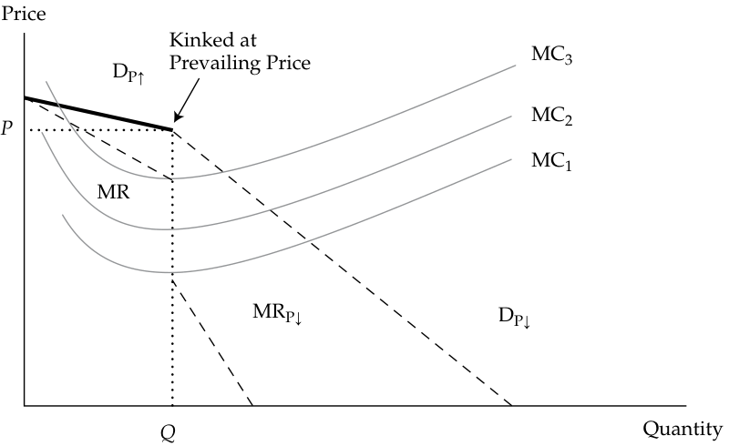
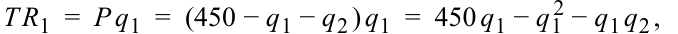
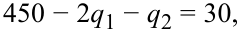
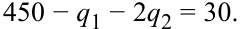
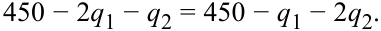
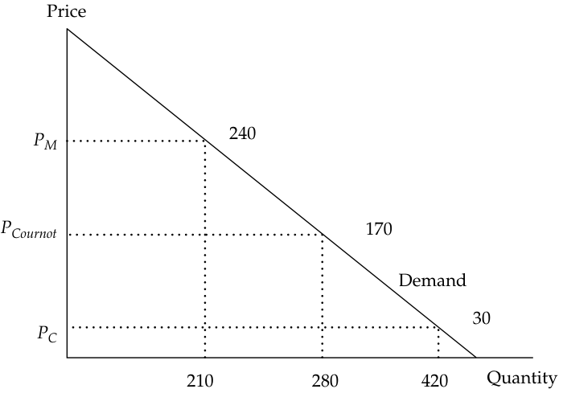

# Volume 2: Economics
## Learning Module 1 The Firm and Market Structures
### Part 4/5: Oligopoly (PDF Pages 37–52)

---

<!-- PDF Page 37 -->

- **QUESTION SET** 1. A company doing business in a monopolistically competitive market will _most likely_ maximize profits when its output quantity is set such that: 

|**A.**average cost is minimized.|
|---|
|**B.**marginal revenue is equal to average cost.|
|**C.**marginal revenue is equal to marginal cost.|
|**Solution:**|
|C is correct. The profit maximizing choice is the level of output at which marginal revenue equals marginal cost.|

## **OLIGOPOLY** 

# **<mark>5</mark>** 

explain supply and demand relationships under oligopoly, including the optimal price and output for firms as well as pricing strategy 

### **Oligopoly and Pricing Strategies** 

An oligopoly market structure is characterized by only a few firms doing business in a relevant market. The products must all be similar and generally are substitutes for one another. In some oligopoly markets, the goods or services may be differentiated by marketing and strong brand recognition, as in the markets for breakfast cereals and for bottled or canned beverages. Other examples of oligopoly markets are made up of homogeneous products with little or no attempt at product differentiation, such as petroleum and cement. _The most distinctive characteristic of oligopoly markets is the small number of firms that dominate the market_ . _There are so few firms in the relevant market that their pricing decisions are interdependent_ . That is, each firm’s pricing decision is based on the expected retaliation by the other firms. Recall the characteristics of oligopoly markets: 

**1.** There are a small number of potential sellers. 

**2.** The products offered by each seller are close substitutes for the products offered by other firms and may be differentiated by brand or homogeneous and unbranded. 

**3.** Entry into the market is difficult, with fairly high costs and significant barriers to competition. 

**4.** Firms typically have substantial pricing power. 

**5.** Products are often highly differentiated through marketing, features, and other non-price strategies. 

Because there are so few firms, each firm can have some degree of pricing power, which can result in substantial profits. Another by-product of the oligopoly market structure is the attractiveness of price collusion. Even without price collusion, a dominant firm may easily become the price maker in the market. Oligopoly markets 

<!-- PDF Page 38 -->

without collusion typically have the most sophisticated pricing strategies. Perhaps the most well-known oligopoly market with collusion is the Organization of the Petroleum Exporting Countries (OPEC) cartel, which seeks to control prices in the petroleum market by fostering agreements among oil-producing countries. 

### **Demand Analysis and Pricing Strategies in Oligopoly Markets** 

Oligopoly markets’ demand curves depend on the degree of pricing interdependence. In a market in which collusion is present, the aggregate market demand curve is divided by the individual production participants. Under non-colluding market conditions, each firm faces an individual demand curve. Furthermore, non-colluding oligopoly market demand characteristics depend on the pricing strategies adopted by the participating firms. The three basic pricing strategies are pricing interdependence, the Cournot assumption, and the Nash equilibrium. 

The first pricing strategy assumes pricing interdependence among the firms in the oligopoly. A good example of this situation is any market in which there are “price wars,” such as the commercial airline industry. For example, flying out of their hubs in Atlanta, both Delta Air Lines and AirTran Airways jointly serve several cities. AirTran is a low-cost carrier and typically offers lower fares to destinations out of Atlanta. Delta tends to match the lower fares for those cities also served by AirTran when the departure and arrival times are similar to its own. When Delta offers service to the same cities at different time slots, however, Delta’s ticket prices are higher. 

The most common pricing strategy assumption in these price war markets is that competitors will match a price reduction and ignore a price increase. The logic is that by lowering its price to match a competitor’s price reduction, the firm will not experience a reduction in customer demand. Conversely, by not matching the price increase, the firm stands to attract customers away from the firm that raised its prices. The oligopolist’s demand relationship must represent the potential increase in market share when rivals’ price increases are not matched and no significant change in market share when rivals’ price decreases are matched. 

Given a prevailing price, the price elasticity of demand will be much greater if the price is increased and less if the price is decreased. The firm’s customers are more responsive to price increases because its rivals have lower prices. Alternatively, the firm’s customers are less responsive to price decreases because its rivals will match its price change. 

This implies that the oligopolistic firm faces two different demand structures: one associated with price increases and another relating to price reductions. Each demand function will have its own marginal revenue structure as well. Consider the demand and marginal revenue functions in Exhibit 16. The functions DP↑ and MRP↑ represent the demand and marginal revenue schedules associated with higher prices, whereas the functions DP↓ and MRP↓ represent the lower prices’ demand and marginal revenue schedules. The two demand schedules intersect at the prevailing price (i.e., the price at which the price increase and price decrease are both equal to zero). 

<!-- PDF Page 39 -->

#### **Exhibit 16: Kinked Demand Curve in Oligopoly Market** 

<!-- Start of picture text -->
Price P MC DP↑ MRP↓ DP↓ MRP↑ Q Quantity <!-- End of picture text -->

This oligopolistic pricing strategy results in a kinked demand curve, with the two segments representing the different competitor reactions to price changes. The kink in the demand curve also yields a discontinuous marginal revenue structure, with one part associated with the price increase segment of demand and the other relating to the price decrease segment. Therefore, the firm’s overall demand equals the relevant portion of DP↑ and the relevant portion of DP↓. Exhibit 17 represents the firm’s new demand and marginal revenue schedules. The firm’s demand schedule shown in Exhibit 17 is segment DP↑ and DP↓, where overall demand D = DP↑ + DP↓. 

#### **Exhibit 17: Kinked Demand Curve in Oligopoly Market** 

<!-- Start of picture text -->
Price Kinked at MC3 Prevailing Price DP↑ MC2 P MC1 MR MRP↓ DP↓ Q Quantity <!-- End of picture text -->

Exhibit 17 shows that a wide variety of cost structures are consistent with the prevailing price. If the firm has relatively low marginal costs, MC1, the profit-maximizing pricing rule established earlier, MR = MC, still holds for the oligopoly firm. Marginal cost can rise to MC2 and MC3 before the firm’s profitability is challenged. If the marginal 

<!-- PDF Page 40 -->

cost curve MC2 passes through the gap in marginal revenue, the most profitable price and output combination remains unchanged at the prevailing price and original level of output. 

Criticism of the kinked demand curve analysis focuses on its inability to determine what the prevailing price is from the outset. The kinked demand curve analysis helps explain why stable prices have been observed in oligopoly markets and therefore is a useful tool for analyzing such markets. However, because it cannot determine the original prevailing price, it is considered to be an incomplete pricing analysis. 

### **The Cournot Assumption** 

The second pricing strategy was first developed by French economist Augustin Cournot in 1838. In the **Cournot assumption** , each firm determines its profit-maximizing production level by assuming that the other firms’ output will not change. This assumption simplifies pricing strategy because there is no need to guess what the other firm will do to retaliate. It also provides a useful approach to analyzing real-world behavior in oligopoly markets. Take the most basic oligopoly market situation, a two-firm duopoly market. In equilibrium, neither firm has an incentive to change output, given the other firm’s production level. Each firm attempts to maximize its own profits under the assumption that the other firm will continue producing the same level of output in the future. The Cournot strategy assumes that this pattern continues until each firm reaches its long-run equilibrium position. In long-run equilibrium, output and price are stable: No change in price or output will increase profits for either firm. 

Consider this example of a duopoly market. Assume that the aggregate market demand has been estimated to as follows: 

QD = 450 − _P_ . 

The supply function is represented by constant marginal cost MC = 30. 

The Cournot strategy’s solution can be found by setting QD = _q_ 1 + _q_ 2, where _q_ 1 and _q_ 2 represent the output levels of the two firms. Each firm seeks to maximize profit, and each firm believes the other firm will not change output as it changes its own output (i.e., Cournot’s assumption). The firm will maximize profit where MR = MC. Rearranging the aggregate demand function in terms of price, we get: 

_P_ = 450 − QD = 450 − ( _q_ 1+ _q_ 2), and MC = 30. 

Total revenue for each of the two firms is found by multiplying price and quantity: 

<!-- Formula Text: T R 1  =  P q 1  =  (450 − q 1 − q 2 ) q 1  =  450 q 1 − q 1 2 − q 1 q 2 , -->

and 

<!-- Formula Text: T R 2  =  P q 2  =  (450 − q 1 − q 2 ) q 2  =  450 q 2 − q 2 q 1 − q 2 2. -->

Marginal revenue is defined as the change in total revenue, given a change in sales ( _q_ 1 or _q_ 2). For the profit-maximizing output, set MR = MC, or 

<!-- Formula Text: 450 − 2q1 − q2 = 30, -->

and 

<!-- Formula Text: 450 − q1 − 2q2 = 30. -->

Then find the simultaneous equilibrium for the two firms by solving the two equations with two unknowns: 

<!-- Formula Text: 450 − 2q1 − q2 = 450 − q1 − 2q2. -->

Because _q_ 2 = _q_ 1 under Cournot’s assumption, insert this solution into the demand function and solve as follows: 

<!-- Formula Text: 450 − 2q1 − q1 = 450 − 3q1 = 30. -->

<!-- PDF Page 41 -->

Therefore, _q_ 1 = 140, _q_ 2 = 140, and _Q_ = 280. 

The price is _P_ = 450 − 280 = 170. 

In the Cournot strategic pricing solution, the market equilibrium price will be 170, and the aggregate output will be 280 units. This result, known as the Cournot equilibrium, differs from the perfectly competitive market equilibrium because the perfectly competitive price will be lower and the perfectly competitive output will be higher. In general, non-competitive markets have higher prices and lower levels of output in equilibrium when compared with perfect competition. In competition, the equilibrium is reached when price equals marginal cost: 

PC = MRC = MC, so 450 − _Q_ = 30, 

where PC is the competitive firm’s equilibrium price. 

_Q_ = 420, and PC = 30. 

Exhibit 18 describes the oligopoly, competitive, and monopoly market equilibrium positions, where PM is the monopoly optimum price, PC is the competitive price, and PCournot is the oligopoly price under the Cournot assumption. 

#### **Exhibit 18: Cournot Equilibrium in Duopoly Market** 

<!-- Start of picture text -->
Price PM 240 PCournot 170 Demand 30 PC 210 280 420 Quantity <!-- End of picture text -->

In the later discussion regarding monopoly market structure, equilibrium will be established where MR = MC. That solution is also shown in Exhibit 18. The monopoly firm’s demand schedule is the aggregate market demand schedule. Therefore, the solution is 

#### MR = MC. 

For the market demand function, total revenue is _P_ × _Q_ = 450 _Q_ − _Q_2 and MR = 450 − 2 _Q_ ; therefore, 

450 − 2 _Q_ = 30   and _Q_ = 210. 

From the aggregate demand function, solve for price: 

PM = 450 − 210 = 240. 

Note that the Cournot solution falls between the competitive equilibrium and the monopoly solution. 

<!-- PDF Page 42 -->

As the number of firms increases from two to three, from three to four, and so on, the output and price equilibrium positions move toward the competitive equilibrium solution. Historically, this result has been the theoretical basis for the antitrust policies established in the United States. 

### **The Nash Equilibrium** 

The third pricing strategy is attributed to one of the 1994 Nobel Prize winners, John Nash, who first developed the general concepts. In the previous analysis, the concept of market equilibrium occurs when firms are achieving their optimum remuneration under the circumstances they face. In this optimum environment, the firm has no motive to change price or output level. Existing firms are earning a normal return (zero economic profit), leaving no motive for entry to or exit from the market. All of the firms in the market are producing at the output level at which price equals the average cost of production. 

In **game theory** (the set of tools that decision makers use to consider responses by rival decision makers), the **Nash equilibrium** is present when two or more participants in a non-cooperative game have no incentive to deviate from their respective equilibrium strategies after they have considered and anticipated their opponent’s rational choices or strategies. In the context of oligopoly markets, the Nash equilibrium is an equilibrium defined by the characteristic that none of the oligopolists can increase its profits by unilaterally changing its pricing strategy. The assumption is made that each participating firm does the best it can, given the reactions of its rivals. Each firm anticipates that the other firms will react to any change made by competitors by doing the best they can under the altered circumstances. The firms in the oligopoly market have interdependent actions. Their actions are non-cooperative, with each firm making decisions that maximize its own profits. The firms do not collude in an effort to maximize joint profits. The equilibrium is reached when all firms are doing the best they can, given the actions of their rivals. 

Exhibit 19 illustrates the duopoly result from the Nash equilibrium. Assume there are two firms in the market, ArcCo and BatCo. ArcCo and BatCo can charge high prices or low prices for the product. The market outcomes are shown in Exhibit 19. 

**Exhibit 19: Nash Equilibrium in Duopoly Market** 

<!-- Start of picture text -->
ArcCo – Low Price ArcCo – Low Price 50 80 70 0 BatCo – Low Price BatCo – High Price ArcCo – High Price ArcCo – High Price 300 500 350 300 BatCo – Low Price BatCo – High Price <!-- End of picture text -->

<!-- PDF Page 43 -->

For example, the top left solution indicates that when both ArcCo and BatCo offer the product at low prices, ArcCo earns a profit of 50 and BatCo earns 70. The top right solution shows that if ArcCo offers the product at a low price, BatCo earns zero profits. The solution with the maximum joint profits is the lower right equilibrium, where both firms charge high prices for the product. Joint profits are 800 in this solution. 

The Nash equilibrium, however, requires that each firm behaves in its own best interest. BatCo can improve its position by offering the product at low prices when ArcCo is charging high prices. In the lower left solution, BatCo maximizes its profits at 350. Although ArcCo can earn 500 in its best solution, it can do so only if BatCo also agrees to charge high prices. This option is clearly not in BatCo’s best interest because it can increase its return from 300 to 350 by charging lower prices. 

This scenario brings up the possibility of collusion. If ArcCo agrees to share at least 51 of its 500 when both companies are charging high prices, BatCo should also be willing to charge high prices. In general, such collusion is unlawful in most countries, but it remains a tempting alternative. Clearly, conditions in oligopolistic industries encourage collusion, with a small number of competitors and interdependent pricing behavior. Collusion is motivated by several factors: increased profits, reduced cash flow uncertainty, and improved opportunities to construct barriers to entry. 

When collusive agreements are made openly and formally, the firms involved are called a **cartel** . In some cases, collusion is successful; other times, the forces of competition overpower collusive behavior. The following six major factors affect the chances of successful collusion: 

**1.** _The number and size distribution of sellers._ Successful collusion is more likely if the number of firms is small or if one firm is dominant. Collusion becomes more difficult as the number of firms increases or if the few firms have similar market shares. When the firms have similar market shares, the competitive forces tend to overshadow the benefits of collusion. 

**2.** _The similarity of the products._ When the products are homogeneous, collusion is more successful. The more differentiated the products, the less likely it is that collusion will succeed. 

**3.** _Cost structure._ The more similar the firms’ cost structures, the more likely it is that collusion will succeed. 

**4.** _Order size and frequency._ Successful collusion is more likely when orders are frequent, received on a regular basis, and relatively small. Frequent small orders, received regularly, diminish the opportunities and rewards for cheating on the collusive agreement. 

**5.** _The strength and severity of retaliation._ Oligopolists will be less likely to break the collusive agreement if the threat of retaliation by the other firms in the market is severe. 

**6.** _The degree of external competition._ The main reason to enter into the formal collusion is to increase overall profitability of the market, and rising profits attract competition. For example, in 2016 the average extraction cost of a barrel of crude oil from Saudi Arabia was approximately $9, while the average cost from United States shale oil fields was roughly $23.50. The cost of extracting oil from the Canadian tar sands in 2016 was roughly $27 per barrel. It is more likely that crude oil producers in the gulf countries will successfully collude because of the similarity in their cost structures (roughly $9–$10 per barrel). If OPEC had held crude oil prices down below $30 per barrel, there would not have been a viable economic argument to develop US shale oil fields through fracking or expand extraction from Canada’s tar 

<!-- PDF Page 44 -->

sands. OPEC’s successful cartel raised crude oil prices to the point at which outside sources became economically possible and, in doing so, increased the competition the cartel faces. 

Other possible oligopoly strategies are associated with decision making based on game theory. The Cournot equilibrium and the Nash equilibrium are examples of specific strategic games. A strategic game is any interdependent behavioral choice employed by individuals or groups that share a common goal (e.g., military units, sports teams, or business decision makers). Another prominent decision-making strategy in oligopolistic markets is the first-mover advantage in the **Stackelberg model** , named after the economist who first conceptualized the strategy. The important difference between the Cournot model and the Stackelberg model is that Cournot assumes that in a duopoly market, decision making is simultaneous, whereas Stackelberg assumes that decisions are made sequentially. In the Stackelberg model, the leader firm chooses its output first and then the follower firm chooses after observing the leader’s output. It can be shown that the leader firm has a distinct advantage—that is, being a first mover. In the Stackelberg game, the leader can aggressively overproduce to force the follower to scale back its production or even punish or eliminate the weaker opponent. This approach is sometimes referred to as a “top dog” strategy. The leader earns more than in Cournot’s simultaneous game, while the follower earns less. Many other strategic games are possible in oligopoly markets. The important conclusion is that the optimal strategy of the firm depends on what its adversary does. The price and marginal revenue the firm receives for its product depend on both its decisions and its adversary’s decisions. 

### **Oligopoly Markets: Optimal Price, Output, and Long-Run Equilibrium** 

As in monopolistic competition, the oligopolist does not have a well-defined supply function. That is, there is no way to determine the oligopolist’s optimal levels of output and price independent of demand conditions and competitor’s strategies. However, the oligopolist still has a cost function that determines the optimal level of supply. Therefore, the profit-maximizing rule established earlier is still valid: The level of output that maximizes profit is where MR = MC. The price to charge is determined by what price consumers are willing to pay for that quantity of the product. Therefore, the equilibrium price comes from the demand curve, whereas the output level comes from the relationship between marginal revenue and marginal cost. 

Consider an oligopoly market in which one of the firms is dominant and thus able to be the price leader. Dominant firms generally have 40 percent or greater market share. When one firm dominates an oligopoly market, it does so because it has greater capacity, has a lower cost structure, was first to market, or has greater customer loyalty than other firms in the market. 

Assuming there is no collusion, the dominant firm becomes the price maker, and therefore its actions are similar to monopoly behavior in its segment of the market. The other firms in the market follow the pricing patterns of the dominant firm. Why wouldn’t the price followers attempt to gain market share by undercutting the dominant firm’s price? The most common explanation is that the dominant firm’s supremacy often stems from a lower cost of production. Usually, the price followers would rather charge a price that is even higher than the dominant firm’s price choice. If they attempt to undercut the dominant firm, the followers risk a price war with a lower-cost producer that can threaten their survival. Some believe that one explanation for the price leadership position of the dominant firm is simply convenience. Only one firm has to make the pricing decisions, and the others can simply follow its lead. 

<!-- PDF Page 45 -->

Exhibit 20 establishes the dominant firm’s pricing decision. The dominant firm’s demand schedule, DL, is a substantial share of the total market demand, DT. The low-cost position of the dominant firm is represented by its marginal cost, MCL. The sum of the marginal costs of the price followers is established as ΣMCF and represents a higher cost of production than that of the price leader. 

#### **Exhibit 20: Dominant Oligopolist’s Price Leadership** 

<!-- Start of picture text -->
Price ΣMCF PL DT MCL MRL   DL QL QT Quantity <!-- End of picture text -->

An important reason why the total demand curve and the leader demand curve are not parallel is illustrated in Exhibit 20: The leader is the low-cost producer. Therefore, as price decreases, fewer of the smaller suppliers will be able to profitably remain in the market, and several will exit because thwey do not want to sell below cost. Therefore, the leader will have a larger market share as _P_ decreases, which implies that QL increases at a low price, exactly as shown by a steeper DT in the diagram. 

The price leader identifies its profit-maximizing output where MRL = MCL, at output QL. This is the quantity it wants to supply; however, the price it will charge is determined by its segment of the total demand function, DL. At price PL, the dominant firm will supply quantity QL of total demand, DT. The price followers will supply the difference to the market, (QT − QL) = QF. Therefore, neither the dominant firm nor the follower firms have a single functional relationship that determines the quantity supplied at various prices. 

#### **_Optimal Price and Output in Oligopoly Markets_** 

As this discussion shows, clearly no single optimum price and output analysis fits all oligopoly market situations. The interdependence among the few firms that make up the oligopoly market provides a complex set of pricing alternatives, depending on the circumstances in each market. In the case of the kinked demand curve, the optimum price is the prevailing price at the kink in the demand function. As noted, however, the kinked demand curve analysis does not provide insight into what established the prevailing price in the first place. 

Perhaps the case of the dominant firm, with the other firms following the price leader, is the most obvious. In that case, the optimal price is determined at the output level where MR = MC. The profit-maximizing price is then determined by the output position of the segment of the demand function faced by the dominant firm. The price 

<!-- PDF Page 46 -->

followers have little incentive to change the leader’s price. In the case of the Cournot assumption, each firm assumes that the other firms will not alter their output following the dominant firm’s selection of its price and output level. 

Therefore, again, the optimum price is determined by the output level where MR = MC. In the case of the Nash equilibrium, each firm will react to the circumstances it faces, maximizing its own profit. These adjustments continue until prices and levels of output are stable. Because of the interdependence, the individual firm’s price and output level remain uncertain. 

#### **_Factors Affecting Long-Run Equilibrium in Oligopoly Markets_** 

Long-run economic profits are possible for firms operating in oligopoly markets. History has shown that, however, the market share of the dominant firm declines. Profits attract entry by other firms into the oligopoly market. Over time, the marginal costs of the entrant firms decrease because they adopt more efficient production techniques, the dominant firm’s demand and marginal revenue shrink, and the profitability of the dominant firm declines. In the early 1900s, J.P. Morgan, Elbert Gary, Andrew Carnegie, and Charles M. Schwab created the United States Steel Corporation (US Steel). When it was first formed in 1901, US Steel controlled 66 percent of the market. By 1920, US Steel’s market share had declined to 46 percent, and by 1925 its market share was 42 percent. 

In the long run, optimal pricing strategy must include the reactions of rival firms. History has proven that pricing wars should be avoided because any gains in market share are temporary. Decreasing prices to drive away competitors lowers total revenue to all participants in the oligopoly market. Innovation may be a way—though sometimes an uneconomical one—to maintain market leadership. 

#### **OLIGOPOLIES: APPEARANCE VERSUS BEHAVIOR** 

When is an oligopoly not an oligopoly? There are two extreme cases of this situation. A normal oligopoly has a few firms producing a differentiated good, and this differentiation gives them pricing power. 

At one end of the spectrum, we have the oligopoly with a credible threat of entry. In practice, if the oligopolists are producing a good or service that can be easily replicated, has limited economies of scale, and is not protected by brand recognition or patents, they will not be able to charge high prices. The easier it is for a new supplier to enter the market, the lower the margins. In practice, this oligopoly will behave very much like a perfectly competitive market. 

At the opposite end of the spectrum, we have the case of the cartel. Here, the oligopolists collude and act as if they were a single firm. In practice, a very effective cartel enacts a cooperative strategy. Instead of going to a Nash equilibrium, the cartel participants go to the more lucrative (for them) cooperative equilibrium. 

A cartel may be explicit (i.e., based on a contract) or implicit (based on signals). An example of signals in a duopoly would be that one of the firms reduces its prices and the other does not. Because the firm not cutting prices refuses to start a price war, the firm that cut prices may interpret this signal as a “suggestion” to raise prices to a higher level than before, so that profits may increase for both. 

<!-- PDF Page 47 -->

- **QUESTION SET** 1. Oligopolistic pricing strategy _most likely_ results in a demand curve that is: **A.** kinked. **B.** vertical. **C.** horizontal. 

- **Solution:** A is correct. The oligopolist faces two different demand structures, one for price increases and another for price decreases. Competitors will lower prices to match a price reduction, but will not match a price increase. The result is a kinked demand curve. 

- 2. Collusion is _less likely_ in a market when: **A.** the product is homogeneous. **B.** companies have similar market shares. **C.** the cost structures of companies are similar. 

- **Solution:** B is correct. When companies have similar market shares, competitive forces tend to outweigh the benefits of collusion. 

- 3. In an industry composed of three companies, which are small-scale manufacturers of an easily replicable product unprotected by brand recognition or patents, the _most_ representative model of company behavior is: **A.** oligopoly. **B.** perfect competition. **C.** monopolistic competition. 

- **Solution:** B is correct. The credible threat of entry holds down prices and multiple incumbents are offering undifferentiated products. 

- 4. Deep River Manufacturing is one of many companies in an industry that makes a food product. Deep River units are identical up to the point they are labeled. Deep River produces its labeled brand, which sells for $2.20 per unit, and “house brands” for seven different grocery chains, which sell for $2.00 per unit. Each grocery chain sells both the Deep River brand and its house brand. The _best_ characterization of Deep River’s market is: **A.** oligopoly. **B.** perfect competition. **C.** monopolistic competition. 

- **Solution:** C is correct. There are many competitors in the market, but some product differentiation exists, as the price differential between Deep River’s brand and the house brands indicates. 

#### **The following information relates to questions 5 & 6** 

<!-- PDF Page 48 -->

SigmaSoft and ThetaTech are the dominant makers of computer system software. The market has two components: a large mass-market component in which demand is price sensitive, and a smaller performance-oriented component in which demand is much less price sensitive. SigmaSoft’s product is considered to be technically superior. Each company can choose one of two strategies: 

_Open architecture (Open):_ Mass market focus allowing other software venders to develop products for its platform. 

_Proprietary (Prop):_ Allow only its own software applications to run on its platform. 

5. Depending upon the strategy each company selects, their profits would be: 

<!-- Start of picture text -->
SigmaSoft – Open SigmaSoft – Prop 400 650 600 700 ThetaTech – Open ThetaTech – Open SigmaSoft – Open SigmaSoft – Prop 800 600 300 400 ThetaTech – Prop ThetaTech – Prop <!-- End of picture text -->

The Nash equilibrium for these companies is: 

- **A.** proprietary for SigmaSoft and proprietary for ThetaTech. 

- **B.** open architecture for SigmaSoft and proprietary for ThetaTech. 

- **C.** proprietary for SigmaSoft and open architecture for ThetaTech. 

- **Solution:** 

C is correct. In the Nash model, each company considers the other’s reaction in selecting its strategy. In equilibrium, neither company has an incentive to change its strategy. ThetaTech is better off with open architecture regardless of what SigmaSoft decides. Given this choice, SigmaSoft is better off with a proprietary platform. Neither company will change its decision unilaterally. 

# **<mark>6</mark>** 

## **DETERMINING MARKET STRUCTURE** 

identify the type of market structure within which a firm operates and describe the use and limitations of concentration measures 

<!-- PDF Page 49 -->

Monopoly markets and other situations in which companies have pricing power can be inefficient because producers constrain output to cause an increase in prices. Therefore, less of the good will be consumed, and it will be sold at a higher price, which is generally inefficient for the overall market. As a result, many countries have introduced competition law to regulate the degree of competition in many industries. 

Market power in the real world is not always as clear as it is in textbook examples. Governments and regulators often have the difficult task of measuring market power and establishing whether a firm has a dominant position that may resemble a monopoly. A few historical examples of this are as follows: 

**1.** In the 1990s, US regulators prosecuted agricultural corporation Archer Daniels Midland for conspiring with Japanese competitors to fix the price of lysine, an amino acid used as an animal feed additive. The antitrust action resulted in a settlement that involved more than US$100 million in fines paid by the cartel members. 

**2.** In the 1970s, US antitrust authorities broke up the local telephone monopoly, leaving AT&T the long-distance business (and opening that business to competitors), and required AT&T to divest itself of the local telephone companies it owned. This antitrust decision brought competition, innovation, and lower prices to the US telephone market. 

**3.** European regulators (specifically, the European Commission) have affected the mergers and monopoly positions of European corporations (as in the case of the companies Roche, Rhone-Poulenc, and BASF, which were at the center of a vitamin price-fixing case) as well as non-European companies (such as Intel) that do business in Europe. Moreover, the merger between the US company General Electric and the European company Honeywell was denied by the European Commission on grounds of excessive market concentration. 

Quantifying excessive market concentration is difficult. Sometimes, regulators need to measure whether something that has not yet occurred might generate excessive market power. For example, a merger between two companies might allow the combined company to be a monopolist or quasi-monopolist in a certain market. 

A financial analyst hearing news about a possible merger should always consider the impact of competition law (sometimes called antitrust law)—that is, whether a proposed merger may be blocked by regulators in the interest of preserving a competitive market. 

### **Econometric Approaches** 

How should one measure market power? The theoretical answer is to estimate the elasticity of demand and supply in a market. If demand is very elastic, the market must be very close to perfect competition. If demand is rigid (inelastic), companies _may_ have market power. 

From the econometric point of view, this estimation requires some attention. The problem is that observed price and quantity are the equilibrium values of price and quantity and do not represent the value of either supply or demand. Technically, this is called the problem of endogeneity, in the sense that the equilibrium price and quantity are jointly determined by the interaction of demand and supply. Therefore, to have an appropriate estimation of demand and supply, we need to use a model with two equations: an equation of demanded quantity (as a function of price, income of the buyers, and other variables) and an equation of supplied quantity (as a function of price, production costs, and other variables). The estimated parameters will then allow us to compute elasticity. 

<!-- PDF Page 50 -->

Regression analysis is useful in computing elasticity but requires a large number of observations. Therefore, one may use a time-series approach and, for example, look at 20 years of quarterly sales data for a market. The market structure may have changed radically over those 20 years, however, and the estimated elasticity may not apply to the current situation. Moreover, the supply curve may change because of a merger among large competitors, and the estimation based on past data may not be informative regarding the future state of the market postmerger. 

An alternative approach is a cross-sectional regression analysis. Instead of looking at total sales and average prices in a market over time (the time-series approach mentioned earlier), we can look at sales from different companies in the market during the same year, or even at single transactions from many buyers and companies. Clearly, this approach requires a substantial data-gathering effort, and therefore, this estimation method can be complicated. Moreover, different specifications of the explanatory variables (e.g., using total GDP rather than median household income or per-capita GDP to represent income) may lead to dramatically different estimates. 

### **Simpler Measures** 

Trying to avoid these drawbacks, analysts often use simpler measures to estimate elasticity. The simplest measure is the concentration ratio, which is the sum of the market shares of the largest _N_ firms. To compute this ratio, one would, for example, add the sales values of the largest 10 firms and divide this figure by total market sales. This number is always between 0 (perfect competition) and 100 percent (monopoly). 

The main advantage of the concentration ratio is that it is simple to compute, as shown previously. The disadvantage is that it does not directly quantify market power. In other words, is a high concentration ratio a clear signal of monopoly power? A company may be the only incumbent in a market, but if the barriers to entry are low, the simple presence of a _potential_ entrant may be sufficient to convince the incumbent to behave like a firm in perfect competition. For example, a sugar wholesaler may be the only one in a country, but the knowledge that other large wholesalers in the food industry might easily add imported sugar to their range of products should convince the sugar wholesaler to price its product as if it were in perfect competition. 

Another disadvantage of the concentration ratio is that it tends to be unaffected by mergers among the top market incumbents. For example, if the largest and second-largest incumbents merge, the pricing power of the combined entity is likely to be larger than that of the two preexisting companies. But the concentration ratio may not change much. 

#### **CALCULATING THE CONCENTRATION RATIO** 

Suppose there are eight producers of a certain good in a market. The largest producer has 35 percent of the market, the second largest has 25 percent, the third has 20 percent, the fourth has 10 percent, and the remaining four have 2.5 percent each. If we computed the concentration ratio of the top three producers, it would be 35 + 25 + 20 = 80 percent, while the concentration ratio of the top four producers would be 35 + 25 + 20 + 10 = 90 percent. 

If the two largest companies merged, the new concentration ratio for the top three producers would be 60 (the sum of the market shares of the merged companies) + 20 + 10 = 90 percent, and the concentration ratio for the four top producers would be 92.5 percent. Therefore, this merger affects the concentration ratio very mildly, even though it creates a substantial entity that controls 60 percent of the market. 

<!-- PDF Page 51 -->

For example, the effect of consolidation in the US retail gasoline market has resulted in increasing degrees of concentration. In 1992, the top four companies in the US retail gasoline market shared 33 percent of the market. By 2001, the top four companies controlled 78 percent of the market (Exxon Mobil 24 percent, Shell 20 percent, BP/Amoco/Arco 18 percent, and Chevron/Texaco 16 percent). 

To avoid the known issues with concentration ratios, economists O. C. Herfindahl and A. O. Hirschman suggested an index in which the market shares of the top _N_ companies are first squared and then added. If one firm controls the whole market (a monopoly), the Herfindahl–Hirschman index (HHI) equals 1. If there are _M_ firms in the industry with equal market shares, then the HHI equals (1/ _M_ ). This provides a useful gauge for interpreting an HHI. For example, an HHI of 0.20 would be analogous to having the market shared equally by five firms. 

The HHI for the top three companies in the example in the box above would be 0.352 + 0.252 + 0.202 = 0.225 before the merger, whereas after the merger, it would be 0.602 + 0.202 + 0.102 = 0.410, which is substantially higher than the initial 0.225. The HHI is widely used by competition regulators; however, just like the concentration ratio, the HHI does not take the possibility of entry into account, nor does it consider the elasticity of demand. Therefore, the HHI has limited use for a financial analyst trying to estimate the potential profitability of a company or group of companies. 

#### **EXAMPLE 4** 

### **The Herfindahl–Hirschman Index** 

1. Suppose a market has 10 suppliers, each of them with 10 percent of the market. What are the concentration ratio and the HHI of the top four firms? 

   - **A.** Concentration ratio 4 percent and HHI 40 

   - **B.** Concentration ratio 40 percent and HHI 0.4 

   - **C.** Concentration ratio 40 percent and HHI 0.04 

   - **Solution:** 

   - C is correct. The concentration ratio for the top four firms is 10 + 10 + 10 + 10 = 40 percent, and the HHI is 0.102 × 4 = 0.01 × 4 = 0.04. 

#### **QUESTION SET** 

1. An analyst gathers the following market share data for an industry: 

|**Company**|**Sales (in millions of euros)**|
|---|---|
|ABC|300|
|Brown|250|
|Coral|200|
|Delta|150|
|Erie|100|
|All others|50|

2. The industry’s four-company concentration ratio is _closest_ to: 

**A.** 71%. 

<!-- PDF Page 52 -->

**B.** 86%. 

**C.** 95%. 

**Solution:** 

B is correct. The top four companies in the industry account for 86 percent of industry sales: (300 + 250 + 200 + 150)/(300 + 250 + 200 + 150 + 100 + 50) = 900/1050 = 86%. 

#### **The following information applies to questions 3 & 4** 

An analyst gathered the following market share data for an industry composed of five companies: 

|**Company**|**Market Share (%)**|
|---|---|
|Zeta|35|
|Yusef|25|
|Xenon|20|
|Waters|10|
|Vlastos|10|

3. The industry’s three-firm Herfindahl–Hirschman index is _closest_ to: 

   - **A.** 0.185. 

   - **B.** 0.225. 

   - **C.** 0.235. 

   - **Solution:** 

   - B is correct. The three-firm Herfindahl–Hirschman index is 0.352 + 0.252 + 0.202 = 0.225. 

4. One disadvantage of the Herfindahl–Hirschman index is that the index: 

   - **A.** is difficult to compute. 

   - **B.** fails to reflect low barriers to entry. 

   - **C.** fails to reflect the effect of mergers in the industry. 

   - **Solution:** 

B is correct. The Herfindahl–Hirschman index does not reflect low barriers to entry that may restrict the market power of companies currently in the market. 

