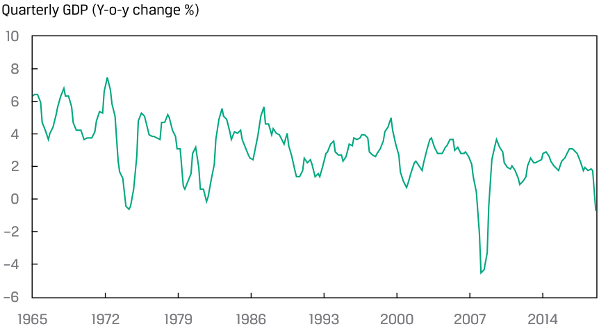
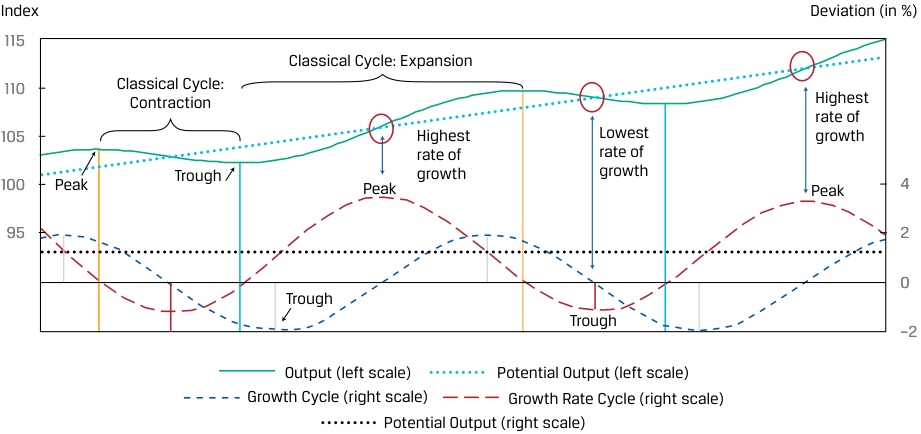

# Volume 2: Economics
## Learning Module 2 Understanding Business Cycles
### Part 1/3: Introduction (PDF Pages 57–67)

---

<!-- PDF Page 57 -->

#### L E A R N I N G M O D U L E 

# **<mark>2</mark>** 

### **Understanding Business Cycles** 

###### **by Gambera Michele, PhD, CFA, Ezrati Milton, and Cao Bolong, PhD, CFA.** 

_Michele Gambera, PhD, CFA, is with UBS Asset Management and the University of Illinois at Urbana-Champaign (USA). Milton Ezrati (USA). Bolong Cao, PhD, CFA, is at Ohio University (USA)._ 

###### **<mark>LEARNING OUTCOMES</mark>** 

**_Mastery The candidate should be able to:_** describe the business cycle and its phases describe credit cycles describe how resource use, consumer and business activity, housing sector activity, and external trade sector activity vary over the business cycle and describe their measurement using economic indicators 

##### **INTRODUCTION** 

**<mark>1</mark>** 

A typical economy’s output of goods and services fluctuates around its long-term path. We now turn our attention to those recurring, cyclical fluctuations in economic output. Some of the factors that influence short-term changes in the economy—such as changes in population, technology, and capital—are the same as those that affect long-term sustainable economic growth. But forces that cause shifts in aggregate demand and aggregate supply curves—such as expectations, political developments, natural disasters, and fiscal and monetary policy decisions—also influence economies, particularly in the short run. 

We first describe a typical business cycle and its phases. While each cycle is different, analysts and investors need to be familiar with the typical cycle phases and what they mean for the expectations and decisions of businesses and households that influence the performance of sectors and companies. These behaviors also affect financial conditions and risk appetite, thus affecting the setting of expectations and choices of portfolio exposures to different investment sectors or styles. 

In the lessons that follow, we describe credit cycles, introduce several theories of business cycles, and explain how different economic schools of thought interpret the business cycle and their recommendations with respect to it. We also discuss 

<!-- PDF Page 58 -->

variables that demonstrate predictable relationships with the economy, focusing on those whose movements have value in predicting the future course of the economy. We then proceed to explain measures and features of unemployment and inflation. 

###### **LEARNING MODULE OVERVIEW** 

- Business cycles are recurrent expansions and contractions in economic activity affecting broad segments of the economy. 

- Classical cycle refers to fluctuations in the level of economic activity (e.g., measured by GDP in volume terms). 

- Growth cycle refers to fluctuations in economic activity around the long-term potential or trend growth level. 

- Growth rate cycle refers to fluctuations in the growth rate of economic activity (e.g., GDP growth rate). 

- The overall business cycle can be split into four phases: recovery, expansion, slowdown, and contraction. 

- In the recovery phase of the business cycle, the economy is going through the “trough” of the cycle, where actual output is at its lowest level relative to potential output. 

- In the expansion phase of the business cycle, output increases, and the rate of growth is above average. Actual output rises above potential output, and the economy enters the so-called boom phase. 

- In the slowdown phase of the business cycle, output reaches its highest level relative to potential output (i.e., the largest positive output gap). The growth rate begins to slow relative to potential output growth, and the positive output gap begins to narrow. 

- In the contraction phase of the business cycle, actual economic output falls below potential economic output. 

- Credit cycles describe the changing availability—and pricing—of credit. 

- Strong peaks in credit cycles are closely associated with subsequent systemic banking crises. 

- Economic indicators are variables that provide information on the state of the overall economy. 

   - Leading economic indicators have turning points that usually precede those of the overall economy. 

   - Coincident economic indicators have turning points that usually are close to those of the overall economy. 

   - Lagging economic indicators have turning points that take place later than those of the overall economy. 

- A diffusion index reflects the proportion of a composite index of leading, lagging and coincident indicators that are moving in a pattern consistent with the overall index. Analysts often rely on these diffusion indexes to provide a measure of the breadth of the change in a composite index. 

<!-- PDF Page 59 -->

##### **OVERVIEW OF THE BUSINESS CYCLE** 

## **<mark>2</mark>** 

describe the business cycle and its phases 

**Business cycles** are recurrent expansions and contractions in economic activity affecting broad segments of the economy. In their 1946 book “Measuring Business Cycles”, Burns and Mitchell define the business cycle as follows: 

Business cycles are a type of fluctuation found in the aggregate economic activity of nations that organize their work mainly in business enterprises: a cycle consists of expansions occurring at about the same time in many economic activities, followed by similarly general recessions, contractions, and revivals which merge into the expansion phase of the next cycle; this sequence of events is recurrent but not periodic; in duration, business cycles vary from more than one year to 10 or 12 years. 

This definition is rich with important insight. First, business cycles are typical of economies that rely mainly on business enterprises—therefore, not agrarian societies or centrally planned economies. Second, a cycle has an expected sequence of phases, alternating between expansion and contraction, or upswings and downturns. Third, such phases occur at about the same time throughout the economy. Finally, cycles are recurrent; they happen again and again over time but not in a periodic way; they do not all have the exact same intensity and duration. Exhibit 1 provides an illustration of the pattern of economic growth rate in developed markets. 

**Exhibit 1: Fluctuations of Growth in OECD Countries over Time** 

<!-- Start of picture text -->
Quarterly GDP (Y-o-y change %) 10 8 6 4 2 0 –2 –4 –6 1965 1972 1979 1986 1993 2000 2007 2014 <!-- End of picture text -->

_Note:_ The Organisation for Economic Co-Operation and Development (OECD) includes more than 30 large member countries. 

_Source:_ OECD.Stat (https:// stats .oecd .org), year-over-year change in quarterly GDP in OECD countries. 

Burns and Mitchell’s definition remains helpful. History never repeats itself in quite the same way, but it certainly does offer patterns that can be used when analyzing the present and forecasting the future. Business cycle analysis is a wide-ranging topic with conflicting perspectives held by industry participants. 

<!-- PDF Page 60 -->

###### **Phases of the Business Cycle** 

Business cycles are recurring sequences of alternating upswings and downturns. The business cycle can be broken into phases in various ways. The most obvious way is to divide it into two primary segments: the expansion, or the upswing, and the contraction, or the downturn, with two key turning points, or peaks and troughs (see Exhibit 2 and Exhibit 3). These two periods are fairly easy to identify in retrospect. Subdividing the cycle more finely, however, becomes ambiguous, even in retrospect, because it requires identifying more nuanced changes, such as acceleration or deceleration of growth without a change in its direction. It thus is useful to divide the cycle into several phases distinguished through both economic and financial market characteristics. Our focus is on economic characteristics of the different phases, but we also will highlight their implication for the behavior of different segments of the financial markets. 

The timing of these periods will depend on the type of cycle. Before moving on to the description of the four distinct phases to which we will refer in the subsequent sections, we first explain the different cycle concepts that analysts should be aware of given the range of different opinions, interpretations, and descriptions that practitioners use. 

###### **_Types of Cycles_** 

- **Classical cycle** refers to fluctuations in the level of economic activity (e.g., measured by GDP in volume terms). The contraction phases between peaks and troughs are often short, whereas expansion phases are much longer. Exhibit 2 shows the classical cycle of economic activity. In practice, the classical cycle is not used extensively by academics and practitioners because it does not easily allow the breakdown of movements in GDP between shortterm fluctuations and long-run trends. In addition, an absolute decline in activity between peaks and troughs does not occur frequently. 

###### **Exhibit 2: Classical Cycle** 

<!-- Start of picture text -->
Index 115 Classical Cycle: Expansion  Peak Classical Cycle: 110 Contraction Trough 105 100 Peak Trough 95 Output (left scale) <!-- End of picture text -->

- **Growth cycle** refers to fluctuations in economic activity around the long-term potential or trend growth level. The focus is on how much actual economic activity is below or above trend growth in economic activity. The dashed “wave” in the lower part of Exhibit 3 captures the fluctuation of actual activity from trend growth activity. Exhibit 3 shows “gaps” between actual and trend output. The growth cycle definition comes closest to how 

<!-- PDF Page 61 -->

mainstream economists think: It dissects overall economic activity into a part driven by long-run trends and a part reflecting short-run fluctuations. Compared with the classical view of business cycles, peaks generally are reached earlier and troughs later in time. The time periods below and above trend growth are of similar length. 

**Exhibit 3: Classical and Growth Cycles** 

<!-- Start of picture text -->
Index Deviation (in %) 115 Classical Cycle: Expansion  Peak 110 Classical Cycle: Contraction Trend GDP Trough 105 Growth cycle peak  Growth cycle trough 100 Peak Trough corresponds to the largest positive gap  corresponds to the largest negative gap  4 between actual  between actual GDP 95 GDP and trend  Peak and trend GDP  2 GDP 0 Trough Trough –2 Output (left scale) Potential Output (left scale) Growth Cycle (right scale) <!-- End of picture text -->

- **Growth rate cycle** refers to fluctuations in the growth rate of economic activity (e.g., GDP growth rate). Peaks and troughs are mostly recognized earlier than when using the other two definitions (see Exhibit 4). One advantage of this approach is that it is not necessary to first estimate a long-run growth path. Nevertheless, economists often refer to economic growth being above or below potential growth rate, reflecting upswings or downturns. 

**Exhibit 4: Classical, Growth, and Growth Rate Cycles** 

<!-- Start of picture text -->
Index Deviation (in %) 115 Classical Cycle: Expansion 110 Classical Cycle: Contraction Highest rate of 105 Highest Lowest growth rate of rate of 100 Peak Trough Peak growth growth Peak 4 95 2 0 Trough Trough –2 Output (left scale) Potential Output (left scale) Growth Cycle (right scale) Growth Rate Cycle (right scale) Potential Output (right scale) <!-- End of picture text -->

_Notes:_ The vertical lines indicate troughs and peaks when using either the classical, growth, or growth rate cycle definition of a business cycle. The growth cycle reflects the percentage deviation of output relative to its trend. The growth rates in the growth rate cycle are calculated as annualized month-over-month growth rates. 

<!-- PDF Page 62 -->

###### **_Practical Issues_** 

In practice, the definitions of a business cycle are used interchangeably, which often causes confusion regarding how one labels the phases and their timing. The classical cycle definition is rarely used. In line with how most economists and practitioners view the cycle, we will generally be using the growth cycle concept in which business cycles can be thought of as fluctuations around potential output (the trend in potential output is shown as the upward sloping dotted line in Exhibit 3). 

###### **_Four Phases of the Cycle_** 

The overall business cycle can be split into four phases: 

**Recovery** : The economy is going through the “trough” of the cycle, where actual output is at its lowest level relative to potential output. Economic activity, including consumer and business spending, is below potential but is starting to increase, closing the negative output gap. 

**Expansion** : The recovery gathers pace, output increases, and the rate of growth is above average. Actual output rises above potential output, and the economy enters the so-called boom phase. Consumers increase spending, and companies increase production, employment, and investment. Prices and interest rates may start increasing. As the expansion continues, the economy may start to experience shortages in factors of production. Overinvestment in productive capacity may lead companies to reduce further investment spending. 

**Slowdown** : Output of the economy reaches its highest level relative to potential output (largest positive output gap). The growth rate begins to slow relative to potential output growth, and the positive output gap begins to narrow. Consumers remain optimistic about the economy, but companies may rely on overtime rather than using new hires to meet demand. Inflation slows at some point, and price levels may decrease. 

**Contraction** : Actual economic output falls below potential economic output. Consumer and business confidence declines. Companies reduce costs by eliminating overtime and reducing employment. The economy may experience declines in absolute economic activity; a recession; or if the fall in activity is particularly large, a depression. If the decline is moderate, this phase tends to be shorter than the expansion phase. 

Exhibit 5 provides a summary of the key characteristics of each phase and describes how several important economic variables evolve through the course of a business cycle. 

**Exhibit 5: Business Cycle Phase Characteristics** 

<!-- Start of picture text -->
Gap between actual GDP and trend GDP Peak Time Trough Trough Recovery Expansion Slowdown Contraction <!-- End of picture text -->

<!-- PDF Page 63 -->

|**Phase**|**Recovery**|**Expansion**|**Slowdown**|**Contraction**|
|---|---|---|---|---|
|**Description**|Economy going through a trough. Negative output gap starts to narrow.|Economy enjoying an upswing. Positive out- put gap opens.|Economy going through a peak. Positive output gap starts to narrow.|Economy weakens and may go into a recession. Negative output gap opens.|
|**Activity levels:** **consumers and** **businesses**|Activity levels are below potential but start to increase.|Activity measures show above-average growth rates.|Activity measures are above average but decelerating. Moving to below-average rates of growth.|Activity measures are below potential. Growth is lower than normal.|
|**Employment**|Layoffs slow. Businesses rely on overtime before moving to hiring. Unemployment remains higher than average.|Businesses move from using overtime and temporary employees to hiring. Unemployment rate stabilizes and starts falling.|Business continue hir- ing but at a slower pace. Unemployment rate continues to fall but at decreasing rates.|Businesses first cut hours, eliminate over- time, and freeze hiring, followed by outright layoffs. Unemployment rate starts to rise.|
|**Inflation**|Inflation remains moderate.|Inflation picks up modestly.|Inflation further accelerates.|Inflation decelerates but with a lag.|

###### **Leads and Lags in Business and Consumer Decision Making** 

The behavior of businesses and households is key to the cycle and frequently incorporates leads and lags relative to what are established as turning points. For example, at the beginning of an expansion phase, companies may want to fully use their existing workforce and wait to hire new employees until they are sure that the economy is indeed growing. However, gradually all economic variables are going to revert toward their normal range of values (e.g., GDP growth will be close to potential, or average, growth). 

###### **Market Conditions and Investor Behavior** 

Many economic variables and sectors of the economy have distinctive cyclical patterns. Knowledge of these patterns can offer insight into likely cyclical directions overall, or it can be particularly applicable to an investment strategy that requires more specific rather than general cyclical insights for investment success. 

###### **_Recovery Phase_** 

When asset markets expect the end of a recession and the beginning of an expansion phase, risky assets will be repriced upward. When an expansion is expected, the markets will start incorporating higher profit expectations into the prices of corporate bonds and stocks. Typically, equity markets will hit a trough about three to six months before the economy bottoms out and well before the economic indicators turn up. Indeed, as we will see later, the equity market is classified as a leading indicator of the economy. 

###### **_Expansion Phase_** 

When an economy’s expansion is well-established, a later part of an expansion, referred to as a “ **boom** ,” often follows. The boom is an expansionary phase characterized by economic growth “testing the limits” of the economy, strong confidence, profit, and credit growth. For example, companies may expand so much that they have difficulty finding qualified workers and will compete with other prospective employers by 

<!-- PDF Page 64 -->

raising wages and continuing to expand capacity, relying on strong cash flows and borrowing. The government or central bank may step in if it is concerned about the economy overheating. 

###### **_Slowdown Phase_** 

During the boom, the riskiest assets will often have substantial price increases. Safe assets, such as government bonds that were more highly prized during recession, may have lower prices and thus higher yields. In addition, investors may fear higher inflation, which also contributes to higher nominal yields. 

###### **_Contraction Phase_** 

During contraction, investors place relatively high values on such safer assets as government securities and shares of companies with steady (or growing) positive cash flows, such as utilities and producers of staple goods. Such preferences reflect the fact that the marginal utility of a safe income stream increases in periods when employment is insecure or declining. 

###### **WHEN DO RECESSIONS BEGIN AND END?** 

A simple and commonly referred to rule is the following: A recession has started when a country or region experiences two consecutive quarters of negative real GDP growth. Real GDP growth is a measure of the “real” or “inflation-adjusted” growth of the overall economy. This rule can be misleading because it does not indicate a recession if real GDP growth is negative in one quarter, slightly positive the next quarter, and again negative in the next quarter. Many analysts question this result. This issue is why some countries have statistical and economic committees that apply the principles stated by Burns and Mitchell to several macroeconomic variables—not just real GDP growth—as a basis to identify business cycle peaks and troughs. The National Bureau of Economic Research (NBER) is an organization that dates business cycles in the United States. Interestingly, the economists and statisticians on NBER’s Business Cycle Dating Committee analyze numerous time series of data focusing on employment, industrial production, and sales. Because the data are available with a delay (preliminary data releases can be revised even several years after the period they refer to), it also means that the Committee’s determinations may take place well after the business cycle turning points have occurred. As we will see later in the reading, practical indicators may help economists understand in advance if a cyclical turning point is about to happen. 

1. Which of the following rules is _most likely_ to be used to determine whether the economy is in a recession? 

   - **A.** The central bank has run out of foreign reserves. 

   - **B.** Real GDP has two consecutive quarters of negative growth. 

   - **C.** Economic activity experiences a significant decline in two business sectors. 

###### **Solution:** 

B is correct. GDP is a measure of economic activity for the whole economy. Changes in foreign reserves or a limited number of sectors may not have a material impact on the whole economy. 

2. Suppose you are interested in forecasting earnings growth for a company active in a country where no official business cycle dating committee (such 

<!-- PDF Page 65 -->

|as the NBER) exists. The variables you are_most likely_to consider to identify peaks and troughs of a country’s business cycle are:|
|---|
|**A.**inflation, interest rates, and unemployment. **B.**stock market values and money supply. **C.**unemployment, GDP growth, industrial production, and inflation. **Solution:** C is correct. Unemployment, GDP growth, industrial production, and inflation are measures of economic activity. The discount rate, the mone- tary base, and stock market indexes are not direct measures of economic activities. The first two are determined by monetary policy, which react to economic activities, whereas the stock market indexes tend to be forward looking or leading indicators of the economy.|
|**QUESTION SET**|
|1. The characteristic business cycle patterns of trough, expansion, peak, and contraction are:|
|**A.**periodic.|
|**B.**recurrent.|
|**C.**of similar duration. **Solution:**|
|B is correct. The stages of the business cycle occur repeatedly over time.|
|2. During the contraction phase of a business cycle, it is_most likely_that: **A.**inflation indicators are stable.|
|l **B.**aggregate economic activity relative to potential output is decreasing. **C.**investor preference for government securities declines. **Solution:**|
|B is correct. The net trend during contraction is negative.|
|3. An economic peak is_most_closely associated with:|
|**A.**accelerating inflation.|
|l **B.**stable unemployment.|
|**C.**declining capital spending. **Solution:**|
|A is correct. Inflation is rising at peaks.|

##### **CREDIT CYCLES** 

<!-- PDF Page 66 -->

Whereas business cycles mostly use GDP as a measure of economic activity, a body of literature has emerged in which cyclical developments of financial variables are analyzed separately. This is most commonly done in terms of credit and property prices. Credit cycles describe the changing availability—and pricing—of credit. They describe growth in private sector credit (availability and usage of loans), which is essential for business investments and household purchases of real estate. Therefore, they are connected to real economic activity captured by business cycles that describe fluctuations in real GDP. 

When the economy is strong or improving, the willingness of lenders to extend credit, and on favorable terms, is high. Conversely, when the economy is weak or weakening, lenders pull back, or “tighten” credit, by making it less available and more expensive. This frequently contributes to the decline of such asset values as real estate, causing further economic weakness and higher defaults. This is because of the importance of credit in the financing of construction and the purchase of property. Credit cycles are a subset of a wider family of so-called financial cycles, a topic that goes beyond the scope of our coverage. 

###### **Applications of Credit Cycles** 

Financial factors were for a long time not prominent on the radar screens of macroeconomists. Monetary and financial phenomena were largely seen as a veil that could be ignored when trying to understand the economy. But loose private sector credit is considered to have contributed to several financial crises, such as the Latam crisis of the 1980s; the Mexican, Brazilian, and Russian crises of the 1990s; the Asian crisis of 1997–1998; and the Global Financial Crisis of 2008–2009. Expansive credit conditions often lead to asset price and real estate bubbles that burst when capital market outflows and drawdowns occur mostly because of weaker fundamentals. 

It is recognized that in a world with financial frictions, business cycles can be amplified, with deeper recessions and more extensive expansions because of changes in access to external financing. In line with this belief, it is found that the duration and magnitude of recessions and recoveries are often shaped by linkages between business and credit cycles. In particular, recessions accompanied by financial disruption episodes (notably, house and equity price busts), tend to be longer and deeper. Recoveries combined with rapid growth in credit, risk-taking, and house prices tend to be stronger. 

Financial variables tend to co-vary closely with each other and can often help explain the size of an economic expansion or contraction, but they are not always synchronized with the traditional business cycle. Credit cycles tend to be longer, deeper, and sharper than business cycles. Although the length of a business cycle varies from peak to trough, the average length of a credit cycle is mostly found to be longer than that of the business cycle. Exhibit 6 illustrates how credit cycles can be visualized. 

###### **VISUALIZING FINANCIAL CYCLES** 

In an October 2019 working paper titled “Predicting Recessions: Financial Cycle versus Term Spread,” the Bank for International Settlements (BIS) provided a visual presentation of credit cycles, which is reproduced in Exhibit 6. It shows that such cycles tend to boom before recessions. 

<!-- PDF Page 67 -->

###### **Exhibit 6: BIS Visualization of Financial Cycles** 

<!-- Start of picture text -->
Financial cycles tend to boom ahead of recessions 1  Graph 1 United States  United Kingdom 0.12 0.2 0.06 0.1 0.00 0.0 –0.06 –0.1 –0.12 –0.2 87 92 97 02 07 12 17 87 92 97 02 07 12 17 <!-- End of picture text -->

The shaded areas represent recessions. 

1  Financial cycles are measured by the composite financial cycle proxy calculated from frequency-based (bandpass) filters capturing mediumterm cycles in real credit, the credit-to-GDP ratio and real house prices. 

_Notes:_ Credit cycles are measured by a (composite) proxy calculated from variables that include credit-to-GDP ratio and real house prices. The axis on the right shows the year-on-year change in the proxy. 

_Source:_ Bank for International Settlement (BIS) Material (available on the BIS website: www .bis .org). 

###### **Consequences for Policy** 

Investors pay attention to the stage in the credit cycle because (1) it helps them understand developments in the housing and construction markets; (2) it helps them assess the extent of business cycle expansions as well as contractions, particularly the severity of a recession if it coincides with the contraction phase of the credit cycle; and (3) it helps them better anticipate policy makers’ actions. Whereas monetary and fiscal policy traditionally concentrate on reducing the volatility of business cycles, macroprudential stabilization policies that aim to dampen financial booms have gained importance. This is further stressed by findings that strong peaks in credit cycles are closely associated with subsequent systemic banking crises. 

###### **QUESTION SET** 

1. A senior portfolio manager at Carnara Asset Management explains her analysis of business cycles to a junior analyst. She makes two statements: 

- Statement 1 Business cycles measure activity by GDP, whereas credit cycles combine a range of financial variables, such as the amount of and pricing of credit. 

- Statement 2 Credit cycles and business cycles are unrelated and serve different purposes. 

- **A.** Only Statement 1 is true. 

- **B.** Only Statement 2 is true. 

- **C.** Both statements are true. 

- **Solution:** 

A is correct. Only Statement 1 is true. Statement 2 is not true because researchers have found linkages between financial and business cycles that help explain the magnitude of business cycle expansions and contractions depending on the state of the credit cycle. 

