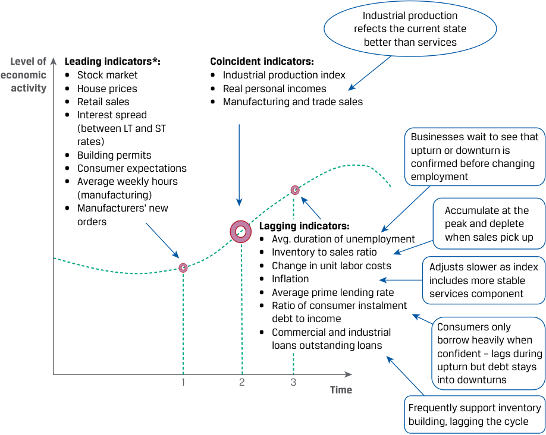

# Volume 2: Economics
## Learning Module 2 Understanding Business Cycles
### Part 2/3: Economic Indicators over the Business Cycle (PDF Pages 68–81)

---

<!-- PDF Page 68 -->

2. With which sector of the economy would analysts most commonly associate credit cycles? 

   - **A.** Exports 

   - **B.** Construction and purchases of property 

   - **C.** Food retail 

   - **Solution:** 

B is correct. Credit cycles are associated with availability of credit, which is important in the financing of construction and the purchase of property. 

3. The reason analysts follow developments in the availability of credit is that: 

   - **A.** loose private sector credit may contribute to the extent of asset price and real estate bubbles and subsequent crises. 

   - **B.** loose credit helps reduce the extent of asset price and real estate bubbles. 

   - **C.** credit cycles are of same length and depth as business cycles. 

   - **Solution:** 

A is correct. Studies have shown that loose credit conditions contribute to the extent of asset price and real estate bubbles that tend to be followed by crises. 

# **<mark>4</mark>** 

## **ECONOMIC INDICATORS OVER THE BUSINESS CYCLE** 

- describe how resource use, consumer and business activity, housing sector activity, and external trade sector activity vary over the business cycle and describe their measurement using economic indicators 

This lesson provides a broad overview of how the use of resources needed to produce goods and services typically evolves during a business cycle. We start by focusing on circumstances of firms and explore some of the links between fluctuations in inventory, employment, and investment in physical capital with economic fluctuations. 

### **The Workforce and Company Costs** 

The pattern of hiring and employment is shown in Exhibit 7 . When the economy enters contraction, companies reduce costs and eliminate overtime. They may try to retain workers rather than reduce employment only to increase it later. Finding and training new workers is costly, and it may be more cost efficient to keep workers on the payroll even if they are not fully utilized. Companies may also benefit from an implicit bond of loyalty between a company and its workers, boosting productivity in the process. In prolonged contractions, companies will start reducing costs more aggressively—terminating consultants, advertising campaigns, and workers beyond the strict minimum. Capacity utilization will be low, and few companies will invest in new equipment. Companies will try to liquidate their inventories of unsold products. In addition, banks will be reluctant to lend because bankruptcy risks are perceived to be higher, adding to the weakness in the economy. 

<!-- PDF Page 69 -->

Decreases in aggregate demand are likely to depress wages or wage growth as well as prices of inputs and capital goods. After a while, all of these input prices will be relatively low. In addition, interest rates may be cut to try to revive the economy. 

As prices and interest rates decrease, consumers and companies may begin to purchase more and aggregate demand may begin to rise. This stage is the turning point of the business cycle: Aggregate demand starts to increase and economic activity increases. 

**Exhibit 7: Business Cycle Phases—Levels of Employment** 

|Tr **Gap between** **actual GDP** **and trend GDP**|ough Recovery Expansion|Peak Slowdown Contra|ction **Time** Trough||
|---|---|---|---|---|
|**Phase**|**Recovery**|**Expansion**|**Slowdown**|**Contraction**|
|Description of activity levels|Economy starts at trough and output below poten- tial. Activity picks up, and gap starts to close.|Economy enjoys an upswing, with activ- ity measures showing above-average growth rates.|Economy at peak. Activity above average but decelerating. The economy may experience shortages of factors of production as demand may exceed supply.|Economy goes into a contraction, (recession, if severe). Activity mea- sures are below poten- tial. Growth is lower than normal.|
|Employment|Layoffs slow. Businesses rely on overtime before moving to hiring. Unemployment remains higher than average.|Businesses move from using overtime and temporary employees to hiring. Unemployment rate stabilizes and starts falling. Levels of employ|Businesses continue hir- ing but at a slower pace. Unemployment rate continues to fall but at slowly decreasing rates. ment lag the cycle|Businesses first cut hours, eliminate over- time, and freeze hiring, followed by outright layoffs. Unemployment rate starts to rise.|

### **Fluctuations in Capital Spending** 

Capital spending—spending on tangible goods, such as property, plant, and equipment— typically fluctuates with the business cycle. Because business profits and cash flows are sensitive to changes in economic activity, capital spending is also highly sensitive to changes in economic activity. In fact, investment is one of the most procyclical and volatile components of GDP. Company spending decisions are driven by business conditions, expectations, and levels of capacity utilization, all of which fluctuate over the cycle. With regard to efficiency, firms will run “lean production” to generate maximum output with the fewest number of workers at the end of contractions. Exhibit 8 provides a description of capital spending over the cycle. Note that new orders statistics include orders that will be delivered over several years. For example, 

<!-- PDF Page 70 -->

it is common for airlines to order 40 airplanes to be delivered over five years. Where relevant, analysts use “core” orders that exclude defense and aircrafts for a better understanding of the economy’s trend. 

**Exhibit 8: Capital Spending during the Economic Cycle** 

|**Phase of the** **Cycle**|**Business conditions and** **expectations**|**Capital spending**|**Examples**|
|---|---|---|---|
|**Recovery**|Excess capacity during trough, low utilization, little need for capacity expansion. Interest rates tend to be low— supporting investment.|Low but increasing as compa- nies start to enjoy better condi- tions. Capex focus on efficiency rather than capacity. Upturn most pronounced in orders for light producer equip- ment. Typically, the orders initially reinstated are for equipment with a high rate of obso- lescence, such as software, systems, and technological hardware.|Software, systems, and hardware (high rates of obsolescence) orders placed or re-instated first.|
|**Expansion**|Companies enjoy favorable con- ditions. Capacity utilization increases from low levels. Over time, productive capacity may begin to limit ability to respond to demand. Growth in earnings and cash flow gives businesses the financial ability to increase investment spending.|Customer orders and capacity utilization increase. Companies start to focus on capacity expansion. The composition of the econo- my’s capacity may not be opti- mal for the current structure of demand, necessitating spending on new types of equipment. Orders precede actual ship- ments, so orders for capital equipment are a widely watched indicator of the future direction of capital spending.|Heavy and complex equipment, warehouses, and factories. A company may need warehouse space in locations different from where existing facilities are located.|
|**Slowdown**|Business conditions at peak, with healthy cash flow. Interest rates tend to be higher— aimed at reducing overheating and encouraging investment slowdown.|New orders intended to increase capacity may be an early indicator of the late stage of the expansion phase. Companies continue to place new orders as they operate at or near capacity.|Fiber-optic overinvestment in the late 1990s that peaked with the “technology, media, telecoms bubble.”|
|**Contraction**|Companies experience fall in demand, profits, and cash flows.|New orders halted, and some existing orders canceled (no need to expand). Initial cutbacks may be sharp and exaggerate the economy’s downturn. As the general cycli- cal bust matures, cutbacks in spending on heavy equipment further intensify the contrac- tion. Maintenance scaled back.|Technology and light equipment with short lead times get cut first. Cuts in construction and heavy equipment follow.|

<!-- PDF Page 71 -->

#### **EXAMPLE 1** 

### **Capital Spending** 

1. Levels of capacity utilization are one of the factors that determine companies’ aggregate need for additional capital expenditure. Which of the following is another factor that affects the capital expenditure decision? 

   - **A.** The rate of unemployment 

   - **B.** The composition of the economy’s capacity in relation to how it can satisfy demand 

   - **C.** The ability to reinstate orders canceled during the contraction stage 

   - **Solution:** 

B is correct. The composition of the current productive capacity may not be optimal of the current structure of demand. C is incorrect because the ability to re-instate canceled orders is a matter that is relevant once the decision to increase capital expenditure is made. 

2. Orders for technology and light equipment decline before construction projects in a contraction because: 

   - **A.** businesses are uncertain about cyclical directions. 

   - **B.** equipment orders are easier to cancel than large construction projects. 

   - **C.** businesses value light equipment less than structures and heavy machinery. 

#### **Solution:** 

B is correct. Because it usually takes much longer to plan and complete large construction projects than it takes to plan and complete equipment orders, construction projects may be less influenced by business cycles. 

### **Fluctuations in Inventory Levels** 

The aggregate size of inventories is small relative to the size of the economy, but their accumulation and cutbacks by businesses can occur with substantial speed and frequency. Changing inventories reflect differences between the growth (or decline) in sales and the growth (or decline) in production. A key indicator in this area is the inventory–sales ratio that measures the inventories available for sale to the level of sales. Analysts pay attention to inventories to gauge the position of the economy in the cycle. Exhibit 9 shows how production, sales, and inventories typically move through the phases of a cycle. 

<!-- PDF Page 72 -->

#### **Exhibit 9: Inventories throughout the Cycle** 

|**Phase of** **the Cycle**|**Recovery**|**Expansion**|**Slowdown**|**Contraction**|
|---|---|---|---|---|
|Sales and production|Decline in sales slows. Sales subsequently recover. Production upturn follows but lags behind sales growth. Over time, production approaches normal levels as excess inventories from the downturn are cleared.|Sales increase. Production rises fast to keep up with sales growth and to replenish inven- tories of finished products. This increases the demand for intermediate products. “Inventory rebuilding or restocking stage.”|Sales slow faster than production; inventories increase. Economic slowdown leads to production cutbacks and order cancellations.|Businesses pro- duce at rates below the sales volumes necessary to dis- pose of unwanted inventories.|
|Inventory– sales ratio|Begins to fall as sales recov- ery outpaces production.|Ratio stable.|Ratio increases. Signals weakening economy.|Ratio begins to fall back to normal.|

#### **EXAMPLE 2** 

### **Inventory Fluctuation** 

1. Although a small part of the overall economy, changes in inventories can influence economic growth measures significantly because they: **A.** reflect general business sentiment. **B.** tend to move forcefully up or down. **C.** determine the availability of goods for sale. 

**Solution:** 

B is correct. Inventory levels can fluctuate dramatically over the business cycle. 

2. Inventories tend to rise when: 

   - **A.** inventory–sales ratios are low. **B.** inventory–sales ratios are high. **C.** economic activity begins to rebound. 

   - **Solution:** 

A is correct. When the economy starts to recover, sales of inventories can outpace production, which results in low inventory–sales ratios. Companies then need to accumulate more inventories to restore the ratio to normal level. C is incorrect because in the early stages of a recovery, inventories are likely to fall as sales increase faster than production. 

3. Inventories will often fall early in a recovery because: **A.** businesses need profit. **B.** sales outstrip production. **C.** businesses ramp up production because of increased economic activity. 

**Solution:** B is correct. The companies are slow to increase production in the early recovery phase because they first want to confirm the recession is over. Increasing output also takes time after the downsizing during the recession. 

<!-- PDF Page 73 -->

4. In a recession, companies are _most likely_ to adjust their stock of physical capital by: 

   - **A.** selling it at fire sale prices. 

   - **B.** not maintaining equipment. 

   - **C.** quickly canceling orders for new construction equipment. 

   - B is correct. Physical capital adjustments to downturns come through aging of equipment plus lack of maintenance. 

5. The inventory–sales ratio is _most likely_ to be rising: 

   - **A.** as a contraction unfolds. 

   - **B.** partially into a recovery. 

   - **C.** near the top of an economic cycle. 

   - C is correct. Near the top of a cycle, sales begin to slow before production is cut, leading to an increase in inventories relative to sales. 

### **Economic Indicators** 

**Economic indicators** are variables that provide information on the state of the overall economy. They are statistics or data readings that reflect economic circumstances of a country, group of countries, region, or sector. Economic indicators are used by policy makers and analysts to understand and assess the existing condition of the economy and its position in the cycle. They also can be used to help predict or confirm the turning points in the cycle. Such knowledge allows analysts to better predict the financial and market performance of stocks and bonds of issuers operating in different sectors of the economy with different sensitivity to the economic cycle. 

### **Types of Indicators** 

Economic indicators are often classified according to whether they lag, lead, or coincide with changes in an economy’s growth. 

- **Leading economic indicators** have turning points that usually precede those of the overall economy. They are believed to have value for predicting the economy’s future state, usually near term. 

- **Coincident economic indicators** have turning points that are usually close to those of the overall economy. They are believed to have value for identifying the economy’s present state. 

- **Lagging economic indicators** have turning points that take place later than those of the overall economy. They are believed to have value in identifying the economy’s past condition and only change after a trend has been established. 

Exhibit 10 provides an illustration of several leading, lagging, and coincident indicators. The leading indicators observed at a point in time labeled as time “1” indicate the direction of the of the activity (output) at a future point in time, such as time “2.” The lagging indicators, released around time “3,” refer to and help confirm what the state of the economy was at time “2.” 

<!-- PDF Page 74 -->

#### **Exhibit 10: Types of Economic Indicators** 

<!-- Start of picture text -->
Industrial production refects the current state better than services Level of Leading indicators*: Coincident indicators: economic • Stock market • Industrial production index activity • House prices • Real personal incomes • Retail sales • Manufacturing and trade sales • Interest spread (between LT and ST rates) Businesses wait to see that • Building permits upturn or downturn is • Consumer expectations confirmed before changing • Average weekly hours employment (manufacturing) • Manufacturers’ new Accumulate at the orders Lagging indicators: peak and deplete • Avg. duration of unemployment when sales pick up • Inventory to sales ratio • Change in unit labor costs Adjusts slower as index • Inflation i ncludes more stable • Average prime lending rate services component • Ratio of consumer instalment debt to income • Commercial and industrial Consumers only borrow heavily when loans outstanding loans confident – lags during upturn but debt stays 1 2 3 into downturns Time Frequently support inventory building, lagging the cycle <!-- End of picture text -->

* Leading indicators will be explored in the subsequent section. 

### **Composite Indicators** 

An economic indicator either consists of a single variable, like industrial production or the total value of outstanding building permits, or can be a composite of different variables that all tend to move together. The latter are regularly labeled composite indicators. Traditionally, most composite indicators to measure the cyclical state of the economy consist of up to a dozen handpicked variables published by organizations like the OECD or national research institutes. The exact variables combined into these composites vary from one economy to the other. In each case, however, they bring together various economic and financial measures that have displayed a consistently leading, coincident, or lagging relationship to that economy’s general cycle. 

### **Leading Indicators** 

The Conference Board, a US industry research organization, publishes a composite leading indicator known as The Conference Board Leading Economic Index (LEI), which consists of 10 component parts (it uses the classical business cycle as the underlying concept). Exhibit 11 presents the 10 components used in the LEI. In addition to naming the indicators, it offers a general description of why each measure is leading the business cycle. 

<!-- PDF Page 75 -->

**Exhibit 11: Index of Leading Economic Indicators, United States** 

|**Leading indicators** Average weekly hou manufacturing|rs,|Businesses will cut overtime before laying off workers in a downturn and increase it before rehiring in a cyclical upturn. Moves up and down before the general economy. **Reason for use**|
|---|---|---|
|Average weekly initi for unemployment i|al claims nsurance|A very sensitive test of initial layoffs and rehiring.|
|Manufacturers’ new for consumer goods materials|orders and|Businesses cannot wait too long to meet demand without ordering. Orders tend to lead at upturns and downturns & captures business sentiment.|
|_The Institute of Su_ _polls its members_ _manufacturing ord_ _pricing, and comp_|_pply Management (ISM)_ _to build indexes of_ _ers, output, employment,_ _arable gauges for services._||
|ISM new order index|_A diffusion index usually m_ _that are rising in the same_ _movement in the trend is_|_easures the percentage of components in a series_ _period. It indicates how widespread a particular_ _among the individual components._ |
|_Survey bas_|_ed_|Reflects the month on month change in new orders for final sales. Decline of new orders can signal weak demand and can lead to recession.|
|Manufacturers’ new for non-defense cap goods excluding air|orders ital craft|Captures business expectations and offers first signal of movement up or down. Important sector.|
|Building permits for private housing unit|new s|Signals new construction activity as permits required before new building can begin.|
|S&P 500 Index||Stocks tends to anticipate economic turning points; useful early signal.|
|Leading Credit Index||A vulnerable financial system can amplify the effects of negative shocks, causing widespread recessions.|
||_Aggregates the_ _information from six_ _leading financial_ _indicators, which reflect_ _the strength of the_||
|Interest rate spread between 10-year treasury yields and overnight| _financial system to_ _endure stress._|LT (10 or 30 year) bond yields express market expectations about the direction of short-term interest rates. As rates ultimately follow the economic cycle up and down, a wider spread, by anticipating short rate increases, also anticipates|
|borrowing rates (federal funds rate)|_Inversion of the_ _yield curve occurs_ _when ST interest_ _rate exceed LT rates_ _– meaning that ST_ _rates are expected_ _to fall and activity is_ _expected to weaken._|an economic upswing and vice versa.|
|Average consumer expectations for business conditions| _Survey based_|Optimism tends to increase spending. Provides early insight into the direction ahead for the whole economy.|

### **Using Economic Indicators** 

Exhibit 12 shows a simplified process that an analyst could use to identify business cycle phases. The conclusions then can be used to make investment decisions—for example, to decide in what sectors companies are likely to see improving or deteriorating 

<!-- PDF Page 76 -->

cash flows, which could affect the investment performance of the equity and debt securities issued by the companies. Note that the order of the steps does not have to follow this particular sequence. 

#### **Exhibit 12: Use of Statistics to Identify Business Cycle Phase** 

#### Step 1 

- Data release: Analyst notes an increase in the reported level of consumer instalment debt to income. 

- Analysis: The above indicator normally lags cyclical upturns. 

- Possible conclusion: Initial evidence that an upturn has been underway. 

#### Step 2 

- Data release: Industrial Production Index and non-farm payrolls (employees on non-agricultural payrolls) are moving higher. 

- Analysis: These coincident indicators suggest activity is picking up. 

- Possible conclusion: Further evidence that expansion is underway. 

#### Step 3 

- Observation: Equity market index has been trending higher. Equity index is a leading indicator. Analyst checks the aggregate LEI Index. 

- Analysis: If the aggregate LEI is moving higher too, evidence suggests that recovery is underway. Confirmation that output is moving higher. 

#### **Or** 

- If aggregate LEI is not moving higher, analyst cannot draw conclusions about recovery. 

### **Other Composite Leading Indicators** 

For about 30 countries and several aggregates, such as the EU and G–7, the OECD calculates OECD Composite Leading Indicator (CLI), which gauges the state of the business cycle in the economy using the growth cycle concept. One of the interesting features of OECD CLI is that the underlying methodology is consistent across several countries. Therefore, it can be compared more easily to see how each region is faring. Exhibit 13 shows the eight components of CLI used by the OECD. As is usually the case with leading indicators, some data are based on surveys whereas others are based on reported market or economic data. 

<!-- PDF Page 77 -->

#### **Exhibit 13: OECD Euro Area CLI Components** 

|**OECD CLI**|||
|---|---|---|
|_Composite indicator_ _of economic tendency_ _survey results_|Economic sentiment index Residential building permits||
||Capital goods orders||
||M2 money supply Euro Stoxx Equity Index An interest rate spread|Composite leading indicator|
|_Survey – based_|EurozoneEuro area Manufacturing Purchasing Managers Index (PMI)||
|_Survey – based_|EurozoneEuro area Service Sector Future Business Activity Expectations Index||

The parallels that can be drawn between many of these components and those used in the United States are clear, but the Euro area includes a services component in its business activity measures that the United States lacks. Additionally, the Euro area forgoes many of the overtime and employment gauges that the United States includes. The OECD CLI for Japan is again similar, but it does include labor market indicators (unlike the Euro area) and it adds a measure of business failures not included in the other two. 

#### **GERMANY: THE IFO SURVEY** 

The German ifo survey is a widely used index capturing business climate in Germany and is published monthly. Exhibit 14 shows how the index moved ahead of quarterly-reported year-over-year changes in German GDP. It also shows an uptick in 2018 despite the GDP growth downturn. These indicators are useful, but they are not foolproof. 

#### **Exhibit 14: Business Climate Survey and GDP** 

<!-- Start of picture text -->
Percent (year-over-year) Index (2015 = 100) 6 110 4 105 2 100 0 95 –2 90 –4 85 –6 80 –8 75 08 09 10 11 12 13 14 15 16 17 18 19 20 GDP (year-over-year) IFO Index Sources:  The ifo Institute and the Federal Statistical Office of Germany. <!-- End of picture text -->

<!-- PDF Page 78 -->

### **Surveys** 

The composite indicators for region- or country-specific business cycles often make use of economic tendency surveys. These monthly or quarterly surveys carried out by central banks, research institutes, statistical offices, and trade associations are conducted among either businesses, consumers, or experts. The mostly qualitative questions posed are often on the state of their finances, level of activity, and confidence in the future. 

CIRET (a forum for leading economists and institutions that conducts and analyzes business and consumer survey data), the United Nations, the OECD, and the European Commission operate at different regional levels to harmonize and exchange knowledge regarding these business tendency and consumer surveys. The Directorate-General for Economic and Financial Affairs (DG ECFIN) publishes fully harmonized results for different sectors of the EU member and applicant economies. The Bank of Japan carries out similar surveys and releases the findings in what is called the “Tankan Report.” These diverse sources multiply within and across economies. Over the past decade, so-called purchasing managers indexes along similar lines, albeit with often much smaller survey samples, have been introduced in a wide range of countries and regions, including Europe and China. 

These economic tendency surveys are often aggregated into or are a part of composite indicators. IHS Markit publishes a global Purchasing Managers’ Index (PMI) indicator using results of its national business surveys (see Exhibit 13). A global consumer confidence indicator is published by The Conference Board. Some other institutions collect national survey data and calculate supranational results. For example, the OECD publishes a business confidence indicator and a consumer confidence indicator for the OECD aggregate in its report “Main Economic Indicators.” In addition, the European Commission calculates various survey-based indicators for the EU, reflecting the situation in Europe. Based on economic tendency surveys and using the growth rate cycle concept, the Swiss Economic Institute ( _Konjunkturforschungsstelle_ or KOF) and _Fundação Getúlio Vargas_ (FGV), based in Rio de Janeiro, Brazil, publish a coincident and a leading indicator for the world economy called the Global Economic Barometers. These barometers incorporate hundreds of survey variables from around the world. 

### **The Use of Big Data in Economic Indicators** 

The vast increase in this information and academic developments regarding the use of big(ger) data have in recent years increased the number of variables that go into these composite indicators. For instance, using a statistical technique called principal components analysis, the Federal Reserve Bank of Chicago computes the Chicago Fed National Activity Index (CFNAI) using 85 monthly macroeconomic series. These series cover industrial production, personal income, capital utilization, employment by sectors, housing starts, retail sales, and so on. Principal components analysis extracts the underlying trend that is common to most of these variables, thus distilling the essence of the US business cycle. Similarly, the Bank of Italy in conjunction with the Centre for Economic Policy Research (CEPR) produces the EuroCOIN statistic, which is also based on principal component analysis. More than 100 macroeconomic series are included in EuroCOIN. EuroCOIN also includes data derived from surveys, interest rates, and other financial variables. 

### **Nowcasting** 

Policy makers and market practitioners use real-time monitoring of economic and financial variables to continuously assess current conditions. To overcome the publication delays (e.g., GDP numbers are published with a substantial delay) and forecast 

<!-- PDF Page 79 -->

the “present,” they make use of a large variety of data—such as financial market transactions, data from the usage of the large amounts of timely internet searches, and electronic payment data—to provide estimates for key low-frequency (monthly or quarterly) economic indicators. This process produces a nowcast, which is an estimate of the current state, and we refer to the process of producing such an estimate as nowcasting. It can be applied to various macroeconomic variables of interest, such as GDP growth, inflation, or unemployment. 

### **GDPNow** 

Nowcasts are produced by a number of entities in investment banking and asset management for their internal or client use, but they are also published by institutions, such as the Atlanta Fed (the Federal Reserve Bank of Atlanta, one of the 12 Federal Reserve Banks in the United States). According to the Atlanta Fed, “GDPNow” is “best viewed as a running estimate of real GDP growth based on available data for the current measured quarter.” The objective is to forecast GDP for the current quarter (which will not be released until after quarter-end) in real time based on data as they are released throughout the quarter. To do this, the Atlanta Fed attempts to use the same methodology and data as will be used by the US Bureau of Economic Analysis (BEA) to estimate GDP, replacing data that have not yet been released with forecasts based on the data already observed. As the quarter progresses, more of the actual data will have been observed. GDPNow should, at least on average, converge to what will be released by the BEA as their “advance” estimate of quarterly GDP about four weeks after quarter-end. 

#### **DIFFUSION INDEX OF ECONOMIC INDICATORS** 

In the United States, The Conference Board also compiles a monthly diffusion index of the leading, lagging, and coincident indicators. The **diffusion index** reflects the proportion of the index’s components that are moving in a pattern consistent with the overall index. Analysts often rely on these diffusion indexes to provide a measure of the breadth of the change in a composite index. 

For example, The Conference Board tracks the growth of each of the 10 constituents of its LEI, assigning a value of 1.0 to each indicator that rises by more than 0.05 percent during the monthly measurement period, a value of 0.5 for each component indicator that changes by less than 0.05 percent, and a value of 0 for each component indicator that falls by more than 0.05 percent. These assigned values, which of course differ in other indexes in other countries, are then summed and divided by 10 (the number of components). To make the overall measure resemble the more familiar indexes, the Board multiplies the result by 100. 

A simple numerical example will help explain. Say, for ease of exposition, the indicator has only four component parts: stock prices, money growth, orders, and consumer confidence. In one month, stock prices rise 2.0 percent, money growth rises 1.0 percent, orders are flat, and consumer confidence falls by 0.6 percent. Using The Conference Board’s assigned values, these would contribute respectively: 1.0 + 1.0 + 0.5 + 0 to create a numerator of 2.5. When divided by four (the number of components) and multiplied by 100, it generates an indicator of 62.5 for that month. 

Assume that the following month stock prices fall 0.8 percent, money grows by 0.5 percent, orders pick up 0.5 percent, and consumer confidence grows 3.5 percent. Applying the appropriate values, the components would add to 0 + 1.0 + 1.0 + 1.0 = 3.0. Divided by the number of components and multiplied by 

<!-- PDF Page 80 -->

100, it yields an index value of 75. The 20.0 percent increase in the index value means more components of the composite index are rising. Given this result, an analyst can be more confident that the higher composite index value actually represents broader movements in the economy. In general, a diffusion index does not reflect outliers in any component (like a straight arithmetic mean would do) but instead tries to capture the overall change common to all components. 

#### **QUESTION SET** 

1. Leading, lagging, and coincident indicators are: 

   - **A.** the same worldwide. 

   - **B.** based on historical cyclical observations. 

   - **C.** based on Keynesian or Monetarist theory. 

#### **Solution:** 

B is correct. The recognition of economic indicators is based on empirical observations for an economy. 

2. A diffusion index: 

   - **A.** measures growth. 

   - **B.** reflects the consensus change in economic indicators. 

   - **C.** is roughly analogous to the indexes used to measure industrial production. 

#### **Solution:** 

B is correct. The diffusion indexes are constructed to reflect the common trends embedded in the movements of all the indicators included in such an index. 

3. In the morning business news, a financial analyst, Kevin Durbin, learned that average hourly earnings had increased last month. The most appropriate action for Durbin is to: 

   - **A.** call his clients to inform them of a good trading opportunity today. 

   - **B.** examine other leading indicators to see any confirmation of a possible turning point for the economy. 

   - **C.** use the news in his research report as a confirmation for his belief that the economy has recovered from a recession. 

#### **Solution:** 

B is correct. Financial analysts need to synthesize the information from various indicators in order to gather a reliable reading of the economic trends. 

4. The following table shows the trends in various economic indicators in the two most recent quarters: 

|**Economic Indicator**|**Trend**|
|---|---|
|Interest rate spread between long-term govern- ment bonds and overnight borrowing rate|Narrowing|
|New orders for capital goods|Declining|
|Residential building permits|Declining|

<!-- PDF Page 81 -->

|**Economic Indicator**|**Trend**|
|---|---|
|Employees on non-agricultural payrolls|Turned from rising to falling|
|Manufacturing and trade sales|Stable|
|Average duration of unemployment|Small decline|
|Change in unit labor costs|Rising|

Given the information, this economy is _most likely_ experiencing a: 

**A.** continuing recession. 

**B.** peak in the business cycle. 

**C.** strong recovery out of a trough. 

#### **Solution:** 

B is correct. The first three indicators are leading indicators, and all of them are indicating an impending recession, which means the economy has reached the peak in this cycle. Non-agricultural payrolls and manufacturing and trade sales are coincident indicators. The trends in these two variables further indicate that the economy may begin to decline. The trends in the last two indicators—both lagging indicators—indicate that the economy may either continue to grow or it may be close to a peak. Aggregating the signals given by all three groups of economic indicators, it appears the economy may be near the peak of a business cycle. 

