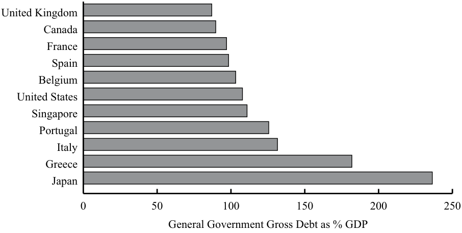
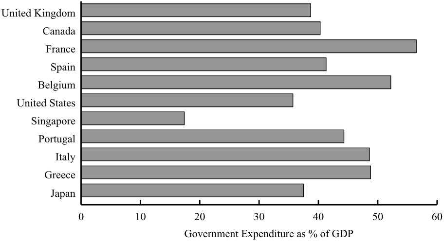

# Volume 2: Economics
## Learning Module 3 Fiscal Policy
### Part 1/2: Introduction (PDF Pages 87–99)

---

<!-- PDF Page 87 -->

#### L E A R N I N G M O D U L E 

# **<mark>3</mark>** 

### **Fiscal Policy** 

###### **by Andrew Clare, PhD, and Stephen Thomas, PhD.** 

_Andrew Clare, PhD, and Stephen Thomas, PhD, are at Cass Business School (UK)._ 

###### **<mark>LEARNING OUTCOMES</mark>** 

|**_Mastery_**|**_The candidate should be able to:_**|
|---|---|
||compare monetary and fiscal policy|
||describe roles and objectives of fiscal policy as well as arguments as to whether the size of a national debt relative to GDP matters|
||describe tools of fiscal policy, including their advantages and disadvantages|
||explain the implementation of fiscal policy and difficulties of implementation as well as whether a fiscal policy is expansionary or contractionary|

##### **INTRODUCTION** 

**<mark>1</mark>** 

**Fiscal policy** refers to the government’s decisions about taxation and spending, whereas **monetary policy** refers to central bank activities that are directed toward influencing the quantity of money and credit in an economy. Fiscal policy involves the use of government spending and changing tax revenue to affect certain aspects of the economy, such as the overall level of aggregate demand. Government deficits are the difference between government revenues and expenditures over a period of calendar time. The fiscal tools available to a government include transfer payments, current government spending, capital expenditures, and taxes. Economists often examine the **structural budget deficit** as an indicator of a government’s fiscal stance. 

###### **LEARNING MODULE OVERVIEW** 

- Fiscal policy refers to the government’s decisions about taxation and spending. 

- ■ Monetary policy refers to central bank activities that are directed toward influencing the quantity of money and credit in an economy. 

<!-- PDF Page 88 -->

- The primary goal of both monetary and fiscal policy is the creation of an economic environment in which growth is stable and positive, and inflation is stable and low. 

- Fiscal policy involves the use of government spending and changing tax revenue to affect certain aspects of the economy, including the level of economic activity in an economy, the distribution of income and wealth among different segments of the population, and the allocation of resources between different sectors and economic agents. 

- The **budget surplus/deficit** is the difference between government revenue and expenditure for a fixed period of time, such as a fiscal or calendar year. 

- There are several strong arguments both for and against being concerned about national debt relative to GDP. 

- The fiscal tools available to a government include transfer payments, current government spending, capital expenditures, direct taxes, and indirect taxes. 

- Taxes can be justified both in terms of raising revenues to finance expenditures and in terms of income and wealth redistribution policies. 

- Fiscal policy tools seek to achieve or maintain an economy on a path of positive, stable growth with low inflation. 

- Economists assess the structural (or cyclically adjusted) budget deficit as an indicator of the government’s fiscal stance, which is defined as the deficit that would exist if the economy was at full employment. 

- Actual government deficits may not be a good measure of fiscal stance because of the distinction between real and nominal interest rates and the role of inflation adjustment when applied to budget deficits. 

- Fiscal policy cannot stabilize aggregate demand completely because the difficulties in executing fiscal policy cannot be completely overcome. 

## **<mark>2</mark> INTRODUCTION TO MONETARY AND FISCAL POLICY** 

compare monetary and fiscal policy 

The economic decisions of households can have a significant impact on an economy. For example, a decision on the part of households to consume more and to save less can lead to an increase in employment, investment, and ultimately profits. Equally, the investment decisions made by corporations can have an important impact on the real economy and on corporate profits. But individual corporations can rarely affect large economies on their own; the decisions of a single household concerning consumption will have a negligible impact on the wider economy. 

By contrast, the decisions made by governments can have an enormous impact on even the largest and most developed of economies for two main reasons. First, the public sectors of most developed economies normally employ a significant proportion of the population, and they usually are responsible for a significant proportion 

<!-- PDF Page 89 -->

of spending in an economy. Second, governments are also the largest borrowers in world debt markets. The following exhibit gives some idea of the scale of government borrowing and spending. 

###### **Scale of Government Borrowing and Spending** 

**Panel A. Central Government Debt to GDP, 2017** 

<!-- Start of picture text -->
United Kingdom Canada France Spain Belgium United States Singapore Portugal Italy Greece Japan 0 50 100 150 200 250 General Government Gross Debt as % GDP <!-- End of picture text -->

**Panel B. Public Sector Spending to GDP, 2017** 

<!-- Start of picture text -->
United Kingdom Canada France Spain Belgium United States Singapore Portugal Italy Greece Japan 0 10 20 30 40 50 60 Government Expenditure as % of GDP <!-- End of picture text -->

_Source_ : IMF, World Economic Outlook Database, April 2018. 

Government policy is ultimately expressed through its borrowing and spending activities. In this reading, we identify and discuss two types of government policy that can affect the macroeconomy and financial markets: monetary policy and fiscal policy. 

Monetary policy refers to central bank activities that are directed toward influencing the quantity of money and credit in an economy. Central banks can implement monetary policy almost completely independent of government interference and influence at one end of the scale or may simply act as the agent of the government at the other end of the scale. 

<!-- PDF Page 90 -->

By contrast, fiscal policy refers to the government’s decisions about taxation and spending. Both monetary and fiscal policies are used to regulate economic activity over time. They can be used to accelerate growth when an economy starts to slow or to moderate growth and activity when an economy starts to overheat. In addition, fiscal policy can be used to redistribute income and wealth. 

The overarching goal of both monetary and fiscal policy is normally the creation of an economic environment in which growth is stable and positive and inflation is stable and low. Crucially, the aim is to steer the underlying economy so that it does not experience economic booms that may be followed by extended periods of low or negative growth and high levels of unemployment. In such a stable economic environment, households can feel secure in their consumption and saving decisions, while corporations can concentrate on their investment decisions, on making their regular coupon payments to their bond holders, and on making profits for their shareholders. 

The challenges to achieving this overarching goal are many. Economies frequently are buffeted by shocks (such as oil price jumps), and some economists believe that natural cycles in the economy also exist. Moreover, we can find plenty of examples from history in which government policies—either monetary, fiscal, or both—have exacerbated an economic expansion that eventually led to damaging consequences for the real economy, for financial markets, and for investors. 

###### **QUESTION SET** 

1. Which of the following statements _best_ describes monetary policy? Monetary policy: 

   - **A.** involves the setting of medium-term targets for broad money aggregates. 

   - **B.** involves the manipulation by a central bank of the government’s budget deficit. 

   - **C.** seeks to influence the macroeconomy by influencing the quantity of money and credit in the economy. 

   - **Solution:** 

C is correct, as monetary policy involves central bank activities directed toward influencing the quantity of money and credit. Choice A is incorrect because, although the setting of targets for monetary aggregates is a possible _tool_ of monetary policy, monetary policy itself is concerned with influencing the overall, or macro, economy. 

2. Which of the following statements _best_ describes fiscal policy? Fiscal policy: 

   - **A.** is used by governments to redistribute wealth and incomes. 

   - **B.** is the attempt by governments to balance their budgets from one year to the next. 

   - **C.** involves the use of government spending and taxation to influence economy activity. 

###### **Solution:** 

C is correct. Note that governments may wish to use fiscal policy to redistribute income and balance their budgets, but the overriding goal of fiscal policy is usually to influence a broader range of economic activity. 

<!-- PDF Page 91 -->

##### **ROLES AND OBJECTIVES OF FISCAL POLICY** 

## **<mark>3</mark>** 

describe roles and objectives of fiscal policy as well as arguments as to whether the size of a national debt relative to GDP matters 

Fiscal policy involves the use of government spending and changing tax revenue to affect a number of aspects of the economy: 

- Overall level of aggregate demand in an economy and hence the level of economic activity. 

- Distribution of income and wealth among different segments of the population. 

- Allocation of resources between different sectors and economic agents. 

The discussion of fiscal policy often focuses on the impact of changes in the difference between government spending and revenue on the aggregate economy, rather than on the actual levels of spending and revenue themselves. 

###### **Roles and Objectives of Fiscal Policy** 

A primary aim for fiscal policy is to help manage the economy through its influence on aggregate national output, that is, real GDP. 

###### **_Fiscal Policy and Aggregate Demand_** 

Aggregate demand is the amount companies and households plan to spend. We can consider a number of ways that fiscal policy can influence aggregate demand. For example, an **expansionary** policy could take one or more of the following forms: 

- Cuts in personal income tax raise disposable income with the objective of boosting aggregate demand. 

- Cuts in sales (indirect) taxes to lower prices raise real incomes with the objective of raising consumer demand. 

- Cuts in corporation (company) taxes to boost business profits may raise capital spending. 

- Cuts in tax rates on personal savings to raise disposable income for those with savings, with the objective of raising consumer demand. 

- New public spending on social goods and infrastructure, such as hospitals and schools, boost personal incomes with the objective of raising aggregate demand. 

We must stress, however, that the reliability and magnitude of these relationships will vary over time and from country to country. For example, in a recession with rising unemployment, it is not always the case that cuts in income taxes will raise consumer spending because consumers may wish to raise their precautionary (rainy day) saving in anticipation of further deterioration in the economy. Indeed, in very general terms, economists are often divided into two camps regarding the workings of fiscal policy. **Keynesians** believe that fiscal policy can have powerful effects on aggregate demand, output, and employment when there is substantial spare capacity in an economy. **Monetarists** believe that fiscal changes only have a temporary effect on aggregate demand and that monetary policy is a more effective tool for restraining or boosting inflationary pressures. Monetarists tend not to advocate using monetary policy for countercyclical adjustment of aggregate demand. This intellectual division 

<!-- PDF Page 92 -->

naturally will be reflected in economists’ divergent views on the efficacy of the large fiscal expansions observed in many countries following the 2008–2009 Global Financial Crisis, along with differing views on the possible impact of quantitative easing. 

###### **_Government Receipts and Expenditure in Major Economies_** 

In Exhibit 1, we present the total government revenues as a percentage of GDP for some major economies. This is the share of a country’s output that is gathered by the government through taxes and such related items as fees, charges, fines, and capital transfers. It is often considered as a summary measure of the extent to which a government is involved both directly and indirectly in the economic activity of a country. 

Taxes are formally defined as compulsory, unrequited payments to the general government (they are unrequited in the sense that benefits provided by a government to taxpayers usually are not related to payments). Exhibit 1 contains taxes on incomes and profits, social security contributions, indirect taxes on goods and services, employment taxes, and taxes on the ownership and transfer of property. 

**Exhibit 1: General Government Revenues as Percent of GDP** 

||**1995**|**2000**|**2005**|**2008**|**2010**|**2015**|
|---|---|---|---|---|---|---|
|Australia|34.5|36.1|36.5|35.3|32.4|34.9|
|Germany|45.1|46.4|43.6|43.8|43.0|44.5|
|Japan|31.2|31.4|31.7|34.4|30.6|35.7|
|United Kingdom|38.2|40.3|40.8|42.2|38.2|38.0|
|United States|33.8|35.4|33.0|32.3|30.9|33.4|
|OECD|37.9|39.0|37.7|37.9|39.8|40.9|

_Source:_ Organisation for Economic Co-Operation and Development (OECD). 

Taxes on income and profits have been fairly constant for the member countries of the Organisation for Economic Co-operation and Development (OECD) at around 12.5–13 percent of GDP since the mid-1990s, while taxes on goods and services have been steady at about 11 percent of GDP for that period. Variations between countries can be substantial; taxes on goods and services are around 5 percent of GDP for the United States and Japan but are more than 16 percent for Denmark. 

Exhibit 2 shows the percentage of GDP represented by government expenditure in a variety of major economies over time. Generally, these have been fairly constant since 1995, although Germany had a particularly high number at the start of the period because of reunification costs. The impacts of governments’ fiscal stimulus programs in the face of the 2008–2009 financial crisis show up as significant increases in government expenditures in Exhibit 2 and increases in government deficits between 2008 and 2010 are evident in Exhibit 3. 

**Exhibit 2: General Government Expenditures as Percent of GDP** 

||**1995**|**2000**|**2005**|**2008**|**2010**|**2015**|
|---|---|---|---|---|---|---|
|Australia|38.2|35.2|34.8|34.3|34.4|36.2|
|Germany|54.8|45.1|46.9|43.8|47.3|43.9|
|Japan|36.0|39.0|38.4|37.1|39.6|39.4|
|United Kingdom|44.1|36.6|44.0|47.5|47.6|42.2|

<!-- PDF Page 93 -->

||**1995**|**2000**|**2005**|**2008**|**2010**|**2015**|
|---|---|---|---|---|---|---|
|United States|37.1|33.9|36.2|38.8|42.9|37.6|
|OECD|42.7|38.7|40.5|41.4|45.2|41.8|

_Source:_ OECD. 

Clearly, the possibility that fiscal policy can influence output means that it may be an important tool for **economic stabilization** . In a recession, governments can raise spending ( **expansionary fiscal policy** ) in an attempt to raise employment and output. In boom times—when an economy has full employment and wages and prices are rising too fast—government spending may be reduced and taxes raised ( **contractionary fiscal policy** ). 

Hence, a key concept is the budget surplus or deficit, which is the positive or negative difference between government revenue and expenditure for a fixed period of time, such as a fiscal or calendar year. Government revenue includes tax revenues net of transfer payments; government spending includes interest payments on the government debt. Analysts often focus on changes in the budget surplus or deficit from year to year as indicators of whether the fiscal policy is getting tighter or looser. An increase in a budget surplus would be associated with contractionary fiscal policy, while a rise in a deficit is an expansionary fiscal policy. Of course, over the course of a business cycle, the budget surplus will vary automatically in a countercyclical way. For example, as an economy slows and unemployment rises, government spending on social insurance and unemployment benefits will also rise and add to aggregate demand. This is known as an **automatic stabilizer** . Similarly, if boom conditions ensue and employment and incomes are high, then progressive income and profit taxes are rising and also act as automatic stabilizers increasing budget surplus or reducing budget deficit. The great advantage of automatic stabilizers is that they are automatic and do not require the identification of shocks to which policy makers must consider a response. By reducing the responsiveness of the economy to shocks, these automatic stabilizers reduce output fluctuations. Automatic stabilizers should be distinguished from discretionary fiscal policies, such as changes in government spending or tax rates, which are actively used to stabilize aggregate demand. If government spending and revenues are equal, then the budget is **balanced** . 

**Exhibit 3: General Government Net Borrowing or Lending as Percent of GDP** 

||**1995**|**2000**|**2005**|**2008**|**2010**|**2015**|
|---|---|---|---|---|---|---|
|Australia|–3.7|0.9|1.7|–3.8|–4.4|–2.2|
|Germany|–9.7|1.3|–3.3|–0.2|–4.2|0.8|
|Japan|–4.7|–7.6|–6.7|–4.1|–9.1|–3.6|
|United Kingdom|–5.8|3.7|–3.3|–5.1|–9.4|–4.2|
|United States|–3.3|1.5|–3.3|–7.0|–12.0|–4.2|
|OECD|–4.8|0.2|–2.7|–1.5|–5.1|–1.9|

_Source:_ OECD. 

<!-- PDF Page 94 -->

###### **EXAMPLE 1** 

###### **Sources and Uses of Government Cash Flows: The Case of the United Kingdom** 

The precise components of revenue and expenditure will of course vary over time and between countries. But, as an example of the breakdown of expenditure and revenue, in Exhibit 4 and Exhibit 5 we have presented the budget projections of the United Kingdom for 2018/2019. The budget projected that total spending would come to GBP808 billion, whereas total revenue would be only GBP769 billion. The government was therefore forecasting a budget shortfall of GBP39 billion for the fiscal year, meaning that it had an associated need to borrow GBP39 billion from the private sector in the United Kingdom or the private and public sectors of other economies. 

###### **Exhibit 4: Where Does the Money Go? United Kingdom, 2018–2019** 

<!-- Start of picture text -->
Housing and Industry, agriculture environment and employment Personal social £31 £23 services £32 Public order and safety £35 Transport £35 Social protection £252 Net debt interest £41 Defence £49 Health Education £155 £102 Other (including EU transactions) £53 <!-- End of picture text -->

<!-- Start of picture text -->
Note:  All values are in billions of pounds. <!-- End of picture text -->

<!-- Start of picture text -->
Source:  HM Treasury, United Kingdom. <!-- End of picture text -->

<!-- PDF Page 95 -->

###### **Exhibit 5: Where Does the Money Come From? United Kingdom, 2018–2019** 

<!-- Start of picture text -->
Council tax Business rates £34 £30 Excise duties £49 Income tax £185 Other non-taxes £51 Corporation tax £55 VAT Other taxes £145 £86 National insurance contrbution £134 <!-- End of picture text -->

_Note:_ All values are in billions of pounds. 

_Source:_ HM Treasury, United Kingdom. 

###### **QUESTION SET** 

1. The _least likely_ goal of a government’s fiscal policy is to: 

   - **A.** redistribute income and wealth. 

   - **B.** influence aggregate national output. 

   - **C.** ensure the stability of the purchasing power of its currency. 

   - **Solution:** 

C is correct. Ensuring stable purchasing power is a goal of monetary rather than fiscal policy. Fiscal policy involves the use of government spending and tax revenue to affect the overall level of aggregate demand in an economy and hence the level of economic activity. 

2. Which of the following _best_ represents a contractionary fiscal policy? 

   - **A.** Temporary suspension of payroll taxes 

   - **B.** Public spending on a high-speed railway 

   - **C.** Freeze in discretionary government spending 

   - **Solution:** 

C is correct. A freeze in discretionary government spending is an example of a contractionary fiscal policy. 

3. A “pay-as-you-go” rule, which requires that any tax cut or increase in entitlement spending be offset by an increase in other taxes or reduction in other entitlement spending, is an example of which fiscal policy stance? 

**A.** Neutral 

<!-- PDF Page 96 -->

**B.** Expansionary 

- **C.** Contractionary 

- **Solution:** 

A is correct. A “pay-as-you-go” rule is a neutral policy because any increases in spending or reductions in revenues would be offset. Accordingly, there would be no net impact on the budget deficit/surplus. 

###### **Deficits and the National Debt** 

Government deficits are the difference between government revenues and expenditures over a period of calendar time, usually a year. Government (or national) debt is the accumulation over time of these deficits. Government deficits are financed by borrowing from the private sector, often through private pension and insurance fund portfolio investments. We read that governments are more likely to have deficits than surpluses over long periods of time. As a result, a large stock of outstanding government debt may be owned by the private sector. This will vary as the business cycle ebbs and flows. Exhibit 6 shows the time path of the ratio of public debt to GDP for the United Kingdom over several hundred years. It can be clearly seen that the major cause of fluctuations in that ratio through history has been the financing of wars, in particular the Napoleonic Wars of 1799–1815 and the First and Second World Wars of 1914–1918 and 1939–1945. 

**Exhibit 6: UK National Debt as Percent of GDP, 1692–2018** 

<!-- Start of picture text -->
Debt as Percent of GDP 300 250 200 150 100 50 0 1700 1750 1800 1850 1900 1950 2000 Year <!-- End of picture text -->

_Source_ : http:// ukpublicspending .co .uk. 

With the onset of the credit crisis of 2008, governments actively sought to stimulate their economies through increased expenditures without raising taxes and revenues. This led to increased borrowing, shown in Exhibit 7, which became a concern in the 

<!-- PDF Page 97 -->

financial markets in 2010 for such countries as Greece. Indeed, between 2008 and 2009, according to the OECD, central government debt rose from USD1.2 trillion to USD1.6 trillion in the United Kingdom and from USD5.8 trillion to USD7.5 trillion for the United States. The fiscal expansion by governments in the face of the financial crisis seems to have significantly raised the general government debt-to-GDP ratio over the long term for many countries, as illustrated in Exhibit 7. 

**Exhibit 7: General Government Debt as Percent of GDP** 

||**1995**|**2000**|**2005**|**2008**|**2010**|**2015**|
|---|---|---|---|---|---|---|
|Australia|57.3|41.1|30.0|30.0|41.9|64.1|
|Germany|54.1|59.5|70.1|68.1|84.5|78.9|
|Japan|94.7|142.6|176.2|181.6|207.5|237.4|
|United Kingdom|51.4|48.7|51.3|63.3|88.8|111.7|
|United States|83.2|61.7|79.0|93.2|117.0|125.3|
|OECD|65.8|59.9|59.5|60.8|73.0|85.3|

_Source:_ www .oecd .org. 

Ultimately, if the ratio of debt to GDP rises beyond a certain unknown point, then the solvency of the country comes into question. An additional indicator for potential insolvency is the ratio of interest rate payments to GDP, which is shown for some major economies in Exhibit 8. These represent payments required of governments to service their debts as a percentage of national output and, as such, reflect both the size of debts and the interest charged on them. 

**Exhibit 8: General Government Net Debt Interest Payments as Percent of GDP** 

||**1995**|**2000**|**2005**|**2008**|**2010**|**2015**|
|---|---|---|---|---|---|---|
|Australia|3.5|1.7|1.0|–0.5|0.0|0.3|
|Germany|2.9|2.7|2.4|2.3|2.1|0.9|
|Japan|1.3|1.5|0.8|0.3|0.6|0.4|
|United Kingdom|3.1|2.4|1.8|1.7|2.6|2.0|
|United States|3.5|2.5|1.8|2.6|2.9|2.8|
|OECD|3.6|2.5|1.8|1.9|2.1|1.9|

_Source:_ OECD. 

Government spending was far in excess of revenues following the credit crisis of 2007–2010 as governments tried to stimulate their economies; this level of spending raised concerns in some quarters about the scale of governmental debt accumulation. Exhibit 7 shows that government debt relative to GDP for the OECD countries overall rose from 59.5 percent in 2005 to 85.3 percent in 2015. In Japan, where fiscal spending has been used to stimulate the economy from the early 1990s, the ratio has risen from 94.7 percent in 1995 to 237.4 percent in 2015. If an economy grows in real terms, so do the real tax revenues and hence the ability to service a growing real debt at constant tax rate levels. If, however, the real growth in the economy is lower than the real interest rate on the debt, then the debt ratio will worsen even though the economy is growing because the debt burden (i.e., the real interest rate times the debt) 

<!-- PDF Page 98 -->

grows faster than the economy. Hence, an important issue for governments and their creditors is whether their additional spending leads to sufficiently higher tax revenues to pay the interest on the debt used to finance the extra spending. 

However, within a national economy, the real value of the outstanding debt will fall if the overall price level rises (i.e., inflation, and hence a rise in nominal GDP even if real GDP is static) and thus the ratio of debt to GDP may not be rising. If the general price level falls (i.e., deflation), then the ratio may stay elevated for longer. If net interest payments rise rapidly and investors lose confidence in a government’s ability to honor its debts, then financing costs may escalate even more quickly and make the situation unstable. 

Should we be concerned about the size of a national debt (relative to GDP)? There are strong arguments both for and against: 

- The arguments against being concerned about national debt (relative to GDP) are as follows: 

   - The scale of the problem may be overstated because the debt is owed internally to fellow citizens. This is certainly the case in Japan and South Korea, where 93 percent is owned by local residents. Canada is similar with 90 percent of debt is owned by residents. However, other countries have a much lower percentage owned internally. According to data from the Bank for International Settlements (BIS) and International Monetary Fund (IMF), the figures are 53 percent and 73 percent in the United States and United Kingdom, respectively, whereas in Italy, only 46 percent is owned by local residents. 

   - A proportion of the money borrowed may have been used for capital investment projects or to enhance human capital (e.g., training, education); these should lead to raised future output and tax revenues. 

   - Large fiscal deficits require tax changes that actually may reduce distortions caused by existing tax structures. 

   - Deficits may have no net impact because the private sector may act to offset fiscal deficits by increasing saving in anticipation of future increased taxes. This argument is known as “Ricardian equivalence” and is discussed in more detail later. 

   - If there is unemployment in an economy, then the debt is not diverting activity away from productive uses (and indeed the debt could be associated with an increase in employment). 

- The arguments in favor of being concerned about national debt are as follows: 

   - High levels of debt to GDP may lead to higher tax rates in the search for higher tax revenues. This may lead to disincentives to economic activity as the higher marginal tax rates reduce labor effort and entrepreneurial activity, leading to lower growth in the long run. 

   - If markets lose confidence in a government, then the central bank may have to print money to finance a government deficit. This ultimately may lead to high inflation, as evidenced by the economic history of Germany in the 1920s and more recently in Zimbabwe. 

   - Government borrowing may divert private sector investment from taking place (an effect known as crowding out); if there is a limited amount of savings to be spent on investment, then larger government demands will lead to higher interest rates and lower private sector investing. 

<!-- PDF Page 99 -->

An important distinction to make is between long- and short-run effects. Over short periods of time (say, a few years), crowding out may have little effect. If it lasts for a longer time, however, then capital accumulation in an economy may be damaged. Similarly, tax distortions may not be too serious over the short term but will have a more substantial impact over many years. 

###### **QUESTION SET** 

1. Which of the following is _not_ associated with an expansionary fiscal policy? **A.** Rise in capital gains taxes **B.** Cuts in personal income taxes **C.** New capital spending by the government on road building 

**Solution:** 

   - A is correct. A rise in capital gains taxes reduces income available for spending and hence reduces aggregate demand, other things being equal. Cutting income tax raises disposable income, while new road building raises employment and incomes; in both cases, aggregate demand rises and hence policy is expansionary. 

2. Fiscal expansions will _most likely_ have the greatest impact on aggregate output when the economy is in which of the following states? 

   - **A.** Full employment **B.** Near full employment **C.** Considerable unemployment 

   - **Solution:** 

- C is correct. When an economy is close to full employment, a fiscal expansion raising aggregate demand can have little impact on output because there are few spare unused resources (e.g., labor or idle factories); instead, there will be upward pressure on prices (i.e., inflation). The greatest impact on aggregate output will occur when there is considerable unemployment. 

- 3. Which one of the following is _most likely_ a reason to _not_ use fiscal deficits as an expansionary tool? **A.** They may crowd out private investment. **B.** They may facilitate tax changes to reduce distortions in an economy. **C.** They may stimulate employment when there is substantial unemployment in an economy. 

- **Solution:** 

A is correct. A frequent argument against raises in fiscal deficits is that the additional borrowing to fund the deficit in financial markets will displace private sector borrowing for investment (i.e., crowding out). 

4. The _most likely_ argument against high national debt levels is that: 

   - **A.** the debt is owed internally to fellow citizens. 

   - **B.** they create disincentives for economic activity. 

