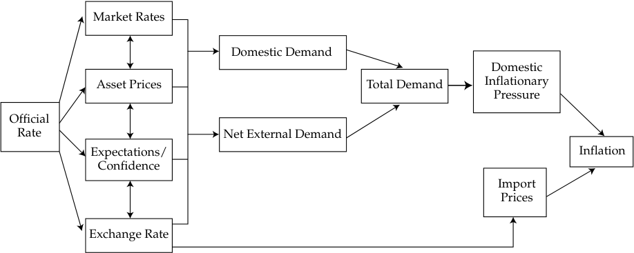

# Volume 2: Economics
## Learning Module 4 Monetary Policy
### Part 1/3: Introduction (PDF Pages 113–123)

---

<!-- PDF Page 113 -->

#### L E A R N I N G M O D U L E 

# **<mark>4</mark>** 

### **Monetary Policy** 

###### **<mark>LEARNING OUTCOMES</mark>** 

|**_Mastery_**|**_The candidate should be able to:_**|
|---|---|
||describe the roles and objectives of central banks|
||describe tools used to implement monetary policy tools and the monetary transmission mechanism, and explain the relationships between monetary policy and economic growth, inflation, interest, and exchange rates|
||describe qualities of effective central banks; contrast their use of inflation, interest rate, and exchange rate targeting in expansionary or contractionary monetary policy; and describe the limitations of monetary policy|
||explain the interaction of monetary and fiscal policy|

<!-- Start of picture text -->
1 <!-- End of picture text -->

##### **INTRODUCTION** 

Central banks play several important roles in modern economies. These roles include being the monopoly supplier of the currency, the banker to the government and the bankers’ bank, the lender of last resort, the regulator and supervisor of the payments system, the conductor of monetary policy, and the supervisor of the banking system. Central banks have three primary tools available to them: open market operations, the refinancing rate, and reserve requirements. The success of central banks is thought to depend on three key concepts: central bank independence, credibility, and transparency. Both fiscal and monetary policy can alter aggregate demand, but they do so through differing channels with differing impacts on the composition of aggregate demand. 

###### **LEARNING MODULE OVERVIEW** 

- Central banks are the sole supplier of domestic currency, the banker to the government and the bankers’ bank, the lender of last resort, the regulator and supervisor of the payments system, the conductor of monetary policy, and the supervisor of the banking system. 

<!-- PDF Page 114 -->

- The highest profile role that central banks assume is the operation of a country’s monetary policy, which refers to central bank activities that are directed toward influencing the quantity of money and credit in an economy. 

- The overarching goal of most central banks in maintaining price stability is the associated goal of controlling inflation. 

- Central banks can manipulate the money supply in one of three ways: open market operations, its official policy rate and associated actions in the repo market, and manipulation of official reserve requirements. 

- The central bank target **interest rate** (or **policy rate** ) is used to influence short- and long-term interest rates and, ultimately, real economic activity. 

- The central bank’s policy rate works through the economy via the following interconnected channels: short-term interest rates, changes in the values of key asset prices, the exchange rate, and the expectations of economic agents. 

- The success of inflation-targeting by central banks depends on three key characteristics: central bank independence, credibility, and transparency. 

- Many emerging market economies choose to operate monetary policy by targeting their currency’s exchange rate, rather than an explicit level of domestic inflation. 

- A major problem for central banks as they try to manage the money supply to influence the real economy is that they cannot control the amount of money that households and corporations put in banks on deposit, nor can they easily control the willingness of banks to create money by expanding credit. 

- Both fiscal and monetary policy can alter aggregate demand, but they do so through differing channels with differing impacts on the composition of aggregate demand. 

- Both fiscal and monetary policies suffer from a lack of precise current knowledge of the economy, because periodic economic data are released with a time lag and are subject to revision. 

- The interaction between monetary and fiscal policies is evident in the Ricardian equivalence because if tax cuts have no impact on private spending due to higher expected future taxes, then this may lead policy makers to favor monetary tools. 

<!-- Start of picture text -->
2 <!-- End of picture text -->

##### **ROLE OF CENTRAL BANKS** 

describe the roles and objectives of central banks 

<!-- PDF Page 115 -->

###### **Roles of Central Banks and Objectives of Monetary Policy** 

Central banks play several key roles in modern economies. Generally, a central bank is the sole supplier of the domestic currency, the banker to the government and the bankers’ bank, the lender of last resort, the regulator and supervisor of the payments system, the conductor of monetary policy, and the supervisor of the banking system. Let us examine these roles in turn. 

In its earliest form, money could be exchanged for a prespecified precious commodity, usually gold, and promissory notes were issued by many private banks. Today, however, state-owned institutions—usually central banks—are designated in law as being the monopoly suppliers of a currency. Initially, these monopolists supplied money that could be converted into a prespecified amount of gold; they adhered to a **gold standard** . For example, until 1931, bank notes issued by Britain’s central bank, the Bank of England, could be redeemed at the bank for a prespecified amount of gold. But Britain, like most other major economies, abandoned this convertibility principle in the first half of the twentieth century. Money in all major economies today is not convertible by law into anything else, but it is, in law, **legal tender** . This means that it must be accepted when offered in exchange for goods and services. Money that is not convertible into any other commodity is known as **fiat money** . Fiat money derives its value through government decree and because people accept it for payment of goods and services and for debt repayment. 

As long as fiat money is acceptable to everyone as a medium of exchange, and it holds its value over time, then it also will be able to serve as a unit of account. However, once an economy has moved to a system of fiat money, the role of the supplier of that money becomes even more crucial because they could, for example, expand the supply of this money indefinitely should they wish to do so. Central banks, therefore, play a crucial role in modern economies as the suppliers and guardians of the value of their fiat currencies and as institutions charged with the role of maintaining confidence in their currencies. As the sole suppliers of domestic currency, central banks are at the center of economic life. As such, they assume other roles in addition to being the suppliers and guardians of the value of their currencies. 

Most central banks act as the banker to the government and to other banks. They also act as a **lender of last resort** to banks. Because the central bank effectively has the capacity to print money, it is in the position to be able to supply the funds to banks that are facing crisis. The facts that economic agents know that the central bank stands ready to provide the liquidity required by any of the banks under its jurisdiction and that they trust government bank deposit insurance help to prevent bank runs in the first place. However, the recent financial crisis has shown that this knowledge is not always sufficient to deter a bank run. 

###### **EXAMPLE 1** 

###### **The Northern Rock Bank Run** 

In the latter part of the summer of 2007, the fall in US house prices and the related implosion of the US sub-prime mortgage market became the catalyst for a global liquidity crisis. Banks began to hoard cash and refused to lend to other banks at anything other than extremely punitive interest rates through the interbank market. This caused severe difficulties for a UK mortgage bank, Northern Rock. Northern Rock’s mortgage book had expanded rapidly in the preceding years as it borrowed aggressively from the money markets. It is now clear that this expansion was at the expense of loan quality. The then–UK regulatory authority, the Financial Services Authority (FSA), later reported in 2008 that Northern Rock’s lending practices did not pay due regard to either the credit quality of the mortgagees or the values of the properties on which the mortgages 

<!-- PDF Page 116 -->

were secured. Being at the worst end of banking practice and relying heavily on international capital markets for its funding, Northern Rock was therefore susceptible to a global reduction in liquidity. As the liquidity crisis took hold, Northern Rock found that it could not replace its maturing money market borrowings. On 12 September 2007, in desperate need of liquidity, Northern Rock’s board approached the UK central bank to ask for the necessary funds. 

However, the news of Northern Rock’s perilous liquidity position became known by the public and, more pertinently, by Northern Rock’s retail depositors. On 14 September, having heard the news, queues began to form outside Northern Rock branches as depositors tried to withdraw their savings. On that day, it was estimated that Northern Rock depositors withdrew around GBP1 billion, representing 5 percent of Northern Rock’s deposits. Further panic ensued as investors in “internet-only” Northern Rock accounts could not withdraw their money because of the collapse of Northern Rock’s website. A further GBP1 billion was withdrawn over the next two days. 

Northern Rock’s share price dropped rapidly, as did the share prices of other similar UK banks. The crisis therefore threatened to engulf more than one bank. To prevent contagion, the chancellor of the exchequer announced on 17 September that the UK government would guarantee all Northern Rock deposits. This announcement was enough to stabilize the situation and given that lending to Northern Rock was now just like lending to the government, deposits actually started to rise again. 

Eventually Northern Rock was nationalized by the UK government, with the hope that at some time in the future it could be privatized once its balance sheet had been repaired. 

Central banks often are charged by the government to supervise the banking system, or at least to supervise those banks that they license to accept deposits. In some countries, this role is undertaken by a separate authority. In other countries, the central bank can be jointly responsible with another body for the supervision of its banks. 

Exhibit 1 lists the banking supervisors in the G–10 countries; central banks are underlined. As the exhibit shows, most but not all bank systems have a single supervisor, which is not necessarily a central bank. A few countries, such as Germany and the United States, have more than one supervisor. 

**Exhibit 1: Banking Supervision in the G–10** 

|**Country**|**Institutions**|
|---|---|
|Belgium|Banking and Finance Commission|
|Canada|Office of the Superintendent of Financial Institutions|
|France|fi Commission Bancaire|
|Germany|Federal Banking Supervisory Office; Deutsche Bundesbank|
|Italy|fi Bank of Italy|
|Japan|Financial Services Agency|
|Netherlands|Bank of Netherlands|
|Sweden|Swedish Financial Supervisory Authority|
|Switzerland|Federal Commission|
|United Kingdom|Bank of England|
|United States|Office of the Comptroller of the Currency; Federal Reserve; Federal Deposit Insurance Corporation|

<!-- PDF Page 117 -->

The United Kingdom is an interesting case study in this regard. Until May 1997, the Bank of England had statutory responsibility for banking supervision in the United Kingdom. In May 1997, banking supervision was removed from the Bank of England and assigned to a new agency, the Financial Services Authority (FSA). However, the removal of responsibility for banking supervision from the central bank was seen by some as being a contributory factor in the run on the mortgage bank Northern Rock, and generally as a contributory factor in the recent banking crisis. Because of this perceived weakness in the separation of the central bank from banking supervision, the Bank of England regained responsibility for banking supervision and regulation in 2013. 

Perhaps the least appreciated role of a central bank is its role in the **payments system** . Central banks are usually asked to oversee, regulate, and set standards for a country’s payments system. For the system to work properly, procedures must be robust and standardized. The central bank will usually oversee the payments system and will also be responsible for the successful introduction of any new processes. Given the international nature of finance, the central bank will also be responsible for coordinating payments systems internationally with other central banks. 

Most central banks are responsible for managing their country’s **foreign currency reserves** as well as its gold reserves. With regard to the latter, even though countries abandoned the gold standard in the early part of the twentieth century, the world’s central bankers still hold large quantities of gold. As such, if central banks were to decide to sell significant proportions of their gold reserves, it could potentially depress gold prices. 

Finally, central banks are usually responsible for the operation of a country’s **monetary policy** . This is arguably the highest profile role that these important organizations assume. Recall that monetary policy refers to central bank activities that are directed toward influencing the quantity of money and credit in an economy. As the sole supplier of a country’s domestic currency, central banks are in the ideal position to implement and determine monetary policy. 

To summarize, central banks assume a range of roles and responsibilities. They do not all assume responsibility for the supervision of the banks, but all of the following roles normally are assumed by the central bank: 

- Monopoly supplier of the currency; 

- Banker to the government and the bankers’ bank; 

- Lender of last resort; 

- Regulator and supervisor of the payments system; 

- Conductor of monetary policy; and 

- Supervisor of the banking system. 

###### **The Objectives of Monetary Policy** 

Central banks fulfill a variety of important roles, but for what overarching purpose? A perusal of the websites of the world’s central banks will reveal a wide range of explanations of their objectives. Their objectives are clearly related to their roles, and so there is frequent mention of objectives related to the stability of the financial system and to the payments systems. Some central banks are charged with doing all they can to maintain full employment and output. Some also have related but less tangible roles, such as _maintaining confidence in the financial system_ , or even to _promote understanding of the financial sector_ . Most seem to acknowledge explicitly one overarching objective—the objective of maintaining **price stability** . 

<!-- PDF Page 118 -->

So, although central banks usually have to perform many roles, most specify an overarching objective. Exhibit 2 lists what we might call the primary objectives of a number of central banks, from both developed market and emerging market economies. 

###### **Exhibit 2: The Objectives of Central Banks** 

###### **The Central Bank of Brazil** 

Its institutional mission is to “ensure the stability of the currency’s purchasing power and a solid and efficient financial system.” 

###### **The European Central Bank** 

“[T]o maintain price stability is the primary objective of the Euro system and of the single monetary policy for which it is responsible. This is laid down in the Treaty on the Functioning of the European Union, Article 127 (1).” 

“Without prejudice to the objective of price stability”, the euro system will also “support the general economic policies in the Community with a view to contributing to the achievement of the objectives of the Community.” These include a “high level of employment” and “sustainable and non-inflationary growth.” 

###### **The US Federal Reserve** 

“The Federal Reserve sets the nation’s monetary policy to promote the objectives of maximum employment, stable prices, and moderate longterm interest rates.” 

###### **The Reserve Bank of Australia** 

“It is the duty of the Reserve Bank Board, within the limits of its powers, to ensure that the monetary and banking policy of the Bank is directed to the greatest advantage of the people of Australia and that the powers of the Bank ... are exercised in such a manner as, in the opinion of the Reserve Bank Board, will best contribute to: 

- **a.** the stability of the currency of Australia; 

- **b.** the maintenance of full employment in Australia; and 

- **c.** the economic prosperity and welfare of the people of Australia.” 

###### **The Bank of Korea** 

“The primary purpose of the Bank, as prescribed by the Bank of Korea Act of 1962, is the pursuit of price stability.” 

_Source:_ “Central Bank and Monetary Authority Websites,” Bank for International Settlements, http:// www .bis .org/ cbanks .htm. 

###### **QUESTION SET** 

1. A central bank is normally _not_ the: 

   - **A.** lender of last resort. 

   - **B.** banker to the government and banks. 

<!-- PDF Page 119 -->

|**C.**body that sets tax rates on interest on savings. **Solution:**|
|---|
|C is correct. A central bank is normally the lender of last resort and the banker to the banks and government, but the determination of all tax rates is normally the preserve of the government and is a fiscal policy issue.|
|2. Which of the following_best_describes the overarching, long-run objective of most central banks?|
|**A.**Price stability|
|**B.**Fast economic growth|
|**C.**Current account surplus **Solution:**|
|A is correct. Central banks normally have a variety of objectives, but the overriding one is nearly always price stability.|
|3. Which role is a central bank_least likely_to assume?|
|**A.**Lender of last resort|
|**B.**Supplier of the currency|
|**C.**Sole supervisor of banks **Solution:**|
|C is correct. The supervision of banks is not a role that all central banks assume. When it is a central bank’s role, responsibility may be shared with one or more entities.|

As we have discussed, one of the essential features of a monetary system is that the medium of exchange should have a relatively stable value from one period to the next. Arguably then, the overarching goal of most central banks in maintaining price stability is the associated goal of controlling inflation. Before we explore the tools central banks use to control inflation, we should first consider the potential costs of inflation. In other words, we should ask why it is that central bankers believe that it is so important to control a nominal variable. 

##### **MONETARY POLICY TOOLS AND MONETARY TRANSMISSION** 

## **<mark>3</mark>** 

describe tools used to implement monetary policy tools and the monetary transmission mechanism, and explain the relationships between monetary policy and economic growth, inflation, interest, and exchange rates 

Central banks have three primary tools available to them: open market operations, the refinancing rate, and reserve requirements. 

<!-- PDF Page 120 -->

###### **Open Market Operations** 

One of the most direct ways for a central bank to increase or reduce the amount of money in circulation is through **open market operations** . Open market operations involve the purchase and sale of government bonds from and to commercial banks or designated market makers. For example, when the central bank buys government bonds from commercial banks, this increases the reserves of private sector banks on the asset side of their balance sheets. If banks then use these surplus reserves by increasing lending to corporations and households, then broad money growth expands through the money multiplier process. Similarly, the central bank can sell government bonds to commercial banks. In so doing, the reserves of commercial banks decline, reducing their capacity to make loans (i.e., create credit) to households and corporations and thus causing broad money growth to decline through the money multiplier mechanism. In using open market operations, the central bank may target a desired level of commercial bank reserves or a desired interest rate for these reserves. 

###### **The Central Bank’s Policy Rate** 

The most obvious expression of a central bank’s intentions and views comes through the interest rate it sets. The name of the **official interest rate** (or **official policy rate** or just **policy rate** ) varies from central bank to central bank, but its purpose is to influence short- and long-term interest rates and ultimately real economic activity. 

The interest rate that a central bank sets and that it announces publicly is normally the rate at which it is willing to lend money to the commercial banks (although practices do vary from country to country). This policy rate can be achieved by using short-term collateralized lending rates, known as repo rates. For example, if the central bank wishes to increase the supply of money, it might buy bonds (usually government bonds) from the banks, with an agreement to sell them back at some time in the future. This transaction is known as a **repurchase agreement** . Normally, the maturity of repo agreements ranges from overnight to two weeks. In effect, this represents a secured loan to the banks, and the lender (in this case the central bank) earns the repo rate. 

Suppose that a central bank announces an increase in its official interest rate. Commercial banks normally would increase their **base rates** at the same time. A commercial bank’s base rate is the reference rate on which it bases lending rates to all other customers. For example, large corporate clients might pay the base rate plus 1 percent on their borrowing from a bank, whereas the same bank might lend money to a small corporate client at the base rate plus 3 percent. But why would commercial banks immediately increase their base or reference rates just because the central bank’s refinancing rate had increased? 

The answer is that commercial banks do not want to lend at a rate of interest below that which they are charged by the central bank. Effectively, the central bank can force commercial banks to borrow from it at this rate because it can conduct open market operations that create a shortage of money, forcing the banks to sell bonds to it with an agreed-upon repurchase price (i.e., a repurchase agreement). The repo rate would be such that the central bank earned the official refinancing rate on the transactions. 

The name of each central bank’s official refinancing rate varies. The Bank of England’s refinancing rate is the **two-week repo rate** . In other words, the Bank of England fixes the rate at which it is willing to lend two-week money to the banking sector. The European Central Bank’s (ECB’s) official policy rate is known as the **refinancing rate** , which defines the rate at which the ECB is willing to lend short-term money to the Euro area banking sector. 

The corresponding rate in the United States is the discount rate, which is the rate for member banks borrowing directly from the Federal Reserve System. The most important interest rate used in US monetary policy is the **federal funds rate** . The federal 

<!-- PDF Page 121 -->

funds rate (or **fed funds rate** ) is the interbank lending rate on overnight borrowings of reserves. The Federal Open Market Committee (FOMC) seeks to move this rate to a target level by reducing or adding reserves to the banking system by means of open market operations. The level of the rate is reviewed by the FOMC at its meetings held every six weeks (although the target can be changed between meetings, if necessary). 

Through the setting of a policy rate, a central bank can manipulate the amount of money in the money markets. Generally speaking, the higher the policy rate, the higher the potential penalty that banks will have to pay to the central bank if they run short of liquidity, the greater their willingness will be to reduce lending, and the more likely it will be that broad money growth will shrink. 

###### **Reserve Requirements** 

The third primary way in which central banks can limit or increase the supply of money in an economy is through the **reserve requirement** . We already have seen that the money creation process is more powerful the lower the percentage reserve requirement of banks. So, a central bank could restrict money creation by raising the reserve requirements of banks. However, this policy tool is not used much today in developed market economies. Indeed, some central banks, such as the Bank of England, no longer even set minimum reserve requirements for the banks under their jurisdiction. Changing reserve requirements frequently is disruptive for banks. For example, if a central bank increased the reserve requirements, a bank that was short on reserves might have to cease its lending activities until it had built up the necessary reserves, because deposits would be unlikely to rise quickly enough for the bank to build its reserves in this way. However, reserve requirements are still actively used in many emerging market countries to control lending and remain a potential policy tool for those central banks that do not currently use it. 

To summarize, central banks can manipulate the money supply in one of three ways: 

- open market operations; 

- official policy rates and associated actions in the repo market; and 

- manipulation of official reserve requirements. 

###### **The Transmission Mechanism** 

The overarching goal of a central bank is to maintain price stability. We have demonstrated how a central bank can manipulate the money supply and growth of the money supply. We also indicated how policy rates set and targeted by the central banks are usually very short term in nature; often they target overnight interest rates. However, most businesses and individuals in the real economy borrow and lend over much longer time frames than this. It may not be obvious, then, how changing short-term interest rates can influence the real economy, particularly if money neutrality holds in the long run. The fact that central bankers believe that they can affect real economic variables, in particular economic growth, by influencing broad money growth suggests that they believe that money is not neutral—at least not in the short run. 

Exhibit 3 presents a stylized representation of the **monetary transmission mechanism** . This is the process whereby a central bank’s interest rate is transmitted through the economy and ultimately affects the rate of increase of prices—that is, inflation. 

<!-- PDF Page 122 -->

**Exhibit 3: A Stylized Representation of the Monetary Transmission Mechanism** 

<!-- Start of picture text -->
Market Rates Domestic Demand Domestic Asset Prices Total Demand Inflationary Pressure Official Rate Net External Demand Expectations/ Inflation Confidence Import Prices Exchange Rate <!-- End of picture text -->

_Source_ : Bank of England, https:// www .bankofengland .co .uk/ . 

Suppose that a central bank announces an increase in its official interest rate. The implementation of the policy may begin to work through the economy via four interrelated channels. Those channels include bank lending rates, asset prices, agents’ expectations, and exchange rates. First, as described earlier, the base rates of commercial banks and interbank rates should rise in response to the increase in the official rate. Banks, in turn, would increase the cost of borrowing for individuals and companies over both short- and long-term horizons. Businesses and consumers would then tend to borrow less as interest rates rise. An increase in short-term interest rates could also cause the price of such assets as bonds or the value of capital projects to fall as the discount rate for future cash flows rises. 

Market participants would then come to the view that higher interest rates will lead to slower economic growth, reduced profits, and reduced borrowing to finance asset purchases. Exporters’ profits might decline if the rise in interest rates causes the country’s exchange rate to appreciate, because this would make domestic exports more expensive to overseas buyers and dampen demand to purchase them. The fall in asset prices as well as an increase in prices would reduce household financial wealth and therefore lead to a reduction in consumption growth. Expectations regarding interest rates can play a significant role in the economy. Often companies and individuals will make investment and purchasing decisions based on their interest rate expectations, extrapolated from recent events. If the central bank’s interest rate move is widely expected to be followed by other interest rate increases, investors and companies will act accordingly. Consumption, borrowing, and asset prices may all decline as a result of the revision in expectations. 

A rise in the central bank’s policy rate can reduce real domestic demand and net external demand (that is, the difference between export and import consumption) through a wide range of interconnected ways. Weaker total demand would tend to put downward pressure on the rate of domestic inflation—as would a stronger currency, which would reduce the prices of imports. Taken together, these factors might begin to put downward pressure on the overall measure of inflation. 

To summarize, the central bank’s policy rate works through the economy via one or more of the following interconnected channels: 

- Short-term interest rates; 

- Changes in the values of key asset prices; 

- The exchange rate; and 

- The expectations of economic agents. 

<!-- PDF Page 123 -->

|**QUESTION SET**|
|---|
|1. Which of the following variables are_most likely_to be affected by a change in a central bank’s policy rate?|
|**A.**Asset prices only|
|**B.**Expectations about future interest rates only|
|**C.**Both asset prices and expectations about future interest rates **Solution:**|
|C is correct. The price of equities, for example, might be affected by the expectation of future policy interest rate changes. In other words, a rate change may be taken as a signal of the future stance of monetary policy— contractionary or expansionary.|
|2. Which of the following does a central bank seek to influence directly via the setting of its official interest rate?|
|**A.**Import prices|
|**B.**Domestic inflation|
|l **C.**Inflation expectations **Solution:**|
|C is correct. By setting its official interest rate, a central bank could expect to have a direct influence on inflation expectations—as well as on other market interest rates, asset prices, and the exchange rate (where this is freely floating). If it can influence these factors, it might ultimately hope to influence import prices (via changes in the exchange rate) and also domes- l|
|tically generated inflation (via its impact on domestic or external demand). The problem is that the workings of the transmission mechanism—from the official interest rate to inflation—are complex and can change over time.|
|3. Monetary policy is_least likely_to include:|
|**A.**setting an inflation rate target.|
|**B.**changing an official interest rate.|
|**C.**enacting a transfer payment program. **Solution:**|
|C is correct. Transfer payment programs represent fiscal, not monetary policy.|
|4. Which is the_most_accurate statement regarding central banks and monetary policy?|
|**A.**Central bank activities are typically intended to maintain price stability.|
|**B.**Monetary policies work through the economy via four independent channels.|

