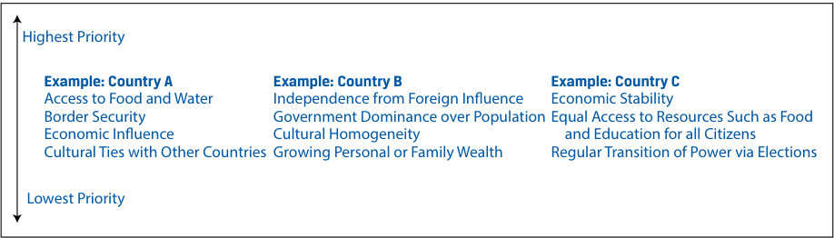

# Volume 2: Economics
## Learning Module 5 Introduction to Geopolitics
### Part 1/4: Introduction (PDF Pages 149–159)

---

<!-- PDF Page 149 -->

#### L E A R N I N G M O D U L E 

# **<mark>5</mark>** 

### **Introduction to Geopolitics** 

**by Goodwin Lauren, Nair-Reichert Usha, PhD, and Witschi Daniel Rober, PhD.** 

_Lauren Goodwin, CFA, is at New York Life Investments (USA). Usha Nair-Reichert, PhD, is at Georgia Institute of Technology (USA). Daniel Robert Witschi, PhD, CFA, is at Dreyfus Sons & Co Ltd. (Switzerland)._ 

###### **<mark>LEARNING OUTCOMES</mark>** 

|**_Mastery_**|**_The candidate should be able to:_**|
|---|---|
||describe geopolitics from a cooperation versus competition perspective|
||describe geopolitics and its relationship with globalization|
||describe functions and objectives of the international organizations that facilitate trade, including the World Bank, the International Monetary Fund, and the World Trade Organization describe geopolitical risk|
||describe tools of geopolitics and their impact on regions and economies|
||describe the impact of geopolitical risk on investments|

<!-- Start of picture text -->
1 <!-- End of picture text -->

##### **INTRODUCTION** 

Investors study geopolitics and geopolitical risk because they can have a material impact on investment outcomes. These relations affect key drivers of investment performance, including economic growth, business performance, market volatility, and transaction costs. On a portfolio level, geopolitical risk can affect the suitability of a security or strategy for an investor’s goals, risk tolerance, and time horizon. In this learning module, we will build a framework by which investors can measure, assess, track, and react to geopolitical risk, with a goal of improving investment outcomes. 

<!-- PDF Page 150 -->

###### **LEARNING MODULE OVERVIEW** 

- Geopolitics is the study of how geography affects politics and international relations. Within the field of geopolitics, analysts study actors—the individuals, organizations, companies, and national governments that carry out political, economic, and financial activities—and how they interact with one another. 

- State actors can be cooperative or non-cooperative. A country may want to cooperate with its neighbors or with other state actors for many reasons. These reasons are typically defined by a country’s national interest—its goals and ambitions—whether they be military, economic, or cultural. 

- The cooperation and engagement among countries is also affected by its resource endowment, standardization of the rules of engagement, and cultural factors and soft power. 

- A country’s national interest can be viewed as a hierarchy of factors, with those essential for survival at the top of the hierarchy and nicebut-not-essential elements lower in the hierarchy. Governments use the hierarchy of interests to guide their behavior. 

- Political cooperation versus non-cooperation is only one lens through which geopolitical actors engage with the world, but it is an important one for understanding countries’ priorities. 

- Globalization is marked by economic and financial cooperation, including the active trade of goods and services, capital flows, currency exchange, and cultural and information exchange. By contrast, antiglobalization or nationalism is the promotion of a country’s own economic interests to the exclusion or detriment of the interests of other nations. Nationalism is marked by limited economic and financial cooperation. 

- Globalization provides potential gains, such as: 

   - increased profits—through increasing sales and/or reducing costs, 

   - access to resources—market access and investment opportunities, and 

   - intrinsic gains—an improved quality of life. 

- Globalization also has some potential drawbacks, such as: 

   - unequal economic and financial gains, 

   - interdependence that can lead to supply chain disruption, and 

   - possible exploitation of social and environmental resources. 

- The International Monetary Fund’s (IMF’s) main mandate is to ensure the stability of the international monetary system, the system of exchange rates and international payments that enables countries to buy goods and services from each other. 

- The World Bank’s main objective is to help developing countries fight poverty and enhance environmentally sound economic growth. 

- The World Trade Organization (WTO) provides the legal and institutional foundation of the multinational trading system. It regulates cross-border trade relationships among nations on a global scale. 

<!-- PDF Page 151 -->

|■|A geopolitical framework for analysis includes four archetypes of country behavior: autarky, hegemony, multilateralism, and bilateral- ism. Each archetype has its own costs, benefits, and trade-offs with respect to geopolitical risk.|
|---|---|
|■|Geopolitical risk is the risk associated with tensions or actions between actors (state and non-state) that affect the normal and peaceful course of international relations. Geopolitical risk tends to rise when the geographic and political factors underpinning country relations shift.|
|■|The tools of geopolitics may be separated into the following three types:|
||● national security tools,|
||● economic tools, and ● financial tools.|
|■|i The most extreme example of a national security tool is that of armed conflict. Espionage is an indirect national security tool. Military alli- ances are often used either to aid in direct conflict or to deter conflict from arising in the first place.|
|■|i Economic tools are used to reinforce a cooperative or non-cooperative stance through economic means. Among state actors, economic tools can include multilateral trade agreements or the global harmonization of tariff rules. Economic tools also can be non-cooperative in nature. Nationalization is a non-cooperative approach to asserting economic control.|
|■|Financial tools are the actions used to reinforce a cooperative or non-cooperative stance through financial mechanisms. Examples of cooperative financial tools include the free exchange of currencies across borders and allowing foreign investment. Examples of non-co- operative financial tools include limiting access to local currency markets and restricting foreign investment.|
|■|There are three basic types of geopolitical risk:|
||● event risk,|
||● exogenous risk, and ● thematic risk.|
|■|Event risk evolves around set dates known in advance. Political events, for example, often result in changes to investor expectations related to a country’s cooperative stance. Brexit is an example of event risk.|
|■|Exogenous risk is a sudden or unanticipated risk that can affect either a country’s cooperative stance, the ability of non-state actors to glo- balize, or both. Examples include sudden uprisings, invasions, or the aftermath of natural disasters.|
|■|Thematic risks are known risks that evolve and expand over time. Climate change, cyber threats, and the ongoing threat of terrorism fall into this category.|
|■|To make an assessment, an investor considers geopolitical risk in terms of the following three areas: ● likelihood it will occur,|

<!-- PDF Page 152 -->

   - velocity (speed) of its impact, and 

   - size and nature of that impact. 

- Geopolitical risks seldom develop in linear fashion, making it difficult to monitor and forecast their likelihood, velocity, and size and nature of impact on a portfolio. As a result, many investors deploy an approach that includes scenario building and signposting rather than a single point forecast. 

- Investors study geopolitical risk because it has a tangible impact on investment outcomes. On a macroeconomic level, these risks can affect capital markets conditions, such as economic growth, interest rates, and market volatility. 

- Changes in capital markets conditions can have an important influence on asset allocation decisions, including an investor’s choice of geographic exposures. 

- On a portfolio level, geopolitical risk can influence the appropriateness of an investment security or strategy for an investor’s goals, risk tolerance, and time horizon. 

## **<mark>2</mark>** 

##### **NATIONAL GOVERNMENTS AND POLITICAL COOPERATION** 

describe geopolitics from a cooperation versus competition perspective 

The international environment is constantly evolving. Such trends as the growth of emerging market economies, globalization, and the rise of populism affect the range of opportunities and threats that companies, industries, nations, and regional groups face. **Geopolitics** is the study of how geography affects politics and international relations. Within the field of geopolitics, analysts study actors—the individuals, organizations, companies, and national governments that carry out political, economic, and financial activities—and how they interact with one another. The role of state and non-state actors is discussed in the following section. 

###### **State and Non-State Actors** 

Relationships within and among countries can be complex. To begin, many actors influence international relations, political developments, and economic affairs. In the introduction, we defined actors as the individuals, organizations, companies, and national governments that carry out political, economic, and financial activities. This definition can be divided into two types of actors relevant for geopolitical risk: state actors and non-state actors. **State actors** are typically national governments, political organizations, or country leaders that exert authority over a country’s national security and resources. The South African president, sultan of Brunei, Malaysia’s parliament, and the British Prime minister are all examples of state actors. **Non-state actors** are those that participate in global political, economic, or financial affairs but do not 

<!-- PDF Page 153 -->

directly control national security or country resources. Examples of non-state actors are non-governmental organizations (NGOs), multinational companies, charities, and even influential individuals, such as business leaders or cultural icons. 

These actors are influenced not only by their relationship with one another but also by factors affecting their other allies and adversaries. For example, if Country A has a cooperative relationship with Country B but Country B attacks Country C, a close ally of Country A, then the relationship between Countries A and B may become strained or even broken. The opposite is also true: A country’s cooperation across many political, economic, or financial channels may increase trust over time. As a result, the international system is composed of multifaceted webs of affairs that can shape events and decisions as well as economic and market outcomes. Although a “one-size-fits-all” model does not exist for geopolitical actors, understanding and categorizing the threats and opportunities that a country faces may help us to gauge the likelihood that geopolitical risk will arise. 

Countries and their governments are heavily influenced by economic, financial, and national security considerations as well as by social and cultural factors and non-state actors. In fact, economic and financial considerations are inextricably linked with a country’s national interest and political dynamic. That said, it is useful to isolate one of these areas—national actors and political cooperation—as a starting point in understanding actors’ interwoven goals and the way they may affect geopolitical risk. In the next section, we will develop a sense of state actors and their motivations for cooperation (versus non-cooperation) before adding layers of geopolitical risk analysis. 

###### **Features of Political Cooperation** 

At the highest level, relations between countries or national governments (state actors) can be cooperative or competitive in nature. **Cooperation** is the process by which countries work together toward some shared goal or purpose. These goals may, and often do, vary widely—from strategic or military concerns to economic influence or cultural preferences. Given the expansive nature of country goals and interests, their interactions with one another also may be complex, generating the potential for geopolitical risk to arise. 

We begin that framework by exploring one specific type of cooperation—political cooperation—which is the degree to which countries work toward agreements on rules and standardization for the activities and interactions between them. Within this context, a **cooperative country** is one that engages and reciprocates in rules standardization; harmonization of tariffs; and international agreements on trade, immigration, or regulation and that also allows for the free flow of information, including technology transfer. In contrast, a **non-cooperative country** is one with inconsistent and even arbitrary rules; restricted movement of goods, services, people, and capital across borders; retaliation; and limited technology exchange. We show the degree of political cooperation in Exhibit 1 

<!-- PDF Page 154 -->

**Exhibit 1: Political Cooperation and Non-Cooperation** 

<!-- Start of picture text -->
Inconsistent Rules Rules Standardization Arbitrary Rule Harmonization of Tariffs Restricted Movement Across Borders Free Movement Across Borders Restricted Trade; Capital Controls Permitted Movement of Goods, Services, and Capital Retaliation Reciprocation Lack of Technology Exchange Technology Exchange Non-Cooperation Cooperation <!-- End of picture text -->

A country may want to cooperate with its neighbors or with other state actors for many reasons. These reasons are typically defined by a country’s national interest—its goals and ambitions—whether they be military, economic, or cultural. 

###### **_National Security or Military Interest_** 

National security or national defense involves protecting a country, including its citizens, economy, and institutions, from external threat. These threats may be broad in nature—from military attacks and terrorism, to crime, cybersecurity, and even natural disasters. 

Geographic factors play an important role in shaping a country’s approach to national security and the extent to which it will choose a cooperative approach. Landlocked countries, such as Switzerland, rely extensively on their neighbors for access to vital resources. This reliance may make cooperation more important for sustaining international access and growth or even for survival. By the same token, countries highly connected to trade routes, such as Singapore, or countries acting as a conduit for trade, such as Panama, may use their geographic location as a lever of power in broader international dynamics. 

###### **_Economic Interest_** 

Over time, the concept of national security has expanded to include economic factors, including access to such resources as energy, food, or water. On a domestic level, growing national wealth and limiting income inequality can contribute to social stability, another important component of national security. On the international level, the ability of national firms to operate on a global scale is increasingly important as well. In this context, countries that cooperate in support of their economic interest are likely focused on one of two factors: Either they would like to secure essential resources through trade, or they would like to level the global playing field for their companies or industries through standardization. 

###### **EXAMPLE 1** 

###### **Factors Affecting Cooperation** 

1. True or false: Geographic factors do not influence the extent to which a country will choose a cooperative approach. Explain your reasoning. 

   - **A.** True 

<!-- PDF Page 155 -->

###### **B.** False 

###### **Solution:** 

B is correct. Geographic factors play an important role in shaping a country’s approach to national security and the extent to which it will choose a cooperative approach. A country with limited access to resources because of its geographic characteristics might be more inclined to cooperate as it needs access to resources to thrive, whereas a country rich in internal resources might use its resources as leverage to influence international dynamics. Countries with direct access to the sea have an advantage related to trade and transport as well as the natural resources provided by the ocean. 

###### **EXAMPLE 2** 

###### **Factors Affecting Cooperation** 

1. Fill in the blank: Two factors on which a cooperative country is likely focused include____ and___. 

###### **Solution:** 

Two factors on which a cooperative country is likely focused include _trade_ and _standardization_ . 

###### **Resource Endowment, Standardization, and Soft Power** 

The cooperation and engagement among countries is also affected by its resource endowment, standardization of the rules of engagement, and cultural factors and soft power. These factors are examined in the section that follows. 

###### **_Geophysical Resource Endowment_** 

At a basic level, **geophysical resource endowment** includes such factors as livable geography and climate as well as access to food and water, which are necessary for sustainable growth. Geophysical resource endowment is highly unequal among countries. Some countries, such as the United States, Russia, Australia, and China, are relatively self-sufficient in their resource use. Others, such as Western Europe, Japan, and Turkey, are highly reliant on others for key factors of production, such as fossil fuels. Still others, such as Saudi Arabia, have a plentiful endowment of fossil fuels but rely on others for many basic needs. 

These different starting points create power dynamics that can affect the terms of engagement between states. A country heavily endowed with a resource may find itself with more political leverage when dealing with another country in desperate need of that resource. At the same time, a resource-rich country may become vulnerable if the use or sale of the resource benefits certain groups more than others, therefore contributing to internal political instability. 

###### **_Standardization_** 

Economic and financial activities may cross borders with or without explicit government support. As they do, governments have more incentive to cooperate with others in standardizing the rules of engagement. **Standardization** is the process of creating protocols for the production, sale, transport, or use of a product or service. Standardization occurs when relevant parties agree to follow these protocols together. It helps support expanded economic and financial activities across borders, such as 

<!-- PDF Page 156 -->

trade and capital flows, which support higher economic growth and standards of living. Rules standardization can take many forms—from regulatory cooperation, to process standardization, to operational synchronization. Rules standardization may also be driven by non-state entities, such as industry groups or organizations. Exhibit 2 provides examples of standardization. 

###### **Exhibit 2: Types of Rules Standardization** 

||**Regulatory Cooperation**|**Process Standardization**|**Operational Synchronization**|
|---|---|---|---|
|Challenge|As financial cooperation expands, countries need a comprehensive standard for governance and risk management of the banking sector.|Financial transactions across bor- ders faced higher costs and longer wait times, increasing the burden for cross-border activity.|Increasing international trade created supply chain bottlenecks as containers of different sizes and shapes were sent to ports worldwide.|
|Solution|Basel Committee on Banking Supervision (BCBS)|Society for Worldwide Interbank Financial Telecommunication (SWIFT)|Containerization|
|Process|The BCBS was established in 1974 by the G–10 banking authorities. Membership has since expanded to the G–20.|SWIFT was established in 1973 to provide a global financial infrastructure.|Standards set for containers of uniform size and shape using mul- timodal forms of transport (land, sea, air, rail) and port cranes.|
|Benefit|Allows for more effective supervi- sion of the global banking sector and international capital flows.|Facilitates global payments in more than 200 countries and territories, ser- vicing more than 11,000 institutions worldwide.|Dramatically reduces the time and cost of shipping goods.|

###### **_Cultural Considerations and Soft Power_** 

Finally, countries may have cultural reasons for cooperating with others. These could be historical in nature, such as long-standing political ties, immigration patterns, shared experiences, or cultural similarities. In other cases, countries may engage in **soft power** , a means of influencing another country’s decisions without force or coercion. Soft power can be built over time through such actions as cultural programs, advertisement, travel grants, and university exchange. For example, the European Union (EU) Erasmus+ program provides funding for exchange programs in education and sport to drive social inclusion and participation between participants from different countries and also to promote such priority policies as the EU’s green and digital transitions. In another example, countries like South Korea advertise visiting Seoul, the country’s capital city, in subway systems globally. These advertisements use popular Korean-made products, musical acts, and actors to encourage interaction with Korean culture and business. 

###### **The Role of Institutions** 

An **institution** is an established organization or practice in a society or culture. An institution can be a formal structure, such as a university, organization, or process backed by law; or, it can be informal, such as customs or behavioral patterns important to a society. Institutions can, but need not be, formed by national governments. Examples of institutions include NGOs, charities, religious customs, family units, the media, political parties, and educational practice. 

Generally, strong institutions contribute to more stable internal and external political forces. That consistency, in turn, gives a country more opportunity to develop cooperative relationships. Countries with strong institutions—including organizations 

<!-- PDF Page 157 -->

and structures promoting government accountability, rule of law, and property rights— allow them to act with more authority and independence in the international space. Stronger institutions also make cooperative relationships more durable. By integrating a cooperative relationship in multiple layers of society, strong institutions can reduce the likelihood that a country defects from its cooperative roles. 

###### **Hierarchy of Interests and Costs of Cooperation** 

The national interest of a country is its set of goals and ambitions. For some countries, national interest is viewed primarily in geospatial terms—the need for self-determination, survival as a nation state, the need for clear national borders, or expansion of the nation state. For others, national interest incorporates a wide array of interrelated factors, including the economic and social considerations discussed earlier. This broad approach can create conflicts among a country’s many important needs, which complicates the assessment of geopolitical actors and their motivations. 

We can think of a country’s national interest as a hierarchy of factors, with those essential for survival at the top of the hierarchy and nice-but-not-essential elements lower in the hierarchy. Governments use the hierarchy of interests to guide their behavior. They will choose to cooperate where it benefits the nation-state, but when two needs result in conflicting cooperation tactics, those higher on the hierarchy are prioritized. For example, cooperation in the form of tariff harmonization may benefit the country on a stand-alone basis; however, if those countries are in a military conflict, then there is a higher cost to cooperation. In this case, if military determination is higher on the countries’ hierarchies, then cooperation may not be in their national interest, despite the potential benefits. 

Exhibit 3 shows how countries prioritize their hierarchy of interests. Every country has different resources, goals, and leadership and thus different priorities, as well. In the exhibit, Country A prioritizes access to food and water. In contrast, Country B, prioritizes independence from foreign influence. Additionally, these priorities may shift as political leadership turns over or as global events change. For investors, it is important to understand how these resources, goals, and leadership styles may interact or even conflict with one another over time. When countries’ goals misalign or change, it may give rise to geopolitical risk. 

###### **Exhibit 3: Hierarchy of Interests** 

<!-- Start of picture text -->
Highest Priority Example: Country A Example: Country B Example: Country C Access to Food and Water Independence from Foreign Influence Economic Stability Border Security Government Dominance over Population Equal Access to Resources Such as Food Economic Influence Cultural Homogeneity  and Education for all Citizens Cultural Ties with Other Countries Growing Personal or Family Wealth Regular Transition of Power via Elections Lowest Priority <!-- End of picture text -->

###### **Power of the Decision Maker** 

Some elements on the hierarchy of national interests may appear clear-cut; securing access to food and water may take precedence over funding a cultural program, for example. However, as basic societal needs are met, the hierarchy of national interests 

<!-- PDF Page 158 -->

can become more subjective. One government may treat the prioritization of some interests—such as military buildup or providing health care—very differently from its predecessor. How governments weigh those issues will determine the depth and nature of political cooperation. 

The length of a country’s political cycle has an important impact on priority designation. Many countries have political cycles of just a few years, which means that long-term risks like climate change or addressing income inequality can be difficult to prioritize against projects or goals that can be achieved in a short-term horizon. Intrinsic in this reality is that governmental decision makers, whether political parties or individuals, have their own set of influences and needs. Although we will not explore this idea in depth, it is important to acknowledge that, for the purpose of geopolitical risk analysis, decision makers’ motivations can affect a country’s cooperative and non-cooperative choices. This introduces a factor of psychology and non-predictability into choices along the hierarchy of a nation’s needs that can shape geopolitical relationships. 

###### **EXAMPLE 3** 

###### **Country’s Political Cycle** 

1. True or false: The length of a country’s political cycle does not affect its priority designation. 

Explain your reasoning. 

**A.** True 

**B.** False 

**Solution:** 

B is correct. The length of a country’s political cycle has an important impact on priority designation as governments with shorter cycles have little incentive to focus on longer-term priorities, even if those priorities would be beneficial for society. Australia, for example, has shorter than average parliamentary terms, which could potentially affect governmental priorities. 

###### **Political Non-Cooperation** 

We consider political cooperation and non-cooperation as existing along a spectrum. While it is in some countries’ interest to be highly politically cooperative, for others it is less essential. Over time, most countries cooperate on standardized rules on an international scale. In some instances of extreme non-cooperation, however, countries’ political self-determination is more important than the benefits of any cooperative actions. These extreme cases are rare, not least because the importance of cooperation for other state actors may result in attempts to coerce non-cooperative state actors into participation. 

###### **INTERNATIONAL SANCTIONS AGAINST VENEZUELA (2015–)** 

The United States has had concerns about Venezuelan narcotics trafficking since 2005 and Venezuela’s lack of cooperation in combatting terrorism since 2006. With support from Congress and in response to increasing political repression in Venezuela, US President Obama levied additional sanctions for human rights abuses, corruption, and antidemocratic actions. The European Union urged 

<!-- PDF Page 159 -->

Venezuelan officials to work toward political reconciliation but ultimately joined the United States in targeted sanctions to encourage a credible and meaningful process toward re-starting cooperation. 

Throughout this time, sanctions have included targeted restrictions on Venezuelan officials, blocking financial transactions, and an embargo on the oil sector, which is highly important to the country’s economy. Some politicians continue to support economic sanctions as a means to pressure the Venezuelan government to meet international standards on human rights and political cooperation. Others are concerned about the increasing humanitarian cost of those sanctions. 

Venezuela’s non-cooperative stance in the international arena has resulted in it being subject to substantial international sanctions. Imposing sanctions is in itself a non-cooperative approach by the United States and the European Union meant to influence the behavior of a country or its political leadership. Venezuela’s non-cooperative stance indicates that its political self-determination is a priority above that of the humanitarian cost being inflicted on its citizens. 

Political cooperation versus non-cooperation is only one lens through which geopolitical actors engage with the world, but it is an important one for understanding countries’ priorities. Assessing a state actor’s hierarchy of needs and how it may change may help us to understand its motivations and priorities. These factors affect not only countries’ political and military actions but also their willingness to support economic and financial cooperation, which we will explore next. 

###### **QUESTION SET** 

1. Which of these is likely lowest on a country’s hierarchy of interests? **A.** Tariff harmonization **B.** Military determination 

   - **C.** Cultural program development 

   - **Solution:** 

C is correct. Cultural program development is likely lowest on a country’s hierarchy of interests. Military determination (B) is often a primary source of national security and key to a country’s national interest. Tariff harmonization (A) may improve economic activity and improve cooperation. Cultural programs are important and influential but likely lower priority compared with A and B. 

2. Which of the following actions by a country is _most likely_ a form of geopolitical cooperation? 

   - **A.** Acting as a conduit for trade 

   - **B.** Engaging in rules standardization 

   - **C.** Opting to use soft power over military retaliation 

   - **Solution:** 

B is correct. Political cooperation is associated with anything related to agreements of rules and standardization, with countries working together toward some shared goal. A cooperative country is one that engages and reciprocates in rules standardization. A is incorrect because acting as a conduit of trade, like Panama, involves non-cooperatively using a country’s geographic location as a lever of power in broader international dynamics. C is incorrect because both soft power and military retaliation are examples 

