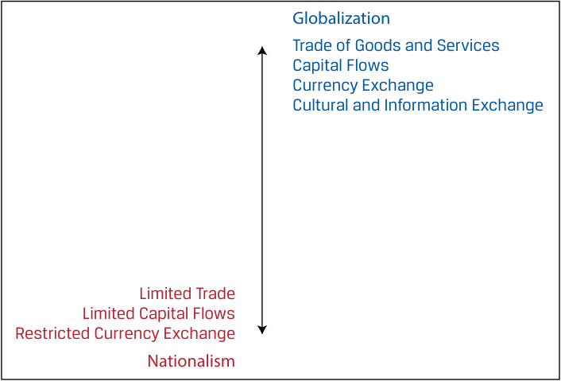

# Volume 2: Economics
## Learning Module 5 Introduction to Geopolitics
### Part 2/4: Forces of Globalization (PDF Pages 160–174)

---

<!-- PDF Page 160 -->

of non-cooperative behavior, with the former being a less extreme means to influence another country’s decisions without force or coercion. 

3. Which of the following statements represents an aspect of geopolitical risk? 

   - **A.** Modeling geopolitical risk is relatively easy to standardize. 

   - **B.** An engaged country can be considered cooperative, even if it does not reciprocate. 

   - **C.** The strength of a country’s institutions is relevant to the durability of its cooperative relationships. 

#### **Solution:** 

C is correct. The strength of a country’s institutions can make cooperative relationships more durable. A is incorrect because modeling geopolitical risk is not easily standardized. B is incorrect because a cooperative country is one that is both engaged and reciprocates. 

# **<mark>3</mark>** 

## **FORCES OF GLOBALIZATION** 

describe geopolitics and its relationship with globalization 

**Globalization** is the process of interaction and integration among people, companies, and governments worldwide. It is marked by the spread of products, information, jobs, and culture across borders. Indeed, the spread of goods and services across borders has been increasing for decades. The World Bank Openness Index, a key measure of globalization, has risen from 27 percent in 1970 to more than 60 percent in 2019, as shown in Exhibit 4. Since 2008, globalization has experienced headwinds; these include the impact of the Global Financial Crisis, which increased scrutiny of cross-border activity, and the rise in nationalism, which decreased some countries’ appetite for using imported products or services. Capacity constraints may also create an important headwind. Global trade cannot make up 100 percent of global economic activity, meaning its expansion may slow even without specific disruptions. 

<!-- PDF Page 161 -->

#### **Exhibit 4: Global Trade as Percentage of GDP** 

<!-- Start of picture text -->
Global Trade (as % of GDP) 65 60 55 50 45 40 35 30 25 1970 1974 1978 1982 1986 1990 1994 1998 2002 2006 2010 2014 2018 <!-- End of picture text -->

_Source:_ World Bank Open Data, World Bank, https:// data .worldbank .org. Trade is defined as imports plus exports in the global economy. 

In addition to its macroeconomic impact, globalization is also visible at a microeconomic level. Take, for example, the production of an automobile. A car may be designed in Japan, with electrical parts made in Germany, steering systems designed in the United States, seatbelts manufactured in Sweden, climate system made in Belgium, and vehicles assembled in Mexico. In fact, automobiles are often assembled in one country with parts from all over the world, finished in a second country, and sold in a third (see Exhibit 5). This extensive process provides opportunities for companies to find the best inputs for their product, whether in terms of quality or cost-effectiveness. The process of globalization also opens opportunities for investors worldwide, who may invest in aspects of engineering, production, or even the process of supply chain management and logistics. 

<!-- PDF Page 162 -->

**Exhibit 5: Production of Automobiles** 

_Notes:_ Reprinted with permission. Copyright © 2021 Bank of America Corporation (“BAC”). The use of the above in no way implies that BAC or any of its affiliates endorses the views or interpretation or the use of such information or acts as any endorsement of the use of such information. The information is provided "as is" and none of BAC or any of its affiliates warrants the accuracy or completeness of the information. 

_Source:_ Bank of America Merrill Lynch Global Research. 

Globalization also has cultural and communicative features. Although it can be difficult to measure these features, such as the spread of information or culture, it is not difficult to see them in our daily lives. A grocery store in Warsaw may hold Italian cheese, Moroccan spices, Colombian coffee, and Indian sauces. Social media allows users in South Africa to collaborate on dances with a Japanese music group. Faster and more affordable travel has increased interactions between citizens of countries all over the world. Internet usage allows for the near-instantaneous spread of cultural information and context. 

### **Features of Globalization** 

In the previous section, we considered political cooperation and non-cooperation as one lens through which to consider geopolitical actors—primarily national or state actors. Globalization, by contrast, is the result of economic and financial cooperation. It is carried out mostly by non-state actors, such as corporations, individuals, or organizations. 

Globalization is marked by economic and financial cooperation, including the active trade of goods and services, capital flows, currency exchange, and cultural and information exchange. Actors participating in globalization are likely to reach beyond their national borders for access to new markets, talent, or learning. In contrast, antiglobalization or **nationalism** is the promotion of a country’s own economic interests to the exclusion or detriment of the interests of other nations. Nationalism is marked by limited economic and financial cooperation. These actors may focus on national production and sales, limited cross-border investment and capital flows, and restricted currency exchange. Exhibit 6 shows a continuum from nationalism to globalization. 

<!-- PDF Page 163 -->

#### **Exhibit 6: Globalization: Economic and Financial Cooperation** 

<!-- Start of picture text -->
Globalization Trade of Goods and Services Capital Flows Currency Exchange Cultural and Information Exchange Limited Trade Limited Capital Flows Restricted Currency Exchange Nationalism <!-- End of picture text -->

Globalization and cooperation tend to be correlated, meaning that globalization can be facilitated or accelerated by political cooperation, but globalization is also an independent process. Organic private sector forces can drive the exchange of products or ideas even without government support or harmonized rules. 

#### **EXAMPLE 4** 

### **Features of Globalization** 

1. Fill in the blanks using the following words: _government_ ; _private sector_ ; _national_ ; _subnational._ 

Although political cooperation and non-cooperation can be driven by ____ actors, globalization as the result of economic and financial cooperation is carried out mostly by_________ actors, such as corporations, individuals, or organizations. Organic _________ forces can drive the exchange of products or ideas even without _________ support.fill-in-the-blank **Solution:** 

Although political cooperation and non-cooperation can be driven by _<u>national</u>_ actors, globalization as the result of economic and financial cooperation is carried out mostly by _<u>subnational</u>_ actors, such as corporations, individuals, or organizations. Organic _<u>private sector</u>_ forces can drive the exchange of products or ideas even without _<u>government</u>_ support. 

#### **EXAMPLE 5** 

### **Features of Globalization** 

1. True or False: Globalization is primarily carried out by governmental actors. Explain your reasoning. **A.** True 

<!-- PDF Page 164 -->

#### **B.** False 

#### **Solution:** 

B is correct. Globalization is primarily carried out by non-governmental actors, such as corporations, individuals, or organizations, and is the result of economic and financial cooperation. Multinational corporations, for example, want a competitive advantage leading them to seek new markets, talent, and learning as well as trade, capital, currency, and cultural and information exchange. Corporate outsourcing of talent is an example of globalization. 

### **Motivations for Globalization** 

Non-state actors, such as companies and investors, who choose to participate in globalization consider three potential gains: 

- Increasing profits 

- Access to resources and markets 

- Intrinsic gain 

#### **_Increasing Profits_** 

Profit can be increased by two means: increasing sales or reducing costs. 

#### **Increasing sales** 

The opportunity to generate higher profits may motivate companies to globalize. The first way to generate profit is to increase sales. Companies may choose to engage in globalization in order to access new customers for their goods and services. This process may require extensive investment, including acquiring or building property, plant, and equipment in the local market. It may also require hiring workers in new markets and offering training directly benefiting the countries involved. 

#### **Reducing costs** 

Another way to increase profits is to reduce costs. Globalization allows companies to access lower tax-operating environments, reduce labor costs, or seek other supply chain efficiency gains, all of which are cost-reduction measures. Of course, increasing sales and reducing costs can be closely intertwined. The consolidation of the global automobile industry is one instructive example. For capital-intensive production processes, companies experience economies of scale, reducing average costs, by producing more. By consolidating, automakers can benefit from a global sales opportunity while reducing costs per auto sold. 

#### **_Access to Resources and Markets_** 

In “Motivations for Globalization,” we described the economic interest countries may have to cooperate, including access to resources. The same may be true of non-state actors, such as companies, seeking sustainable access to resources, such as talent or raw materials. If those resources are not readily available or affordable in the home country, then the non-state actor may globalize to improve access. 

A non-state actor may also seek market access or investment opportunities abroad. For example, a country experiencing low domestic market returns and increasing wealth may experience a higher propensity to accept cross-border risk—a catalyst for seeking returns abroad. For investment professionals, there are two important types of flows. **Portfolio investment flows** are short-term investments in foreign assets, 

<!-- PDF Page 165 -->

such as stocks or bonds. Alternatively, **foreign direct investments (FDI)** are long-term investments in the productive capacity of a foreign country. These concepts will be covered in more detail elsewhere in the curriculum. 

As appetite for cross-border investment has increased, such globalizing actors as companies and organizations (i.e., industry groups, NGOs, or charitable organizations), have established processes for facilitating those needs, including foreign exchange, accounting services, and global investment management services. This globalizing force, while an independent one, has been facilitated and strengthened over time by the harmonization of foreign exchange markets and investment practices. 

#### **_Intrinsic Gain_** 

Intrinsic gain is a side effect or consequence of an activity that generates a benefit beyond profit itself. It is difficult to measure but contributes to globalization’s momentum. It can also be a stabilizing force, increasing empathy between actors and reducing the likelihood that a geopolitical threat is levied. One example of intrinsic gain is the personal growth or education that individuals may receive from expanding their horizons, experiencing new places, or learning new ideas. Another example is accelerated productivity from learning new methods. 

Regardless of the motivation for globalization—profit driven or intrinsically driven—these processes and investments can have multiplicative effects. As globalization deepens, companies develop standards and processes to incorporate multiple cultures into their overall corporate culture. They must cooperate with multiple sets of rules, and they may establish standard procedures based on the groups of companies in which they operate. 

While these factors provide important motivating forces for globalization, they are not the only benefits of globalization. The process of reducing barriers between global businesses and organization can also provide aggregate economic benefits, such as increased choice, higher quality goods, increased competition among firms, higher efficiency, and increased labor mobility. 

### **Costs of Globalization and Threats of Rollback** 

While globalization provides many benefits, costs also may be associated with it for individual economies or sectors, depending on how it is implemented. Some of the potential disadvantages of globalization are discussed in the following sections. 

#### **_Unequal Accrual of Economic and Financial Gains_** 

Economic theory tells us that aggregate economic activity is improved when all actors seek profit maximization and efficiency. However, improvement on the aggregate does not mean improvement for everyone. If a company moves a factory to another country, it creates jobs in the new country but reduces them at home, while firms in the new country may have to compete with the foreign firm for labor. Some actors will benefit from this exchange, but others may suffer. 

#### **_Lower Environmental, Social, and Governance Standards_** 

Companies operating in lower-cost countries often operate in the local standards of those countries. If standards on environmental protection, social benefits, or corporate governance are lower in one country compared with another, and companies ultimately reduce their standards of production in that context, then globalization can create a drain on human, administrative, and environmental resources. The more measurable corporate profit factor may show a gain, but the overall effect of that activity may be negative. For example, many European countries have stricter standards on carbon emissions than those elsewhere in the world. Imagine that a European-based company 

<!-- PDF Page 166 -->

decides to produce in a different country with lighter environmental regulations and cheaper labor costs. If the company decides to act according to local standards rather than its home country standards, it may make more profit but reduce environmental quality. 

#### **_Political Consequences_** 

These two costs can create a third cost of globalization: the political consequences of global expansion. While some individuals may enjoy global exposure, others may fear it. While some countries may benefit from improved labor force utilization, others may lose jobs as a company moves abroad. Therefore, globalization can contribute to income and wealth inequality, as well as differences in opportunity, within and between countries. These dynamics can manifest in countries’ local politics, resulting in a force not only for reduced political and economic cooperation but also for a rollback in political cooperation. 

#### **_Interdependence_** 

Through the process of greater economic and financial cooperation, companies may become dependent on other countries’ resources for their supply chains. On aggregate, this can result in the nation becoming dependent on other nations for certain resources. If there is a disruption to the supply chain, including through a moment of political non-cooperation, then firms may not be able to produce the good themselves. Commodities production illustrates this potential risk. Rare earth metals, used for light-emitting diode (LED) lights and most electronic displays, are largely produced in China. Copper, essential for renewable energy construction, is largely produced in Chile. Disruptions to production in these countries, including mining accidents or floods, can disrupt entire industries relying on those resources. 

#### **THE COVID-19 PANDEMIC AND SUPPLY CHAIN SHORTAGES** 

The COVID-19 pandemic, which began in late 2019 and reached global impact in 2020, provides an interesting example of how geopolitical disruptions can impact companies’ supply chains and countries’ access to important resources. In the early months of 2020, many countries enforced stay-at-home orders in hopes of protecting their citizens against the pandemic’s spread. As a result, demand for many goods and services collapsed and manufacturing activity was restricted, resulting in a significant slowdown in production of many goods and services. Even as production resumed, the impact of production slowdown had ripple effects across industries. 

Semiconductors were one such product. Semiconductor production is highly concentrated in China and is very important to the automobile industry. The chips are used for fuel-pressure sensors, navigation displays, and speedometers, among other automotive devices. Gradually, as the pandemic wore on, mobility began to improve, but supply remained constrained. The result was a severe shortage of semiconductor supply, which contributed to high and rising prices for new, used, and rental automobiles in many countries across the world. This dependence of a global industry on one country’s production illustrates how interconnected supply chains can create important financial risks. Additionally, the effects of the semiconductor shortage soon moved beyond the automobile industry, as other industrial players struggled to secure chips for their devices. 

<!-- PDF Page 167 -->

The experience of the COVID-19 pandemic built upon preexisting challenges to global supply chain management. Supply disruptions revealed the pitfalls of overreliance on any single production location. Corporates found their supply chains were fragile as inputs sourced from foreign countries became unavailable or manufacturing moved offshore suddenly fell victim to lockdown orders. 

### **Threats of Rollback of Globalization** 

The threat of deglobalization has grabbed headlines since 2018 when the Trump administration began a series of “America first” policies. Rooted in nationalism, isolationism, and concerns for national and economic security, trade wars escalated in fits and starts for several years. Targets evolved to include not only countries traditionally seen as US competitors but also long-standing allies, such as the European Union, through tariffs on imported products, and Canada and Mexico, through a renegotiation of the North America Free Trade Agreement now known as the U.S.-Mexico-Canada Agreement (USMCA). These developments have led investors and policy makers to consider whether globalization is reversing and what it means for the path of geopolitical risk. 

Indeed, the impact of political non-cooperation on multinational companies is significant. Global design, manufacturing, and distribution systems are complex, making a change in the rules—such as a restriction on the free movement of goods and services—burdensome, which raises questions about profitability and efficiency. Multinational corporations are accustomed, however, to the political and operational risks of international production. This makes management rightfully slow to change carefully engineered processes over political disputes that eventually may be cleared up. 

Despite the deglobalization discussion, completely reversing globalization seems unlikely. Instead, companies are likely to use a combination of the following tactics to fortify their supply chains: 

**1.** _Reshoring the essentials:_ Shortages of prescription medication, personal protective equipment, and other essential items during the pandemic highlighted the need for certain “essential” supply chains to be rebuilt domestically for emergency situations. Companies seeking to reduce manufacturing and procurement risk may relocate back to their home countries. 

**2.** _Reglobalizing production:_ The same concerns about production disruptions, rising labor costs, or political risk may instead prompt companies to duplicate or fortify their supply chains. 

**3.** _Doubling down on key markets:_ China has been the focus of US trade concerns, but the political risk is unlikely to change the need for some globalization. Not all manufacturing would be able to move outside of such key markets as China, Canada, and Mexico, particularly for companies that also seek to sell to those markets. While labor costs in some trading partners have risen over time, so too has the productivity of those workers. Add large market size, physical infrastructure supporting coordination, sophisticated supply chains, and the investment required to rebuild supply chains elsewhere, and some companies may consider doubling down on key markets. Developing production “In country, for the country,” in combination with external supply chains, may be required. 

<!-- PDF Page 168 -->

#### **QUESTION SET** 

1. Which of these actions would do the most to increase geopolitical risk? 

   - **A.** Increase capital flows 

   - **B.** Restrict foreign currency exchange 

   - **C.** Engage in trade of goods and services 

   - **Solution:** 

B is correct. Restricted foreign currency exchange—a characteristic of antiglobalization—would likely reduce political and economic cooperation and thus increase geopolitical risk. A is incorrect because an increase in capital flows would reduce geopolitical risk. C is incorrect because an increase in trade would reduce geopolitical risk. 

# **<mark>4</mark>** 

## **INTERNATIONAL TRADE ORGANIZATIONS** 

describe functions and objectives of the international organizations that facilitate trade, including the World Bank, the International Monetary Fund, and the World Trade Organization 

During the Great Depression in the 1930s, countries attempted to support their failing economies by sharply raising barriers to foreign trade, devaluing their currencies to compete against each other for export markets, and restricting their citizens’ freedom to hold foreign exchange. These attempts proved to be self-defeating. World trade declined dramatically and employment and living standards fell sharply in many countries. By the 1940s, it had become a widespread conviction that the world economy needed organizations to help promote international economic cooperation. In July 1944, during the United Nations Monetary and Financial Conference in Bretton Woods, New Hampshire, representatives of 45 governments agreed on a framework for international economic cooperation. Two crucial, multinational organizations emanated from this conference—the World Bank, which was founded during the conference, and the International Monetary Fund (IMF), which came into formal existence in December 1945. Although the IMF was founded with the goal to stabilize exchange rates and assist the reconstruction of the world’s international payment system, the World Bank was created to facilitate post-war reconstruction and development. 

A third institution, the International Trade Organization (ITO), was to be created to handle the trade side of international economic cooperation, joining the other two Bretton Woods institutions. The draft ITO charter was ambitious, extending beyond world trade regulations to include rules on employment, commodity agreements, restrictive business practices, international investment, and services. The objective was to create the ITO at a United Nations Conference on Trade and Employment in Havana, Cuba in 1947. Meanwhile, 15 countries had begun negotiations in December 1945 to reduce and regulate customs tariffs. With World War II only barely ended, they wanted to give an early boost to trade liberalization and begin to correct the legacy of protectionist measures that had remained in place since the early 1930s. The group had expanded to 23 nations by the time the deal was signed on 30 October 

<!-- PDF Page 169 -->

1947 and the General Agreement on Tariffs and Trade (GATT) was born. The Havana conference began on 21 November 1947, less than a month after GATT was signed. The ITO charter was finally approved in Havana in March 1948, but ratification in some national legislatures proved impossible. The most serious opposition was in the US Congress, even though the US government had been one of the driving forces. In 1950, the US government announced that it would not seek congressional ratification of the Havana Charter, and the ITO was effectively dead. As a consequence, the GATT became the only multilateral instrument governing international trade from 1948 until the World Trade Organization (WTO) was officially established in 1995. 

### **Role of the International Monetary Fund** 

As we saw earlier, current account deficits reflect a shortage of net savings in an economy and can be addressed by policies designed to rein in domestic demand. This approach, however, could have adverse consequences for domestic employment. The IMF stands ready to lend foreign currencies to member countries to assist them during periods of significant external deficits. A pool of gold and currencies contributed by members provides the IMF with the resources required for these lending operations. The funds are lent only under strict conditions and borrowing countries’ macroeconomic policies are continually monitored. The IMF’s main mandate is to ensure the stability of the international monetary system, the system of exchange rates and international payments that enables countries to buy goods and services from each other. More specifically, the IMF: 

- provides a forum for cooperation on international monetary problems; 

- facilitates the growth of international trade and promotes employment, economic growth, and poverty reduction; 

- supports exchange rate stability and an open system of international payments; and 

- lends foreign exchange to members when needed, on a temporary basis and under adequate safeguards, to help them address balance of payments problems. 

The 2008–2009 Global Financial Crisis demonstrated that domestic and international financial stability cannot be taken for granted, even in the world’s most developed countries. In light of these events, the IMF has redefined and deepened its operations by: 

- _enhancing its lending facilities_ : The IMF has upgraded its lending facilities to better serve its members. As part of a wide-ranging reform of its lending practices, it also has redefined the way it engages with countries on issues related to structural reform of their economies. In this context, it has doubled member countries’ access to fund resources and streamlined its lending approach to reduce the stigma of borrowing for countries in need of financial help. 

- _improving the monitoring of global, regional, and country economies_ : The IMF has taken several steps to improve economic and financial surveillance, which is its framework for providing advice to member countries on macroeconomic policies and warning member countries of risks and vulnerabilities in their economies. 

- _helping resolve global economic imbalances_ : The IMF’s analysis of global economic developments provides finance ministers and central bank governors with a common framework for discussing the global economy. 

<!-- PDF Page 170 -->

- _analyzing capital market developments_ : The IMF is devoting more resources to the analysis of global financial markets and their links with macroeconomic policy. It also offers training to country officials on how to manage their financial systems, monetary and exchange regimes, and capital markets. 

- _assessing financial sector vulnerabilities_ : Resilient, well-regulated financial systems are essential for macroeconomic stability in a world of ever-growing capital flows. The IMF and the World Bank jointly run an assessment program aimed at alerting countries to vulnerabilities and risks in their financial sectors. 

From an investment perspective, the IMF helps to keep country-specific market risk and global systemic risk under control. The Greek sovereign debt crisis, which threatened to destabilize the entire European banking system, is an example. In early 2010, the Greek sovereign debt rating was downgraded to non-investment grade by leading rating agencies as a result of serious concerns about the sustainability of Greece’s public sector debt load. Yields on Greek government bonds rose substantially following the downgrading and the country’s ability to refinance its national debt was seriously questioned in international capital markets. Bonds issued by some other European governments fell and equity markets worldwide declined in response to spreading concerns of a Greek debt default. The downgrading of Greek sovereign debt was the ultimate consequence of persistent and growing budget deficits the Greek government had run before and after the country had joined the European Monetary Union (EMU) in 2001. Most of the budget shortfalls reflected elevated outlays for public-sector jobs, pensions, and other social benefits as well as persistent tax evasion. Reports that the Greek government had consistently and deliberately misreported the country’s official economic and budget statistics contributed to further erosion of confidence in Greek government bonds in international financial markets. Facing default, the Greek government requested that a joint European Union/IMF bailout package be activated, and a loan agreement was reached between Greece, the other EMU member countries, and the IMF. The deal consisted of an immediate EUR45 billion in loans to be provided in 2010, with more funds available later. A total of EUR110 billion was agreed depending on strict economic policy conditions that included cuts in wages and benefits, an increase in the retirement age for public-sector employees, limits on public pensions, increases in direct and indirect taxes, and a substantial reduction in state-owned companies. By providing conditional emergency lending facilities to the Greek government and designing a joint program with the European Union on how to achieve fiscal consolidation, the IMF prevented a contagious wave of sovereign debt crises in global capital markets. 

Another example of IMF activities is the East Asian Financial Crisis in the late 1990s. It began in July 1997, when Thailand was forced to abandon its currency’s peg with the US dollar. Currency devaluation subsequently hit other East Asian countries that had similar balance of payment problems, including South Korea, Malaysia, the Philippines, and Indonesia. They had run persistent and increasing current account deficits, financed mainly with short-term capital imports, in particular, domestic banks borrowing in international financial markets. External financing was popular because of the combination of lower foreign (especially US) interest rates and fixed exchange rates. Easy money obtained from abroad led to imprudent investment, which contributed to overcapacities in several industries and inflated prices on real estate and stock markets. The IMF came to the rescue of the affected countries with considerable loans, accompanied by policies designed to control domestic demand, which included fiscal austerity and tightened monetary reins. 

<!-- PDF Page 171 -->

### **World Bank Group and Developing Countries** 

The World Bank’s main objective is to help developing countries fight poverty and enhance environmentally sound economic growth. For developing countries to grow and attract business, they have to 

- strengthen their governments and educate their government officials; 

- implement legal and judicial systems that encourage business; 

- protect individual and property rights and honor contracts; 

- develop financial systems robust enough to support endeavors ranging from micro credit to financing larger corporate ventures; and 

- combat corruption. 

Given these targets, the World Bank provides funds for a wide range of projects in developing countries worldwide and financial and technical expertise aimed at helping those countries reduce poverty. 

The World Bank’s two closely affiliated entities—the International Bank for Reconstruction and Development (IBRD) and the International Development Association (IDA)—provide low or no-interest loans and grants to countries that have unfavorable or no access to international credit markets. Unlike private financial institutions, neither the IBRD nor the IDA operates for profit. The IBRD is market-based, and uses its high credit rating to pass the low interest it pays for funds on to its borrowers—developing countries. It pays for its own operating costs because it does not look to outside sources to furnish funds for overhead. 

IBRD lending to developing countries is primarily financed by selling AAA-rated bonds in the world’s financial markets. Although the IBRD earns a small margin on this lending, the greater proportion of its income comes from lending out its own capital. This capital consists of reserves built up over the years and money paid in from the Bank’s 185 member country shareholders. IBRD’s income also pays for World Bank operating expenses and has contributed to IDA and debt relief. IDA is the world’s largest source of interest-free loans and grant assistance to the poorest countries. IDA’s funds are replenished every three years by 40 donor countries. Additional funds are regenerated through repayments of loan principal on 35- to 40-year, no-interest loans, which are then available for relending. At the end of September 2010, the IBRD had net loans outstanding of USD125.5 billion, while its borrowings amounted to USD132 billion. 

In addition to acting as a financier, the World Bank also provides analysis, advice, and information to its member countries to enable them to achieve the lasting economic and social improvements their people need. Another core function of the World Bank is to increase the capabilities of its partners, people in developing countries, and its own staff. Links to a wide range of knowledge-sharing networks have been set up by the Bank to address the vast need for information and dialogue about development. 

From an investment perspective, the World Bank helps to create the basic economic infrastructure that is essential for the creation of domestic financial markets and a well-functioning financial industry in developing countries. Moreover, the IBRD is one of the most important supranational borrowers in the international capital markets. Because of its strong capital position and its very conservative financial, liquidity, and lending policies, it enjoys the top investment-grade rating from the leading agencies, and investors have confidence in its ability to withstand adverse events. As a result, IBRD bonds denominated in various major currencies are widely held by institutional and private investors. 

<!-- PDF Page 172 -->

### **World Trade Organization and Global Trade** 

The WTO provides the legal and institutional foundation of the multinational trading system. It is the only international organization that regulates cross-border trade relationships among nations on a global scale. It was founded on 1 January 1995, replacing the General Agreement on Tariffs and Trade (GATT) that had come into existence in 1947. The GATT was the only multilateral body governing international trade from 1947 to 1995. It operated for almost half a century as a quasi-institutionalized, provisional system of multilateral treaties. Several rounds of negotiations took place under the GATT, of which the Tokyo round and the Uruguay round may have been the most far reaching. The Tokyo round was the first major effort to address a wide range of non-tariff trade barriers, whereas the Uruguay round focused on the extension of the world trading system into several new areas, particularly trade in services and intellectual property, but also to reform trade in agricultural products and textiles. The GATT still exists in an updated 1994 version and is the WTO’s principal treaty for trade in goods. The GATT and the General Agreement on Trade in Services (GATS) are the major agreements within the WTO’s body of treaties that encompasses a total of about 60 agreements, annexes, decisions, and understandings. 

In November 2001, the most recent round of negotiations was launched by the WTO in Doha, Qatar. The Doha round was an ambitious effort to enhance globalization by slashing barriers and subsidies in agriculture and addressing a wide range of cross-border services. So far, under GATS, which came into force in January 1995, banks, insurance companies, telecommunication firms, tour operators, hotel chains, and transport companies that want to do business abroad can enjoy the same principles of free and fair trade that previously had applied only to international trade in goods. Although no final agreement was reached in the Doha round, it marked one of the most crucial events in global trade over the past several decades: China’s accession to the WTO in December 2001. The inability to reach agreement in the Doha round led to an increasing number of bilateral and multilateral trade agreements, such as the Trans-Pacific Partnership with Japan, Vietnam, and nine other countries. 

The WTO’s most important functions are the implementation, administration, and operation of individual agreements; acting as a platform for negotiations; and settling disputes. Moreover, the WTO has the mandate to review and propagate its members’ trade policies and ensure the coherence and transparency of trade policies through surveillance in a global policy setting. The WTO also provides technical cooperation and training to developing, least-developed, and low-income countries to assist with their adjustment to WTO rules. In addition, the WTO is a major source of economic research and analysis, producing ongoing assessments of global trade in its publications and research reports on special topics. Finally, the WTO works in cooperation with the other two Bretton Woods institutions, the IMF and the World Bank. 

From an investment perspective, the WTO’s framework of global trade rules provides the major institutional and regulatory base without which today’s global multinational corporations would be hard to conceive. Modern financial markets would look different without the large, multinational companies whose stocks and bonds have become key elements in investment portfolios. In the equity universe, for instance, investment considerations focusing on global sectors rather than national markets would make little sense without a critical mass of multinational firms competing with each other in a globally defined business environment. 

#### **QUESTION SET** 

On 10 May 2010, the Greek government officially applied for emergency lending facilities extended by the International Monetary Fund. It sent the following letter to the IMF’s Managing Director: 

<!-- PDF Page 173 -->

Request for Stand-By Arrangement This paper was prepared based on the information available at the time it was completed on Monday, May 10, 2010. The views expressed in this document are those of the staff team and do not necessarily reflect the views of the government of Greece or the Executive Board of the IMF. The policy of publication of staff reports and other documents by the IMF allows for the deletion of market-sensitive information. 

May 3, 2010 Managing Director International Monetary Fund Washington DC 

The attached Memorandum of Economic and Financial Policies (MEFP) outlines the economic and financial policies that the Greek government and the Bank of Greece, respectively, will implement during the remainder of 2010 and in the period 2011–2013 to strengthen market confidence and Greece’s fiscal and financial position during a difficult transition period toward a more open and competitive economy. The government is fully committed to the policies stipulated in this document and its attachments, to frame tight budgets in the coming years with the aim to reduce the fiscal deficit to below 3 percent in 2014 and achieve a downward trajectory in the public debt-GDP ratio beginning in 2013, to safeguard the stability of the Greek financial system, and to implement structural reforms to boost competitiveness and the economy’s capacity to produce, save, and export. (…) The government is strongly determined to lower the fiscal deficit, (…) by achieving higher and more equitable tax collections, and constraining spending in the government wage bill and entitlement outlays, among other items. In view of these efforts and to signal the commitment to effective macroeconomic policies, the Greek government requests that the Fund supports this multi-year program under a Stand-By Arrangement (SBA) for a period of 36 months in an amount equivalent to SDR26.4 billion. (A SDR (special drawing right) is a basket of four leading currencies: Japanese yen (JPY), US dollar (USD), British pound (GBP), and euro (EUR).) A parallel request for financial assistance to euro area countries for a total amount of EUR80 billion has been sent. The implementation of the program will be monitored through quantitative performance criteria and structural benchmarks as described in the attached MEFP and Technical Memorandum of Understanding (TMU). There will be twelve quarterly reviews of the program supported under the SBA by the Fund, (….) to begin with the first review that is expected to be completed in the course of the third calendar quarter of 2010, and then every quarter thereafter until the last quarterly review envisaged to be completed during the second calendar quarter of 2013, to assess progress in implementing the program and reach understandings on any additional measures that may be needed to achieve its objectives. (….) The Greek authorities believe that the policies set forth in the attached memorandum are adequate to achieve the objectives of the economic program, and stand ready to take any further measures that may become appropriate for this purpose. The authorities will consult with the Fund in accordance with its policies on such consultations, (….) and in advance of revisions to the policies contained in the MEFP. All information requested by the Fund (….) to assess implementation of the program will be provided. 

|(….)||
|---|---|
|Sincerely,||
|George||
|Papaconstantinou|George Provopoulos|
|Minister of Finance|Governor of the Bank of Greece|

<!-- PDF Page 174 -->

1. What is the objective of the IMF’s emergency lending facilities? **Solution:** 

The program seeks to safeguard the stability of the Greek financial system and to implement structural reforms to boost competitiveness and the economy’s capacity to produce, save, and export. 

2. What are the macroeconomic policy conditions under which the IMF provides emergency lending to Greece? 

#### **Solution:** 

The Greek government has to reduce the country’s fiscal deficit by achieving higher and more equitable tax collections as well as constrain spending in the government wage bill and entitlement outlays. 

3. What is the amount Greece requests from the IMF as emergency funds? **Solution:** 

Greece applied for a standby arrangement in an amount equivalent to SDR26.4 billion (approximately USD39.5 billion, based on the 10 May 2010 exchange rate). 

4. Which of the following international trade organizations regulates cross-border exchange among nations on a global scale? 

   - **A.** World Bank Group (World Bank) 

   - **B.** World Trade Organization (WTO) 

   - **C.** International Monetary Fund (IMF) 

   - **Solution:** 

B is correct. The WTO provides the legal and institutional foundation of the multinational trading system and is the only international organization that regulates cross-border trade relations among nations on a global scale. The WTO’s mission is to foster free trade by providing a major institutional and regulatory framework of global trade rules. Without such global trading rules, today’s global transnational corporations would be hard to conceive. 

5. Which of the following international trade organizations has a mission to help developing countries fight poverty and enhance environmentally sound economic growth? 

   - **A.** World Bank Group (World Bank) 

   - **B.** World Trade Organization (WTO) 

   - **C.** International Monetary Fund (IMF) 

   - **Solution:** 

A is correct. The World Bank’s mission is to help developing countries fight poverty and enhance environmentally sound economic growth. The World Bank helps to create the basic economic infrastructure essential for creation and maintenance of domestic financial markets and a well-functioning financial industry in developing countries. 

6. Which of the following organizations helps to keep global systemic risk under control by preventing contagion in scenarios such as the 2010 Greek sovereign debt crisis? 

   - **A.** World Bank Group <u>(World Bank)</u> 

