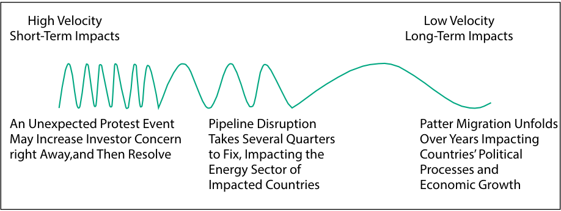
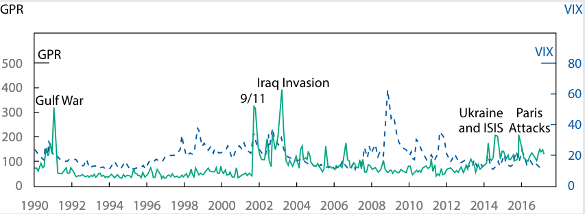

# Volume 2: Economics
## Learning Module 5 Introduction to Geopolitics
### Part 4/4: Geopolitical Risk and the Investment Process (PDF Pages 187–202)

---

<!-- PDF Page 187 -->

2. In the following table, match the geopolitical tool with the _most_ appropriate example of each tool. 

**Geopolitical Tool Example** 1. Financial A. Nationalization 2. Economic B. Espionage 3. National security C. Free exchange of currency across borders 

##### **Solution:** 

Option 1 (Financial) matches with C (Free exchange of currency across borders). 

Option 2 (Economic) matches with A (Nationalization). 

Option 3 (National security) matches with B (Espionage). 

### **GEOPOLITICAL RISK AND THE INVESTMENT PROCESS** 

# **<mark>7</mark>** 

describe the impact of geopolitical risk on investments 

There is no shortage of attention to geopolitical risk in financial market analysis. However, the extent to which investors incorporate geopolitical risk into their decision making will vary widely with their investment objectives and risk tolerance. Some investors may be considered _takers_ of geopolitical risk. These investors may incorporate geopolitical risk into their analysis only to the extent that it affects the long-term attractiveness of asset classes or strategies. For other investors, geopolitical risk may be a central component of their investment process. For these portfolios, monitoring dislocations is an achievable and meaningful driver of alpha creation, where focused geopolitical risk analysis can reduce the impact and severity of adverse events and enhance the potential for upside growth. For example, an investor that anticipates an important political transition may enact portfolio hedges to shield against market volatility or may use the market volatility as a buying opportunity—in either case, improving investment outcomes. 

What follows is a discussion of the impact of geopolitical risk on the investment environment. We begin with a discussion of types of geopolitical risk, followed by a means of assessing those risks and the ways that they can manifest in a portfolio. 

#### **Types of Geopolitical Risk** 

There are three basic types of geopolitical risk: event risk, exogenous risk, and thematic risk. 

**Event risk** evolves around set dates, such as elections, new legislation, or other date-driven milestones, such as holidays or political anniversaries, known in advance. Political events often result in changes to investor expectations related to a country’s cooperative stance. As a result, risk analysts often use political calendars as a starting place for assessing event risk. 

One example of event risk is the United Kingdom’s referendum on European Union membership (Exhibit 11). This was a known event risk; it was planned for 23 June 2016, well in advance. The stakes of the election were well understood, with 

<!-- PDF Page 188 -->

many years’ worth of politically cooperative steps likely to unwind in the event of a “yes” vote. Most investors expected a “no” vote; when the results proved the opposite, investor expectations related to the United Kingdom’s cooperative stance were drastically changed. 

**Exhibit 11: Market Reaction to Event Risk: United Kingdom’s EU Referendum, 2016** 

||**First Day**|**30 Days**|**1 Year**|
|---|---|---|---|
|FTSE|−3.1%|6.2%|17.1%|
|GBP|−8.1%|−11.9%|−14.5%|
|10-year bond yield (Gilt)|−21.0%|−42.0%|−25.0%|

The United Kingdom’s vote to end its European Union membership came as a surprise to many investors. Several asset classes were immediately affected, including equities, the national currency, and government bonds. In the weeks that followed, investors adjusted to the news but became concerned about what a rollback in political cooperation might mean for long-term economic growth. As a result, equity prices recovered, but the British pound continued on a steady decline. Government bond yields declined precipitously in the month following the vote, recovering somewhat as the year progressed. 

It is useful to note that the predictability of an event does not necessarily change its likelihood, its speed of impact, or the size of impact on investors; however, it does give investors more time to prepare a response. We will come back to this example and others in this section when we discuss the assessment of geopolitical threats. 

**Exogenous risk** is a sudden or unanticipated risk that affects either a country’s cooperative stance, the ability of non-state actors to globalize, or both (Exhibit 12). Examples include sudden uprisings, invasions, or the aftermath of natural disasters. 

**Exhibit 12: Market Reaction to Exogenous Risk: Japan’s Fukushima Nuclear Disaster, 2011** 

||**First Day**|**30 Days**|**1 Year**|
|---|---|---|---|
|Nikkei|−6.2%|−5.2%|−3.6%|
|Yen|−0.3%|3.4%|0.5%|
|Japanese 10-year bondyield|−3.3%|5.9%|−22.3%|

On 11 March 2011, Japan was struck with an earthquake and subsequent tsunami wave, resulting in significant loss of human life, homes, and productive capital. The natural disaster also caused a significant nuclear accident that resulted in further human, property, and environmental damage and also disrupted supply chains. The initial market response reflected market concern: Equities fell, the currency depreciated, and bond prices rose. In the weeks that followed and as the toll of the environmental disaster became more apparent, Japanese equity markets continued to suffer, declining up to 20.4 percent (as of 25 November 2011) from their levels the day of the earthquake. 

As the environmental costs of the accident became clear, this event contributed to a shifting stance on political cooperation on environmental issues. Less than three months after the incident, Germany decided to phase out nuclear power entirely by 2022. Belgium confirmed plans to exit nuclear power by 2025, and such countries as Italy, Spain, and Switzerland opted not to reintroduce nuclear energy programs. 

<!-- PDF Page 189 -->

Finally, **thematic risks** are known risks that evolve and expand over a period of time. Climate change, pattern migration, the rise of populist forces, and the ongoing threat of terrorism fall into this category. 

Cyber threats are another example of thematic risk (Exhibit 13). Cyber risks include any attempt to expose, alter, disable, destroy, steal, or gain information through unauthorized access to or unauthorized use of computer systems. These threats began with the expansion of internet and computer use and have increased in number and scale. Now, the number of records stolen or affected by cyberattacks is in the billions per year. While the basic nature of cyberattacks is consistent, the size, scale, and sophistication of attacks have increased over time. 

**Exhibit 13: Market Reaction to Thematic Risk: Equifax Data Breach, 2017** 

||**First Day**|**30 Days**|**1 Year**|
|---|---|---|---|
|Stock price|−13.7%|−22.0%|−4.8%|
|Financial services industry|0.9%|10.3%|18.6%|

In September 2017, the US consumer credit reporting company Equifax announced a data breach that exposed personal information, including names, dates of birth, and personal identification numbers of approximately 147 million people. The initial market reaction was very negative. Equifax’s equity price fell by 13.7 percent in one day and by 34.9 percent over the first week, reaching its low on 15 September 2017. Over time, the impact moderated somewhat, but Equifax still underperformed the financial services industry in the year after its data breach. 

At first, the data breach affected Equifax the most, including instituting protections and credit monitoring for affected customers, without significant impacts on the broader financial industry. 

However, the event also triggered broader impacts over time. Other companies have increased spending on cybersecurity and instituted stronger processes, including software upgrades. 

##### **EXAMPLE 10** 

#### **Geopolitical Risk and the Investor** 

1. Which of the following types of risks are known in advance? Select all that apply. 

   - **A.** Event risk 

   - **B.** Exogenous risk 

   - **C.** Thematic risk 

   - **Solution:** 

A and C are correct. 

Event risk evolves around set dates, and thematic risk is a known risk that evolves and expands over a period of time. Exogenous risk is a sudden or unanticipated risk. 

<!-- PDF Page 190 -->

#### **Assessing Geopolitical Threats** 

Geopolitical risk is always present in the investment environment, and these risks can affects investments in many different ways—from broad macroeconomic levels, to industry impacts, down to individual companies. The question for investors is whether the particular geopolitical risk is relevant for their portfolio management decisions. To make this assessment, an investor considers geopolitical risk in terms of the following three areas: 

- _likelihood_ it will occur, 

- _velocity_ (speed) of its impact, and 

- size and nature of that _impact_ . 

##### **_Likelihood_** 

The likelihood of a risk is the probability that it will occur. Measuring likelihood is a challenging process. The highly unpredictable nature of many risks—their build over time, the many and conflicting motivations of actors involved—means this exercise can be more art than science. However, we may use the framework from Lesson 4 to assess the basic likelihood of risk occurring. Highly collaborative and globalized countries are, on balance, less likely to experience geopolitical risk because the political, economic, and financial costs of partners inflicting those risks are higher. That same interconnectedness, however, may make multilateral countries more vulnerable to certain risks. Their operation in and cooperation with other countries means a risk posed to any of those countries may also have an impact on itself. Similarly, multiple risk exposures may increase the impact of that risk when it occurs. 

Of course, many other factors may increase the likelihood that a risk may occur. Internal political stability, economic need, and the motivations of governmental actors play an important role in increasing the likelihood of disruptive action. In fact, these considerations are so plentiful and intertwined that geopolitical risk monitoring tools have emerged as key components of many research offerings for investors. The numerous scenarios for any given risk make measuring risk likelihood a potentially never-ending task. As a result, investors must balance the time spent on this activity with the relative importance of its input to the investment process. 

The examples used in the section “Types of Geopolitical Risk” in Lesson 6, can help us put a finer point on this concept. Of the three risks described, a cyber risk may have been the most likely to occur and to affect a given investment strategy, whereas the United Kingdom’s “yes” vote and Russia’s annexation of Crimea were less likely at the time in which they occurred. Of course, all three of these risks have different potential impacts on investors. As a result, likelihood should be considered only in conjunction with the velocity and impact of the risk. 

##### **_Velocity_** 

The **velocity** of geopolitical risk is the pace at which it affects an investor portfolio. For the sake of simplicity, we explore short-term or “high-velocity” impacts, medium-term, and long-term or “low-velocity” impacts (see Exhibit 14). 

In the short term, we may see volatility in the markets affecting entire industries or even the entire market. Exogenous or “black swan” events tend to fit into this category, causing market volatility and investor flight to quality. A **black swan risk** is an event that is rare and difficult to predict but has an important impact. Investors with the appropriate time horizon and risk tolerance may make tactical changes to their investment choices as a result of these events. Long-term changes are unlikely to be necessary. 

<!-- PDF Page 191 -->

Risks with a medium-term impact may begin to impair companies’ processes, costs, and investment opportunities, resulting in lower valuations. These risks tend to be distributed toward specific sectors, meaning they will affect some companies much more than others. 

Long-term risks may have important environmental, social, governance, and other impacts. This can affect an investor’s asset allocation—including choice of asset classes and investment styles—for a long-term horizon; however, the immediate impact on portfolios is likely to be more limited. 

**Exhibit 14: Risk Velocity** 

<!-- Start of picture text -->
High Velocity Low Velocity Short-Term Impacts Long-Term Impacts An Unexpected Protest Event  Pipeline Disruption Patter Migration Unfolds May Increase Investor Concern Takes Several Quarters Over Years Impacting right Away,and Then Resolve to Fix, Impacting the  Countries’ Political Energy Sector of Processes and Impacted Countries Economic Growth <!-- End of picture text -->

Note that some risks have more than one speed of impact on investments. The United Kingdom’s referendum outcome to exit the EU had some immediate impacts, notably a decline in the value of the British pound sterling and other forms of market volatility. Over time, low-velocity impacts have become more apparent and more lasting for investors. Higher transaction costs and the unwind of previous forms of political cooperation—including the freedom of movement between the United Kingdom and the EU—are generating important impacts on investment outcomes and overall economic growth. 

##### **EXAMPLE 11** 

#### **Geopolitical Risk Velocity and Investor Reaction** 

1. Match the potential velocity of a geopolitical risk with the _most likely_ investor reaction among those listed in the following table: 

|**Geopolitical Risk Velocity**|**Investor Reaction**|
|---|---|
|1. Low|A. Adjust investments in specific sectors|
|2. Medium|i B. Flight to quality|
|3. High|C. Adjust asset allocation|
|**Solution:**||

Option 1 (Low) matches with C (Adjust asset allocation). Option 2 (Medium) matches with A (Adjust investments in specific sectors). O <mark>p</mark> tion 3 <mark>(</mark> Hi <mark>g</mark> h <mark>)</mark> matches with B <mark>(</mark> Fli <mark>g</mark> ht to <mark>q</mark> ualit <mark>y)</mark> . 

<!-- PDF Page 192 -->

##### **EXAMPLE 12** 

#### **Geopolitical Risk and the Investor** 

1. Describe the three areas that an investor should consider when assessing geopolitical risk. 

   - **Solution:** 

An investor should consider the following three areas when assessing geopolitical risk: the likelihood it will occur, the velocity of its impact, and the size and nature of that impact. The likelihood that it will occur considers the probability that geopolitical risk will occur. The velocity of its impact is the pace at which it affects an investor portfolio. The impact can manifest in many ways and can be discrete in size or broad in nature. 

#### **Impact of Geopolitical Risk** 

A risk’s impact on investor portfolios can manifest in many different ways. For the sake of this framework for assessing risk, suffice it to say that investors should consider the size of any risk’s impact when gauging its importance to the investment process. A high-impact risk may merit extensive study of its drivers and motivations, whereas a low-impact risk may not. In addition, the size of a risk’s impact may be compounded by external factors. For example, risk tends to have a greater impact on markets experiencing a general contraction or economic downturn. 

Impact may also be discrete or broad in nature. Discrete impacts are those that affect only one company or sector at a time, whereas broad impacts are felt more holistically by a sector, a country, or the global economy. Cyber risks may be considered in this light. In the event of a cyberattack, only the companies and investment strategies exposed to that company will be affected. However, cyber risks may also have a broader impact by increasing monitoring, due diligence, and security costs for all companies and investors seeking to avoid them. 

When assessing geopolitical risk for portfolio management, investors should consider all three geopolitical risk factors—likelihood, velocity, and size and nature of impact—together. For example, a highly likely risk with very little impact to the portfolio may not merit extensive analysis and investor attention. However, a highly impactful risk with a low likelihood of occurring may merit building a scenario for response but not regular monitoring and assessment. Between these extremes, investors must consider their goals and risk tolerance to identify high-priority risks. 

##### **_Scenario Analysis_** 

Geopolitical risks seldom develop in linear fashion, making it difficult to monitor and forecast their likelihood, velocity, and impact on a portfolio as well as difficult to address those changes through portfolio action. As a result, many investors deploy an approach that includes scenario analysis and signposting rather than a single point forecast. 

**Scenario analysis** is the process of evaluating portfolio outcomes across potential circumstances or states of the world. Scenarios help investment teams understand where they stand with respect to a risk that might cause them to change their behavior. Scenario analysis can strengthen a team’s conviction about its prioritization and calls to action, thereby helping it make good investment choices at opportune moments. 

Scenarios can take the form of qualitative analysis, quantitative measurement, or both. A simple framework for qualitative scenario building begins with developing a base case for the event. What is the most impactful outcome of the risk? How likely 

<!-- PDF Page 193 -->

is that risk/outcome to occur in the first place? From there, investors can consider upside and downside scenarios. Is it a persistent tail risk or a short-term shock? How are markets likely to recover once the event has taken place? Considering alternate futures for key risks will drive more precise perspective around what constitutes key developments in the most important risks. 

Quantitative scenarios can vary widely by sophistication. One form of a simple quantitative scenario is a stylized scenario in which portfolio sensitivity is measured against one key factor relevant to the portfolio, such as interest rates, asset prices, or exchange rates. Another involves using circumstances from extreme events to help build quantitative tests for portfolio resilience. It is important to have reasonable ambitions, however. Quantitative scenarios can be complicated because of the secondary and linked impacts of geopolitical risks to securities in the portfolio. 

Good scenario building can prompt investors to alter their risk prioritization, making it a useful tool not only for tracking risks but also for deciding which portfolio actions may be valuable to take. Good scenario analysis also requires a consistent commitment of investors’ time and resources. Teams that read similar research or speak with similar client groups may be affected by **groupthink** , the practice of thinking or making decisions as a group in a way that discourages creativity or individual responsibility. For scenario analysis to be useful in portfolio management, teams must work hard to build creative processes, identify and track scenarios, and assess the need for action on a regular basis. 

#### **Tracking Risks According to Signposts** 

To build a portfolio’s resilience to unexpected change, asset managers develop processes in advance that allow for rapid course correction. In other words, by creating plans for addressing priority risks as they occur, investors can help reduce the events’ impact on investment outcomes. 

One important process is identifying signposts for priority risk. A **signpost** is an indicator, market level, data piece, or event that signals a risk is becoming more or less likely. An analyst can think of signposts like a traffic light. If quantitative and qualitative evidence suggest that a risk is low in likelihood, velocity, or impact, then the signposts are flashing green, or no action needed. If signposts are flashing amber, indicating that a risk is medium in likelihood, velocity, or impact, then higher caution and preparedness against that risk may be warranted. As a risk rises in likelihood, velocity, or impact, an action plan may be necessary. 

Identifying signposts should equip a team to differentiate signal from noise and react when signposts flash red. For instance, when the market environment moves to either risk-on or risk-off, it is important to identify what actions should be taken next or communications made. Good signposts are anchored in the key assumptions made up-front around a scenario and mark whether a scenario is materializing. 

Let’s return to our example of the United Kingdom’s Brexit referendum for context. Before 2014, signposts for geopolitical risk in the United Kingdom may have flashed “green.” Attitudes toward European Union membership were divided, and while there is always a possibility of disruptive geopolitical change, a reduction in political cooperation with the European Union was not clearly defined. Then, when the referendum was announced in 2015, signposts for disruptive change became more likely and faster in potential velocity, resulting in a higher required level of portfolio manager attention. In May 2016, when phone polls suggested that the “leave” vote was moving to the majority, signposts flashed “red” and attentive portfolio managers prepared action plans for election day. 

Identifying the right signposts can require some trial and error. A basic rule of thumb for distinguishing signal from noise is the distinction between politics and policy. For example, there can be a big difference in “politics” between two leaders, 

<!-- PDF Page 194 -->

but the “policies” they enact are what create larger or more durable portfolio impacts. Political developments can serve as meaningful signposts, as they can indicate a change in the risk’s likelihood or pace. However, analysts are frequently knocked off course by following developments that do not necessarily indicate a change in real economic or market outcomes. Instead, analysts should look for policy changes to guide their portfolio management decisions. 

Some combinations of economic and financial market circumstances serve as strong warnings of potential trouble. For example, high inflation and deteriorating employment can signal political unrest. A pegged currency and rapidly declining export value (particularly for commodities exporters) can prompt a change in exchange rate policy. Often, particularly for emerging markets, these signposts will change before official data are released. If a portfolio relies on country-level economic conditions, data screens should be used to help identify any red flags early. 

#### **Manifestations of Geopolitical Risk** 

If geopolitical risk takes many forms, its impact on investor portfolios is just as multifaceted. High-velocity risks are most likely to manifest in market volatility through prompt changes in asset prices. Commonly affected asset prices include commodities, foreign exchange, equities, and bond prices (via changes in interest rates). 

One example is the market response to economic shutdowns related to the COVID-19 pandemic (Exhibit 15). Using the United States as an example, the S&P 500 Index fell from a level of 3,386 on 19 February 2020 to 2,237.4 on 23 March, a decline of nearly 34%. Bonds also experienced volatility. Global investors’ “flight to safety” pushed up US bond prices. The US 10-year Treasury yield fell from 1.5661 to a low of 0.5407 during that period, a decline of nearly 68 percent. This volatility was not permanent but created ample risk—and opportunity—for investors during that time. 

**Exhibit 15: US Market Reaction to the COVID-19 Pandemic, 1 January 2020 to 23 March 2021** 

<!-- Start of picture text -->
January 1 2020 = 100 140 120 100 80 60 40 20 S&P 500 Index UST 10-Year Yield 1/2/202/2/203/2/204/2/205/2/206/2/207/2/208/2/209/2/2010/2/2011/2/2012/2/201/2/212/2/213/2/21 <!-- End of picture text -->

_Source:_ Bloomberg Finance LP. 

Low-velocity geopolitical risks can have a more prolonged impact on investor inputs. Sustained disruption may result in smaller revenues, higher costs, or both, which can negatively affect a company’s valuation. Here, too, the COVID-19 pandemic is 

<!-- PDF Page 195 -->

an instructive example. While risk asset valuations improved over the course of the pandemic, disruptions to mobility and consumption had long-lasting impacts on company revenues and supply chains. 

For countries, regions, or sectors perceived to be at more consistent risk of geopolitical disruption, investors may require higher compensation, effectively increasing the discount rate investors use when valuing those securities. Portfolio investment flows face greater volatility because of geopolitical factors, and investors will factor in a higher risk premium. This dynamic is a key reason why asset prices in emerging and frontier markets are typically maintained at a discount to those in developed countries that are perceived to have a lower threat of risk. 

##### **GEOPOLITICAL RISK INDEX** 

In a 2019 paper, two analysts at the US Federal Reserve Board of Governors built the Geopolitical Risk Index (GPR) based on a tally of news articles covering geopolitical tensions and their impact on economic events. The purpose of the index is to measure real-time geopolitical risk as perceived by the press, the public, global investors, and policymakers in a way that is consistent over time. 

<!-- Start of picture text -->
GPR VIX GPR VIX 500 80 400 Iraq Invasion Gulf War 9/11 60 300 Ukraine Paris and ISIS Attacks 40 200 20 100 0 0 1990 1992 1994 1996 1998 2000 2002 2004 2006 2008 2010 2012 2014 2016 <!-- End of picture text -->

Through their construction of the GPR, the authors made three important observations. First, they found that high levels of geopolitical risk reduce US investment, employment, and price level of the stock market. Second, and taking this observation deeper, the authors found that individual firm’s investment falls more in industries positively exposed to geopolitical risk and that firms reduce investment in the wake of idiosyncratic geopolitical risk events. Finally, they studied the adverse effect of geopolitical events themselves as well as the threat of adverse events, finding that the threat of events had a larger impact over time. 

##### **EXAMPLE 13** 

#### **Geopolitical Risk** 

1. True or False: Higher-velocity geopolitical risks are _most_ likely to have a prolonged impact on investor inputs. 

Explain your selection. 

**A.** True 

**B.** False 

##### **Solution:** 

B is correct. Higher-velocity risks are most likely to manifest in market volatility via prompt changes in asset prices. Lower-velocity geopolitical risks are likely to have a prolonged impact on investor inputs. The terrorist attacks of 11 September 2001 in the United States are an example of a 

<!-- PDF Page 196 -->

higher-velocity geopolitical risk as the market had a sharp downturn and rebounded in a relatively short amount of time. 

##### **EXAMPLE 14** 

#### **Geopolitical Risk** 

1. True or false: The probability and impact of geopolitical risks influence relative asset price discount rates across emerging and developed markets. 

Explain your selection. 

**A.** True 

**B.** False 

##### **Solution:** 

A is correct. For countries, regions, or sectors perceived to be at more consistent risk of geopolitical disruption, investors may require higher compensation, effectively increasing the discount rate used in valuation. When portfolio investment flows face greater volatility because of geopolitical factors, investors will factor in a higher risk premium. This explains why asset prices in emerging markets typically are maintained at a discount to those in developed countries perceived to have a lower threat of geopolitical risk, with the latter more likely to experience lower probability risks with lesser impacts. 

#### **Acting on Geopolitical Risk** 

Determining the likelihood, velocity, and impact of a risk may help an investor to assign priority to which risks might be most important. But if the risk does occur, what, if anything, can be done about it? Even if an investor could anticipate every risk and its impact on their portfolios, they must still consider whether and how to act in the face of such threats. A final step in incorporating geopolitical risk into the portfolio management process thus requires that geopolitical risk analysis be translated into investment action as appropriate for investor goals, risk tolerance, and time horizon. 

Taking a top-down approach, asset allocators may consider geopolitical risk in their asset allocation strategy. The likelihood, velocity, and impact of risks may affect key capital markets assumptions as well as an asset allocator’s positioning in certain countries or regions. For example, countries with a long history of using a multilateral approach may be considered more reliable investments and see increased investor flows. In contrast, those countries experiencing consistent military threat may have lower economic and investment growth potential because of consistent disruptions. The asset allocator would thus allocate more capital to the countries with lower expected risk profiles. 

At the portfolio management level, investors can consider geopolitical risk as a factor in multifactor models. Imagine an analyst assessing global car manufacturers. A company with highly diversified production may be exposed to more risk (i.e., higher likelihood), but production would be less likely to come to a halt given the multiple production alternatives (i.e., lower impact). When making a buy or sell recommendation, the analyst may consider relative geopolitical risk exposure as a factor in their analysis. Disruptive threats may be used as a binary yes-or-no factor or they can affect the confidence intervals around factors related to momentum, valuation, market sentiment, or the economic cycle. 

<!-- PDF Page 197 -->

Ultimately, the importance of geopolitical risk to the investment process depends on investor objectives, risk tolerance, and time horizon. For an investor with low risk tolerance, reducing exposure to geopolitical risk may be appropriate, whether through low-volatility investment choices or through hedging. 

For an investor with a long time horizon, a geopolitical event like an exogenous shock could be a buying opportunity. For an investor nearing retirement, however, that same exogenous shock can have a major negative impact on their terminal portfolio value. 

The extensive political, economic, and financial cooperation in which countries, companies, and organizations participate may raise the stakes of geopolitical risk analysis for global investors. Changes in the style and momentum of international cooperation can have an important impact on capital markets. Global investors ignore those risks at their peril. 

<!-- PDF Page 198 -->

## **~~PRACTICE PROBLEMS~~** 

**1.** Which of the following statements regarding a country’s political cooperation is _most_ accurate? 

   - **A.** If a country is engaged in military conflict, there is a higher cost to cooperation. 

   - **B.** A country with few internal resources is not likely to rely on political cooperation. 

   - **C.** Interest prioritization does not determine the depth and nature of political cooperation. 

**2.** A consequence of one of the disadvantages of globalization is that: 

   - **A.** pay differences between countries have narrowed. 

   - **B.** emerging market trade flows have grown more important. 

   - **C.** greater economic and financial cooperation has increased interdependence. 

**3.** Which of the following outcomes is _most_ likely a result of globalization? 

   - **A.** Unequal gains 

   - **B.** Increased independence 

   - **C.** Decreased access to talent 

**4.** A US company expanding critical spare part inventories for local customers made at its existing Canadian facility after a supply chain disruption is _most likely_ using the coping tactic of: 

   - **A.** reshoring the essentials. 

   - **B.** reglobalizing production. 

   - **C.** doubling down on key markets. 

**5.** An example of a geopolitical multifaceted tool for furthering national interests is: **A.** cabotage. 

   - **B.** armed conflict. 

   - **C.** nationalization of key export industries. 

**6.** Which of these is most likely to be described as an event risk? 

   - **A.** An earthquake 

   - **B.** An election 

   - **C.** An ongoing civil war 

**7.** Exogenous risks are _best_ described as those that: 

   - **A.** are known and evolve and expand over a period of time. 

<!-- PDF Page 199 -->

   - **B.** revolve around set dates, such as elections, new legislation, or other date-driven milestones, such as holidays or political anniversaries. 

   - **C.** are sudden or unanticipated and impact either a country’s cooperative stance, the ability of non-state actors to globalize, or both. 

**8.** Which of the following statements about geopolitical threats in the investment environment is _most_ accurate? 

   - **A.** Geopolitical risk is not always present in the investment environment. 

   - **B.** Highly collaborative, interconnected countries are vulnerable to geopolitical risk. 

   - **C.** Geopolitical risk tends to have less of an impact on markets already experiencing a general contraction or economic downturn. 

**9.** An applicable conclusion drawn from the Geopolitical Risk Index (GPR) is that: 

   - **A.** high geopolitical risk results in tangible macroeconomic effects. 

   - **B.** recurring geopolitical risk events lead to reduced corporate investment. 

   - **C.** the adverse impact of actual events is greater over time than that of the threat of such events. 

**10.** The basic geopolitical risk type _most likely_ in comparison to have the smallest degree of uncertainty is: 

   - **A.** exogenous risk. 

   - **B.** event risk. 

   - **C.** thematic risk. 

<!-- PDF Page 200 -->

## **~~SOLUTIONS~~** 

1. A is correct. If a country is engaged in military conflict, there is a higher cost to cooperation. B is incorrect because a country with few internal resources is likely to rely on political cooperation. C is incorrect because interest prioritization does determine the depth and nature of political cooperation. 

2. C is correct. Through the process of greater economic and financial cooperation, companies may become dependent on other countries’ resources for their supply chains. On aggregate, this can result in the nation itself becoming dependent on other nations for certain resources (such as rare earth metals, cobalt, or copper). If there is a disruption to the supply chain, including via a moment of political non-cooperation, then firms may not be able to produce the good themselves. A is incorrect because the narrowing of pay differences between countries results from a motivation to pursue globalization, which is related to one of its advantages. It is an important way for companies to increase profitability by reducing their costs. Although wage differentials remain, they are decreasing. B is incorrect because the proportion of flows between developed economies as a share of overall trade continuing to decline as emerging market trade flows rise is a function of increased international investment. This increased investment has provided beneficial aggregate economic benefits, such as increased choice, higher quality goods, increased competition among firms, higher efficiency, and increased labor mobility. 

3. A is correct. Unequal accrual of economic and financial gains is a cost of globalization because improvement on the aggregate does not mean improvement for everyone. B is incorrect because globalization leads to _interdependency_ as companies may become dependent on other countries’ resources for their supply chains. C is incorrect because rather than decreased access to talent, a country might actually globalize to improve access to talent as cooperation and globalization can lead to increased access to resources. 

4. A is correct. The COVID-19 pandemic has highlighted the need for certain essential supply chains to be rebuilt domestically for emergency situations, with availability of critical spare parts being an analogy. The close integration of the US and Canadian economies through the revised USMCA agreement effectively makes expanded production at an existing Canadian factory an example of reducing manufacturing risk by relocating to home countries via reshoring. B is incorrect because instead of reducing manufacturing risk by duplicating or fortifying its supply chain, the company is simply continuing to use its existing capacity more intensively. C is incorrect because although the production is intended to better supply its home market, there is no evidence that the company is expanding its presence in the US market or shifting its focus to the exclusion of available opportunities elsewhere. 

5. A is correct. Cabotage is the right to transport passengers or goods within a country by a foreign firm. Many countries—including those with multilateral trade agreements—impose restrictions on cabotage across transportation subsectors, meaning that shippers, airlines, and truck drivers are not allowed to transport goods and services within another country’s borders. Allowing cabotage requires coordination on areas like physical security and economic coordination, a highly multilateral (multifaceted tool) process. B is incorrect because armed conflict is the most extreme example of a national security tool. It can be either internal or external to a country in taking a direct and active approach to wield- 

<!-- PDF Page 201 -->

ing influence. C is incorrect because nationalization of key export industries is an economic tool. This process of transferring an activity or industry from private to state control is a non-cooperative approach to asserting economic control. 

6. B is correct. Event risk evolves around set dates, such as elections and new legislation, or other date-driven milestones, such as holidays or political anniversaries known in advance. The other choices could not be known in advance. An earthquake (A) is an example of an exogenous risk. An ongoing civil war (C) is an example of a thematic risk. 

7. C is correct. Exogenous risks are best described as those that are sudden or unanticipated and that affect either a country’s cooperative stance, the ability of non-state actors to globalize, or both. A is incorrect because thematic (not exogenous) risks are known risks that evolve and expand over a period of time. B is incorrect because event (not exogenous) risks are those that evolve around set dates, including elections, new legislation, or other date-driven milestones. 

8. B is correct. Although highly collaborative and globalized countries are, on balance, less likely to experience geopolitical risk because the political, economic, and financial costs of partners inflicting those risks are higher than less collaborative countries, the same interconnectedness may make them more vulnerable to geopolitical risk. A is incorrect because geopolitical risk is always present in the investment environment. C is incorrect because geopolitical risk tends to have a greater impact on markets already experiencing a general contraction or economic downturn. 

9. A is correct. The GPR creators found that high levels of geopolitical risk reduce US investment, employment, and price level of the stock market. B is incorrect because firms reduce investment in the wake of idiosyncratic events, which would be unlikely to repeat. C is incorrect because the threat of an event was shown to have a larger impact over time than that of the actual events themselves. 

10. B is correct. _Event risk_ evolves around set dates, such as elections or new legislation, or other date-driven milestones, such as holidays or political anniversaries. Analysts can thus look to political calendars as a predictable starting point for determining the occurrence of event risk, with time to devise a suitable response. A is incorrect because exogenous risk is sudden and unanticipated. Examples include sudden uprisings, invasions, or the aftermath of natural disasters. The timing and range of its effects thus have the greatest unknowns. C is incorrect because thematic risks are known risks that evolve and expand over a period of time. Climate change, pattern migration, the rise of populist forces, and the ongoing threat of terrorism fall into this category. These are more foreseeable than exogenous risks, but with their extended interval of exposure, planned responses likely require continual adjustments. 

<!-- PDF Page 202 -->

