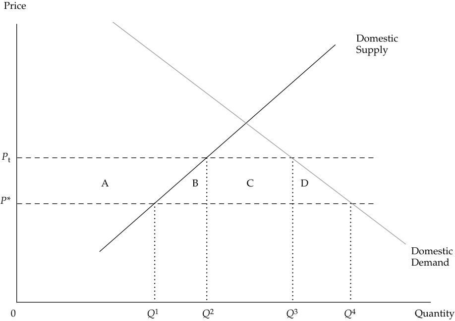

# Volume 2: Economics
## Learning Module 6 International Trade
### Part 1/2: Introduction (PDF Pages 203–218)

---

<!-- PDF Page 203 -->

#### L E A R N I N G M O D U L E 

# **<mark>6</mark>** 

### **International Trade** 

###### **by Usha Nair-Reichert, PhD, and Daniel Robert Witschi, PhD, CFA.** 

_Usha Nair-Reichert, PhD, is at Georgia Institute of Technology (USA). Daniel Robert Witschi, PhD, CFA (Switzerland)._ 

###### **<mark>LEARNING OUTCOMES</mark>** 

|**_Mastery_**|**_The candidate should be able to:_**|
|---|---|
||describe the benefits and costs of international trade|
||compare types of trade restrictions, such as tariffs, quotas, and export subsidies, and their economic implications|
||explain motivations for and advantages of trading blocs, common markets, and economic unions|

##### **INTRODUCTION** 

## **<mark>1</mark>** 

From an investment perspective, it is important for global investors to understand existing trade policies. Such policies can affect the volume and value of trade and thus can affect the return on investment. Investors need to be aware of potential changes in the government’s trade policy. Such changes have important implications for firm profitability and growth by affecting the demand for its products and its pricing. There has been much debate among economists on the role of trade and trade policy and its impact on the overall economy. This learning module examines the benefits and cost of international trade. It then describes trade restrictions and their implications and discusses the motivation for, and advantages of, the different types of trading blocs or trade agreements. 

###### **LEARNING MODULE OVERVIEW** 

- The most compelling arguments supporting international trade are: 

   - countries gain from exchange and specialization, 

   - ● industries experience greater economies of scale, 

   - households and firms have greater product variety, 

<!-- PDF Page 204 -->

   - competition is increased, and 

   - resources are allocated more efficiently. 

- Newer models of trade focus on the gains from trade that result from economies of scale, greater product variety, and increased competition. 

- Opponents of free trade point to the potential for greater income inequality and the loss of jobs in developed market countries as a result of import competition. 

- The fact that trade increases overall welfare does not mean that every individual consumer and producer is better off. What it does mean is that the winners could, in theory, compensate the losers and still be better off. 

- Trade restrictions (or trade protection) are government policies that limit the ability of domestic households and firms to trade freely with other countries. 

- Tariffs are taxes that a government levies on imported goods. The primary objective of tariffs is to protect domestic industries that produce the same or similar goods. They also may aim to reduce a trade deficit. 

- The net welfare effect of tariffs is the sum of consumer surplus, producer surplus and government tax revenue. The loss in consumer surplus is greater than the sum of the gain in producer surplus and government revenue and results in a deadweight loss to the country’s welfare. 

- A quota restricts the quantity of a good that can be imported into a country, generally for a specified period of time. A voluntary export restraint (VER) is a trade barrier under which the exporting country agrees to limit its exports of the good to its trading partners to a specific number of units. 

- An export subsidy is a payment by the government to a firm for each unit of a good that is exported. Its goal is to stimulate exports. 

- A regional trading bloc is a group of countries that have signed an agreement to reduce and progressively eliminate barriers to trade and the movement of factors of production among the members of the bloc. 

- There are many different types of regional trading blocs, depending on the level of integration that takes place. These include free trade areas, customs union, common market, and economic union. 

- Trade creation occurs when regional integration results in the replacement of higher-cost domestic production by lower-cost imports from other members. Trade diversion occurs when lower-cost imports from non-member countries are replaced with higher-cost imports from members. 

##### **BENEFITS AND COSTS OF TRADE** 

<!-- PDF Page 205 -->

Over the past few decades, the global economy has experienced rapid growth in trade and a growing interdependence among countries. This has led to a debate among policy makers over whether the expansion of trade has been helpful for individual national economies. This lesson examines the possible benefits and costs of international trade. 

###### **Benefits and Costs of International Trade** 

The benefits and costs of international trade are widely debated. The most compelling arguments supporting international trade are as follows: countries gain from exchange and specialization, industries experience greater economies of scale, households and firms have greater product variety, competition is increased, and resources are allocated more efficiently. 

Gains from exchange occur when trade enables each country to receive a higher price for its exports (and greater profit) or pay a lower price for imported goods instead of producing these goods domestically at a higher cost (i.e., less efficiently). This exchange, in turn, leads to a more efficient allocation of resources by increasing production of the export good and reducing production of the import good in each country (trading partner). This efficiency allows for consumption of a larger bundle of goods, thus increasing overall welfare. The fact that trade increases overall welfare does not mean, of course, that every individual consumer and producer is better off. What it does mean is that the winners could, in theory, compensate the losers and still be better off. 

Trade also leads to greater efficiency by fostering specialization based on comparative advantage. Traditional trade models, such as the Ricardian model and the Heckscher–Ohlin model, focus on specialization and trade according to comparative advantage arising from differences in technology and factor endowments, respectively. 

Newer models of trade focus on the gains from trade that result from economies of scale, greater product variety, and increased competition. In an open economy, increased competition from foreign firms reduces the monopoly power of domestic firms and forces them to become more efficient, in contrast to a closed economy. Industries that exhibit increasing returns to scale (e.g., the automobile and steel industries) benefit from increased market size as a country starts trading because the average cost of production declines as output increases in these industries. Monopolistically competitive models of trade have been used to explain why there is significant two-way trade (known as _intra-industry trade_ ) between countries within the same industry. Intra-industry trade occurs when a country exports and imports goods in the same product category or classification. 

A monopolistically competitive industry has many firms; each firm produces a unique or differentiated product: it does not have any exit or entry barriers, and long-run economic profits are zero. In such a model, even though countries may be similar, they gain from trade because each country focuses on the production and export of one or more varieties of the good and imports other varieties of the good. For example, the European Union exports and imports different types of cars. Consumers gain from having access to a greater variety of final goods. Firms benefit from greater economies of scale because firms both within and outside the EU are able to sell their goods in both markets. Hence, scale economies allow firms to benefit from the larger market size and experience lower average cost of production as a result of trade. 

Research suggests that trade liberalization can lead to increased real (i.e., inflation-adjusted) GDP although the strength of this relationship is still debated. The positive influence of trade on GDP can arise from more efficient allocation of resources, learning by doing, higher productivity, knowledge spillovers, and trade-induced changes in policies and institutions that affect the incentives for innovation. In industries that embrace “learning by doing,” such as the semiconductor industry, the cost of production per unit declines as output increases because of expertise and experience 

<!-- PDF Page 206 -->

acquired in the process of production. Trade can lead to increased exchange of ideas, freer flow of technical expertise, and greater awareness of changing consumer tastes and preferences in global markets. It also can contribute to the development of higher quality and more effective institutions and policies that encourage domestic innovation. For example, studies have shown that foreign research and development (R&D) has beneficial effects on domestic productivity, which become stronger the more open an economy is to foreign trade. For example, some estimate that about a quarter of the benefits of R&D investment in a G–7 country accrues to their trading partners. Consider Logitech, a Swiss company that manufactures computer mice. To win original equipment manufacturer (OEM) contracts from IBM and Apple, Logitech needed to develop innovative designs and provide high-volume production at a low cost. So in the late 1980s, the company moved to Taiwan Region, which had a highly qualified labor force, competent parts suppliers, a rapidly expanding local computer industry, and offered Logitech space in a science park at a competitive rate. Soon thereafter, Logitech was able to secure the Apple contract. 

Opponents of free trade point to the potential for greater income inequality and the loss of jobs in developed countries as a result of import competition. As a country moves toward free trade, adjustments will be made in domestic industries that are exporters as well as in those that face import competition. Resources (investments) may need to be reallocated into or out of an industry depending on whether that industry is expanding (exporters) or contracting (i.e., facing import competition). As a result of this adjustment process, less-efficient firms may be forced to exit the industry, which, in turn, may lead to higher unemployment and the need for displaced workers to be retrained for jobs in expanding industries. The counter argument is that although there may be short-term and even some medium-term costs, these resources are likely to be more effectively (re-)employed in other industries in the long run. Nonetheless, the adjustment process is virtually certain to impose costs on some groups of stakeholders. 

###### **QUESTION SET** 

Consider two countries that each produce two goods. Suppose the cost of producing cotton relative to lumber is lower in Cottonland than in Lumberland. 

1. How would trade between the two countries affect the lumber industry in Lumberland? 

###### **Solution:** 

The lumber industry in Lumberland would benefit from trade. Because the cost of producing lumber relative to producing cotton is lower in Lumberland than in Cottonland (i.e., lumber is relatively cheap in Lumberland), Lumberland will export lumber and the industry will expand. 

2. How would trade between the two countries affect the lumber industry in Cottonland? 

###### **Solution:** 

The lumber industry in Cottonland would not benefit from trade, at least in the short run. Because lumber is relatively expensive to produce in Cottonland, the domestic lumber industry will shrink as lumber is imported from Lumberland. 

<!-- PDF Page 207 -->

3. What would happen to the lumber industry workers in Cottonland in the long run? **Solution:** The overall welfare effect in both countries is positive. However, in the short run, many lumber producers in Cottonland (and cotton producers in Lumberland) are likely to find themselves without jobs as the lumber industry in Cottonland and the cotton industry in Lumberland contract. Those with skills that also are needed in the other industry may find jobs fairly quickly. Others are likely to do so after some re-training. In the long run, displaced workers should be able to find jobs in the expanding export industry. Those who remain in the import-competing industry, however, may be permanently worse off because their industry-specific skills are now less valuable. Thus, even in the long run, trade does not necessarily make every stakeholder better off. But the winners could compensate the losers and still be better off, so the overall welfare effect of opening trade is positive. 

4. What is the meaning of the expression “gains from trade”? **Solution:** 

Gains from trade imply that the overall benefits of trade outweigh the losses from trade. It does not mean that all stakeholders (producers, consumers, government) benefit (or benefit equally) from trade. 

5. What are some of the benefits from trade? 

###### **Solution:** 

Some of the benefits from trade include the following: gains from exchange and specialization based on relative cost advantage; gains from economies of scale as the companies add new markets for their products; greater variety of products available to households and firms; greater efficiency from increased competition; and more efficient allocation of resources. 

## **TRADE RESTRICTIONS AND AGREEMENTS—TARIFFS,** **<mark>3</mark> QUOTAS, AND EXPORT SUBSIDIES** 

compare types of trade restrictions, such as tariffs, quotas, and export subsidies, and their economic implications 

Trade restrictions (or trade protection) are government policies that limit the ability of domestic households and firms to trade freely with other countries. Examples of trade restrictions include tariffs, import quotas, voluntary export restraints (VER), subsidies, embargoes, and domestic content requirements. **Tariffs** are taxes that a government levies on imported goods. **Quotas** restrict the quantity of a good that can be imported into a country, generally for a specified period of time. A voluntary export restraint is similar to a quota but is imposed by the exporting country. An **export subsidy** is paid by the government to the firm when it exports a unit of a good that is being subsidized. The goal is to promote exports, but it reduces welfare by encouraging production and trade that is inconsistent with comparative advantage. **Domestic content provisions** stipulate that some percentage of the value added or 

<!-- PDF Page 208 -->

components used in production should be of domestic origin. Trade restrictions are imposed by countries for several reasons, including protecting established domestic industries from foreign competition, protecting new industries from foreign competition until they mature (infant industry argument), protecting and increasing domestic employment, protecting strategic industries for national security reasons, generating revenue from tariffs (especially for developing countries), and retaliation against trade restrictions imposed by other countries. 

**Capital restrictions** are defined as controls placed on foreigners’ ability to own domestic assets or domestic residents’ ability to own foreign assets. Thus, in contrast with trade restrictions, which limit the openness of goods markets, capital restrictions limit the openness of financial markets and will be addressed later. 

###### **Tariffs** 

Tariffs are taxes that a government levies on imported goods. The primary objective of tariffs is to protect domestic industries that produce the same or similar goods. They also may aim to reduce a trade deficit. Tariffs reduce the demand for imported goods by increasing their price above the free trade price. The economic impact of a tariff on imports in a small country is illustrated in Exhibit 1. In this context, a small country is not necessarily small in size, population, or GDP. Instead, a **small country** is one that is a price taker in the world market for a product and cannot influence the world market price. For example, by many measures, Brazil is a large country, but it is a price taker in the world market for cars. A large country, however, is a large importer of the product and can exercise some influence on price in the world market. When a large country imposes a tariff, the exporter reduces the price of the good to retain some of the market share it could lose if it did not lower its price. 

This reduction in price alters the terms of trade and represents a redistribution of income from the exporting country to the importing country. So, in theory, it is possible for a large country to increase its welfare by imposing a tariff if (1) its trading partner does not retaliate and (2) the deadweight loss as a result of the tariff (see below) is smaller than the benefit of improving its terms of trade. Global welfare, however, would still experience a net reduction—the large country cannot gain by imposing a tariff unless it imposes an even larger loss on its trading partner. 

In Exhibit 1, the world price (free trade price) is _P_ *. Under free trade, domestic supply is _Q_1 , domestic consumption is _Q_4 , and imports are _Q_1 _Q_4 . After the imposition of a per-unit tariff _t_ , the domestic price increases to Pt, which is the sum of the world price and the per-unit tariff _t_ . At the new domestic price, domestic production increases to _Q_2 and domestic consumption declines to _Q_3 , resulting in a reduction in imports to _Q_2 _Q_3 . 

<!-- PDF Page 209 -->

###### **Exhibit 1: Welfare Effects of Tariff and Import Quota** 

<!-- Start of picture text -->
Price Domestic Supply P t A B C D P* Domestic Demand 0 Q 1 Q 2 Q 3 Q 4 Quantity <!-- End of picture text -->

The welfare effects of the tariff can be summarized as follows: 

- Consumers suffer a loss of consumer surplus because of the increase in price. In Exhibit 1, this effect is represented by areas A + B + C + D. 

- Local producers gain producer surplus from a higher price for their output. This effect is represented by area A. 

- The government gains tariff revenue on imports _Q_2 _Q_3 . This effect is represented by area C. 

The net welfare effect is the sum of these three effects and is summarized in Exhibit 2. The loss in consumer surplus is greater than the sum of the gain in producer surplus and government revenue and results in a deadweight loss to the country’s welfare of B + D. 

**Exhibit 2: Welfare Effects of an Import Tariff or Quota** 

||**Importing Country**|
|---|---|
|Consumer surplus|– (A + B + C + D)|
|Producer surplus|+A|
|Tariff revenue_or_Quota rents|+C|
|f National welfare|− B − D|

Tariffs create deadweight loss because they give rise to inefficiencies on both the consumption and production side. B represents inefficiencies in production. Instead of being able to import goods at the world price _P_ *, tariffs encourage inefficient producers whose cost of production is greater than _P_ * to enter (or remain in) the market, leading to an inefficient allocation of resources. On the consumption side, tariffs prevent mutually beneficial exchanges from occurring because consumers who were willing to pay more than _P_ * but less than Pt are now unable to consume the good. 

<!-- PDF Page 210 -->

###### **EXAMPLE 1** 

###### **Analysis of a Tariff** 

South Africa manufactures 110,000 tons of paper. However, domestic demand for paper is 200,000 tons. The world price for paper is USD5.00 per ton. South Africa will import 90,000 tons of paper from the world market at free trade prices. If the South African government (a small country) decides to impose a tariff of 20 percent on paper imports, the price of imported paper will increase to USD6.00. Domestic production after the imposition of the tariff increases to 130,000 tons, while the quantity demanded declines to 170,000 tons. 

1. Calculate the loss in consumer surplus arising from the imposition of the tariff on imported paper. 

###### **Solution:** 

The loss in consumer surplus = USD1 × 170,000 + 1/2 × USD1 × 30,000 = USD185,000. This calculation is represented by areas A + B + C + D in Exhibit 1. 

2. Calculate the gain in producer surplus arising from the imposition of the tariff. 

###### **Solution:** 

Gain in producer surplus = USD1 × 110,000 + 1/2 × (USD1 × 20,000) = USD120,000; Area A in Exhibit 1. 

3. Calculate the gain in government revenue arising from the imposition of the tariff. 

###### **Solution:** 

Change in government revenue = USD1 × 40,000 = USD40,000; Area C in Exhibit 1. 

4. Calculate the deadweight loss arising from the imposition of the tariff. 

   - **Solution:** 

Deadweight loss because of the tariff = 1/2 × USD1 × 20,000 + 1/2 × USD1 × 30,000 = USD 25,000; Areas B + D in Exhibit 1. 

###### **Quotas** 

A quota restricts the quantity of a good that can be imported into a country, generally for a specified period of time. An **import license** specifies the quantity that can be imported. For example, the European Union operates a system of annual import quotas for steel producers who are not members of the World Trade Organization. A key difference between tariffs and quotas is that the government is able to collect the revenue generated from a tariff. This effect is uncertain under a quota. With quotas, foreign producers can often raise the price of their goods and earn greater profits than they would without the quota. These profits are called **quota rents** . In Exhibit 1, if the quota is _Q_2 _Q_3 , the equivalent tariff that will restrict imports to _Q_2 _Q_3 is _t_ and the domestic price after the quota is Pt. This is the same as the domestic price after the tariff _t_ was imposed. Area C, however, is now the quota rent or profits that are likely to be captured by the foreign producer rather than tariff revenue that is captured by the domestic government. If the foreign producer or foreign government captures the 

<!-- PDF Page 211 -->

quota rent, C, then the welfare loss to the importing country, represented by areas B + D + C in Exhibit 1, under a quota is greater than under the equivalent tariff. If the government of the country that imposes the quota can capture the quota rents by auctioning the import licenses for a fee, then the welfare loss under the quota is similar to that of a tariff, represented by areas B + D. 

A VER is a trade barrier under which the exporting country agrees to limit its exports of the good to its trading partners to a specific number of units. The main difference between an import quota and a VER is that the former is imposed by the importer, whereas the latter is imposed by the exporter. The VER allows the quota rent resulting from the decrease in trade to be captured by the exporter (or exporting country), whereas in the case of an import quota, there is ambiguity regarding who captures the quota rents. Hence, a VER results in welfare loss in the importing country. For example, in 1981, the Japanese government imposed VERs on automobile exports to the United States. 

###### **Export Subsidies** 

An export subsidy is a payment by the government to a firm for each unit of a good that is exported. Its goal is to stimulate exports. But it interferes with the functioning of the free market and may distort trade away from comparative advantage. Hence, it reduces welfare. _Countervailing duties_ are duties that are levied by the importing country against subsidized exports entering the country. As an example, agricultural subsidies in developed countries, notably the EU, have been a contentious issue in trade negotiations with emerging market countries and developed market countries that are agricultural exporters, such as New Zealand and Australia. 

In the case of an export subsidy, the exporter has the incentive to shift sales from the domestic to the export market because it receives the international price plus the per-unit subsidy for each unit of the good exported. This scenario raises the price in the domestic market by the amount of the subsidy in the small country case (price before subsidy plus subsidy). In the large country case, the world price declines as the large country increases exports. The net welfare effect is negative in both the large and small country cases, with a larger decline in the large country case. In the large country case, the decline in world prices implies that a part of the subsidy is transferred to the foreign country, unlike in the small country case. 

Exhibit 3 summarizes some of these effects. 

**Exhibit 3: Summary of Some of the Effects of Trade Restrictions** 

**Panel A. Effects of Alternative Trade Policies** 

||**Tariff**|**Import Quota**|**Export Subsidy**|**VER**|
|---|---|---|---|---|
|Impact on|Importing country|Importing country|Exporting country|Importing country|
|Producer surplus|Increases|Increases|Increases|Increases|
|Consumer surplus|Decreases|Decreases|Decreases|Decreases|

<!-- PDF Page 212 -->

###### **Panel A. Effects of Alternative Trade Policies** 

||**Tariff**|**Import Quota**|**Export Subsidy**|**VER**|
|---|---|---|---|---|
|Government revenue|Increases|Mixed (depends on whether the quota rents are captured by the importing country through sale of licenses or by the exporters)|Falls (government spending rises)|No change (rent to foreigners)|
|National welfare|Decreases in small country Could increase in large country|Decreases in small country Could increase in large country|Decreases|Decreases|

###### **Panel B. Effects of Alternative Trade Policies on Price, Production, Consumption, and Trade** 

||**Tariff**|**Import Quota**|**Export Subsidy**|**VER**|
|---|---|---|---|---|
|Impact on|Importing country|Importing country|Exporting country|Importing country|
|Price|Increases|Increases|Increases|Increases|
|Domestic|Decreases|Decreases|Decreases|Decreases|
|consumption|||||
|Domestic production|Increases|Increases|Increases|Increases|
|Trade|Imports decrease|Imports decrease|Exports increase|Imports decrease|

###### **EXAMPLE 2** 

###### **Analysis of Trade Restrictions** 

Thailand, a small country, has to decide whether to impose a tariff or a quota on the import of computers. You are considering investing in a local firm that is a major importer of computers. 

1. What will be the impact of a tariff on prices, quantity produced, and quantity imported in Thailand (the importing country)? 

###### **Solution:** 

A tariff imposed by a small country, such as Thailand, raises the price of computers in the importing country, reduces the quantity imported, and increases domestic production. 

2. If Thailand imposes a tariff, what will the impact be on prices in the exporting country? 

###### **Solution:** 

A tariff imposed by a small country would not change the price of computers in the exporting country. 

3. How would a tariff affect consumer surplus, producer surplus, and government revenue in Thailand? **Solution:** 

When a small country imposes a tariff, it reduces consumer surplus, increases producer surplus, and increases government revenue in that country. 

<!-- PDF Page 213 -->

4. Explain whether the net welfare effect of a tariff is the same as that of a quota. 

###### **Solution:** 

The quota can lead to a greater welfare loss than a tariff if the quota rents are captured by the foreign government or foreign firms. 

5. Which policy, a tariff or a quota, would be most beneficial to the local importer in which you may invest and why? 

###### **Solution:** 

A tariff will hurt importers because it will reduce their share of the computer market in Thailand. The impact of a quota depends on whether or not the importers can capture a share of the quota rents. Assuming importers can capture at least part of the rents, they will be better off with a quota. 

6. If Thailand were to negotiate a VER with the countries from which it imports computers, would this be better or worse than an import quota for the local importing firm in which you may invest? Why? 

###### **Solution:** 

The VER would not be better for the local importer than the import quota and would most likely be worse. Under the VER, all of the quota rents will be captured by the exporting countries whereas with an import quota at least part of the quota rents may be captured by local importers. 

It is important to understand existing trade policies and the potential for policy changes that may affect return on investment. Changes in the government’s trade policy can affect the pattern and value of trade and may result in changes in industry structure. These changes may have important implications for firm profitability and growth because they can affect the goods a firm can import or export; change demand for its products; affect its pricing policies; and create delays through increased paperwork, procurement of licenses, approvals, and so on. For example, changes in import policies that affect the ability of a firm to import vital inputs for production may increase the cost of production and reduce firm profitability. 

##### **TRADING BLOCS AND REGIONAL INTEGRATION** 

<!-- Start of picture text -->
4 <!-- End of picture text -->

explain motivations for and advantages of trading blocs, common markets, and economic unions 

There has been a proliferation of trading blocs or regional trading agreements (RTA) in recent years. Important examples of regional integration include the United States-Mexico-Canada Agreement (USMCA) and the European Union (EU). A regional trading bloc is a group of countries that have signed an agreement to reduce and progressively eliminate barriers to trade and movement of factors of production among the members of the bloc. It may or may not have common trade barriers against countries that are not members of the bloc. 

<!-- PDF Page 214 -->

###### **Types Of Trading Blocs** 

There are many different types of regional trading blocs, depending on the level of integration that takes place. **Free trade areas** (FTA) are one of the most prevalent forms of regional integration in which all barriers to the flow of goods and services among members have been eliminated. However, each country maintains its own polices against non-members. The USMCA among the United States, Canada, and Mexico is an example of an FTA. A **customs union** extends the FTA by not only allowing free movement of goods and services among members but also by creating a common trade policy against non-members. In 1947, Belgium, the Netherlands, and Luxemburg (Benelux) formed a customs union that became part of the European Community in 1958. 

The **common market** is the next level of economic integration that incorporates all aspects of the customs union and extends it by allowing free movement of factors of production among members. The Southern Cone Common Market (MERCOSUR) of Argentina, Brazil, Paraguay, and Uruguay is an example of a common market. An **economic union** requires an even greater degree of integration. It incorporates all aspects of a common market and in addition requires common economic institutions and coordination of economic policies among members. The European Community became the European Union in 1993. If the members of the economic union decide to adopt a common currency, then it is also a **monetary union** . For example, with the adoption of the euro, 19 EU member countries also formed a monetary union. 

###### **EXAMPLE 3** 

###### **Trading Blocs** 

1. Chile and Australia have a free trade with each other but have separate trade barriers on imports from other countries. Chile and Australia are a part of a(n): 

**A.** FTA. 

- **B.** economic union. 

- **C.** customs union. 

- **D.** common market. 

- **Solution:** 

A is correct. Chile and Australia do not a have customs union because they do not have a common trade policy with respect to other trade partners (C is incorrect). A common market or an economic union entail even more integration (B and D are incorrect). 

2. An RTA that removes all tariffs on imports from member countries, and has common external tariffs against all non-members, but does not advance further in deepening economic integration is called a(n): 

**A.** FTA. 

- **B.** economic union. 

- **C.** customs union. 

<!-- PDF Page 215 -->

**D.** common market. 

###### **Solution:** 

C is correct. A basic FTA does not entail common external tariffs (A is incorrect), whereas a common market and an economic union entail integration beyond common external tariffs (B and D are incorrect). 

###### **Regional Integration** 

Regional integration is popular because eliminating trade and investment barriers among a small group of countries is easier, politically less contentious, and quicker than multilateral trade negotiations under the World Trade Organization (WTO). The WTO is a negotiating forum that deals with the rules of global trade between nations and where member countries can sort out trade disputes. Trade negotiations launched by the WTO have included contentious issues of specific concern to developing countries, such as the cost of implementing trade policy reform in developing countries, market access in developed countries for developing countries’ agricultural products, and access to affordable pharmaceuticals in developing countries. Despite decades of negotiations, limited progress has been made on these and other major issues. Hence, it is not surprising to see a renewed interest in bilateral and multilateral trade liberalization on a smaller scale. Policy coordination and harmonization are also easier among a smaller group of countries. Regional integration can be viewed as a movement toward freer trade. 

Regional integration results in preferential treatment for members compared with non-members and can lead to changes in the patterns of trade. Member countries move toward freer trade by eliminating or reducing trade barriers against each other, leading to a more efficient allocation of resources. Regional integration also may result in trade and production being shifted from a lower-cost non-member who still faces trade barriers to a higher-cost member who faces no trade barriers. This shift leads to a less-efficient allocation of resources and could reduce welfare. Hence, two static effects are direct results of the formation of the customs union: trade creation and trade diversion. 

###### **_Trade Creation and Diversion_** 

**Trade creation** occurs when regional integration results in the replacement of higher-cost domestic production by lower-cost imports from other members. For example, consider two hypothetical countries, Qualor and Vulcan. Qualor produces 10 million shirts annually and imports 2 million shirts from Vulcan, which has a lower cost of production. Qualor has 10 percent tariffs on imports from Vulcan. Qualor and Vulcan then agree to form a customs union. Qualor reduces its production of shirts to 7 million and now imports 11 million shirts from Vulcan. The decline in Qualor’s domestic production (from 10 million to 7 million shirts) is replaced by importing 3 million additional shirts from the low-cost producer, Vulcan. This scenario represents trade creation. The rest of the additional imports (6 million shirts) represents increased consumption by Qualor’s consumers because the price of shirts declines after formation of the custom union. 

**Trade diversion** occurs when lower-cost imports from non-member countries are replaced with higher-cost imports from members. In the previous example, suppose Qualor initially imposes a 10 percent tariff on imports from both Vulcan and Aurelia. Aurelia is the lowest-cost producer of shirts, so Qualor initially imports 2 million shirts from Aurelia instead of from Vulcan. Qualor and Vulcan then form a customs union, which eliminates tariffs on imports from Vulcan but maintains a 10 percent tariff on imports from Aurelia. Now trade diversion could occur if the free trade price on imports from Vulcan is lower than the price on imports from Aurelia. 

<!-- PDF Page 216 -->

Even though Aurelia is the lowest-cost producer, it may be a higher-priced source of imports because of the tariff. If this is the case, then Qualor will stop importing from Aurelia, a non-member, and divert its imports to Vulcan, a member of the RTA. Both trade creation and trade diversion are possible in an RTA. If trade creation is larger than trade diversion, then the net welfare effect is positive. There are concerns, however, that this may not always be the case. 

###### **_Costs and Benefits of Regional Trading Blocs_** 

The benefits ascribed to free trade—greater specialization according to comparative advantage, reduction in monopoly power because of foreign competition, economies of scale from larger market size, learning by doing, technology transfer, knowledge spillovers, greater foreign investment, and better quality intermediate inputs at world prices—also apply to regional trading blocs. In addition, fostering greater interdependence among members of the regional trading bloc reduces the potential for conflict. Members of the bloc also have greater bargaining power and political clout in the global economy by acting together instead of as individual countries. 

Considerable spillover of growth across borders is evident among member countries of the Organisation for Economic Co-operation and Development (OECD), which are highly integrated both as a group and within their own geographic regions. The long-run growth of integrated countries is interconnected because members have greater access to each other’s markets. Strong growth in any RTA country could have a positive impact on growth in other RTA member countries. RTAs also enhance the benefits of good policy and lead to convergence in living standards. For example, growth spillovers are likely to be much smaller among Sub-Saharan African countries because of a lack of integration arising from deficiencies in RTAs and inadequate levels of transportation and telecommunications infrastructure. One study estimated what the cumulative loss in real GDP between 1970 and 2000 would have been if Switzerland, which is landlocked and fully integrated with both its immediate neighbors and the world economy, had been subject to the same level of spillovers as the Central African Republic. Under such a scenario, Switzerland’s GDP per capita in 2000 would have been 9.3 percent lower. The cumulative GDP loss would have been USD334 billion (constant US dollars, 2000), which was the equivalent of 162 percent of Switzerland’s real GDP in 2000. 

Although regional integration has many advantages, it may impose costs on some groups. For example, there was significant concern in the United States that fewer trade restrictions and especially low-skilled labor-intensive imports from Mexico could hurt low-skilled workers. Adjustment costs arose as import competition caused inefficient firms to exit the market, and the workers in those firms were at least temporarily unemployed as they sought new jobs. However, the surviving firms experienced an increase in productivity, and US consumers benefited from the increase in product varieties imported from Mexico. One study estimated that the product varieties exported from Mexico to the United States had grown by an average of 2.2 percent a year across all industries. While USMCA imposed estimated private costs of nearly USD5.4 billion a year in the United States during 1994–2002, these costs were offset by an average welfare gain of USD5.5 billion a year accruing from increased varieties imported from Mexico. Consumer gains from more varieties of products continued over time as long as the imports continued, whereas adjustment costs arising from job losses declined over time. In 2003, the gain from increased product varieties from Mexico was USD11 billion, far exceeding the adjustment costs of USD5.4 billion. 

It is important to recognize, however, that workers displaced by regional integration may have to bear long-term losses if they are unable to find jobs with wages comparable with the jobs they lost or they remain unemployed for a long period of time. For example, although import competition was certainly not the only factor that led 

<!-- PDF Page 217 -->

to a dramatic contraction of the US automobile industry, the impact on employment in that industry is likely to be permanent and many former autoworkers, especially older workers, may never find comparable jobs. 

Concerns regarding national sovereignty, especially where big and small nations may be part of the same bloc, also have been an impediment to the formation of FTAs. The proposal for a South Asian regional bloc has faced challenges regarding India’s role because it is one of the biggest economies in the region. 

###### **_Challenges to Deeper Integration_** 

The formation of an RTA and its potential progression from an FTA to deeper integration in the form of a customs union, common market, or economic union face at least two challenges. First, cultural differences and historical considerations—for example, wars and conflicts—may complicate the social and political process of integration. Second, maintaining a high degree of economic integration limits the extent to which member countries can pursue independent economic and social policies. Free trade and mobility of labor and capital tend to thwart policies aimed at controlling relative prices or quantities within a country, while balance-of-payments and fiscal credibility considerations limit the viability of divergent macroeconomic policies. This situation is especially true in the case of a monetary union because monetary policy is not under the control of individual countries and currency devaluation or revaluation is not available as a tool to correct persistent imbalances. When persistent imbalances do arise, they may lead to a crisis that spills over to other countries facing similar problems. The Greek fiscal crisis in 2010 is a case in point. In May 2010, Standard & Poor’s reduced the credit ratings on Greece’s government from investment grade to junk status. It also downgraded the government debt of Spain and Portugal. These countries were suffering from a combination of high government deficits and slow GDP growth. The credit downgrades increased fears that Greece, in particular, would default on its debt and cause economic turmoil not only among the healthier countries in the EU but also in the United States and Asia. The EU and the International Monetary Fund (IMF) agreed on a USD145 billion (EUR110 billion) bailout for Greece in May 2010 and provided Ireland with a financing package of about USD113 billion (EUR85 billion) in November 2010. 

###### **_Investment Implications_** 

Regional integration is important from an investment perspective because it offers new opportunities for trade and investment. The cost of doing business in a large, single, regional market is lower and firms can benefit from economies of scale. Note, however, that differences in tastes, culture, and competitive conditions still exist among members of a trading bloc. These differences may limit the potential benefits from investments within the bloc. In addition, depending on the level of integration and the safeguards in place, problems faced by individual member countries in an RTA may quickly spread to other countries in the bloc. 

###### **QUESTION SET** 

Bagopia, Cropland, and Technopia decide to enter into an RTA. In the first stage, they decide to sign an FTA. After several successful years, they decide that it is time to form a common market. 

<!-- PDF Page 218 -->

1. Does an FTA make exporting firms in member countries more attractive as investment options? 

###### **Solution:** 

The first stage, where there is free movement of goods and services among RTA members, is called an FTA. It makes exporting firms a more attractive investment proposition because they are able to serve markets in member countries without the additional costs imposed by trade barriers. 

2. How does the common market affect firms doing business in these countries compared with an FTA? 

###### **Solution:** 

Unlike an FTA, a common market allows for free movement of factors of production, such as labor and capital, among the member economies. Like an FTA, it provides access to a much larger market and free movement of goods and services. But the common market can create more profitable opportunities for firms than an FTA by allowing them to locate production in and purchase components from anywhere in the common market according to comparative advantage. 

