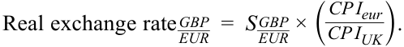
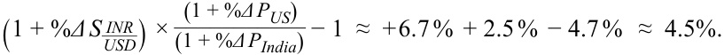
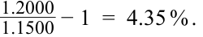

# Volume 2: Economics
## Learning Module 7 Capital Flows and the FX Market
### Part 2/4: The Foreign Exchange Market and Exchange Rates (PDF Pages 224–240)

---

<!-- PDF Page 224 -->

#### **LEARNING MODULE OVERVIEW** 

- The foreign exchange market is the largest market in the world. 

- Nominal spot exchange rates are quoted in the market and are inputs for analysts to determine real exchange rates, which reflect the relationship between domestic and foreign price levels and indicate the relative purchasing power between countries. To track exchange rate movements, calculating the percentage change in a currency relative to another currency enables market participants to understand price changes and use these percentages in market trades. 

- Exchange rate regimes can be floating or fully fixed, and various political and economic forces drive countries to use one of a number of intermediate regimes. 

- The impact of exchange rates and other factors on a country’s trade balance is mirrored by their impact on that country’s capital flows. 

- Although the free flow of capital between countries is most beneficial economically, governments may restrict capital inflows or outflows to address domestic policy and strategic or defense-related objectives. These restrictions allow governments to avoid capital flight in times of macroeconomic crisis and limit capital inflows, which may hurt the competitiveness of domestic firms. 

# **<mark>2</mark>** 

## **THE FOREIGN EXCHANGE MARKET AND EXCHANGE RATES** 

describe the foreign exchange market, including its functions and participants, distinguish between nominal and real exchange rates, and calculate and interpret the percentage change in a currency relative to another currency 

### **Introduction and the Foreign Exchange Market** 

The foreign exchange (FX) market—the market in which currencies are traded against each other—is by far the world’s largest market. Current estimates put daily turnover at approximately USD6.6 trillion for 2019. This is about 10 to 15 times larger than daily turnover in global fixed-income markets and about 50 times larger than global turnover in equities. 

The FX market is a truly global market that operates 24 hours a day, each business day. It involves market participants from every time zone connected through electronic communications networks that link players as large as multibillion-dollar investment funds and as small as individuals trading for their own account—all brought together in real time. International trade would be impossible without the trade in currencies that facilitates it and so too would cross-border capital flows that connect all financial markets globally through the FX market. 

<!-- PDF Page 225 -->

These factors make FX a key market for investors and market participants to understand. The world economy is increasingly transnational in nature, with both production processes and trade flows often determined more by global factors than by domestic considerations. Likewise, investment portfolio performance increasingly reflects global determinants because pricing in financial markets responds to the array of investment opportunities available worldwide, not just locally. All of these factors funnel through, and are reflected in, the FX market. As investors shed their “home bias” and invest in FX, the exchange rate—the price at which foreign-currency-denominated investments are valued in terms of the domestic currency—becomes an increasingly important determinant of portfolio performance. 

Even investors adhering to a purely “domestic” portfolio mandate are increasingly affected by what happens in the FX market. Given the globalization of the world economy, most large companies depend heavily on their foreign operations (e.g., by some estimates about 30 percent of S&P 500 Index earnings are from outside the United States). Almost all companies are exposed to some degree of foreign competition, and the pricing for domestic assets—equities, bonds, real estate, and others—also depend on demand from foreign investors. All of these various influences on investment performance reflect developments in the FX market. 

#### **_The FX Market_** 

To understand the FX market, it is necessary to become familiar with some of its basic conventions. Individual currencies often are referred to by standardized three-letter codes that the market has agreed upon through the International Organization for Standardization (ISO). Exhibit 1 lists some of the major global currencies and their identification codes. 

**Exhibit 1: Standard Currency Codes** 

|**Three-Letter Currency Code**|**Currency**|
|---|---|
|AUD|Australian dollar|
|BRL|Brazilian real|
|CAD|Canadian dollar|
|CHF|Swiss franc|
|CNY|Chinese yuan|
|EUR|Euro|
|GBP|British pound sterling|
|HKD|Hong Kong dollar|
|INR|Indian rupee|
|JPY|Japanese yen|
|KRW|South Korean won|
|MXN|Mexican peso|
|NOK|Norwegian krone|
|NZD|New Zealand dollar|
|RUB|Russian ruble|
|SEK|Swedish krona|
|SGD|Singapore dollar|
|USD|US dollar|
|ZAR|South African rand|

<!-- PDF Page 226 -->

It is important to understand the difference between referring to an _individual currency_ and an _exchange rate_ . One can hold an individual currency (e.g., in a EUR100 million deposit); an exchange rate, however, is the price of one currency in terms of another (e.g., the exchange rate between the euro and the US dollar). An individual currency can be singular, but two currencies always are involved in an exchange rate: the price of one currency relative to another. The exchange rate is the number of units of one currency (called the _price currency_ ) that one unit of another currency (called the _base currency_ ) will buy. An equivalent way of describing the exchange rate is as the cost of one unit of the base currency in terms of the price currency. 

This distinction between individual currencies and exchange rates is important because, as we will see in a later lesson, these three-letter currency codes can be used both ways. For example, when used as an exchange rate in the professional FX market, EUR is understood to be the exchange rate between the euro and US dollar. Be aware of the context (either as a currency or as an exchange rate) in which these three-letter currency codes are being used. To avoid confusion, this lesson will identify exchange rates using the convention of “A/B,” referring to the number of units of currency A that one unit of currency B will buy. For example, a USD/EUR exchange rate of 1.1700 means that 1 euro will buy 1.1700 US dollars (i.e., 1 euro costs 1.1700 US dollars). In this case, the euro is the base currency and the US dollar is the price currency. A decrease in this exchange rate would mean that the euro costs less or that fewer US dollars are needed to buy one euro. In other words, a decline in this exchange rate indicates that the US dollar is _appreciating_ against the euro or, equivalently, the euro is _depreciating_ against the US dollar. 

These exchange rates are referred to as _nominal_ exchange rates. In contrast, _real_ exchange rates are indexes that often are constructed by economists and other market analysts to assess changes in the relative purchasing power of one currency compared with another. Creating these indexes requires adjusting the nominal exchange rate by using the price levels in each country of the currency pair (hence the name “real exchange rates”) to compare the relative purchasing power between countries. 

In a world of homogenous goods and services, and with no market frictions or trade barriers, the relative purchasing power across countries would tend to equalize: Why would you pay more, in real terms, domestically for a “widget” if you could import an identical “widget” from overseas at a cheaper price? This basic concept is the intuition behind a theory known as purchasing power parity (PPP), which describes the long-term equilibrium of nominal exchange rates. PPP asserts that nominal exchange rates adjust so that identical goods (or baskets of goods) will have the same price in different markets. Or, put differently, the purchasing power of different currencies is equalized for a standardized basket of goods. 

In practice, the conditions required to enforce PPP are not satisfied: Goods and services are not identical across countries; countries typically have different baskets of goods and services produced and consumed; many goods and services are not traded internationally; there are trade barriers and transaction costs (e.g., shipping costs and import taxes); and capital flows are at least as important as trade flows in determining nominal exchange rates. As a result, nominal exchange rates exhibit persistent deviations from PPP. Moreover, relative purchasing power among countries displays a weak, if any, tendency toward long-term equalization. A simple example of a cross-country comparison of the purchasing power of a standardized good is the Big Mac index produced by the _Economist_ , which shows the relative price of this standardized hamburger in different countries. The Big Mac index shows that fast-food hamburger prices can vary widely internationally and that this difference in purchasing power is typical of most goods and services. Hence, movements in real exchange rates provide meaningful information about changes in relative purchasing power among countries. 

<!-- PDF Page 227 -->

Consider the case of an individual who wants to purchase goods from a foreign country. The individual would be able to buy fewer of these goods if the nominal spot exchange rate for the foreign currency appreciated or if the foreign price level increased. Conversely, the individual could buy more foreign goods if the individual’s domestic income increased. (For this example, we will assume that changes in the individual’s income are proportional to changes in the domestic price level.) Hence, in _real_ purchasing power terms, the real exchange rate that an individual faces is an increasing function of the nominal exchange rate (quoted in terms of the number of units of domestic currency per one unit of foreign currency) and the foreign price level and a decreasing function of the domestic price level. The _higher_ the real exchange rate is, the _fewer_ foreign goods, in real terms, the individual can purchase and the _lower_ that individual’s relative purchasing power will be compared with the other country. 

An equivalent way of viewing the real exchange rate is that it represents the relative price levels in the domestic and foreign countries. Mathematically, we can represent the foreign price level in terms of the domestic currency as follows: 

Foreign price level in domestic currency = _Sd/f_ × _Pf_ , 

where _Sd_ / _f_ is the spot exchange rate (quoted in terms of the number of units of domestic currency per one unit of foreign currency) and Pf is foreign price level quoted in terms of the foreign currency. We can define the domestic price level, in terms of the domestic currency, as _Pd_ . Hence, the ratio between the foreign and domestic price levels is as follows: 

Real exchange rate( _d_ / _f_ ) = ( _Sd_ / _fPf_ )/ _Pd_ = _Sd_ / _f_ × ( _Pf_ / _Pd_ ) . 

For example, for a British consumer wanting to buy goods made in the Eurozone, the real exchange rate (defined in GBP/EUR terms; note that the domestic currency for the United Kingdom is the price currency, not the base currency) will be an increasing function of the nominal spot exchange rate (GBP/EUR) and the Eurozone price level and a decreasing function of the UK price level. This is written as follows: 

<!-- Formula Text: Real exchange rate  GBP _ EUR   =  S  GBP _ EUR  × ( CP I eur _ CP I UK ). -->

We can examine the effect of movements in the domestic and foreign price levels, and the nominal spot exchange rate, on the real purchasing power of an individual in the United Kingdom wanting to purchase Eurozone goods. Assume that the nominal spot exchange rate (GBP/EUR) increases by 10 percent, the Eurozone price level increases by 5 percent, and the UK price level increases by 2 percent. The change in the real exchange rate is then as follows: 

<!-- Formula Text: (1 + Δ S  d _ f _ S  d _ f  ) × (1 + Δ P f _ P f ) _ (1 + Δ P d _ P d ) − 1 =  (1 + 10%) ×  1 + 5% _ 1 + 2%  − 1  ≈  10 %  + 5 %  − 2 %   ≈  13%. -->

In this case, the real exchange rate for the UK-based individual has _increased_ about 13 percent, meaning that it now costs _more_ , in real terms, to buy Eurozone goods. Or put differently, the UK individual’s real purchasing power relative to Eurozone goods has _declined_ by about 13 percent. An easy way to remember this relationship is to consider the real exchange rate (stated with the domestic currency as the price currency) as representing the real price you face to purchase foreign goods and services: The _higher_ the price is (real exchange rate), the _lower_ your relative purchasing power will be. 

The real exchange rate for a currency can be constructed for the domestic currency relative to a single foreign currency or relative to a basket of foreign currencies. In either case, these real exchange rate indexes depend on the assumptions made by the 

<!-- PDF Page 228 -->

analyst creating them. Several investment banks and central banks create proprietary measures of real exchange rates. Note that real exchange rates are _not_ quoted or traded in global FX markets: They are only indexes created by analysts to understand the international competitiveness of an economy and the real purchasing power of a currency. 

In this context, real exchange rates can be useful for understanding trends in international trade and capital flows and hence can be seen as one of the influences on nominal spot exchange rates. As an example, consider the exchange rate between the Indian rupee and the US dollar. During 2018, the nominal rupee exchange rate against the US dollar (INR/USD) rose by approximately 6.7 percent—meaning that the US dollar appreciated against the rupee. However, the annual inflation rates in the United States and India were different during 2018—approximately 2.5 percent for the United States and 4.7 percent for India. This means that the real exchange rate (in INR/ USD terms) was depreciating less rapidly than the nominal INR/USD exchange rate: 

<!-- Formula Text: (1 + %Δ S  INR _ USD ) × (1 + %Δ P US) ___________ (1 + %Δ P India)  − 1  ≈  + 6.7 %  + 2.5 %  − 4.7 %   ≈  4.5%. -->

This combination of a much weaker rupee and a higher Indian inflation rate meant that the real exchange rate faced by India was increasing, thus decreasing Indian purchasing power in US dollar terms. 

Movements in real exchange rates can have a similar effect as movements in nominal exchange rates in terms of affecting relative prices and hence trade flows. Even if the nominal spot exchange rate does not move, differences in inflation rates between countries affect their relative competitiveness. 

Although real exchange rates can exert some influence on nominal exchange rate movements, they are only one of many factors; it can be difficult to disentangle all of these inter-relationships in a complex and dynamic FX market. As discussed earlier, PPP is a poor guide to predicting future movements in nominal exchange rates because these rates can deviate from PPP equilibrium—and even continue to trend away from their PPP level—for years at a time. Hence, it should not be surprising that real exchange rates, which reflect changes in relative purchasing power, have a poor track record as a predictor of future nominal exchange rate movements. 

#### **EXAMPLE 1** 

### **Nominal and Real Exchange Rates** 

An investment adviser located in Sydney, Australia, is meeting with a local client who is looking to diversify her domestic bond portfolio by adding investments in fixed-rate, long-term bonds denominated in the Hong Kong dollar. The client frequently visits Hong Kong SAR, and many of her annual expenses are denominated in the Hong Kong dollar. The client, however, is concerned about the foreign currency risks of offshore investments and whether the investment return on her Hong Kong-dollar-denominated investments will maintain her purchasing power—both domestically (i.e., for her Australian-dollar-denominated expenses) and for her foreign trips (i.e., Hong Kong-dollar-denominated expenses for her visits to Hong Kong SAR). The investment adviser explains the effect of changes in nominal and real exchange rates to the client and illustrates this explanation by making the following statements: 

Statement 1 All else equal, an increase in the nominal AUD/HKD exchange rate will lead to an increase in the Australia-dollar-denominated value of your foreign investment. 

<!-- PDF Page 229 -->

Statement 2 All else equal, an increase in the nominal AUD/HKD exchange rate means that your relative purchasing power for your Hong Kong SAR trips will increase (based on paying for your trip with the income from your Hong Kong-dollar-denominated bonds). 

- Statement 3 All else equal, an increase in the Australian inflation rate will lead to an increase in the real exchange rate (AUD/HKD). A higher real exchange rate means that the relative purchasing power of your Australian-dollar-denominated income is higher. 

Statement 4 All else equal, a decrease in the nominal exchange rate (AUD/ HKD) will decrease the real exchange rate (AUD/HKD) and increase the relative purchasing power of your Australiandollar-denominated income. 

To demonstrate the effects of the changes in inflation and nominal exchange rates on relative purchasing power, the adviser uses the following scenario: “Suppose that the AUD/HKD exchange rate increases by 5 percent, the price of goods and services in Hong Kong SAR goes up by 5 percent, and the price of Australian goods and services goes up by 2 percent.” 

#### 1. Statement 1 is: 

- **A.** correct. 

- **B.** incorrect, because based on the quote convention the investment’s value would be decreasing in Australian dollar terms. 

- **C.** incorrect, because the nominal Australian dollar value of the foreign investments will depend on movements in the Australian inflation rate. 

#### **Solution:** 

A is correct. Given the quoting convention, an increase in the AUD/HKD rate means that the base currency (Hong Kong dollar) is appreciating (one Hong Kong dollar will buy more Australian dollars). This increases the nominal value of the Hong Kong-dollar-denominated investments when measured in Australian dollar terms. 

#### 2. Statement 2 is: 

- **A.** correct. 

- **B.** incorrect, because purchasing power is not affected in this case. 

- **C.** incorrect, because based on the quote convention, the client’s relative purchasing power would be decreasing. 

#### **Solution:** 

B is correct. When paying for Hong Kong-dollar-denominated expenses with Hong Kong-dollar-denominated income, the value of the AUD/HKD spot exchange rate (or any other spot exchange rate) would not be relevant. In fact, this is a basic principle of currency risk management: reducing FX risk exposures by denominating assets and liabilities (or income and expenses) in the same currency. 

3. Statement 3 is: 

**A.** correct. 

**B.** incorrect with respect to the real exchange rate only. 

<!-- PDF Page 230 -->

- **C.** incorrect with respect to both the real exchange rate and the purchasing power of Australian dollar -denominated income. 

#### **Solution:** 

C is correct. An increase in the Australian (i.e., domestic) inflation rate means that the real exchange rate (measured in domestic/foreign, or AUD/ HKD, terms) would be decreasing, not increasing. Moreover, an increase in the real exchange rate (RAUD/HKD) would be equivalent to a reduction of the purchasing power of the Australian client: Goods and services denominated in Hong Kong dollar would cost more. 

4. Statement 4 is: 

   - **A.** correct. 

   - **B.** incorrect with respect to the real exchange rate. 

   - **C.** incorrect with respect to the purchasing power of Australian dollar-denominated income. 

**Solution:** 

A is correct. As the spot AUD/HKD exchange rate decreases, the Hong Kong dollar is depreciating against the Australian dollar; or equivalently, the Australian dollar is appreciating against the Hong Kong dollar. This is reducing the real exchange rate (RAUD/HKD) and increasing the Australian client’s purchasing power. 

5. Based on the adviser’s scenario and assuming that the Hong Kong dollar value of the Hong Kong dollar bonds remained unchanged, the nominal Australian dollar value of the client’s Hong Kong dollar investments would: 

   - **A.** decrease by about 5 percent. 

   - **B.** increase by about 5 percent. 

   - **C.** remain about the same. 

   - **Solution:** 

B is correct. As the AUD/HKD spot exchange rate increases by 5 percent, the Hong Kong dollar is appreciating against the Australian dollar by 5 percent and, all else equal, the value of the Hong Kong-dollar-denominated investment is increasing by 5 percent in Australian dollar terms. 

6. Based on the adviser’s scenario, the change in the relative purchasing power of the client’s Australian-dollar-denominated income is _closest_ to: 

   - **A.** –8 percent. 

   - **B.** +8 percent. 

**C.** +12 percent. 

**Solution:** 

A is correct. The real exchange rate (RAUD/HKD) is expressed as follows:  PHKD R_  HKD__AUD_=_S_  HKD__AUD_× _PAUD_. 

The information in the adviser’s scenario can be expressed as follows: 

% _Δ R_  HKD__AUD_≈ %_ΔS_  HKD__AUD_+ %_ΔPHKD_− %_ΔPAUD_≈ + 5 %  + 5 %  − 2 %  ≈ + 8% . 

Because the real exchange rate (expressed in AUD/HKD terms) has gone up by about 8 percent, the real purchasing power of the investor based in Australia has declined by about 8 percent. This can be seen from the fact that 

<!-- PDF Page 231 -->

Hong Kong dollar has appreciated against the Australian dollar in nominal terms, and the Hong Kong SAR price level has also increased. This increase in the cost of Hong Kong SAR goods and services (measured in Australian dollars) is only partially offset by the small (2 percent) increase in the investor’s income (assumed equal to the change in the Australian price level). 

#### **QUESTION SET** 

1. A decrease in the real exchange rate (quoted in terms of domestic currency per unit of foreign currency) is _most likely_ to be associated with an increase in which of the following? 

   - **A.** Foreign price level. 

   - **B.** Domestic price level. 

   - **C.** Nominal exchange rate. 

#### **Solution:** 

B is correct. The real exchange rate (quoted in terms of domestic currency per unit of foreign currency) is given as follows: 

Real exchange rate( _d_ / _f_ ) = _Sd_ / _f_ × ( _Pf_ / _Pd_ ). 

An increase in the domestic price level ( _Pd_ ) _decreases_ the real exchange rate because it implies an _increase_ in the relative purchasing power of the domestic currency. 

### **Market Participants** 

We now turn to the counterparties that participate in FX markets. As mentioned previously, an extremely diverse universe of market participants ranges in size from multi-billion-dollar investment funds to individuals trading for their own account (including foreign tourists exchanging currencies at airport kiosks). 

To understand the various market participants, it is useful to separate them into broad categories. One broad distinction is between what the market refers to as the _buy side_ and the _sell side_ . The sell side generally consists of large FX trading banks (such as Citigroup, UBS, and Deutsche Bank); the buy side consists of clients who use these banks to undertake FX transactions (i.e., buy FX products) from the sell-side banks. 

The buy side can be further broken down into several categories: 

- _Corporate accounts_ : Corporations of all sizes undertake FX transactions during cross-border purchases and sales of goods and services. Many of their FX flows also are related to cross-border investment flows—such as international mergers and acquisitions (M&A) transactions, investment of corporate funds in foreign assets, and foreign currency borrowing. 

- _Real money accounts_ : These are investment funds managed by insurance companies, mutual funds, pension funds, endowments, exchange-traded funds (ETFs), and other institutional investors. These accounts are referred to as real money because they usually are restricted in their use of leverage or financial derivatives. This feature distinguishes them from leveraged accounts (discussed next), although many institutional investors often engage in some form of leverage, either directly through some use of borrowed funds or indirectly using financial derivatives. 

<!-- PDF Page 232 -->

- _Leveraged accounts_ : This category, often referred to as the professional trading community, consists of hedge funds, proprietary trading shops, commodity trading advisers (CTAs), high-frequency algorithmic traders, and the proprietary trading desks at banks—and, indeed, almost any active trading account that accepts and manages FX risk for profit. The professional trading community accounts for a large and growing proportion of daily FX market turnover. These active trading accounts also have a wide diversity of trading styles. Some are macro-hedge funds that take long-term FX positions based on their views of the underlying economic fundamentals of a currency. Others are high-frequency algorithmic traders that use technical trading strategies (such as those based on moving averages or Fibonacci levels) and whose trading cycles and investment horizons are sometimes measured in milliseconds. 

- _Retail accounts_ : The simplest example of a retail account is the archetypical foreign tourist exchanging currency at an airport kiosk. However, as electronic trading technology has reduced the barriers to entry into FX markets and the costs of FX trading, there has been a huge surge in speculative trading activity by retail accounts—consisting of individuals trading for their own accounts as well as smaller hedge funds and other active traders. This category also includes households using electronic trading technology to move their savings into foreign currencies (e.g., this is relatively widespread among households in Japan). It is estimated that retail trading accounts for as much as 10 percent of all spot transactions in some currency pairs and that this proportion is growing. 

- _Governments_ : Public entities of all types often have FX needs, ranging from relatively small (e.g., maintaining consulates in foreign countries) to large (e.g., military equipment purchases or maintaining overseas military bases). Sometimes these flows are purely transactional—the business simply needs to be done—and sometimes government FX flows reflect, at least in part, the public policy goals of the government. Some government FX business resembles that of investment funds, although sometimes with a public policy mandate as well. In some countries, public sector pension plans and public insurance schemes are run by a branch of the government. One example is the Caisse de dépôt et placement du Québec, which was created by the Québec provincial government in Canada to manage that province’s public sector pension plans. The Caisse, as it is called, is a relatively large player in financial markets, with nearly CAD420 billion of assets under management at the end of 2021. Although it has a mandate to invest these assets for optimal return, it is also called upon to help promote the economic development of Québec. Many governments—both at the federal and provincial/state levels—issue debt in foreign currencies; this, too, creates FX flows. Such supranational agencies as the World Bank and the African Development Bank issue debt in a variety of currencies as well. 

- _Central banks_ : These entities sometimes intervene in FX markets to influence either the level or trend in the domestic exchange rate. This often occurs when the central banks judge their domestic currency to be too weak and when the exchange rate has overshot any concept of equilibrium level (e.g., because of a speculative attack) to the degree that the exchange rate no longer reflects underlying economic fundamentals. Alternatively, central banks also intervene when the FX market has become so erratic and dysfunctional that end-users such as corporations can no longer transact necessary FX business. Conversely, central banks sometimes intervene when they believe that their domestic currency has become too strong, to the 

<!-- PDF Page 233 -->

point that it undercuts that country’s export competitiveness. The Bank of Japan intervened against yen strength versus the US dollar in 2004 and again in March 2011 after the massive earthquake and nuclear disaster. Similarly, in 2010, 2013, and again in 2015, the Swiss National Bank intervened against strength in the Swiss franc versus the euro by selling the Swiss franc on the euro–Swiss (CHF/EUR) cross-rate. Central bank reserve managers are frequent participants in FX markets to manage their country’s FX reserves. In this context, they act much like real money investment funds—although generally with a cautious, conservative mandate to safeguard the value of their country’s FX reserves. The FX reserves of some countries are enormous, and central bank participation in FX markets can sometimes have a material impact on exchange rates even when these reserve managers are not intervening for public policy purposes. Total FX reserves reached nearly USD13 trillion at the end of 2021. 

This largely reflects the rapid growth in foreign reserves held by Asian central banks, because these countries typically run large current account surpluses with the United States and other developed market economies. Reserve accumulation by energy-exporting countries in the Middle East and elsewhere is also a factor. As of the end of 2021, nearly 60 percent of global allocated currency reserves were held in US dollars, while just over 20 percent was held in euros, the second most widely held currency in central bank FX reserves. 

- _Sovereign wealth funds (SWFs)_ : Many countries with large current account surpluses have diverted some of the resultant international capital flows into SWFs rather than into FX reserves managed by central banks. Although SWFs are government entities, their mandate is usually more oriented toward purely investment purposes rather than public policy purposes. As such, SWFs can be thought of as akin to real money accounts, although some SWFs can employ derivatives or engage in aggressive trading strategies. It generally is understood that SWFs use their resources to help fulfill the public policy mandate of their government owners. The SWFs of many current account surplus countries (such as exporting countries in East Asia (e.g., Singapore) or oil-exporting countries (e.g., Kuwait) are enormous, and their FX flows can be an important determinant of exchange rate movements in almost all of the major currency pairs. 

The sell side generally consists of the FX dealing banks that sell FX products to the buy side. The following sell-side distinctions can be made. 

- A large and growing proportion of the daily FX turnover is accounted for by the very largest money center dealing banks, such as Deutsche Bank, Citigroup, UBS, HSBC, and a few other multinational banking behemoths. Maintaining a competitive advantage in FX requires huge fixed-cost investments in the electronic technology that connects the FX market, and it also requires a broad, global client base. As a result, only the largest first-tier banks are able to compete successfully in providing competitive price quotes to clients across the broad range of FX products. In fact, among the largest FX dealing banks, a large proportion of their business is crossed internally, meaning that these banks are able to connect buyers and sellers within their own extremely diverse client base and have no need to show these FX flows outside of the bank. 

- All other banks fall into the second and third tier of the FX market sell side. Many of these financial institutions are regional or local banks with well-developed business relationships, but they lack the economies of scale, 

<!-- PDF Page 234 -->

broad global client base, or information technology (IT) expertise required to offer competitive pricing across a wide range of currencies and FX products. In many cases, these are banks in emerging markets that do not have the business connections or credit lines required to access the FX market on a cost-effective basis on their own. As a result, these banks often outsource FX services by forming business relationships with the larger tier-one banks; otherwise, they depend on the deep, competitive liquidity provided by the largest FX market participants. 

The categories presented are based on functions that are closely associated with the named groups. However, in some cases, functions typifying a group also may be assumed by or shared with another group. For example, sell-side banks provide FX price quotes. Hedge funds and other large players, however, may access the professional FX market on equal terms with the dealing banks and effectively act as market makers. 

One of the most important ideas to draw from this categorization of market participants is that there is an extremely wide variety of FX market participants, reflecting a complex mix of trading motives and strategies that can vary with time. Most market participants reflect a combination of hedging and speculative motives in tailoring their FX risk exposures. Among public sector market participants, public policy motives also may be a factor. The dynamic, complex interaction of FX market participants and their trading objectives make it difficult to analyze or predict movements in FX rates with any precision or to describe the FX market adequately with simple characterizations. 

#### **BEST PRACTICES IN FOREIGN EXCHANGE MARKETS** 

As an important element of trade and cross-border capital flows and a key determinant of portfolio performance, the transparency and proper functioning of foreign exchange markets is of critical importance to market participants in meeting their financial goals and objectives. However, as a truly global market, the FX market lacks the regulatory oversight of domestic exchanges, although the Bank for International Settlements (BIS) mentioned earlier, oversees and periodically surveys FX market activity worldwide. 

In an effort initiated by the BIS Markets Committee, the Global Foreign Exchange Committee (GFXC) was established in 2017 by FX market participants, including central banks, large global banks, and buy-side firms, to ensure a “robust, fair, liquid, open, and appropriately transparent” FX market in which users can transact at competitive prices using best practices established in a voluntary FX Global Code. These practices address such principles as ethics, governance, execution, information sharing, confirmation and settlement, and risk management and compliance. 

### **Market Composition** 

In this section, we first describe components of the FX market, then present a descriptive overview of the global FX market drawn from the 2016 Triennial Survey undertaken by the Bank for International Settlements (BIS). 

In addition to spot transactions, the FX market includes forward transactions and **FX swaps** . Forwards are transactions made using forward exchange rates with settlement at agreed-upon future dates, and forward rates can be used to manage FX risk. The combination of spot and forward transactions can be used to create FX swaps. These instruments are used for hedging purposes and to raise foreign currency at more favorable rates, and their trading constitutes the largest daily volume of the FX market. 

<!-- PDF Page 235 -->

The BIS is an umbrella organization for the world’s central banks. Every three years, participating central banks undertake a survey of the FX market in their jurisdictions, the results of which are aggregated and compiled at the BIS. The survey, taken in April 2016, gives a broad indication of the current size and distribution of global FX market flows. 

As of April 2016, the BIS estimates that average daily turnover in the traditional FX market (composed of spot, outright forward, and FX swap transactions) totaled approximately USD5.1 trillion. Exhibit 2 shows the approximate percentage allocation among FX product types, including both traditional FX products and exchange-traded FX derivatives. Note that this table of percentage allocations adds exchange-traded derivatives to the BIS estimate of average daily turnover of USD5.1 trillion; the “Spot” and “Outright forwards” categories include only transactions that are not executed as part of a swap transaction. 

**Exhibit 2: FX Turnover by Instrument** 

|**Instrument**|**FX Turnover (%)**|
|---|---|
|Spot|33|
|Outright forwards|14|
|Swapsa|49|
|FX options|5|
|**Total**|**100**|

_Note:_ Swaps includes FX and currency swaps. An “FX swap” is not the same as a "currency swap"; a currency swap is generally used for multiple periods and payments. May not add to 100% due to rounding. a _Includes both FX and currency swaps._ 

The survey also provides a percentage breakdown of the average daily flows between sell-side banks (called the interbank market), between banks and financial customers (all non-bank financial entities, such as real money and leveraged accounts, SWFs, and central banks), and between banks and non-financial customers (such as corporations, retail accounts, and governments). The breakdown is provided in Exhibit 3. It bears noting that the proportion of average daily FX flow accounted for by financial clients is much larger than that for non-financial clients. The BIS also reports that the proportion of financial client flows has been growing rapidly, and in 2010, it exceeded interbank trading volume for the first time. This underscores the fact that only a minority of the daily FX flow is accounted for by corporations and individuals buying and selling foreign goods and services. Huge investment pools and professional traders account for a large and growing proportion of the FX business. 

**Exhibit 3: FX Flows by Counterparty** 

|**Counterparty**|**FX Flows (**|**%)**|
|---|---|---|
|Interbank||42|
|Financial clients||51|
|Non-financial clients||8|

_Note:_ May not add to 100% due to rounding. 

<!-- PDF Page 236 -->

The 2016 BIS survey also identified the top five currency pairs in terms of their percentage share of average daily global FX turnover. These are shown in Exhibit 4. Note that each of these most active pairs includes the US dollar (USD). 

**Exhibit 4: FX Turnover by Currency Pair** 

|**Currency Pair**|**Percent of Market (%)**|
|---|---|
|USD/EUR|23.1|
|JPY/USD|17.8|
|USD/GBP|9.3|
|USD/AUD|5.2|
|CAD/USD|4.3|

The largest proportion of global FX trading occurs in London, followed by New York. This means that FX markets are most active between approximately 8:00 a.m. and 11:30 a.m. New York time, when banks in both cities are open. (The official London close is at 11:00 a.m. New York time, but London markets remain relatively active for a period after that.) Tokyo is the third-largest FX trading hub. 

#### **EXAMPLE 2** 

### **Market Participants and Composition of Trades** 

The investment adviser based in Sydney, Australia, makes the following statements to her client when describing some of the basic characteristics of the FX market: 

- Statement 1 “FX transactions for spot settlement see the most trade volume in terms of average daily turnover because the FX market is primarily focused on settling international trade flows.” 

Statement 2 “The most important FX market participants on the buy side are corporations engaged in international trade; on the sell side they are the local banks that service their FX needs.” 

1. Statement 1 is: 

   - **A.** correct. 

   - **B.** incorrect with respect to the importance of spot settlements. 

   - **C.** incorrect both with respect to the importance of spot settlements and international trade flows. 

#### **Solution:** 

C is correct. Although the media generally focus on the spot market when discussing FX, the majority of average daily trade volume involves the FX swap market as market participants either roll over or modify their existing hedging and speculative positions (or engage in FX swap financing). Although it is true that all international trade transactions eventually result in some form of spot settlement, this typically generates a great deal of hedging (and speculative) activity in advance of spot settlement. Moreover, an important group of FX market participants engages in purely speculative positioning with no intention of ever delivering/receiving the principal amount of the trades. Most FX trading volume is not related to international trade: Portfolio flows (cross-border capital movements) and speculative activities dominate. 

<!-- PDF Page 237 -->

2. Statement 2 is: 

   - **A.** correct. 

   - **B.** incorrect with respect to corporations engaged in international trade. 

   - **C.** incorrect with respect to both corporations and the local banks that service their trade needs. 

#### **Solution:** 

C is correct. The most important FX market participants in terms of average daily turnover are found not among corporations engaged in international trade but among huge investment managers, both private (e.g., pension funds) and public (e.g., central bank reserve managers or sovereign wealth funds). A large and growing amount of daily turnover is also being generated by high-frequency traders who use computer algorithms to automatically execute extremely high numbers of speculative trades (although their individual ticket sizes are generally small, they add up to large aggregate flows). On the sell side, the largest money center banks (e.g., Deutsche Bank, Citigroup, HSBC, UBS) are increasingly dominating the amount of trading activity routed through dealers. Regional and local banks are increasingly being marginalized in terms of their share of average daily turnover in FX markets. 

#### **QUESTION SET** 

1. Which of the following counterparties is _most likely_ to be considered a sell-side FX market participant? 

   - **A.** A large corporation that borrows in foreign currencies 

   - **B.** A sovereign wealth fund that influences cross-border capital flows 

   - **C.** A multinational bank that trades FX with its diverse client base 

#### **Solution:** 

C is correct. The sell-side parties generally consist of large banks that sell FX and related instruments to buy-side clients. These banks act as market makers, quoting exchange rates at which they will buy (the bid price) or sell (the offer price) the base currency. 

### **Exchange Rate Quotations** 

Exchange rates represent the relative price of one currency in terms of another. This price can be represented in two ways: (1) currency A buys how many units of currency B; or (2) currency B buys how many units of currency A. Of course, these two prices are simply the inverse of each other. 

To distinguish between these two prices, market participants sometimes distinguish between _direct_ and _indirect_ exchange rates. In the quoting convention A/B (where there are a certain number of units of currency A per one unit of currency B), we refer to currency A as the _price currency_ (or quote currency); currency B is referred to as the _base currency_ . (The reason for this choice of names will become clear.) The base currency is always set at a quantity of one. A _direct_ currency quote takes the domestic country as the price currency and the foreign country as the base currency. For example, for a Paris-based trader, the domestic currency would be the euro (EUR) and a foreign currency would be the UK pound (GBP). For this Paris-based trader, a _direct_ quote would be EUR/GBP. An exchange rate quote of EUR/GBP = 1.1211 

<!-- PDF Page 238 -->

means that GBP1 costs EUR1.1211. For this Paris-based trader, an _indirect_ quote has the domestic currency—the euro—as the base currency. An indirect quote of GBP/ EUR = 0.8920 means that EUR1 costs GBP0.8920. _Direct and indirect quotes are just the inverse (reciprocal) of each other._ 

The professional FX market does not use the convention of describing exchange rates as either being direct or indirect because determining the domestic currency and the foreign currency depends on where one is located. For a London-based market participant, the UK pound (GBP) is the domestic currency and the euro (EUR) is a foreign currency. For a Paris-based market participant, it would be the other way around. 

To avoid confusion, the FX market has developed a set of market conventions that all market participants typically adhere to when making and asking for FX quotes. Exhibit 5 displays some of these for the major currencies: the currency code used for obtaining exchange rate quotes, how the market lingo refers to this currency pair, and the actual ratio—price currency per unit of base currency—represented by the quote. 

**Exhibit 5: Exchange Rate Quote Conventions** 

|**FX Rate Quote**||**Actual Ratio**|
|---|---|---|
|**Convention**|**Name Convention**|**(Price currency/Base currency)**|
|EUR|Euro|USD/EUR|
|JPY|Dollar–yen|JPY/USD|
|GBP|Sterling|USD/GBP|
|CAD|Dollar–Canada|CAD/USD|
|AUD|Aussie|USD/AUD|
|NZD|Kiwi|USD/NZD|
|CHF|Swiss franc|CHF/USD|
|EURJPY|Euro–yen|JPY/EUR|
|EURGBP|Euro–sterling|GBP/EUR|
|EURCHF|Euro–Swiss|CHF/EUR|
|GBPJPY|Sterling–yen|JPY/GBP|
|EURCAD|Euro–Canada|CAD/EUR|
|CADJPY|Canada–yen|JPY/CAD|

Several things should be noted in this exhibit. First, the three-letter currency codes in the first column (for FX rate quotes) refer to what are considered to be the major exchange rates. Remember that an exchange rate is the price of one currency in terms of another: Two currencies are always involved in the price. This is different from referring to a single currency in its own right. For example, one can refer to the euro (EUR) as a _currency_ ; but if we refer to a euro _exchange rate_ (EUR), it is always the price of the euro in terms of another currency, in this case the US dollar. This is because in the professional FX market, the three-letter code EUR is always taken to refer to the euro–US dollar exchange rate, which is quoted in terms of the number of US dollars per euro (USD/EUR). Second, the six-letter currency codes in the first column refer to some of the major _cross-rates_ . This topic will be covered in the next section, but generally these are secondary exchange rates and are not as common as the main exchange rates. (Note that three-letter codes are always in terms of an exchange rate involving the US dollar, but the six-letter codes are not.) Third, when both currencies are mentioned in the code or the name convention, _the base currency is always mentioned first, the opposite order of the actual ratio_ ( _price currency/base currency_ ). Thus, the code for “Sterling–yen” is “GBPJPY,” but the actual number quoted 

<!-- PDF Page 239 -->

is the number of yen per sterling (JPY/GBP). Note also that _the codes may appear in a variety of formats that all mean the same thing._ For example, GBPJPY might instead appear as GBP:JPY or GBP–JPY. Fourth, regardless of where a market participant is located, there is always a mix of direct and indirect quotes in common market usage. For example, a trader based in Toronto, Canada, will typically refer to the euro–Canada and Canada–yen exchange rates—a mixture of direct (CAD/EUR) and indirect (JPY/ CAD) quotes for that Canada-based trader. No overall consistency is observed in this mixture of direct and indirect quoting conventions in the professional FX market; a market participant must get familiar with how the conventions are used. In general, however, there is a hierarchy for quoting conventions. For quotes involving the euro, it serves as the base currency (e.g., GBP/EUR). Next in the priority sequence, for quotes involving the British pound (but not the euro), it serves as the base currency (e.g., USD/GBP). Finally, for quotes involving the US dollar (but not the GBP or EUR), it serves as the base currency (e.g., CAD/USD). Exceptions among the major currencies are the Australian and New Zealand dollars: they serve as the base currency when quoted against the US dollars (i.e., USD/AUD, USD/NZD). 

Another concept involving exchange rate quotes in professional FX markets is that of a _two-sided price_ . When a client asks a bank for an exchange rate quote, the bank will provide a “ _bid_ ” (the price at which the bank is willing to buy the currency) and an “ _offer_ ” (the price at which the bank is willing to sell the currency). But _two_ currencies are referenced in an exchange rate quote, which is always the price of one currency relative to the other. So, which currency is being bought and which is being sold in this two-sided price quote? In this situation, the lingo involving the price currency (or quote currency) and the base currency, explained earlier, becomes useful. _The two-sided price quoted by the dealer is in terms of buying/selling the base currency_ . It shows the number of units of the _price_ currency that the client will receive from the dealer for one unit of the base currency (the bid) and the number of units of the price currency that the client must sell to the dealer to obtain one unit of the base currency (the offer). Consider the case of a client that is interested in a transaction involving the Swiss franc (CHF) and the euro (EUR). As we have read, the market convention is to quote this as euro–Swiss (CHF/EUR). The euro is the base currency, and the two-sided quote (price) shows the number of units of the price currency (CHF) that must be paid or will be received for EUR1. For example, a two-sided price in euro– Swiss (CHF/EUR) might look like: 1.1583–1.1585. The client will receive CHF1.1583 for selling EUR1 to the dealer and must pay CHF1.1585 to the dealer to buy EUR1. Note that _the price is shown in terms of the price currency_ and that _the bid is always less than the offer_ : The bank buys the base currency (euro, in this case) at the low price and sells the base currency at the high price. Buying low and selling high is profitable for banks, and spreading clients—trying to widen the bid/offer spread—is how dealers try to increase their profit margins. Note, however, that the electronic dealing systems currently used in professional FX markets are extremely efficient in connecting buyers and sellers globally. Moreover, this worldwide competition for business has compressed most bid/offer spreads to very tight levels. For simplicity, in the remainder of this reading, we will focus on exchange rates as a single number (with no bid/offer spread). 

One last point in exchange rate quoting conventions is that most major spot exchange rates are typically quoted to four decimal places. One exception among the major currencies involves the yen, for which spot exchange rates are usually quoted to two decimal places. (For example, a USD/EUR quote would be expressed as 1.1701, whereas a JPY/EUR quote would be expressed as 130.98.) This difference involving the yen comes from the fact that the units of yen per unit of other currencies typically is relatively large, and hence extending the exchange rate quote to four decimal places is viewed as unnecessary. 

<!-- PDF Page 240 -->

Regardless of which quoting convention is used, changes in an exchange rate can be expressed as a percentage appreciation of one currency against the other: One simply has to be careful in identifying which currency is the price currency and which is the base currency. For example, suppose the exchange rate for the euro (USD/EUR) increases from 1.1500 to 1.2000. This represents an (unannualized) percentage change of the following: 

<!-- Formula Text: 1.2000 _ 1.1500  − 1  =  4.35 % . -->

This represents a 4.35 percent appreciation in the euro against the US dollar (and not an appreciation of the US dollar against the euro) because the USD/EUR exchange rate is expressed with the US dollar as the price currency. 

Note that this appreciation of the euro against the US dollar also can be expressed as a depreciation of the US dollar against the euro; but in this case, the depreciation is not equal to 4.35 percent. Inverting the exchange rate quote from USD/EUR to EUR/ USD, so that the euro is now the price currency, leads to the following: 

<!-- Formula Text: ( 1 _ 1.2000 ) _ ( 1 _ 1.1500 )  − 1  =   1.1500 _ 1.2000  − 1  =  − 4.17%. -->

Note that the US dollar depreciation is not the same, in percentage terms, as the euro appreciation. Mathematically, these percentages will always be different. 

#### **EXAMPLE 3** 

### **Exchange Rate Conventions** 

A dealer based in New York City provides a spot exchange rate quote of 18.8590 MXN/USD to a client in Mexico City. The inverse of 18.8590 is 0.0530. 

1. From the perspective of the Mexican client, the _most_ accurate statement is that the: 

   - **A.** direct exchange rate quotation is equal to 0.0530. 

   - **B.** direct exchange rate quotation is equal to 18.8590. 

   - **C.** indirect exchange rate quotation is equal to 18.8590. 

   - **Solution:** 

B is correct. A direct exchange rate uses the domestic currency as the price currency and the foreign currency as the base currency. For an MXN/USD quote, the Mexican peso is the price currency; therefore, the direct quote for the Mexican client is 18.8590 (it costs MXN18.8590 to purchase USD1). Another way of understanding a _direct_ exchange rate quote is that it is the price of one unit of foreign currency in terms of your own currency. This purchase of a unit of foreign currency can be thought of as a purchase much like any other you might make; think of the unit of foreign currency as just another item that you might be purchasing with your domestic currency. For example, for someone based in Canada, a liter of milk might cost about CAD1.25 at a time when USD1 costs about CAD1.30. This _direct_ currency quote uses the _domestic_ currency (the Canadian dollar, in this case) as the _price_ currency and simply gives the price of a unit of foreign currency that is being purchased. 

2. If the bid/offer quote from the dealer was 18.8580–18.8600 MXN/USD, then the bid/offer quote in USD/MXN terms would be _closest_ to: 

   - **A.** 0.05302–0.05303. 

