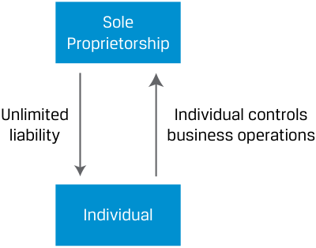
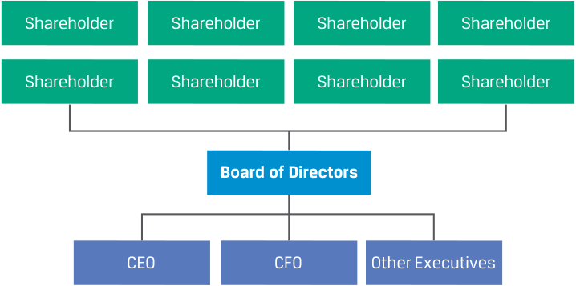
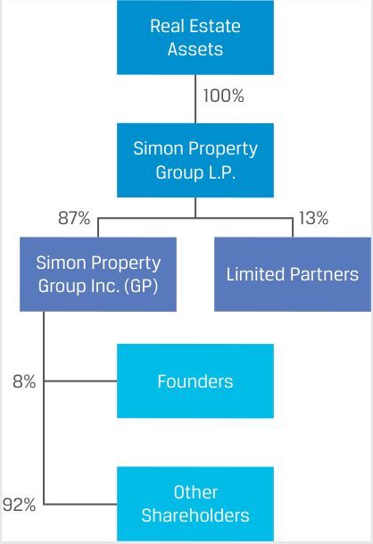

# Volume 3: Corporate Issuers
## Learning Module 1 Organizational Forms, Corporate Issuer Features, and Ownership
### Part 1/3: Introduction (PDF Pages 11–22)

---

<!-- PDF Page 11 -->

#### L E A R N I N G M O D U L E 

# **<mark>1</mark>** 

### **Organizational Forms, Corporate Issuer Features, and Ownership** 

###### **<mark>LEARNING OUTCOMES</mark>** 

###### **_Mastery The candidate should be able to:_** 

compare the organizational forms of businesses describe key features of corporate issuers compare publicly and privately owned corporate issuers 

##### **INTRODUCTION** 

**<mark>1</mark>** 

This learning module introduces the Corporate Issuers topic area, which covers the fundamentals of how corporations are organized and governed and how they make operating, investing, and financing decisions. Financial analysts must have a strong understanding of corporate issuers because they are the largest type of issuer in financial markets globally; many analysts are focused entirely on analyzing and investing in their debt or equity instruments. In the first lesson of this module, we describe and compare the legal organizational forms of businesses, emphasizing their similarities and differences and important implications for investors. The second lesson focuses on the corporate organizational form and its key features, such as the separation of ownership and management, limited shareholder liability, access to financing, and tax issues. In the final lesson, we compare privately held and public corporate issuers, including the mechanisms of how corporate issuers go public and are taken private. 

###### **LEARNING MODULE OVERVIEW** 

- Businesses are legally organized as sole proprietorships, partnerships, or limited companies, which differ by several attributes, including legal identity, owner–manager relations, owner liability, taxation, and access to financing. In practice, organizational forms are jurisdiction specific; our focus is on common characteristics. 

- The limited company form, often known as the corporation, offers advantages over the other two forms by improving the ability to raise capital, through limited shareholder liability, the separation of 

<!-- PDF Page 12 -->

ownership and management, and fewer restrictions on the number of owners and transferring ownership. In most jurisdictions, there are two types of limited companies: private limited companies and public limited companies. 

- Private limited companies tend to have some restrictions on ownership but pass-through taxation like partnerships. Public limited companies have no ownership restrictions, but their income can be taxed at both the company and shareholder level. While public limited companies do not have to go public by selling their shares on an exchange, it is this form that is most suitable for becoming a publicly traded company. 

- Corporate shareholders elect a board of directors that appoints executive management to operate the company. Shareholders effect change primarily through their ability to replace directors. 

- Corporations that seek external financing in financial markets, known as corporate issuers, can utilize either public or private markets, and these choices have implications for the liquidity and price transparency of the company’s securities, as well as its ability to raise future financing and the degree to which it must disclose information. 

- Corporate issuers can change their status from privately held to publicly traded (or “listed”) through a variety of mechanisms, including an initial public offering. Publicly traded issuers can be taken private through several mechanisms, including a leveraged buyout. 

- Shareholders of corporate issuers include not only individuals and institutional investors, such as pension funds and mutual funds, but also governments, non-profits, and other corporations. 

###### **LEARNING MODULE SELF-ASSESSMENT** 

These initial questions are intended to help you gauge your current level of understanding of this topic. 

1. Fill in the two blanks below using the two of the following four possible terms: 

   - Sole proprietorship 

General partnership 

Limited partnership 

Public limited company (corporation) 

A _____________________ likely has the greatest access to financing, while a _____________________ likely has the least access to financing. 

###### **Solution:** 

A public limited company (corporation) likely has the greatest access to financing, while a sole proprietorship likely has the least access to financing. A primary difference across organizational forms is access to financing to fund investments. The sole proprietorship is limited to its individual owner’s ability to invest her own money and borrowing capacity as an individual. At 

<!-- PDF Page 13 -->

|the other end of the spectrum, a public limited company can access a broad array of outside investors by issuing debt and/or equity securities.|
|---|
|2. Which of the following organizational forms provides for the_least_owner liability of business debts?|
|**A.**General partnership|
|**B.**Private limited company|
|**C.**Sole proprietorship **Solution:**|
|B is correct. In both the sole proprietorship and general partnership forms of organization, the owners are personally liable for all debts assumed by the company. In a private limited company, owner (shareholder) liability is limited to the value of their ownership stake.|
|3. Voting rights of a corporate issuer’s shareholders generally refer to which of the following?|
|**A.**The ability of the corporation to vote in political elections|
|h **B.**The direct ability to elect a chief executive officer of the company|
|h        fi **C.**The ability to elect members of the company’s board of directors **Solution:**|
|C is correct. The voting rights of shareholders generally allow them to elect board members as well as vote on other matters outlined in the company’s charter. The board of directors has the responsibility to hire (or retain) the company’s chief executive officer (CEO); thus, voting rights do not give shareholders the_direct_ability to hire the CEO. Despite the status of a corpo- ration as a distinct legal entity, this status does not provide voting rights in political elections.|
|4. Explain how the following situation reflects double taxation on the corpo- rate organizational form: The corporation pays a 21% tax rate on pre-tax income of USD100 million. The corporation distributes USD10 million to its shareholders. Individuals pay a 20% tax on dividend income. **Solution:**|
|The corporation pays USD21 million in income taxes at the corporate level and, collectively, the shareholders pay USD2 million in individual income taxes on dividends received. In total, USD23 million in income taxes were paid on the pre-tax income of USD100 million. Effectively, the USD10 mil- lion paid as dividends was taxed twice, first as business income and again as personal income.|
|5. True or false: The term “public” for a public corporate issuer means that the company is wholly or partially owned by a government. **A.**True|
|**B.**False **Solution:**|
|B is correct. The statement is false because while a public corporate issuer could be owned partly by a government, this condition is not necessary. The term “public” refers only to the fact that a company’s equity securities are traded on an exchange and thus are available for investment bythepublic.|

<!-- PDF Page 14 -->

###### 6. Fill in the blanks: 

A public company’s shares can be exchanged on a ________________, while a private company’s shares suffer from a lack of price 

____________________. 

###### **Solution:** 

A public company’s shares can be exchanged on a stock exchange, while a private company’s shares suffer from a lack of price transparency. 

## **<mark>2</mark>** 

##### **ORGANIZATIONAL FORMS OF BUSINESSES** 

compare the organizational forms of businesses 

In most market economies, there are three general types of organization, each with distinct purposes, stakeholders, and governing legal frameworks: for-profit organizations, known as **businesses** or **companies** ; not-for-profit non-governmental organizations, or simply non-profits; and governments. 

The focus of this and subsequent modules are businesses, because financial analysts are important participants in the markets for their financial resources. However, non-profits and governments often are investors in businesses, which will be covered in later lessons. Governments as issuers of debt and other securities are covered in modules on fixed income. 

###### **Organizational Forms of Businesses** 

Business owners choose a legal **organizational form** that defines how returns, risks, and ownership and operational responsibilities are distributed. There are three general forms common to most jurisdictions. 

**Exhibit 1: Organizational Forms of Businesses** 

<!-- Start of picture text -->
Businesses Non-Profits Governments Sole Trader or Sole Partnership Limited Company Proprietorship <!-- End of picture text -->

The organizational forms of businesses differ by several attributes: 

- _Legal identity:_ Whether the business is legally considered a separate entity or person apart from its owners 

- _Owner–manager relationship:_ The relationship between the owner(s) of the business and those who manage the business 

<!-- PDF Page 15 -->

- _Owner liability:_ The extent to which owners are personally legally liable for actions or debts undertaken by the business 

- _Taxation:_ The treatment of business profits or losses for tax purposes 

- _Access to financing:_ The ability to raise capital to fund expansion and distribute risks 

Every jurisdiction has its own specific versions and variants of organizational forms, including different names for them. We are not attempting to provide an exhaustive treatment of jurisdictional specifics; rather, we provide the general and common attributes that analysts must know to ask the right questions in their own research on specific investment candidates and business cases. 

###### **Sole Trader or Proprietorship** 

The simplest organizational form is the sole trader or proprietorship, shown in Exhibit 2. In a sole proprietorship, the owner provides the capital needed to start and operate the business and retains full control over management, while participating fully in the firm’s financial returns and risks. In some jurisdictions, this form is the default form, requiring no formal legal registration, and is dissolved when the owner ceases business activity or dies. 

###### **Exhibit 2: Sole Trader or Proprietorship** 

<!-- Start of picture text -->
Sole Proprietorship Unlimited Individual controls liability business operations Individual <!-- End of picture text -->

An example of a sole proprietorship is a family-owned business. The individual owner usually uses savings or a personal loan to start the business and to run daily operations and retains full management control. The owner retains all return (profits), which is taxed as personal income, and is personally responsible for losses and obligations of the business, such as debts. 

While sole proprietorships comprise the largest _number_ of businesses in most market economies and are preferred by small business owners for their simplicity and flexibility, their growth is constrained by an owner’s ability to access financing, assume risk, and serve as the sole owner. 

###### **Partnerships** 

Partnerships allow multiple owners to pool their resources and share business risk and return. There are three common types in most jurisdictions: general partnerships, limited partnerships, and limited liability partnerships. 

A **general partnership** , shown in Exhibit 3, has two or more owners called partners or **general partners (GPs)** . General partnerships are like sole proprietorships, with the important distinction that they allow for additional resources to be brought into the 

<!-- PDF Page 16 -->

business by the additional owners, along with the sharing of business risk and return. Partnerships are often formed and governed by a written partnership agreement that outlines specific partner roles and responsibilities and the sharing of profits, losses, and obligations. However, a written agreement is not required; partnerships can be formed verbally or incidentally through actions. 

**Exhibit 3: General Partnership** 

<!-- Start of picture text -->
General Partnership Unlimited Shared control of liability business operations Partner Partner Partner <!-- End of picture text -->

Examples of general partnerships include service businesses, such as builders or contractors, and joint ventures of multiple businesses. Such businesses have a small number of partners who usually contribute equal or similar amounts of capital. The partners bring complementary expertise, such as expertise in business development, financial acumen, operations, or legal/compliance, and they share responsibility in running the business. All profits, losses, and risks of the business are collectively assumed and shared by the partners. If one partner is unable to pay his share of the business’s debts, the remaining partners are fully liable. As with a sole proprietorship, potential for growth is limited by the partners’ ability to source financing and expertise and their collective risk tolerance because the partners are still personally liable for business losses and debt. 

Exhibit 4 shows a type of partnership called a **limited partnership** , which addresses some of the shortcomings of general partnerships. In a limited partnership, there must be at least one general partner (GP) with unlimited liability that often manages the business. Remaining partners, however, called **limited partners (LPs)** , have limited liability, meaning their losses are limited to the size of their investment in the limited partnership, and may not have any management responsibilities. With limited liability, personal assets are considered separate and thus protected from the obligations of the business. All partners are entitled to a share of the profits and losses as specified in the partnership agreement, with GPs typically receiving a larger portion in exchange for their greater risk and personal liability. Partnership agreements are customized and negotiated by the partners and can be highly complex, with multiple partnership tiers that have varying profit and loss sharing arrangements. 

<!-- PDF Page 17 -->

###### **Exhibit 4: Limited Partnership** 

<!-- Start of picture text -->
Limited Partnership Greater Less management ... Unlimited management ... Limited responsibility liability responsibility liability General Partner Limited Partner Limited Partner Limited Partner <!-- End of picture text -->

In a limited partnership, while financial risk and reward are shared, such resources as capital and expertise are typically limited to what the partners can contribute, and limited partners usually grant managerial responsibilities to the GP, which entails risk. Partnership agreements are customized and often limit the transferability of ownership interest or expansion beyond a small group of partners. Like sole proprietorships, partnerships are typically **pass-through businesses** for tax purposes. Pass-through businesses are not taxed at the entity level, passing on all their profits or losses to the partners who are taxed personally. Business income from these entities is passed through and taxed regardless of whether income was actually distributed or retained in the partnership and reinvested. 

In some jurisdictions, there is a special form of limited partnership known as a **limited liability partnership (LLP)** , which does not require a general partner and is instead composed entirely of limited partners, thus resolving the risk of unlimited liability for the GP. Instead, all partners have limited liability, and the partners share in management responsibilities, typically appointing one or more partners as managing partners. In some jurisdictions, such as the United States, LLPs are permitted only for professional services firms, such as law, accounting, engineering, and architecture, and have limits on the number of partners and legal restrictions on equity investment. 

###### **Limited Companies** 

Finally, a **limited company** has many similarities to limited partnerships but includes several more features that allow greater access to financing and expertise for growth. In many jurisdictions, there are two types of limited companies: private limited companies and public limited companies. 

The **private limited company** is similar to a limited partnership. But the form includes limited liability for _all_ owners, improved transferability of ownership interests by dividing ownership into units called **shares** that are more easily tradeable, and a distinction between owners and managers. Owners, known as **shareholders** or members, elect a **board of directors** to manage the company and authorize any distributions of profits to owners. Boards of directors typically appoint professional managers. Private limited companies are known by many names in different jurisdictions, including limited liability company (LLC) and S corporation in the United States, G.K. in Japan, SARL in France, GmbH in Germany, and company with limited liability in China. 

<!-- PDF Page 18 -->

###### **Exhibit 5: Organization of Limited Company** 

<!-- Start of picture text -->
Shareholder Shareholder Shareholder Shareholder Shareholder Shareholder Shareholder Shareholder Board of Directors CEO CFO Other Executives <!-- End of picture text -->

In many jurisdictions, including the United States, private limited companies have legal limits on the number of owners and require votes for transferring ownership interest but are pass-through businesses (like LPs), meaning that taxes on business income are paid only at the shareholder, not company, level. 

Finally, **public limited companies** , often called **corporations** , are similar to private limited companies but in most jurisdictions face no legal restrictions on the number of owners or ownership transferability, while still featuring limited liability and separation of ownership and management. For these reasons, public limited companies are the most suitable form for companies that seek to go public and are the dominant organizational form globally by revenues and asset values. However, public limited companies are disadvantaged in most jurisdictions compared to the other organizational forms in one respect: taxation. While other forms are taxed only on business income and loss at the owner (personal) level, public limited companies are taxed at the business level and _again_ at the personal level if profits are distributed to shareholders. But if profits are retained and reinvested in the company, the shareholder level of tax does not apply, which makes this organizational form more suitable for companies intending to retain profits to fund investment. 

Public limited companies are known by different names in different jurisdictions, including C-corporation in the United States, corporation in China, Société anonyme in France, AG in Germany, and K.K. or stock company in Japan. Examples are numerous, including most if not all well-known multinational companies. 

###### **EXAMPLE 1** 

###### **Simon Property Group** 

Simon Property Group (“Simon”) is one of the largest owners of retail real estate in the world, with over $33 billion in assets. Its assets primarily include shopping centers in the United States and some retail properties in Europe and Asia. Simon is organized in two layers, each with a distinct organizational form. 

<!-- PDF Page 19 -->

<!-- Start of picture text -->
Real Estate Assets 100% Simon Property Group L.P. 87% 13% Simon Property Limited Partners Group Inc. (GP) 8% Founders Other 92% Shareholders <!-- End of picture text -->

The retail real estate assets are wholly owned by Simon Property Group L.P., a limited partnership. Its partners include Simon Property Group Inc., the general partner, and approximately 200 limited partners. The general partner has full managerial responsibilities and unlimited liability and has an ownership interest of 87% in the partnership. 

Importantly, the general partner, Simon Property Group Inc., is itself a corporation. It is broadly owned by thousands of shareholders, including the founding family, which owns 8% of shares. Simon Property Group Inc. has a single asset: its partnership interest in Simon Property L.P. 

Simon’s structure allows co-investing with limited partners, full management control, and receiving most of the income from the assets, while benefiting from broad access to financing, because while the GP has unlimited liability, its _shareholders_ have limited liability. Partnerships composed of entities with limited liability, such as corporations, are common because they shield the ultimate owners (in this case, shareholders of Simon Property Group Inc.) from business risk but allow for the sharing of profit and loss in the underlying business. 

The key distinctions between sole proprietorships, partnerships, and public limited companies or corporations are outlined in Exhibit 6. 

**Exhibit 6: Features of Sole Proprietorships, Partnerships, and Corporations** 

|**Feature**|**Sole Proprietor**|**General Partnership**|**Limited Partnership**|**Corporation**|
|---|---|---|---|---|
|Legal Identity|No separate legal identity; extension of owner|No separate legal identity; extension of partner(s)|No separate legal identity; extension of partner(s)|Separate legal entity|
|Owner–Operator Relationship|Owner operated|Partners operated|GP operated|Board and management operated|
|Owner Liability|Sole unlimited liability|Shared unlimited liability|GP has unlimited lia- bility; LPs have limited liability|Limited liability|

<!-- PDF Page 20 -->

|**Feature**|**Sole Proprietor**|**General Partnership**|**Limited Partnership**|**Corporation**|
|---|---|---|---|---|
|Taxation|Pass-through: Profits taxed as personal income|Pass-through: Profits taxed as personal income|Pass-through: Profits taxed as personal income|Corporation income taxed; distributions (dividends) taxed as personal income|
|Access to Financing|Limited by owner access to capital|Limited by partner access to capital|Limited by GP/LP access to capital|Unbounded access to capital, unlimited business potential|

###### **EXAMPLE 2** 

###### **How Are Investment Funds Organized?** 

Investment funds are pools of capital contributed by one or more investors for earning returns and managing risks. Investment funds are like other companies in a market economy: They hire professional management to invest capital, sometimes with additional borrowed money, in various assets to achieve return objectives subject to risk constraints. Major differences between funds and other companies include employing few people directly, primarily investing in financial instruments rather than operating assets, diversification of assets, and having specific rather than general objectives (e.g., exceed a benchmark rate of return). 

Two common organizational forms for investment funds are corporations and limited partnerships, as illustrated in the following two diagrams. When organized as a corporation, fund investors hold shares that represent their proportionate interests in the pool of underlying assets. When organized as a limited partnership, fund investors hold partnership units that either represent their proportionate interests in the pool of underlying assets or varying interests of specific assets. 

<!-- PDF Page 21 -->

<!-- Start of picture text -->
Investment Fund Organized as a Corporation Assets (Stocks, Bonds, Manages assets Real Estate, etc.) Fund Manager (Separate Owns assets Company) Pays fee Fund (Corporation) Hires manager Fund Board of Directors Owns shares in fund Elects directors Investor/Client Investor/Client (Shareholder) (Shareholder) Investor/Client Investor/Client (Shareholder) (Shareholder) Investment Fund Organized as a Limited Partnership Assets (Stocks, Bonds, Real Estate, etc.) Fund (Limited Partnership) Manages assets Investor/Client Investor/Client Fund Manager (LP) (LP) (GP)* Investor/Client Investor/Client (LP) (LP) <!-- End of picture text -->

*In this structure, which will be discussed in greater detail later in the curriculum in lessons on alternative investment, fund managers typically create a wholly owned private limited company entity that serves as the GP to protect the fund manager from unlimited liability. 

###### **QUESTION SET** 

1. Identify two features that distinguish a general partnership from a limited partnership. **Solution:** Owner–manager relationship: The management of a general partnership is typically shared by the general partners, while in a limited partnership, the general partner often exercises most managerial responsibilities. Owner liability of business debts and obligations: In a general partnership, the partners are personally legally liable for business debt and actions undertaken by the company. In a limited partnership, only the general partner faces personal liability; limited partners’ liability is limited to their investment in the partnership. 

<!-- PDF Page 22 -->

2. Match the following business attributes with the most appropriate organizational form. 

- **Business Attribute Organizational Form** A. Significant capital needs 1. Limited liability partnership B. Single owner, desires simplicity 2. Corporation C. Company provides professional 3. Sole proprietorship services 

   1. Limited liability partnership 

###### **Solution:** 

- A. 2. Corporation 

- B. 3. Sole proprietorship 

- C. 1. Limited liability partnership 

A company with significant capital needs will want broad access to financing. In such a case, the corporate organizational form likely is most appropriate. 

For the single owner who desires simplicity, a sole proprietorship is a suitable mechanism. In some jurisdictions, it is the “default” organizational form and does not require registration. 

Professional service companies, such as a law firm, require the owners to have the skill sets to manage the company. A partnership structure is suitable, and a limited liability partnership structure allows for the partners to share managerial control without any partner assuming unlimited liability. 

3. If a company owner expects to have a significant need for financing, which of the following organizational forms is the _least_ appropriate choice? 

   - **A.** Corporate 

   - **B.** Partnership 

   - **C.** Sole proprietorship 

   - **Solution:** 

C is correct. A sole proprietorship is limited in financing to the owner’s funds and by the amount the owner can borrow personally. A partnership expands access to financing by adding owners, spreading risk, and adding borrowing capacity. The corporate form provides for the broadest access to financing because there are no limits to the number of shareholders and, with limited liability, shareholders are relatively more comfortable with the company borrowing. 

4. Fill in the blanks in the following sentence: 

________________ liability is a benefit to the corporate organizational form, but the form does face a possible disadvantage because of ________________ taxation of distributed business income. 

###### **Solution:** 

<u>Limited liability is a benefit to the corporate organizational form, but the</u> form does face a possible disadvantage because of double taxation of distributed business income. 

