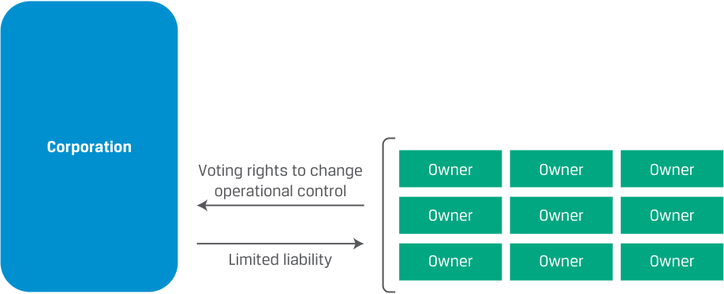
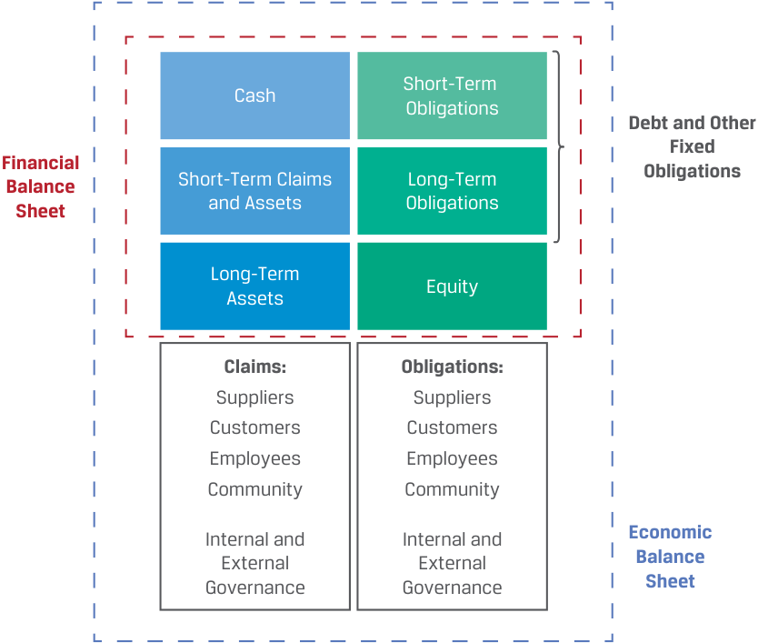
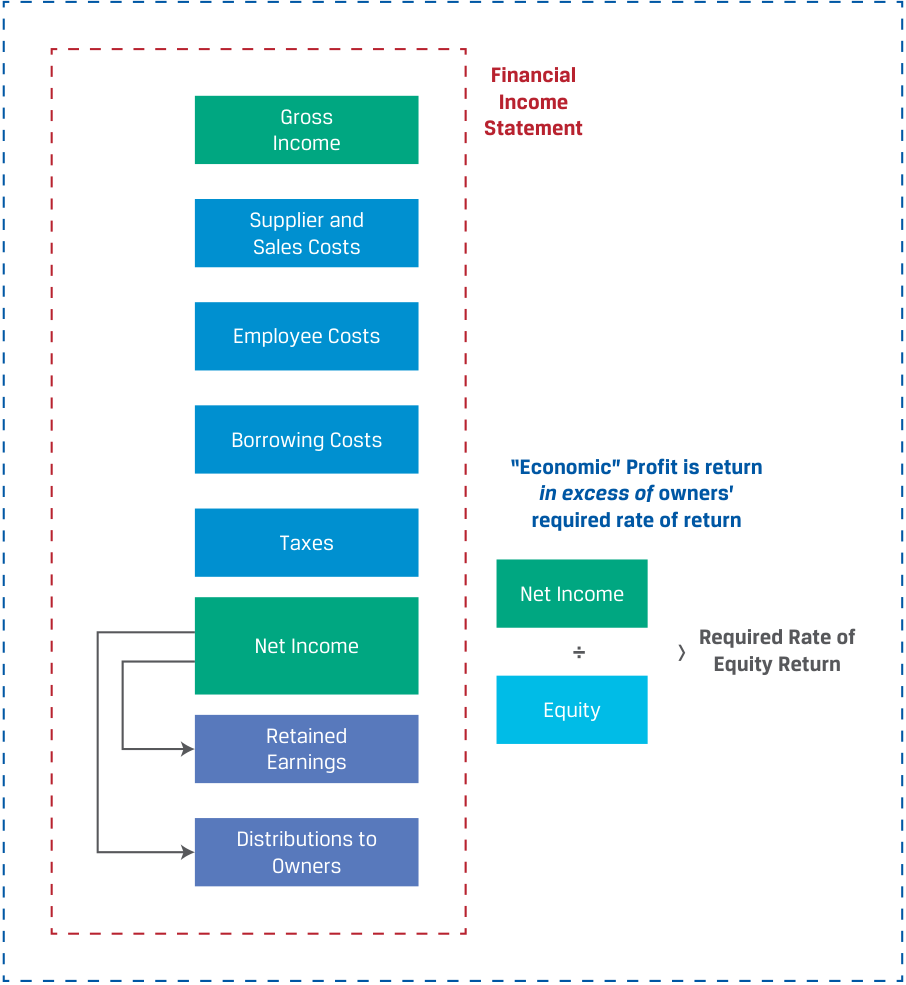

# Volume 3: Corporate Issuers
## Learning Module 1 Organizational Forms, Corporate Issuer Features, and Ownership
### Part 2/3: Key Features of Corporate Issuers (PDF Pages 23–28)

---

<!-- PDF Page 23 -->

5. True or False: Partnerships are typically taxed at the entity level rather than at the individual partner level. 

   - **A.** True 

   - **B.** False 

### **Solution:** 

B is correct. Partnerships are typically pass-through entities, meaning that business income earned by the partnership is passed through to the partners according to the terms of partnership agreement, and each partner is taxed at the personal level. 

# **KEY FEATURES OF CORPORATE ISSUERS** **<mark>3</mark>** 

describe key features of corporate issuers 

The prior lesson addressed several advantages of the corporate organizational form over others, such as limited owner liability, owner–manager separation, and improved access to external financing. In this lesson, we explore the features of corporations in greater depth. Corporations that raise capital in the financial markets, known as **corporate issuers** , are essential for financial analysts to understand, because they raise more capital from investors than even governments worldwide. 

## **Legal Identity** 

A corporation is a legal entity separate and distinct from its owners formed through the filing of articles of incorporation with a regulatory authority. Corporations share many of the rights and responsibilities of an individual and may engage in similar activities. For example, a corporation can enter into contracts, hire employees, sue and be sued, borrow and lend money, make investments, and pay taxes. 

Large corporations frequently have business operations in many different geographic regions and are subject to each regulatory jurisdiction where 

- the company is incorporated, 

- the business is conducted, and 

- the company finances itself 

and for such activities as 

- registration, 

- financial and non-financial reporting and disclosure, and 

- capital market activities (issuance, trading, investment). 

## **Owner–Manager Separation** 

A key feature of most corporations is the separation between those who own the business (the shareholders) and those who operate it, as represented by the board of directors and management. In a corporation, shareholders are largely removed from the 

<!-- PDF Page 24 -->

day-to-day operations of the business. Instead, shareholders elect a board of directors that, in turn, appoints executive-level management, such as the chief executive officer, who is accountable for investing, financing, and operating decisions. Directors and managers have a primary responsibility to act in the best interest of shareholders and, indirectly, all stakeholders. The separation of ownership and management enables the corporation to obtain financing from a larger universe of potential investors who do not need (or want) to be involved in management. 

If a board or management does not act in shareholders’ best interests, shareholders can enact change through exercising **voting rights** attached to their shares—for example, by voting to replace the board of directors—though this can take time. Influencing operations or changing management outright using engagement and voting rights is a strategy pursued by some investors and will be discussed in detail in later lessons. 

## **Owner/Shareholder Liability** 

Risk is shared among all shareholders, who face limited liability. That is, the maximum amount shareholders can lose is what they have invested in the company (i.e., the value of their shares can fall to zero but no further), and they are not responsible for the debts of the corporation unless they separately, specifically guarantee them. 

Shareholders share in the risk and return of the company in proportion to their share ownership unless the corporate charter specifies differently. Unlike partnerships, ownership units are divided into shares of smaller unit size, allowing investors to more easily purchase or sell ownership interests as represented by their shares. For example, some issuers have more than 1 billion shares outstanding, meaning that ownership interests are divided into extremely small increments. Additionally, some corporations issue multiple types or classes of shares with different risk and return characteristics, which will be discussed in a later lesson. Exhibit 7 shows the relationship between owners and the corporation. 

**Exhibit 7: Corporate Shareholder Liability** 

<!-- Start of picture text -->
Corporation Voting rights to change Owner Owner Owner operational control Owner Owner Owner Limited liability Owner Owner Owner <!-- End of picture text -->

## **External Financing** 

The separation between ownership and management allows corporations to access external financing more easily than other business structures because purchasing a share is the only requirement to become an owner. While more expensive to form and operate than other forms, the corporate form is typically preferred when capital needs 

<!-- PDF Page 25 -->

exceed what could be raised by an individual or small group of partners. Financing may be provided by individuals or by institutions, such as mutual funds, pension funds, banks, governments, non-profits, and other corporations. 

Corporations are financed in two ways: with **equity** , by selling shares to investors or reinvesting profits, and with borrowings, or **debt** , in the form of loans, bonds, and leases. Equity investors (shareholders) have a right to receive any distributions of profits, known as **dividends** , while debt must be repaid on a pre-specified date in the future with interest. Equity or debt financing can be raised based on a private contractual agreement between an issuer and investors or in the form of a **security** , a standardized instrument that might be tradeable among investors on a public exchange, which will be covered in the next lesson. 

Exhibit 8 shows the relationship between debt and equity on a corporation’s balance sheet and how these are related to its assets. 

**Exhibit 8: Financial and “Economic” Balance Sheet** 

<!-- Start of picture text -->
Short-Term Cash Obligations Debt and Other Fixed Financial Balance Short-Term Claims Long-Term Obligations Sheet and Assets Obligations Long-Term Equity Assets Claims: Obligations: Suppliers Suppliers Customers Customers Employees Employees Community Community Internal and Internal and Economic External External Balance Governance Governance Sheet <!-- End of picture text -->

While the “financial” balance sheet at the top of Exhibit 8 shows an issuer’s assets (left-hand side) and its sources of financing (right-hand side) from short term to long term measured in financial terms, other intangible or hard-to-quantify assets or liabilities of a firm, such as the human capital associated with its employees and supplier and customer relationships, are included on what may be referred to as an issuer’s broader “economic” balance sheet. 

Similarly, Exhibit 9 shows an issuer’s income statement and distinguishes between its financial income or net income once fixed obligations have been met and its “economic” profit, or return to a firm’s owners in excess of what they could have earned elsewhere on different investments, known as their required rate of return on equity. 

<!-- PDF Page 26 -->

**Exhibit 9: Financial and “Economic” Income Statement** 

<!-- Start of picture text -->
Financial Income Gross Statement Income Supplier and Sales Costs Employee Costs Borrowing Costs “Economic” Profit is return in excess of  owners’ required rate of return Taxes Net Income Net Income ÷ > Required Rate of Equity Return Equity Retained Earnings Distributions to Owners <!-- End of picture text -->

## **Taxation** 

While taxation for corporations can differ greatly from country to country, the corporation is ultimately subject to the tax authority and tax code governing the issuer’s tax reporting, payment, and status. In most countries, corporations are taxed on their profits. Taxable profits are usually _not_ the same as profits reported on financial statements, because tax codes and accounting standards differ. 

In many countries, shareholders pay an additional tax on distributions (dividends) that are passed on to them. This is referred to as the **double taxation** of corporate profits. In some countries, shareholders do not pay a personal tax on dividends if the corporation has paid tax previously on the earnings distributed to shareholders or shareholders receive a personal tax credit for their proportional share of taxes paid by the corporation. In other countries, corporations pay no tax at all or may face different tax regimes within one country. 

<!-- PDF Page 27 -->

### **EXAMPLE 3** 

## **Double Taxation of Corporate Profits** 

1. The French retail giant Auchan Holding generated pre-tax income of €838 million last year and paid corporate taxes of €264 million. Investors in France also pay a 30% tax on dividends received. If Auchan had fully distributed its after-tax income to investors as a dividend and all its investors are in France, what is the total tax rate as a percentage of Auchan’s pre-tax income? 

### **Solution:** 

|Pre-Tax Income|€838|
|---|---|
|Corporate Taxes (31.5%)|€264|
|After-Tax Income|€838 – €264 = €574|
|Distributed Dividend|€574|
|Investor Dividend Tax (30%)|€574 × 0.30 = €172.2|
|Total Tax Rate|(€264 + €172.2)/€838 = 52.1%|

If the after-tax income of €574 million were paid to investors as a dividend, investors would pay €172.2 million in personal taxes on the dividends received. Total taxes paid would be €436.2 million (€264 million at the corporate level plus €172.2 million at the personal level), resulting in a total tax rate of 52.1%. 

Despite the tax disadvantage illustrated in the prior example, the corporate form remains attractive for several reasons. While corporate shareholders are taxed on distributions, sole proprietors and partners are often taxed on all profits regardless of whether they are distributed as dividends (exceptions exist with allowances for profit reserves). This difference makes the corporate structure attractive to businesses that expect to reinvest undistributed profits in, for example, additional capacity for growth. Also, in jurisdictions where corporate tax rates are lower than personal income tax rates, it can be advantageous to “store” profits in the business. 

### **QUESTION SET** 

1. Explain why the separation of ownership from management allows for corporate issuers to have greater access to capital. **Solution:** 

By separating ownership from management responsibilities, corporations can attract a broad range of owners, especially individuals and institutions, who do not want to be involved in management but would like to participate as investors. 

<!-- PDF Page 28 -->

2. Fill in the blanks in the following sentence: 

Limited liability of shareholders refers to the fact that the ________________ amount shareholders may lose on their investment is the ________________ paid to buy the shares. 

### **Solution:** 

Limited liability of shareholders refers to the fact that the maximum amount shareholders may lose on their investment is the price paid to buy the shares. 

3. In which of the following situations does the double taxation of the corporate organizational form matter the _least_ ? 

   - **A.** The company expects to pay all its after-tax income as a dividend to shareholders each year. 

   - **B.** The company’s shareholders reside in a tax jurisdiction with a high tax rate on dividend income. 

   - **C.** The company is expecting to reinvest all its after-tax profits each year into growth of the business. 

### **Solution:** 

C is correct. Reinvestment of all profits implies that the company pays no dividend to shareholders, and thus, no double taxation occurs. 

A is incorrect. Double taxation occurs because dividend income is taxed at both the corporate level and the shareholders’ personal levels. If all after-tax profits are distributed, shareholders are taxed twice on the business’s income. 

B is incorrect because a high tax rate on shareholders’ dividend income received would be a strong impetus to retain profits, find alternative means of distributing profits, or change the organizational form. 

4. Referring to the Auchan Holding example in this lesson, calculate the amount of the tax disadvantage (in euros) Auchan has in its corporate form compared to if it were organized as a limited partnership. Recall that Auchan’s pre-tax profit was €838 million, the corporate tax rate was 31.5%, the personal income tax rate was 30%, and all after-tax profits were distributed. 

### **Solution:** 

If Auchan were organized as a limited partnership, its pre-tax profit would be passed through to the owner(s) and taxes would only be paid at the personal level. Thus, total taxes paid would be €251.4 million (= €838 million × 0.30), or €184.8 million lower than total taxes paid under the corporate organizational form, and this tax of €251.4 million would be paid regardless of whether the partnership distributed the profit to partners. 

5. Corporate issuers are characterized by all of the following _except_ : 

   - **A.** Corporate income is taxed at both the corporate and personal levels. 

   - **B.** Owners do not need to be involved in management of the company. 

