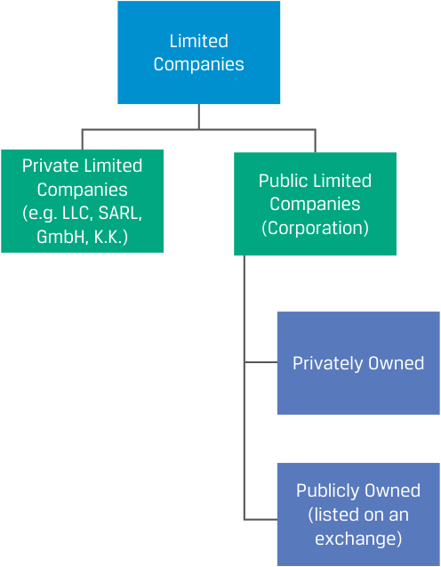
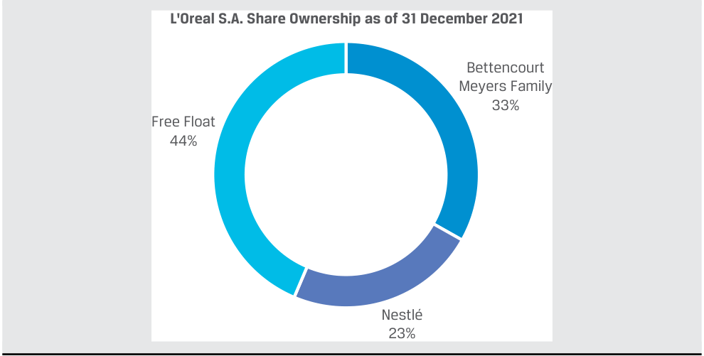

# Volume 3: Corporate Issuers
## Learning Module 1 Organizational Forms, Corporate Issuer Features, and Ownership
### Part 3/3: Publicly vs. Privately Owned Corporate Issuers (PDF Pages 29–44)

---

<!-- PDF Page 29 -->

- **C.** The owners of the corporation are not legally distinct from the corporation. 

- **Solution:** 

C is correct. A corporation is a legally separate entity from its owners. 

A is incorrect because corporate income is taxed at both the corporate and personal levels unless the company pays zero dividends. 

B is incorrect because shareholders are not required to exercise management control over the company. While in some cases, a large shareholder may serve as senior management or be on the board of directors, most shareholders do not take on management responsibilities. 

#### **PUBLICLY VS. PRIVATELY OWNED CORPORATE ISSUERS** 

# **<mark>4</mark>** 

compare publicly and privately owned corporate issuers 

For corporations, “public” and “private” (or “listed” and “unlisted”) are often defined by whether the company’s shares are listed and tradeable on an **exchange** . Somewhat confusingly, this is different from the discussion of private and public limited companies in an earlier lesson; most public or listed companies are public limited companies, but public limited companies are not obliged to list their shares on an exchange. 

###### **Exhibit 10: Publicly vs. Privately Owned Limited Companies** 

<!-- Start of picture text -->
Limited Companies Private Limited Public Limited Companies Companies (e.g. LLC, SARL, (Corporation) GmbH, K.K.) Privately Owned Publicly Owned (listed on an exchange) <!-- End of picture text -->

<!-- PDF Page 30 -->

An exchange, which for equities is referred to as a **stock exchange** , is a rules-based, open access market venue where financial instruments are traded, with price and volume transparency accessible by issuers, investors, and their intermediaries. In addition to an exchange listing, primary features distinguishing public and private companies include 

- the ability to transfer ownership between investors, 

- the process of issuing new shares, and 

- registration and disclosure requirements. 

A **public (listed) company** has some or all of its shares listed and traded on an exchange. These shares may be widely held or involve a majority or controlling owner. Shareholders may include individuals, employees, institutions on behalf of individuals (e.g., pension funds), other corporations, governments, and non-profits. The shares that are traded actively—and thus are not held by insiders, strategic investors, or sponsors but are more freely available on exchanges—are known as an issuer’s **free float** . Free float is often expressed as a percentage of total shares outstanding. 

###### **EXAMPLE 4** 

L’Oréal S.A., the world’s largest beauty company, is a French société anonyme, or public limited company. It has been public since listing its shares on the Paris Stock Market (now Euronext) in 1963. As of 31 December 2021, L’Oréal had approximately 535 million shares outstanding. 

L’Oréal’s shares are mostly owned by Francoise Bettencourt Meyers, her family, and Nestlé (a large, listed Swiss consumer goods company), and the remainder—the free float, approximately 44% of shares—is owned by institutional investors, individual investors, and L’Oréal employees. 

<!-- Start of picture text -->
L'Oreal S.A. Share Ownership as of 31 December 2021 Bettencourt Meyers Family 33% Free Float 44% Nestlé 23% <!-- End of picture text -->

##### **Exchange Listing, Liquidity, and Price Transparency** 

An exchange listing allows ownership to be more easily transferred because investors transact directly with one another in the secondary market on the exchange. An investor can become a shareholder in a public company by executing a buy order in a brokerage account or reduce an ownership position by executing a sell order. This can be done immediately for a relatively small number of shares in a liquid stock or take longer for many shares in a company whose shares trade infrequently. An exchange listing provides share price transparency, allowing investors to track how a company’s value changes. 

<!-- PDF Page 31 -->

###### **Exhibit 11: Public Companies—Share Ownership Transfer** 

<!-- Start of picture text -->
Public Corporation Shareholder Shareholder Shareholder Ownership capital Shareholder Shareholder Shareholder Equity issuance Shareholder Shareholder Shareholder New Investor New Investor New Investor ON EXCHANGE TRADING Parties trade with one another in the secondary market <!-- End of picture text -->

In contrast, the shares of a **private company** are not listed (do not trade on an exchange), so no visible company valuation or share price transparency exists. This makes ownership transfer between investors far more difficult than for a public company. A private company shareholder seeking to sell shares must find a willing buyer, and the two parties must negotiate a price. Even then, the company may refuse the transfer of ownership. Private company shareholders must exercise patience. Their investment is usually locked up until the company is acquired for cash or shares by another company or it goes public. 

Private companies do, however, provide benefits that may outweigh the downside of limited transferability of shares. Private companies typically have fewer shareholders, meaning that controlling owners and management are accountable to fewer stakeholders. Second, many early-stage companies are private. If successful, an investor in their equity could earn high returns. Finally, private companies have few disclosure requirements, which are costly to comply with, and there are few regulations and costs associated with raising financing in private transactions. While some claim that private status results in improved performance from greater focus on the long term, as opposed to focusing on quarterly earnings and other short-term measures associated with listed companies, the empirical evidence for short-termism among listed companies is thin at best.1 

##### **Share Issuance** 

Corporate issuers may issue additional equity shares in the capital markets from time to time. For a public issuer, these shares can be traded in the secondary market once they’re issued. In contrast, private companies finance smaller amounts in the primary market (private debt or equity) from fewer investors who typically have longer holding periods. Exhibit 12 and Exhibit 13 illustrate differences in public and private company share issuance and relative size of financing. 

<!-- PDF Page 32 -->

**Exhibit 12: Public Companies: Share Issuance and Financing Access** 

<!-- Start of picture text -->
Share Issue Share Issue Share Share Issue Issue Share Issue Private Investors may trade actively Placement in secondary market Public Company Private Company Go Public <!-- End of picture text -->

**Exhibit 13: Private Companies Share Issuance and Financing Access** 

<!-- Start of picture text -->
Private Private Private Placement Placement Placement Private Company <!-- End of picture text -->

Private company investors are typically invited to purchase shares in the company through a **private placement** whose terms are outlined in a legal document (public companies can also conduct private placements, subject to regulatory constraints). Private company investors may be limited to qualified or so-called **accredited investors** or **sophisticated investors** , or those deemed to be able and willing by regulatory authorities to assume the greater risk of a non-public offering. 

##### **Registration and Disclosure Requirements** 

Perhaps the defining attribute of public companies is transparency and disclosure. Public companies must register with a regulatory authority and are subject to compliance and reporting requirements. For example, companies with securities listed on US exchanges (e.g., NYSE and NASDAQ) must file audited financial statements and other information on a quarterly basis with the Securities and Exchange Commission (SEC), which are then accessible to the public on the SEC’s EDGAR (Electronic Data Gathering, Analysis, and Retrieval) system or on the company’s website. In the European Union, financial statements must be reported in the EU’s standardized ESEF (European Single Electronic Format) in the registry of domicile, at least semiannually. Public companies’ annual reports regularly exceed 100 pages. 

Besides qualitative information and financial reports, public companies must also disclose major changes in the holding of voting rights and other information that may affect security prices, such as management and director stock transactions. Significant share purchases and sales by management may contain information for investors, such as management’s confidence in exceeding expectations or leading to questions about a company’s business strategy. 

<!-- PDF Page 33 -->

Private companies are generally not subject to the same level of regulatory disclosures, although many rules pertain to both private and public companies (such as prohibitions against fraud and the obligation to file corporate tax returns). While not required, some private firms disclose pertinent information directly to owners as well as lenders, especially if they hope to be able to raise additional financing in the future. Exhibit 14 and Exhibit 15 compare typical entity relationships for public and private companies. 

###### **Exhibit 14: Public Companies: Typical Entity Relationships** 

<!-- Start of picture text -->
Mandated Shares trade disclosures on exchange Stock Regulator Public Company Exchange Registration Meets exchange listing requirements <!-- End of picture text -->

###### **Exhibit 15: Private Companies: Typical Entity Relationships** 

<!-- Start of picture text -->
In some cases, possibly Shares trade Disclosures on exchange Private Stock Regulator Company Exchange Registration Meets exchange listing requirements <!-- End of picture text -->

###### **KNOWLEDGE CHECK** 

1. Match the applicable company characteristic in the left column with the category that best describes it (publicly held, privately held, both) on the right). 

|Exchange listed|Publicly held/Privately held/Both|
|---|---|
|Owner/manager overlaps|Publicly held/Privately held/Both|
|Registered|Publicly held/Privately held/Both|
|Share liquidity|Publicly held/Privately held/Both|
|Non-financial disclosure required|Publicly held/Privately held/Both|
|Negotiated debt and equity sales|Publicly held/Privately held/Both|

<!-- PDF Page 34 -->

|Exchange listed|Publicly held|
|---|---|
|Owner/manager overlaps|Privately held|
|Registered|Publicly held|
|Share liquidity|Publicly held|
|Non-financial disclosure required|Both|
|Negotiated debt and equity sales|Privately held|

Publicly held companies are most often listed on exchanges and required to register shares. Their shares are typically liquid with minor ownership overlap between management and shareholders. These companies must make both financial and non-financial disclosures, and both their debt and equity are typically traded on exchanges. Privately held companies are neither exchange listed nor usually subject to registration requirements. Share issuance is less widely distributed, creating a greater chance of ownership overlap between management and shareholders. Private company shares are illiquid. Generally, these companies are required to make only non-financial disclosures. The sale of their equity and debt is privately negotiated between company insiders and capital providers. 

##### **Going from Private to Public** 

In the next example, we discuss a company’s change from a private company to a public one. 

###### **EXAMPLE 5** 

##### **The Story of Tesla** 

In 1997, engineer Martin Eberhard and computer scientist Marc Tarpenning started a company called NuvoMedia to make an electronic book reader called the Rocket eBook, a precursor to Amazon’s Kindle. Three years after it was founded, NuvoMedia was sold for $187 million. 

Soon after, the two entrepreneurs formed a new company focused on making electric sports cars. They named the company Tesla Motors in honor of the inventor Nikola Tesla, forming a corporation in 2003. As a high-risk, capital-intensive endeavor, they used some of their new-found wealth and sought other cofounders with expertise in electric vehicles and fundraising capabilities. Elon Musk, an entrepreneur with a shared vision in the commercialization of electric sports cars, joined the team, as did Ian Wright and J. B. Straubel, the company’s chief technical officer. 

In addition to investing $6.3 million in Tesla in 2004, making him the largest shareholder, Musk helped raise money from venture capitalists. Musk became CEO in 2008, the year Tesla released its first vehicle, the Roadster. In 2010, Musk led Tesla’s initial public offering, which raised $226 million. Over the next several years, Tesla shifted from sports cars to passenger vehicles, greatly expanding its vehicle production and product line, and in 2016, it also entered the photovoltaics market. In 2017, it changed its name from Tesla Motors to Tesla, Inc., to reflect its diversification into energy storage. The company continued global expansion 

<!-- PDF Page 35 -->

of automobile production, issuing several billion dollars in three secondary equity offerings in 2020. Tesla moved its headquarters from California to Texas and reached a $1 trillion market capitalization in 2021. 

The evolution of Tesla, Inc., over less than 20 years of existence from a startup to a firm among those with the largest market capitalization globally was assisted by the flexibility of its organizational form as a corporation. Tesla was able to obtain significant financing from both debt and equity investors and retain key employees, including Musk, with equity-based compensation. 

Private companies may become public companies (“go public”) in three ways: IPO, direct listing, or acquisition. 

###### **Exhibit 16: Three Ways Private Companies Go Public** 

<!-- Start of picture text -->
"Go Public" IPO Direct Listing Acquisition Acquired by Public Company SPAC <!-- End of picture text -->

Tesla Motors became a public company using an **initial public offering** . To complete an IPO, companies must meet specific exchange listing requirements and usually engage financial intermediaries known as investment banks to underwrite the sale of new shares. Proceeds from the sale of new shares go to the issuing corporation, and its shares begin trading on an exchange. 

Private companies can also go public through a far less common method known as a **direct listing** , which differs from an IPO in two important ways. A direct listing does not involve an underwriter and no new shares are issued, so no capital is raised. Instead, the company simply lists existing shares on an exchange at a price determined by the market, and shares become available to the public as they are sold by existing shareholders. Although direct listings, compared with IPOs, may take place more quickly and at a lower cost, they are usually undertaken only by larger, more established companies with a recognized brand, as in the following example. 

###### **EXAMPLE 6** 

In early 2018, Sweden-based music streaming company Spotify Technology SA became the first foreign issuer to go public via direct listing on the New York Stock Exchange (NYSE). Founded in 2006, Spotify secured multiple rounds of venture capital equity financing and also raised debt prior to going public. Unlike other private companies seeking to go public, Spotify was a well-known brand and an established company, having entered the US market in 2011, with over 

<!-- PDF Page 36 -->

70 million global subscribers and over $5 billion in revenue during the prior year. When announcing its direct listing, Spotify said it chose this financing route because it could list without diluting existing shareholders, offer liquidity to existing shareholders, and provide equal access to buyers and sellers. 

Alternatively, a private company may become public via an acquisition. This may occur indirectly if the company is acquired by another that is already public. In such cases, the acquiring company is usually larger, so an investor in the combined entity has minimal exposure to the private company that was acquired. 

Another means of going public via acquisition is through a **special purpose acquisition company** , which is a transaction like the reverse merger that was popular in the 1990s and early 2000s. A SPAC is a shell company, often called a “blank check” company, that exists solely for the purpose of acquiring an unspecified private company sometime in the future. SPACs raise capital and go public through an IPO. Proceeds are placed in a trust account and can be disbursed only to complete an acquisition; otherwise, they must be returned to investors. SPACs are publicly listed, often specialize in a particular industry, and have a finite time period, such as 18 months, to acquire a private company before proceeds are returned to investors. While investors in a SPAC may not know which private company the SPAC will buy, they may have expectations based on the SPAC executives involved or comments these individuals have made in the media. 

Once the SPAC completes the purchase of a private company, that company becomes public. SPACs are replacing the formerly used reverse merger process of going public, which typically used a dormant listed company with a previous business and trading history. 

###### **KNOWLEDGE CHECK** 

1. Match the method by which a private company can go public with the most closely related term. 

Going Public Method: 

|IPO “blank check,”|existing shareholder, underwriter|
|---|---|
|Direct listing “blank check,”|existing shareholder, underwriter|
|SPAC “blank check,”|existing shareholder, underwriter|

###### **Solution:** 

|IPO|underwriter|
|---|---|
|Direct listing|existing shareholder|
|SPAC|“blank check”|

An IPO is facilitated by investment banks that underwrite, or guarantee, the offering. A direct listing does not involve an underwriter, and no new capital is raised. Instead, the company is simply listed on an exchange, and shares are sold by existing shareholders. A SPAC is a shell company often called a “blank check” company because it exists solely for the purpose of acquiring an unspecified private company sometime in the future. 

<!-- PDF Page 37 -->

2. True or false: Accredited investors are the capital providers qualified by regulators to invest in public companies. Justify your answer. 

   - **Solution:** 

The statement is false. Accredited investors are judged by regulators to have the sophistication for understanding and assuming the risks that come with investing in _private_ , not public, companies. 

##### **Going from Public to Private** 

Public companies may also decide to go private. A “take-private” or “go-private” process involves investors acquiring all of the company’s publicly traded shares and delisting the company from the exchange. The investors must typically pay a premium above the current share price and often use debt to finance the acquisition. Go-private transactions are initiated by investors who believe that actions could be taken that would result in a higher valuation than that reflected in the current share price. Going private puts these investors in control and takes the company out of public view, which may be beneficial. These actions undertaken with greater private control might include management changes, selling assets, restructuring, or realizing cost savings that are expected to exceed the premium paid and financing costs. Once these actions are complete, investors may take the company public again several years later if they are able to achieve the desired valuation at that time. 

Public versus private company trends can provide insight into market developments. For example, many emerging economies have a growing number of public companies, while the opposite is occurring in developed economies. Emerging economies are usually characterized by higher rates of growth, a transition to more open market structures, and foreign capital inflows. This is consistent with a growing number of listed companies on an emerging economy’s domestic stock exchange. 

A declining number of listed public companies in developed markets is a result of several factors. One cause is a higher number of mergers and acquisitions, which reduces the number of independent listed companies. Another is the growing number of private capital sources available, such as venture capital and private equity, allowing companies to access needed capital while avoiding the additional cost, regulatory burden, public scrutiny, and compliance costs associated with a public listing. Another factor is that many private companies simply choose to remain private because it preserves control by incumbent owners and management. 

##### **The Varieties of Corporate Owners** 

Corporations offer a great deal of flexibility in ownership and objectives. As discussed earlier, shareholders include not only individual and institutional investors but also other corporations, governments, and non-profits, which may be controlling owners. 

Governments sometimes create legally separate corporations while maintaining 100% or varying levels of ownership. For example, a sovereign government may establish a wholly owned corporation but create a board of directors and management structure, along with compliance and reporting requirements, such as the issuance of audited financial statements. This structure provides increased transparency to taxpayers and external investors (limited to debt investors in this case) as to whether the corporation achieves its objectives and generates a profit or a loss, which must be financed from the government’s budget. This structure is used by the United States 

<!-- PDF Page 38 -->

Postal Service (USPS), while postal services in some countries, such as the Netherlands (KPN), the United Kingdom (Royal Mail), and Germany (Deutsche Post), are partly or fully investor owned. 

Government-owned corporations exist in both developed and emerging economies, in some cases to supply public goods, such as infrastructure, which creates positive externalities, and in others to earn profits in a major domestic industry. For example, government-owned corporations are common in developed economies among postal systems, railways, and other infrastructure, such as airports. In emerging economies, state-owned or state-controlled enterprises often operate in a dominant domestic industry, such as basic commodities or energy. Financial intermediaries, such as banks, are also often first established as government institutions in these markets. As the economy seeks foreign and domestic capital from the private sector to expand and diversify, government companies are often gradually transferred to private sector ownership via an IPO, as in the following example. 

###### **EXAMPLE 7** 

##### **Saudi Aramco IPO** 

Nearly 50 years after oil was first discovered in Saudi Arabia, the government issued a decree creating the Saudi Arabian Oil Company (Saudi Aramco) to take control of and carry out petroleum and natural gas production in the country. To partially finance a plan to diversify the Saudi economy and reduce reliance on oil, the Saudi government announced its intention in 2016 to raise up to $100 billion on global exchanges by selling a 5% stake in the company, valuing Saudi Aramco at $2 trillion. Given IPO delays and a lower, $1.7 trillion valuation, in 2019, the Saudi government opted to scale down its plans, selling a 1.5% stake on the domestic Saudi stock exchange for $25.6 billion instead. Despite the smaller size, this transaction was the largest IPO to date and created the world’s most valuable publicly traded corporation at the time. 

In other instances, industry deregulation and/or technological change is the catalyst for a shift from government to private sector ownership. For example, the telecommunications industry shifted from government-owned monopolies across developed and less developed economies in the 1980s to many private sector corporations and varying degrees of government ownership today. This expanded access to capital has greatly enhanced the industry’s ability to invest in rapidly evolving cellular technology. In the area of power generation, a similar shift from government to private sector has occurred, leading to greater diversification of energy production, as well as recently leading to investment in sustainable and renewable sources of energy, as in the case of Public Power Corporation S.A. 

###### **EXAMPLE 8** 

##### **Public Power Corporation S.A.** 

The largest electric power company in Greece, Public Power Corporation (PPC), was established as a state-owned and -managed corporation by the Greek government in 1950. Following Greece’s entry into the EU, PPC lost its domestic power generation monopoly. In response to the European Electricity Directive separating power generation, transmission, and distribution, the company issued an IPO in 2001 for 34% of its shares and reduced government ownership further, to 51%, through subsequent share raises over the next few years. The company 

<!-- PDF Page 39 -->

is phasing out coal-fired power plants and shifting to renewable energy sources, and in 2021, it announced a further share capital increase of EUR750 million combined with a reduction in government ownership, from 51% to 34%. 

Corporate shareholders also commonly include non-profits, such as foundations and endowments, some of which have grown to significant size. In addition to financial objectives, non-profits typically have societal and other non-financial responsibilities to their beneficiaries, as in the following example. 

###### **EXAMPLE 9** 

##### **Novo Nordisk Foundation and Novo Nordisk A/S** 

The Denmark-based Novo Nordisk Foundation is the largest private foundation in the world. It has a dual objective: to provide a stable basis for the commercial and research activities conducted by investee companies within and to support scientific and humanitarian purposes. Through its holding company, Novo Holdings A/S, the foundation is the largest and controlling shareholder of the for-profit, listed Danish biopharmaceutical company Novo Nordisk A/S. 

###### **QUESTION SET** 

1. A corporate issuer has the following attributes: It has no need for new equity financing, its debt needs are well satisfied through its existing credit facility with a bank, and it has a majority owner that exercises management control of the company. Is this corporate issuer more likely public or private? 

   - **A.** Public 

   - **B.** Private 

   - **Solution:** 

B is correct. The lack of need for new equity capital implies less reason to have exchange-listed stock, as does the ability to operate the business with the current debt capacity available under its existing credit facility. The majority owner exercising management control could possibly imply either public or private status, although combined with the first two attributes, it is doubtful that such a company would be public. 

2. Which of the following does _not_ reflect a primary difference between an initial public offering (IPO) and a direct listing? 

   - **A.** Whether or not employees own shares in the private company 

   - **B.** Whether or not new capital is raised 

   - **C.** Whether or not an underwriter is used 

###### **Solution:** 

A is correct. A company with employee shareholders can go public with either an IPO or a direct listing; employee shareownership does not differ by the choice of transaction. 

C is incorrect. An IPO uses an underwriter to manage the process and underwrite the purchase of new shares, while a direct listing does not. 

<!-- PDF Page 40 -->

B is incorrect. An IPO raises new capital for the listing company by issuing new shares to the public, while a direct listing does not; it lists only existing shares. 

3. Describe two benefits of being a public company and two reasons that an issuer may instead prefer to be private company. 

**Solution:** 

Benefits of public status: 

- Public listing allows the company to access capital from a broader range of investors, thus making larger capital raises more feasible. 

- Public listing allows for price transparency for investors and ease of trading because of stock exchange listing. This may be especially beneficial if employees own significant stock, because listing creates a market for these shares. 

Benefits of private status: 

   - Fewer disclosure requirements, thus reducing compliance costs and perhaps conferring competitive advantages because information can be kept private. 

   - Fewer stakeholders, thus allowing for improved access to communication channels. 

4. Identify a major reason why a national government would be a 100% shareholder in a corporate issuer, and discuss two factors that may cause a national government to reduce its ownership in a state-owned company. **Solution:** 

A national government may choose to be the 100% owner of a company that provides public goods to the national economy, such as infrastructure and public safety, that would either not be provided by private means or be delivered inequitably or inefficiently. In some cases, a country may have natural resources, such as crude oil, and the national government may use a wholly owned corporation for production and to invest profits in ways that benefit its country. 

Two possible reasons that a country may reduce its ownership in a stateowned company include (1) opportunities to bring in foreign capital and diversify the country’s economy, such as the case highlighted by the Saudi Aramco example, and (2) a push for privatization and deregulation to potentially lower costs through competition and motivate innovation, as highlighted by the postal services examples. 

5. A public company acquires a private company. Is the acquired company public or private after the acquisition? Explain the rationale for your choice. 

   - **A.** Public 

   - **B.** Private 

   - **Solution:** 

A is correct. Even though the acquired company will not have its own shares, the shareholders of the acquirer own the formerly private company, though the percentage of assets of the combined company attributable to 

<!-- PDF Page 41 -->

the acquired company may be small. The acquirer’s board of directors and management now operate the newly acquired company. 

<!-- PDF Page 42 -->

## **~~PRACTICE PROBLEMS~~** 

### **The following information relates to questions 1-5** 

Dee’s Arbor Group Inc. (DAG Inc.) is a large international investor in timber and forest assets located on the North and South American continents. DAG Inc. is the general partner of DAG LP, a limited partnership that is the 100% owner of the timber and forest assets. DAG LP is controlled by DAG Inc. and its limited partners; the limited partners own a 20% stake in the partnership, while DAG Inc. holds the remaining majority stake. 

DAG Inc.’s shares are listed on stock exchanges in the United States and Canada. DAG Inc. is organized as a special corporate form available in its jurisdiction in which it does not pay corporate income taxes so long as it distributes all of its net income as dividends to its shareholders and complies with other conditions. In the current and past fiscal years, DAG Inc. has complied with all of these conditions. 

DAG Inc.’s shares are owned by various members of the Dee family, who hold several key senior management positions at DAG Inc. and DAG LP, and collectively they own 30% of the shares of DAG Inc. The remainder of DAG Inc.’s shares are owned by a variety of individual and institutional investors, none of whom own more than 5%. The following diagram shows the organizational structure of DAG Inc. and DAG LP. 

<!-- Start of picture text -->
Timber and Forest Assets DAG LP DAG Inc. Limited Partners Dee Family Members Outside Shareholders <!-- End of picture text -->

**1.** What percentage of the timber and forest assets are effectively owned by the Dee family members in this scenario? 

   - **A.** 24% 

   - **B.** 30% 

   - **C.** 80% 

**2.** Which of the following best describes the taxation of DAG Inc. and DAG LP? 

   - **A.** DAG LP pays tax based on its pre-tax income. 

<!-- PDF Page 43 -->

   - **B.** Shareholders of DAG Inc. pay tax based on dividend income. 

   - **C.** DAG Inc. pays tax based on its pre-tax income. 

**3.** Which of the following best describes DAG LP and DAG Inc.? 

   - **A.** Neither DAG LP nor DAG Inc. is managed by a majority owner. 

   - **B.** DAG Inc. has limits to its ability to raise new capital because of the dividend requirement on its corporate form. 

   - **C.** DAG Inc. faces unlimited liability as the general partner, while DAG Inc.’s status as a corporation implies that its shareholders face limited liability. 

**4.** What is a significant difference between the limited partners of DAG LP and the outside shareholders of DAG Inc.? 

   - **A.** Managerial responsibilities 

   - **B.** Taxation of income from the partnership 

   - **C.** The ability to vote and replace members of the DAG Inc. board of directors 

**5.** Which of the following rationales would be most consistent with the Dee family’s choice to create this complex organizational structure instead of simply organizing as a limited partnership? 

   - **A.** It provides management control without the need for majority ownership by the family, while maintaining limited liability. 

   - **B.** The complex structure eliminates the potential for double taxation. 

   - **C.** The complex structure avoids potential problems associated with outside investors exercising voting rights. 

<!-- PDF Page 44 -->

## **~~SOLUTIONS~~** 

1. A is correct. The Dee family effectively owns 24% of the timber and forest assets. They own 30% of the shares of DAG (the publicly traded corporation), and they own 80% of the limited partnership (which owns the assets): 24% = 30% × 80%. 

2. B is correct. DAG Inc. is organized as a special corporate form available in its jurisdiction in which it does not pay corporate income taxes. DAG LP, as a limited partnership, is a pass-through entity. DAG Inc. shareholders pay tax on dividend income. 

A is incorrect. DAG LP is a limited partnership. Partnership income is passed through to each partner, and the partners pay tax at the personal level. C is incorrect. DAG Inc. is organized as a special corporate form available in its jurisdiction in which it does not pay corporate income taxes. 

3. C is correct. DAG Inc. is the general partner of DAG LP and thus has unlimited liability in the partnership. However, as a corporation, DAG Inc.’s shareholders have limited liability for its losses and obligations. A is incorrect. DAG LP is 80% owned by DAG Inc., the general partner that manages the partnership. DAG Inc. is 30% owned by the Dee family, who holds several key managerial positions. 

B is incorrect. As a public company, DAG Inc. can raise new equity by issuing shares on an exchange. The dividend requirement is not a binding limit on its ability to raise capital but, rather, might be an attractive feature to prospective investors. 

4. C is correct. The limited partners of DAG LP are not shareholders of DAG Inc., so they do not have voting rights in the corporation. Additionally, because the limited partners own only 20% of the partnership, they also have little ability to remove DAG Inc. as the general partner. In contrast, outside shareholders own 70% of DAG Inc. and have voting rights. They could use their collective ownership to effect change in the management of DAG Inc. 

A is incorrect. Neither the DAG LP limited partners nor the outside shareholders of DAG Inc. have managerial responsibilities. The general partner has managerial responsibilities of the partnership, and the board of DAG Inc. has managerial responsibilities of the corporation. 

B is incorrect. Owing to the special corporate form of DAG Inc., both the corporation _and_ the limited partnership are pass-through entities. Therefore, neither the partnership nor the corporation pays entity-level income taxes, but both the limited partners and shareholders are responsible for personal income taxes. 

5. A is correct. The Dee family can effectively control management of the timber and forest assets with only a 24% effective ownership stake in the partnership. If the family had opted for a limited partnership as the organizational form, they likely would need a much higher ownership stake to assert management control and would have unlimited personal liability. 

B is incorrect. The double taxation problem is not an issue in the more complex structure, nor is it a problem in the partnership structure, because both are pass-throughs. 

C is incorrect. The complex structure potentially creates problems because of the existence of outside shareholders constituting a majority of votes. 

