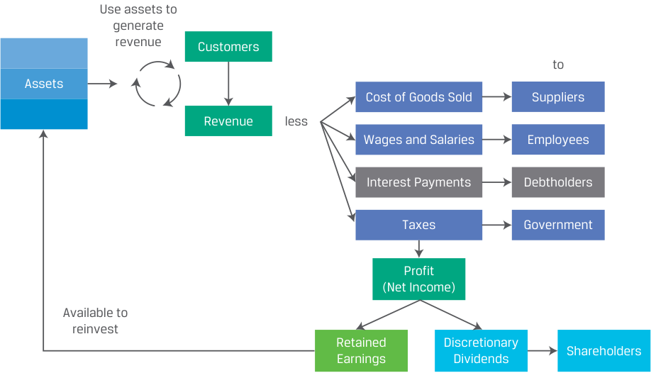
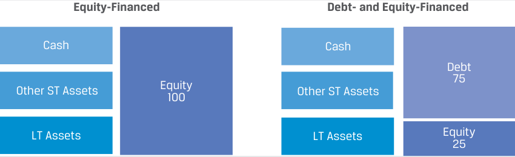
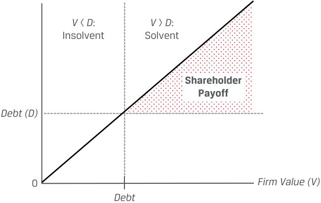

# Volume 3: Corporate Issuers
## Learning Module 2 Investors and Other Stakeholders
### Part 1/3: Introduction (PDF Pages 45–55)

---

<!-- PDF Page 45 -->

#### L E A R N I N G M O D U L E 

# **<mark>2</mark>** 

### **Investors and Other Stakeholders** 

###### **<mark>LEARNING OUTCOMES</mark>** 

**_Mastery The candidate should be able to:_** compare the financial claims and motivations of lenders and shareholders describe a company’s stakeholder groups and compare their interests describe environmental, social, and governance factors of corporate issuers considered by investors 

##### **INTRODUCTION** 

## **<mark>1</mark>** 

Corporate issuers are financed with debt and equity. Debt and equity securities have different risk and return profiles for both issuers and investors. This learning module discusses these differences and their implications, while also considering the perspectives of a broader group of stakeholders beyond debtholders and shareholders. We introduce these groups and discuss potential conflicts of interest among them. Balancing stakeholder interests is important, as both issuers and investors have increasingly incorporated environmental, social, and governance factors into their decision-making processes. Analysts assess ESG factors to better evaluate issuers’ expected future performance and risk profile. 

###### **LEARNING MODULE OVERVIEW** 

- Corporate issuers are financed with debt and equity. Debt is a financing source with a finite length, and interest and principal payments are promised on pre-specified future dates. Debtholders have a priority claim over shareholders to an issuer’s cash flows and assets. 

- Equity is a source of permanent financing, and no promises of repayments or distributions to shareholders are made. Equity is a residual claim on an issuer’s cash flows and assets. 

<!-- PDF Page 46 -->

- From the perspective of an issuer, debt is riskier than equity. From the perspective of an investor, equity is riskier than debt. The proportion of debt in a firm’s capital structure affects both the potential return and the risk of cash flows. 

- Conflicts of interest may exist between debtholders and shareholders. Debtholders’ payoff is limited to promised interest and principal payments, while shareholders’ payoff is theoretically unlimited as increases in firm value over the value of debt accrue to shareholders. 

- Besides debt and equity investors, corporate stakeholders include the board of directors, managers, employees, customers, suppliers, governments, society in general, and the environment. The stakeholder theory of corporate governance broadens the focus of corporate decision-making beyond that of the shareholder theory. 

- Environmental, social, and governance (ESG) considerations are becoming more important to both investors and analysts. ESG factors affect firms’ values and can present both risks and opportunities. 

###### **LEARNING MODULE SELF-ASSESSMENT** 

These initial questions are intended to help you gauge your current level of understanding of this learning module. 

Complete each statement by selecting the most appropriate term in parentheses. 

1. ____________ make permanent capital available to issuers. (debtholders, shareholders) 

###### **Solution:** 

<u>Shareholders make permanent capital available to issuers.</u> 

   - Debtholders is incorrect. Debt has a finite maturity, though it can be far in the future. 

2. ____________ have a residual claim against a firm’s cash flows. (debtholders, shareholders) 

###### **Solution:** 

<u>Shareholders have a residual claim against a firm’s cash flows.</u> Debtholders is incorrect. Debtholders have a _priority_ claim over shareholders to a firm’s cash flows and assets. 

3. The shareholder theory of corporate governance is _______________ than the stakeholder theory. (narrower, broader) 

###### **Solution:** 

The shareholder theory of corporate governance is narrower than the stakeholder theory. 

Stakeholders are groups and individuals with a vested interest in a firm’s success and include, but are not limited to, shareholders. 

<!-- PDF Page 47 -->

|4. ESG considerations are an explicit objective in the _____________ theory of corporate governance. (shareholder, stakeholder) **Solution:**|
|---|
|ESG considerations are an explicit objective in thestakeholdertheory of corporate governance.|
|The stakeholder theory seeks to balance the interests of shareholders with the interests of a broader group that relate to ESG considerations.|
|5. The estimated impact of ESG factors on corporate issuers’ financial and share price performance has _________________ over time. (decreased, remained the same, increased) **Solution:**|
|The estimated impact of ESG factors on corporate issuers’ financial and share price performance hasincreasedover time. This impact is the result of changing consumer and investor preferences, increased regulations and taxes related to ESG factors, and the rising threat of climate change.|
|6. ESG factors are increasingly recognized as _______________ by analysts. (quantifiable, qualitative) **Solution:** ESG factors are increasingly recognized asquantifiableby analysts. His- torically, ESG factors were considered negative externalities with no direct effect on firms’ financial statements. Increasingly, analysts are quantifying the effects of ESG factors and including them in firm valuation and invest- ment decision-making.|

##### **FINANCIAL CLAIMS OF LENDERS AND SHAREHOLDERS** 

## **<mark>2</mark>** 

compare the financial claims and motivations of lenders and shareholders 

###### **Debt Versus Equity** 

The prior module established that corporations finance their assets with debt and equity. We now turn our attention to the nature of these claims, their relative risk versus return for both issuers and investors, and potential conflicts of interest that may arise between lenders and shareholders. 

###### **_Debt and Equity Claims_** 

Exhibit 1 shows the relationship between a corporation’s assets and the claims of its debt and equity investors that finance them. Exhibit 2 shows that assets are used to generate income to pay interest to debtholders, while remaining profits are either reinvested or distributed to shareholders. 

<!-- PDF Page 48 -->

**Exhibit 1: Balance Sheet: Assets, Debt, and Equity** 

<!-- Start of picture text -->
Short-Term Cash Obligations Debt and Other Fixed Financial Balance Short-Term Claims Long-Term Obligations Sheet and Assets Obligations Long-Term Equity Assets Claims: Obligations: Suppliers Suppliers Customers Customers Employees Employees Community Community Internal and Internal and Economic External External Balance Governance Governance Sheet <!-- End of picture text -->

**Exhibit 2: Payments to Debt and Equity Investors** 

<!-- Start of picture text -->
Use assets to generate revenue Customers to Assets Cost of Goods Sold Suppliers Revenue less Wages and Salaries Employees Interest Payments Debtholders Taxes Government Profit (Net Income) Available to reinvest Retained Discretionary Shareholders Earnings Dividends <!-- End of picture text -->

Debtholders, or lenders, provide capital with a _finite_ maturity. Issuers agree to make promised interest payments and to repay principal on pre-specified dates. Lenders have no decision-making power within the corporation, but debt contracts can be structured to protect lenders by imposing financial requirements and/or legal claims on certain assets of the corporation if the debt is not repaid as agreed. As shown in Exhibit 2, interest payments are paid before any distributions to equity investors and are a priority claim against a company’s assets and cash flows. 

<!-- PDF Page 49 -->

Equity investors make _permanent_ capital available to issuers; issuers generally do not commit to future dividends or repayments to shareholders. Rather, equity is a _residual_ claim against company cash flows—whatever is left after expenses, investments, and debt payments. Cash distributions to equity investors are at the discretion of the board of directors. In contrast to lenders, equity investors have voting rights on important company matters such as choosing the board of directors, which appoints and oversees management. 

In addition to interest payments to debtholders, other claims that must be satisfied before any shareholder distributions are made include payments to suppliers, employees, and governments (in the form of taxes). If a firm is dissolved and its assets are liquidated, these priority claims must be met before equity investors receive anything. 

Because debt is a priority, fixed, and finite claim on assets and cash flows, it is a less costly form of financing for issuers: it is lower risk for investors than equity (though, as will be discussed, increasing debt increases risk for a company’s equity investors). Another difference between debt and equity is that debtholder interest payments are usually treated as a tax-deductible expense, reducing taxable income, while dividends paid to shareholders are not. 

###### **KNOWLEDGE CHECK** 

1. Identify whether the attribute on the left is a feature of debt or equity. 

|Legal repayment obligation|Debt, Equity|
|---|---|
|Residual asset claim|Debt, Equity|
|Discretionary payments|Debt, Equity|
|Tax-deductible expense|Debt, Equity|
|Finite term|Debt, Equity|
|Voting rights|Debt, Equity|

###### **Solution:** 

|Legal repayment obligation|Debt|
|---|---|
|Residual asset claim|Equity|
|Discretionary payments|Equity|
|Tax-deductible expense|Debt|
|Finite term|Debt|
|Voting rights|Equity|

Whether offered in the form of a loan or a bond, debt involves a contractual obligation with priority interest and principal claims. Equity investors receive discretionary distributions and have a residual claim to assets. Equity dividend payments are not tax deductible. Debt requires contractual interest and principal payments, with interest expense being tax deductible for the issuer. Debt has a finite term and confers no decision-making power, while equity has an unlimited term and includes voting rights. 

<!-- PDF Page 50 -->

###### **Debt Versus Equity: Risk and Return** 

As established earlier, debtholder claims are fixed and finite, while equity owners have ongoing claims to a firm’s current and future profits. While firms usually start with equity financing, those with more predictable cash flows may choose to borrow rather than sell additional ownership stakes to finance assets. The trade-offs between debt and equity financing for both issuers and investors are best shown by the following example. 

###### **EXAMPLE 1** 

###### **Equity- versus Debt-Based Balance Sheet Financing** 

Consider a firm with assets 100% fully financed by equity and an identical firm financed with 75% debt and 25% equity. 

<!-- Start of picture text -->
Equity-Financed Debt- and Equity-Financed Cash Cash Debt 75 Other ST Assets Equity Other ST Assets 100 LT Assets LT Assets Equity 25 <!-- End of picture text -->

Assume that both firms have revenue, over a period, of 100 and operating expenses of 70. Ignore income taxes. 

1. If we assume interest expense of 15 for the period, calculate net income for each firm and compare their returns on equity (ROE) for the period. Explain why ROE is higher when debt financing is used. 

###### **Solution:** 

Solve for net income by subtracting expenses from revenue, and divide net income by total equity to solve for the one-period return on equity: 

|**Equity-Financed**||**Debt- and Equity-Financed**||
|---|---|---|---|
|Revenue|100|Revenue|100|
|Less:  Operating Expenses|−70|Less: Operating Expenses|−70|
|||Less: Interest Expense|−15|
|Net Income|30|Net Income|15|
|Total Equity|100|Total Equity|25|
|**Return on Equity**|**30%**|**Return on Equity**|**60%**|

Return on equity is higher when debt is used, because the interest cost of debt is lower than the firm’s return on assets. Interest rate on debt = 15/75 = 20% versus return on assets = 30/100 = 30%. 

2. Calculate returns on equity for the period if the firms experience a 20% increase and a 20% decrease in revenue (from Question 1), assuming expenses remain unchanged. 

###### **Solution:** 

Solve for net income and return on equity given the increase and decrease in revenue as follows: 

<!-- PDF Page 51 -->

###### **20%** **_Increase_ in Revenue** 

|**Equity-Financed**||**Debt- and Equity-Financed**||
|---|---|---|---|
|Revenue|120|Revenue|120|
|Less: Operating Expenses|−70|Less: Operating Expenses|−70|
|||Less: Interest Expense|−15|
|Net Income|50|Net Income|35|
|Total Equity|100|Total Equity|25|
|**Return on Equity**|**50%**|**Return on Equity**|**140%**|

###### **20%** **_Decrease_ in Revenue** 

|**Equity-Financed**||**Debt- and Equity-Financed**||
|---|---|---|---|
|Revenue|80|Revenue|80|
|Less: Operating Expenses|−70|Less: Operating Expenses|−70|
|||Less: Interest Expense|−15|
|Net Income|10|Net Income|**(5)**|
|Total Equity|100|Total Equity|25|
|**Return on Equity**|**10%**|**Return on Equity**|**(20%)**|

This example demonstrates the greater potential shareholder return when debt financing is used—but also the greater risk. In particular, the net loss in the downside case for the issuer financed with debt and equity raises the possibility that it may be unable to meet future debt payments. The variation in ROE for the company financed with debt and equity is significantly higher than the ROE variation for the all-equity-financed company. 

From an issuer’s perspective, debt financing is less costly but involves greater risks than equity financing, because it commits the issuer not only to interest and principal payments but also to any restrictions that lenders impose in the debt contract. The greater use of debt for a given amount of equity financing, known as **financial leverage** , increases the likelihood that the firm may be unable to meet its promised obligations to lenders, resulting in bankruptcy and potential liquidation. The firm faces no such risk in the case of equity financing, as shareholders are not promised any distributions or repayments. 

From an investor’s perspective, stocks are riskier than bonds because shareholders hold residual rather than fixed claims against the firm. As shown in Example 1, the profits available for distribution to shareholders can vary greatly, depending on the performance of the firm as well as financial leverage. If a corporation is successful, there is theoretically no limit to how much equity owners could earn on their investment. But if the firm performs poorly, owners can lose their entire investment if the firm is liquidated and debtholders take control of the assets. Due to their limited liability, however, shareholders cannot lose more than their initial investment. 

While debt financing adds risk, equity holders often prefer it to an issuer raising additional equity to fund growth, because additional share issuance reduces the fractional firm ownership of existing shareholders, known as **dilution** . The downside of dilution may be offset by an expectation that the firm will generate enough incremental profit to compensate. 

<!-- PDF Page 52 -->

###### **EXAMPLE 2** 

###### **Financing an Investment with Debt, Equity, or Cash on Hand** 

Consider the same equity-financed firm as in Example 1 and its choices for financing a new investment in long-term assets of 20. The pertinent details in the firm’s initial balance sheet are shown below. Revenue before the investment is 100, expenses are 70 and are expected to remain unchanged, interest on new debt financing is 20%, and the return on the new investment is 30%. Ignore income taxes. 

###### **Initial Balance Sheet** 

|Cash|30|||
|---|---|---|---|
|Other assets|20|||
|LT assets|50|Equity|100|

1. Compare the firm’s returns on equity if it finances the investment with debt, shares, or cash on hand. Discuss the results of the comparison. 

###### **Solution:** 

|**Issue Shares**|**Bo**|**rrow**|**Cash**|**on Hand**|
|---|---|---|---|---|
|Cash 30|Cash 30||Cash 10||
|Other 20|Other 20|Debt 20|Other 20||
|LT assets Equity 120|LT assets|Equity 100|LT assets|Equity 100|
|70|70||70||

||**Issue Shares**|**Borrow**|**Cash on Hand**|
|---|---|---|---|
|Revenue|106|106|106|
|Less: Operating Expenses|70|70|70|
|Less: Interest||4||
|Net Income|36|32|36|
|Equity|120|100|100|
|ROE|30%|32%|36%|

Financing the investment by issuing shares produces the lowest ROE due to the dilution from additional equity. Because the investment produces a return equal to the beginning ROE, there is no change in ROE. Financing with debt produces a higher ROE, because the interest rate on debt is lower than the return on the new investment and no new shares are issued, so equity does not increase. The highest ROE is produced by using cash on hand, which avoids both the increase in equity and the interest cost of new debt. 

Exhibit 3 shows this shareholder payoff asymmetry over time as a function of firm value. 

<!-- PDF Page 53 -->

###### **Exhibit 3: Firm Value and Shareholder Payoff** 

<!-- Start of picture text -->
V  <  D : V  >  D : Insolvent Solvent Shareholder Payoff Debt (D) 0 Firm Value (V) Debt <!-- End of picture text -->

If the firm is solvent—that is, its value ( _V_ ) exceeds the value of its debt ( _D_ )—then the value to shareholders is the positive difference between the firm’s value and the value of its debt. Potential upside gains to shareholders are limited only by the future value of the firm. If a firm becomes insolvent, with a debt value greater than that of its assets ( _V_ < _D_ ), shareholders lose their entire investment and debtholders take control of the firm. 

Exhibit 4 shows this asymmetry from the perspective of debtholders. 

**Exhibit 4: Firm Value and Debtholder Payoff** 

<!-- Start of picture text -->
V  <  D : V  >  D : Insolvent Solvent Debt (D) Debtholder Payoff 0 Firm Value (V) Debt <!-- End of picture text -->

Lender returns are limited to promised interest and principal payments so long as the firm is solvent, regardless of firm performance and financial leverage. In contrast, if firm value falls below that of debt, the firm is declared insolvent and debtholders seek to recover their capital from remaining firm assets. Note that if we add the shaded areas for the shareholder payoff and the debtholder payoff, we get the diagonal line showing the total value of the firm as debtholders are owed promised payments and equity holders get the residual. 

While equity owners seek to maximize firm value (to increase their payoff), bondholders seek to ensure the timely repayment of principal and interest, with the company maximizing its ability to meet its debt obligations. These perspectives are summarized in Exhibit 5. 

<!-- PDF Page 54 -->

**Exhibit 5: Investor Perspectives: Equity versus Debt** 

|**Attribute**|**Equity**|**Debt**|
|---|---|---|
|Tenor|Indefinite|Term (e.g., 3 months, 10 years)|
|Return potential|Unlimited|Capped|
|Maximum loss|Initial investment|Initial investment|
|Investment risk|Higher|Lower|
|Desired outcome|Maximize firm value|Timely repayment|

###### **KNOWLEDGE CHECK** 

1. Corporate equity and debt holders share the same investor perspective with respect to: 

   - **A.** maximum loss. 

   - **B.** investment risk. 

   - **C.** return potential. 

###### **Solution:** 

A is correct. For both equity and debt holders, their initial investment represents their maximum possible loss. The return potential is theoretically unlimited for equity holders, while it is capped for debtholders. Equity holders are exposed to a higher level of investment risk, as they hold a residual claim on the firm’s cash flows that is lower in priority to the debtholders’ claim. 

2. **True or False:** Debtholders, unlike equity holders, have symmetric potential downside losses and upside gains. 

   - **A.** True. 

   - **B.** False. 

###### **Solution:** 

B is correct; the statement is false. Both debtholders and equity holders have asymmetric potential payoffs. For debtholders, potential upside gains are limited to interest and principal repayments, regardless of how high the value of the firm rises. In contrast, if the value of the firm falls below the value of its debt, debtholders can lose up to their initial investment. 

For equity holders, equity value is determined as the value of the firm less the value of its debt. Potential upside gains to shareholders are limited only by the future value of the firm, while shareholder losses, like those of debtholders, are limited to their initial investment. 

###### **Conflicts of Interest among Lenders and Shareholders** 

While both lenders and owners are compensated from the same firm cash flows, the differing risk and return profiles of debtholders and shareholders create potential conflicts of interest. 

Shareholders seek to maximize residual cash flows, or firm profits, once other obligations are met. Since these investors lose their entire investment in the case of insolvency but have unlimited upside return potential, they prefer that management 

<!-- PDF Page 55 -->

pursue projects with greater calculated risks and higher potential returns while maximizing the use of debt financing. Additionally, shareholders can demand higher cash dividends, which can increase leverage, thereby increasing risk for debt investors. Example 1 illustrated the greater potential equity return associated with the use of leverage. 

Bondholders seek to maximize the likelihood that they will receive timely interest and principal payments; they derive no benefit from greater leverage used to pursue projects with higher risks given limited upside. As a result, bondholders generally prefer that management invest in less risky projects that increase cash flow certainty. Since they have no voting rights over management decisions, bondholders seek to impose contractual restrictions such as requiring cash flow coverage for debt payments and/or limiting a firm’s financial leverage. These restrictions prevent a firm from taking actions that may benefit shareholders but reduce the firm’s likelihood of debt repayment in the future. 

###### **QUESTION SET** 

1. Which of the following groups has a residual claim on an issuer’s cash flows? 

   - **A.** Employees 

   - **B.** Debtholders 

   - **C.** Shareholders 

   - **Solution:** 

C is correct. Shareholders are residual claimants to a firm’s cash flows and receive discretionary distributions after priority claims (e.g., employee compensation, supplier payments, interest expenses, and taxes) are met. 

2. Which is more sensitive to changes in firm value: debt or equity? Explain your answer. 

###### **Solution:** 

Equity is more sensitive to changes in firm value, because debtholders have fixed, priority claims while equity holders have residual claims whose value is contingent on future firm profits. On the one hand, if firm value increases, residual value accrues to shareholders while debtholder payments do not change. On the other hand, reductions in firm value fall first on equity holders. If firm value falls below debt value and the firm is declared insolvent, equity holders typically receive nothing and debtholders take control of the firm and often seek to liquidate its assets. 

3. Interest payments to debtholders are: 

   - **A.** residual payments. 

   - **B.** at the discretion of the board. 

   - **C.** deductible for corporate income tax purposes. 

   - **Solution:** 

C is correct. Interest payments on debt are tax deductible for the firm. 

A is incorrect. Debtholders have priority claims on the cash flows of the firm over shareholders. 

B is incorrect. Interest payments are contractual, not discretionary like shareholder dividends. 

