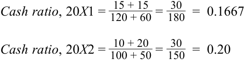
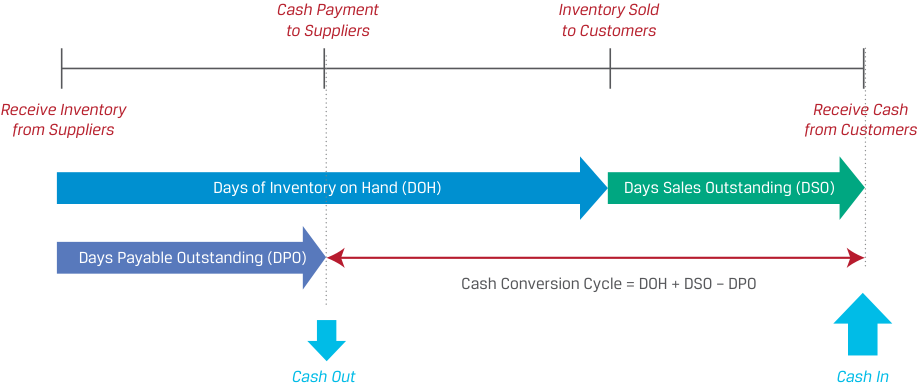

# Volume 3: Corporate Issuers
## Learning Module 4 Working Capital and Liquidity
### Part 1/3: Introduction (PDF Pages 105–119)

---

<!-- PDF Page 105 -->

# L E A R N I N G M O D U L E **<mark>4</mark>** 

### **Working Capital and Liquidity** 

##### **<mark>LEARNING OUTCOMES</mark>** 

|**_Mastery_**|**_The candidate should be able to:_**|
|---|---|
||explain the cash conversion cycle and compare issuers’ cash conversion cycles|
||explain liquidity and compare issuers’ liquidity levels|
||describe issuers’ objectives and compare methods for managing working capital and liquidity|

#### **INTRODUCTION** 

## **<mark>1</mark>** 

Earlier lessons introduced the balance sheet of corporate issuers, composed of assets financed by liabilities (including debt) and equity. This learning module covers the analysis of _short-term_ assets and liabilities, those that result in cash inflows or outflows within a year. The behavior of these assets and liabilities is primarily determined by an issuer’s payment and delivery terms with its customers and suppliers. Subsequent modules cover issuers’ _long-term_ assets, liabilities, and equity financing. Short-term assets and liabilities are a key determinant of an issuer’s ability to generate cash flows for investors, and mismatches between the timing and liquidity of assets and liabilities can have catastrophic effects on a firm. For these reasons and others, analysts closely scrutinize issuers’ cash conversion and liquidity. 

###### **LEARNING MODULE OVERVIEW** 

- Issuers invest cash to generate revenues and profits. The cash conversion cycle is the length of time from paying suppliers to collecting cash from customers. 

- The cash conversion cycle is measured as the sum of days of inventory on hand and days sales outstanding, less days payable outstanding. A short cash conversion cycle means that an issuer converts an investment in inventory into cash quickly, while a long cash conversion cycle means that an issuer converts its inventory investments into cash slowly. 

<!-- PDF Page 106 -->

- Collecting cash from customers sooner, delaying payments to suppliers, and reducing inventory levels relative to sales improve an issuer’s cash conversion cycle. 

- Working capital is defined as an issuer’s short-term assets minus its short-term liabilities. Net working capital adjusts for non-operating accounts such as cash, marketable securities, and short-term debt. The ratio of net working capital to sales is closely related to an issuer’s cash conversion cycle a long cash conversion cycle is associated with higher net working capital to sales, while a short cash conversion cycle is associated with lower net working capital to sales. 

- An issuer’s liquidity is primarily determined by the relative amounts and liquidity of its short-term assets and liabilities, which are determined by the issuer’s business model. The long-run primary source of liquidity for most issuers is cash flow from operations. Secondary sources of liquidity are typically used in crises and impose significant costs, such as issuing equity, renegotiating contracts, selling assets, and filing for bankruptcy protection. 

- Drags and pulls on liquidity affect an issuer’s liquidity situation. Drags on liquidity reduce cash inflows and include such issues as uncollectible receivables and obsolete inventory. Pulls on liquidity are accelerations in cash outflows or interruptions in credit. 

- Issuers may adopt a conservative, moderate, or aggressive approach to working capital management, and these approaches differ in the amount of working capital held on the balance sheet as well as in their reliance on external financing and the composition of short- and longterm financing. 

###### **LEARNING MODULE SELF-ASSESSMENT** 

These initial questions are intended to help you gauge your current level of understanding of this learning module. 

1. Which of the following actions or events will most likely decrease an issuer’s cash conversion cycle? 

   - **A.** Buying short-term marketable securities using cash on hand 

   - **B.** Offering customers a discount for payment received within 10 days 

   - **C.** Slowing of sales of certain goods due to changing preferences in styles 

   - **Solution:** 

B is correct. A prompt-payment discount would likely reduce days sales outstanding and, in turn, decrease the issuer’s cash conversion cycle. 

A is incorrect, because increasing marketable securities by reducing cash does not affect the issuer’s cash conversion cycle. 

C is incorrect, because the slowing of sales of certain goods would likely increase days of inventory on hand and, in turn, increase the issuer’s cash conversion cycle. 

2. Which of the following actions will most likely increase an issuer’s liquidity? 

   - **A.** Forgoing a supplier’s discount for prompt payments 

   - **B.** Relaxing terms for customers by lengthening the payment period 

<!-- PDF Page 107 -->

- **C.** Purchasing short-term marketable securities with cash on hand 

- **Solution:** 

A is correct. Forgoing the discount is using the supplier’s financing and will result in the issuer stretching out payments on accounts payable, putting less drain on liquidity in the short run. This action increases the issuer’s cash conversion cycle. 

B is incorrect, because by relaxing credit terms, customers will take longer to pay, so this action increases the cash conversion cycle. 

C is incorrect, because marketable securities are generally _less_ liquid than cash, so this action would reduce liquidity. Even if the marketable securities are as liquid as cash (e.g., short-term Treasuries), this action would not materially affect liquidity. 

3. The Plough Corporation reports the following items on its two most recent balance sheets (in millions) 

||**Fiscal Y** **31 December 20X2**|**ear-End** **31 December 20X1**|
|---|---|---|
|Cash|10|15|
|Short-term marketable securities|20|15|
|Accounts receivable|100|80|
|Inventory|200|150|
|Prepaid expenses|5|5|
|Accounts payable|100|120|
|Accrued expenses|50|60|

Based on the cash ratio, the company has: 

- **A.** become less liquid. 

- **B.** become more liquid. 

**C.** not changed regarding liquidity. 

###### **Solution:** 

B is correct. The cash ratios for the two fiscal year-ends are: 

<!-- Formula Text: Cash ratio, 20X1 =  15 + 15 _ 120 + 60  =  30 _ 180   =  0.1667 Cash ratio, 20X2 =  10 + 20 _ 100 + 50  =  30 _ 150   =  0.20 -->

The cash ratio has increased from 0.1667 to 0.20, indicating an increase in liquidity. 

4. Which of the following events or activities is most likely to be a drag on liquidity? 

   - **A.** Inventory that becomes obsolete 

**B.** Making <u>payments to suppliers earlier</u> 

<!-- PDF Page 108 -->

- **C.** Offering a discount to customers who pay within 10 days 

- **Solution:** 

A is correct. As inventory becomes obsolete, it becomes more challenging to sell and inventory levels increase. This event is a drag on liquidity, because it slows cash flows. 

B is incorrect, because making payments to suppliers earlier is a pull on liquidity. 

C is incorrect, because offering a prompt-payment discount is likely to result in cash receipts sooner, which would improve liquidity. 

5. Which of the following actions provides a secondary source of liquidity? 

   - **A.** Issuance of equity securities 

   - **B.** Collecting accounts receivable 

   - **C.** Taking advantage of a supplier’s financing and paying on the net day, day 40 

###### **Solution:** 

A is correct. Primary sources of liquidity include cash on hand, borrowings, and cash flow from operations. Secondary sources of liquidity generate cash at a greater cost when primary sources are insufficient, such as issuing equity. 

B is incorrect, because collection of accounts receivable is a primary source of liquidity. 

C is incorrect, because supplier financing is a primary source of liquidity. 

6. Classify each of the following actions as either a conservative or an aggressive approach to working capital management: 

|**Conservative**|**Aggressive**|
|---|---|

|Minimize inventory levels|
|---|
|Greater reliance on long-term debt and equity i|
|financing|
|Lower level of short-term assets|
|Greater reliance on short-term debt|

###### **Solution:** 

||**Conservative**|**Aggressive**|
|---|---|---|
|Minimize inventory levels||✓|
|Greater reliance on long-term debt and equity financing|✓||
|i Lower level of short-term assets||✓|
|Greater reliance on short-term debt||✓|

<!-- PDF Page 109 -->

#### **CASH CONVERSION CYCLE** 

## **<mark>2</mark>** 

explain the cash conversion cycle and compare issuers’ cash conversion cycles 

A company’s business operations are usually composed of several sequential steps. For a company that makes and sells physical goods, its operations include acquiring materials, producing inventory, selling products to customers, and collecting cash. These activities are known as the issuer’s **operating cycle** and occur once or many times over a year, as illustrated in Exhibit 1. 

**Exhibit 1: Operating Cycle** 

<!-- Start of picture text -->
Collection Customer Cash Credit Purchases Sales Finished Raw Goods Materials Production <!-- End of picture text -->

These activities result in cash outflows and inflows that usually do _not_ occur at the same time as the activity. For example, materials are purchased and received by a firm but may not be paid for in cash until weeks or months later. Goods are sold to customers, but cash may not be received until weeks or months later. Finally, inventory may take time to produce or be ready for sale, such as in the spirits industry, where an aged product like whiskey can take years before it is ready to be sold to customers. 

Future cash inflows within the operating cycle are recorded as short-term assets on issuers’ balance sheets, while future cash outflows within the operating cycle are recorded as short-term liabilities. Issuers’ financial statements often use the terms and associated definitions in Exhibit 2 for different types of future cash inflows and outflows. 

<!-- PDF Page 110 -->

**Exhibit 2: Selected Short-Term Assets and Liabilities** 

|**Short-Term Asset**|**Meaning**|
|---|---|
|Accounts receivable|Amounts to be collected from customers for products or services sold|
|Inventory|Cost of products produced or purchased for sale|
|**Short-Term Liability**|**Meaning**|
|Accounts payable|Amounts owed to suppliers for products or services received|

These short-term assets and liabilities are recognized based on the performance or occurrence of an activity and are derecognized when the cash inflow or outflow occurs, as illustrated in Exhibit 3. 

**Exhibit 3: Selected Short-Term Assets and Liabilities Recognition Criteria** 

|**Short-Term Asset**|**Recognized When . . .**|**Derecognized When . . .**|
|---|---|---|
|Accounts receivable|Product or service is sold to cus- tomer on credit|Cash is received from customer|
|Inventory|Issuer takes ownership of materi- als,goods, supplies, etc.|Product is sold to customer|
|**Short-Term Liability**|**Recognized When . . .**|**Derecognized When . . .**|
|Accounts payable|Product or service is received, and issuer deferspayment to supplier|Cash is paid to supplier|

We can use the average duration of each of these short-term accounts to construct a timeline for a company’s operating cycle. The amounts of time that accounts payable, inventory, and accounts receivable are outstanding on the balance sheet are known, respectively, as **days payable outstanding (DPO)** , **days of inventory on hand (DOH)** , and **days sales outstanding (DSO)** . The calculations of these amounts, known as **activity ratios** , will be discussed in detail later in the curriculum. An important quantity from this timeline for analysts is the **cash conversion cycle** : the amount of time between an issuer’s paying its suppliers and receiving cash from customers (i.e., the time between derecognition of accounts payable and derecognition of accounts receivable). Formally, the cash conversion cycle, in days, is expressed in Equation 1 as: 

- Cash conversion cycle 

- = Days of inventory on hand + Days sales outstanding − Days payable outstanding 

~~(1)~~ 

Exhibit 4 depicts the cash conversion cycle on a timeline within the broader operating cycle. 

<!-- PDF Page 111 -->

**Exhibit 4: The Cash Conversion Cycle** 

<!-- Start of picture text -->
Cash Payment Inventory Sold to Suppliers to Customers Receive Inventory Receive Cash from Suppliers from Customers Days of Inventory on Hand (DOH) Days Sales Outstanding (DSO) Days Payable Outstanding (DPO) Cash Conversion Cycle = DOH + DSO – DPO Cash Out Cash In <!-- End of picture text -->

The cash conversion cycle is the number of days it takes a company to convert an inventory investment into cash receipts from customers. Therefore, the longer the cash conversion cycle, the longer a company needs financing to pay its bills, such as payroll, because it has not yet received cash from customers. In 2020, the average US-listed company had a cash conversion cycle of 78 days, though there was considerable variance by industry, as shown in Exhibit 5. Pharmaceutical manufacturers tend to have relatively long cash conversion cycles because they keep a considerable inventory of pharmaceuticals on hand. Airlines—a service business with minimal inventories of goods and mostly prepaid sales to customers in cash or credit cards—tend to have short cash conversion cycles. 

**Exhibit 5: 2020 S&P 1500 Industry Average Cash Conversion Cycles** 

<!-- Start of picture text -->
2020 Industry Average Cash Conversion Cycle 180 S&P 1500 Companies 123 121 78 66 61 40 22 12 Pharmaceuticals Apparel Semiconductors All Auto and Oil and Software Media Airlines Retail Companies Auto Parts Gas <!-- End of picture text -->

Source: JPMorgan Working Capital Index 2021. Authors’ analysis. 

The ideal scenario is a short or even negative cash conversion cycle, which means that cash invested in inventory is quickly returned for subsequent investment. A negative cash conversion cycle can result from receiving cash from customers before—in some cases, _well_ before—suppliers are paid. This scenario results in cash that can be used elsewhere, reducing the need for alternative financing to fund operations. 

<!-- PDF Page 112 -->

###### **INDITEX’S NEGATIVE CASH CONVERSION CYCLE** 

Industria de Diseño Textil, S.A., known as Inditex, is an apparel designer, manufacturer, and retailer listed on the stock exchanges of Madrid, Barcelona, Bilbao, and Valencia. Its largest brand concept is ZARA, which specializes in fast fashion. 

Inditex has a unique business model in apparel, in which it leverages its vertically integrated supply chain to design, make, and sell numerous limited runs of inventories, enabling it to keep up with and influence customers’ changing fashion tastes. Inditex sells off-the-rack items directly to customers (who pay with cash or credit cards), eschews stocking inventory to mitigate fashion risk, and sources raw materials from a vast number of suppliers over whom it has considerable leverage on payment terms. As a result, Inditex has a negative cash conversion cycle, as shown in the table below. 

|**(in millions of EUR)**|**2021**|**2020**|
|---|---|---|
|Accounts receivable|842|715|
|Inventories|3,042|2,321|
|Accounts payable|6,199|4,659|
|Sales|27,716|20,402|
|Cost of goods sold|11,902|9,013|
|Days sales outstanding|11|13|
|Days of inventory on hand|93|94|
|Days payable outstanding|190|189|
|Cash conversion cycle|−86|−82|

Issuers can shorten their cash conversion cycle in several ways, including the following: 

- Reduce days of inventory on hand by discontinuing products or product lines with low or niche demand, by negotiating with suppliers to do more frequent deliveries in order to establish “just in time” inventory levels, and by using data analytics to improve customer demand forecasts and to rationalize stocking levels. 

- Reduce days sales outstanding by offering prompt-payment discounts to customers, imposing late fees, tightening credit standards, imposing upfront deposits or accelerating installment payments, and working with third-party collection agencies. 

- Increase days payable outstanding by negotiating supplier contracts for longer terms. This approach may be feasible by establishing preferred suppliers—purchasing more in volume in exchange for better terms. However, it may result in suppliers charging higher prices or asking for deposits. The ability to lengthen days payable outstanding is highly dependent on the power dynamics between the company and its suppliers. If a company can purchase a critical component from only one supplier who sells to many others, it may not have the ability to negotiate better terms. 

While extending days payable outstanding can improve the cash conversion cycle, suppliers typically offer discounts for prompt payment, such as requiring payment in 30 days but offering a 2% discount if payment is received within 10 days. If a company forgoes this discount in favor of paying in 30 days, it is implicitly borrowing from the 

<!-- PDF Page 113 -->

supplier for 30 − 10 = 20 days at the cost of the forgone discount. One strategy is to borrow from a third party (e.g., a bank) at a relatively low interest rate, pay the supplier early to receive the prompt-payment discount, and later repay the bank. Such a strategy avoids the high cost of supplier financing but preserves cash, as shown in the following example. 

###### **EXAMPLE 1** 

##### **Keown Corporation—Internal versus External Financing** 

Keown Corporation is an established manufacturer of custom paddleboards operating in the North American market. Keown operates its own manufacturing plant in Canada and sells its paddleboards exclusively through its website to avoid the cost of retail locations. 

Most of Keown’s sales take place during the North American summer season from May to August. Keown’s customers expect orders to be filled immediately, so it must maintain substantial inventory to start the summer season or risk losing sales to competitors. Given the seasonality of the business, Keown is particularly focused on meeting customers’ needs. 

Since Keown lacks the necessary cash to pay its suppliers within 10 days, the CFO must decide whether to borrow from its bank at an effective annual rate (EAR) of 7.7% to take the prompt-payment discount offered by its supplier of materials or pay in 30 days. The terms from the supplier are 2/10, net 30. 

1. Should Keown use the bank loan and pay the supplier within 10 days to receive the 2% discount, or simply forgo the discount and pay the supplier in 30 days? 

###### **Solution:** 

To compare the relative cost of the bank loan with that of the trade credit, we can calculate the effective annual rate on the trade credit. Essentially, we are calculating the interest rate on a loan for which the interest cost is the forgone discount and the term is the additional time Keown gets to pay; in this case, 30 − 10 = 20 days. 

<!-- Formula Text: EAR of Supplier Financing =  ((1 + Discount % _______________ 100 %  − Discount % ) Days in Year ________________________ Payment Period−Discount Period ) − 1 Effective Annual Rate of Supplier Financing  =  ((1 + 2% _ 100 %  − 2% ) 365 _ 30−10 ) − 1 Effective Annual Rate of Supplier Financing  =  0.446 or 44.6% -->

Since the effective annual rate of 44.6% on the supplier financing is significantly higher than the 7.7% interest rate on the bank loan, Keown should borrow from its bank. That way, it will still be able to preserve cash but will pay a far lower interest rate on the financing. 

A long cash conversion cycle may reflect industry or business model characteristics, but a longer cycle relative to competitors and a lengthening over time are of particular concern for analysts. A longer cycle may signal worsening customer demand, deteriorating customer financial health or credit quality, or the loss of bargaining power with suppliers. 

<!-- PDF Page 114 -->

###### **EXAMPLE 2** 

##### **Cash Conversion for US Discount Retailers** 

Consider the following activity ratios for large US discount retailers Walmart Inc., Target Corporation, Costco Wholesale Corporation, The TJX Companies, and Ross Stores for the 2021 calendar year, as shown below. 

||**Walmart**|**Target**|**Costco**|**TJX**|**Ross**|
|---|---|---|---|---|---|
|Days sales outstanding|5|2|3|7|2|
|Days of inventory on hand|48|68|29|63|61|
|Days payable outstanding|47|75|34|47|63|

1. Which company has the shortest cash conversion cycle? The longest? **Solution:** 

   - Cash conversion cycle = DSO + DOH − DPO Cash conversion cycle for Walmart = 5 days + 48 days − 47 days = 6 days Cash conversion cycle for Target = 2 days + 68 days −75 days = −5 days Cash conversion cycle for Costco = 3 days + 29 days − 34 days = −2 days Cash conversion cycle for TJX = 7 days + 63 days − 47 days = 23 days Cash conversion cycle for Ross = 2 days + 61 days − 63 days = 0 days 

   - Target has the shortest cash conversion cycle of the five companies. 

2. These companies accept payment from customers at the point of sale in either cash or a debit or credit card. Does this fact align with the activity ratios presented? 

###### **Solution:** 

Yes, because days sales outstanding is small. Debit and credit card payments typically settle in a couple of days, and cash sales are settled immediately. 

3. In examining annual reports, you find that approximately 54% of Costco’s sales are food or food-related items, a larger percentage than that of the other companies, which sell a greater percentage of apparel and non-food items. Does this fact align with the activity ratios presented? 

###### **Solution:** 

Yes. Companies like Costco that sell perishable goods tend to have a lower number of days of inventory on hand, because inventory must be sold soon after receiving it from suppliers or else it spoils. 

In addition to the cash conversion cycle, another measure analysts use to assess the efficiency of business operations is the amount of **working capital** used by the firm, particularly its quantity relative to sales so that it can be compared across time and firms. There are several definitions of working capital in practice. We distinguish between **total working capital** , formally defined in Equation 2 as a broad measure, and **net working capital** , defined in Equation 3 as a measure that excludes items that are less related to the cash conversion cycle or business operations, such as cash, marketable securities, and short-term debt. 

<!-- PDF Page 115 -->

Current assets <u>Minus: Current liabilities</u> Total Working Capital 

~~(2)~~ 

Current assets, excluding cash and marketable securities <u>Minus: Current liabilities, excluding short-term and current debt</u> Net Working Capital 

~~(3)~~ 

To control for size and for comparability across firms, total or net working capital is often expressed as a percentage of annual sales. 

Consider the information on Licht Vernieuwend N.V. for the fiscal year ending 31 December 20X2, as shown in Exhibit 6. The total working capital is the difference between the current assets of EUR335 million and the current liabilities of EUR220 million, or EUR115 million. The net working capital excludes cash, marketable securities, and short-term bank loans from the calculation, giving a net working capital of EUR225 million − EUR160 million = EUR65 million. 

**Exhibit 6: Total and Net Working Capital Extracted from the Licht Vernieuwend N.V. Balance Sheet for the Year Ending 31 December 20X2** 

||**(in millio**|**ns of EUR)**|
|---|---|---|
|Cash|40||
|Marketable securities|70||
|Accounts receivable|85|85|
|Inventory|130|130|
|Prepaid accounts|10|10|
|Total|335|225|
|Accounts payable|130|130|
|Accrued expenses|30|30|
|Short-term bank loan|60||
|Total|220|160|
|Total working capital|115||
|Net workingcapital||65|

The cash conversion cycle and the ratio of working capital to sales are interrelated. Since receivables and inventories are often large components of short-term assets and payables are a large component of short-term liabilities, a short cash conversion cycle is associated with a low ratio of working capital to sales and vice versa. 

###### **INDITEX’S NEGATIVE CASH CONVERSION CYCLE AND WORKING CAPITAL** 

Continuing the earlier example, owing to Inditex’s business model—which includes prompt payment from customers for off-the-rack apparel, limited runs of inventories with fast turnover, and a vast number of suppliers over which it has leverage—Inditex has not only a negative cash conversion cycle but also negative net working capital and negative ratios of net working capital to sales, as shown in the table below. 

<!-- PDF Page 116 -->

|**(in millions of EUR)**|**2021**|**2020**|
|---|---|---|
|Accounts receivable|842|715|
|Inventories|3,042|2,321|
|Accounts payable|6,199|4,659|
|Net working capital|−2,315|−1,623|
|As a % of sales|−8.4%|−8.0%|
|Sales|27,716|20,402|
|Cost of goods sold|11,902|9,013|
|Days sales outstanding|11|13|
|Days of inventory on hand|93|94|
|Days payable outstanding|190|189|
|Cash conversion cycle|−86|−82|

A high ratio of working capital to sales may be a result of industry characteristics, such as in the spirits industry, where inventory must age for several years before being sold to customers, or in the pharmaceutical industry, where companies hold a large amount of inventory, sometimes to comply with regulations. Besides cases of necessity, as illustrated in Example 1, or cases of compliance with regulations, issuers are generally better off holding less working capital and either using capital elsewhere on higher-return projects or returning capital to investors. 

###### **QUESTION SET** 

|1. Classify each of the following actions by an issuer likely effect on its cash conversion cycle:|based on the|
|---|---|
||**Effect on the Cash Con-** **version Cycle**  |
|**Action**|**Shorten** **Lengthen**|
|Offering larger discounts to its customers for pay- ments received before the due date Paying suppliers sooner||
|Lowering reliance on just-in-time inventory methods while increasing safety stocks of inventory Negotiating longer payment periods with its suppliers Tightening credit standards for its customers||
|**Solution:**||

<!-- PDF Page 117 -->

|**Action**|**Effect on t** **versio** **Shorten**|**f  he Cash Con-** **n Cycle** **Lengthen**|
|---|---|---|
|Offering larger discounts to its customers for pay- ments received before the due date|✓||
|Paying suppliers sooner||✓|
|Lowering reliance on just-in-time inventory methods while increasing safety stocks of inventory||✓|
|Negotiating longer payment periods with its suppliers|✓||
|Tightening credit standards for its customers|✓||

2. Identify the issuer with the longest cash conversion cycle and explain the effects of that length on that issuer relative to the other issuers. 

||**Issuer A**|**Issuer B**|**Issuer C**|
|---|---|---|---|
|Days of inventory on hand|20|35|15|
|Days payable outstanding|15|10|5|
|Days sales outstanding|30|25|30|

###### **Solution:** 

Using: 

|_Cash_ _conversion_ _cycle_ =_Days_ _of_ _inventory_ _on_ _hand_ |+_Days_ _sales_ _outstanding_|−_Days_ _pa_ _outstand_|_yable_ _ing_|
|---|---|---|---|
||**Issuer A**|**Issuer B**|**Issuer C**|
|Days of inventory on hand|20|35|15|
|Plus: Days sales outstanding|30|25|30|
|Minus: Dayspayable outstanding|15|10|5|
|Cash conversion cycle|35|50|40|

Issuer B has the longest cash conversion cycle, 50 days. By having the longest cycle, Issuer B is more reliant on alternative financing to support its operations relative to the other issuers. 

3. Assuming no change in days sales outstanding and days of inventory on hand, an issuer in need of cash flow that forgoes the discount offered by its vendor for payments within 10 days and chooses to pay on the due date in 30 days is: 

   - **A.** shortening its cash conversion cycle. 

   - **B.** lengthening its cash conversion cycle. 

   - **C.** not affecting its cash conversion cycle. 

###### **Solution:** 

A is correct. The issuer that uses the vendor financing by delaying payments is increasing its days payable outstanding and thus shortening its cash conversion cycle. The issuer is reducing its need for liquidity by taking advantage of the vendor financing at the cost of the forgone discount. 

<!-- PDF Page 118 -->

4. An issuer with limited cash flow is deciding which of its suppliers’ credit terms are least costly. Which of the following credit terms offered to the issuer by its suppliers have the _lowest_ effective interest rate? 

   - **A.** 1/10, net 50 

   - **B.** 2/15, net 40 

   - **C.** 3/15, net 60 

   - **Solution:** 

A is correct. The implicit financing cost that the issuer faces when forgoing a discount that the supplier or vendor offers is based on the amount of the forgone discount and length of the payment period beyond the discount period; 1/10, net 50 would permit the issuer to borrow for 50 − 10 = 40 days at a cost of only 1% of the purchase price (the forgone discount). The calculations for the cost of financing for each set of credit terms, expressed as an effective annual rate, are as follows: 

<!-- Formula Text: EAR of Supplier Financing =  ((1 + Discount % _______________ 100 %  − Discount % ) Days in Year ________________________ Payment Period−Discount Period ) − 1 EAR of 1/10, net 50  =  ((1 + 1% _ 100 %  − 1% ) 365 _ 50−10 ) − 1 EAR of 1/10, net 50  =  0.096 or 9.6% EAR of 2/15, net 40  =  ((1 + 2% _ 100 %  − 2% ) 365 _ 40−15 ) − 1 EAR of 2/15, net 40  =  0.343 or 34.3% EAR of 3/15, net 60  =  ((1 + 3% _ 100 %  − 3% ) 365 _ 60−15 ) − 1 -->

EAR of 3/15, net 60 = 0.280 or 28.0% 

5. An issuer is comparing a bank loan at a rate of 15% with taking advantage of a supplier’s terms of 1/14, net 30, paying on day 14. The best decision in terms of the lower cost of financing is to: 

   - **A.** forgo the discount and use the supplier’s financing to pay on day 30. 

   - **B.** borrow from the bank to take advantage of the trade credit terms. 

   - **C.** use either option because the cost of the bank loan and the cost of the trade credit are identical. 

###### **Solution:** 

B is correct. 

The cost of the supplier’s trade credit, expressed as an effective annual rate, is 25.769%, which is higher than the 15% interest rate on the bank loan. 

###### EAR of Supplier Financing 

<!-- Formula Text: =  ((1 + Discount % _______________ 100 %  − Discount  % ) Days in Year _________________________ Payment Period − Discount Period ) − 1 EAR of 1/14, net 30  =  ((1 + 1% _ 100 %  − 1% ) 365 _ 30−14 ) − 1 -->

<!-- PDF Page 119 -->

###### EAR of 1/14, net 30 = 0.25769 or 25.769% 

A and C are incorrect, because the bank loan rate of 15% is lower than the effective annual rate, 25.769%, on the supplier’s trade credit. 

6. Consider the following balance sheet for an issuer: 

|Cash|100|
|---|---|
|Marketable securities|20|
|Accounts receivable|600|
|Inventory|800|
|Prepaid expenses|30|
|Property, plant, and equipment|10,000|
|Intangibles|500|
|Total assets|12,050|
|Accounts payable|980|
|Accrued expenses|70|
|Short-term debt|1,000|
|Long-term debt|2,000|
|Shareholders’ equity|8,000|
|Total liabilities and equity|12,050|

7. The issuer’s net working capital is _closest_ to: 

**A.** −500. **B.** 380. **C.** 500. **Solution:** 

B is correct. Net working capital is defined as: 

Current assets, excluding cash and marketable securities <u>Minus: Current liabilities, excluding short-term and current debt</u> Net Working Capital 

Current assets, excluding cash and marketable securities: 

|Accounts receivable|600|
|---|---|
|Inventory|800|
|Prepaid expenses|30|
|Sum|1,430|

Current liabilities, excluding short-term and current debt: 

|Accounts payable|980|
|---|---|
|Accrued expenses|70|
|Sum|1,050|
|Net working capital|380|

A is incorrect, because cash, marketable securities, and short-term debt are mistakenly included in the calculation, resulting in the calculation of total working capital instead of net working capital. 

