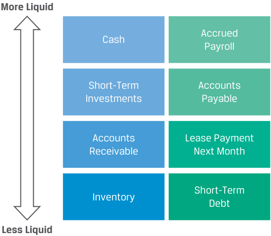
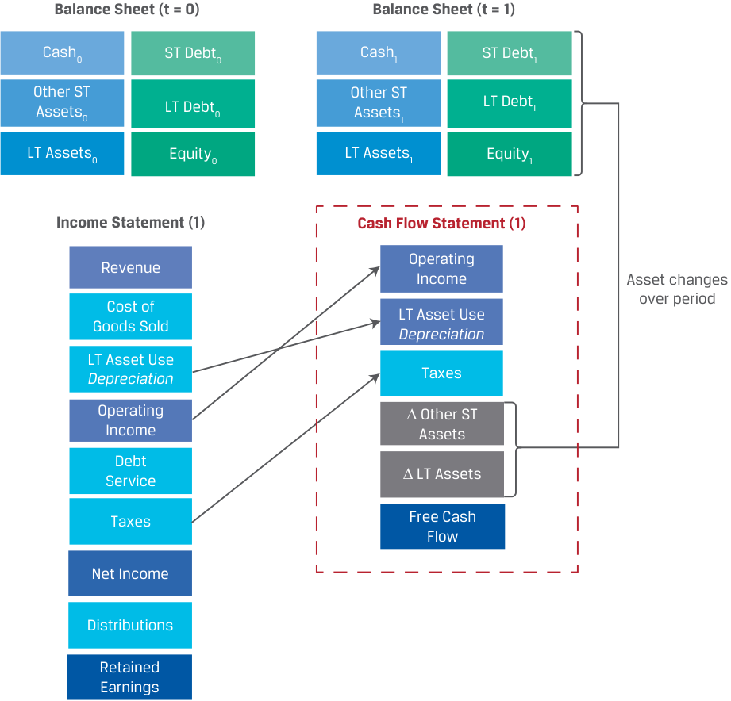
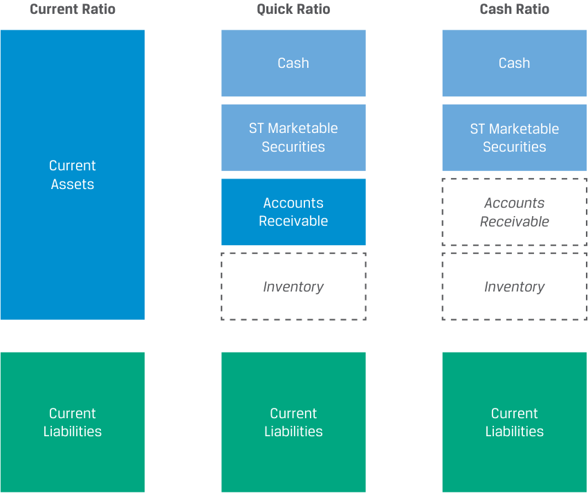
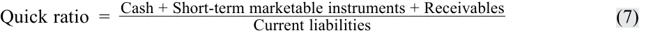
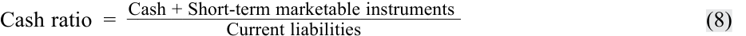
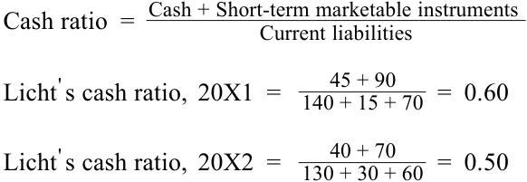

# Volume 3: Corporate Issuers
## Learning Module 4 Working Capital and Liquidity
### Part 2/3: Liquidity (PDF Pages 120–130)

---

<!-- PDF Page 120 -->

C is incorrect, because cash and marketable securities are mistakenly included in the calculation. 

# **<mark>3</mark>** 

## **LIQUIDITY** 

explain liquidity and compare issuers’ liquidity levels 

**Liquidity** for an individual asset or liability is its nearness to cash or settlement. Cash is already cash, so it is the most liquid asset, while inventories can take issuers significant time to sell and ultimately collect cash from customers and are thus less liquid than cash. Similarly, accounts payable due to a supplier in five days are more liquid than a lease payment due next month. Issuers report assets and liabilities on their balance sheet in descending order of liquidity. Assets and liabilities that are not expected to convert into cash or settle within 12 months are presented as long-term assets and liabilities. Exhibit 7 depicts the relative liquidity of short-term assets and liabilities. 

**Exhibit 7: Relative Liquidity of Short-Term Assets and Liabilities** 

<!-- Start of picture text -->
More Liquid Accrued Cash Payroll Short-Term Accounts Investments Payable Accounts Lease Payment Receivable Next Month Short-Term Inventory Debt Less Liquid <!-- End of picture text -->

Liquidity for an _issuer_ refers to its ability to meet its short-term liabilities. It is determined by the amounts and liquidity of its short-term assets and liabilities, which in turn are determined by an issuer’s business model and cash conversion cycle. For example, if an issuer has 20 in total short-term liabilities and 100 in cash, it is highly liquid and will face no problem paying its short-term liabilities. If the reverse is true and the company has 20 in cash and 100 in short-term liabilities, the company will have to seek other sources of liquidity to meet its short-term liabilities. 

<!-- PDF Page 121 -->

### **Primary Liquidity Sources** 

Primary sources of liquidity represent the most readily accessible cash available to the company and include the following: 

- _Cash and marketable securities on hand_ , which is cash available in bank accounts or held as currency or securities that could be sold quickly without significant loss of value. 

- _Borrowings_ , from banks, bondholders, or suppliers’ trade credit. While this source can yield cash to settle near-term obligations, it creates another obligation that will need to be repaid in the future. 

- _Cash flow from the business_ , though it takes time to generate, is a substantial source of liquidity for profitable firms. For example, if a firm has a liability of 40 due in six months but expects to generate 100 in cash from its operations over the next six months, it will not have to use cash on hand or borrowings to settle this liability. However, firms in an earlier stage of growth or earning net losses may not generate sufficient cash flows to meet liabilities. 

While cash and securities on hand and borrowings are an important source of liquidity in the short run, an issuer’s cash flow from its business is the primary long-term source of liquidity. For that reason, financial analysts closely track this information using a financial statement reported by issuers known as the **statement of cash flows** , the basic elements of which are shown in Exhibit 8. 

**Exhibit 8: Statement of Cash Flows for a Firm** 

<!-- Start of picture text -->
Balance Sheet (t = 0) Balance Sheet (t = 1) Cash0 ST Debt0 Cash1 ST Debt1 Other ST Other ST Assets0 LT Debt0 Assets1 LT Debt1 LT Assets0 Equity0 LT Assets1 Equity1 Income Statement (1) Cash Flow Statement (1) Revenue Operating Income Asset changes Cost of over period LT Asset Use Goods Sold Depreciation LT Asset Use Depreciation Taxes Operating ∆ Other ST Income Assets Debt ∆ LT Assets Service Taxes Free Cash Flow Net Income Distributions Retained Earnings <!-- End of picture text -->

<!-- PDF Page 122 -->

There are several measures of cash flows that analysts use or calculate from the statement of cash flows. **Cash flow from operations** is a cash profit measure over a period for an issuer’s primary business activities, calculated as: 

Cash received from customers 

Plus: Interest and dividends received on financial investments Minus: Cash paid to employees and suppliers Minus: Taxes paid to governments <u>Minus: Interest paid to lenders</u> Cash flows from operations 

~~(4)~~ 

However, this measure does not account for capital investments (covered in a subsequent learning module) that issuers make to improve operations or expand. Therefore, analysts calculate an additional measure known as **free cash flow** that accounts for this factor: 

Cash flows from operations <u>Minus: Investments in long-term assets</u> Free cash flow 

~~(5)~~ 

An alternative measure of free cash flow adds back interest paid to lenders in order to compute cash flows that are available for both debt and equity investors. This important topic will be addressed in greater detail later in the curriculum. 

### **Secondary Liquidity Sources** 

While primary liquidity sources are preferable and are unlikely to affect a firm’s ongoing operations, a secondary source may have to be used. Secondary sources of liquidity include the following: 

- Suspending or reducing dividends to shareholders. 

- _Delaying or reducing capital expenditures_ , which will preserve cash in the near term but may result in missed opportunities and impair long-term value. 

- _Issuing equity_ , by issuing shares in the public markets or privately to select investors. While equity issuance provides cash, it comes at the cost of dilution for existing shareholders. 

- _Renegotiating contract terms_ , such as refinancing short-term debt to long-term debt; seeking concessions on interest, rent, and/or lease payments; restructuring debt covenants; and renegotiating payment or delivery terms with customers and suppliers. 

- _Selling assets_ , which depends on the degree to which short-term and/or long-term assets can be liquidated and converted into cash without substantial loss in value. 

- _Filing for bankruptcy_ protection and reorganization to continue operations while restructuring debt contracts and possibly selling assets. 

The use of secondary sources often signals a company’s deteriorating financial health, as it seeks to increase its cash position at a relatively high price or disadvantage to existing debt and equity holders, the company’s employees, and other stakeholders. For example, early in the COVID-19 pandemic, airlines raised funds to shore up their cash positions as revenue severely declined: Lufthansa raised EUR600 million through a convertible bond offering, Singapore Airlines raised SGD$8.8 billion using a rights issue, and Delta Airlines deferred USD500 million in capital expenditures. 

<!-- PDF Page 123 -->

Example 3 shows the net proceeds from the primary and secondary sources of liquidity for an issuer in a liquidity crisis. It also shows the liquidation costs incurred by the company when those sources are used to raise funds. These costs can include the fees and commissions involved with the asset sale as well as any discount in asset value due to liquidity issues. 

#### **EXAMPLE 3** 

### **Estimating Keown Corporation’s Cost of Liquidity** 

1. Keown Corporation is facing a liquidity crisis. As an analyst, you have identified four potential actions that Keown could take to raise funds. Your estimates of fair value for Keown’s assets and liquidation costs are shown below. 

|**Source of Funds**|**Fair Value (mil-** **lions of CAD)**|**Liquidation Costs** **(%)**|
|---|---|---|
|Sell short-term marketable securities|10|0|
|Sell select inventories and receivables|20|10|
|Sell excess real estate property|50|15|
|Sell a subsidiary of the firm|30|20|

The liquidation costs include the fees and commissions for selling an asset as well as any reduction in value due to its illiquidity. In this case, liquidation costs for marketable securities are zero. 

Net of liquidation costs, how much liquidity can Keown raise if all four sources of funds are used, and what are Keown’s total liquidation costs? 

- **A.** 110 million, 9.5 million 

- **B.** 94.5 million, 15.5 million 

- **C.** 125.5 million, 15.5 million 

#### **Solution:** 

The gross and net amounts of liquidity raised are summarized in this table: 

|**Source of Funds**|**Fair Value** **(millions of** **CAD)**|**Liqui** **%**|**dation Costs** **(millions of** **CAD)**|**Net** **Proceeds** **(millions** **of CAD)**|
|---|---|---|---|---|
|Marketable securities|10|0|0|10|
|Inventories and receivables|20|10|2|18|
|Real estate property|50|15|7.5|42.5|
|Subsidiary of the firm|30|20|6|24|
|i **Total**|||15.5|94.5|

B is correct. Total net proceeds from the sales are CAD94.5 million, and the total liquidation costs incurred are CAD15.5 million. 

<!-- PDF Page 124 -->

### **Factors Affecting Liquidity: Drags and Pulls** 

A company’s cash conversion cycle has significant effects on its liquidity position. Two classifications for negative forces on a firm’s liquidity are drags and pulls on liquidity. A **drag on liquidity** occurs when cash inflows lag, creating a shortfall due to a decline in available funds. Alternatively, a **pull on liquidity** involves an acceleration of cash outflows or a situation where trade credit availability is limited, requiring companies to expend funds before they receive proceeds from sales that could offset the liability. 

Major drags on receipts involve pressures from credit management and deterioration in other assets and include the following: 

- _Uncollected receivables._ The longer customer receipts are outstanding, the greater the chance they will not be collected. As we will see in the following lesson, this drag is often measured by the average number of days that receivables are outstanding as well as the level of customer payment delinquencies as a percentage of receivables. 

- _Obsolete inventory._ If inventory of finished goods is held for long periods, it might be an indication that it is no longer in demand by customers or can be sold only at a discounted price. 

- _Borrowing constraints._ If credit conditions tighten due to adverse economic conditions, short-term debt becomes more expensive or unavailable. 

In many cases, drags can be reduced by stricter enforcement of credit and collection practices, but this approach may also drive sales lower if customers are unwilling or unable to make a purchase if cash payment is required. 

Managing cash outflows is of equal importance. If suppliers and other vendors who offer credit terms have greater market power over a firm or believe its financial position is weak, they might demand payment terms that strain the company’s liquidity. Major pulls on liquidity include the following: 

- _Making payments early._ By paying vendors, employees, or others before the due dates with no financial benefit, companies forgo the use of funds. Effective payment management means _not_ making early payments. 

- _Reduced credit limits._ If a company has a history of late payments, suppliers may cut the firm’s credit outstanding at any time. 

- _Limits on short-term lines of credit_ . If a company’s bank limits lending to it, the company may face liquidity constraints. Credit line restrictions can be government mandated, market related, or simply company specific. 

- _Low liquidity positions_ . Many companies face chronic liquidity shortages, often due to industry conditions or a weak financial position. This pull may be exacerbated by an aggressive approach to working capital management. 

The following example addresses changes affecting Keown Corporation’s liquidity position. 

#### **EXAMPLE 4** 

### **Drags and Pulls on Keown Corporation’s Liquidity** 

1. Keown Corporation is experiencing liquidity challenges. As an analyst, you note three recent trends related to Keown’s working capital: 

   **1.** An increase in average days sales outstanding is a drag on liquidity. 

   **2.** An increase in days of inventory on hand is a drag on liquidity. 

<!-- PDF Page 125 -->

**3.** An increase in credit limits by lenders is a pull on liquidity. 

Which trend does _not_ contribute to the firm’s liquidity challenges? 

- **A.** The change in average days sales outstanding 

- **B.** The change in days of inventory on hand 

**C.** The change in credit limits 

#### **Solution:** 

C is correct. The increase in credit limits is not a pull on liquidity but is in fact the opposite: it provides liquidity. 

A is incorrect, because an increase in days sales outstanding is a drag on liquidity as it results in slower or delayed cash inflows. B is incorrect, because higher days of inventory on hand is a drag on liquidity as it extends the cash conversion cycle. 

### **Measuring and Evaluating Liquidity** 

The less liquid the company, the greater the risk it will experience financial distress if business conditions change unfavorably. Financial analysts are keenly interested in common measures to quantify and track changes in firm liquidity over time as well as to compare issuers’ liquidity levels. To compare firms of different sizes with varying sources and uses of liquidity, financial _ratios_ are frequently used. Liquidity assessment using financial ratios usually involves both **liquidity ratios** and the activity ratios introduced earlier in Example 2. Exhibit 9 summarizes the three most used liquidity ratios. 

**Exhibit 9: Key Liquidity Ratios** 

<!-- Start of picture text -->
Current Ratio Quick Ratio Cash Ratio Cash Cash ST Marketable ST Marketable Securities Securities Current Assets Accounts Accounts Receivable Receivable Inventory Inventory Current Current Current Liabilities Liabilities Liabilities <!-- End of picture text -->

<!-- PDF Page 126 -->

Liquidity ratios gauge a firm’s ability to meet its short-term obligations from existing current assets. The broadest measure of liquidity is the **current ratio** , or ratio of current assets to current liabilities: 

<!-- Formula Text: Current ratio  =    Current assets _____________ Current liabilities (6) -->

Recall from an earlier lesson that we defined total working capital as the _difference_ between current assets and current liabilities. A firm with positive total working capital would therefore have a current ratio greater than one, with a higher current ratio representing greater liquidity under this aggregate measure, which includes all short-term assets. 

This broad ratio is usually considered together with two narrower liquidity measures that exclude less liquid short-term assets. Recall that, unlike cash or short-term marketable securities, inventory and receivables are less readily convertible into cash. The **quick ratio** is a ratio of short-term assets to short-term liabilities that excludes inventory: 

<!-- Formula Text: Quick ratio  =   Cash + Short-term marketable instruments + Receivables ________________________________________ Current liabilities (7) -->

A firm able to meet its short-term obligations _without_ liquidating inventory would therefore have a quick ratio greater than one. However, this scenario would require the firm to collect all receivables without delays or customer delinquencies. The **cash ratio** compares cash and short-term marketable securities with current liabilities and is the most conservative of these measures: 

<!-- Formula Text: Cash ratio  =   Cash + Short-term marketable instruments ______________________________ Current liabilities (8) -->

A cash ratio equal to or greater than one indicates that a firm could satisfy all its short-term obligations without having to wait to sell inventory or collect receivables. 

#### **KNOWLEDGE CHECK** 

Consider the following balance sheet information for Licht Vernieuwend N.V. for the fiscal year 20X2 and the previous year, 20X1: 

|**_(in millions of EUR)_**|**20X2**|**20X1**|
|---|---|---|
|Cash|40|45|
|Marketable securities|70|90|
|Accounts receivable|85|90|
|Inventory|130|66|
|Prepaid accounts|10|15|
|Net plant, property, and equipment|1,000|950|
|Intangibles|90|75|
|Total assets|1,425|1,331|
|Accounts payable|130|140|
|Accrued expenses|30|15|
|Short-term bank loan|60|70|
|Long-term debt|400|400|
|Equity|805|706|
|Total liabilities and equity|1,425|1,331|

<!-- PDF Page 127 -->

1. Has net working capital changed from 20X1 to 20X2? If so, what was the primary driver of the change? 

#### **Solution:** 

Net working capital is defined as: 

Current assets, excluding cash and marketable securities <u>Minus: Current liabilities, excluding short-term and current debt</u> Net Working Capital 

Licht Vernieuwend N.V.’s net working capital each year is equal to: 

|**_(in millions of EUR)_**|**20X2**|**20X1**|
|---|---|---|
|Accounts receivable|85|90|
|Plus: Inventory|130|66|
|Plus: Prepaid accounts|10|15|
|Minus: Accounts payable|(130)|(140)|
|Minus: Accrued expenses|(30)|(15)|
|Net workingcapital|65|16|

Licht Vernieuwend N.V.’s net working capital has increased from EUR16 million in 20X1 to EUR65 million in 20X2, largely owing to the increased investment in inventory from EUR66 million to EUR130 million. 

2. Has the liquidity changed from 20X1 to 20X2 based on the: 

   - **i.** cash ratio? 

   - **ii.** quick ratio? 

   - **iii.** current ratio? 

#### **Solution:** 

- **i.** The cash ratio is defined as: 

<!-- Formula Text: Cash ratio  =   Cash + Short-term marketable instruments ______________________________ Current liabilities Licht ' s cash ratio,  20X1  = 45 + 90 _ 140 + 15 + 70   =  0.60 Licht ' s cash ratio,  20X2  = 40 + 70 _ 130 + 30 + 60   =  0.50 -->

Based on the cash ratio, Licht Vernieuwend N.V.’s liquidity has declined from 20X1 to 20X2. 

**ii.** The quick ratio is defined as: 

________________________________________ Quick ratio =Cash + Short-term marketable instruments + Receivables Current liabilities _ Licht' s quick ratio,  20X1 =   140 + 15 + 7045 + 90 + 90= 1.00 _ Licht' s quick ratio,  20X2 =   130 + 30 + 6040 + 70 + 85= 0.89 

Based on the quick ratio, Licht Vernieuwend N.V.’s liquidity has declined from 20X1 to 20X2. 

<!-- PDF Page 128 -->

<!-- Formula Text: iii. The current ratio is defined as: Current ratio  =    Current assets _____________ Current liabilities Licht ' s current ratio,  20X1  =    45 + 90 + 90 + 66 + 15 _________________ 140 + 15 + 70 =  1.36 Licht ' s current ratio,  20X2  =    40 + 70 + 85 + 130 + 10 _________________ 130 + 30 + 60 =  1.52 -->

Based on the current ratio, Licht Vernieuwend N.V.’s liquidity has increased from 20X1 to 20X2. 

3. Given the changes in liquidity ratios in Question 2, did the issuer become more or less liquid based on the most conservative liquidity ratio? 

#### **Solution:** 

The most conservative liquidity ratio is the cash ratio, as it measures the ability of an issuer to settle near-term obligations using only the most liquid assets: cash and short-term marketable instruments. Based on the cash ratio, Licht Vernieuwend N.V.’s liquidity has declined from 20X1 to 20X2. 

#### **QUESTION SET** 

1. Classify each of the following as either a drag on liquidity or a pull on liquidity: 

||**Effect on**|**f  Liquidity**|
|---|---|---|
|**Action**|**Drag**|**Pull**|
|Customers delaying payments|||
|Inventory becoming obsolete|||
|Paying suppliers before due dates without a discount incentive|||
|Lender reducing a line of credit|||
|Vendors reducing trade credits|||

#### **Solution:** 

||**Effect on**|**f  Liquidity**|
|---|---|---|
|**Action**|**Drag**|**Pull**|
|Customers delaying payments|✓||
|Inventory becoming obsolete|✓||
|Paying suppliers before due dates without a discount incentive||✓|
|Lender reducing a line of credit||✓|
|Vendors reducing trade credits||✓|

<!-- PDF Page 129 -->

2. Consider the following information from the Statement of Cash Flows for the Lucor Corporation: 

|Net income|1,000|
|---|---|
|Cash flow from operations|1,400|
|Cash flow from investing|(700)|
|Investment in long-term assets|(800)|
|Cash flow from financing|500|
|l  i Funds from debt issue|600|
|Total net cash flow for the period|1,200|

Lucor’s free cash flow for this period is _closest_ to: 

**A.** 200. **B.** 600. **C.** 700. **Solution:** 

B is correct. Free cash flow is the difference between cash flow from operations and the investment in long-term assets, or 

_Free cash flow_ = 1, 400 − 800 = 600 

3. An issuer is facing a liquidity crisis. Based on these estimations, complete the following table: 

||**Fair Value** **(millions of** **USD)**|**Liquidation** **Cost** **(% of fair** **value)**|**Liquidation** **Cost** **(millions of** **USD)**|**Net Pro-** **ceeds** **(millions of** **USD)**|
|---|---|---|---|---|
|Selling a production plant|1,000|20|||
|Selling short-term mar- ketable securities|100|0|||
|Selling receivables|900|10|||
|Selling inventory|600|12|||
|Total|||||

**Solution:** 

<!-- PDF Page 130 -->

||**(1)** **Fair Value** **(millions of** **USD)**|**(2)** **Liquidation** **Cost** **(% of fair** **value)**|**(3)** **Liquidation** **Cost** **(millions of** **USD)**|**(4)** **Net Pro-** **ceeds** **(millions of** **USD)**|
|---|---|---|---|---|
|Selling a production plant|1,000|20|200|800|
|Selling short-term mar-|100|0|0|100|
|ketable securities|||||
|Selling receivables|900|10|90|810|
|Selling inventory|600|12|72|528|
|Total||||2,238|

The liquidation cost in column (3) is the result of multiplying the column (1) and (2) entries. The net proceeds in column (4) are the result of subtracting the liquidation cost from the fair value, column (1). The total net proceeds is the sum of the net proceeds from each source in column (4). 

4. Rank the following ratios from smallest (rank 1) to largest (rank 3) for a company that has inventory, accounts receivable, and payables: 

|**Ratio**|**Rank**|
|---|---|
|Cash ratio||
|Current ratio||
|Quick ratio||

#### **Solution:** 

The denominator is the same for each of these ratios (current liabilities), so the differences among these ratios are attributable to the numerator. In the case of the cash ratio, the numerator is simply cash and short-term marketable securities. In the case of the quick ratio, receivables are added to cash and short-term marketable securities in the numerator. Finally, the current ratio has all current assets in the numerator. 

|**Ratio**|**Rank**|
|---|---|
|Cash ratio|1|
|Current ratio|3|
|Quick ratio|2|

5. An issuer has the following current assets and current liabilities on its balance sheet: 

|Cash|200|
|---|---|
|Marketable securities|40|
|Accounts receivable|600|
|Inventory|800|
|Prepaid expenses|60|
|Accounts payable|500|

