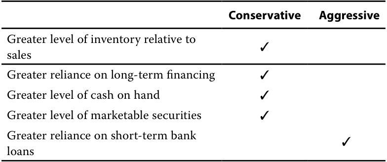

# Volume 3: Corporate Issuers
## Learning Module 4 Working Capital and Liquidity
### Part 3/3: Managing Working Capital and Liquidity (PDF Pages 131–142)

---

<!-- PDF Page 131 -->

|Accrued expenses|50|
|---|---|
|Short-term debt|600|

The issuer’s cash and quick ratios, respectively, are closest to: 

**A.** 0.2087; 0.7304. **B.** 0.4363; 1.5273. **C.** 0.5455; 1.6364. Solution to 5: A is correct. The cash ratio is: _ Cash ratio =200 + 40 1, 150= 0.2087 The quick ratio is: ___________ Quic ratio =200 + 40 + 600 = 0.7304 1, 150 

### **MANAGING WORKING CAPITAL AND LIQUIDITY** 

# **<mark>4</mark>** 

describe issuers’ objectives and compare methods for managing working capital and liquidity 

The primary goal of working capital and liquidity management is to maximize firm value while maintaining ready access to funds necessary for day-to-day operations and obligations to creditors. Often, reaching this goal involves shortening the cash conversion cycle, estimating required liquidity, and minimizing any excess so that cash can be invested elsewhere in higher-return projects or returned to shareholders. 

The realistic bounds of working capital and liquidity management depend on a firm’s business model. For example, some types of manufacturing may involve more complex and lengthy conversion of inputs into finished goods, which may require that inventory be held for weeks or months. A distributor of less complex goods, however, may have just a few days of inventory on hand. Some businesses in the same industry require more investment in inventory and receivables than others. For example, retail businesses with multiple sales locations where finished goods are available for purchase, as well as those that offer customers sales on credit versus immediate payment, will need more working capital (in inventories and/or accounts receivable). In contrast, service and software businesses may have far lower working capital requirements, as they do not have inventories and may receive payments from customers upfront. 

#### **Working Capital Management** 

Firms estimate working capital requirements by first determining optimal working capital requirements in relation to revenue and then forecasting future working capital levels based on their revenue forecast. In doing so, firms often distinguish between, on the one hand, base levels of inventory, staffing, and receivables that are _permanent_ current assets and relatively constant over time and, on the other hand, additional 

<!-- PDF Page 132 -->

inventory and labor needed during a company’s seasonal peak production and sales period or during a growth phase that are considered _variable_ current assets. During this process, managers also weigh the cost versus benefit of different inventory and receivables management policies. For example, higher inventory levels may reduce the likelihood of a shortfall due to supplier risk or unanticipated demand but may also increase the obsolescence risk of existing inventory. Although more accommodative sales credit policies that increase receivables may help drive sales or revenue growth, they may also lead to higher billing costs and increased payment delinquencies over time. 

Companies take different approaches to both the _size_ of current assets and the _composition_ of financing used to support those assets. Exhibit 10 outlines three different approaches to working capital management, from the highest cost (i.e., higher levels of current assets funded on a longer-term basis) to the lowest (fewer assets funded on a shorter-term basis) for a given level of sales. 

**Exhibit 10: Working Capital Management and Funding Approaches** 

<!-- Start of picture text -->
Moderate Conservative “Matched” Aggressive Larger short-term asset Moderate short-term asset Smaller short-term asset position versus sales position versus sales position versus sales Greater reliance on long-term Match funding: Greater reliance on short- debt and equity Fund permanent assets long-term term liabilities Fund variable assets short-term Current AssetsPermanent Long-Term Current AssetsPermanent Debt and EquityLong-Term Current AssetsPermanent Debt and EquityLong-Term Debt and Equity Variable Short-Term Variable Short-Term Current Assets Liabilities Variable Short-Term Current Assets Liabilities Current Assets Liabilities <!-- End of picture text -->

A conservative approach to working capital management involves more cash, receivables, and inventory relative to sales, with a greater reliance on long-term funding sources. While this strategy provides a firm with the most financial flexibility to meet its needs, it is also typically the costliest. The pros and cons of a conservative working capital approach are outlined in Exhibit 11. 

**Exhibit 11: Conservative Working Capital Approach: Pros and Cons** 

|**Pros**|**Cons**|
|---|---|
|Stable, permanent financing avoids rollover risk associated with short-term debt|Long-term debt typically involves a higher interest rate|
|Financing costs are known upfront|High cost of equity|
|Certainty of working capital needed to pur- chase the necessary inventory|Permanent financing eliminates the opportunity to borrow only as needed|
|Extended payment term reduces short-term cash needs for debt service|A longer lead time is often required to establish the financing position|
|Higher flexibility during market disruptions that can be covered by larger cash or market- able securitiespositions|Long-term debt may involve more restrictions on business operations|

<!-- PDF Page 133 -->

Firms in an early-growth phase are more likely to consider a conservative approach due to limited access to short-term debt. More established companies with higher profit margins pursuing such a policy may also be able to pass these higher financing costs on to customers. Firms may choose to pursue a conservative working capital strategy for a number of other reasons: 

- Reduced need to access capital during times of market stress 

- Expectation of flat to rising interest rates 

- Preference for cash flow stability over rollover risk of short-term debt 

- Benefits of greater certainty and access to more permanent capital, which are perceived to offset the higher associated financing cost 

An aggressive working capital approach, in contrast, seeks to minimize excess cash, receivables, and inventory relative to sales, with more reliance on short-term funding to meet variable and some permanent working capital needs. With fewer committed resources to support current assets, the firm has reduced its short-term financial flexibility in exchange for higher returns for investors. 

The pros and cons of an aggressive working capital strategy are outlined in Exhibit 

12. 

**Exhibit 12: Aggressive Working Capital Approach: Pros and Cons** 

|**Pros**|**Cons**|
|---|---|
|Lower financing cost|Interest expense may fluctuate as rates on short-term financing change|
|Flexibility to borrow only as needed reduces overall interest expense|May result in higher short-term cash needs to satisfy debt maturities|
|Short-term debt usually involves fewer restrictions on business operations|Rollover risk of short-term debt increases bankruptcy risk, particularly during mar- ket disruptions|
|Flexibility to refinance if rates decline|May have to rely on more costly trade credit, tighten customer credit, or sell receivables if unable to refinance at favor- able terms|

Firms in industries with lower profit margins may consider pursuing a more aggressive working capital policy to gain a cost advantage over competitors. While greater reliance on short-term financing lowers debt cost versus a conservative approach, a firm also faces greater exposure to debt rollover risk in times of market stress. This exposure affected many firms during the 2008–2009 financial crisis and in early 2020 during the initial phase of the COVID-19 pandemic. 

Firms choosing an aggressive working capital policy may do so for one or more of the following additional reasons: 

- Ability to forecast future sales and cash needs with a high degree of precision 

- Expectation of stable or falling interest rates 

- Expectation that firm will shorten its cash conversion cycle (i.e., shorten its accounts receivable and inventory period and extend its accounts payable period) 

- Ability to quickly liquidate inventory and minimize accounts receivable 

<!-- PDF Page 134 -->

A moderate working capital approach strikes a balance between the use of long-term financing for more permanent current asset needs and short-term debt for variable needs. Since stable, predictable needs are met with long-term financing and less predictable seasonal or growth-based needs are met with short-term resources, this method is often also referred to as a “matched” approach. 

The pros and cons of a moderate working capital strategy are outlined in Exhibit 13. 

**Exhibit 13: Moderate Working Capital Approach: Pros and Cons** 

|**Pros**|**Cons**|
|---|---|
|Lower financing cost versus conserva-|Access to short-term capital may be lim-|
|i tive approach; lower risk than aggressive approach|ited for seasonal or growth needs|
|Flexibility to increase financing for seasonal requirements or growth as needed|Uncertain cost of short-term debt for vari- able needs during market disruptions|
|Diversified sources of funding, with a more|May have to rely on more costly trade|
|i disciplined approach to balance sheet management|credit to meet seasonal or growth needs if unable to refinance at favorable terms|

Under a moderate approach, firms face lower financing costs than under a more conservative policy, with lower refinancing risk relative to a more aggressive working capital strategy. While these firms may also pursue measures to reduce working capital and shorten their cash conversion cycle, the use of long-term debt and equity to support permanent needs allows for more gradual changes in doing so. Other reasons a firm might pursue a moderate approach to working capital management include the following: 

- Ability to accurately forecast base current asset requirements, with less certainty surrounding variable needs 

- Reduced financing costs relative to a conservative approach, with lower rollover risk and greater financial flexibility than a more aggressive approach 

- To balance the use of less costly short-term financing with the stability and certainty of permanent working capital supported by long-term financing 

The interaction between a firm’s sales strategy and its working capital approach is an important consideration for financial analysts. For example, extending more credit, or more generous credit terms, to customers in order to boost sales will also increase working capital. In addition to an increase in accounts receivable, a firm may well face rising customer payment delinquencies, both of which require additional financing. The added cost of monitoring, billing, and collecting receivables over a longer period, as well as higher borrowing costs, must be weighed against the additional profit generated under the new strategy. 

Effective management of liquidity is a core finance function for most firms. Even profitable companies can encounter financial difficulties by failing to ensure they have sufficient liquidity to meet current liabilities. 

<!-- PDF Page 135 -->

##### **EXAMPLE 5** 

#### **Changes to Keown Corporation’s Credit Policy** 

1. Keown Corporation is considering an increase in the line of credit it offers to new customers as its sales manager believes doing so will lead to increased sales. What would be the expected impact on Keown’s short-term funding needs if this change were made? 

   - **A.** The company would reduce its inventory levels. 

   - **B.** The company would likely collect faster, reducing its receivables. 

   - **C.** The company would have an increased need for working capital. 

   - **D.** The company could pay its suppliers sooner, reducing its accounts payable. 

   - **E.** The company would not see any change in working capital needs as a result of the change. 

##### **Solution:** 

C is correct. The company would likely need more short-term funding to support the expected increase in required inventory and accounts receivable resulting from an increase in sales. 

#### **Liquidity and Short-Term Funding** 

As described in a prior lesson, liquidity involves a firm’s relative ability to convert resources into cash to meet immediate obligations. For most firms, this ability includes using existing cash balances, cash flow from operations, or borrowings. Firms can maximize financial flexibility by developing a short-term financing strategy and regularly evaluating available alternatives to fund themselves. Companies that fail to sufficiently explore available options or to take advantage of cost savings from available forms of financing are more likely to face higher financing costs or even financial distress, in which they are unable to borrow from any source. 

A prudent short-term financing strategy (when to borrow and in what form) achieves several objectives, including the following: 

- Maintaining sufficient and diversified sources of credit to fund _ongoing_ cash needs. While many firms have a primary source of short-term funding, such as trade credits and credit facilities, a company should ideally ensure it has additional sources of financing available to reduce reliance on one lender or type of funding. 

- Securing adequate funding capacity to handle the firm’s _changing_ cash needs. This objective may involve accommodation of peak seasonal needs or planned growth. 

- Confirming that financing rates offered, as well as associated terms and conditions, are competitive and understanding how these rates might change under different capital markets and economic conditions. 

- Ensuring that both implicit (e.g., the cost of supplier financing discussed earlier) and explicit funding costs are considered in calculating the company’s effective cost of borrowing. 

<!-- PDF Page 136 -->

A firm’s industry, size, location, and other factors may also influence its approach to short-term funding in the following ways: 

- _Size_ . A company’s size is an important determinant of available financing alternatives. For example, a small, privately held firm might be limited to short-term credit advances from a single bank, while very large firms are able to access short-term fixed-income markets, among other sources. Many funding alternatives involve either a minimum size or fixed costs, making them prohibitively expensive or unavailable for small and midsize companies. 

- _Creditworthiness_ . A firm’s creditworthiness determines not only whether a loan will be approved by a lender and the rate it will pay, but also whether the loan contains terms and conditions that restrict the firm’s operations. For example, a lender may impose borrowing conditions on a less creditworthy firm that restrict its ability to sell or use its assets for different purposes. This topic will be covered in greater detail in later learning modules. 

- _Legal considerations_ . Some firms in emerging or frontier markets with less well-defined legal systems may have fewer funding alternatives from financial intermediaries or financial markets than firms in developed economies. As a result, they may rely more heavily on trade credits from suppliers. 

- _Regulatory considerations._ Several industries in developed markets are highly regulated. Firms in these industries, such as utilities or banks, may be restricted in both how much they can borrow and the type of borrowing they can access. In other instances, they may have access to unique sources of short-term funding unavailable to other firms. For example, financial institutions can borrow and lend central bank reserves with one another and can also directly access central bank funding. The funding of financial institutions will be addressed in detail later in the curriculum. 

- _Underlying assets._ Depending on their business model, companies may have assets, such as inventory, that are considered attractive as collateral for secured short-term funding. 

For firms of any size, industry, or location, proper planning enables a company to manage its short-term debt needs more efficiently. For example, forecasting cash positions over a cash conversion cycle and beyond can help firms reduce the likelihood of financial distress under adverse market conditions. Matching the timing of debt maturities to expected cash receipts and spacing debt maturities out over time can also help reduce short-term funding risk. 

##### **KNOWLEDGE CHECK: EVALUATING SHORT-TERM FINANCING CHOICES** 

1. Which of the following factors should a company consider when evaluating short-term financing choices? 

   - **A.** The cost of the funds borrowed 

   - **B.** The flexibility offered by the source 

   - **C.** The ease with which the funds can be accessed 

   - **D.** Legal or regulatory constraints that might favor one source over another 

<!-- PDF Page 137 -->

- **E.** All of the above 

- **Solution:** 

E is correct. The cost of funds for a company is the most obvious item to consider, but it may choose to borrow at a slightly higher cost after taking all the other items into consideration. 

##### **KNOWLEDGE CHECK: MEETING KEOWN CORPORATION’S SHORT-TERM FINANCING NEEDS** 

1. Keown Corporation has accounts payable of CAD2 million with terms of 2/10, net 30 and accounts receivable of CAD2 million. In addition, the company holds CAD5 million in marketable securities. Keown has a short-term need of CAD200,000 to meet payroll. Which of the following choices makes the most sense for raising the CAD200,000? 

   - **A.** The company should issue long-term debt. 

   - **B.** The company should issue common stock. 

   - **C.** The company should delay paying accounts payable and forgo the 2% discount. 

   - **D.** The company should sell accounts receivable at a 10% discount. 

   - **E.** The company should sell marketable securities at a 0.5% brokerage cost (ignore capital gains tax). 

##### **Solution:** 

E is correct. 

The options for raising CAD200,000 are summarized in this table. 

|||**Liquid**|**ation Cost**|
|---|---|---|---|
|**Source of Funds**|**Action**|**%**|**CAD**|
|C. Accounts payable (2/10, net 30)|Delay CAD200,000 in pay- ment and forgo 2% discount|2.0|4,000|
|D. Accounts receivable|Sell CAD222,222 in value at 10% discount to raise CAD200,000|10.0|22,222|
|E. Marketable securities|Sell CAD200,000 in value|0.5|1,000|

Choosing C involves forgoing a 2% discount, which on CAD200,000 amounts to a cost of CAD4,000. To net CAD200,000 using option D, the company would have to sell CAD222,222 of accounts receivable at a cost of CAD22,222. E appears to be the best choice. Marketable securities are liquid and can be easily sold for market value, less the relatively minor brokerage cost of CAD1,000. 

<!-- PDF Page 138 -->

##### **QUESTION SET** 

1. Classify each of the following in terms of approaches to working capital management: 

<!-- Start of picture text -->
Conservative Aggressive Greater level of inventory relative to sales Greater reliance on long-term financing Greater level of cash on hand Greater level of marketable securities Greater reliance on short-term bank loans <!-- End of picture text -->

##### **Solution:** 

<!-- Start of picture text -->
Conservative Aggressive Greater level of inventory relative to ✓ sales Greater reliance on long-term financing ✓ Greater level of cash on hand ✓ Greater level of marketable securities ✓ Greater reliance on short-term bank ✓ loans <!-- End of picture text -->

2. A company has USD30 million of accounts payable, for which it could delay payment to day 14, forgoing the 2% discount it would receive for paying within ten days. The liquidation cost in millions of USD is closest to: 

   - **A.** 0.6. 

   - **B.** 6.1. 

   - **C.** 8.4. 

   - **Solution:** 

A is correct. The liquidation cost is the forgone 2% discount applied to the USD30 million value of the accounts payable. 

Liquidation cost = USD 30 million × 0.02 = USD 0.6 million 

B and C are incorrect, because they represent effective annual rates of the forgone interest applied to the value of the accounts payable. 

3. A company changed the credit terms it offers its customers from 1/10, net 30 to 1/15, net 30. The most likely effect of this change is: 

   - **A.** an increase in accounts receivable. 

   - **B.** no change in accounts receivable. 

   - **C.** a decrease in accounts receivable. 

   - **Solution:** 

A is correct. The company extended the discount period by 5 days and did not change the discount amount as a percentage of the sale price (1%). More 

<!-- PDF Page 139 -->

|generous credit terms for its customers will likely increase accounts receiv- able, because customers will take longer to pay even if they take the dis- count. In addition, the more attractive credit terms may result in increased accounts receivable due to increased sales. B and C are incorrect, because a more generous discount period will result in increased accounts receivable as customers will take longer to pay if they take advantage of the discount.|
|---|
|4. Changing its accounts receivable policy to extend credit to customers with lower creditworthiness will most likely result in: **A.**a pull on liquidity. **B.**a drag on liquidity. **C.**no effect on liquidity. **Solution:** B is correct. By extending credit to customers with lower creditworthi- ness, the company is likely to experience more delinquent or uncollectible accounts and an increase in days sales outstanding, resulting in a drag on liquidity. A is incorrect, because a pull on liquidity would result from an acceleration of cash outflows. In this case, the change to the company’s credit policy has the effect of slowing cash inflows. C is incorrect, because the change in the company’s accounts receivable policy would likely increase its working capital needs due to having higher accounts receivable.|
|5. The Lucor Corporation is seeking to raise liquidity and is evaluating two potential actions. i|
|Option 1 Selling accounts receivable to a financial intermediary at a 5% dis- count off their carrying value|
|Option 2 Accelerating payments to suppliers to receive a 5% discount|
|Which of the options would achieve Lucor’s objective?|
|**A.**Option 1|
|**B.**Option 2|
|**C.**Neither, because they both incur liquidation costs **Solution:**|
|A is correct. Option 1 would increase liquidity by converting a less liquid asset (accounts receivable) into cash immediately, albeit at a cost.|
|B is incorrect, because Option 2 would decrease liquidity by accelerating cash outflows.|
|l C is incorrect, because Option 2 would decrease liquidity by accelerating cash outflows and would not incur liquidation costs.|

<!-- PDF Page 140 -->

## **~~PRACTICE PROBLEMS~~** 

**1.** An issuer changing its credit terms for customers from 2/10, net 30 to 2/10, net 40 will most likely experience: 

   - **A.** a pull on its liquidity. 

   - **B.** a drag on its liquidity. 

   - **C.** no change in its liquidity. 

**2.** Which of the following will most likely _decrease_ an issuer’s cash conversion cycle? An increase in its days: 

   - **A.** sales outstanding. 

   - **B.** of inventory on hand. 

   - **C.** payable outstanding. 

**3.** An analyst gathers balance sheet information for the most recent fiscal year for three issuers. 

||**Issuer A**|**Issuer B**|**Issuer C**|
|---|---|---|---|
|Cash|100|120|50|
|Marketable securities|20|10|20|
|Accounts receivable|300|300|200|
|Inventory|500|600|300|
|Prepaid expenses|50|0|10|
|Accounts payable|400|500|300|
|Accrued expenses|40|20|0|

Which issuer is most liquid based on the quick ratio? 

   - **A.** Issuer A 

   - **B.** Issuer B 

   - **C.** Issuer C 

**4.** An analyst is evaluating an issuer’s liquidity and calculates a negative cash conversion cycle for the issuer in the most recent fiscal year. This result is: 

   - **A.** not feasible. 

   - **B.** possible, because the issuer has sufficient cash and marketable securities on hand to support short-term needs. 

   - **C.** possible, because the investment in inventory is returned quickly and the issuer takes advantage of vendor financing. 

**5.** An issuer eliminated the prompt-payment discount it had offered to customers. This action most likely will: 

   - **A.** increase the issuer’s liquidity. 

<!-- PDF Page 141 -->

- **B.** decrease the issuer’s liquidity. 

- **C.** not affect the issuer’s liquidity. 

<!-- PDF Page 142 -->

## **~~SOLUTIONS~~** 

1. B is correct. By extending the net period, the issuer will likely see its accounts receivable increase, lengthening its cash conversion cycle and producing a drag on its liquidity. 

A is incorrect, because the change will slow payments from customers (inflows) rather than pull on liquidity in terms of outflows. C is incorrect, because extending the net period will slow payments from customers and produce a drag on liquidity. 

2. C is correct. Increasing days payable outstanding would reduce the cash conversion cycle, because payments to suppliers are delayed. Days payable outstanding is subtracted from the sum of days sales outstanding and days of inventory on hand to compute the cash conversion cycle. 

A is incorrect, because an increase in days sales outstanding will increase the issuer’s cash conversion cycle. 

B is incorrect, because an increase in days of inventory on hand will increase the issuer’s cash conversion cycle. 

3. A is correct. The quick ratio is defined as: 

________________________________________ Quick ratio =Cash + Short-term marketable instruments + Receivables Current liabilities 

The quick ratio for each issuer is: 

___________ _ Issuer A quick ratio =100 + 20 + 300 400 + 40 =420 440= 0.9545 ___________ _ Issuer B quick ratio =120 + 10 + 300 500 + 20 =430 520= 0.8269 _ _ Issuer C quick ratio =50 + 20 + 200 300 + 0 =270 300= 0.9000 

4. C is correct. If days of inventory on hand is low, the accounts receivable collection period is short, and the issuer takes advantage of its vendors’ financing, a negative cash conversion cycle is a possible result. 

   - A is incorrect, because issuers may have a negative cash conversion cycle if days payable outstanding is larger than the sum of days of inventory on hand and days sales outstanding. 

B is incorrect, because the amount of cash and marketable securities on hand does not affect the company’s cash conversion cycle. 

5. B is correct, because the elimination of the discount will likely result in customers paying later as there is no incentive to pay early without the discount. With customers paying later, this action becomes a drag on liquidity. A and C are incorrect, because customers likely paying later will reduce the issuer’s liquidity. 

