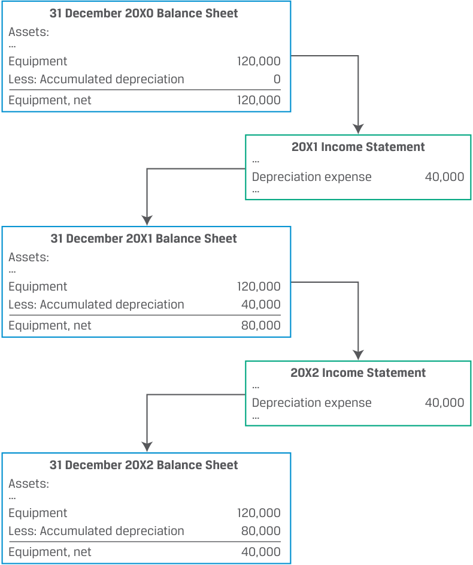

# Volume 3: Corporate Issuers
## Learning Module 5 Capital Investments and Capital Allocation
### Part 1/3: Introduction (PDF Pages 143–153)

---

<!-- PDF Page 143 -->

### L E A R N I N G M O D U L E 

# **<mark>5</mark>** 

## **Capital Investments and Capital Allocation** 

##### **<mark>LEARNING OUTCOMES</mark>** 

**_Mastery The candidate should be able to:_** describe types of capital investments describe the capital allocation process, calculate net present value (NPV), internal rate of return (IRR), and return on invested capital (ROIC), and contrast their use in capital allocation describe principles of capital allocation and common capital allocation pitfalls describe types of real options relevant to capital investments 

#### **INTRODUCTION** 

**<mark>1</mark>** 

The previous learning module described issuers’ _short-term_ investments and financing activities. In this module and the next, we turn our attention to issuers’ _long-term_ investment and financing activities. First, we explore the various forms of capital investment and their purposes. We then discuss the investment decision-making process and compare analytical approaches employed in that process. In the third lesson, we describe principles of capital allocation and common pitfalls. While the goals of both capital allocation and estimating expected investment returns are to select the best choice among investment alternatives, a firm’s decision today may influence future investment decisions, resulting in so-called real options, which are discussed in the final lesson. 

###### **LEARNING MODULE OVERVIEW** 

- Companies make capital investments to maintain or expand operations. Capital investments can be grouped into four categories based on their risk and return characteristics: (1) going concern projects, (2) regulatory/compliance projects, (3) expansion <u>projects, and (4) other.</u> 

<!-- PDF Page 144 -->

- Capital allocation is a process undertaken by issuers’ management and board for evaluating investment opportunities based on their expected contribution to shareholder value, as well as other considerations, such as environmental, social, and governance (ESG) factors. Although some projects might look profitable on an accounting or standalone basis, they might be uneconomical compared to alternatives or from an overall strategic perspective. Such projects should not be pursued, and capital should instead be returned to shareholders. 

- Net present value (NPV) and internal rate of return (IRR) are two tools used to evaluate individual investment projects. NPV estimates the increase in firm value from a project, while IRR is an estimate of the rate of return on a project, subject to certain assumptions, which can be compared to a hurdle rate. 

- Unlike NPV and IRR, return on invested capital (ROIC) is a company-wide measure and can be calculated using data available to independent analysts. ROIC is the rate of return an issuer earns over a period across all investments and can be compared to an investor’s required rate of return. Like NPV and IRR, ROIC is subject to limitations and assumptions. 

- Before investment projects are appraised on a quantitative basis, they should be modeled in accordance with certain principles, including measurement of cash flows on an after-tax basis, avoiding double counting, and including a project’s impact on the rest of the firm. Impacts can be positive, such as cost savings, or negative, such as the loss of sales from existing products. 

- Apart from deviations from these principles, capital allocation is additionally prone to behavioral biases and cognitive errors. These pitfalls can be detected by a thorough analysis of a company’s financials on a historical and comparative basis, as well as an examination of corporate governance and management renumeration policies. 

- Real options are like financial options in that they provide a right, not an obligation, for management to alter different aspects of capital projects in the future. Those aspects include timing and size of a project, as well as flexibility with regard to future pricing policies or operating capacity. 

- The most common approach to evaluating projects with real options is to compare a project’s NPV before and after inclusion of an option’s value less the option’s cost. More advanced methods include decision trees and option pricing models, which require assumptions about the probability of future events. 

###### **LEARNING MODULE SELF-ASSESSMENT** 

These initial questions are intended to help you gauge your current level of understanding of this learning module. 

1. The following list contains either an example or an attribute of a capital investment project. Assign each item to either _maintenance_ or _growth_ . 

   - Acquisition 

   - Expand business scope 

<!-- PDF Page 145 -->

- Research and development 

- Replace outdated facilities 

- High-risk investment and uncertainty 

- Limited downside risk and uncertainty 

- Needed to meet safety, compliance, regulatory standards 

###### **Maintenance Growth** 

###### **Solution:** 

|**Maintenance**|**Growth**|
|---|---|
|Replace outdated facilities|Acquisition|
|Needed to meet safety, compliance, regulatory standards|Expand business scope|
|Limited downside risk and|Research and development|
|uncertainty||
||High-risk investment and uncertainty|

2. When calculating IRR, the interim cash flows are assumed to be reinvested and earn a rate of return rate that is: 

   - **A.** lower than IRR. 

   - **B.** the same as IRR. 

   - **C.** higher than IRR. 

   - **Solution:** 

B is correct. An important assumption of IRR is that it represents only the (geometric) rate of return on the investment if interim cash flows are reinvested at the IRR. 

A is incorrect because if reinvestment rates are lower compared to IRR, the rate of return on the investment will be lower than the IRR. 

C is incorrect because if reinvestment rates are higher compared to IRR, the rate of return on the investment will be higher than the IRR. 

3. Complete the following sentences by filling in the blanks using the terms provided. 

When calculating ROIC, an independent analyst should add 

_________________ and _________________ to calculating average invested capital. ROIC, _________________ project NPV and IRR, can be calculated using data available to independent investment analysts. 

like 

unlike 

equity 

<!-- PDF Page 146 -->

short-term assets 

long-term assets 

long-term liabilities 

###### **Solution:** 

When calculating ROIC, an independent analyst should add _<u>equity</u>_ and _<u>long-term liabilities</u>_ to calculate average invested capital. ROIC, _<u>unlike</u>_ project NPV and IRR, can be calculated using data available to independent investment analysts. 

4. Explain why capital allocation decisions should _not_ be based on accounting measures such as earnings per share (EPS). 

###### **Solution:** 

Capital investments with a positive NPV can reduce rather than increase accounting measures in the near term, while cost cutting and share buybacks, in contrast, may have a positive effect on such measures. Basing investment decisions on short-term accounting numbers can lead a company to choose investments that are not in the long-run interests of its shareholders. Additionally, capital allocation should consider opportunity costs, such as by using a required rate of return for calculating NPV and an appropriate hurdle rate for an IRR. Accounting profits do not consider opportunity costs. 

5. The annual report of company XYZ contains the following disclosures: Disclosure 1: “XYZ’s management compensation is based on exceeding a target EPS growth rate.” 

Disclosure 2: “XYZ’s management does not change the required rate of return when evaluating capital projects based on whether they are financed by internal or external sources.” 

Disclosure 3: “When evaluating investment projects, XYZ prepares cashflow projections based on inflation-adjusted cash flows and discounts them using real rates.” 

Which of the disclosed policies does _not_ conform to best practices regarding capital allocation? 

- **A.** Disclosure 1 

- **B.** Disclosure 2 

**C.** Disclosure 3 

###### **Solution:** 

A is correct. Positive-NPV investment projects can reduce, rather than increase, EPS in the near term, even though they increase shareholder value. Management compensation should incorporate a longer-term perspective and a measure that better considers required rates of return, such as ROIC. B is incorrect because internally generated capital, such as cash flow from operations, is equity financing and it could be returned to equity investors as a dividend. Regardless of the financing source, management should use appropriate risk-adjusted required rates of return to evaluate capital investments. 

<!-- PDF Page 147 -->

C is incorrect because companies may perform analysis in either nominal or real terms, but the approach to cash flows and the discount rate should be consistent. That is, nominal cash flows should be discounted at a nominal discount rate, and real (inflation-adjusted) cash flows should be discounted at a real rate. 

6. Explain what real options are and how they influence company value. **Solution:** 

Real options are similar to financial options, except that they deal with real, instead of financial, assets. Real options grant companies the right to make a decision (but do not impose an obligation) in the future that alters the value of capital investment decisions made today. Real options, by providing future decision-making flexibility to companies, can be an important piece of the value in many capital investments. 

#### **CAPITAL INVESTMENTS** 

**<mark>2</mark>** 

describe types of capital investments 

**Capital investments** , also referred to as _capital projects_ , are investments with a life of one year or longer, which usually appear on the balance sheet as long-term assets. Like most assets, capital investments are initially recorded at cost. The expenditure is not recorded on the income statement; rather, a portion of the cost is recorded on the income statement periodically as a non-cash **depreciation** or **amortization** expense over the asset’s useful life. The result is that capital spending is “smoothed” over time and aligned with the inflow of benefits from the investment. On the statement of cash flows, cash capital spending is simply reported as incurred. 

In subsequent periods, capital investment assets are presented on the balance sheet on a _net_ basis: cost less accumulated depreciation or amortization. As depreciation or amortization is recorded over time and accumulates, this net value declines to zero or a salvage value. The process is illustrated in Exhibit 1 and will be covered in greater detail later in the curriculum. 

<!-- PDF Page 148 -->

**Exhibit 1: Depreciation/Amortization of a Long-Term Asset** 

<!-- Start of picture text -->
31 December 20X0 Balance Sheet Assets: … Equipment 120,000 Less: Accumulated depreciation 0 Equipment, net 120,000 20X1 Income Statement … Depreciation expense 40,000 … 31 December 20X1 Balance Sheet Assets: … Equipment 120,000 Less: Accumulated depreciation 40,000 Equipment, net 80,000 20X2 Income Statement … Depreciation expense 40,000 … 31 December 20X2 Balance Sheet Assets: … Equipment 120,000 Less: Accumulated depreciation 80,000 Equipment, net 40,000 <!-- End of picture text -->

A firm’s capital investment and allocation process are central to its success and therefore important for analysts to understand. Capital investments describe a company’s prospects best, providing insight into both the quality of management decisions and how the company creates value. Note that capital investments are not limited to property, equipment, and other tangible assets; increasingly, capital investments are in the form of digital capabilities and other intangible assets. Regardless of the nature of the asset, the principles in this learning module apply because we are focused on cash flows. 

Four categories of capital investments and their potential uses are summarized in Exhibit 2. These investments usually link to the business model of the firm and reflect its strategic and competitive environment. 

<!-- PDF Page 149 -->

###### **Exhibit 2: Types of Capital Projects** 

|**Maintain Business**|**Grow Business**|
|---|---|
|**Going Concern (Maintenance)**|**Expansion of Existing Business**|
|■Continue current operations|■Expand business size|
|■Improve efficiency|■Expand business scope|
|fi ■Risk management|■Research and development and acquisi- tions within core business ■Low to moderate risk|
|**Regulatory/Compliance**|**New Lines of Business and Other**|
|■Usually imposed by a third party, laws, etc.|■Research and development, investments, and acquisitions outside the firm’s current|
|■Needed to meet safety, compliance, regu- latory or supervisory standards|i business ■Often high risk|

##### **Going Concern Projects** 

Going concern projects, often known as **maintenance capital expenditures** , are investments to continue the company’s current operations and maintain the existing size of the business. Common going concern projects include replacing assets nearing the end of their useful life, maintaining IT hardware and software, and continuous improvements of existing facilities. For example, a company might replace data center cooling units with newer, more efficient alternatives. 

These maintenance projects are relatively easy for management to evaluate since they usually involve the replication of existing business operations. Projects aimed at improving efficiencies typically involve comparing the upfront cost to the expected periodic savings over time in the context of current operations. Typically, these projects are lower risk. 

To fund these projects, managers (and debt investors who provide the financing) usually seek to match the term of incremental financing with the lifespan of new assets. For example, a utility company may issue a 30-year bond to finance replacement power generation equipment with an expected useful life of 30 years. This so-called **match funding** approach reduces financing risk, because funding long-term assets with shorter debt obligations introduces rollover risk, or uncertain financing cost or availability during the project before the capital investment reaches the end of its useful life. Similarly, a company that borrows for longer than necessary may either pay a higher long-term rate of interest or face the cost of buying back debt in the future that is no longer needed. 

Issuers are not required to disclose the amount of maintenance capital expenditures or the composition of total capital expenditures generally. Analysts often estimate that annual maintenance capital expenditure is equal to the amount of depreciation and amortization expense reported on the income statement. The accuracy of this estimate depends on how closely the expected useful life of assets approximates actual useful life and whether the historical cost of an asset approximates its replacement cost; both assumptions are likely to be more accurate for shorter-lived assets. 

<!-- PDF Page 150 -->

##### **Regulatory Compliance Projects** 

Unlike projects based on management discretion, regulatory compliance projects are required to meet rules and standards. For example, such projects may be driven by a new law to reduce pollution or financial regulations requiring banks to monitor and report transactions and balances to regulators. 

Regulatory compliance projects often increase a firm’s expenses with no added revenue but are required to avoid fines and/or to continue operations. However, industry incumbents may find that such rules and standards serve as a barrier to industry entry and therefore increase or protect their profitability. Also, when firms work directly with regulators to develop these new standards, their timing and impact may be tailored to best suit an industry’s ability to adapt while continuing operations. Firms with greater financial flexibility may consider early adoption of new rules to reduce business uncertainty going forward and gain a competitive edge versus their peers. Moreover, such investments can attract new customers and are often considered to create a strategic advantage. 

As standards evolve, firms must decide whether the returns on an underlying business remain attractive once additional regulatory costs are imposed. In some cases, firms may be able to pass some or all of the additional regulatory costs from these projects on to end users in the form of higher prices. In other cases, a firm may decide that a business no longer meets its minimum return requirement (once the costs of such projects are included) and it would be better off winding down or ceasing certain affected operations altogether. 

###### **EXAMPLE 1** 

##### **Complying with Anti-Money-Laundering Regulations** 

Danske Bank A/S (“Danske”), the largest financial institution in Denmark, is subject to a large anti-money-laundering investigation after a report from a whistle blower and audit letters from Group Internal Audit. Danske acknowledged in a press release that “ _major deficiencies in controls and governance made it possible to use Danske Bank’s branch in Estonia for criminal activities, such as money laundering.”_ 

The examination of Danske’s anti-money-laundering policies resulted in the resignation of its CEO, the closure of the Estonian branch, and the arrests of multiple employees. Danske is also expected to pay fines of up to several billion dollars to financial regulators in the United States, Denmark, and other European countries. The scandal not only had an impact on Danske but also resulted in increasing penalties for money laundering in Denmark. 

While regulatory compliance projects can be costly, they can prevent scandals and losses from fines and legal proceedings that damage firms’ reputations. 

Businesses seeking to grow often engage in capital projects to increase the _scale_ of existing business activities, expand their _scope_ to new areas of operation, or enter new areas. These expansion projects typically involve greater uncertainty, time, and amounts of capital than going concern or regulatory compliance projects. 

##### **Expansion of Existing Business** 

Capital projects aimed at increasing the size of a firm’s existing operations may introduce execution risks, such as sourcing additional inputs, addressing unforeseen production and distribution bottlenecks, or failing to budget for the cost of acquiring new customers. These risks are highest among firms in an early phase without established 

<!-- PDF Page 151 -->

operations whose expansion projects are therefore usually largely financed by equity. More established firms also spend heavily on expansion projects. For example, pharmaceutical and energy exploration companies often invest over 10% of annual revenues in pursuit of new medications and energy reserves, respectively. Similarly, technology companies typically invest heavily in expansion projects initially to accelerate product development cycles, maintain competitiveness, acquire customers and clients, and stay ahead of rivals. Established firms with an existing track record of successful expansion are more often able to use debt financing for such capital projects given investor perception of lower associated risk. 

Capital investments are also usually necessary if an established firm decides to extend its existing operations to adjacent products and services or expand to new regions or markets. The expansion of business scope may take advantage of existing capabilities to meet the needs of a different customer base. Unforeseen risks related to increasing scope include the added complexity of managing multiple business lines and facing new competitors. Investors and analysts often look to a firm’s competitive position and past performance by peers in executing similar strategies when gauging the likelihood of success. 

###### **EXAMPLE 2** 

##### **Sony Grows Gaming Business** 

Sony Interactive Entertainment (“SIE”) is a global, leading video game and digital entertainment company owned by Japanese multinational conglomerate Sony. SIE conducts the research and development, production, and sales of both hardware and software for the PlayStation console. 

In January 2022, SIE announced it would acquire Bungie Inc. (“Bungie”) for $3.6 billion. Bungie is a US-based independent videogame developer and longtime partner of SIE that has created some of the videogame industry’s most highly acclaimed franchises, including Halo, Myth, and Destiny. 

In the press release, SIE summarized how the acquisition would expand its business: “This acquisition will give SIE access to Bungie’s world-class approach to live game services and technology expertise, furthering SIE’s vision to reach billions of players.” 

##### **New Lines of Business and Other Projects** 

A firm’s management may decide to invest in an activity completely outside or only minimally related to its existing business. Usually seen as a special situation offering unusual growth, investment, or innovation opportunities for a company’s business or business model, these projects are likely to be the riskiest capital investments. 

Either these projects will have characteristics of a startup, such as investing capital to explore a new technology or a business idea/model for sources of new business growth, or the company will acquire a firm in a new industry or sector. Important risks include the unforeseen challenges of an unfamiliar business and the risk of overpaying. 

<!-- PDF Page 152 -->

###### **EXAMPLE 3** 

##### **Kirin Enters New Market** 

Kirin Holding (“Kirin”) is an integrated beverage producer and the second largest brewer in Japan. Kirin’s top brands include both alcoholic beverages, such as Kirin Ichiban and Honkirin, and soft drinks, such as Kirin Gogo-no-Kocha and Nama-cha. 

In September 2019, Kirin invested ¥129 billion to become a top shareholder of Fancl Corp. (“Fancl”), a Japanese cosmetics and dietary supplement maker. Fancl has more than 25 years of experience as a pioneer in the supplement market and is a market leader in foods with functional claims. Both companies want to combine their research and development capabilities with their strong brands to offer a wide range of products. 

Analysts should carefully examine issuers’ overall level and trend of expansion capital investment, as well as the segment and market if disclosed, to analyze growth prospects, management priorities, and the rates of return on investment relative to alternatives. The level and trend of expansion capital spending may be estimated by subtracting maintenance (often estimated using depreciation and amortization expense) from total capital expenditures. 

###### **QUESTION SET** 

1. Match the following examples of capital projects with type of the project. 

   - Project 1: An office equipment producer decides to develop a new line of computer peripherals intended for gamers. 

   - Project 2: A tire producer decides to invest in solar panel production to benefit from government subsidies. 

   - Project 3: A global bank migrates its on-site data storage to cloud computing data storage to improve its cost efficiency. 

   - Project 4: A property management company undertakes a new capital project intended to install an advanced ventilation system in all its office buildings to meet stricter air pollution regulations. 

|**Project Type**|**Capital Project**|
|---|---|
|Expansion of existing business||
|Going concern/maintenance||
|Regulatory or compliance||
|New lines of business and other||

###### **Solution:** 

|**Project Type**|**Capital Project**|
|---|---|
|Expansion of existing business|Project 1, because it aims to increase the size of a firm’s existing operations and acquire new customers|
|Going concern/maintenance|Project 3, which allows the bank to con- tinue its current operations using more efficient technology|

<!-- PDF Page 153 -->

|**Project Type**|**Capital Project**|
|---|---|
|Regulatory or compliance|Project 4, because unlike projects based on management discretion, this project is to comply with air pollution regulations.|
|New lines of business and other|Project 2, which is an investment into a new market not related to the company’s existing business|

2. It is true that the capital allocation process: 

   - **A.** involves the use of significant proprietary, non-public information about a company. 

   - **B.** aims at identifying projects with the highest absolute non-risk-adjusted rate of returns. 

   - **C.** uses less information compared to the process used to construct investment management portfolios. 

   - **Solution:** 

A is correct. The capital allocation process is the process used by a firm’s management and board to make capital investment based on both internal, non-public _and_ public information. The process is substantially similar to those used by investors and analysts constructing investment management portfolios but occurs at a more granular level of detail and more in “real time” because insiders do not need to wait for quarterly earnings reports. B is incorrect because the capital allocation process is used by a firm’s management to deliver superior risk-adjusted returns, when compared to similarly risky investments. 

C is incorrect because the capital allocation process is more granular compared to the process used to construct investment management portfolios. The capital allocation process focuses on identifying profitable projects and utilizes proprietary information. The process used to construct investment portfolios involves public information and non-material, non-public information, often at the company and segment level. 

3. What type of capital allocation project will _most likely_ be implemented even if it has a negative estimated NPV? 

   - **A.** New lines of business and other 

   - **B.** Expansion of existing business **C.** Regulatory or compliance 

   - **Solution:** 

C is correct. Regulatory compliance projects are required by third parties, such as government regulatory bodies, to meet rules and standards and to avoid fines or other legal consequences. 

A and B are incorrect because new lines of business and other as well as expansion of existing business projects are done at management’s discretion and would generally not be pursued if they were estimated to have a negative NPV. 

