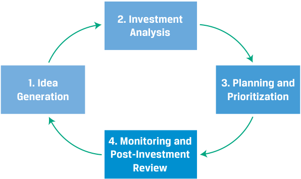
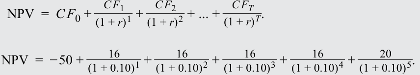
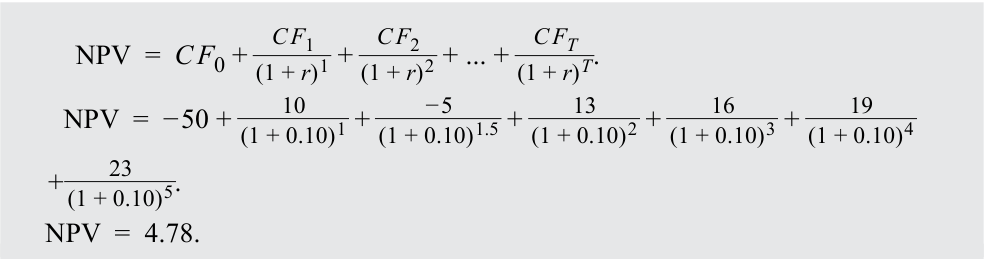
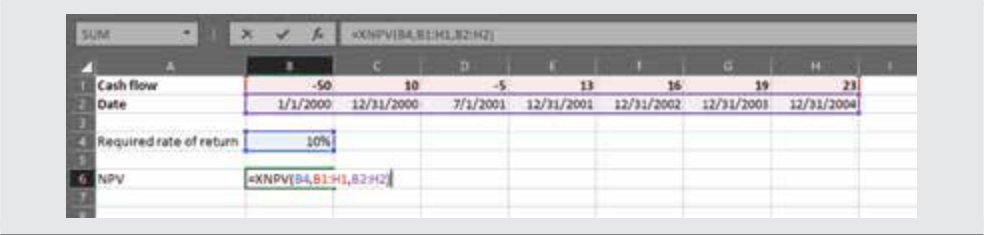
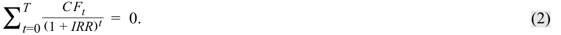
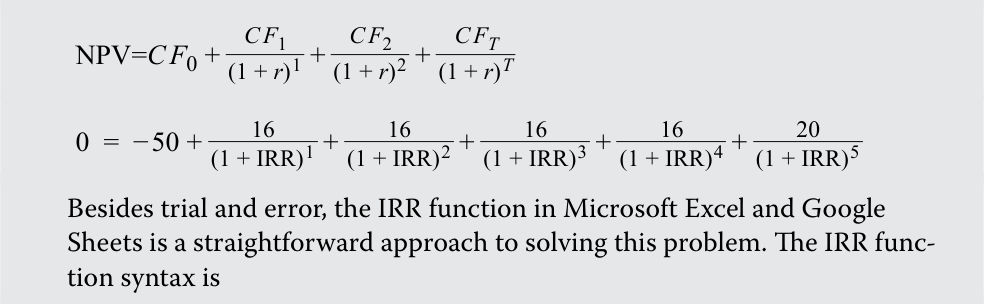
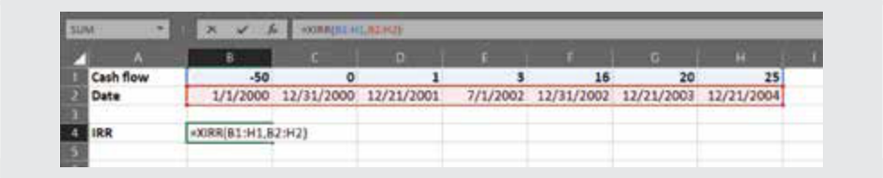
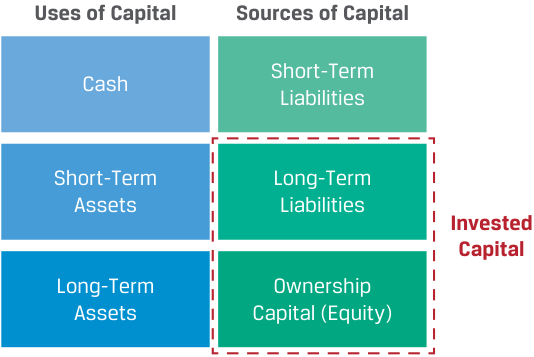
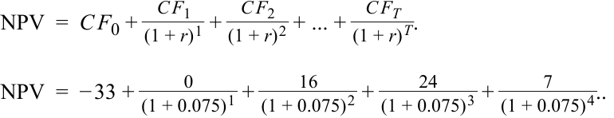

# Volume 3: Corporate Issuers
## Learning Module 5 Capital Investments and Capital Allocation
### Part 2/3: Capital Allocation (PDF Pages 154–165)

---

<!-- PDF Page 154 -->

# **<mark>3</mark>** 

## **CAPITAL ALLOCATION** 

describe the capital allocation process, calculate net present value (NPV), internal rate of return (IRR), and return on invested capital (ROIC), and contrast their use in capital allocation 

**Capital allocation** is the process used by a firm’s management and board to make capital investment and return decisions. Management seeks to deliver risk-adjusted returns greater than what investors could earn on similarly risky investments elsewhere. The process is substantially similar to those used by investors and analysts constructing investment management portfolios but occurs at a more granular level of detail. Rather than only investing in entire companies, issuers invest in projects and utilize significant proprietary, non-public information. 

Investors and analysts must judge whether an issuer will manage capital wisely over the long term. To make that judgment, analysts should evaluate the issuer’s capital allocation process and its adherence to first principles and, most importantly, assess the issuer’s historical track record of capital allocation. The generic steps in the capital allocation process are shown in Exhibit 3. 

**Exhibit 3: Steps in the Capital Allocation Process** 

<!-- Start of picture text -->
2. Investment Analysis 1. Idea 3. Planning and Generation Prioritization 4. Monitoring and Post-Investment Review <!-- End of picture text -->

- _Idea generation:_ While ideas may originate from anywhere, it is important that management has a strong understanding of the competitive environment that the prospective investment is situated in, as well as the firm’s current operations, capabilities, and competitive position. Often, ideas come from managers engaged in the business and involve expanding scale and scope of existing activities or adjacent businesses. Executives may also engage external consultants for advice on idea generation. As will be discussed later, capital spending tends to be highly correlated from year to year, indicating that prior-period ideas and plans weigh heavily. 

- _Investment analysis:_ Following the generation of investment ideas, managers forecast the amount, timing, duration, and volatility of an investment’s expected cash flows to estimate whether the investment is a wise use of capital. 

- _Planning and prioritization:_ Management selects and prioritizes profitable investment opportunities that, when considered together, are the most value enhancing on a risk-adjusted return basis. Only investment candidates 

<!-- PDF Page 155 -->

estimated to generate returns greater than investors’ opportunity cost (the returns they could earn elsewhere on similarly risky endeavors) should be pursued. Additionally, some projects that appear attractive in isolation may be less desirable when considered in the context of existing operations, other proposed projects, or constraints on financing. 

When value-creative investment opportunities are exhausted, managers should return any remaining capital to shareholders. In this way, shareholders can redeploy that capital elsewhere to earn their required rate of return. 

- _Monitoring and post-investment review:_ This step involves monitoring the performance of the investment and related activities against projections and, often, making adjustments, such as increasing or decreasing investment levels (which will be discussed later as real options). This step is important for several reasons. First, it helps validate assumptions made in the capital allocation process, revealing systematic errors, such as overly optimistic forecasts. Second, it helps enforce discipline in business operations by focusing management attention on bringing performance into alignment with projections. Finally, it may produce ideas for future investments. Managers should seek to invest in profitable areas and scale down or dispose of assets in areas that generate suboptimal returns or may have greater value to other firms. 

Two of the most widely used analytical tools in the investment analysis step are **net present value (NPV)** and **internal rate of return (IRR)** . These are applications of time-value-of-money concepts. While an independent investment analyst does not have access to the project-by-project information used by management in these calculations, an analyst should understand the rationale behind them, their strengths, and their limitations in practice (also, these tools are used elsewhere in investment management, which will be covered later in the curriculum). Analysts have access to highly aggregated consolidated financial statements, which they can use to calculate and analyze **return on invested capital (ROIC)** , a useful _aggregate_ , rather than _project_ , return measure. 

### **Net Present Value (NPV)** 

The NPV of an investment is the present value (in currency terms) of expected future cash inflows less the investment’s costs (or cash _outflows_ ), as shown in Exhibit 4. 

**Exhibit 4: Net Present Value of a Capital Investment** 

<!-- Start of picture text -->
t  = 0 t  =  T Upfront CF 1 CF 2 CF 3 CF 4 CF 5 Investment (cash outflow) Cash Inflows CF 0 <!-- End of picture text -->

Exhibit 4 shows the simple case where a single investment ( _CF_ 0 < 0) occurs at inception followed by cash inflows. We may solve for the NPV using Equation 1: 

<!-- PDF Page 156 -->

<!-- Formula Text: NPV  =  C F 0 + C F 1 _ (1 + r) 1  + C F 2 _ (1 + r) 2  + ... + C F T _ (1 + r) T . NPV  =  ∑ t=0 T C F t _ (1 + r) t , (1) -->

where 

- _CFt_ = After-tax cash flow at time _t_ 

   - _r_ = Required rate of return—the rate of return that a corporate issuer’s investors could earn on a similarly risky investment 

The calculation is illustrated in the following example. 

#### **EXAMPLE 4** 

### **Gerhardt Corporation NPV** 

1. Assume that Gerhardt Corporation is considering a capital investment of €50 million today that is expected to return after-tax cash flows of €16 million per year for the next four years plus another €20 million in Year 5. If the required rate of return is 10%, what is the NPV of this investment? **Solution:** 

Using Equation 1, we may solve for the NPV as follows: 

<!-- Formula Text: NPV  =  C F 0 + C F 1 _ (1 + r) 1  + C F 2 _ (1 + r) 2  + ... + C F T _ (1 + r) T . NPV  =  − 50 + 16 _ (1 + 0.10) 1  + 16 _ (1 + 0.10) 2  + 16 _ (1 + 0.10) 3  + 16 _ (1 + 0.10) 4  + 20 _ (1 + 0.10) 5 . -->

NPV = − 50 + 63.136 = 13.136. 

Since this investment may be acquired today at a cost of €50 million, the company exchanges €50 million today for an investment worth €63.136 million. The investment increases the present value of the firm’s wealth by a net amount of €13.136 million. 

This can also be solved in Microsoft Excel or Google Sheets using the NPV function: 

=NPV(rate,value1,value2,…) 

where 

_rate_ = Required rate of return 

_value(s)_ = After-tax cash flows 

Note that the NPV function uses _t_ = 1 for the first cash flow, not _t_ = 0, and assumes cash flows are evenly spaced. Therefore, cash flows at _t_ = 0 (in this case, –50) need to be subtracted or added outside the function. The proper argument here is 

= NPV(0.10, 16, 16, 16, 16, 20) – 50 = 13.136. 

<!-- PDF Page 157 -->

Because the NPV is the amount by which investors’ wealth increases from an investment, the NPV decision rule is as follows: 

|Invest if|NPV ≥ 0.|
|---|---|
|Do not invest if|NPV < 0.|

Positive-NPV investments increase the wealth of the shareholders, while a negative NPV reduces wealth. In the rare event that NPV is zero, a project could be accepted because it meets the required rate of return. However, because NPV analysis relies on estimated future cash flows, a zero-NPV project leaves no room for error. While the decision rule is straightforward, NPV is usually just one factor in capital allocation. There may be competing projects, intangible considerations, and so on, that factor into the decision. Therefore, NPV ≥ 0 can be viewed as a _necessary_ but not _sufficient_ condition for making an investment. 

Many investments have unconventional cash flow patterns in which outflows may occur not only at inception but also on future dates, as in Exhibit 5. An example of this is an investment in additional capacity at a later stage. 

**Exhibit 5: Unconventional Cash Flow Patterns** 

<!-- Start of picture text -->
t  = 0 t  =  T CF 2 CF 4 CF 5 CF 0 CF 1 CF 3 <!-- End of picture text -->

Analysis of these types of investments is best handled using spreadsheet software, such as Microsoft Excel and Google Sheets, manually, or using the XNPV function, which, unlike the NPV function, does _not_ assume evenly spaced periods and allows the user to specify the timing of cash flows. This concept is illustrated in the following example. 

#### **EXAMPLE 5** 

### **Gerhardt Corporation NPV II** 

Assume that Gerhardt Corporation is considering a capital investment of €50 million today with the following estimated cash flow schedule over the next five years (all amounts in millions of euros). 

|**_t_**|**0**|**1**|**1.5**|**2**|**3**|**4**|**5**|
|---|---|---|---|---|---|---|---|
|**Cash flow**|–50|10|-5|13|16|19|23|

1. If the required rate of return is 10%, what is the NPV of this investment and should Gerhardt make the investment? 

   - **Solution:** 

Using Equation 1, we may solve for the NPV as follows: 

<!-- PDF Page 158 -->

<!-- Formula Text: NPV  =  C F 0 + C F 1 _ (1 + r) 1  + C F 2 _ (1 + r) 2  + ... + C F T _ (1 + r) T . NPV  =  − 50 + 10 _ (1 + 0.10) 1  + − 5 _ (1 + 0.10) 1.5  + 13 _ (1 + 0.10) 2  + 16 _ (1 + 0.10) 3  + 19 _ (1 + 0.10) 4 + 23 _ (1 + 0.10) 5 . NPV  =  4.78. -->

Since the NPV ≥ 0, Gerhardt should make the investment. This problem can also be solved in Microsoft Excel or Google Sheets using the XNPV function. The XNPV function syntax is as follows: 

=XNPV(rate,values,dates) 

where 

_rate_ = Required rate of return 

_values_ = After-tax cash flows at each date 

_dates_ = Date of each after-tax cash flow (for a problem like this without exact dates, the dates are arbitrary; what matters is that they are accurately spaced) 

The function is most clearly specified by referencing cash flow and date arrays that are aligned on a spreadsheet, as shown here: 

### **Internal Rate of Return** 

The **internal rate of return (IRR)** is the discount rate that makes the net present value of an investment equal to zero, as shown in Equation 2: 

<!-- Formula Text: ∑ t=0 T C F t _ (1 + IRR) t   =  0. (2) -->

Note the similarity of the IRR calculation to Equation 1, which includes _r_ (the required rate of return) in the denominator instead of _IRR_ . 

#### **EXAMPLE 6** 

### **Gerhardt Corporation IRR** 

1. Assume that Gerhardt Corporation is considering a capital investment of €50 million today that is expected to return after-tax cash flows of €16 million per year for the next four years plus another €20 million in Year 5. What is the IRR of this investment? 

**Solution:** 

Recall from Equation 1 that the NPV is 

<!-- PDF Page 159 -->

<!-- Formula Text: NPV  =  C F 0 + C F 1 _ (1 + r) 1  + C F 2 _ (1 + r) 2  + C F T _ (1 + r) T -->

The IRR is the discount rate, _r_ , that makes the NPV equal to zero. In other words, 

<!-- Formula Text: NPV=C F 0 + C F 1 _ (1 + r) 1  + C F 2 _ (1 + r) 2  + C F T _ (1 + r) T 0  =  − 50 + 16 _ (1 + IRR) 1  + 16 _ (1 + IRR) 2  + 16 _ (1 + IRR) 3  + 16 _ (1 + IRR) 4  + 20 _ (1 + IRR) 5 Besides trial and error, the IRR function in Microsoft Excel and Google Sheets is a straightforward approach to solving this problem. The IRR func- tion syntax is -->

=IRR(values,[guess]) 

where 

_values_ = After-tax cash flows 

_[guess]_ = An optional user-specified guess for the IRR (the default is 10%) 

Importantly, like the NPV function, the IRR function assumes that cash flows are received or paid at the end of period and that each period is evenly spaced. Unlike the NPV function, it does not assume that the first cash flow is at _t_ = 1, so the argument here is simply 

= IRR (–50, 16, 16, 16, 16, 20) 

= 0.1952, or 19.52%. 

The IRR decision rule is to invest if the IRR _exceeds_ the required rate of return ( _r_ ) for a capital investment: 

|Invest if|IRR ≥_r_.|
|---|---|
|Do not invest if|IRR <_r_.|

For this reason, the required rate of return is often referred to as the **hurdle rate** . If the IRR is equal to _r_ , the project is _theoretically_ acceptable because it meets the required return with an NPV of zero. Since the IRR of 19.52% in our example exceeds the hurdle rate of 10%, Gerhardt should invest. 

An important attribute of IRR is that it will only equal an investor’s (geometric) rate of return on an investment if interim cash flows are reinvested at the IRR; if reinvestment rates are in fact lower, the rate of return on the investment will be lower than the IRR and vice versa. The NPV calculation instead assumes interim cash flows are reinvested at _r,_ the required rate of return, which is often more economically realistic. Reinvestment rates and the implications therein will be explored in depth later in the curriculum in fixed-income lessons. 

For an investment for which the assumptions of end-of-period, evenly spaced cash flows are inappropriate, the XIRR function in Microsoft Excel and Google Sheets is the proper tool, as in the following example. 

<!-- PDF Page 160 -->

#### **EXAMPLE 7** 

### **Gerhardt Corporation IRR III** 

1. Assume that Gerhardt Corporation is considering a capital investment of €50 million today with the following estimated cash flow schedule over the next five years (all amounts in millions of euros). 

|**_t_**|**0**|**1**|**2** **2.5**|**3**|**4**|**5**|
|---|---|---|---|---|---|---|
|**Cash flow**|–50|0|1 3|16|20|25|

What is the IRR of this investment, and should Gerhardt make the investment if its required rate of return is 10%? 

#### **Solution:** 

This problem can be solved in Microsoft Excel or Google Sheets using the XIRR function. The XIRR function syntax is as follows: 

=XIRR(values,dates,[guess]) 

where 

_values_ = After-tax cash flows at each date 

_dates_ = Date of each after-tax cash flow (for a problem like this without exact dates, the dates are arbitrary; what matters is that they are accurately spaced) 

_[guess]_ = An optional user-specified guess for the IRR (the default is 10%) The function is most clearly specified by referencing cash flow and date arrays that are aligned on a spreadsheet, as shown here: 

The IRR is 6.76%, which is below Gerhardt’s required rate of return of 10%, so it should not invest in this project. 

An important limitation with IRR is that multiple IRRs exist if cash flow signs (+/–) change more than once. We can illustrate this with the following simple example: 

|**Time**|**0**|**1**|**2**|
|---|---|---|---|
|**Cash flow**|−1,000|5,000|−6,000|

The IRR for this investment satisfies this equation: 

_ _ − 1, 000 +( 1 + IRR5, 000)1+  ( 1 + IRR− 6, 000)2= 0. 

Two values of IRR satisfy the equation: 100% and 200%, which are clearly quite different. In such cases, where cash flow signs change more than once, NPV should be used instead of IRR. Financial calculators and spreadsheet software will often misleadingly return a single IRR solution, defaulting to the lowest value. 

<!-- PDF Page 161 -->

#### **WHICH TO USE: NPV OR IRR?** 

While NPV and IRR criteria usually indicate the same investment decision, in the case of mutually exclusive investment projects, a company could face a decision between one project with a larger NPV and another with a higher IRR. If the company can invest in only one project, which should it choose? 

The correct choice is the project with the higher NPV. While NPV shows the firm’s wealth increase in currency terms from a capital investment, the IRR solely indicates a project’s rate of return (subject to the IRR reinvestment assumption) rather than its size or the period over which the IRR is earned. 

Many practitioners find IRR easier to use than NPV. If the required return is 10%, for example, a project IRR of more than 10% is desirable, while an NPV amount in currency terms may be harder to interpret because the number needs to be in the context of firm size. As a practical matter, once a firm has the data to calculate the NPV, it is simple to also calculate the IRR. However, the most appropriate and theoretically sound criterion is the NPV. 

### **Return on Invested Capital** 

Independent investment analysts do not have the necessary information to calculate or audit management’s calculations of project NPVs or IRRs. Analysts of listed companies have consolidated financial statements and, sometimes, segment-level information, all of which are highly aggregated and include cash flows associated with many projects. Return on invested capital, also known as return on capital employed (ROCE), is a profitability measure for the total capital that management has invested, shown as Equation 3. Typically, an annual after-tax profit measure is used, so ROIC is measured _per year_ . 

<!-- Formula Text: ROIC  = After‐ tax operating profit t ___________________ Average invested capital   = (1 − Tax rate) × Operating profit t _____________________________ Average total LT liabilities and equity t−1,t . (3) -->

The denominator is a measure of total _capital_ investment, so working capital is not included. From the perspective of the balance sheet, invested capital includes the amounts in the red box: 

<!-- Start of picture text -->
Uses of Capital Sources of Capital Short-Term Cash Liabilities Short-Term Long-Term Assets Liabilities Invested Capital Long-Term Ownership Assets Capital (Equity) <!-- End of picture text -->

#### **EXAMPLE 8** 

### **Return on Invested Capital** 

Assume that a corporate issuer reported 24,395 in Year 2 after-tax operating profits and the following balance sheet information. 

<!-- PDF Page 162 -->

|**Assets:**|**End of Year 1**|**End of Year 2**|
|---|---|---|
|Cash|4,364|6,802|
|Short-term assets|40,529|52,352|
|Long-term assets|287,857|279,769|
|Total assets|332,750|338,923|
|**Liabilities and Equity:**|**End of Year 1**|**End of Year 2**|
|Accounts payable|35,221|50,766|
|Short-term debt|21,142|5,877|
|Long-term debt|112,257|106,597|
|Share capital|15,688|15,688|
|Retained earnings|148,442|159,995|
|Total liabilities and equity|332,750|338,923|

1. Calculate ROIC for Year 2. 

**Solution:** 

_______________________________After‐  tax operating profit _t_ ROIC = Average LT liabilities and equity capital _t_ −1, _t_ 24, 395 

_______________________________________ ROIC = _____________________________________________(112, 257 + 15, 688 + 148, 442) +  2 (106, 597 + 15, 688 + 159, 995) 

ROIC = 8.73%. 

2. If an investor has a required rate of return of 10%, is this company a promising investment candidate? 

**Solution:** 

No. Although the company is profitable, the company’s ROIC is below the investors’ required rate of return, so the investor should look to invest elsewhere. However, this is only a single historical year, and myriad other factors will have to be considered by the investor. 

ROIC has several practical benefits: 

- Unlike project NPV and IRR, it can be calculated using data available to independent investment analysts. 

- Unlike such measures as operating profit or operating profit margin (operating profit as a percentage of sales), ROIC accounts for the capital needed to generate returns. The relationship between operating profit margin and ROIC can be illustrated by decomposing ROIC as follows: 

__________________After‐tax operating profit ROIC = Average invested capital ROIC =  __________________After‐tax operating profit ×  _________________Sales Sales Average invested capital 

<!-- PDF Page 163 -->

The term on the left is after-tax operating profit margin, and the term on the right is a measure of capital or asset turnover—how much in annual sales the company’s invested capital is generating. Therefore, there are two paths to a high or increasing ROIC: profit margin and turnover. A high-margin company can earn a low ROIC if turnover is low, and a low-margin company can earn an attractive ROIC if turnover is high. 

- While NPV and IRR measures allow the comparison of individual projects within a firm, ROIC is an aggregate measure to gauge a firm’s ability to create value across _all_ its investments. This is important because investors generally cannot invest in individual projects, only the company as a whole (some exceptions exist, such as leases and asset-backed securities, which will be discussed later in fixed-income modules). 

- ROIC can be compared to investors’ required rate of return. If an issuer’s ROIC is greater than the investors’ required rate of return over time, the issuer is creating value for investors. Conversely, if the ROIC is below the required rate of return, it is an indicator that investors would have been better off investing elsewhere; the issuer should take actions to improve turnover or profit margins, dispose of investments in underperforming areas, return capital, or seek alternative areas of investment with greater returns. 

- Since ROIC measures the returns that an issuer earns on investing both debt and equity, it should be compared to a required rate of return for both its debt _and_ equity investors. As discussed in prior lessons, equity is riskier than debt and therefore has a higher required return, so using solely a required return for equity investors would be an overestimate. In the next module, we will calculate a blended required rate of return as part of a broader discussion of financing. 

ROIC does have limitations and shortcomings: 

- ROIC, unlike NPV and IRR, is an accounting, not cash-based, measure. Operating profit and cash flows can differ materially, owing to the recognition of certain items and the difference between depreciation and capital expenditures. 

- ROIC is backward looking and can be volatile from year to year based on investment activity and business conditions, so examining trends and rates of change is essential. Profitable investments can sometimes take years to earn competitive returns. 

- As a highly aggregated measure, ROIC may mask profitable or unprofitable areas of the issuer. 

Analysts should also be aware that there is less consensus on the measurement of ROIC than such measures as operating profit margin, particularly the denominator. Many practitioners, for example, subtract some or all intangible assets and “excess” cash from the denominator and may exclude certain long-term liabilities, such as pension and deferred tax liabilities that are not considered “invested capital.” Additional calculation issues, which will be addressed later in the curriculum, include treatments of “non-recurring” expenses, leased assets, and equity from non-controlling interests. 

<!-- PDF Page 164 -->

#### **QUESTION SET** 

1. True or false. During the planning and prioritization step in the capital allocation process, a firm’s management should accept any investment project with an estimated positive NPV. 

#### **Solution:** 

False. Some projects that appear attractive in isolation may be less desirable when considered in the context of existing operations, other proposed projects, ESG factors, or financing constraints. 

2. Which step in the capital allocation process _most likely_ involves the calculation of NPV and IRR? 

   - **A.** Idea generation 

   - **B.** Investment analysis 

   - **C.** Planning and prioritization 

   - **Solution:** 

B is correct. The investment analysis step involves forecasting the amount, timing, duration, and volatility of an investment’s expected cash flows and subsequently using NPV and IRR to determine whether the investment will be a wise use of capital. 

A is incorrect because during the idea generation step, management gathers ideas and chooses the most promising ones for further analysis. However, in this early phase, no forecasts or profitability analysis involving NPV or IRR is conducted. 

C is incorrect because during the planning and prioritization step, management selects and prioritizes profitable investment opportunities that, when considered together, are the most value enhancing on a risk-adjusted return basis. This step occurs after NPV and IRR analysis. 

3. Which of the following relationships is true? 

   - **A.** If IRR > Required rate of return, then NPV < 0. 

   - **B.** If IRR = Required rate of return, then NPV = 0. 

   - **C.** Required rate of return = Risk-free rate. 

#### **Solution:** 

B is correct. IRR is the required rate of return that makes an investment’s NPV equal to zero. 

A is incorrect because IRR is the required rate of return for which NPV = 0. If IRR is greater than the required rate of return, then NPV of cash flows discounted at the required rate of return will be greater than zero, not less than zero. 

C is incorrect because when calculating NPV, expected cash flows should be discounted at the required rate of return to reflect investors’ opportunity cost for similarly risky projects, not a rate that ignores risk. 

4. A company is considering undertaking a new capital investment project that is expected to cost $33 million. The after-tax cash-flow projection for the 

<!-- PDF Page 165 -->

next four years is shown below. Calculate NPV and IRR assuming a required rate of return of 7.5%. 

|**Year**|**1**|**2**|**3**|**4**|
|---|---|---|---|---|
|**Cash flow**|0|16|24|7|

#### **Solution:** 

To calculate NPV, we use the following equation: 

<!-- Formula Text: NPV  =  C F 0 + C F 1 _ (1 + r) 1  + C F 2 _ (1 + r) 2  + ... + C F T _ (1 + r) T . NPV  =  − 33 + 0 _ (1 + 0.075) 1  + 16 _ (1 + 0.075) 2  + 24 _ (1 + 0.075) 3  + 7 _ (1 + 0.075) 4 .. -->

NPV = $5.41 million. 

Using the same equation, we can also solve for IRR by assuming that NPV = 0. 

<!-- Formula Text: 0  =  − 33 + 0 _ (1 + IRR) 1  + 16 _ (1 + IRR) 2  + 24 _ (1 + IRR) 3  + 7 _ (1 + IRR) 4 . IRR = 13.57%. -->

5. Based on the information below, calculate ROIC for year 20X2. Values in each column are as of the end of the period. Assume operating profit of 3,890 and a tax rate of 17% in Year 20X2. 

##### **Balance Sheet** 

|**Assets:**|**20X1**|**20X2**|
|---|---|---|
|Cash|490|700|
|Short-term assets|10,520|11,790|
|Long-term assets|22,400|23,740|
|Total assets|33,410|36,230|
|**Liabilities and equity:**|||
|Accounts payable|5,970|6,620|
|Short-term debt|2,470|2,840|
|Long-term debt|9,880|10,550|
|Share capital|15,090|16,220|
|Total liabilities and equity|33,410|36,230|

#### **Solution:** 

ROIC can be calculated using the following formula: 

__________________________( 1 − Tax rate) ×  Operating profit _t_ ROIC = Average LT liabilities and equity _t_ −1, _t_. 

____________________________( 1 − 0.17) × 3, 890 ROIC = (9, 880 + 15, 090 + 10, 550 + 16, 220) / 2. ROIC = 12.48%. 

