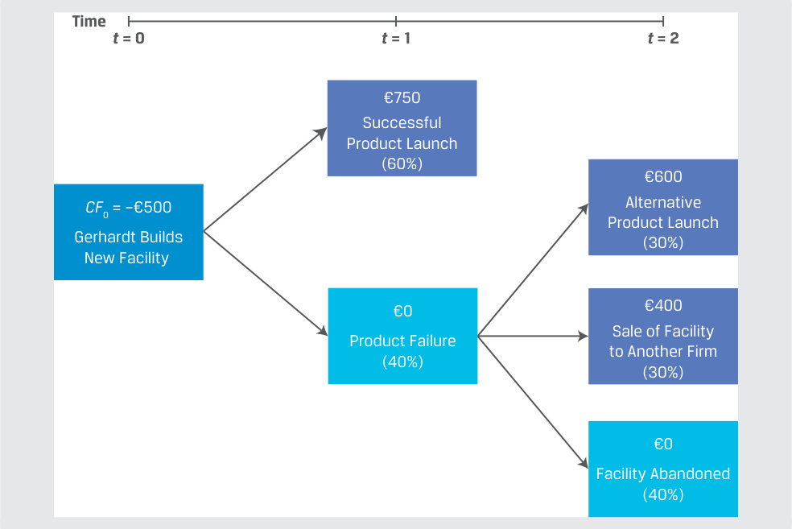
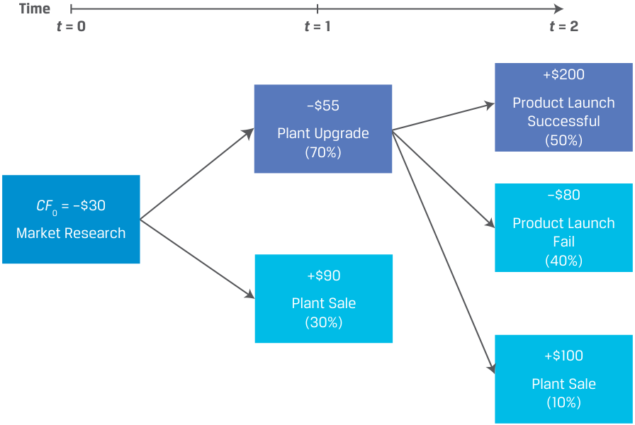
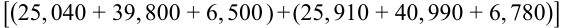

# Volume 3: Corporate Issuers
## Learning Module 5 Capital Investments and Capital Allocation
### Part 3/3: Capital Allocation Principles and Pitfalls (PDF Pages 166–180)

---

<!-- PDF Page 166 -->

6. Complete the sentences by filling in the blanks using the following terms. Note that each term can be used more than once. 

equity profit margin asset turnover long-term liabilities average invested capital 

ROIC can be increased by increasing ______ or ______. A high-______company can earn a low ROIC if ______ is low, and a low-______ company can earn a high ROIC if ______ is high. 

###### **Solution:** 

ROIC can be increased by increasing _<u>profit margin</u>_ or _<u>asset turnover</u>_ . A high- _<u>profit margin</u>_ company can earn a low ROIC if _<u>asset turnover</u>_ is low, and a low- _<u>profit margin</u>_ company can earn a high ROIC if _<u>asset turnover</u>_ is high. 

7. Explain why a government-owned company may have a low required rate of return compared to a small technology company. 

###### **Solution:** 

The required rate of return is the discount rate that investors require given the riskiness of the project or company and the rate of return available on other similarly risky investments. Considering the business risk of both companies, a government-owned company can be perceived as a lower-risk issuer compared to a small technology company. Consequently, investors would require less compensation for risk. 

# **<mark>4</mark> CAPITAL ALLOCATION PRINCIPLES AND PITFALLS** 

describe principles of capital allocation and common capital allocation pitfalls 

<!-- PDF Page 167 -->

##### **Capital Allocation Principles** 

While the analytical tools and investment decision criteria introduced in the prior lesson are quantitative and straightforward, there is considerable latitude for errors and misjudgment. To improve the decision-making process, key principles should be followed when using these tools. 

- _After-tax cash flows:_ Managers should evaluate capital allocation decisions based on after-tax cash flows rather than other profit- or accounting-based measures. Managers must reflect the impact of taxation on a project’s expected cash flows, specifically the tax benefits derived from non-cash deductions, such as depreciation and amortization. 

- _Incremental cash flows only but examine broadly:_ Capital allocation analysis should ignore **sunk costs** , or those expenses that have already been incurred (or written off), and include only incremental cash flows associated with a new investment as compared to without it. However, capital investments often have an impact on the rest of the firm, which may be positive or negative. A positive effect might include cost savings with business activities that directly result from making the investment, while a negative effect might be the loss of sales from a similar product. Both are incremental cash flows, so they should be included in the analysis. 

- _Timing of cash flows:_ The forecasted timing, duration, volatility, and change in the possible direction of the expected cash flows must be considered for a capital investment. Notice how the NPV and IRR can change when cash flows are moved from one period to another. 

##### **Capital Allocation Pitfalls** 

Despite adhering to the principles, capital allocation is challenging for most firms. We divide common capital allocation pitfalls into cognitive errors and behavioral biases. Cognitive errors include calculation and other mistakes, while behavioral biases include errors in judgment and blind spots. 

###### **_Cognitive Errors in Capital Allocation_** 

- _Internal forecasting errors:_ Management may make errors in their forecasts, which may be difficult to impossible for external analysts to identify. However, if significant enough, the incorrect or flawed analysis will ultimately manifest itself in failed, or underperforming, investments. Forecasting errors include incorrect cost or required rates of return inputs. For example, overhead costs such as management time, information technology support, financial systems, can be challenging to estimate. Finally, companies often fail to incorporate competitor responses into the analysis of a planned investment. 

- _Ignoring costs of internal financing:_ The primary source of financing for investments by large corporate issuers is cash flows from operations (i.e., not borrowing or issuing shares). Many management teams behave as if these internally generated funds are “free” but scarce and allocate them according to a budget that is closely tied to prior-period amounts. External financing from debt or equity issuance, however, is treated differently: It is used less often, typically only for larger investments, such as acquisitions, and treated as “expensive.” This is flawed logic. Internally generated capital, such as cash flow from operations, _is_ equity financing because it could be returned to equity investors as a dividend. While it is not raised from equity 

<!-- PDF Page 168 -->

investors by issuing shares, it is withheld from them, incurring their opportunity cost nonetheless. Regardless of financing source, management should use appropriate risk-adjusted required rates of return to evaluate capital investments; those funded by internally generated funds do not automatically get a lower _r_ . 

This error is hard to detect and isolate from other errors and biases, but analysts should inquire about management’s capital allocation process and how the source of financing influences investment decisions. If a company has an aversion to raising external capital and to returning capital, management may potentially be affected by this. 

- _Inconsistent treatment of, or ignoring, inflation:_ Inflation affects capital allocation in several ways. The first is whether the investment analysis is done in nominal or in real terms. Nominal cash flows include inflation effects, whereas real cash flows are adjusted downward to remove the effect of inflation (or adjusted upward to remove the effect of deflation). Companies may perform analysis in either nominal or real terms, but the approach to cash flows and discount rate should be consistent. That is, nominal cash flows should be discounted at a nominal discount rate, and real cash flows should be discounted at a real rate. 

Investment analysis embeds, explicitly or implicitly, expectations for inflation, which probably does not affect all unit prices and unit costs uniformly. For example, rising oil prices are obviously beneficial for oil producers, which sell their product at a higher price. However, rising oil prices over longer time periods can be associated with rising production and capital costs, eroding some of the benefit. Second, many oil companies also own refining and chemical businesses, for which crude oil is the main input. Profitability of those businesses tends to decline as crude prices rise. If actual inflation differs from expected inflation, after-tax cash flows will be better or worse than expected depending on how specific sales outputs or cost inputs are affected. 

###### **_Behavioral Biases in Capital Allocation_** 

- _Inertia:_ In a study of more than 1,600 US listed companies, researchers from McKinsey found a 0.92 correlation between levels of capital investment in a business segment or unit from one year to the next.1 This is the result of management anchoring capital investment budgets to prior-year amounts. Analysts identify this bias by examining the level of capital investment in total, by segment, or by business line, if disclosed, and comparing it to the prior year and the return on investment. If capital investment each year is static or rising despite falling returns on investment, analyst should question the issuer’s justification for a capital investment and whether management should consider alternative uses. 

- _Basing investment decisions on accounting measures, such as EPS:_ Managers often have an incentive to increase accounting measures, such as earnings per share, net income, or return on equity. Many capital investments, even those with high NPVs, can reduce rather than increase these accounting results in the near term, while cost cutting and share buybacks, in contrast, may have a positive effect on such measures. Paying too much attention to short-run accounting numbers can lead a company to choose investments that are not in the long-run interests of its shareholders. Analysts may observe this behavior first by examining the direct financial incentives of management based on the structure and composition of their compensation. 

<!-- PDF Page 169 -->

Second, analysts can compare the level of capital spending to historical and peer levels to judge whether management has prioritized shorter-term, accounting-based measures. That said, lower capital investment may be a sign of limited investment opportunities, in which case allocating capital to alternative uses is a wise decision. 

- _Pet project bias:_ Projects that receive preferential treatment, or so-called **pet projects** , are sometimes selected without thorough capital allocation analysis. In other cases, such analysis is conducted but overly optimistic projections are used to inflate the pet project’s profitability. Identifying pet projects is difficult, because financial statements are usually aggregated and such projects may not meet the threshold of materiality. Instead, analysts should evaluate the corporate governance structure for warning signs that increase the chances of misallocation of capital: controlled companies or significant ownership concentration by a single individual or group, weak oversight by the board of directors, and executive compensation that is not aligned with stakeholders’ interests. 

- _Failure to consider investment alternatives or alternative scenarios:_ While investment idea generation is the first step in the capital allocation process, many viable alternatives are never even considered at some companies. Firms also often fail to consider different outcomes, which can and should be incorporated through breakeven, scenario, and simulation analyses. This error may stem from limited capital investment experience, such as not making divestitures or acquisitions, or no experience with a failed investment. While failure is obviously undesirable, the lack of failure over time may reflect a management team that is not taking enough risk. 

###### **QUESTION SET** 

1. True or false: Investment projects funded using internally generated funds (e.g., cash flow from operations) should be evaluated using a lower required rate of return as compared to projects funded using debt or share issuance. 

###### **Solution:** 

False. Ignoring the cost of internal financing is a common cognitive error. Internally generated capital, such as cash flow from operations, is equity financing because it could be returned to equity investors as a dividend or share repurchase. While internally generated capital is not raised from equity investors by issuing shares, it is withheld from them, therefore incurring their opportunity cost. Regardless of financing source, management should use an appropriate risk-adjusted required rate of return to evaluate capital investments. 

2. Alexandra Tolonen, an investment analyst, prepares forecasts for expansion of a car battery plant and wants to consider the effect of rising lithium carbonate prices. Tolonen adjusts future after-tax cashflows downward to remove the effects of an expected lithium carbonate price increase of 5% 

<!-- PDF Page 170 -->

and uses real discount rates to calculate the project’s NPV. In the second year of the project, the actual lithium carbonate price increased by 10%. 

True or false. Given that Tolonen has used inflation-adjusted cash flows and discount rates, the rise in lithium carbonate prices will not impact the project’s profitability. 

###### **Solution:** 

False. Even though Tolonen was consistent in using real cash flows and real rates while preparing the forecast, this fact does not make the project immune to changes in inflation. If actual inflation differs from expected inflation, after-tax cash flows will be better or worse than expected, depending on how specific cost inputs are affected. 

3. An analyst is analyzing company XYZ and has gathered annual invested capital and ROIC for each of the three XYZ business segments. 

||**Capital**|**Expenditure**|**s ($ m)**||**ROIC**||
|---|---|---|---|---|---|---|
|**Segment**|**20X0**|**20X1**|**20X2**|**20X0**|**20X1**|**20X2**|
|**A**|264|282|303|7.50%|7.10%|6.80%|
|**B**|297|318|340|10.00%|8.90%|7.10%|
|**C**|211|226|242|6.90%|7.80%|9.00%|

Based on the information provided, XYZ’s management is _most likely_ prone to which of the following biases? 

- **A.** Inertia 

- **B.** Sunk cost 

- **C.** Pet project 

###### **Solution:** 

A is correct. Inertia can be identified by examining the level of capital investment in total, by segment, or by business line, if disclosed, and comparing it to the prior year and the return on investment. If capital investment each year is static or rising despite falling returns on investment, the analyst should question the issuer’s justification for a capital investment and whether management should consider alternative uses. In the case of XYZ, we can observe that for segments A and B, ROIC is decreasing, but both segments are getting a higher capital allocation each year. 

B is incorrect because sunk cost is related to the capital allocation process in determining a potential project’s profitability. Sunk costs, or those expenses that have already been incurred, should be ignored when evaluating potential projects. 

C is incorrect because a detailed view of individual investment projects undertaken by XYZ’s management is not provided. Identifying pet projects from outside the firm is difficult, because financial statements are aggregated and such projects may not meet the threshold of materiality. 

4. Bradshaw, a financial analyst, prepares a forecast of future expected gross (pre-tax) cash flows for an investment project. Bradshaw also forecasts future depreciation related to that project and assumes a required rate of return 6%. Based on the information provided and a tax rate of 18%, calculate 

<!-- PDF Page 171 -->

the NPV of the project. In this jurisdiction, depreciation is not deductible for taxes. 

||**Cash Flow and Depr **|**eciation Fore**|**cast**||
|---|---|---|---|---|
|**Time**|**0**|**1**|**2**|**3**|
|**Gross cash flow**|–7.50|4.50|4.50|6.00|
|**l** **Depreciation**|0.00|–1.00|–1.00|–1.00|

###### **Solution:** 

To calculate NPV for this project, Bradshaw should first calculate after-tax cash flows and consider depreciation only to the extent that it is tax deductible and reduces taxes, because it is non-cash. After-tax cash flows can be calculated by applying the following formula to all cash flows to be received in the future. 

###### After‐  tax cash flow _t_ =  Gross cash flow _t_ ×( 1 − Tax rate) . 

||**After-Tax Cash Flo**|**w Forecast**|||
|---|---|---|---|---|
|**Time**|**0**|**1**|**2**|**3**|
|**After-tax cash flow**|–7.50|3.69|3.69|4.92|

The calculation of NPV is follows: 

<!-- Formula Text: NPV  =  − 7.5 + 3.69 _ (1 + 0.06) 1  + 3.69 _ (1 + 0.06) 2  + 4.92 _ (1 + 0.06) 3 . -->

NPV = 3.396 

5. Explain why some managers might reject projects that significantly increase shareholder value (i.e., have a high NPV). 

###### **Solution:** 

Managers may have an incentive to increase accounting profitability measures, such as earnings per share, net income, or return on equity. Many capital investments, even those with high NPVs, can reduce rather than increase these measures in the near term, while cost cutting and share buybacks, in contrast, may have a positive effect on such measures. If this incentive is strong enough, management may forgo high-NPV projects in favor of actions that increase near-term earnings per share. 

#### **REAL OPTIONS** 

describe types of real options relevant to capital investments 

The capital allocation process described earlier implied that firms make all capital investment decisions for a project at inception, maintaining one course of action throughout the life of a project. In practice, firms often have alternatives, known as **real options** , that can alter the value of capital investments. That is, some capital investment decisions are in fact a series of decisions; some are taken today, while 

<!-- PDF Page 172 -->

others can be postponed and will be based on future economic events or information. Similar to financial options, such as derivatives, real options grant a firm the right, but not the obligation, to take an action in the future. A company should only pursue (or **exercise** ) a real option if it is value enhancing. 

Just as the value of a financial option depends on the future value of an underlying asset, real options are contingent on future events for a company. Real options offer flexibility to companies that can greatly enhance the NPV of companies’ capital investments in one or more of the following forms: 

- _Timing option:_ Instead of investing now, the company can choose to delay its investing decision. In doing so, companies forgo near-term returns and hope to obtain improved information for the NPV of projects selected. Investments may be sequenced over time, so that investing in a project creates the option to make future investments. 

- _Sizing option:_ An **abandonment option** allows a company to abandon the investment after it is undertaken if the financial results are disappointing. At some future date, if the cash flow from abandoning an investment exceeds the present value of the cash flows from continuing the investment, the company should exercise the abandonment option. Conversely, if the company can make additional investments when future financial results are strong, the company has a **growth option** , or expansion option. 

- _Flexibility option:_ Companies may also benefit from operational flexibility other than abandonment or expansion once an investment is complete. For example, suppose a firm finds that demand for a product or service exceeds capacity. Management may be able to exercise a **price-setting option** . By increasing prices, the company could benefit from the excess demand, which it cannot do by increasing production. Alternatively, a firm may consider **production flexibility options** to alter production when demand differs from its forecast. For example, a firm may add overtime or extra shifts to increase production for a given capacity. 

- _Fundamental option:_ The entire value of an investment may depend on factors outside the firm’s control, such as the price of a commodity. For example, the value of an oil well or refinery investment is contingent on the price of oil. The value of a gold mine is contingent on the price of gold. If oil prices were low, a company likely would not choose to drill a well. If oil prices were high, it would go ahead and drill. Many R&D (research and development) projects are also very similar to such options. 

Firms use several approaches in evaluating capital investments with these characteristics, such as the following: 

**1.** Investment analysis _without_ considering options: If the NPV is positive without considering real options and the project involves real options that could increase its net present value, then the NPV represents a _minimum_ return and the firm should make the investment. 

**2.** Calculation of NPV with real options: Under this approach, the firm calculates a project’s NPV based on expected cash flows and then subtracts the incremental cost of the real option and adds its associated value, as shown in Equation 4: 

Project NPV = NPV (without options) – Option cost + Option value. 

<!-- PDF Page 173 -->

**3.** Decision trees and option pricing models: Either approach may be used by firms seeking to assess the value of a capital investment that involves future sequential decisions and alternative outcomes for a given investment. These models often assign a probability and expected timing to future outcomes, which are used to calculate the project’s NPV. 

To calculate the return on capital investments with or without real options, firms must often assume an expected probability for future events. The following example provides an illustration using a decision tree for evaluating the return on a capital investment with and without real options. 

###### **EXAMPLE 9** 

##### **Gerhardt Corporation Capital Allocation Using a Decision Tree** 

Assume that Gerhardt Corporation is considering a €500 million outlay for a capital investment in a facility to produce a new product. Gerhardt assigns a 60% probability to a successful product launch, which is expected to return €750 million in one year’s time. Gerhardt’s finance team has also conducted an analysis of alternative facility uses, summarizing the timing and probability of cash flows associated with each real option in the following decision tree. 

Gerhardt Corporation Decision Tree 

<!-- Start of picture text -->
Time t  = 0 t  = 1 t  = 2 €750 Successful Product Launch (60%) €600 CF 0 = –€500 Alternative Product Launch Gerhardt Builds (30%) New Facility €0 €400 Sale of Facility Product Failure to Another Firm (40%) (30%) €0 Facility Abandoned (40%) <!-- End of picture text -->

1. Calculate the NPV of Gerhardt’s project _without_ real options using a 10% required rate of return ( _r_ ). 

###### **Solution:** 

The NPV without real options uses Equation 1 and a probability-weighted cash flow if the product is successfully launched (60%) and a 40% probability that future cash inflows are zero: 

<!-- PDF Page 174 -->

_ CF 1 NPV =  CF 0 +   (1 + _r_ )1+ ,or _ NPV = − 500 +(0.6 × 750) (1.10) 

Because NPV = –€90.91, Gerhardt should not pursue the project, based on the NPV decision rule. 

2. Calculate the NPV of Gerhardt’s proposed project _with_ real options and a 10% required rate of return. 

###### **Solution:** 

Calculate NPV with real options using Equation 1 and probability-weighted cash flows in future periods: 

 C F_ 1  C F_ 2 NPV = _C F_ 0 +   (1 + _r_ )1+ (1 + _r_ )2 _ ____________________________ = − 500 +(0.6 × 750) (1.10)1 +  [(0.4 × 0.3 ) × 600 ] + [(0.4 × 0.3 ) × 400] (1.10)2 

The NPV _with_ real options equals €8.26, which implies based on the NPV decision rule that Gerhardt should invest in the new production facility if alternative uses in the future are considered. Note that the cash flow calculation for the second period is based on the conditional probabilities of specific outcomes. That is, in the case of both the possible alternative product launch and facility sale to another firm, the 30% probability of each of these mutually exclusive outcomes _given_ a product failure in Period 1 (40%) makes the conditional probability of each event equal to 12% (= 0.4 × 0.3). 

As the previous example shows, the inclusion of real options in the capital allocation process to incorporate different scenarios related to internal and external events and their expected impact on future after-tax cash flows can materially change the evaluation of an investment. 

###### **QUESTION SET** 

1. Which of the following statements about real options is true? 

   - **A.** Using option pricing models estimates an option’s value with the highest accuracy. 

   - **B.** Real options allow companies to abandon an investment project if its profitability is poor. 

   - **C.** Real options would allow a refinery to hedge future prices of crude oil needed for production. 

###### **Solution:** 

B is correct. An abandonment option is a type of real option, which allows a company to abandon the investment after it is undertaken. 

A is incorrect because even though real options can be priced using option pricing models, the estimates require multiple unobservable inputs, such as probabilities of events and timing of their occurrence. The complexity does not necessarily improve accuracy. 

C is incorrect because real options provide companies with flexibility with regard to future decisions; however, they do not allow the hedging of commodity prices. The risk of crude oil price changes can be hedged using financial options, not real options. 

<!-- PDF Page 175 -->

2. ScolarCorp is planning a market research campaign to gauge interest in a new type of product. If interest in the new product is high, the company will need to upgrade its existing production plant to allow for product manufacturing. Alternatively, if interest is low, ScolarCorp will sell the plant for $90 million. The required rate of return for the project is 7.5%. A ScolarCorp analyst summarized the timing and probability of cash flows associated with each alternative use in the following decision tree. 

<!-- Start of picture text -->
Time t  = 0 t  = 1 t  = 2 +$200 –$55 Product Launch Successful Plant Upgrade (50%) (70%) –$80 CF 0 = –$30 Product Launch Market Research Fail (40%) +$90 Plant Sale (30%) +$100 Plant Sale (10%) <!-- End of picture text -->

Based on the decision tree, match the following factors with the impact on the capital project’s value (option value): 

Increase in market research cost 

Decrease in market research cost 

Increase in plant sale price 

Decrease in plant sale price 

Increasing required rate of return 

Decreasing required rate of return 

**Increases Project Value Decreases Project Value** 

###### **Solution:** 

|**Increases Project Value**|**Decreases Project Value**|
|---|---|
|Decrease in market research cost|Increase in market research cost|
|Increase in plant sale price|Decrease in plant sale price|
|Decreasing required rate of return|Increasing required rate of return|

The calculation of the NPV of the project, considering all alternatives and their probabilities, can be carried out as follows: 

<!-- PDF Page 176 -->

<!-- Formula Text: NPV  =  CF 0 + CF 1 _ (1 + r) 1  + CF 1 _ (1 + r) 2 . NPV  =  − 30 +  (− 55 × 0.7 + 90 × 0.3) ________________ (1 + 0.075) 1 +  (200 × (0.7 × 0.5) − 80 × (0.7 × 0.4) + 100 × (0.7 × 0.1)) ________________________________________ (1 + 0.075) 2 . -->

<!-- Formula Text: NPV = $6.549. -->

Impact of increase in market research cost 

If the market research cost increases, for example, by 10 (to –40), the NPV of the entire project will decrease by the same amount. Given that initial outlay occurs at _t_ = 0, it does not need to be discounted. 

Impact of increase in plant sale price 

If the plant sale price increases (either in Year 1 or Year 2), the NPV of the entire project will increase by a smaller amount, given that corresponding cash flow needs to be probability adjusted and discounted to _T_ 0. 

Impact of increase in required rate of return 

An increase in the required rate of return will decrease the NPV of the entire project, given that it is used to discount future cash flows. 

3. Company XYZ is considering expanding its distribution center in a foreign country. The local government is working on a new environmental regulation that introduces subsidies and tax breaks for investments related to renewable energy. Once the new law is approved, XYZ could upgrade the distribution center at lower cost. If the company decides to wait for the new regulation to come into effect, it will have to bear project-related costs of $1.8 million. XYZ’s finance team estimates that if the company waits, the NPV of the project will be $9.7 million, compared to a current value of $8.9 million. Calculate option value. 

###### **Solution:** 

To determine option value, we need to compare the project value with and without the option and additionally consider option cost. 

Project NPV (with option) = $9.7 million. 

Project NPV (without option) = $8.9 million. 

Option cost = $1.8 million. 

Project NPV (with option) 

= Project NPV (without option) – Option cost + Option value. 

$9.7 million = $8.9 million – $1.8 million + Option value. 

Option value = $2.6 million. 

<!-- PDF Page 177 -->

## **~~PRACTICE PROBLEMS~~** 

### **The following information relates to questions 1-5** 

Larissa Soroka, an analyst at ABC company, has been asked to prepare cash flow forecasts for two mutually exclusive investment projects related to new products. ABC’s management asks Soroka to include the cost of market research that was recently completed as well as the potential loss of revenue from existing products that could occur if either project is undertaken. Soroka presents the forecast in Exhibit 1 and is asked to calculate IRR and NPV for both projects. Investors in ABC have a required rate of return of 8%. 

###### **Exhibit 1** 

||**Cash Flow Fo**|**recast for**|**Projects A**|**and B**||
|---|---|---|---|---|---|
|**Time**|**0**|**1**|**2**|**3**|**4**|
|**Project A**|(18.5)|4.5|6.0|6.0|5.5|
|**Project B**|(33.5)|(2.5)|(1.0)|24.0|25.5|

ABC’s management asks Soroka to consider in her forecast the impact of a six-month delay in all future cash flows and estimate the impact of that event on IRR and NPV. 

After reviewing the forecast, ABC’s management asks Soroka to estimate ABC’s ROIC for 20X2. ABC earned operating profit of $8,830, had an effective tax rate of 22%, and reported the balance sheet in Exhibit 2. 

###### **Exhibit 2** 

|**ABC Balance Sheet** **(end-of-period values)**||
|---|---|
|**Assets:** **20X1**|**20X2**|
|Cash 1,600|1,720|
|Short-term assets 30,450|29,910|
|Long-term assets 60,250|62,060|
|Total assets 92,300|93,690|
|**Liabilities and equity:** **20X1**|**20X2**|
|Accounts payable 12,930|11,620|
|Short-term debt 8,030|8,390|
|Long-term debt 25,040|25,910|
|Share capital 39,800|40,990|

<!-- PDF Page 178 -->

|**Liabilities and equity:**|**20X1**|**20X2**|
|---|---|---|
|Retained earnings|6,500|6,780|
|Total liabilities and equity|92,300|93,690|

ABC’s management has an ROIC objective of at least 9.2% and asks Soroka for her recommendation about the projects. 

**1.** When preparing the cash-flow forecasts for both projects, Soroka should include: **A.** only the cost of the market research. 

   - **B.** only the loss of revenue from existing products. 

   - **C.** both the market research cost and the loss of revenue from existing products. 

**2.** With regard to Project A and Project B, which of the following is true? **A.** Both projects should be invested in according to the IRR decision rule. 

   - **B.** Both projects should be invested in according to the NPV decision rule. 

   - **C.** Only Project B should be invested in according to the IRR decision rule. 

**3.** The _most likely_ impact from the cash-flow timing considered by Soroka is that: **A.** both IRR and NPV would decrease. 

   - **B.** both IRR and NPV stay unchanged. 

   - **C.** only IRR would decrease but NPV would increase. 

**4.** Based on ABC’s balance sheet presented in Exhibit 2, Soroka should calculate: **A.** average invested capital of $72,510 and ROIC of 9.50%. 

   - **B.** average invested capital of $80,720 and ROIC of 10.94%. 

   - **C.** average invested capital of $92,995 and ROIC of 9.50%. 

**5.** Considering ABC management’s ROIC-based investment criterion and the IRR and NPV of both projects, Soroka should recommend to: 

   - **A.** reject both projects A and B. 

   - **B.** invest only in Project B because it has a higher NPV. 

   - **C.** invest only in Project A because has positive cash flow during all four years. 

<!-- PDF Page 179 -->

## **~~SOLUTIONS~~** 

1. B is correct. Capital allocation analysis should include only incremental cash flows associated with a new investment. The loss of revenue from existing products is an incremental negative effect that should be included in the analysis. The market research costs in this case are a sunk cost because the research has already been completed and therefore does not affect cash-flow estimates, no matter whether ABC undertakes either of these projects or neither of them. 

2. C is correct. The IRR decision rule is to invest if the IRR exceeds the required rate of return or hurdle rate. Project B’s IRR is 8.97%, which exceeds the required rate of return of 8%; however, Project A’s IRR is 7.04%, which is below the required rate of return of 8%. 

The NPV of both projects can be calculated as follows: 

<!-- Formula Text: NPV A  =  − 18.5 + 4.5 _ (1 + 0.08) 1  + 6 _ (1 + 0.08) 2 6 _ (1 + 0.08) 3 5.5 _ (1 + 0.08) 4   =  − 0.38. NPV B  =  − 33.5 + − 2.5 _ (1 + 0.08) 1  + − 2.5 _ (1 + 0.08) 2 24 _ (1 + 0.08) 3 25.5 _ (1 + 0.08) 4   =   1.12. Using the same equation, we can solve for the IRRs by assuming that N 0  =  − 18.5 + 4.5 _ (1 + IRR A) 1  + 6 _ (1 + IRR A) 2  + 6 _ (1 + IRR A) 3  + 5.5 _ (1 + IRR A) 4 . IRR A  =  7.04%. 0  =  − 33.5 + − 2.5 _ (1 + IRR B) 1  + − 2.5 _ (1 + IRR B) 2  + 24 _ (1 + IRR B) 3  + 25.5 _ (1 + IRR B) 4 . IRR B  =  8.97%. -->

Using the same equation, we can solve for the IRRs by assuming that NPV = 0. 

A is incorrect because Project B’s IRR is 8.97%, which exceeds the required rate of return of 8%; however, Project A’s IRR is 7.04%, which is below the required rate of return of 8%. Consequently, only Project B meets the IRR decision rule. B is incorrect because the NPV decision rule is to invest if the NPV is greater than 0. Project B’s NPV is $1.12 million, while Project A’s NPV is –$0.38. Consequently, only Project B meets the NPV decision rule. 

3. A is correct. The forecasted timing of cash flow is an important factor affecting both projects’ IRR and NPV. In the case of delaying all future cash flows from both projects by six months, the result would be a lower IRR and a lower NPV. Given that all future cash flows are to be received six months later, their present value decreases; hence, the NPV and IRR of an entire project also decrease. B is incorrect because when cash flows from the investment projects are delayed by six months, both projects’ NPV and IRR would decrease, not stay unchanged. C is incorrect because when cash flows from the investment projects are delayed by six months, both project’s NPV and IRR would decrease. 

4. A is correct. To calculate ROIC, we can use the following formula: 

________________________( 1 − Tax rate) ×  Operating profit _t_ ROIC = Average invested capital _t_ −1, _t_, where 

<!-- PDF Page 180 -->

Average invested capital _t_ −1, _t_ =  ________________________________(Debt + Equity)20X1  +  2 (Debt + Equity)20X2  ) 

<!-- Formula Text: [(25, 040 + 39, 800 + 6, 500 ) + (25, 910 + 40, 990 + 6, 780)] -->

Average invested capital _t_ −1, _t_ =   _________________________________________2 

Average invested capital _t_ −1, _t_ = 72, 510. 

ROIC =   _____________(1 − 0.22) × 8, 830 . 72, 510 

ROIC = 9.50%. 

5. A is correct. ABC’s management aims to achieve a minimum ROIC above 9.20%, but the IRR of both projects fails to meet this investment criterion. Even though Project B has a positive NPV, if it were undertaken, it would reduce ROIC. B is incorrect because even though Project B’s NPV is $1.12 million (which increases ABC’s value to shareholders), its IRR is 8.97%, which is below the target ROIC of 9.20%. Consequently, if Project B was undertaken, it would lower ABC’s ROIC. 

C is incorrect because Project A’s IRR is below ABC management’s target ROIC of 9.2%. Additionally, Project A’s NPV is negative, so it decreases ABC’s shareholder value. 

