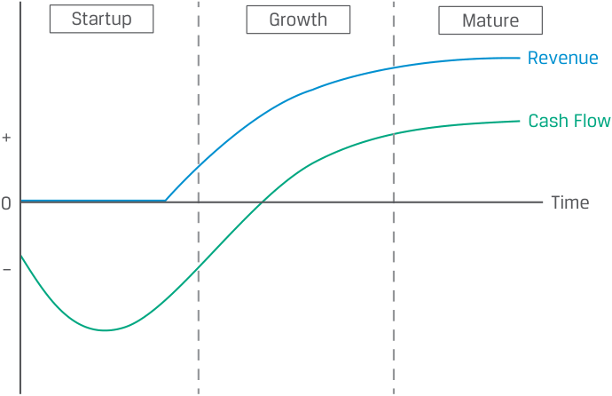

# Volume 3: Corporate Issuers
## Learning Module 6 Capital Structure
### Part 2/4: Factors Affecting Capital Structure (PDF Pages 188–198)

---

<!-- PDF Page 188 -->

_We_ = $800,000/$1,200,000 = 0.67. 

Thus, the book value weight for debt (0.40) is higher than the market value weight (0.33). 

4. If the marginal corporate tax rate is 20% and the stock price increases to $25, the WACC for Company X is closest to: 

**A.** 7.60%. 

**B.** 8.26%. 

**C.** 8.55%. 

**Solution:** 

B is correct. 

The book value weights are computed as follows: 

_Wd_ = $400,000/$1,000,000 = 0.40. 

_We_ = $600,000/$1,000,000 = 0.60. 

The market value of equity is equal to $25 × 40,000 shares = $1,000,000. The market value weights are computed as follows: 

_Wd_ = $400,000/$1,400,000 = 0.29. 

_We_ = $1,000,000/$1,400,000 = 0.71. 

The appropriate weights for the WACC calculation are the market weights Company X’s WACC, using the market weights, is calculated as follows: 

WACC = (weighting of debt * cost of debt) + (weighting of equity * cost of equity) 

= (0.29) (5%)(1-0.2) +(0.71)(10%) = 8.26% 

5. Fill in the blanks using the following two terms: 

higher 

lower 

Shareholder value is increased by a ________________ return on investment and a capital structure that results in a ________________ WACC. **Solution:** 

Shareholder value is increased by a _<u>highe</u>_ <u>r return on investment and a capi-</u> tal structure that results in a _<u>lower</u>_ WACC. 

# **<mark>3</mark>** 

## **FACTORS AFFECTING CAPITAL STRUCTURE** 

explain factors affecting capital structure and the weighted-average cost of capital 

<!-- PDF Page 189 -->

Issuers desire a capital structure that minimizes its weighted-average cost of capital and generally matches the duration of its assets. The total amount and type of financing needed are generally determined by the issuer’s business model and its position in the corporate life cycle. The costs of debt and equity are determined in financial markets by top-down factors that affect debt and equity markets generally, as well as investors’ assessments of issuer-specific risk factors, as summarized in Exhibit 1. 

**Exhibit 1: Factors Affecting Capital Structure** 

<!-- Start of picture text -->
Internal Factors: Business Model Stage in Life Cycle Cash Flows and Short-Term Short-Term Liabilities Profitability Assets Asset Types and Long-Term Ownership Debt Long-Term Assets External Factors: Ownership Capital (Equity) Capital Markets and Economic Conditions Regulatory Constraints Industry Factors <!-- End of picture text -->

### **Determinants of the Amount and Type of Financing Needed** 

The total amount and type of financing needed (thus, the weightings in the WACC calculation) generally depend on the issuer’s business model and its position in the corporate life cycle. 

#### **_Capital-Intensive Businesses_** 

Some businesses require a lot of assets—for example, those in utilities; transportation; real estate; some types of manufacturing, such as semiconductors; and natural resource production. These are known as **capital-intensive businesses** . This need for lots of assets is evident from low asset turnover (low sales-to-total-assets ratio), high capital expenditures to sales, and high net-working-capital-to-sales ratios. 

While many businesses were once vertically integrated and more capital intensive, many have separated into multiple, focused companies where the capital-intensive business is separate from the customer-facing brand or service businesses. The businesses then have contractual rather than ownership relations. For example, Hilton Worldwide, one of the world’s largest hotel companies, operates almost all its hotel rooms through long-term franchise or management agreements, with the hotels themselves owned by others. Similarly, NVIDIA designs and tests its products but does not manufacture semiconductor wafers; that capital-intensive activity is instead done by Taiwan Semiconductor Manufacturing Company Limited and Samsung Electronics Co. Ltd. 

<!-- PDF Page 190 -->

#### **EXAMPLE 1** 

### **Leases as Debt Financing** 

Many business models require fungible and tangible assets, such as 

- office space, 

- data centers, 

- IT devices, such as PCs, phones, and tablets, 

- aircraft, and 

- automobiles. 

While companies could buy these assets for cash or borrow cash and buy them, a more common approach is to lease them from a lessor, such as a bank or specialized asset lessor—for example, AerCap Holdings N.V., which leases over 1,000 aircraft to airlines. 

A lease is like a loan, but rather than receiving cash in exchange for interest and principal payments, the borrower (lessee) receives an asset in exchange for lease payments. Implicit in the lease is an interest rate that is often much lower than what the lessee would have been lent cash for, because the leased asset is collateral and because lessors are often large companies that can borrow cheaply. 

Another similar approach to financing fungible and tangible assets is through secured debt. By using the asset as collateral for a loan or bond, the issuer may be able to obtain a far lower cost of debt than on an unsecured basis. This is true of a downtown office building but probably not for a highly specialized factory in a remote location or a consumable asset that has little value to investors as collateral. 

The capital structures of some firms can be regulated by governments. For example, banks must adhere to regulatory capital standards by maintaining a certain percentage of equity as a proportion of assets. Similarly, regulatory oversight of public utility companies by local governments can influence their capital structures through rules and regulations relating to setting pricing/rates. This generally increases WACC because it results in higher equity financing. 

#### **_“Capital-Light” Businesses_** 

Some business models—notably in the technology sector, as well as service businesses that have shed their capital-intensive businesses—have low capital needs (i.e., high fixed asset turnover and/or low capital-expenditures-to-sales-ratios), known as **capital-light businesses** , or asset-light businesses. Their assets might be primarily composed of excess cash and some intangibles. This reflects several factors: 

- They simply operate a network for others that own assets and thus do not need to seek financing for them from financial markets. For example, Uber and Airbnb operate global ridesharing and hospitality networks, respectively, that connect drivers and hosts who own the automobile and real estate assets with riders and guests. The companies earn commissions and fees from network users. 

- The company may charge its customers upfront for services or have a very short or negative cash conversion cycle, thus obviating the need for external financing for working capital. 

<!-- PDF Page 191 -->

- The company may compensate employees and management primarily with stock, which the employees and management are happy to accept based on a rising stock price, again obviating the need for cash. This is technically a form of equity financing, but from employees rather than formal financial markets. 

- If the company is profitable from an early stage and is capital light, it may not need to raise significant external financing unless management intends to expand quickly. 

#### **_Corporate Life Cycle_** 

Besides the business model determining the amount of financing needed, a large determinant of the type of financing (debt versus equity) used is based on the company’s life cycle stage. Rather than a static capital structure, most firms have a capital structure that changes over time. The framework in Exhibit 2 describes the relationship between a company’s life cycle stage, its cash flow characteristics, and its ability to support debt. 

**Exhibit 2: Capital Structure and Company Life Cycle** 

<!-- Start of picture text -->
Startup Growth Mature Revenue Cash Flow + 0 Time – <!-- End of picture text -->

|**Feature / Phase**|**Startup**|**Growth**|**Mature**|
|---|---|---|---|
|Revenue Growth|Initial|Rising|Slowing|
|Free Cash Flow|Negative|Rising|Stable|
|Business Risk|High|Medium|Low|
|Debt Availability|Little or None|Rising|High|
|Debt Type|Convertible|Secured|Unsecured|

As companies mature, business risk typically declines and a firm’s cash flows turn positive and stabilize, allowing for greater use of debt financing on better terms and at lower cost. Note that the framework considers free cash flow, which is net of capital investment. Profitable, high-growth businesses may have negative free cash flow once greater investments are considered. While the life cycle stages of a company often mirror those of an industry, both startup and growth companies can often be found in mature industries. Examples include restaurants and apparel, with new concepts, formats, and fashions appearing regularly, as well as technology-driven disruption of established industries, such as advertising (TikTok and Douyin), retail (Shopify), and automobiles (Tesla and BYD). 

<!-- PDF Page 192 -->

#### **Early Stage/Startup** 

- Early in its life, a company requires funding to develop and launch its first product or service. Revenues are zero or minimal, and the risk of business failure is high. The uncertain prospects and negative free cash flow lead most startups to seek equity rather than debt financing. Many stock exchanges have minimum size and profitability requirements and costly regulatory requirements, so equity financing for startups is usually sourced from founders, employees, and venture capital investors rather than through an IPO. 

- At this early stage, the only types of debt financing that might be available are leases and convertible debt. Leased assets commonly include office or retail real estate that can be leased at a low cost. Second, in some cases, startups may be able to raise **convertible debt** , or debt that offers investors the right to convert the debt to equity in the future at a predetermined price, while usually deferring interest payments until maturity. Convertible debt and other instruments combining debt and equity features are covered later in the curriculum. 

#### **Growth** 

- As a company emerges from the startup stage, product demand may result in rising revenue and accelerating growth, but further investment is needed to support growth and build scale. This includes sales and marketing expenses, growth-related capital expenditures, and working capital. Free cash flow is still likely negative, but visibility is improving as the firm establishes its customer and supplier base. 

- As business risk declines and free cash flow improves, the business becomes more attractive to lenders. Many growth companies use debt conservatively to preserve operational and financial flexibility and minimize the risk of financial distress. Equity remains the predominant source of financing. 

#### **Mature Phase** 

- As a firm reaches maturity, revenue growth slows but also becomes more predictable. A mature firm usually generates reliable and positive free cash flow and likely has an established customer and supplier base. There is typically a decline or a deceleration in growth-related investment spending. Consistent free cash flow allows the company to borrow more cheaply, which is usually more attractive than higher-cost equity. 

- In practice, large, mature public companies commonly use significant debt in their capital structures, although many seek to maintain an investment-grade credit rating to preserve maximum financial flexibility and minimize the cost of debt. Mature companies may elect to distribute capital to shareholders by increasing dividends or repurchasing shares. 

### **Determinants of the Costs of Debt and Equity** 

The costs of debt and equity are determined in financial markets by top-down factors that affect debt and equity markets generally, as well as investors’ assessments of issuer-specific factors. While the cost of debt is lower than the cost of equity, these costs are influenced by the same risk factors and thus tend to move together because they are claims on the same cash flows. 

<!-- PDF Page 193 -->

#### **_Top-Down Factors_** 

Top-down factors affecting the cost of capital include financial market conditions and industry conditions. 

Economic conditions can significantly influence debt and equity investors’ expected returns, whether in private or public markets. Debt investors can invest on a nearly risk-free basis in sovereign government debt and will demand a spread over that as compensation for assuming the issuer-specific risks. Macroeconomic and country-specific factors (real growth, inflation, monetary policy, and exchange rate changes) can increase both interest rates on sovereign governments debt and credit spreads across issuers. As recession risk increases, debt investors may charge borrowers much higher spreads, owing to the increasing possibility of default. This effect is often more pronounced among firms in cyclical sectors, such as mining, materials, or industrials, in which revenues and cash flows vary widely through the economic cycle. The same is true for equity investors; companies ideally want to borrow when interest rates are low, and they want to issue equity when stock prices are high. This tends to follow the same conditions as when credit spreads are low. 

The industry in which a firm operates is likely to have a significant effect as well. Exposure to economic factors is generally based on the products or services the issuer sells. For example, higher oil prices might lead to lower credit spreads and greater investor willingness to increase financial leverage for oil producers, while the opposite may happen for airlines, for which fuel is a significant expense. 

#### **_Issuer-Specific Factors_** 

Debt and equity investors consider the risk and return profile of an issuer and adjust their required rates of return relative to base rates or broad averages by evaluating risk factors, including the following: 

**1.** Sales risks 

**2.** Profitability risks (operating leverage) 

**3.** Financial leverage and interest coverage 

**4.** Collateral/type of assets owned by the firm. 

Investors are more confident, all else equal, in firms with stable, predictable, and growing revenues and so will extend financing at lower costs to these types of firms. This is generally the result of size and the characteristics of the firm’s products and services. For example, established firms in the telecommunications or software industries have stable cash flow streams from recurring subscription-based revenues from many customers, so no single customer represents more than a small fraction of total revenues. In contrast, such industries as automobile and construction equipment manufacturing have more volatile cash flows that are highly sensitive to economic conditions, increasing the risk of default should business conditions worsen. 

Besides stability of revenues, stability of profit margins is also an important factor, which is determined by a company’s proportion of fixed versus variable costs. This is often measured using a firm’s **operating leverage** , or its proportion of fixed costs to total costs: 

Operating leverage = Fixed costs/Total costs. ~~(2)~~ 

Companies with higher operating leverage experience a greater change in cash flow and profitability for a given change in revenue than firms with low operating leverage, as shown in the following example. 

<!-- PDF Page 194 -->

#### **KNOWLEDGE CHECK: FIXED VS. VARIABLE COST AND FIRM PROFITABILITY** 

Consider two companies fully financed by equity. Each firm has revenue of 100 over a particular period and expenses of 70. 

   - The first company (Firm _FC_ +) has fixed costs ( _FC_ ) of 50 and variable costs ( _VC_ ) equal to 20% of sales, or 20. 

   - The second company (Firm _FC_ –) has fixed costs of 20 and variable costs equal to 50% of sales. 

1. Calculate profit (revenue – total costs) for each firm, and compare their returns on equity (profit/total equity). 

#### **Solution:** 

Solve for profit by subtracting fixed costs ( _FC_ ) and variable costs from revenue and dividing the profit by total equity to calculate the one-period return on equity: 

|**Firm****_FC_+** **(Primarily Fixed Cost)**||**Firm****_FC_–** **(Primarily Variable Cost)**||
|---|---|---|---|
|Revenue|100|Revenue|100|
|Less: Fixed Costs|–50|Less: Fixed Costs|–20|
|Variable Cost (20%)|–20|Variable Cost (50%)|–50|
|Profit|30|Profit|30|
|Total Equity|100|Total Equity|100|
|**Return on Equity**|**30%**|**Return on Equity**|**30%**|

2. Calculate the return on equity (ROE) for each firm if both firms experience a 25% increase in sales. **Solution:** 

|**Firm****_FC_+** **(Primarily Fixed Cost)**|**25% Sales Decline**|**Base Case**|**25% Sales Rise**|
|---|---|---|---|
|Revenue|75|100|125|
|Less: Fixed Costs|50|50|50|
|Variable Cost (20%)|15|20|25|
|Profit|10|30|50|
|Total Equity|100|100|100|
|**Return on Equity**|**10%**|**30%**|**50%**|

|**Firm****_FC_–** **(Primarily Variable Cost)**|**25% Sales Decline**|**Base Case**|**25% Sales Rise**|
|---|---|---|---|
|Revenue|75|100|125|
|Less: Fixed Costs|20|20|20|
|Variable Cost (50%)|37.5|50|62.5|
|Profit|17.5|30|42.5|

<!-- PDF Page 195 -->

|**Firm****_FC_–** **(Primarily Variable Cost)**|**25% Sales Decline**|**Base Case**|**25% Sales Rise**|
|---|---|---|---|
|Total Equity|100|100|100|
|**Return on Equity**|**18%**|**30%**|**43%**|

3. Calculate the ROE for each firm if both firms experience a 25% decrease in sales. 

#### **Solution:** 

|**Firm****_FC_+** **(Primarily Fixed Cost)**|**25% Sales Decline**|**Base Case**|**25% Sales Rise**|
|---|---|---|---|
|Revenue|75|100|125|
|Less: Fixed Costs|50|50|50|
|Variable Cost (20%)|15|20|25|
|Profit|10|30|50|
|Total Equity|100|100|100|
|**Return on Equity**|**10%**|**30%**|**50%**|

|**Firm****_FC_–** **(Primarily Variable Cost)**|**25% Sales Decline**|**Base Case**|**25% Sales Rise**|
|---|---|---|---|
|Revenue|75|100|125|
|Less: Fixed Costs|20|20|20|
|Variable Cost (50%)|37.5|50|62.5|
|Profit|17.5|30|42.5|
|Total Equity|100|100|100|
|**Return on Equity**|**18%**|**30%**|**43%**|

4. Which firm might debt investors be willing to extend credit to at a lower cost of debt? Explain your answer. 

#### **Solution:** 

Based on the information provided, debt investors might be willing to extend credit at a lower cost of debt to Firm _FC_ – because its profits and profitability are more stable, especially in the downside case of a 25% decline in sales. The firm’s stability of profits makes it more likely than Firm _FC_ + to be able to make promised interest and principal payments even if sales decline. The stability of profits results from a higher percentage of costs that are variable; in other words, it has lower operating leverage. 

In practice, debt investors would, among other things, evaluate the stability of sales and develop an outlook for sales growth for both firms. While Firm _FC_ – has lower operating leverage, it could have greater sales risk than Firm _FC_ +. 

Financial leverage and interest coverage are important considerations because a company with significant indebtedness already is less able to support _incremental_ debt because it has already committed to interest and principal payments. Additionally, for equity investors, high levels of indebtedness mean that there are significant priority claims ahead of them. Financial leverage, covered in a prior lesson, is often measured 

<!-- PDF Page 196 -->

using a ratio of either total debt or debt net of cash and marketable securities to a profit measure, such as operating income, or to total equity. Interest coverage measures an issuer’s ability to make interest payments from its core business profits: 

Interest coverage = Profit before interest and taxes/Interest expense. ~~(3)~~ 

#### **KNOWLEDGE CHECK: FINANCIAL LEVERAGE AND FIRM PROFITABILITY** 

Consider two companies both with assets of 100. 

   - Firm A is financed with 80 in equity and 20 in debt, while Firm B is financed with 40 equity and 60 debt. 

   - Each firm has revenue of 100 over a particular period and non-interest expenses of 70. Firm A has interest expense of 2, while Firm B has interest expense of 9. Ignore income taxes. 

1. Calculate profit, interest coverage, and ROE for each firm. **Solution:** 

|**Firm A** **(Majority Equity)**||**Firm B** **(Majority Debt)**||
|---|---|---|---|
|Revenue|100|Revenue|100|
|Less: Operating expenses|–70|Less: Operating expenses|–70|
|Operating income|30|E|30|
|Less: Interest expense|–2|Less: Interest expense|–9|
|**Interest coverage** **i**|**15**|**Interest coverage** **i**|**3.3**|
|**Profit**|**28**|**Profit**|**21**|
|Total Equity|80|Total Equity|40|
|**Return on Equity**|**35%**|**Return on Equity**|**53%**|

2. Calculate ROE and interest coverage for each firm if both experience a 25% increase in operating income. 

#### **Solution:** 

|**Firm A**||||
|---|---|---|---|
|**(Majority Equity)**|**25% OI Decline**|**Base Case**|**25% OI Rise**|
|Operating income|22.5|30|37.5|
|Less: Interest expense|–2|–2|–2|
|**Interest coverage**|**11**|**15**|**19**|
|Profit|20.5|28|35.5|
|i Total Equity|80|80|80|
|**Return on Equity**|**26%**|**35%**|**44%**|
|**Firm B**||||
|**(Majority Debt)**|**25% OI Decline**|**Base Case**|**25% OI Rise**|
|Operating income|22.5|30|37.5|
|Less: Interest expense|–9|–9|–9|
|**Interest coverage**|**2.5**|**3.3**|**4.2**|

<!-- PDF Page 197 -->

|**Firm B** **(Majority Debt)**|**25% OI Decline**|**Base Case**|**25% OI Rise**|
|---|---|---|---|
|Profit|13.5|21|28.5|
|Total Equity|40|40|40|
|**Return on Equity**|**34%**|**53%**|**71%**|

3. Calculate ROE and interest coverage for each firm if both experience a 25% decrease in operating income. 

#### **Solution:** 

|**Firm A** **(Majority Equity)**|**25% OI Decline**|**Base Case**|**25% OI Rise**|
|---|---|---|---|
|Operating income|22.5|30|37.5|
|Less: Interest expense|–2|–2|–2|
|**Interest coverage**|**11**|**15**|**19**|
|Profit|20.5|28|35.5|
|Total Equity|80|80|80|
|**Return on Equity**|**26%**|**35%**|**44%**|

|**Firm B** **(Majority Debt)**|**25% OI Decline**|**Base Case**|**25% OI Rise**|
|---|---|---|---|
|Operating income|22.5|30|37.5|
|Less: Interest expense|–9|–9|–9|
|**Interest coverage**|**2.5**|**3.3**|**4.2**|
|Profit|13.5|21|28.5|
|Total Equity|40|40|40|
|**Return on Equity**|**34%**|**53%**|**71%**|

4. Which firm might investors require lower rates of return for on debt and equity? Explain your answer. 

#### **Solution:** 

Firm A, which is primarily financed with equity. While Firm B has greater profitability (ROE) in the base case and higher upside for equity investors if operating income increases, it has a much wider range of outcomes owing to its substantially higher leverage. Even in the downside case, Firm A’s interest coverage ratio is over 10; therefore, it can withstand a >90% decline in operating income before its ability to make interest payments is seriously imperiled. 

In practice, investors would, among other things, evaluate the stability of sales and operating leverage in developing an outlook for both firms. So while Firm A has lower financial leverage and higher interest coverage, it could have greater operating leverage and higher sales risk than Firm B. 

<!-- PDF Page 198 -->

Finally, the underlying assets associated with a firm’s business model are also an important consideration. In general, assets that support the greater use of debt include those that are considered strong collateral, generate cash, or are fungible or liquid, such as real estate, automobiles, aircraft, and receivables from creditworthy customers. Secured debt and leases are covered in detail later in the curriculum. 

#### **QUESTION SET** 

1. Match each of the following phases of the company life cycle with the debt type: 

|**Phase of company life cycle**|**Likely debt type**|
|---|---|
|A. Startup|i. Unsecured|
|B. Growth|ii. Convertible|
|C. Mature|iii. Secured|

#### **Solution:** 

   - **A.** ii. Convertible: In the early stages of the corporate life cycle, the only types of debt available are leases and convertible debt. 

   - **B.** iii. Secured: Business risk declines and free cash flow improves in the growth phase but is still likely negative, so secured debt financing is most likely. 

   - **C.** i. Unsecured: Free cash is now positive and predictable. The firm is able to use a significant amount of debt, including unsecured debt. 

2. The cost of debt and equity is likely to be higher for a firm with 

   - **A.** stable revenue growth. 

   - **B.** high operating leverage. 

   - **C.** high interest coverage. 

#### **Solution:** 

B is correct. Operating leverage is the firm’s proportion of fixed costs to total costs and measures the stability of profits. Firms with high operating leverage experience a greater change in operating profits for a given change in revenues. Thus, firms with high operating margins are riskier and likely to have higher debt and equity costs. 

A and C are incorrect. Stable revenue growth and high interest coverage suggest a lower risk profile for the firm and a lower cost of debt and equity. A high interest coverage ratio indicates the firm has lower financial leverage and less risk. 

Jason Jayman, a financial analyst, is preparing a report on two companies. Newtech is an early-stage company with a primarily variable operating cost structure, and its assets are largely cash and intangibles. Oldtech is a mature company with high fixed costs, low capital turnover, and a high capital expenditure to sales ratio. Jayman expects GDP growth to slow over the next year, which will lower the growth rate of revenues for both companies. 

3. Newtech will likely finance activity by issuing: 

- **A.** unsecured debt. 

**B.** equity through an IPO. 

