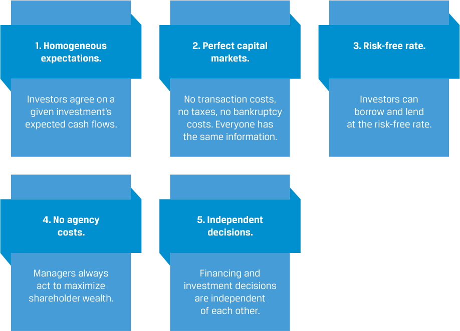
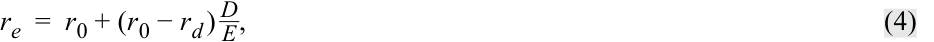
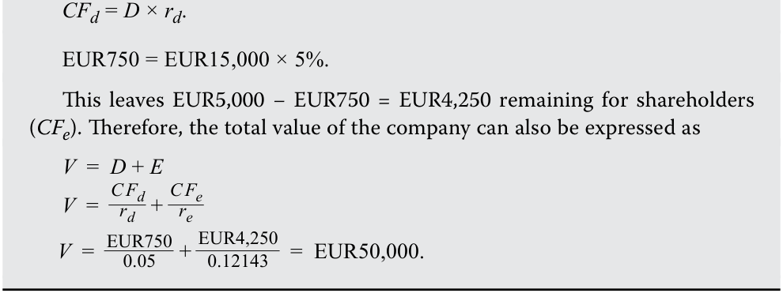
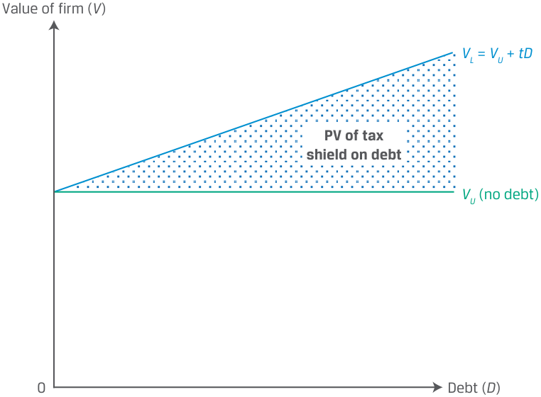
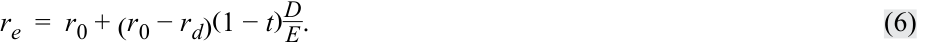
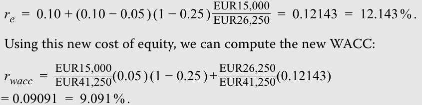
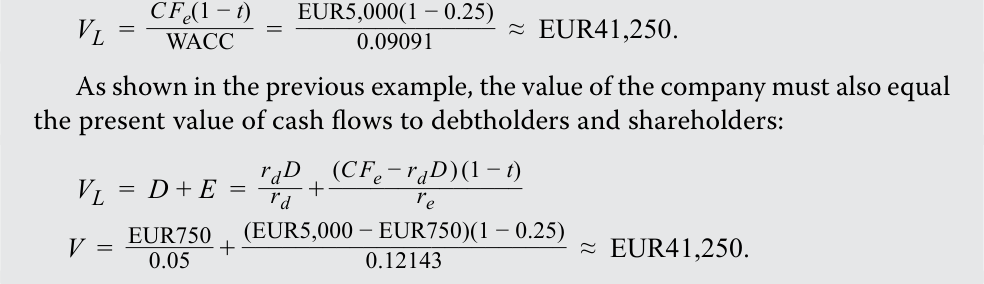
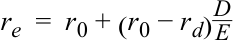

# Volume 3: Corporate Issuers
## Learning Module 6 Capital Structure
### Part 3/4: Modigliani–Miller Capital Structure Propositions (PDF Pages 199–208)

---

<!-- PDF Page 199 -->

**C.** equity sourced from founders and employees. **Solution:** C is correct. Newtech is in the early stages of its corporate life cycle. Equity financing for early-stage firms is sourced from founders, employees through share-based compensation, and venture capital. Generally, the only sources of debt financing available for these firms are leases and convertible debt. Equity financing through an IPO is unlikely given that most stock exchanges have minimum size and profitability requirements. 4. Given the forecast of deteriorating business conditions, which company will experience a greater change in cash flow and profitability? **A.** Newtech **B.** No difference **C.** Oldtech **Solution:** C is correct. With revenue growth slowing, Oldtech is likely to experience a greater change in cash flow and profitability. Despite being in the mature phase of the corporate life cycle, during which one would expect stable profits, Oldtech has high operating leverage given its high degree of fixed cost. This will result in a greater change in profits for a given change in revenues. In contrast, Newtech’s costs are variable, with low operating leverage. 5. The business model used by Oldtech can best be described as: **A.** capital light. **B.** capital intensive. **C.** contractual rather than ownership relationships. **Solution:** 

B is correct. Oldtech’s business model can best be described as capital intensive given its high fixed costs, low capital turnover, and high capital-expenditure-to-sales ratio. The firm requires a lot of assets and has significant financing requirements. Newtech is capital light since most of its costs are variable and its assets are largely cash and intangibles. 

# **MODIGLIANI–MILLER CAPITAL STRUCTURE PROPOSITIONS** 

<!-- Start of picture text -->
4 <!-- End of picture text -->

explain the Modigliani–Miller propositions regarding capital structure 

In a classic 1958 paper, Nobel Prize–winning economists Franco Modigliani and Merton Miller argued that under certain assumptions, a company’s choice of capital structure does not affect (or is “irrelevant” in determining) its value, where firm value is equal to the present value of the firm’s expected future cash flows, discounted by its weighted-average cost of capital. In short, managers _cannot_ change a company’s value by simply changing its capital structure. The assumptions used by Modigliani and Miller (MM) are shown in Exhibit 3. 

<!-- PDF Page 200 -->

**Exhibit 3: Modigliani–Miller Assumptions** 

<!-- Start of picture text -->
1. Homogeneous 2. Perfect capital 3. Risk-free rate. expectations. markets. Investors agree on a No transaction costs, Investors can given investment’s no taxes, no bankruptcy borrow and lend expected cash flows. costs. Everyone has at the risk-free rate. the same information. 4. No agency 5. Independent costs. decisions. Managers always Financing and act to maximize investment decisions shareholder wealth. are independent of each other. <!-- End of picture text -->

Modigliani and Miller then relaxed their assumptions to show how taxes and financial distress costs _do_ result in capital structure having an impact on firm value, though relatively modest in practice. While their assumptions do not hold in practice—which ultimately does alter MM’s original conclusion of capital structure irrelevance—their theoretical framework remains a popular starting point for considering the use of debt in a company’s capital structure. What is clear is that it’s a firm’s future cash flows that are the primary driver of value, not capital structure. 

## **Capital Structure Irrelevance (MM Proposition I without Taxes)** 

Modigliani and Miller demonstrated that changing the capital structure does not affect firm value based on investors being able to create any capital structure they wish for a company by simply borrowing and lending themselves in addition to owning a firm’s shares. This “homemade” leverage argument relies on the assumption that investors can lend and borrow at the risk-free rate. 

Say, for example that a company has a capital structure consisting of 50% debt and 50% equity and that an individual investor would prefer that the company’s capital structure be 70% debt and 30% equity. The investor could borrow money to finance her share purchases so that her ownership of company assets would reflect her preferred 70% debt financing. This action would be equivalent to buying stock on margin and would have no effect on either the company’s expected operating cash flows or company value. 

Modigliani and Miller used the concept of arbitrage to demonstrate their point: If the value of an unlevered company (i.e., a company without any debt) is not equal to that of a levered company, investors could make a riskless arbitrage profit at no cost by selling shares of the overvalued company and using the proceeds to buy shares of the undervalued company, forcing their values to become equal. The value of a firm is thus determined not by how it finances itself but, rather, by its expected future cash flows. Their conclusion is summarized next. 

<!-- PDF Page 201 -->

### **MM PROPOSITION I WITHOUT TAXES** 

If the market value of a company is not affected by the company’s capital structure, then the following is true: 

**1.** The value of the levered company ( _VL_ ) is equal to the value of the unlevered company ( _VU_ ), or _VL_ = _VU_ . 

**2.** The value of a company is determined solely by its expected future cash flows (not its relative use of debt versus equity capital). 

**3.** In the absence of taxes, the weighted-average cost of capital is unaffected b <mark>y</mark> ca <mark>p</mark> ital structure. 

## **Higher Financial Leverage Raises the Cost of Equity (MM Proposition II without Taxes)** 

Debt is less costly than equity because debtholders have a priority claim. Therefore, one might expect a company’s WACC to _decline_ by increasing the proportion of debt in its capital structure. However, adding financial leverage increases risk, because more debt increases the probability of bankruptcy. As a result, equity investors will demand a higher return on equity to offset the increase in risk. 

MM Proposition II without taxes tells us that adding any amount of lower-cost debt capital to the capital structure is always perfectly offset by an increase in the cost of equity, resulting in _no_ change in the company’s WACC. MM Proposition II explains why investors require higher returns on levered equity; their required returns should match the increased risk from leverage. Specifically, MM Proposition II without taxes implies that a firm’s equity cost is a linear function of its debt-to-equity ratio ( _D_ / _E_ ): 

<!-- Formula Text: r e  =  r 0 + (r 0 − r d )  D _ E , (4) -->

where _re_ is the cost of equity, _r_ 0 is the cost of capital for a company financed _only_ with equity, _rd_ is the cost of debt, _D_ is the market value of debt, and _E_ is the market value of equity. Exhibit 4 shows this relationship. 

### **Exhibit 4: Equity Cost as a Function of the Debt-to-Equity Ratio** 

<!-- Start of picture text -->
re r O + ( r O –  rd ) D E re D E r 0 rWACC D 0 E <!-- End of picture text -->

<!-- PDF Page 202 -->

Note that _re_ increases with the debt-to-equity ratio with an intercept equal to _r_ 0 and slope equal to the quantity ( _r_ 0 − _rd_ ), while the WACC ( _rWACC_ ) does not change as debt levels change. 

Given that capital structure changes do not affect the company’s future cash flow stream and the company’s weighted-average cost of capital remains unchanged for any chosen capital structure, there is no change in the value of the company. Note that Modigliani and Miller did not assume away the possibility of bankruptcy but simply assumed it occurs at zero cost. 

### **MM PROPOSITION II WITHOUT TAXES** 

If the cost of equity is assumed to be a linear function of the company’s debtto-equity ratio, then the following is true: 

**1.** Higher leverage raises the cost of equity but does not change firm value or WACC. 

**2.** The increase in the cost of equity must exactly offset the greater use of lower-cost debt. 

### **EXAMPLE 2** 

## **Gerhardt Corporation Cost of Equity** 

Assume that Gerhardt Corporation has an all-equity capital structure. Gerhardt has expected annual cash flows (or _CFe_ ) of EUR5,000 and a cost of equity of 10%, which is also its WACC since equity is the firm’s only source of capital. For simplicity, we assume that all cash flows are perpetual. Therefore, Gerhardt’s value is equal to 

<!-- Formula Text: V  = C F e _ r wacc   =   EUR5,000 _ 0.10 =  EUR50,000. -->

Now suppose that Gerhardt plans to issue EUR15,000 in debt at a cost of 5% and use the proceeds to buy back and reduce its outstanding equity by EUR15,000. This action leaves total invested capital unchanged at EUR50,000. 

Under MM Proposition I, _VL_ = _VU_ , the value of Gerhardt must remain the same at EUR50,000 after the change in capital structure. Under MM Proposition II, after the change in capital structure, the cost of equity for Gerhardt—now with EUR15,000 in debt capital and EUR35,000 in equity capital—increases to 12.143%: 

<!-- Formula Text: r e  =  0.10 + (0.10 − 0.05 )  EUR15,000 _ EUR35,000   ≈  0.12143  =  12.143 % . -->

To prove that Gerhardt’s firm value is unchanged under the new capital structure, we must show its WACC remains unchanged at 10%. With the new cost of equity, Gerhardt’s WACC is now calculated as 

<!-- Formula Text: r wacc  =  ( EUR15,000 _ EUR50,000 )0.05 + ( EUR35,000 _ EUR50,000 )0.12143  =  0.10  =  10 % . -->

Gerhardt’s WACC is still 10%, because the move to lower-cost debt was perfectly offset by an increase in the cost of equity. Thus, consistent with MM Proposition I, the value of the firm remains unchanged, at EUR50,000. Furthermore, the value of Gerhardt must equal the sum of the present values of 

<!-- PDF Page 203 -->

cash flows to debtholders ( _CFd_ ) and shareholders ( _CFe_ ). With EUR15,000 debt at a cost of 5% ( _rd_ ), Gerhardt makes the following debtholder and shareholder payments: 

<!-- Formula Text: CFd = D × rd. EUR750 = EUR15,000 × 5%. This leaves EUR5,000 − EUR750 = EUR4,250 remaining for shareholders (CFe). Therefore, the total value of the company can also be expressed as V  =  D + E V  = C F d _ r d   + C F e _ r e V  =   EUR750 _ 0.05   +  EUR4,250 _ 0.12143    =  EUR50,000. -->

## **Firm Value with Taxes (MM Proposition I with Taxes)** 

In most jurisdictions, interest expense is deductible from a company’s income for tax purposes. In other words, debt provides a tax shield for companies that are earning profits, and the money saved in taxes enhances the value of the company. Ignoring other factors, such as the costs of financial distress and bankruptcy, for now, let us explore the two MM propositions when we relax the assumption of no corporate taxes. The value of the company increases with increasing levels of debt, and the actual cost of debt is reduced by the amount of the tax benefit: 

After-tax cost of debt = Before-tax cost of debt × (1 − Marginal tax rate). 

Modigliani and Miller’s Proposition I with corporate taxes states that in the presence of corporate taxes (but not personal taxes), the value of the levered company is greater than that of the all-equity company by an amount equal to the tax rate multiplied by the value of the debt ( _tD_ ), defined as the present value of the **debt tax shield** : 

_VL_ = _VU_ + _tD_ , ~~(5)~~ 

where _t_ is the marginal tax rate and _tD_ is the present value of the debt tax shield. When there are corporate taxes, a profitable company can increase its value by using debt financing, as shown in Exhibit 5. 

<!-- PDF Page 204 -->

**Exhibit 5: Firm Value with Corporate Taxes and Debt** 

<!-- Start of picture text -->
Value of firm ( V ) VL  =  VU  +  tD PV of tax shield on debt VU  (no debt) 0 Debt ( D ) <!-- End of picture text -->

As noted in Proposition I with corporate taxes, the increase in firm value, _V_ , is solely attributable to the tax shield. Taken to its (unrealistic) extreme, Equation 5 predicts a value-maximizing capital structure of 100% debt. 

### **MM PROPOSITION I WITH CORPORATE TAXES** 

If the market value of a levered company is equal to the value of an unlevered company plus the value of the debt tax shield, then the following is true: 

**1.** In the presence of taxes, a profitable company can increase its value ( _V_ ) by using debt. 

**2.** The higher the tax rate, the greater the benefit of using debt in the ca <mark>p</mark> ital structure. 

## **Cost of Capital (MM Proposition II with Taxes)** 

If the value of the company increases as it uses more debt, the company’s WACC must decrease as it uses more debt. That is, in the earlier propositions without corporate taxes, the lower cost of debt was fully offset by an increase in the cost of equity. Now, in the presence of corporate taxes, the cost of debt is further lowered by the tax benefit such that the lower debt cost outweighs the increase in the cost of equity and results in a lower WACC. 

To demonstrate this idea, let’s begin with the revised cost of equity under MM Proposition II with corporate taxes: 

<!-- Formula Text: r e  =  r 0 + (r 0 − r d)(1 − t) D _ E . (6) -->

Notice that the only difference between Equation 6 and Equation 4 (MM Proposition II with no taxes) is the presence of the term (1 − _t_ ). When _t_ is zero, the two equations are identical. When _t_ is not zero, the term (1 − _t_ ) is less than 1 and serves to reduce the cost of levered equity. The cost of equity still rises as the company increases the amount of debt in its capital structure, but it rises at a slower rate than in the no-tax case. as shown in Exhibit 6. 

<!-- PDF Page 205 -->

### **Exhibit 6: Equity Cost, Debt-to-Equity Ratio, and WACC with Taxes** 

<!-- Start of picture text -->
re r O + ( r O –  rd ) D E r O + ( r O –  rd ) (1 –  t ) D E rWACC  (without taxes) r 0 rWACC  (with taxes) D 0 E <!-- End of picture text -->

Consequently, as debt increases, the company’s _rWACC_ decreases and the company’s value increases. This result implies that when there are taxes (and no financial distress or bankruptcy costs), debt financing is highly advantageous. Taken to an extreme, this result also suggests that a company’s optimal capital structure is 100% debt—a conclusion that is at odds with reality and a direct result of Modigliani and Miller’s restrictive assumptions. 

### **MM PROPOSITION II WITH CORPORATE TAXES** 

If the cost of equity is a linear function of the company’s debt-to-equity ratio with an adjustment for the tax rate, then the following is true: 

**1.** In the presence of taxes, the cost of equity rises as the company uses more debt but at a slower rate than in the no-tax case. 

**2.** As the company’s use of debt increases, its WACC decreases and its value increases. 

**3.** In the presence of taxes (but no financial distress or bankruptcy costs), the use of debt is value enhancing and, at the extreme, 100% debt is o <mark>p</mark> timal. 

### **EXAMPLE 3** 

## **Gerhardt Corporation under Corporate Taxes** 

Recall from the previous example that annual cash flows to Gerhardt shareholders were EUR5,000 and the cost of equity (and WACC) was 10%. As before, Gerhardt is planning to issue EUR15,000 of 5% debt to buy back an equivalent amount of equity. Now, however, assume that Gerhardt pays corporate taxes at a rate of 25%. 

Since the company does not currently have debt, the after-tax cash flows are now EUR5,000(1 − 0.25), or EUR3,750. Because the cash flows are assumed to be perpetual, the value of the company is EUR37,500 (= EUR3,750/0.10), considerably less than the amount when there were no corporate taxes, EUR50,000. 

<!-- PDF Page 206 -->

Now, suppose Gerhardt proceeds to issue EUR15,000 of debt and uses the proceeds to repurchase equity. According to MM Proposition II with corporate taxes (i.e., Equation 5), the value of the company is 

_VL_ = _VU_ + _tD_ = EUR37,500 + 0.25(EUR15,000) = EUR41,250. 

The total company value is now EUR41,250, consisting of debt of EUR15,000 and equity of EUR26,250 (= EUR41,250 − EUR15,000). 

According to MM Proposition II with corporate taxes (Equation 6), the new cost of equity for Gerhardt is 

<!-- Formula Text: r e  =  0.10 + (0.10 − 0.05 ) (1 − 0.25 )  EUR15,000 _ EUR26,250   =  0.12143  =  12.143 % . Using this new cost of equity, we can compute the new WACC: r wacc  =   EUR15,000 _ EUR41,250 (0.05 ) (1 − 0.25 ) +  EUR26,250 _ EUR41,250 (0.12143) = 0.09091  =  9.091 % . -->

Unlike the previous example, where Gerhardt’s WACC did not change with the change in capital structure, Gerhardt’s WACC decreased in this example from 10% to 9.091%. This reduction in WACC resulted in an increase in company value to EUR41,250: 

<!-- Formula Text: V L  = C F e(1 − t) _ WACC    =   EUR5,000(1 − 0.25) _______________ 0.09091 ≈  EUR41,250. As shown in the previous example, the value of the company must also equal the present value of cash flows to debtholders and shareholders: V L  =  D + E  = r d D _ r d   + (C F e − r d D ) (1 − t) ______________ r e V  =   EUR750 _ 0.05   +  (EUR5,000 − EUR750)(1 − 0.25) ________________________ 0.12143 ≈  EUR41,250. -->

Of course, in the real world, taxes are not the only factor affecting the value of a levered company. The analysis becomes more complex when we consider the costs of financial distress, among other real-world considerations. 

## **Cost of Financial Distress** 

Financial distress refers to the heightened uncertainty regarding a company’s ability to meet its obligations because of diminished earnings power or actual current losses. Operating and financial leverage can magnify profits but also increase losses and the likelihood of financial distress. Even before filing for bankruptcy, companies under financial distress may lose customers, creditors, suppliers, and employees. 

Direct costs of financial distress are cash expenses associated with bankruptcy, such as legal and administrative fees, while indirect costs include forgone business and investment opportunities, reputational risk, and costs arising from conflicts of interest between managers and debtholders, or agency costs of debt, when a firm is near or in bankruptcy. 

Costs of financial distress are lower for firms whose assets have a ready secondary market. Airlines, shipping companies, and some manufacturers have tangible assets that can be easily sold. Technology, pharmaceutical, and information technology firms, as well as those in the service sector, usually lack such assets and have higher costs associated with financial distress. The probability of financial distress and bankruptcy rises with more debt in the capital structure, higher sales risk and operating leverage, and lower liquidity. The task of optimizing a firm’s capital structure by taking these and other factors into consideration is the subject of the next lesson. 

<!-- PDF Page 207 -->

### **EXAMPLE 4** 

## **The Costs of Financial Distress** 

Rite Aid Corporation, listed on the NYSE, operates over 2,000 retail pharmacies in the United States. The company has a highly leveraged balance sheet, with a ratio of net debt to annual earnings before interest, taxes, depreciation, and amortization over 5.0 for many years. During the COVID-19 pandemic, the company performed well, exceeding profit expectations largely due to brisk COVID-19 testing and vaccine revenues. However, as the pandemic entered its third year, vaccine and testing revenue began to fall, and other issues, such as pricing declines from insurance companies and wage pressures, accelerated. Owing to its high financial leverage, the ensuing reduction in analysts’ profit estimates resulted in large declines in the prices of Rite Aid debt and equity: Over the first five months of 2022, the price of its 02/15/2027 unsecured notes fell from 94 to 60 and its stock price fell from $15 to $6 per share. By May 2022, Rite Aid’s cost of debt exceeded 20%. 

In April 2022, one equity analyst lowered the estimated fair value of Rite Aid stock from $16 to $1 and warned that the stock may in fact be worthless. According to the analyst, the company faced $200 million per year in interest expenses and another $225 million per year in maintenance capital expenditures. The analyst estimated that next fiscal year, the company would achieve only $370 million in earnings before interest, taxes, depreciation, and amortization, and the analyst warned that it faces considerable challenges in growing beyond that. Continued net losses would render the stock worthless and likely require the company to restructure its obligations with its bondholders. 

During its quarterly earnings call, management was upbeat, but it intends to close 145 underperforming stores to lower its expenses and further cut corporate costs to improve profitability. 

### **QUESTION SET** 

1. The view that debt financing is highly advantageous and the optimal capital structure is 100% debt is consistent with: 

   - **A.** MM without taxes. 

   - **B.** MM with taxes and financial distress costs. 

   - **C.** MM with taxes and no financial distress cost. 

   - **Solution** : 

C is correct. MM with taxes and no distress cost leads to the conclusion that the optimal capital structure is 100% debt. This is because tax law favors debt financing over equity financing since the interest expense on debt financing is tax deductible. Ignoring financial distress costs, the value of the company increases with increasing levels of debt. The value of the levered firm ( _VL_ ) is greater than that of the unlevered one ( _VU_ ) by the amount equal to the tax rate multiplied by the level of debt ( _tD_ ). 

2. True or False: What is clear from MM is that the primary driver of firm value is capital structure. 

   - **A.** True 

<!-- PDF Page 208 -->

### **B.** False **Solution:** 

B is correct. This statement is false since it is future cash flows that are the primary driver of value. Under a set of restrictive assumptions, MM’s conclusion of capital structure irrelevance is obtained. Relaxing these assumptions, MM showed that capital structure does impact value, but it has only a modest impact compared to future cash flows. 

3. MM Proposition II without taxes differs from MM Proposition I without taxes since it concludes that: 

   - **A.** WACC is unaffected by capital structure. 

   - **B.** the value of the levered firm is equal to that of the unlevered firm. 

   - **C.** higher leverage raises the cost of equity, which exactly offsets the lower cost of debt. 

### **Solution:** 

C is correct. MM Proposition II without taxes differs from MM Proposition I without taxes in that the cost of equity will rise with leverage and completely offset the lower cost of debt. Debt has a lower cost relative to equity because debtholders have a priority claim on the cash flow of the firm. So, one would expect WACC to decline with more debt. MM Proposition II without taxes argues that the cost of equity is a linear function of the debt-to-equity ratio. The addition of more low-cost debt to the capital structure will increase the debt-to-equity ratio and raise the cost of equity, offsetting the lower debt cost. As a result, the firm’s WACC is unchanged. 

Company Y has an unlevered WACC of 10%. It has a cost of debt equal to 5.5% and a debt-to-equity ratio of 0.75. The corporate tax rate is 25%. 

4. Fill in the blanks: The cost of equity for Company Y will be _____________ if it pays no corporate taxes and _____________ if it pays corporate taxes. 

### **Solution:** 

The cost of equity for Company Y will be 13.37% if it pays no corporate taxes and 12.53% if it pays corporate taxes. 

The cost of equity is a linear function of its debt-to-equity ratio and without taxes is calculated as follows: 

<!-- Formula Text: r e  =  r 0 + (r 0 − r d) D _ E -->

= 10% + (10% – 5.5%)(0.75) = 13.37%. 

The cost of equity with taxes is calculated as 

 re_ = _r_ 0 +  ( _r_ 0 − _rd_ )( 1 − _t_)_D_ _E_ 

= 10% + (10% – 5.5%)(1 – 0.25)(0.75) = 12.53%. 

5. If Company Y is an all-equity-financed firm, its cost of equity will be ________ its WACC. 

   - **A.** greater than 

**B.** equal to 

